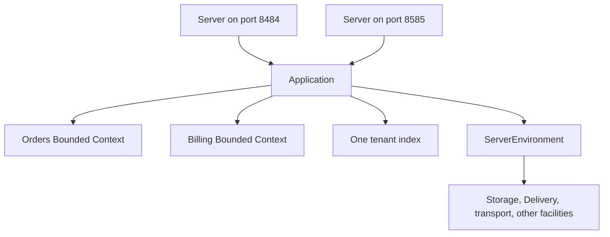
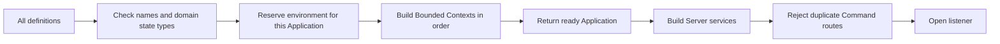
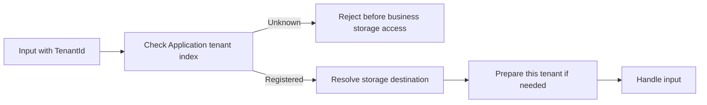
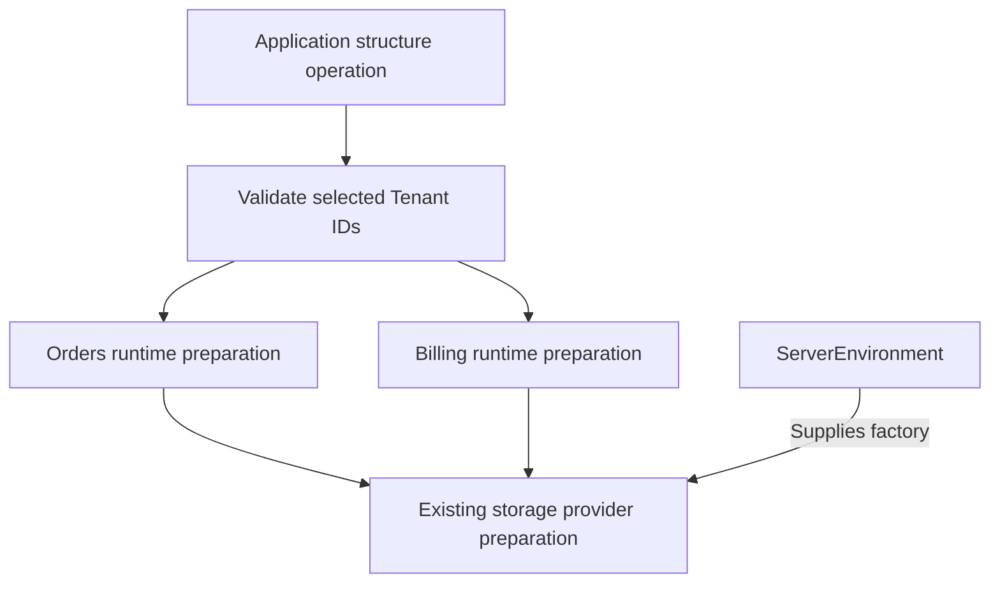
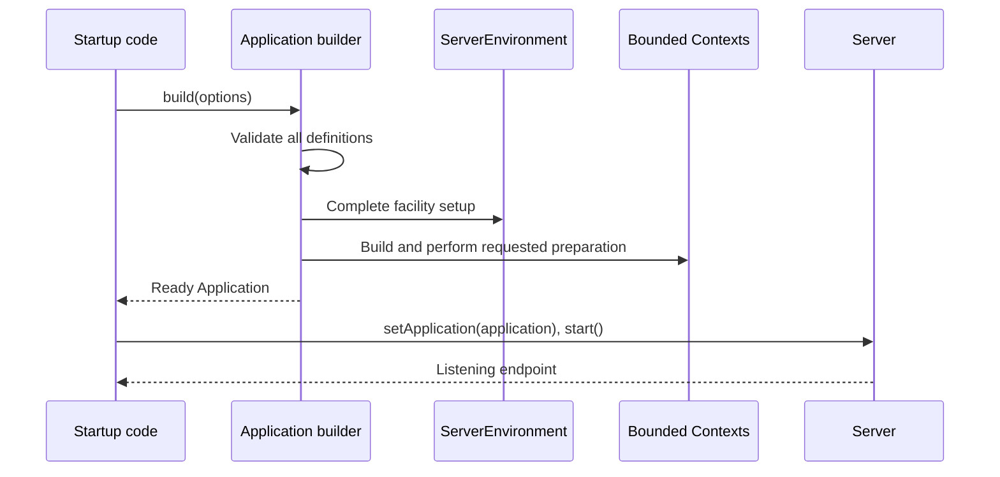
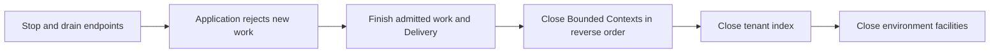

# Application migration: follow Spine JVM, preserve the TS preparation API

This is the first deliverable of the migration: a proposal for changing the API and implementation. The runtime changes have not been made yet. Every **after** example shows a proposed API, not an API available today. Examples omit imports and use existing application repositories or factories where their construction is not the subject.

The reference is a fresh clone of official `core-jvm/master`, at [`a108f30`](https://github.com/SpineEventEngine/core-jvm/tree/a108f30a896efa63c6ba901c245ee587e7944344). The TypeScript baseline is fresh official `spine-ts/master`, at [`3844fd369`](https://github.com/SpineEventEngine/spine-ts/tree/3844fd36953beefdd655fad5cf6f83b7fa75e2c6). Both were inspected on 12 November 2026.

The aim is to follow the JVM design. Differences below are limited to existing TS behavior, asynchronous operations, and TS APIs that have no JVM counterpart. Decisions that still need an answer are collected at the end.

## 1. Use the final JVM design, not the intermediate one

**How JVM does it.** [PR #1717](https://github.com/SpineEventEngine/core-jvm/pull/1717) introduces `Application`, but initially makes it a singleton. [PR #1720](https://github.com/SpineEventEngine/core-jvm/pull/1720) replaces that intermediate arrangement with explicitly built instances. Latest master also contains [PR #1723](https://github.com/SpineEventEngine/core-jvm/pull/1723), which changes `multitenant` spelling to `multiTenant` in relevant API names.

| Part                         | Intermediate #1717                     | Latest JVM master: target for TS       |
| ---------------------------- | -------------------------------------- | -------------------------------------- |
| Application                  | `Application.instance()`               | `Application.newBuilder()`             |
| Server environment           | Still a singleton                      | `ServerEnvironment.newBuilder()`       |
| Bounded Context construction | Call its builder's public `build()`    | Add its builder to `Application`       |
| Tenant index                 | One index on the singleton Application | One index on each Application          |
| Server input                 | Previously built Bounded Contexts      | Explicit `setApplication(application)` |
| Server shutdown              | Closes served Bounded Contexts         | Leaves the Application open            |
| Application shutdown         | Bounded Contexts and index             | Bounded Contexts, index, environment   |

**TS migration: the same final arrangement.** Do not ship an intermediate `Application.instance()`. Do not replace the old singleton with a hidden global “current application.”



`Application` describes what runs together. `ServerEnvironment` supplies the facilities used to run it. `Server` exposes it over a network. Two servers can expose the same running Application.

A few terms used below:

- A **Bounded Context** groups one part of the business model and its message handlers.
- A **System Context** is the paired framework part that handles internal work for a Bounded Context, such as command records and catch-up work. Its generated name is reserved.
- A **facility** is a configured service object, such as a storage factory or message transport.
- A **Stand** is the Bounded Context's read-side entry point for queries and subscriptions. A **read route** maps a state type to the repository that can answer a query.
- An **Inbox** stores messages waiting for an Entity to handle them. **Delivery** moves those messages to the right handler. **Catch-up** rebuilds a Projection from past Events.
- **Drain** means stop accepting new work and wait for already accepted work to finish. **DDL** means database commands that create or change structures, such as tables.

## 2. Build a ServerEnvironment instead of looking up a singleton

**How JVM does it.** `ServerEnvironment.newBuilder().under(type, configure).build()` creates an instance. Configuration becomes fixed after build. A builder builds one environment. `instance()`, static `under()`/`when()`, and reset-based configuration are removed. JVM still selects the current environment type when a technology getter is called; a built Bounded Context retains the technologies it received. See [ServerEnvironment.kt][j-env] and [BoundedContextBuilder.java][j-builder].

**TS today.** `ServerEnvironment.when(type).use(settings)` writes a module-level map. `instance()` resolves one environment. Bounded Contexts, servers, repositories, and several other classes reach for that singleton. TS `Environment.instance()` is a separate object that selects `Local` or `Production` from the Node process.

**TS migration: the same construction and configuration boundary.** Add the JVM builder shape and move configuration into each builder. Keep `Environment` separate; removing the `ServerEnvironment` singleton does not itself require removing process environment information.

Before:

```ts
ServerEnvironment.when(EnvironmentType.Local).use({
  storageFactory,
  typeRegistry,
});
const environment = ServerEnvironment.instance();
await environment.completeSetup();
```

After, proposed TS syntax:

```ts
const environment = ServerEnvironment.newBuilder()
  .under(EnvironmentType.Local, (settings) => {
    settings.use({ storageFactory, typeRegistry });
  })
  .build();
```

The callback and `under()` follow JVM. The object passed to `use()` preserves TS's existing settings object. This is a syntax adaptation: Java's overloaded `use(StorageFactory)` and `use(TransportFactory)` cannot simply be copied as runtime overloads of erased TS interfaces.

Keep the existing TS settings for storage, integration transport, schema registry, Delivery ports, Delivery strategy, tracing, logger, subscription queue capacity, and default AI registry. Move only `tenantIndex` out of these settings. Keep Bounded Context-specific AI and subscription registry choices at their existing scope.

**Difference to explain, not silently change:** JVM has a `Tests` environment and requires configured storage/transport outside that default. TS currently has `Local` and `Production`, defaults both facilities in memory, and requires a schema registry in production. Retain those TS defaults for this migration unless the final questions select stricter JVM parity. Do not introduce a new scheduler or tracing subsystem just because JVM already has one.

Follow JVM's per-environment configuration model. In normal TS execution, the process environment type is already stable. Tests should create fresh instances instead of changing global settings while applications are running.

## 3. Let Application build its Bounded Contexts

**How JVM does it.** `Application.Builder` accepts an environment, an optional tenant index, Bounded Context builders, and third-party integrations. It requires at least one Bounded Context. Production code cannot directly build a Bounded Context; the remaining public shortcut is for special test builders. An environment can be assigned to only one Application. See [Application.kt][j-app].

**TS today.** `BoundedContextBuilder.build()` is public and asynchronous. `Server.add()` accepts either builders or already built Bounded Contexts. There is no framework `Application` class. `ManagedServerApplication` is a process-hosting API and serves a different purpose.

**TS migration: the same assembly model.** Add `Application` and its builder in the server package. Add `setServerEnvironment()`, `setTenantIndex()`, `add()`, `contexts()`, `tenantIndex()`, `isOpen()`, and `close()`. Keep the JVM names for these new operations. Remove the ordinary public Bounded Context `build()` path and `Server.add()` after all maintained callers have been converted.

Before:

```ts
await ServerEnvironment.instance().completeSetup();
const orders = await BoundedContext.singleTenant("Orders").add(OrderAggregate).build();
const server = await Server.atPort(8484).add(orders).start();
```

After:

```ts
const application = await Application.newBuilder()
  .setServerEnvironment(environment)
  .add(BoundedContext.singleTenant("Orders").add(OrderAggregate))
  .build();

const server = await Server.atPort(8484).setApplication(application).start();
```

**Necessary TS difference:** `Application.Builder.build()` returns `Promise<Application>`. JVM construction is synchronous. TS already awaits storage preparation and integration setup, so returning an application before those required operations finish would weaken the existing guarantee.

Before the first `await`, the builder must synchronously mark itself as building, freeze its input definitions, and reserve the environment. A second call on the same builder must reject rather than start another build; a competing builder using that environment must also reject. This follows JVM's single-build and single-Application rules while accounting for TS's asynchronous construction. On failure, release the reservation only after rollback settles and only if the environment remains usable. A consumed builder stays terminal; use a fresh builder for another attempt.

Follow JVM's fixed list: `contexts()` returns a read-only list in build order. A closed Bounded Context remains in that list. Its paired System Context is not a second public list entry. The underlying Bounded Context of a third-party integration is included. Do not add public late registration, removal, or a global Bounded Context search API.

Use `BoundedContext.multiTenant()` and the corresponding latest JVM spelling in the migrated API. This is a separate naming change from #1720 and should be tracked explicitly.

## 4. Validate the whole Application before building its parts

**How JVM does it.** Before construction, Application checks required inputs, environment availability, third-party reuse, Bounded Context names, generated System Context names, and Entity state types served by different Bounded Contexts. It then builds in insertion order. Duplicate Command handling is checked later, while building `CommandService`. See [ContextRegistry.kt][j-registry] and [CommandService.java][j-command-service].

**TS today.** Entity state conflicts are detected while registering repositories with the environment. Server read routes also validate state types. `SpineServices` currently keeps the first Command route when two Bounded Contexts accept the same Command type; a test explicitly expects this.

**TS migration: the same validation rules and stages as JVM.** Inspect configured repositories and generated metadata before opening Bounded Context resources. Use that information to check names and state types. Do not construct Entity instances just to discover their state schemas.

For example, these definitions must fail before either Bounded Context starts:

```ts
await Application.newBuilder()
  .setServerEnvironment(environment)
  .add(BoundedContext.singleTenant("Orders"))
  .add(BoundedContext.singleTenant("Orders_System"))
  .build();
```

The awaited `build()` rejects before constructing either Bounded Context. `Orders_System` conflicts with the System Context generated for `Orders`.



Do not forbid repeated framework System entity types across different System Contexts. JVM's uniqueness rule applies to the domain repository definitions, not every System entity created underneath them.

The same domain names and state types can appear in two separate Applications with separate environments. This permits two isolated tests in one process. It does not guarantee separate physical data if both environments point to the same database.

## 5. Put the tenant index on Application

**How JVM does it.** `application.tenantIndex()` returns the application's supplied index or creates its default index on first access. The default uses the environment's storage factory and `__SYSTEM_TENANTS__` storage scope. Application closes the index. Bounded Contexts no longer configure separate tenant indexes. A single-tenant Application that never requests the index creates no tenant storage. See [Application.kt][j-app], [DefaultTenantStorage.kt][j-default-index], and [TenantIndex.java][j-index].

**TS today.** The environment supplies `tenantIndex`, which defaults to `SINGLE_TENANT`. A multi-tenant Bounded Context requires an environment index and can replace it with `withTenantIndex()`. `PersistentTenantIndex.create()` can already build a storage-backed index independently. Its interface supports asynchronous `contains()`, `keep()`, `page()`, and `all()`, but does not require `close()`.

**TS migration: the same application-level index.** Remove `ServerEnvironmentSettings.tenantIndex`, `ServerEnvironment.tenantIndex`, and `BoundedContextBuilder.withTenantIndex()`. Give all multi-tenant Bounded Contexts in one Application the same index. Keep single-tenant execution separate; do not insert a synthetic tenant into the directory. Remove the public `BoundedContext.tenantIndex` getter too, following JVM's application-level access. Keep a package-internal reference for TS admission and local preparation. Code that needs to register tenants uses `application.tenantIndex()`. The single-tenant execution marker is not the result of that Application accessor.

Before:

```ts
ServerEnvironment.when(EnvironmentType.Local).use({ tenantIndex });
const orders = BoundedContext.multitenant("Orders").withTenantIndex(otherIndex);
```

After:

```ts
const application = await Application.newBuilder()
  .setServerEnvironment(environment)
  .setTenantIndex(tenantIndex)
  .add(BoundedContext.multiTenant("Orders"))
  .add(BoundedContext.multiTenant("Billing"))
  .build();

await application.tenantIndex().keep(initech);
```

`initech` here is a real generated `TenantId`, not a string or an unrelated identifier message.

For code that previously supplied different indexes to different Bounded Contexts, follow JVM: use separate Applications and separate environments if they truly represent different tenant sets. Do not silently union the indexes. Combining them changes which tenants each Bounded Context accepts.

**TS-specific adaptation:** retain the synchronous `tenantIndex()` accessor shape by returning one stable index object; its existing data operations remain asynchronous. Its accessor must not create tables. Separate opening the default index handle from preparing its storage. Open that handle with the equivalent of `createMissingStructures: false`; do not call today's default `PersistentTenantIndex.create()` path, which creates structures.

Use one in-flight handle-initialization attempt. Membership reads do not issue DDL. A first explicit compatibility check inspects the directory without creating it, and reports missing or incompatible structures. A failed attempt clears its pending initialization state so a later explicit create or `keep()` can retry with creation permitted. `keep()` may initialize the default directory before registering the tenant; it does not prepare the tenant's business structures. A check must never trigger an operation that grants permission to create structures. Concurrent checks and creates must retain their distinct modes rather than treating any pending promise as proof of compatibility.

Closing the index rejects new operations, waits for initialization and admitted operations, and then closes any acquired handle. Test a close that arrives while initialization is still pending. Multi-tenant TS construction explicitly prepares the default directory before eager tenant enumeration; deferred construction leaves creation deferred. This earlier access compared with JVM is required by TS's existing tenant preparation, not JVM behavior.

Add asynchronous close support to the TS index contract so Application can reliably close supplied indexes too. A custom directory with nothing to release can implement a no-op close. Preserve the existing `PersistentTenantIndex` record schema, full Tenant IDs, timestamps, and storage scope. Existing custom storage groups must still be supplied explicitly; a new default must not silently point an existing deployment at an empty directory.

## 6. Preserve TS's tenant checks while changing where the index is configured

**How JVM does it.** These changes establish shared tenant registration. Latest inspected `TenantFilter` checks whether a tenant ID is required or forbidden; it does not reject an ID because it is absent from Application's index. `contains()` itself must not register a tenant or cache a missing tenant indefinitely. See [TenantFilter.kt][j-tenant-filter] and [TenantStorage.java][j-tenant-storage].

**TS today.** Membership is already checked before business storage work. Unknown tenants produce `TENANT_UNKNOWN`. Commands, Events, queries, subscriptions, and Inbox delivery must preserve their tenant admission behavior. Storage destinations are selected separately by storage-provider configuration.

**TS migration: different request checking, deliberately preserved.** Continue using the application's shared index for TS admission. Removing this check to imitate the current JVM filter would weaken existing TS behavior. This is preservation of an existing TS feature, not a new tenant policy.



Keep three operations distinct:

| Operation                     | What it means                                   | What it does not do                     |
| ----------------------------- | ----------------------------------------------- | --------------------------------------- |
| `tenantIndex().keep(id)`      | Register a tenant                               | Create its database or authorize a user |
| Storage destination resolver  | Find its configured database or namespace       | Register it                             |
| `createStorageStructures(id)` | Prepare declared structures in that destination | Register it or allocate infrastructure  |

A directory outage is an error, not evidence that the tenant is unknown. Do not replace it with `false`. Do not keep negative membership results that hide a tenant registered by another process.

For internal wiring, pass the shared index or a narrow admission function to Bounded Contexts. JVM does not make each Bounded Context hold a reference to Application; TS need not add that broad reference either.

## 7. Move application-wide structure operations from ServerEnvironment to Application

**How JVM does it.** JVM has no public counterpart to TS's `createStorageStructures()` or `checkStructureCompatibility()`. The relevant JVM boundary is that Application contains the fixed Bounded Context list while ServerEnvironment supplies technology. See [Application.kt][j-app] and [ContextRegistry.kt][j-registry].

**TS today.** Both operations exist on `ServerEnvironment`, which finds completed open Bounded Contexts. The local operations exist on `boundedContext.runtime`.

**TS migration: same JVM responsibility boundary, with TS-only methods.** Move the two application-wide methods to Application. Keep their current names, arguments, and asynchronous return type. They operate on the Application's built, open Bounded Contexts. Keep the local `boundedContext.runtime` methods for selecting one Bounded Context; they delegate to the same preparation implementation.

Before:

```ts
await environment.createStorageStructures(initech);
await environment.checkStructureCompatibility(initech);
await orders.runtime.createStorageStructures(initech);
```

After:

```ts
await application.createStorageStructures(initech);
await application.checkStructureCompatibility(initech);
await orders.runtime.createStorageStructures(initech);
```

| Call                                              | Required behavior                                                                                                                                               |
| ------------------------------------------------- | --------------------------------------------------------------------------------------------------------------------------------------------------------------- |
| `application.createStorageStructures()`           | Prepare all open single-tenant Bounded Contexts and the current registered tenants of all open multi-tenant Bounded Contexts                                    |
| `application.createStorageStructures(idA, idB)`   | Validate all supplied IDs against the shared index, then prepare them in every open multi-tenant Bounded Context; do not include single-tenant Bounded Contexts |
| `application.checkStructureCompatibility(...)`    | Select the same Bounded Contexts and tenants, but inspect their declared structures without creating or altering them                                           |
| `orders.runtime.createStorageStructures(...)`     | Prepare only Orders, using its single-tenant mode or the shared Application index                                                                               |
| Any application-wide operation after close begins | Reject new work                                                                                                                                                 |

If no open Bounded Context can participate, report that instead of silently succeeding. A selected tenant with no open multi-tenant Bounded Context is not useful preparation.

Capture and validate complete Tenant IDs before provider preparation. Remove duplicate IDs using their complete identity. A malformed or unknown ID must reject the whole explicit selection before any selected Bounded Context prepares structures. With no IDs, use `page()` and cancellation rather than loading `all()` into memory. This is a live traversal, not a database snapshot. Before no-argument creation enumerates tenants, initialize the default directory if an open multi-tenant Bounded Context needs it. A check uses read-only directory checking instead. Explicit-ID creation must validate membership first; it cannot create a missing directory and pretend that the supplied tenant was registered. A supplied index continues to use its supported external/bootstrap procedure.



This is the main relocation requested for the TS-specific API. Storage providers still create/check their structures. Application coordinates the work; it does not contain PostgreSQL, MySQL, or Datastore implementation details.

## 8. Be precise about which structures these methods prepare

**How JVM does it.** JVM's Application and Server changes do not add a schema deployment API. Its default tenant storage is separate from domain storage. Therefore JVM cannot answer the coverage of a TS structure-preparation call.

**TS today.** Bounded Context preparation covers the domain Event store, enabled System Event storage, registered Entity records and enabled histories, Agent-related storage, and the built-in persistent subscription registry. Other facilities have separate initialization paths. See [TS preparation implementation][ts-context], [provider preparation port][ts-preparation], and [storage layout][ts-layout].

**TS migration: preserve that scope, and state its limits.** Moving the methods must not imply that they now provision every table or external resource used by the process. The new default tenant directory needs the small bootstrap step explained in point 5; that is not a general expansion to every shared facility.

| Storage or resource                                                          | Treatment in this migration                                                                                                                     |
| ---------------------------------------------------------------------------- | ----------------------------------------------------------------------------------------------------------------------------------------------- |
| Domain Entity records and configured histories                               | Keep existing preparation and checks                                                                                                            |
| Domain Event store and enabled System Event store                            | Keep existing preparation and checks                                                                                                            |
| Agent records, audit/history, acceptance receipts                            | Keep existing preparation and checks                                                                                                            |
| Built-in persistent subscription registry                                    | Prepare/check through its existing hook                                                                                                         |
| Custom subscription registry                                                 | Use its documented contract; do not claim the built-in provider hook covers it                                                                  |
| Persistent tenant index                                                      | Bootstrap the new default before eager/no-argument creation traverses tenants; check without DDL. Supplied indexes keep separate initialization |
| Delivery Inbox and shard-session storage                                     | Preserve separate facility initialization; do not advertise a new application-wide checker                                                      |
| Browser subscription bindings and node registry                              | Preserve their separate initialization                                                                                                          |
| Database, SQL schema, cloud project, credentials, deployed Datastore indexes | Deployment prerequisites, not created by these methods                                                                                          |

This matters for a deployment that allows reads but forbids schema changes. `checkStructureCompatibility()` must not issue creation work for the structures it checks. However, calling it after an ordinary eager build does not undo creation already performed during build, tenant-index initialization, or other facility startup.

Likewise, `createStorageStructures: false` means “defer creation,” not “prohibit all creation forever.” A first valid input can still create missing model structures. A fully read-only process startup would require reviewing every facility's initialization and a separate policy; this migration must not claim to provide that automatically.

For the default tenant index, resolve the bootstrap order explicitly. Preparation cannot enumerate tenants from a missing directory. The implementation must initialize the directory before eager tenant traversal, and a check-only operation must not cause a hidden default-directory creation. With deferred build, no-argument `application.createStorageStructures()` can bootstrap the default directory before traversing it; alternatively, `application.tenantIndex().keep(id)` initializes that directory and registers the first tenant. A supplied preprepared index is the existing way to make this order explicit. None of these paths creates a tenant's database.

## 9. Keep eager and lazy preparation, but start them through Application

**How JVM does it.** Application builds its Bounded Contexts before Server is built or started. Technologies are resolved during construction; Server startup is not a general application-initialization step. JVM does not have TS's two preparation switches. See [Application.kt][j-app] and [Server.java][j-server].

**TS today.** `completeSetup()` checks the connection, initializes integration transport, and initializes shared Delivery. `BoundedContextBuilder.build()` separately defaults both `createStorageStructures` and `startSubscriptionMonitoring` to true. Either phase can be deferred.

**TS migration: the same overall order, with existing asynchronous TS phases.** Let `await Application.Builder.build()` coordinate environment setup and Bounded Context construction. Keep the environment's facility-setup implementation internal. Move the two public build options to the Application build call, applying them to its Bounded Contexts.

Export `ApplicationBuildOptions` with those two optional boolean fields from the server package. Remove the public `BoundedContextBuildOptions` export when the ordinary public Bounded Context build method is removed, and update imports, declarations, and TSDoc. An internal Bounded Context preparation type can remain private.

Normal startup:

```ts
const application = await Application.newBuilder()
  .setServerEnvironment(environment)
  .add(ordersBuilder)
  .add(billingBuilder)
  .build();
```

Deferred preparation:

```ts
const application = await Application.newBuilder()
  .setServerEnvironment(environment)
  .add(ordersBuilder)
  .add(billingBuilder)
  .build({
    createStorageStructures: false,
    startSubscriptionMonitoring: false,
  });

await application.createStorageStructures();
for (const boundedContext of application.contexts()) {
  await boundedContext.runtime.startSubscriptionMonitoring();
}
```

Both snippets use proposed Application APIs. `ordersBuilder` and `billingBuilder` are configured Bounded Context builders, not built Bounded Contexts.

| Build options                             | Behavior to preserve                                                                     |
| ----------------------------------------- | ---------------------------------------------------------------------------------------- |
| Neither option set                        | Prepare current model structures and complete the first monitoring pass before returning |
| Only `createStorageStructures: false`     | Defer model preparation; monitoring can still prepare its shared registry dependency     |
| Only `startSubscriptionMonitoring: false` | Prepare structures; defer monitoring                                                     |
| Both false                                | Defer both; first valid input prepares the required tenant and starts monitoring         |



A shared Delivery supervisor must not deliver messages to a partly built Application. Preserve the TS readiness gates while all definitions are being assembled, and release them only when required application setup has succeeded. Import channels and subscription recovery also need this check; delaying the network listener alone is insufficient.

## 10. Make servers expose Application without shutting it down

**How JVM does it.** `Server.atPort(...).setApplication(application).build()` assembles services. `start()` opens gRPC. Both shutdown methods leave Application open. Orderly `shutdown()` does not itself wait for termination; `shutdownAndWait()` is forceful and waits. Several servers may expose one Application. See [Server.java][j-server].

**TS today.** `Server` captures the singleton, builds added Bounded Contexts, and closes them when its running handle closes. It also prevents a Stand from being attached to another server. `RegisteredTargets` stores one server's route table against each Stand.

**TS migration: same separation and sharing as JVM.** Add `setApplication()`. Remove `ServerOptions.contexts` and `Server.add()`. Server startup reads the Application's list and creates listener services; it no longer creates Bounded Contexts. A running server's `close()` stops its listener and its listener-specific work, leaving Application open.

```ts
const first = await Server.atPort(8484).setApplication(application).start();
const second = await Server.atPort(8585).setApplication(application).start();

await first.close();
// The second endpoint and the Application still work.
await second.close();
await application.close();
```

**TS syntax difference:** retain `start(): Promise<RunningServer>` and the returned `close()` handle. Adding a separate JVM-style synchronous `Server.Builder.build()` is unnecessary to reproduce the lifecycle behavior.

This cannot be implemented by merely adding an `application` field. Remove server-exclusive Stand reservations. Keep the shared read-route information available to Bounded Context handlers without assigning it to whichever server started last. The same information must work when there is no network server. Keep listener subscription sessions, outward read filters, and listener cleanup separate so closing one endpoint cannot detach another endpoint's observers.

Replace the current listener shutdown call to `#drainContexts()` with listener-only admission and draining. It must stop new requests through that endpoint and wait for its accepted requests and query work. It must not call `boundedContextAccess.beginClose()`, stop shared subscription monitoring, or wait for Application-wide Delivery to become idle while another endpoint continues feeding it. Keep any shared route table installed until Application cleanup; remove only the closing endpoint's subscriptions and session resources. Test one endpoint closing during an accepted request while a second endpoint continues sending work.

Keep `Server.addResource()` and `ServerOptions.resources` as per-server cleanup contracts. Close those resources on that server's shutdown or failed start, using the existing retry rules. Do not put the shared Application, its Bounded Contexts, its index, or its environment into these lists. Sharing one closeable resource object between servers still needs an explicit external lifetime; server shutdown must not double-close a shared application facility.

Preserve `Server.query()` and `appQueries` behavior. Its listener-configured handlers and outward filters should stay with the server unless a separate product decision changes that API. The new core `Application` name does not justify moving every existing feature named “application query.”

## 11. Give Application the full shutdown sequence

**How JVM does it.** Application closes Bounded Contexts in reverse build order, then its tenant index, then its environment. It attempts each top-level stage and reports failures. Repeated Application close is a no-op. On Bounded Context construction failure, its builder closes already built Bounded Contexts, releases the environment assignment, and leaves that environment open. JVM environment cleanup itself is sequential, so its failure behavior is not identical to TS's retryable cleanup. See [Application.kt][j-app] and [ServerEnvironment.kt][j-env].

**TS migration: same normal shutdown order.** First stop all endpoints that expose the Application. Then reject new Application work, finish already admitted work, and close its parts in the JVM order. Preserve follow-up work already admitted by TS's message processing rules while draining.

**Like JVM, `application.close()` does not stop network servers.** Caller-managed code must close its server handles first; process-managed hosts do that on its behalf. If a caller closes Application early, already open listeners still need separate closure, and new requests through them fail because the Application is closing. Application does not silently turn this call into shutdown of every endpoint.

Prevent a startup race: setting the Application to closing and admitting a new server start must use the same synchronous lifecycle check. A start already in progress holds a tracked startup operation, checks Application availability before publishing its running handle, and rolls back listener resources if close has begun. Application close waits for these startup operations to settle before releasing Bounded Context resources. It does not wait for an already running listener to be manually closed. Tests must cover both a start racing close and an early Application close with two still-open listeners.



**Necessary TS difference:** preserve existing asynchronous cleanup and retry rules. Concurrent close calls should share the current close attempt. After a failed close, retry only unfinished cleanup; do not reopen input or repeat successfully completed cleanup. Collect the original failure and cleanup failures without losing either. Leave the caller's logger transport flushing/closing contract unchanged.

Keep failure cases distinct:

| Failure                                                                               | Proposed TS result                                                                   | JVM comparison                                                            |
| ------------------------------------------------------------------------------------- | ------------------------------------------------------------------------------------ | ------------------------------------------------------------------------- |
| Structural validation fails                                                           | Build nothing; leave supplied environment/index available to the caller              | Same preflight boundary                                                   |
| Bounded Context assembly fails before a required setup failure                        | Close constructed parts and release application reservation where reuse remains safe | Follow JVM rollback; do not promise reused repositories/builders are safe |
| Required environment setup, eager preparation, or explicit provider preparation fails | Stop new work and finish existing TS automatic cleanup for the affected Application  | Existing TS behavior, more than JVM's structural build rollback           |
| Malformed/unknown tenant, directory lookup error, or local API misuse                 | Reject that operation without closing the whole Application                          | Preserve current TS distinction                                           |
| Lazy first-input preparation fails                                                    | Reject the triggering input; a later input can retry                                 | Existing TS behavior; no matching JVM preparation API                     |
| A server cannot open its port                                                         | Clean up that server's listener resources; leave the supplied Application available  | Same server/application separation                                        |

An application builder needs an explicit record of which resources it acquired and which it merely received. On rollback, it must not close a supplied tenant index before responsibility for it has transferred, and must not abandon an index it created internally. Do not assume every build error makes an environment reusable: a TS facility setup failure already makes that environment unusable.

## 12. Remove hidden singleton reads from every runtime path

**How JVM does it.** Repositories and buses receive technologies through their Bounded Context. The System Context uses the same selected facilities. Delivery receives its node and storage explicitly. Catch-up uses Delivery's registered inbox information and a direct link to the domain Bounded Context instead of an application-global lookup. See [BoundedContextBuilder.java][j-builder], [InboxDeliveries.java][j-inboxes], and [CatchUpRepository.kt][j-catch-up].

**TS migration: the same explicit dependency flow.** Changing only the builder leaves several global dependencies in place. The source scan found these paths:

| TS code                                                                       | Required change                                                                                                                              |
| ----------------------------------------------------------------------------- | -------------------------------------------------------------------------------------------------------------------------------------------- |
| `server/server-environment.ts`                                                | Remove module-level configuration and resolved instance; relocate application list and application-wide preparation; keep facility lifecycle |
| `context/bounded-context.ts`                                                  | Receive facilities, tenant admission, and application lifecycle callbacks through internal construction                                      |
| `repository/repository.ts`                                                    | Use the registered Bounded Context's logger and Delivery for Inbox/catch-up operations                                                       |
| `delivery/delivery-builder.ts`                                                | Remove fallback to `ServerEnvironment.instance()`; provide node and storage explicitly                                                       |
| `stand/stand.ts`, `services/spine-services.ts`                                | Receive queue settings from the selected environment, not a global lookup                                                                    |
| `integration/integration-broker.ts`                                           | Use the logger selected for its Bounded Context                                                                                              |
| `integration/third-party-context.ts`                                          | Use its attached Bounded Context's schema registry and transport                                                                             |
| `server/server.ts`, `browser/browser-server.ts`, `server/node-coordinator.ts` | Obtain facilities from their explicit application/hosting arrangement                                                                        |
| `runtime/runtime.ts`, `server/process-server-coordinator.ts`                  | Audit environment-keyed admission and process shutdown state for multiple Applications                                                       |

The paths above are relative to `packages/server/src`. This is the production code inventory, not just an example rewrite.

Keep application-definition validation separate from Delivery's endpoint registry. JVM no longer uses `ContextRegistry` as a general type-to-Bounded-Context lookup. TS should not simply rename every environment registry to “Application registry.” Move the fixed application list and validation, while keeping Inbox lookup with Delivery.

JVM's prerequisite #1719 keys Inbox registration by state type **and Bounded Context name**. Its System Contexts repeat framework state types. TS currently has an environment recipient map keyed by target type. Audit that routing while removing the singleton; avoid dispatching a message to another System Context merely because its type matches. This is a correctness requirement, not a reason to redesign the delivery protocol or copy JVM serialized messages without examining the TS Inbox representation.

## 13. Build third-party integrations with the Application

**How JVM does it.** `ThirdPartyContext.singleTenant()` and `multiTenant()` return an unbuilt integration object. Add it to Application, which constructs and attaches its underlying Bounded Context. It may emit Events only after that succeeds. Another Application cannot attach the same object. See [ThirdPartyContext.kt][j-third-party].

**TS today.** These factories are asynchronous and immediately build a hidden Bounded Context through the singleton. Event schema lookup also reads `ServerEnvironment.instance()`.

**TS migration: the same deferred attachment as JVM.** Return the unbuilt object synchronously; move construction into Application build, after `Application.Builder.add()` records the definition. Retain the public method names, and follow JVM's precise states: `isOpen()` returns false before attachment, true after a successful Application build, and false after its Bounded Context closes. `emittedEvent()` rejects before attachment and after closure. Calling `close()` before attachment does nothing, as in JVM; it does not prevent a later Application build.

Explicitly rename both public factories, `BoundedContext.multitenant()` and `ThirdPartyContext.multitenant()`, to `multiTenant()`. Update their callers and TypeDoc. Do not mechanically rename the TS `ContextSpec.multitenant` data property as if it were JVM's factory method.

Before:

```ts
const calendar = await ThirdPartyContext.singleTenant("Calendar");
await calendar.emittedEvent(meetingScheduled, actor);
```

After:

```ts
const calendar = ThirdPartyContext.singleTenant("Calendar");
const application = await Application.newBuilder()
  .setServerEnvironment(environment)
  .add(schedulingBuilder)
  .add(calendar)
  .build();

await calendar.emittedEvent(meetingScheduled, actor);
```

`meetingScheduled` represents a generated domain Event message. Building two separate Applications does not automatically connect their in-memory transports. Bounded Contexts exchanging local external Events should be assembled in the same Application, as in JVM; separate Applications need an explicitly configured transport arrangement.

## 14. Update TS hosting helpers without confusing them with Application

**How JVM does it.** A Server serves an explicit Application. Server shutdown does not close it. The inspected core JVM API has no direct equivalent of TS's `BrowserServer`, Node process coordinator, or `ManagedServerApplication` process replicas.

**TS migration: same core boundary, TS-specific hosting adaptation.** Keep the existing hosting APIs where practical. They must coordinate an explicit Application instead of the singleton environment.

| Existing helper                               | Required migration                                                                                              |
| --------------------------------------------- | --------------------------------------------------------------------------------------------------------------- |
| `Server.run()`                                | Track its Application for process-managed shutdown; close the Application only after its managed endpoints stop |
| Combined `BrowserServer.run(server, options)` | Use the supplied Server's Application; stopping a browser endpoint must not tear down unrelated endpoints       |
| Standalone browser gateway                    | Keep its independent gateway lifecycle; do not manufacture a domain Application                                 |
| `ManagedServerApplication`                    | Each child process builds its separate Application; stop the child's server and then close that Application     |
| Node coordinator                              | Receive environment-dependent settings explicitly, including subscription queue settings                        |

`Server.start()` is the explicit caller-managed form shown earlier. A process-managed `run()` handle can still close more resources, but its documentation must say that it is a host shutdown operation, not the low-level JVM-style Server shutdown.

For several endpoints sharing an Application, keep one application-level shutdown registration in the process coordinator. A caller-managed endpoint must not be silently destroyed when the last managed sibling stops. Preserve the current rejection of incompatible management modes, but apply it per Application instead of assuming one global environment.

The managed child callback currently returns only a `RunningServer`. That is no longer enough if closing a server leaves its Application open. Update the internal association or make the callback return both handles. The exact choice is in the final questions; either way, child setup failure, normal shutdown, replacement, and parent disconnect must all close the Application. Keep the existing restrictions on persistent/custom child subscription registries.

Also cover failure **before the callback returns**. A callback can build an Application and then fail to open its server. Neither a successful-return association nor returning `{ application, server }` can clean up a handle that was never returned. For the retained callback form, require callback code to close the Application on rejection, including when `Server.start()` fails. Update every maintained callback accordingly and preserve the startup error alongside cleanup errors. Once the callback successfully returns, the framework takes over child shutdown. Test failure immediately after Application construction and before returning a running server.

## 15. Replace singleton-reset tests with isolated Applications

**How JVM does it.** `TestApplications.newBuilder()` supplies a fresh test environment. `BlackBox.from(builder)` creates an Application; `BlackBox.from(application)` requires one Bounded Context and closes that Application. The special `assumingTests()` builder remains a convenience for tests that need a directly built Bounded Context. See [TestApplications.kt][j-test-app] and [BlackBox.java][j-blackbox].

**TS migration: the same test isolation.** Add the corresponding testing helper in `@spine-event-engine/testing`. Let ordinary tests build an Application without configuring or resetting global server facilities. Update `BlackBox` so its cleanup matches the object supplied to it.

Proposed example:

```ts
const application = await TestApplications.newBuilder()
  .add(BoundedContext.singleTenant("Orders").add(OrderAggregate))
  .build();
const box = await BlackBox.from(application);

try {
  // Exercise Orders with its generated Commands and Events.
} finally {
  await box.close();
}
```

The important tests are observable behavior, not checks that a field moved:

- Two Applications with separate environments can use the same Bounded Context names and domain state types without interfering. Concurrent calls on one Application builder, or two builders sharing one environment, cannot build twice.
- Closing one Application does not close another's storage, Delivery, transport, tenant index, or observers.
- Two servers can expose one Application; closing either leaves the other usable.
- Duplicate names, System names, and domain state types fail before resource construction; duplicate Command routes fail before listening.
- All multi-tenant Bounded Contexts use the one index; supplied/default index closure happens once after Bounded Contexts close. Check-first initialization issues no DDL, explicit create after a failed check can retry, concurrent first calls are safe, and close during initialization releases its handle.
- Unknown tenants still fail before business destination lookup; a newly registered tenant is visible after an earlier negative lookup.
- Application-wide create/check selects the intended Bounded Contexts and tenants; checks issue no creation work for the inspected structures.
- All four eager/deferred option combinations preserve behavior. Initial monitoring only needs its registry, not every tenant's Entity structures.
- Setup failure, close during build/preparation, close retry, failed port binding, third-party reuse, and managed-child cleanup release the correct resources.
- Integration, Inbox routing, catch-up, generated application queries, and subscriptions work across the new boundary.

Use real domain-specific Protobuf Commands, Events, states, and IDs. Do not use matching wire shapes as substitutes. No new timeout, retry budget, or tenant-count cap is needed for this migration.

**TS difference:** tests that exercise SQL or Datastore preparation must still run the relevant provider checks. A passing in-memory test cannot prove that a compatibility check avoids schema creation on those providers.

## 16. Implement the migration in ordered slices

**How JVM does it.** #1717 moves technology access toward the Bounded Context and introduces Application. #1720 completes instance construction and changes Server and test helpers. The final source is the behavior reference; TS does not need to publish JVM's temporary API.

**TS migration: same destination, with a TS-specific work sequence.** Keep one production writer for overlapping runtime files. Update maintained examples directly. Do not build compatibility shims or data-migration tooling as part of this API work.

| Slice                             | Main work                                                                                                                     | Evidence required before accepting it                                                                                  |
| --------------------------------- | ----------------------------------------------------------------------------------------------------------------------------- | ---------------------------------------------------------------------------------------------------------------------- |
| 1. Explicit facilities            | Environment builder and internal dependency propagation across all singleton consumers                                        | Two independently configured environment instances; source scan finds no hidden runtime fallback                       |
| 2. Application assembly           | Builder, fixed list, structural validation, environment assignment, third-party attachment, rollback                          | Invalid definitions have no construction effects; partial construction is cleaned; separate Applications stay isolated |
| 3. Tenants and preparation        | One index, default/supplied lifecycle, move structure methods and build options, preserve admission and lazy behavior         | Full tenant-selection and preparation matrix, provider checks, failure/drain tests                                     |
| 4. Server and hosting             | `setApplication()`, shared Application endpoints, read routes, endpoint cleanup, browser and process hosts                    | Native/browser tests, two-endpoint survival, child shutdown/replacement tests                                          |
| 5. Testing and maintained callers | Test Applications, BlackBox, examples, package exports, TSDoc, beginner guides                                                | Public snippets compile; examples start; no old singleton/setup/construction calls remain                              |
| 6. Final verification             | Relevant specialist reviews, aggregate corrections, required release verification, version-only commit before merge readiness | Current verification/review evidence and pushed feature branch; human decides PR creation and merge                    |

The slices describe work order, not permission to publish broken intermediate states. Assembly and preparation may need to land together because TS construction is asynchronous. Complete cheap focused checks before the final `verify:release` run. This planning document itself uses the documentation-only verification profile.

Public changes must be reflected in `packages/server/src/index.ts`, `packages/server/REFERENCE.md`, `packages/testing`, the affected package guides, `docs/STORAGE_LAYOUT.md`, and maintained examples. Keep internal lifecycle and provider preparation hooks out of public exports.

Do not change Protobuf field numbers, record layouts, tenant identity rules, or stored data merely to move an API. The `multiTenant` source naming update must not silently rename an existing serialized field or physical storage key.

## Source references

These links pin the inspected source so later changes to master do not change the meaning of this proposal.

- JVM: [Application][j-app], [ServerEnvironment][j-env], [Bounded Context builder][j-builder], [application validation/list][j-registry], [Server][j-server], [Command service][j-command-service].
- JVM tenants and integration: [tenant index][j-index], [default tenant storage][j-default-index], [membership lookup][j-tenant-storage], [tenant filter][j-tenant-filter], [third-party integration][j-third-party].
- JVM Delivery and testing: [Inbox lookup][j-inboxes], [catch-up repository][j-catch-up], [test Applications][j-test-app], [BlackBox][j-blackbox].
- TS: [environment and application-wide preparation][ts-env], [Bounded Context assembly/preparation][ts-context], [Server lifecycle][ts-server], [Stand route registration][ts-targets], [service routing][ts-services], [persistent tenant index][ts-index], [provider preparation][ts-preparation], [current storage guide][ts-layout].

[j-app]: https://github.com/SpineEventEngine/core-jvm/blob/a108f30a896efa63c6ba901c245ee587e7944344/server/src/main/kotlin/io/spine/server/Application.kt
[j-env]: https://github.com/SpineEventEngine/core-jvm/blob/a108f30a896efa63c6ba901c245ee587e7944344/server/src/main/kotlin/io/spine/server/ServerEnvironment.kt
[j-builder]: https://github.com/SpineEventEngine/core-jvm/blob/a108f30a896efa63c6ba901c245ee587e7944344/server/src/main/java/io/spine/server/BoundedContextBuilder.java
[j-registry]: https://github.com/SpineEventEngine/core-jvm/blob/a108f30a896efa63c6ba901c245ee587e7944344/server/src/main/kotlin/io/spine/server/ContextRegistry.kt
[j-server]: https://github.com/SpineEventEngine/core-jvm/blob/a108f30a896efa63c6ba901c245ee587e7944344/server/src/main/java/io/spine/server/Server.java
[j-command-service]: https://github.com/SpineEventEngine/core-jvm/blob/a108f30a896efa63c6ba901c245ee587e7944344/server/src/main/java/io/spine/server/CommandService.java
[j-index]: https://github.com/SpineEventEngine/core-jvm/blob/a108f30a896efa63c6ba901c245ee587e7944344/server/src/main/java/io/spine/server/tenant/TenantIndex.java
[j-default-index]: https://github.com/SpineEventEngine/core-jvm/blob/a108f30a896efa63c6ba901c245ee587e7944344/server/src/main/kotlin/io/spine/server/tenant/DefaultTenantStorage.kt
[j-tenant-storage]: https://github.com/SpineEventEngine/core-jvm/blob/a108f30a896efa63c6ba901c245ee587e7944344/server/src/main/java/io/spine/server/tenant/TenantStorage.java
[j-tenant-filter]: https://github.com/SpineEventEngine/core-jvm/blob/a108f30a896efa63c6ba901c245ee587e7944344/server/src/main/kotlin/io/spine/server/commandbus/TenantFilter.kt
[j-inboxes]: https://github.com/SpineEventEngine/core-jvm/blob/a108f30a896efa63c6ba901c245ee587e7944344/server/src/main/java/io/spine/server/delivery/InboxDeliveries.java
[j-catch-up]: https://github.com/SpineEventEngine/core-jvm/blob/a108f30a896efa63c6ba901c245ee587e7944344/server/src/main/kotlin/io/spine/server/delivery/CatchUpRepository.kt
[j-third-party]: https://github.com/SpineEventEngine/core-jvm/blob/a108f30a896efa63c6ba901c245ee587e7944344/server/src/main/kotlin/io/spine/server/integration/ThirdPartyContext.kt
[j-test-app]: https://github.com/SpineEventEngine/core-jvm/blob/a108f30a896efa63c6ba901c245ee587e7944344/server-testlib/src/main/kotlin/io/spine/testing/server/TestApplications.kt
[j-blackbox]: https://github.com/SpineEventEngine/core-jvm/blob/a108f30a896efa63c6ba901c245ee587e7944344/server-testlib/src/main/java/io/spine/testing/server/blackbox/BlackBox.java
[ts-env]: https://github.com/SpineEventEngine/spine-ts/blob/3844fd36953beefdd655fad5cf6f83b7fa75e2c6/packages/server/src/server/server-environment.ts
[ts-context]: https://github.com/SpineEventEngine/spine-ts/blob/3844fd36953beefdd655fad5cf6f83b7fa75e2c6/packages/server/src/context/bounded-context.ts
[ts-server]: https://github.com/SpineEventEngine/spine-ts/blob/3844fd36953beefdd655fad5cf6f83b7fa75e2c6/packages/server/src/server/server.ts
[ts-targets]: https://github.com/SpineEventEngine/spine-ts/blob/3844fd36953beefdd655fad5cf6f83b7fa75e2c6/packages/server/src/services/registered-targets.ts
[ts-services]: https://github.com/SpineEventEngine/spine-ts/blob/3844fd36953beefdd655fad5cf6f83b7fa75e2c6/packages/server/src/services/spine-services.ts
[ts-index]: https://github.com/SpineEventEngine/spine-ts/blob/3844fd36953beefdd655fad5cf6f83b7fa75e2c6/packages/server/src/context/persistent-tenant-index.ts
[ts-preparation]: https://github.com/SpineEventEngine/spine-ts/blob/3844fd36953beefdd655fad5cf6f83b7fa75e2c6/packages/storage/src/internal/storage-preparation.ts
[ts-layout]: https://github.com/SpineEventEngine/spine-ts/blob/3844fd36953beefdd655fad5cf6f83b7fa75e2c6/docs/STORAGE_LAYOUT.md

## Questions

1. **Should the environment builder preserve TS's settings object or copy JVM's individual configuration methods?** JVM uses calls such as `settings.use(storageFactory)` and `settings.use(transportFactory)`. The proposed TS form is `settings.use({ storageFactory, integrationChannelFactory })`. Individual named setters such as `useStorageFactory(factory)` would also work. **Recommendation:** keep the settings object inside JVM-style `under(type, callback)`; it preserves existing TS configuration and avoids runtime guessing between TS interfaces.

2. **Should missing storage and transport become errors in production?** JVM provides in-memory defaults for `Tests`, while TS currently also defaults these facilities in production. Keeping TS behavior means `under(Production, ...)` can omit them; stricter parity requires both explicitly. **Recommendation:** preserve defaults in this migration and consider stricter production configuration separately. If exact default parity is required now, make that an explicit acceptance criterion and update every example/test accordingly.

3. **Should Application provide a default tenant index, as JVM does?** One option is `Application.newBuilder().setServerEnvironment(environment).add(multiTenantBuilder).build()` with a default directory. The other requires `.setTenantIndex(index)` as TS effectively does today. **Recommendation:** follow JVM and supply a lazy default. Retain explicit injection for existing storage groups and external directories. Specify its physical group mapping before implementation, reusing the current Tenant record and `__SYSTEM_TENANTS__` scope rather than inventing a new stored format.

4. **Should `tenantIndex()` be synchronous or asynchronous?** JVM returns the index directly. TS can do the same with a stable object whose `contains()`, `keep()`, and traversal methods await initialization. The alternative is `const index = await application.tenantIndex()`. **Recommendation:** the synchronous accessor, matching JVM's API; keep asynchronous work in the index operations. Require single initialization under concurrent calls, safe close during initialization, and no hidden creation from a check-only operation.

5. **Should custom tenant indexes implement `close()`?** JVM requires it; TS's interface currently does not. A required `close(): void | Promise<void>` makes Application cleanup explicit. Optional duck-typed cleanup preserves existing implementations but leaves responsibility unclear. **Recommendation:** require `close()`, update maintained indexes, and use a no-op for implementations with nothing to release. A factory shared elsewhere must not be closed by an index handle.

6. **Should the Bounded Context-local preparation methods remain?** Keeping them allows `orders.runtime.createStorageStructures(initech)` alongside `application.createStorageStructures(initech)`. Removing them requires another way to select one Bounded Context. JVM has no equivalent method to settle this. **Recommendation:** retain the local methods and move only the environment-wide operations to Application.

7. **Should build-time preparation options apply to the whole Application or remain selectable per Bounded Context?** The simple option is `.build({ createStorageStructures: false, startSubscriptionMonitoring: false })`. A per-Bounded-Context alternative could pass options alongside each `add(builder, options)`, but that extends JVM's `add()` API. **Recommendation:** application-wide defaults plus the existing local runtime methods. Add per-Bounded-Context build options only if a concrete mixed-startup requirement needs them.

8. **Should the structure methods cover additional shared facilities now?** They could continue preparing the same Bounded Context structures, or expand to tenant directory, Delivery, browser bindings, and node tables. JVM provides no equivalent full-process schema API. **Recommendation:** preserve the current Bounded Context coverage, add only the required default-directory bootstrap described above, and list the limits clearly. Expanding it needs explicit provider hooks and separate acceptance tests, especially for a no-creation startup.

9. **How should managed child startup supply the Application for cleanup?** One option keeps `createServer()` returning a `RunningServer` and lets the framework retain an internal link to its Application. Another returns `{ application, server }` explicitly. JVM only establishes the shutdown order, not this Node callback. **Recommendation:** keep the current callback shape if the framework can retain an unambiguous internal link; otherwise change it explicitly to the two handles. Never infer the Application from a global environment. With either successful-return shape, the callback must close any Application it created if it rejects before returning; a returned handle cannot cover that failure window.

10. **Should TS retain retryable close and request-local lazy-preparation failure?** JVM Application close is terminal and repeated calls are no-ops; JVM has no equivalent TS lazy-preparation method. TS already retries unfinished cleanup and allows later input to retry failed lazy preparation. **Recommendation:** preserve those TS guarantees, while following JVM's normal close order. Do not turn one tenant's lazy storage failure into a global Application failure.

11. **Should production Bounded Contexts ever be built without Application?** JVM restricts direct construction to test helpers. TS could keep a shortcut that silently creates a one-Bounded-Context Application, but that hides lifetime and tenant configuration. **Recommendation:** follow JVM: production code uses Application, tests use `TestApplications` or a clearly test-only helper. Update maintained code directly rather than keeping two production construction models.

12. **Should the latest JVM `multiTenant` spelling be included in this migration?** Keeping `multitenant` would reduce the immediate TS diff but diverge from the freshly cloned master. Renaming source APIs now follows latest JVM. **Recommendation:** include the public source spelling change, separately tracked from the lifecycle work, without renaming stored data or frozen serialized fields.

13. **May different Applications share the same closeable facility object?** JVM rejects sharing one environment instance, but that does not stop two environments from receiving the same storage factory object. Separate instances can safely target the same database; sharing one object can cause one Application's close to break another. **Recommendation:** require separate lifecycle-managed facility instances for independent Applications in this migration. If shared object lifetimes are needed, specify an explicit external-lifecycle contract first rather than adding silent reference counting.
