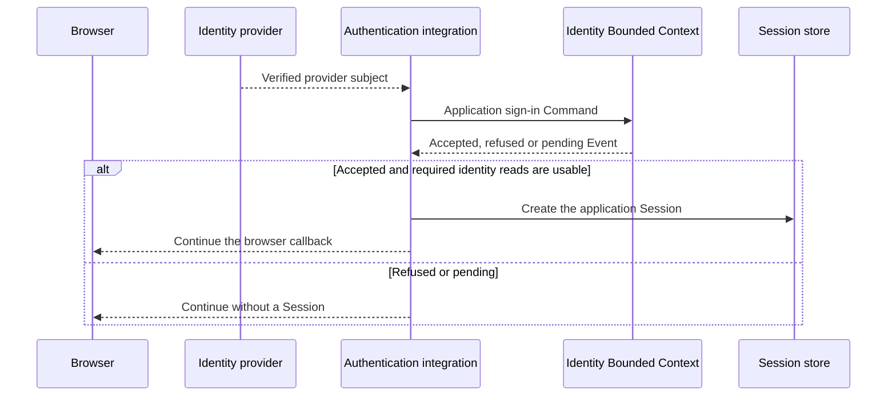

# Better Auth integration: failed attempt and future investigation

**Status: future task, not authorized for implementation. The integration was
removed from the tenant/auth storage work at the human's request.**

This document preserves the engineering information needed to investigate the
idea later. It is not a supported feature description. Do not restore the
removed adapter and call it a working integration merely because its selected
native-library tests passed.

## What failed

The attempt demonstrated that a selected subset of Better Auth operations could
be stored through a Spine `StorageFactory`. It did not establish an acceptable
integration between Better Auth's identity lifecycle and an application's domain
rules. The final design still restricted identity changes to framework-controlled
provisioning and used a private library patch for callback-state consumption.
The human rejected this as ready for inclusion.

A normal application may have an Identity or Users Bounded Context. That Bounded
Context decides what a first sign-in means: accept an invitation, create a person,
request approval, refuse access, or ask for an existing identity to be linked.
Neither automatic native signup nor unconditional refusal of unknown users is a
sufficient framework policy. Application developers must supply the protocol
that makes that decision using their Commands and Events.

The failed attempt was therefore broader than a missing SQL adapter. Replacing
SQL calls with record-storage calls did not solve domain admission, the timing
of identity reads, native lifecycle assumptions, or safe extension points.

## Evidence and historical implementation

The examined library version was **Better Auth 1.7.16**. Findings about hook order
and internal behavior below refer to that version. A future investigation must
check its selected version again, including installed source and actual native
HTTP flows. Public documentation alone does not prove execution order.

The disposable experiment originally used version **1.7.15**. The production
attempt moved to **1.7.16** after an upstream security-patch review. Results from
the earlier pin were not sufficient acceptance for the later integration; native
flows and adapter behavior had to be exercised again against the production pin.

The implementation is recoverable from Git history. These commits identify the
successive stages, not versions approved for restoration:

| Commit                                     | Stage                                                                                                                                 |
| ------------------------------------------ | ------------------------------------------------------------------------------------------------------------------------------------- |
| `b34d1006b`                                | Persistent native record models, custom adapter and controlled provisioning.                                                          |
| `d87ae1ef6`                                | Native session handling, password login and externally verified login.                                                                |
| `77689fe77`                                | Native OIDC routes, provider network handling and callback-state races.                                                               |
| `3317146d2`                                | Subsequent auth review corrections. This commit also contains unrelated changes, so inspect paths rather than restoring it wholesale. |
| `5e9b49093ad7d40acc3db0fd9356f7eba093a2e0` | Complete source snapshot immediately before the approved removal wave.                                                                |

For example, inspect the removed implementation without changing the worktree:

```bash
git show 5e9b49093:packages/auth/src/better-auth/native-adapter.ts
git show 5e9b49093:packages/auth/src/better-auth/oidc-network.ts
git show 5e9b49093:packages/auth/test/better-auth/native-oidc.test.ts
```

These are historical paths. Inspect the selected commit rather than assuming
the removed files still exist in the current checkout.

### Stage 1: native database experiments

The earlier PostgreSQL/MySQL experiments used Better Auth's native database
adapters. They established that the library's normal database path could run.
They did **not** establish that Spine record storage could implement its adapter
contract. The human explicitly challenged that evidence gap and required an
actual custom adapter experiment.

Do not reuse those native SQL results as evidence for a future `StorageFactory`
adapter. The future acceptance suite must pass through the application's actual
Spine storage provider for every relevant read and write.

### Stage 2: a custom record-storage adapter

The later implementation introduced `PersistentBetterAuthStore` under the
optional `@spine-event-engine/auth/better-auth` subpath. It selected native model
families named User, Account, Session and Verification. Each selected family had
record codecs, declared indexes and provider-neutral record operations.

The historical files were:

- `persistent-store.ts`: selected models, preparation, provisioning and lifecycle.
- `record-specs.ts` and `record-codec.ts`: model definitions, indexes and conversion.
- `native-adapter.ts`: Better Auth adapter operations and supported query shapes.
- `expiry-maintenance.ts`: explicit cleanup of selected expiry records.
- `settings.ts` and `index.ts`: the restricted public configuration and exports.

A readonly `BetterAuthUsers` option could supply User lookup by ID and email.
This avoided copying an existing User directory, but it did not provide a
complete domain protocol or independent bindings for all record families.

The store followed the persistent-store lifecycle introduced by the surrounding
PR: a private constructor, async factory, default structure creation/checking,
and an explicit opt-out. Selected record models used conditional writes and
indexed lookups. There was no cross-record transaction.

### Stage 3: selected native login and session behavior

`integration.ts` assembled the pinned native library with the custom adapter.
Supported paths included administrator-provisioned password accounts, externally
verified login and prelinked OIDC identities. Native User and Account creation
was rejected. Native signup and implicit linking were disabled. Sessions could
be created, read, renewed and revoked through the custom store.

This selected profile was intentional: it prevented unreviewed native routes
from performing unsupported writes. However, it also meant a first-time Google
visitor could not run an application-defined admission protocol. Provisioning
outside the login flow became the required path instead of one selectable policy.

### Stage 4: OIDC and callback concurrency

`generic-oauth.ts` and `oidc-network.ts` configured trusted providers and the
native OAuth plugin. The implementation initialized providers before publishing
routes, checked native proof/state behavior and propagated request cancellation
through callback work.

A callback must consume its state once. Two requests carrying the same callback
must not both exchange the code or create sessions. The implementation tested
native concurrent callback schedules and used atomic record consumption.
However, the native library's internal delete path introduced a second-read race.
The implementation addressed it by replacing a callback-local internal adapter
method. This worked within the tested pinned profile but was not an acceptable
stable public integration boundary.

### Packaging and declaration workarounds

The optional subpath kept Better Auth out of the base auth package's public
imports. The package declared an exact optional peer and a development dependency
for integration tests. This was a real packaging boundary, not evidence that
all native options were supported.

The native declaration graph also pulled in Bun SQLite types. The attempt used
the upstream `bun-types` SQLite declaration in the development build without
loading Bun's conflicting global types. Local structural declarations described
the selected native options. A `genericOAuth` forwarding function exposed the
selected configuration shape and reconstructed the native plugin; it did not
accept arbitrary executable plugins. Application mapping callbacks omitted by
that reconstruction were therefore unavailable even if upstream documented them.

The API documentation checker temporarily needed a 6 GiB Node heap setting for
that declaration surface. Removal also removed the optional subpath, peer,
Bun declaration references, local option wrappers, TypeDoc entry and dedicated
API-export inventory. The retained API documentation check passed on the normal
heap afterward. A future attempt must assess the declaration/package cost again,
not silently restore these workarounds or use `skipLibCheck` to conceal conflicts.

### Stage 5: broader verification and the unresolved domain design

Tests were added around the custom adapter, native HTTP flows, provider behavior
and independent-process callback races. Server tests exercised native auth routes
and active-stream invalidation. These tests were more substantial evidence than
the original native-SQL experiment, but they demonstrated the selected profile,
not arbitrary Better Auth compatibility or the required domain-driven admission.

A later architecture proposal suggested an application admission protocol and
public native hooks. Those ideas were **not implemented or proven** before the
human requested removal. The future work below keeps that distinction explicit.

## Current issue count: nine investigation items

There are **nine unresolved items** in this handoff. They are not nine confirmed
security vulnerabilities. The table distinguishes missing product behavior,
restricted compatibility and an unproven replacement design. Each item needs a
recorded decision before a future integration can be proposed as complete.

| #   | Item                                                                     | Classification                                                           |
| --- | ------------------------------------------------------------------------ | ------------------------------------------------------------------------ |
| 1   | Application-controlled identity admission                                | Missing required behavior.                                               |
| 2   | Independently selectable identity, Session and Verification dependencies | Public API design gap.                                                   |
| 3   | Framework provisioning and partial writes                                | Incorrect responsibility boundary and failure limitations.               |
| 4   | Query, join and account lookup semantics                                 | Restricted adapter contract, including an arbitrary account cap.         |
| 5   | Native mutation routes and plugins                                       | Unsupported operations that require explicit scope and domain protocols. |
| 6   | Account fields and provider token handling                               | Incomplete native model coverage, optional feature decision.             |
| 7   | Atomic callback consumption through public extension points              | Private implementation dependency and unproven replacement.              |
| 8   | Initialization cancellation                                              | Lifecycle gap in provider startup.                                       |
| 9   | Admission outcomes, read consistency and cancellation after acceptance   | Missing end-to-end domain integration contract.                          |

### 1. The application must decide admission

Suppose Google proves a person controls a particular provider subject. That
proof does not answer whether the application should admit them. An invitation-
only product may require an invitation. Another product may create a new User
immediately. Another may record a pending request for an administrator.

The framework must offer an application extension point after proof verification
and before Session issuance. It must not infer a new account from an email match,
force signup, or force refusal merely because a local row is absent.

A possible application protocol uses `RequestSignIn` and outcomes such as
`SignInAccepted`, `SignInRejected`, `SignInPending`, `InvitationRequired` and
`IdentityLinkRequired`. These are illustrative application messages, not proposed
mandatory framework messages. A future example must define real domain messages
and document their meaning.



The integration responds to the browser after processing the provider callback.
No raw password, access token or refresh token belongs in public domain Events.

In Better Auth 1.7.16, `user.validateUserInfo` could allow or refuse a native OAuth
operation but could not return the application's chosen User. Unknown-user
signup could fail before that hook under the selected configuration. Password
login did not use the same hook. Therefore one generic validation callback was
not enough.

A future spike may investigate the generic OAuth `mapProfileToUser` callback
and the Session `create.before` hook, but it must prove their order and exact
coverage. `onPrincipal` alone is too late to prevent unwanted Session creation.

### 2. One selected-model store is not a sufficient API

User and Account are Better Auth library concepts. A User is the local identity;
an Account associates it with a credential or provider subject. These shapes do
not require two domain Entity types or two new application tables. One existing
User Aggregate and its views might supply both.

The previous API combined several dependencies in one selected-model store.
A future API should allow independent choices:

| Dependency           | Application choice                                                                                  |
| -------------------- | --------------------------------------------------------------------------------------------------- |
| Identity reads       | Identity Bounded Context views or an existing external directory.                                   |
| Admission protocol   | Application Commands, outcomes and policy.                                                          |
| Session storage      | Persistent implementation using one StorageFactory/group, or an external implementation.            |
| Verification storage | Separately selected StorageFactory/group or external implementation, when the chosen flows need it. |
| Principal mapping    | Stable application identity and current eligibility for request admission.                          |

This is a responsibility sketch, **not approved exported TypeScript**:

```ts
const dependencies = {
  identity: {
    reads: applicationIdentityReads,
    admission: applicationSignInProtocol,
  },
  sessions: applicationSessionStore,
  verifications: applicationVerificationStore,
};
```

Each collaborator above is application-supplied. No new factory name or public
interface is promised by this task. A proposal must show how separate backends
work without assuming a transaction across them.

### 3. Provisioning must not become a second identity workflow

The old store provisioned immutable User and Account definitions. Failure could
leave only part of a batch written. Process-local failed-batch tracking did not
make those partial states durable across restart. Independent writes also did
not make email uniqueness across records an atomic invariant.

The correction is not to add a framework provisioning coordinator, transaction
or outbox. Registration, email rules and provider linking are domain rules of the
Identity Bounded Context. A future integration must define how it reads a
confirmed domain decision and what it does when the necessary views are not yet
available. It cannot silently retry a successful domain Command to repair an
unrelated auth-store operation.

A Session creation failure after accepted registration does not undo the domain
registration. A subsequent sign-in may request a new admission according to the
application's rules. Document that ordinary independent-write behavior clearly.

### 4. Adapter operations must match the selected native flows

Better Auth's database abstraction is broader than per-record storage. The old
adapter supported a bounded set of predicates, comparisons, selected joins and
mutations. It did not implement arbitrary query combinations or plugin models.
One account join also had a fixed limit of 100, which could hide a needed account.
The human prohibits introducing such arbitrary limits without explicit approval.

A future investigation must enumerate every operation emitted by the exact
selected native flows: predicates, normalization, ordering, offsets/limits,
joins, counts and update/delete return values. A passing direct adapter unit test
is insufficient if the native flow asks a different question.

Prefer an exact credential or provider-subject lookup when the domain contract
calls for one. Do not replace a missing indexed operation with a whole-group scan
or an arbitrary cap. Explain provider differences and prove the actual supported
PostgreSQL, MySQL/MariaDB and Datastore paths selected for the proposal.

### 5. Native routes can bypass the intended domain protocol

Readonly User/Account views are incompatible with simply enabling native signup,
linking, profile changes or password reset. Those routes expect to mutate native
identity records. Arbitrary plugins may also create additional models or use
unimplemented operations.

For every proposed route, specify who verifies the proof and who makes the domain
decision. Password hashing and one-time proof validation should use maintained
library mechanisms. Registration, linking and password policy effects should
follow application protocols. Do not write a separate password or OAuth engine
as a workaround for an unsuitable library extension point.

A route allowlist alone is not enough if one admitted endpoint has multiple body
modes, such as redirect login versus a direct ID-token flow. Test each enabled
mode. Unselected plugins are a declared boundary, not a universal compatibility
claim.

### 6. Native Account coverage needs an explicit decision

The historical codec did not provide a general provider access/refresh/ID token
vault or all native account-management behavior. Therefore enabling token refresh
or APIs that read those fields could not be assumed to work.

Decide whether the future integration needs provider tokens at all. If it does,
define secret storage, access control, expiry, rotation and deletion explicitly,
then test native behavior against those fields. If it does not, disable dependent
features and document the selected profile. Do not put provider tokens in domain
Events or manufacture placeholder field values.

Native User also requires an email. A verified subject without an email is not
permission to invent one. The application may supply a real domain-approved email,
or that native profile may be unsuitable for the application.

### 7. Replace the private callback-state patch only after proof

The historical `OidcNetwork` replaced
`internalAdapter.deleteVerificationByIdentifier` for a callback. The reason was
a concrete race in the native library:

1. Two callbacks read the same state.
2. The first callback removes it successfully.
3. The second callback enters native deletion, which reads again.
4. That second read sees no record, so native code may skip the custom adapter's
   delete operation entirely.
5. An exception on a failed adapter delete cannot stop a path that never calls it.

Atomic storage deletion alone therefore did not prove that only one callback
could proceed. The private patch enforced the selected behavior but coupled the
integration to native internals.

A proposed replacement used callback-local operation state: the public adapter
would record successful consumption of the exact state, and the configured
`getToken` callback would require that confirmation before token exchange.
A skipped delete would leave confirmation absent. **This is an unproven idea.**
It must be tested against the actual native flow, including both concurrent
schedules and independent processes, before it can replace the patch.

Do not persist a new technical coordinator record or override private internals
to hide a missing public extension. If the public seam cannot establish the
required property, document the upstream blocker and stop that integration path.

### 8. Initialization needs an explicit cancellation contract

The old integration performed provider discovery before publishing routes, but
startup did not expose the same caller cancellation contract as request work.
A future host must be able to abandon initialization and release resources if
startup is cancelled or another provider fails.

Use the framework's accepted cancellation conventions. Do not introduce an
arbitrary discovery timeout or retry budget. A configured application policy or
an external protocol requirement is different from an invented default.

### 9. A domain outcome must be usable before Session issuance

An accepted Event does not imply that every Projection has already applied it.
For example, the Identity Aggregate can accept a person before a User lookup
Projection returns the new row. Creating a Session immediately and then failing
the next request's User lookup is not a successful sign-in.

A future design needs one of these explicit strategies:

- Acceptance supplies complete confirmed identity views, and subsequent requests
  can read those facts from an immediately authoritative source.
- The application adapter waits for the required read-model version before it
  permits Session creation. Cancellation and storage failure remain visible.

Do not treat a Command admission acknowledgment as a domain acceptance Event.
Do not treat an emitted Event as proof of an atomic multi-record transaction.
The auth continuation waits outside delivery handlers and held shard resources.

Pending, invitation-required and link-required outcomes also need a documented
browser response. Native generic errors must not erase those distinctions.
Application-selected redirects must be trusted destinations, and internal
sensitive reasons must not be copied indiscriminately into callback URLs.

Cancellation can happen after domain acceptance or during Session insertion.
A cancelled HTTP operation must not issue a cookie when a later async write
finishes. Define and test late-record cleanup and visible cleanup failures.
Do not claim that cancellation rolls back an already accepted domain decision.

## Deployment boundaries that are not additional issue-count entries

The current tenant/auth storage work supports a single Gateway host.
Process-local rate enforcement and local
active-stream cancellation do not establish coordinated multi-Gateway operation.
Shared PostgreSQL records alone cannot notify a stream running in another process.
Do not add replication or distributed cancellation to this future task implicitly.
If a future proposal selects that deployment, it needs its own approved contract.

The previously selected component authentication remains a separate available
choice. This task must not force applications to adopt Better Auth or replace
working Google OIDC, Firebase, opaque-session or signed-token integrations.

## Required investigation before a new proposal

1. Select and pin a current library version. Read its public extension contracts
   and relevant native source. Record differences from the historical version.
2. Build a disposable native-flow proof outside production code. Use the actual
   custom `StorageFactory` adapter, not native SQL adapters as a substitute.
3. Prove verified identity reaches application admission before native identity
   decisions or Session creation. Cover first-time and returning sign-in.
4. Prove the public callback-state seam without private method replacement.
5. Prove independently supplied identity reads, Session and Verification stores.
6. Exercise accepted, refused, pending, invitation-required and linking-required
   domain outcomes, read-model lag, cancellation and partial storage failure.
7. Enumerate exact supported routes and adapter operations. Resolve all nine
   items above, recording unsupported choices honestly.
8. Present the result and API proposal for human approval before production
   implementation. A negative experiment is an acceptable conclusion.

## Acceptance matrix for that disposable experiment

| Scenario                                                       | Required evidence                                                                                           |
| -------------------------------------------------------------- | ----------------------------------------------------------------------------------------------------------- |
| Returning Google identity                                      | Verified issuer/subject resolves the exact domain binding and creates one usable Session.                   |
| First sign-in accepted                                         | Application Command/Event protocol decides admission, required reads become usable, then Session is issued. |
| First sign-in refused or pending                               | No Session/cookie, application-selected meaningful response.                                                |
| Existing email, different provider subject                     | Application linking rules decide, no native implicit merge.                                                 |
| Disabled user                                                  | No new Session and authoritative later session checks apply the selected application policy.                |
| Invalid signature, issuer, audience, nonce or userinfo subject | Domain admission is never invoked with unverified identity.                                                 |
| Duplicate callback state                                       | Exactly one consumption winner, including native second-read skip and separate-process schedules.           |
| Password sign-in, if selected                                  | Native verification precedes domain admission and the final Session gate.                                   |
| Projection delay                                               | No unusable Session caused by a missing required identity view.                                             |
| Cancellation during admission or insertion                     | No late cookie, explicit handling of any late stored Session.                                               |
| Separate storage providers                                     | No hidden transaction assumptions between identity, Session and Verification.                               |
| Unsupported native operation                                   | Clear rejection before partial unsupported mutation, with documented scope.                                 |
| Packaging                                                      | Optional dependency boundary is real, no private imports or leaked declarations.                            |

Use the build protocol, domain-correct fixtures, focused tests and independent
no-memory reviewers. Do not count skipped provider tests as verified. Keep raw
experiment logs outside Git; update this task with decisions and maintainable
links rather than execution diaries.

## Related future work

[One Command outcome, one subscription](../command-outcome-subscription/TASK.md)
is a separate, **NOT APPROVED YET** protocol proposal. Do not assume it must be
implemented to conduct a server-side auth experiment. Any dependency must be
justified by the actual chosen integration, not by the historical plan.

Primary library references to re-check for the selected future version:

- [Custom database adapters](https://www.better-auth.com/docs/concepts/database).
- [Generic OAuth plugin](https://www.better-auth.com/docs/plugins/generic-oauth).
- [User and Account concepts](https://www.better-auth.com/docs/concepts/users-accounts).
