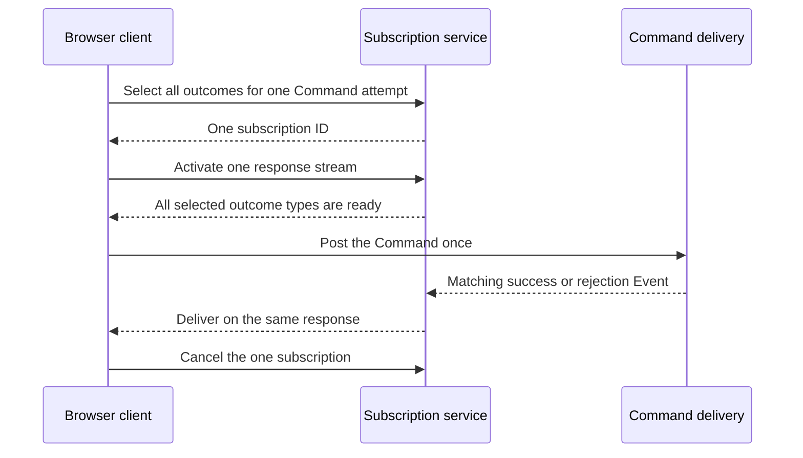

# One Command outcome, one subscription

**Proposal status: NOT APPROVED YET. Do not implement this task without human
approval of the public and wire contracts.**

## Problem

A caller can submit one Command whose result is one of several Event types.
For example, moving a Fieldnotes place can produce `PlaceMoved`,
`PlaceUnavailable`, `PlaceRevisionConflict`, or `InvalidPlaceCoordinates`.
The caller needs one subscription for that attempt. It attaches different
handlers to the possible outcomes of the same subscription.

The current `ClientRequest.postAndSubscribe()` creates a separate server Topic
and activated response stream for each selected message type. A client-side
`GroupSubscription` presents these registrations together, but the server still
allocates several subscription IDs and the browser opens several responses.
Calling them logical subscriptions would obscure the bug: the intended operation
is one subscription throughout the implementation.

The following existing application call illustrates the problem. Identifiers
refer to generated Fieldnotes messages and a principal-scoped `ClientRequest`.

```ts
const result = await request.postAndSubscribe(MovePlaceSchema, movePlace, {
  events: [PlaceMovedSchema],
  rejections: [PlaceUnavailableSchema, PlaceRevisionConflictSchema, InvalidPlaceCoordinatesSchema],
  signal,
});
```

Before correction, this call requires four activated HTTP responses. After the
proposed correction, it must require one. The selection of four message types
must not change the number of server subscriptions, IDs or transport responses.

## Why this matters in a small application

Fieldnotes also maintains one long-lived subscription for the current person's
private place states. Two open tabs therefore use two long-lived responses.
An attempt to move a place opens four outcome responses. Under a browser's
six-connection HTTP/1.1 per-origin pool, these responses can occupy all six
connections before the Command POST is sent. The POST waits for a connection,
while the outcome responses wait for the Command to run.

HTTP/2 at the browser-facing ingress avoids this particular connection-pool
cycle by putting multiple streams on one connection. It does not correct the
framework's subscription model. Closing outcomes promptly after completion
reduces resource use, but cannot solve starvation before the POST begins.

## Approved intent and undecided contract

The human established the semantic requirement: one Command attempt has one
outcome subscription, regardless of how many outcome types are selected.
**The protocol design below is not approved.** In particular, an additional
TypeScript protocol message must not be treated as an accepted prerequisite.

Before implementation, inspect the corresponding Spine JVM API and protocol.
Determine whether the existing compatible protocol has an intended expression
for this selection. If it does, use it. If it does not, present the smallest
contract change for explicit human review, with compatibility consequences.
Do not change frozen copied JVM Protobuf definitions locally.

Relevant current paths:

- `packages/client-web/src/client/client.ts`: `postAndSubscribe`, activation,
  readiness and grouped cancellation.
- `packages/proto/proto/spine/client/subscription.proto`: current Topic and
  Subscription contracts.
- `packages/proto/proto/spine/client/filters.proto`: target and filter shape.
- `packages/server/src/stand/subscription-observer.ts`: selected Event delivery.
- `packages/server/src/bus/event-bus.ts`: Event observation.
- `packages/server/src/services/spine-services.ts`: subscription service routing.

Confirm paths and method locations against the future starting revision.
The task should start from the then-current official `origin/master` in a
separate worktree according to the build protocol.

## Proposed behavior

1. The client creates one selection containing the Command correlation and all
   permitted success and rejection types.
2. The server authorizes that complete selection before accepting it. Rejection
   must leave no partially registered subscription.
3. The server creates one subscription record and one ID.
4. Activation opens one response and acknowledges readiness only when every
   selected type can be observed. No fast outcome may disappear between
   subscription setup and Command submission.
5. Only after readiness does the client post the Command once.
6. Every matching outcome arrives through the same response. Per-type callbacks
   are local dispatch decisions, not additional server subscriptions.
7. Cancellation releases the one subscription and its observers. Failed setup,
   request cancellation and logout also release it.
8. Reconnection must not repost the Command. Define observation guarantees
   honestly against the actual Event/subscription retention contract.



This sequence describes the required behavior, not an approved wire encoding.
It does not introduce multiple logical subscriptions or a transport multiplexer.

## Questions the contract review must resolve

- Can the intended JVM protocol express a correlated set of message types? Show
  the actual messages and service calls, not a hypothetical wildcard Topic.
- If an extension is necessary, which package defines it, how does the existing
  client negotiate it, and how does an unsupported server reject it clearly?
- Which existing correlation field identifies the originating Command? Preserve
  its exact semantics for emitted Events and rejections, including Events
  produced indirectly by a Process Manager if such outcomes are selected.
- Does the subscription stay open after one outcome until explicit cancellation,
  as the existing API allows, or does the public API define terminal outcomes?
  Do not silently impose first-Event cancellation on general subscriptions.
- What exact readiness acknowledgment covers the complete selection?
- What existing disconnect/retention guarantees apply? Do not promise replay,
  catch-up or gap-free recovery that the framework does not implement.
- How does authorization apply to every selected message type and Actor?

## Implementation outline after approval

### 1. Freeze the contract

Record the approved API, Protobuf/service changes if any, authorization rules,
readiness semantics and cancellation behavior. Update the task with the human's
answer. Do not create a compatibility alias or migration layer unless explicitly
requested.

### 2. Register and activate one subscription

Implement one server record, one ID, and one activation lifetime. Internal
Event-type observers may be necessary, but they must be resources of that one
subscription. Every terminal cleanup path must release all those observers.
No extra persistent coordinator or artificial cap is authorized.

### 3. Update the existing client operation

Keep the application-level selection of success and rejection types understandable.
Make the existing Command operation use the approved single-subscription contract.
Do not conceal fanout behind a renamed facade. Preserve cancellation and typed
outcome handling. Update documentation and examples to describe one subscription.

### 4. Prove behavior across the real transport

Test the actual public client and server, not only an in-memory helper:

- Ten possible outcome types produce exactly one server registration, one ID,
  one Activate response and one cancellation.
- A handler that finishes immediately cannot outrun readiness.
- Unrelated Commands, Actors and message types are excluded.
- A selected rejection follows the same stream as a selected success.
- Partial authorization/setup failure leaves no observers or live response.
- Cancellation before readiness, during POST and after an outcome closes all
  resources without reposting the Command.
- Logout and session expiry stop the operation according to the existing local
  invalidation contract.
- Multiple browser tabs under HTTP/1.1 can post Commands without the previous
  outcome-type connection fanout. Use a real browser regression.
- Reconnection and shutdown follow the agreed semantics without duplicate posts.

Use domain-correct generated Commands, Events and identifiers. Do not substitute
an Entity state for a Command merely because the payload has suitable fields.

### 5. Review and document

Run the protocol's mechanical preflight, then fresh independent API and
reliability reviews, with documentation/style concerns explicitly covered.
Address relevant findings before final verification. The final PR explanation
must show the before/after resource counts and a real application example.

## Explicit boundaries

This task does not authorize arbitrary subscription multiplexing, WebSockets,
a new Event catch-up mechanism, changes to independent storage-write semantics,
or automatic retry of a successfully handled Command. Those are different
contracts. HTTP/2 remains a useful supported example deployment independently
of this proposed framework correction.
