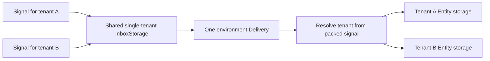
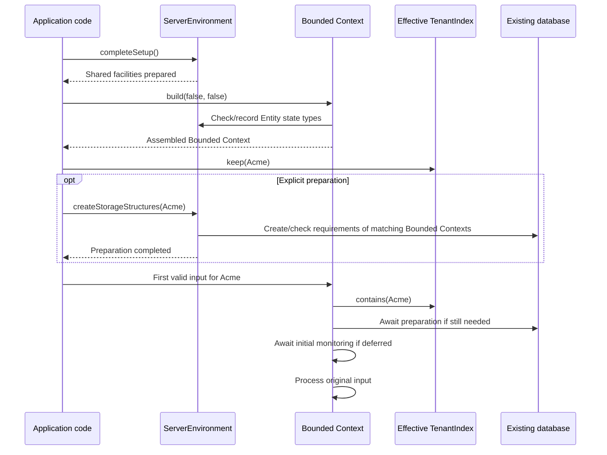

# Shared environment, lazy preparation, and tenant support

## 1. Decisions this proposal implements

ServerEnvironment remains the common configuration point. There is no Application class.

The environment supplies one StorageFactory, one TransportFactory, one Delivery, default TenantIndex, and default AI settings. Bounded Contexts can override TenantIndex and AI settings. They cannot replace the factories or Delivery.

The environment always provides a StorageFactory, with an in-memory default, and a cached Delivery.local() when no custom Delivery is configured. Server only prepares and exposes gRPC services.

The normal application sequence is:

1. Configure ServerEnvironment and explicitly complete its setup.
2. Build Bounded Contexts. By default, await structure preparation and initial subscription monitoring.
3. Start the gRPC Server with the assembled Bounded Contexts.
4. Add tenants through application-controlled TenantIndex implementations. Application code can explicitly prepare their structures through ServerEnvironment; otherwise the first valid input triggers preparation.

The latest answers change three earlier rules:

- Each false build flag independently means “defer until first valid input,” including mixed combinations.
- Failed lazy initialization rejects the triggering request and remains retryable on subsequent input. It does not stop the environment. Explicit startup preparation remains fail-fast for the application.
- Once subscription monitoring has started successfully, later periodic failures produce WARN logs and restart attempts. They never stop the application.
- A completed Bounded Context may process input while another is still being built. A catastrophic later build failure still stops application processing.

**No existing-data migration is included.** Do not add migration utilities, compatibility conversions, upgrade scans, or migration tests unless explicitly requested. Tests that reopen storage written by the revised implementation are still necessary for persistence and the Agent lifecycle; they are not an upgrade project.

All added API names and examples below describe the proposed implementation.

## 2. Storage instances must be retained

This remains the first implementation priority.

A StorageFactory creates Storage objects. For example, createRecordStorage(...) returns a RecordStorage instance. The factory and the returned Storage are different objects.

Current TS has paths that create and close Storage objects for individual operations. InboxStorage is one example: its read path obtains RecordStorage and closes it afterward. A new object can repeat provider initialization. [Current Inbox operations](https://github.com/SpineEventEngine/spine-ts/blob/ff6c8669537a016c47f012150306500d3b52b5d1/packages/server/src/delivery/inbox-storage.ts#L87)

Retain the objects for their actual runtime lifetimes:

- Shared Delivery retains its Inbox and shard-storage access.
- Repositories retain their storage for repeated reads and writes.
- Tenant-specific storage objects are reused for the corresponding tenant and model.
- Closing one Bounded Context does not close resources still used elsewhere.

Coordinate preparation across objects targeting the same physical structures. Remember successful connection checks, creation, and compatibility checks separately for their relevant destination/model requirements. Failed attempts must not leave a false successful marker.

Retaining an object does not require keeping a physical connection open for every tenant. Connection checks must release temporary resources, and provider pools must respect configured budgets. Preparing many tenants must not accumulate one idle connection per tenant merely because a check ran.

A compatibility result describes a successful check, not a permanent guarantee against later external database changes.

### EventStores with a shared factory

Each logical Bounded Context stores its Events separately. For example, when
Shipping imports an Event from Orders, both EventStores may retain the original
Event ID. A shared StorageFactory must preserve both copies.

Use the existing StorageGroup to distinguish EventStores by the exact context name
and their domain or System role. Construction, atomic Entity writes, history reads
and structure preparation must select the same group. Equal names and roles denote
the same logical EventStore across restarts; different names or roles select
separate stores. The compact stable mapping and provider checks are specified in
D-0160. Entity families and the shared Inbox retain their existing identity rules.

This does not relax the registration rule below: two distinct open domain contexts
cannot register the same Entity state type, even when their names are equal.
No existing-data migration or fallback read is included.

## 3. One domain Bounded Context per Entity state type

Adopt [JVM PR #1698](https://github.com/SpineEventEngine/core-jvm/pull/1698), inspected at final revision 728e7654a711.

The earlier suggestion to permit overlapping domain Entity state types using a Bounded Context discriminator is withdrawn.

### Registration rule

An Entity state TypeUrl can be served by only one open domain Bounded Context in the environment. This is unconditional, including tests and BlackBox. There is no switch to disable it.

```ts
const first = await BoundedContext.singleTenant("First").add(Calculator).build();

const second = await BoundedContext.singleTenant("Second").add(Calculator).build(); // DuplicateEntityStateException, including in tests.
```

Different repository objects, Entity classes sharing the state type, tenant sets, databases, or Entity IDs do not make this valid. Different state types may use equal IDs; equal IDs in different tenants of one multitenant Bounded Context are also valid.

The rule applies within one runtime environment. Separate application replicas can each register the same model.

### Environment record and early check

Keep an internal record of state TypeUrl to its single registered domain Bounded Context object reference.

- Compare objects by identity, not name. Equal names do not merge distinct instances.
- Check and insert together before repository registration can change shared Delivery. In TS, do not put an await between checking and insertion.
- Cover builders, internal registration after construction, and BlackBox.
- Preserve existing duplicate-repository checks within one Bounded Context.
- Exclude actual framework System Contexts, using their framework identity. All domain Entity categories, including Agents, participate.
- Keep strong references until closure; garbage collection must not decide whether registration succeeds.
- Deferred preparation still reserves state types. Registration is separate from readiness.

Add public DuplicateEntityStateException with a public constructor taking the state type and conflicting Bounded Context names. The message identifies the conflict and tells developers to register the type in one open domain Bounded Context.

Provide the equivalent internal lookup:

```ts
contextsServing(stateType: TypeUrl): readonly BoundedContextName[];
```

Return a read-only list containing zero or one name. A second distinct Bounded Context is rejected during registration even if both contexts have equal names. Keep the object reference internally for execution; never resolve a recipient by turning it into a name and looking that name up again.

A lookup uses the single registered domain Bounded Context. An absent registration uses the existing missing-destination error. The registered context proceeds through readiness and tenant checks; readiness cannot make a duplicate registration acceptable. Do not use this domain lookup for System Context targets.

The follow-on JVM catch-up work is outside this task.

### Unconditional checking and reset

Duplicate state registration is rejected in every environment and test mode.
Do not introduce a Tests profile for this feature, a checkDuplicateEntityStates
setting, or a BlackBox bypass. Existing general test controls cannot disable the
rule. Tests must use distinct domain state types, close a previous context before
reusing its type, or run separate application replicas in separate processes.

A settings-only test reset preserves live resources and registrations. A full singleton reset must reject before teardown while any Bounded Context, build, or cleanup remains active, including empty or deferred Bounded Contexts. Current TS resets by closing resources and replacing the singleton, so preserving only the state-type map would be insufficient. [Current reset](https://github.com/SpineEventEngine/spine-ts/blob/ff6c8669537a016c47f012150306500d3b52b5d1/packages/server/src/server/server-environment.ts#L321)

Tests must explicitly close Bounded Contexts and BlackBoxes. Reset cannot hide leaks.

### Registration and close failures

Match the PR's distinctions:

| Failure                                            | Record handling                                                              |
| -------------------------------------------------- | ---------------------------------------------------------------------------- |
| Another Bounded Context already serves the type    | Reject before changing Delivery.                                             |
| Registration fails before accepting the repository | Remove only the entry newly added by that attempt.                           |
| This Bounded Context already had that entry        | Preserve its earlier entry.                                                  |
| Repository accepted, then onRegistered fails       | Keep the entry until actual cleanup.                                         |
| Build fails                                        | Close the partially built Bounded Context and release all its registrations. |

Preserve the initiating build error and report cleanup errors additionally.

A throwing pre-close callback must not prevent remaining cleanup. Attempt every repository close; finish System Context cleanup; preserve the first failure and report later ones. Disable/detach recipients independently of provider-close errors, then release served-type records. Correctness must not require calling close twice.

Closing a Bounded Context releases its association with a shared TenantIndex without closing that index for other Bounded Contexts. Shared environmental resources close with the environment; application-supplied resources follow their declared cleanup arrangement.

After normal closure another Bounded Context may register the type. Cleanup after a failed build does not clear the application's catastrophic failure state.

## 4. Shared Delivery and single-tenant InboxStorage

All Bounded Contexts use the environment Delivery. Explicit environment setup makes the configured instance or cached local default available before any context builds. Server does not attach a different Delivery later.

Current TS constructs Delivery in repository handoffs and changes from direct delivery to an environment-attached path. Remove those constructions and that change of mode. Configure Delivery and sharding policy through the environment. [Current handoff](https://github.com/SpineEventEngine/spine-ts/blob/ff6c8669537a016c47f012150306500d3b52b5d1/packages/server/src/repository/repository.ts#L12513)

**InboxStorage always uses a shared single-tenant storage scope containing signals from all tenants. There is no multitenant option.** Shard coordination records use the corresponding shared scope. The revised shared-Inbox path does not read former tenant-specific Inbox locations; supporting those layouts is outside this task.

Current Inbox/storage derivation preserves tenant-specific StorageContexts; workers can carry a tenant from that scope. Replace this with tenant resolution from the packed signal. [Current Inbox scope](https://github.com/SpineEventEngine/spine-ts/blob/ff6c8669537a016c47f012150306500d3b52b5d1/packages/server/src/delivery/inbox-storage.ts#L495)



Commands obtain tenant information through CommandContext/ActorContext. Events use canonical origin resolution across supported EventContext forms. Single-tenant inputs keep their established neutral/unset convention.

Validate tenant membership before new Inbox persistence. Recheck before dispatching saved work because membership may have changed. A malformed packed signal must not execute under a guessed tenant or be acknowledged as delivered.

The execution context must be restored after processing so concurrent tenants do not affect each other.

### When posting a signal finishes

With local Delivery, posting waits for the existing delivery result for that
signal. For an Agent, this means accepting and acknowledging its input; its live
handler may still be running. An Agent with no available execution capacity leaves
the signal pending and reports the existing command-posting error.

With configured remote Delivery and its environment supervisor, posting finishes
when the remote Inbox accepts the signal and the shard notification is submitted.
Another application process may still be handling that shard. Processing can
therefore finish later. This preserves the existing remote behavior; it does not
mark the signal delivered or start an Agent merely because its record was saved.
A failed Inbox write still rejects the call. A later local notification failure is
logged, and the existing delivery notifications and safety scan can find the work.

The environment selects this behavior from its installed Delivery facilities.
There is no context-level switch or attachment step. Calling Delivery.run directly
still returns its actual result, including SKIPPED when another process is working
on the shard. Context closure waits for its admitted operations; it does not wait
indefinitely for every pending record on every remote process.

### Notification-driven dispatch

After a successful committed Inbox write, notify Delivery that the shard has work. Start a processor if needed; otherwise ensure the current processor notices the new work.

TS already has notification paths. Consolidate them under shared Delivery; do not describe the change as replacing an entirely polling-based implementation.

Handle the race where a message arrives while a processor changes from busy to idle. Coordinate the transition and recheck pending work. In a distributed Delivery, coordinate processors through shared facilities.

A handler posting to its current shard must not recursively wait for that entire shard to finish. Preserve public posting completion semantics separately from notifications.

The periodic scan remains a safety net for missed notifications and unfinished ordinary delivery. It does not run Agent executions again. A pending ordinary message targeting a fully assembled lazy Bounded Context can trigger its initialization before dispatch. A scan must not initialize every idle Bounded Context merely because it exists.

Delivery identity distinguishes tenant, Entity state type, typed Entity ID, signal, and applicable delivery action. PR #1698 supplies the unique serving domain Bounded Context. Correct the current omission of tenant from recent-delivery duplicate keys. Preserve System Context-specific addressing without inventing a domain Bounded Context namespace.

## 5. TenantIndex: the complete public contract

This section restores the previously discussed behavior and examples.

### Current gap

Current TS creates a TenantIndex internally from the factory's provider catalog. It provides all(), page(), keep(), tenancy information, and close(), but has no direct contains() operation or the proposed public custom-index configuration/access. Some input paths call keep(). [Current interface](https://github.com/SpineEventEngine/spine-ts/blob/ff6c8669537a016c47f012150306500d3b52b5d1/packages/server/src/context/tenant-index.ts#L32)

The new design makes membership an application-configurable source of truth. Ordinary input must not register its tenant implicitly.

### Configure defaults, override, and inspect

```ts
ServerEnvironment.when(Environment.instance().type).use({
  storageFactory: factory,
  tenantIndex: companyTenants,
});

const environment = ServerEnvironment.instance();
await environment.completeSetup();

const orders = await BoundedContext.multitenant("Orders").add(Order).build();

const billing = await BoundedContext.multitenant("Billing")
  .withTenantIndex(billingTenants)
  .add(Invoice)
  .build();

// Proposed read-only properties returning the configured live objects.
environment.tenantIndex === companyTenants; // true
orders.tenantIndex === companyTenants; // true
billing.tenantIndex === billingTenants; // true
```

The environment index is the default, not the only index. Admission and preparation use the receiving Bounded Context's effective index. Keep the actual object and consult its current contents; do not make a permanent startup copy.

The Bounded Context's single/multitenant mode remains its model setting. Single-tenant operation does not require registering a synthetic tenant in the shared company directory.

### Membership and registration

```ts
const currentIndex = orders.tenantIndex;

const known = await currentIndex.contains(acmeTenant);
await currentIndex.keep(acmeTenant);
const ids = await currentIndex.all();
```

Add contains(tenantId): Promise<boolean> to the public contract.

- contains reads membership without registration, storage preparation, or infrastructure provisioning.
- A lookup failure rejects. It must not be converted to false or TENANT_UNKNOWN.
- keep requests registration through that implementation and completes after membership is visible to subsequent reads through it.
- Repeated keep for an already registered tenant is harmless.
- keep may reject, for example for a read-only directory or an unprovisioned tenant.
- all remains a convenience; internal all-tenant preparation uses the existing paged enumeration and cancellation support.
- Paging remains useful after Agent recovery is removed. Remove recovery-specific naming/documentation without removing enumeration.

No permanently cached admission list may conceal membership changes. If an implementation caches membership, its invalidation must preserve the live-index contract.

### An application-backed index

An application can adapt its existing directory rather than configure a database list in source code:

```ts
// Illustrative delegation. Directory operations are application code.
// Enumeration/paging methods retain the public TenantIndex signatures.
const companyTenants: TenantIndex = {
  contains: (tenantId) => tenantDirectory.contains(tenantId),
  keep: (tenantId) => tenantDirectory.register(tenantId),
  all: () => tenantDirectory.allTenantIds(),
  page: (request) => tenantDirectory.pageTenantIds(request),
};
```

The proposed public membership interface is independent of a per-Bounded-Context tenantMode and storage-provider lifetime. Export the supporting paging types publicly as well, so an application implementation needs no private storage-provider imports. For index resources, the framework closes resources it creates; application code closes supplied directory resources unless it explicitly delegates that cleanup to the environment. Closing one Bounded Context never closes a shared supplied directory.

A read-only directory can provide the same membership/enumeration operations and reject keep with a clear error. Application administration can update that directory through its normal API; subsequent contains/page calls see the change.

The in-memory default index keeps membership in memory. A provider-backed index can use that provider's existing catalog/discovery facilities. A dynamic resolver alone cannot enumerate tenants. If a provider has no suitable catalog, persistent dynamic membership requires an application-supplied index. Do not invent hidden tenant-registry records to make this work.

### Registration and database resolution are separate

The approved resolver remains:

```ts
const factory = await PostgresStorageFactory.newBuilder()
  .setOptions(sharedDatabaseOptions)
  .setTenantResolver((tenantId) => tenantDirectory.databaseOptions(tenantId))
  .build();
```

TenantIndex answers “is this tenant registered?” The resolver answers “which existing database serves it?” Neither creates databases.

setOptions identifies an existing shared destination for Inbox and other non-tenant framework records. It need not be a dedicated new database. Missing shared configuration must be reported explicitly rather than guessed from a tenant.

Concurrent first use of a tenant coordinates resolution and pool preparation. A tenant added to the live directory must not require rebuilding the factory or restarting the process.

After restart, the persistent application index supplies membership and the resolver supplies settings. A fixed configured catalog cannot discover arbitrary new databases; use the dynamic index for that requirement.

### What JVM establishes

The production JVM core implementation can persist tenant registry records through its configured storage. Its index does not itself select a separate database per tenant. Provider implementations can use their native discovery mechanisms. These precedents support separate membership and storage concerns; they do not establish that JDBC already provides the approved TS dynamic resolver.

TS retains its existing restriction against introducing hidden stored tenant-index records. An application may persist its directory in application-managed storage. The requested unknown-tenant rejection is an explicit TS requirement, not a claim about the JVM default admission behavior.

## 6. TENANT_UNKNOWN on every applicable input path

The receiving Bounded Context checks its effective TenantIndex before tenant-specific resolution, preparation, persistence, or handler execution.

This covers Commands, queries, Events, imported Events, subscription operations, browser/gateway entry points, direct in-process calls, and delivery between Bounded Contexts.

```text
Validate request and effective tenant
    → consult receiving Bounded Context's TenantIndex
    → unknown: return TENANT_UNKNOWN
    → known: await any needed lazy initialization
    → process request
```

Unknown input must not call keep(), invoke the database resolver, create structures, write new Inbox work, or run a model/handler. A query must not return an empty successful result for an unknown tenant.

Missing or inapplicable tenant IDs keep their distinct validation errors. Directory failure is an operational error, not unknown membership. Authentication and authorization still apply.

A subscription request containing only a subscription ID may need a shared registry lookup to identify its tenant. That control lookup is allowed before membership checking; it must not open an unknown tenant's database. Activation and cancellation must both enforce membership.

Saved ordinary Inbox work is checked against current membership. A removed tenant is not recreated merely because a record names it.

### gRPC representation

Use stable framework error identifier TENANT_UNKNOWN. gRPC requires its predefined numeric codes, so use proposed transport status NOT_FOUND with structured Spine error details:

```text
gRPC status: NOT_FOUND (5)
Spine error type: TENANT_UNKNOWN
Message: Tenant "acme" is not registered for Orders.
```

The existing spine.base.Error has a type field. Preserve the identifier through native gRPC, browser protocols, gateways, and client decoding; do not require message parsing. [Error schema](https://github.com/SpineEventEngine/spine-ts/blob/ff6c8669537a016c47f012150306500d3b52b5d1/packages/proto/proto/spine/base/error.proto#L41), [gRPC status codes](https://grpc.io/docs/guides/status-codes/)

Current service catch blocks often wrap Command/query failures in successful RPC responses. Unknown-tenant admission must instead remain a non-OK transport response consistently. Direct calls expose the equivalent identifiable framework error. This is not a domain Rejection Event.

## 7. Explicit environmental setup

Factory assembly performs local configuration work without database checks. Environmental preparation is explicitly awaited:

```ts
ServerEnvironment.when(Environment.instance().type).use({
  storageFactory: factory,
  integrationChannelFactory: transportFactory,
  tenantIndex: companyTenants,
  ai: aiSettings,
  typeRegistry,
  logger,
  // delivery: customDelivery,
});

const environment = ServerEnvironment.instance();
await environment.completeSetup();
```

completeSetup validates configuration, initializes shared facilities, checks shared storage, prepares known framework structures, initializes transport/Delivery resources, and checks usable TenantIndex/AI configuration. A healthy empty index is valid. It does not make model calls to test AI or execute saved business work before its recipients exist.

Bounded Context construction does not initiate environmental setup. It awaits an already explicitly started setup attempt, or rejects with a clear instruction to call `completeSetup()` if setup has never started. This also applies to lazy context builds. Testing helpers may explicitly complete setup during their assembly; Server does not perform it.

The shared Inbox and other definitions known independently of Entity models can be prepared here. Model-dependent requirements are determined during Bounded Context assembly.

TransportFactory gains a required `initialize(): Promise<void>` operation.
The environment awaits it to initialize and check shared transport resources
that can be established before channel identities are known. Memory validates
its open state without creating channels or publishing messages. External
adapters await their configured shared connections where applicable. A factory
whose resources exist only per channel checks its local configuration here and
documents that scope. No fake channel or signal is used as a probe.

Initialization is idempotent and concurrent calls share an attempt. Direct
standalone channel creation coordinates with the same initializer. Close fences
new work, drains initialization and cleans partial acquisitions; a late completion
cannot restore readiness. Initialization failure is reported with cleanup errors
preserved. A runtime-supplied factory missing the method is rejected before setup
I/O. Update the built-in factory, test doubles and public SPI documentation.

Actual model-derived publishers, subscribers, consumers and control announcements
remain part of awaited Bounded Context assembly, including lazy builds. Successful
factory setup does not promise that every future channel exists or every channel
permission has been checked. Log “Transport factory initialized” only after its
operation completes; log overall setup only after all phases succeed. Actual
channel setup failures still reject build under the startup failure policy.

Keep standalone connection diagnostics on the factory:

```ts
await factory.checkConnection(); // Read-only; no Server or Entity registration.
```

Log completed setup phases at INFO. Do not announce success early or claim every future tenant database has been checked. Setup failure rejects, cleans up partial work, and prevents startup. Concurrent calls coordinate one attempt; production configuration stays fixed after success.

## 8. Eager and lazy Bounded Context initialization

### Default build

```ts
const orders = await BoundedContext.multitenant("Orders").add(Order).build();
```

Default build is equivalent to both options being true. It checks/records state types early, assembles repositories and signal routes, prepares model storage for current indexed tenants, awaits initial subscription monitoring, and finishes the required receiving facilities before returning.

Use one asynchronous build API. Do not return while a requested initialization step is still running unnoticed.

### Both options false

Yes, lazy initialization makes sense:

```ts
const orders = await BoundedContext.multitenant("Orders").add(Order).build({
  createStorageStructures: false,
  startSubscriptionMonitoring: false,
});

// First valid input waits for needed initialization, then executes.
await orders.commandBus().post(commandForAcme);
```

False means “do not perform this eagerly in build.” It does not prohibit later creation or permanently switch monitoring off. This supersedes the previous proposal's rejection of first-use creation.

The Bounded Context is assembled and its Entity state types are reserved. Its admission path is installed. The first valid input starts preparation and awaits it before business processing.

### What counts as first input?

Commands and Events qualify, as do a query or subscription operation needing the Bounded Context. Direct calls and external consumers use the same checks. Unknown/invalid input does not trigger tenant preparation.

Previously persisted ordinary Inbox work is also actual work and may trigger preparation before dispatch. Merely running a safety scan over an idle registered Bounded Context does not.

For a multitenant Bounded Context, initialize its shared requirements and the requested tenant's complete model requirements. Do not connect to every other tenant database just because Acme sent the first request.

Start the Bounded Context's initial subscription monitoring once. Reconciliation reads the shared registry and installs observers; it must not eagerly initialize every tenant's Entity storage as a side effect.

### Mixed options

| createStorageStructures | startSubscriptionMonitoring | During build                                               | On first relevant input                                                  |
| ----------------------- | --------------------------- | ---------------------------------------------------------- | ------------------------------------------------------------------------ |
| true                    | true                        | Prepare current tenants and start monitoring.              | Prepare any newly registered tenant as needed.                           |
| true                    | false                       | Prepare current tenants.                                   | Start monitoring before processing; prepare a new tenant if needed.      |
| false                   | true                        | Start monitoring and prepare its shared dependencies only. | Prepare the requested tenant/model storage before processing.            |
| false                   | false                       | Assemble and register the model.                           | Prepare required storage and start initial monitoring before processing. |

Starting a monitor necessarily prepares/checks its shared registry dependencies. It does not force all Entity/tenant structure creation. Dependencies must be explicit in the implementation rather than bypassing the selected timing silently.

### One coordinated attempt

Concurrent first inputs for the same Bounded Context/tenant await the same preparation. Other already prepared tenants remain independent. Shared dependencies and monitor startup coordinate once per Bounded Context. Readiness records identify the actual destination and complete requirement set, not a permanent tenant-wide boolean; another Bounded Context can require additional structures.

Use the same preparation service for build, explicit APIs, and lazy input. Remember successful checks and do not repeat creation on every request. Stop/close must prevent a late initialization completion from reopening a closed Bounded Context or restarting its monitor.

After preparation, process the original input exactly once. Notify Delivery to reconsider waiting ordinary Inbox work. Do not acknowledge a signal as successfully executed before its required preparation and processing semantics permit it.

### Receiving an external Event without a startup deadlock

A lazy Bounded Context still needs a registered transport consumer so an Event can arrive. Build establishes the receiving path behind the asynchronous initialization check. It may accept an arrival for preparation, but cannot execute the handler or acknowledge successful processing prematurely.

If construction is still incomplete, keep the transport's existing unavailable/retry behavior; do not invent an unbounded private buffer. Do not require completed model initialization before installing the only consumer capable of triggering it. No separate public active/inactive Bounded Context types or start() operation are introduced.

### Developer-controlled early preparation remains available

```ts
await orders.runtime.createStorageStructures();
await orders.runtime.checkStructureCompatibility(acmeTenant);
await orders.runtime.startSubscriptionMonitoring();
```

Creation also verifies the result. Compatibility checking performs no structure creation. A successful read-only check satisfies storage readiness for those model requirements, so later lazy processing need not create them.

These methods do not implicitly register tenants. No-argument calls use the Bounded Context's current index; one/several IDs select tenants explicitly. A later unprepared tenant can still initialize lazily. The false timing flag is not a universal “never issue DDL” setting.

## 9. ServerEnvironment API for tenant preparation

Use explicit operation names matching the Bounded Context runtime API:

```ts
const environment = ServerEnvironment.instance();

await environment.createStorageStructures(acmeTenant);
await environment.createStorageStructures(acmeTenant, betaTenant);
await environment.createStorageStructures();

await environment.checkStructureCompatibility(acmeTenant);
await environment.checkStructureCompatibility(acmeTenant, betaTenant);
await environment.checkStructureCompatibility();
```

Both methods return Promise<void>. They coordinate work across already assembled, open Bounded Contexts. They operate on existing databases only. Read-only checking never initiates creation, including through a lazy initializer. It may await creation independently requested by another caller, but must not turn its own request into permission to create structures.

### Scope rules

At call entry, capture the fully built/open Bounded Contexts, including those built lazily. An early state-type reservation from an unfinished build is not a complete model and is excluded. Later builds prepare through their own build/lazy paths.

For explicit tenant IDs:

- Consider multitenant Bounded Contexts whose effective TenantIndex contains that tenant.
- Prepare each matching Bounded Context's requirements.
- Skip a Bounded Context whose override excludes the tenant.
- If an ID is absent from every eligible index, reject TENANT_UNKNOWN before resolving its database.
- Validate all explicitly named IDs before starting structure work, so a typo does not lead to a misleading partially validated request.
- Do not call keep().

For no arguments, enumerate each selected Bounded Context's effective index in pages and include ordinary single-tenant Bounded Contexts. Deduplicate compatible physical work. This is more precise than enumerating only environment.tenantIndex, because overrides may differ.

No assembled Bounded Context means there is no model to prepare; reject with a clear configuration error rather than report vacuous success. completeSetup handles the earlier shared-resource phase.

Membership stays live. Recheck it before using each selected tenant; no call promises to prepare tenants or Bounded Contexts added after its captured scope. The call does not lock the application's directory or provision missing databases. It retains the selected runtime resources while admitted preparation runs, so concurrent close waits for that work or cancels it safely rather than disposing storage midway through use. Duplicate IDs are prepared once per applicable requirement set.

### Register and prepare a tenant explicitly

```ts
// Application infrastructure/admin code prepares the database first.
await tenantDirectory.addDatabase(acmeTenant, acmeDatabaseOptions);

// Register through the effective application directory/index.
await environment.tenantIndex.keep(acmeTenant);

// Prepare every assembled Bounded Context accepting Acme.
await environment.createStorageStructures(acmeTenant);
```

For externally prepared structures:

```ts
await environment.tenantIndex.keep(acmeTenant);
await environment.checkStructureCompatibility(acmeTenant);
```

For a Bounded Context with an override:

```ts
await billing.tenantIndex.keep(acmeTenant);
await environment.createStorageStructures(acmeTenant);
```

That last call includes Billing and any other assembled Bounded Context whose index accepts Acme. It does not add Acme to Orders' index.

Calling these APIs is optional. If input arrives after registration but before explicit preparation, it uses the same coordinated lazy preparation. An explicit call and first input must not create competing initialization attempts.

When application code specifically requires verification before allowing traffic, it controls that traffic until the explicit call completes. Registering a tenant makes it eligible for lazy processing; it is not a request to hold all its traffic.

These storage methods do not start subscription monitoring by themselves. Monitoring follows its eager/lazy policy or an explicit runtime.startSubscriptionMonitoring() call.

## 10. Subscription monitoring after startup

Monitoring remains per Bounded Context. Current TS starts a first reconciliation plus a ten-second timer and catches periodic failures. The revised behavior distinguishes initial startup from later periodic operation. [Current runtime](https://github.com/SpineEventEngine/spine-ts/blob/ff6c8669537a016c47f012150306500d3b52b5d1/packages/server/src/stand/subscription-runtime.ts#L125)

Reconciliation reads saved definitions, installs/updates active observers, removes obsolete observers, and clears expired pending definitions. It does not retain missed updates for disconnected clients. Live subscription activation also installs observers.

### Initial start

Await the first requested reconciliation, whether triggered by build, an explicit runtime call, or first-input initialization. Do not report initialization success while it runs detached.

### Later failure

Once the monitor has successfully started, a failed periodic pass:

1. Produces a WARN log identifying the Bounded Context, operation, and useful cause.
2. Preserves unaffected observers and allows normal application processing to continue.
3. Arranges another attempt through the existing monitoring schedule.
4. Re-establishes the monitoring loop if it stopped unexpectedly.

Remember successful initial monitoring separately from the health of its current periodic loop. A later failure must not clear initial readiness or make the next signal repeat initialization. Failure of the first pass follows how initialization was requested: explicit startup fails startup; lazy input rejects the request and permits a later input to retry.

Keep one monitoring loop and at most one active reconciliation for the Bounded Context. A rejected Promise must not permanently break the chain. Avoid immediate recursive retries or overlapping timer restarts.

Do not add an arbitrary retry limit, new hard-coded backoff, or a fail-after-N policy. Use the existing/configured schedule. Failure continues to produce WARN diagnostics; a successful recovery may log INFO.

Persistent failure never closes the environment, stops the Server, or refuses unrelated work. People or external monitoring agents can respond to the logs. Request-specific failures still report their own failure honestly.

Close cancels scheduled work and prevents restart after shutdown. The restart mechanism concerns subscription monitoring only; it does not restore Agent execution recovery.

## 11. Failure behavior and independently completing Bounded Contexts

The following distinction is essential:

| Situation                                                      | Behavior                                                                                                                                   |
| -------------------------------------------------------------- | ------------------------------------------------------------------------------------------------------------------------------------------ |
| Environment setup fails                                        | Reject, clean up, prevent startup.                                                                                                         |
| Required eager or explicitly invoked startup preparation fails | Reject, clean up, and stop application startup/processing under the existing fail-fast requirement.                                        |
| Required first-input initialization fails                      | Reject the triggering request without running its handler; leave the environment running and permit subsequent input to retry preparation. |
| Unknown tenant, invalid input, or local API misuse             | Reject that operation; do not shut down the application.                                                                                   |
| Periodic subscription monitoring fails after initial success   | WARN and restart attempts; never stop the application for that failure.                                                                    |

Failed lazy preparation is a request failure, even if the first input arrives hours after startup. Do not mark the environment failed. Requests sharing that failed preparation attempt receive its error; subsequent valid input can start another attempt. Clear the failed in-flight attempt without recording readiness, retain valid completed preparation results, and clean up attempt-specific resources safely. Do not add a background preparation retry loop.

Explicit preparation awaited as part of application startup still fails startup as a whole. Lazy preparation does not convert missing or incompatible structures into successful requests; it changes the scope of failure.

A read-only membership lookup failing during ordinary admission is an operational request failure, not evidence of unknown membership. It does not by itself mean a new initialization attempt has failed.

Completed Bounded Contexts may process input while others build. If a later build fails catastrophically, stop new work across the environment, settle work where possible, and perform cleanup. Earlier business effects cannot be undone.

The runtime must expose the failure to hosting code and refuse new work. It must not call process.exit internally or rely on an unhandled timer exception to stop the process. Server can close its listener as part of hosting cleanup while remaining gRPC-centric.

State-type cleanup after failure does not make a failed environment ready again.

## 12. Complete application examples

### Default eager startup

```ts
const factory = await PostgresStorageFactory.newBuilder()
  .setOptions(sharedDatabaseOptions)
  .setTenantResolver((tenantId) => tenantDirectory.databaseOptions(tenantId))
  .build();

ServerEnvironment.when(Environment.instance().type).use({
  storageFactory: factory,
  integrationChannelFactory: transportFactory,
  tenantIndex: companyTenants,
  ai: aiSettings,
  typeRegistry,
  logger,
});

const environment = ServerEnvironment.instance();
await environment.completeSetup();

const orders = await BoundedContext.multitenant("Orders").add(Order).build();

const billing = await BoundedContext.multitenant("Billing")
  .withTenantIndex(billingTenants)
  .withAi(billingAiSettings)
  .add(Invoice)
  .build();

const server = await Server.atPort(8080).add(orders).add(billing).start();
```

### Lazy startup and explicit preparation later

```ts
// Environment setup has already completed.
const orders = await BoundedContext.multitenant("Orders").add(Order).build({
  createStorageStructures: false,
  startSubscriptionMonitoring: false,
});

const server = await Server.atPort(8080).add(orders).start();

await environment.tenantIndex.keep(acmeTenant);

// Optional. Without it, Acme's first valid input prepares the structures.
await environment.createStorageStructures(acmeTenant);

// Optional. Otherwise Orders starts monitoring on first valid input.
await orders.runtime.startSubscriptionMonitoring();
```

Server installs gRPC services and listens. It never supplies factories, switches Delivery, or eagerly initializes a lazy Bounded Context merely because it is exposed through gRPC.

The same lazy behavior works for direct calls without a Server.



Signal routes come from registered handlers. Query destinations use the unique state-type registration and readiness checks. Subscriptions use observers; do not call them signal routes.

## 13. Provider coverage and implementation order

PostgreSQL, MySQL/MariaDB, and other real-database adapters must share the same lifecycle concepts: retained Storage objects, offline factory assembly, explicit checks, eager/lazy preparation, existing-database resolution, and remembered successful preparation.

Provider-specific structures need not be SQL tables. Datastore retains its namespace behavior and should not simulate SQL DDL. A provider without a meaningful compatibility check must report its supported guarantees clearly rather than claim checks it cannot perform.

The implementation sequence is:

1. Correct Storage retention.
2. Implement PR #1698 registration/cleanup behavior before consolidating shared Delivery.
3. Use shared single-tenant Inbox/shard storage and correct tenant-sensitive identities.
4. Unify notification-driven dispatch and its safety scan.
5. Expose TenantIndex configuration, contains/access/enumeration, and TENANT_UNKNOWN across all entry points.
6. Add environmental setup and shared preparation logic.
7. Add eager/lazy build behavior and environment-level preparation APIs.
8. Implement nonfatal post-start monitoring restart with WARN logs.
9. Remove Agent recovery according to the complete task below.
10. Update providers, public contracts, examples, tests, and human/agent-facing documentation.

Do not add existing-data migration work to any step.

## 14. Original Agent-recovery removal task — included in full

The following is the complete task supplied earlier in this chat. Its scope is retained. The current instruction prohibiting unrequested existing-data migration governs any interpretation of its persisted-data wording: preserve the revised runtime's audit and restart behavior, but do not add an upgrade or conversion project.

```markdown
# Remove automatic Agent execution recovery

## Goal

An Agent handles a Command or reacts to an Event during the lifetime of the running application. If the process stops, that execution ends. Starting the application again must not resume it, repeat its handler, or finish its remaining work.

Remove the automatic recovery machinery added for Agents. Preserve their signal-based API, normal execution, persistent state, and mandatory audit history.

This task supersedes earlier requirements that promised Agent execution recovery.

## Required behavior

For example:

1. An Agent receives a Command to draft a support reply.
2. Its handler calls a model.
3. The model responds, and the response is recorded.
4. The process stops before the handler finishes.
5. The application starts again.

After step 5:

- The recorded conversation remains available through the history API.
- Previously persisted Entity state remains available.
- The handler does not run again.
- The saved model response is not used to reconstruct or continue the execution.
- No new model call, tool call, domain Event, or outgoing Command is produced to finish that execution.
- A new Command explicitly sent by application code can start new work.

The same rule applies when a Bounded Context is closed and constructed again, or when another application instance sees the same storage.

A saved record is evidence of what happened. It is not an instruction to perform more work.

## 1. Remove the scheduler and durable execution backlog

Remove `AgentScheduler` and its integration with Bounded Context construction, repository registration, and shutdown.

Remove:

- Startup scans for unfinished Agent executions.
- Repeated timer scans.
- Wake-up notifications for the recovery scheduler.
- Claims, claim expiry, and renewal used to reclaim Agent executions.
- Selection of accepted or abandoned executions for later processing.
- Recovery of saved outgoing Command obligations.

**Do not merely delete the scheduler’s startup call.** The current scheduler also starts newly accepted Agent executions. Replace that dependency so that an original signal reaches its handler during normal signal processing.

Do not replace the scheduler with another persisted queue, startup sweep, or periodic recovery mechanism.

Preserve correct handling of concurrent signals for the same Agent instance and independent execution of different Agent instances.

## 2. Remove handler replay and continuation logic

Remove the machinery that reruns a handler using previously recorded execution steps, including:

- Substitution of saved model results during handler replay.
- Replay of recorded reads.
- Matching named operations against a previous execution.
- Compatibility checks whose purpose is deciding whether an old execution can resume.
- Reconstruction of execution progress, deadlines, or budgets after interruption.

Review configuration such as `codeRevision` and stored code, schema, and policy revisions. Remove fields and checks that exist solely for recovery.

Preserve validation required for a normal, active model interaction.

Preserve explicitly configured retries or corrective model calls within a running handler. Removing process recovery must not accidentally remove these features.

## 3. Define the boundary with ordinary signal delivery

Inspect the Agent-specific Inbox admission and acknowledgement path.

A signal already accepted for Agent execution must not become executable again after interruption. This includes accepted work that had not yet reached its handler.

Do not preserve recovery indirectly by allowing ordinary Inbox replay to restart those Agent executions.

At the same time:

- Preserve ordinary delivery behavior for Aggregates, Process Managers, and Projections.
- Preserve delivery of genuinely new signals to Agents.
- Preserve normal delivery semantics for Commands already handed to the ordinary command-delivery infrastructure.

Remove the Agent-private mechanism that saves outstanding outgoing Commands and later returns to finish delivering them.

Do not introduce a new framework-wide delivery policy as part of this task.

## 4. Preserve the audit

Keep all four history APIs and their existing ordering and pagination:

- `fullHistory`
- `conversationHistory`
- `systemEventHistory`
- `domainEventHistory`

Keep conversation identifiers and the association between recorded interactions and their Agent instances.

An interrupted interaction may have a recorded beginning without a recorded result. Leave that history intact. Do not add startup processing that invents a result or rewrites the past as a completed execution.

Continue retaining history until the corresponding Entity instance is physically deleted under the framework’s Entity-deletion rules.

Do not remove conversation recording, system events, or domain-event history merely because the recovery implementation currently uses some of the same storage structures.

## 5. Remove unused storage and public contracts

Review the recovery-related code across:

- `packages/server/src/agent`
- `packages/server/src/repository/repository.ts`
- `packages/server/src/context/bounded-context.ts`
- Agent execution storage interfaces and in-memory implementations
- Persistent storage providers
- Agent execution Protobuf definitions and generated code
- Public exports, configuration, and testing helpers

Remove recovery-only records, indexes, transitions, and APIs.

Review `Repository.agentExecution()` and `AgentExecutionStatus` explicitly. Remove recovery-specific phases and contracts. If an execution-status read still serves a necessary purpose during normal execution, retain only behavior supported by the new lifecycle.

Preserve Entity state, model selection, authentication configuration, and audit records that share structures with execution bookkeeping.

Do not introduce compatibility wrappers for removed recovery APIs. Handle existing persisted data deliberately: it must never become executable, and removing recovery must not make retained history unreadable.

## 6. Update examples and documentation

Update both human-facing documentation and agent-facing instructions.

Explain plainly:

> Agent executions do not survive application shutdown. Recorded history survives when persistent storage is used, but the framework does not resume interrupted work.

Remove examples, configuration, and promises that imply otherwise.

Keep examples focused on normal signal handling, model interaction, tool use, and history access. Do not add an application-level recovery example as a replacement.

## 7. Test the resulting behavior

Use focused behavior tests, with `BlackBox` where appropriate.

Demonstrate that:

1. A newly delivered signal still reaches its Agent handler and produces the expected outcome.
2. After interruption and reopening the same persistent storage, accepted Agent work does not execute again.
3. A saved model response remains readable but does not cause handler replay or further model/tool calls.
4. Another application instance cannot reclaim interrupted work.
5. A fresh Command can start new work after restart.
6. Configured correction attempts within a live handler still work.
7. Ordinary signal delivery for other Entity types remains unchanged.

Remove tests whose only purpose was validating the deleted scheduler and recovery machinery. Replace relevant behavior coverage rather than retaining obsolete tests under new names.

Avoid arbitrary sleeps, coverage-filling tests, and a large duplicate test matrix.

## Completion criteria

- No background Agent recovery scheduler remains.
- No persisted Agent execution can be resumed or reclaimed.
- Normal Agent signal handling works without the removed scheduler.
- Audit history remains complete and accessible.
- Recovery-only configuration, storage, APIs, tests, and documentation are removed.
- Relevant checks and independent review pass according to the repository’s current build protocol.

Do not introduce new arbitrary limits, polling intervals, or recovery substitutes. Do not add disposable verification reports to version control.
```

## 15. Verification and review

Implementation tests must cover:

- Retention of Storage objects and shared preparation across repeated/concurrent use.
- Unconditional PR #1698 registration checks in applications, tests and BlackBox; identity comparison, early rejection, same-name objects, System exclusion, unique-destination lookup, failed registration/build/close cleanup, reuse after closure, and reset protection. No disabling switch may remain.
- One shared Delivery and single-tenant Inbox/shard scope across all tenants.
- Correct packed-signal tenant resolution, tenant-sensitive duplicates, notification/idle races, and multi-process delivery coordination.
- Public TenantIndex default/override/live access, contains versus lookup failure, explicit keep, read-only implementations, enumeration, and restart discovery.
- TENANT_UNKNOWN before resolver, structures, Inbox persistence, handler/model execution, and consistently across all supported input protocols.
- All four build timing combinations, including first query/subscription and an external Event arriving through a lazy consumer.
- One initialization attempt for concurrent first inputs and explicit preparation racing lazy input.
- Lazy preparation for a newly registered tenant without rebuilding the factory or scanning all tenant databases.
- Environment preparation scoped to completed Bounded Contexts and their effective indexes; unknown-ID prevalidation and later-build behavior.
- Successful read-only checking satisfying preparation without creation.
- Failed lazy initialization rejecting the triggering request and concurrent waiters, leaving the environment running, and permitting later input to retry without executing the failed request's handler.
- Explicit startup preparation failure stopping startup and cleaning up partial work.
- A post-start monitoring failure logging WARN and recovering without failing the environment, restarting initialization, duplicating loops, or restarting after close.
- Independent Bounded Context completion and gRPC-only Server startup.
- Every behavior in the full Agent-removal task, including accepted-before-handler interruption and retained audit.

No existing-data migration tests are included.

Implementation status and current verification evidence are recorded in [TASK.md](TASK.md).
This specification describes the accepted target; baseline source excerpts explain
the defects it addresses and do not claim that the target is already implemented.
