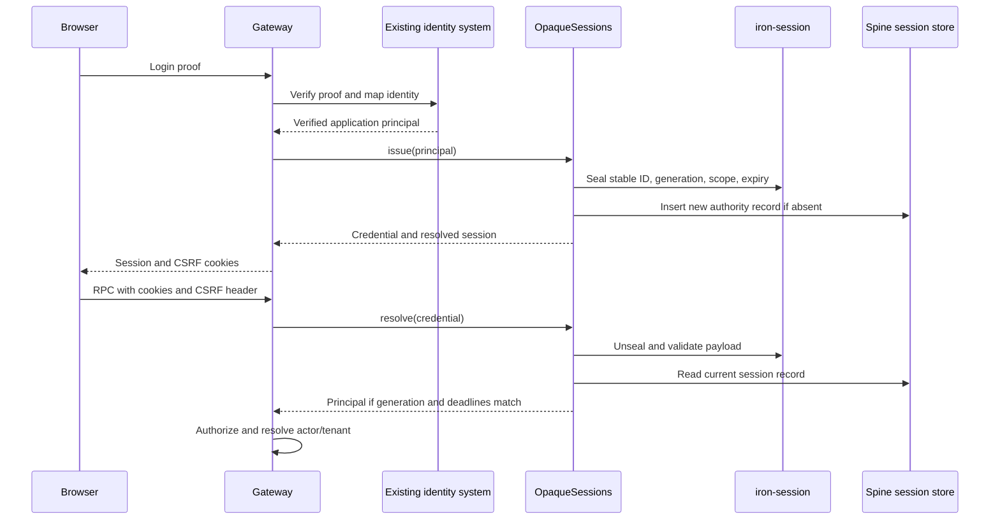
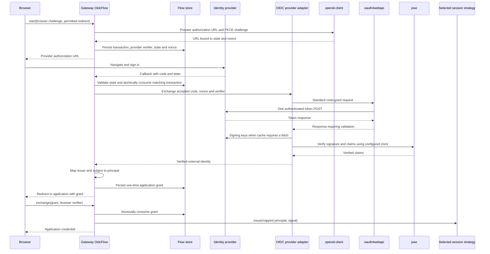
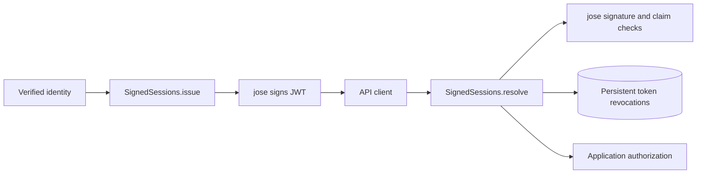
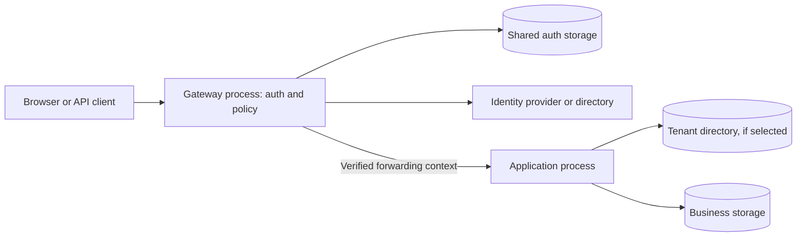

# Persistent tenant and authentication storage

This is the implementation specification for this task. It supersedes earlier proposal revisions. The examples describe the target API. [TASK.md](TASK.md) records which milestones are implemented, accepted or still pending. Implementation and review must use this document, including its acceptance criteria.

The final preparation rule is: **new persistent-store factories create missing supported structures and check compatibility by default, before returning**. Set `createMissingStructures: false` to skip both. **Existing business-storage eager/lazy behavior is unchanged.** There is no remaining scope question about either rule.

This proposal makes persistence an explicit application choice and uses maintained libraries for standard authentication mechanisms. It uses Spine strategies assembled from focused libraries. The application selects one session engine for a given login flow.

APIs in accepted milestones are implemented contracts; later milestone APIs remain proposed until their implementation and review are complete. Existing library calls are identified separately. Application configuration values in examples come from deployment configuration; example durations are not new framework defaults.

## 1. The problem and the resulting behavior

Before this task, the environment could infer a tenant index from a storage-provider catalog. A catalog of configured databases or existing namespaces is not an application tenant-registration directory. Opaque sessions and OIDC login state live in process-local maps, and there is no standard persistent signed-token revocation implementation.

After this change:

| Concern                         | Before                                            | After                                                                                                                                                                                          |
| ------------------------------- | ------------------------------------------------- | ---------------------------------------------------------------------------------------------------------------------------------------------------------------------------------------------- |
| Single-tenant environment       | An index can be inferred from the factory.        | Default `SINGLE_TENANT`; no tenant index is constructed or consulted.                                                                                                                          |
| Multi-tenant directory          | Provider-dependent catalog behavior.              | Application supplies an index; `PersistentTenantIndex` is the standard storage-backed option.                                                                                                  |
| Opaque sessions and login state | Process-local state.                              | Memory remains available; explicitly selected persistent stores survive restart.                                                                                                               |
| Signed-token logout             | Application supplies a revocation implementation. | `PersistentTokenRevocations` is available through the common factory.                                                                                                                          |
| Standard auth mechanics         | Some mechanisms implemented directly in Spine.    | Libraries process JWTs, OIDC, sealed credentials and cookie syntax.                                                                                                                            |
| Structure preparation           | SQL operations can prepare structures lazily.     | New persistent-store factories await creation and compatibility checks by default. Explicit `false` skips preparation, including on later data access; business-storage behavior is unchanged. |

Authentication answers who made a request. Authorization decides what that identity may do. A principal, tenant membership, subscription binding and login session remain different concepts.

## 2. Which libraries do what

| Library       | Responsibility                                                                                               | Persistent storage                                                                                                    |
| ------------- | ------------------------------------------------------------------------------------------------------------ | --------------------------------------------------------------------------------------------------------------------- |
| jose          | Sign and verify application JWTs; verify provider ID-token signatures and claims using the configured clock. | No session database inside jose. Spine checks its selected revocation source for application tokens.                  |
| openid-client | OpenID Connect discovery, authorization URLs and PKCE challenge generation.                                  | Spine persists the pending transaction before returning its authorization URL.                                        |
| oauth4webapi  | Construct, authenticate and send the standard authorization-code token request.                              | It returns a response; the provider adapter validates it and requires JOSE verification before returning an identity. |
| iron-session  | `sealData()` / `unsealData()` protect the reference carried by an opaque credential.                         | Spine stores authoritative session records. We do not use stateless cookie sessions as the authority.                 |
| `cookie`      | Parse Cookie headers and serialize Set-Cookie values.                                                        | None. Strict admission and CSRF protection remain separate.                                                           |

An opaque session credential is a value the browser does not interpret. A cookie and a Bearer header are transport mechanisms, not storage mechanisms. OIDC is the external login protocol; PKCE is its challenge/verifier proof, and CSRF means cross-site request forgery.

The component path retains explicit session transitions, identity mapping, storage adapters and local stream cancellation in Spine. It does not pretend that a sealing library implements those behaviors.

## 3. Tenant API and placement

`ServerEnvironmentSettings.tenantIndex` is already optional. The change is its type and default, not its optionality:

```typescript
/** Selects single-tenant execution without a tenant directory. */
export declare const SINGLE_TENANT: unique symbol;

/** Selects single-tenant execution or an application-supplied directory. */
export type TenantIndexSetting = typeof SINGLE_TENANT | TenantIndex;

// Inside ServerEnvironmentSettings:
/** Defaults to SINGLE_TENANT when omitted. */
readonly tenantIndex?: TenantIndexSetting;
```

Omission and explicit `SINGLE_TENANT` both mean no index. This configuration marker is distinct from the existing internal single-tenant execution identity used for storage routing.

Both `ServerEnvironment.tenantIndex` and `BoundedContext.tenantIndex` return `TenantIndexSetting`. Callers narrow before calling index methods. Bounded Context, Stand and subscription paths branch on tenant mode. A single-tenant Bounded Context returns the marker even inside a multi-tenant environment; a multi-tenant Bounded Context requires a real index. This is an explicit source-compatibility change.

Existing code assumes every getter returns a directory:

```typescript
const registered = await environment.tenantIndex.all();
```

The updated call site distinguishes the configured modes:

```typescript
const index = environment.tenantIndex;
if (index !== SINGLE_TENANT) {
  const registered = await index.all();
  // Process the registered application tenants.
}
```

TypeDoc on both getters must state the marker's meaning and the need for narrowing. In particular, reading a single-tenant Bounded Context's getter returns `SINGLE_TENANT` even when the environment supplies an index for other Bounded Contexts. Update maintained callers directly; no compatibility wrapper or data migration is introduced.

On the application process:

```typescript
ServerEnvironment.when(EnvironmentType.Production).use({
  storageFactory: applicationStorage,
  typeRegistry,
  tenantIndex: SINGLE_TENANT, // May be omitted.
});

const orders = await BoundedContext.singleTenant("Orders").add(OrderAggregate).build();
```

For a hosted application, register Acme before Acme creates its first order:

```typescript
const tenants = await PersistentTenantIndex.create({
  storageFactory: directoryStorage,
  group: new StorageGroup("orders_tenants"),
  createMissingStructures: true,
});

ServerEnvironment.when(EnvironmentType.Production).use({
  storageFactory: applicationStorage,
  typeRegistry,
  tenantIndex: tenants,
});

await tenants.keep(acmeTenantId);
const orders = await BoundedContext.multitenant("Orders").add(OrderAggregate).build();
```

These are assembly excerpts: the application imports its generated bootstrap and supplies its factory, registry, generated IDs and Entity classes. Registering Acme does not create a database or authorize a user.

A multi-tenant Bounded Context in a `SINGLE_TENANT` environment fails assembly before business storage access. A Bounded Context index override is allowed after the environment is configured for multiple tenants.

An existing tenant directory implements `TenantIndex` directly; no duplicate table is created. A read-only directory rejects `keep()`. The standard persistent implementation preserves complete Protobuf TenantId values, idempotent registration and the first registration time. `page()` performs bounded traversal with cancellation and continuation; `all()` deliberately requests the complete list. Paging does not promise a global snapshot during concurrent changes.

Remove the internal `StorageTenantIndex` and inferred `TenantIndexes.fromFactory()` path. Do not introduce `StoredTenantIndex`. The sole standard class is `PersistentTenantIndex`.

## 4. Factories, storage providers and preparation

Choose a storage-group name accepted by the selected provider. These examples use underscores so they also work with the MySQL provider's default table naming.

| Type                                                           | Public package                                |
| -------------------------------------------------------------- | --------------------------------------------- |
| `PersistentTenantIndex`, `SINGLE_TENANT`, `TenantIndexSetting` | `@spine-event-engine/server`                  |
| `PersistentOpaqueSessionStore`, `OpaqueSessionStore`           | `@spine-event-engine/auth`                    |
| `PersistentOidcFlowStore`, `OidcFlowStore`                     | `@spine-event-engine/auth`                    |
| `PersistentTokenRevocations`                                   | `@spine-event-engine/auth`                    |
| `BrowserCredentialReader` and browser hosting                  | Existing `@spine-event-engine/server/browser` |

New persistent classes have private constructors, asynchronous `create()` factories and asynchronous `close()`. There is no `ready()`. The auth package depends on common storage, not a server environment or one database provider.

```typescript
const store = await PersistentOpaqueSessionStore.create({
  storageFactory: authStorage,
  group: new StorageGroup("orders_auth"),
  // createMissingStructures defaults to true.
});
```

The common factory supplies actual RecordStorage handles for domain-correct Protobuf records and their keys/indexes. PostgreSQL, MySQL/MariaDB and Datastore implementations perform the physical operations. Memory uses the same relevant semantics but is process-local.

| `createMissingStructures` | During construction and later operations                                                                                                                         |
| ------------------------- | ---------------------------------------------------------------------------------------------------------------------------------------------------------------- |
| Omitted or `true`         | Before the factory resolves, create supported missing structures and check existing layouts. Reject incompatibility; never migrate data implicitly.              |
| Explicit `false`          | No schema existence/compatibility checks and no creation, during the factory or later data operations. Missing structures fail through ordinary data operations. |

Local option/capability checks and opening connections remain permitted. A partial preparation failure may leave created structures; retry must be safe. SQL providers need a per-handle preparation policy, because skipping eager preparation does not stop current lazy creation. A shared factory must not have a mutable global mode that changes unrelated handles.

Datastore kinds appear when entities are written. Deployment indexes, projects and credentials are not silently provisioned. Any required index deployment unsupported by the provider remains an explicit application deployment step.

The asynchronous factory is the preparation boundary. No partially prepared store is returned when preparation is enabled. An error rejects the call, releases resources acquired by that attempt, and leaves the injected factory available to its other consumers. Successful preparation is retained for that handle; ordinary operations do not repeat preparation on every request.

Normal startup prepares the selected store directly:

```typescript
const sessionStore = await PersistentOpaqueSessionStore.create({
  storageFactory: authStorage,
  group: new StorageGroup("orders_auth"),
});
// Supported missing structures now exist and compatibility checks completed.
```

An application that prepares structures separately explicitly opts out on its runtime process:

```typescript
const sessionStore = await PersistentOpaqueSessionStore.create({
  storageFactory: authStorage,
  group: new StorageGroup("orders_auth"),
  createMissingStructures: false,
});
// No schema checks or creation now or on later session operations.
```

For example, a deployment job can use the default preparation and close its handles. Runtime instances can then use `false` with credentials that cannot create tables. Without the explicit opt-out, runtime construction prepares the selected structures too. No framework timer invokes cleanup.

### Existing Bounded Context lifecycle

Business-storage behavior remains unchanged. `createStorageStructures: false` on a Bounded Context means **defer model preparation**, not permanently prohibit it. `startSubscriptionMonitoring: false` independently defers the initial monitoring pass. The first valid input awaits any deferred requirements before processing. Starting monitoring still prepares its shared registry dependencies.

Default build continues to prepare model storage and start monitoring:

```typescript
const orders = await BoundedContext.singleTenant("Orders").add(OrderAggregate).build();
```

Applications can assemble several Bounded Contexts and then prepare their structures centrally through the existing environment API:

```typescript
const environment = ServerEnvironment.instance();
await environment.completeSetup();

const orders = await BoundedContext.singleTenant("Orders").add(OrderAggregate).build({
  createStorageStructures: false,
  startSubscriptionMonitoring: false,
});

const billing = await BoundedContext.singleTenant("Billing").add(InvoiceAggregate).build({
  createStorageStructures: false,
  startSubscriptionMonitoring: false,
});

await environment.createStorageStructures();
await orders.runtime.startSubscriptionMonitoring();
await billing.runtime.startSubscriptionMonitoring();
// Start accepting traffic after the selected startup work completes.
```

For externally prepared structures, replace the creation call with:

```typescript
await environment.checkStructureCompatibility();
```

The environment methods operate on completed, open Bounded Contexts captured for that call. Without arguments they include single-tenant Bounded Contexts and traverse each multi-tenant Bounded Context's effective tenant index. Explicit IDs select matching multi-tenant Bounded Contexts:

```typescript
await environment.createStorageStructures(acmeTenantId);
await environment.checkStructureCompatibility(acmeTenantId, betaTenantId);
```

They do not register tenants, provision databases, or start subscription monitoring. Successful explicit checks satisfy readiness for the checked requirements. Later unprepared tenants can still initialize lazily.

A standalone Gateway prepares its explicitly selected auth stores through their factories; the environment methods do not discover those stores.

| Setting                                            | Meaning of `false`                                                          |
| -------------------------------------------------- | --------------------------------------------------------------------------- |
| New persistent-store `createMissingStructures`     | Skip schema checks and creation for that store, including later operations. |
| Existing Bounded Context `createStorageStructures` | Defer model preparation until explicit preparation or first valid input.    |

The shared provider changes must preserve this distinction for unrelated handles.

## 5. Component path: configuration

Use existing strategy objects with explicit options. Do not introduce a second universal authentication configuration language or pass unrestricted library options that can disable framework guarantees.

### Opaque sessions and iron-session

```typescript
const sessions = await OpaqueSessions.create({
  store,
  scope: "orders-browser",
  password: config.sessionSealKeys,
  ttlMilliseconds: config.sessionLifetimeMs,
  clock: applicationClock,
});
```

`store`, `scope`, `password` and factory-only construction are proposed additions. `ttlMilliseconds` and the trusted clock remain explicit session policy. Omitting `store` selects memory for local development; it still requires valid sealing configuration.

| Setting           | Behavior                                                                                                                                          |
| ----------------- | ------------------------------------------------------------------------------------------------------------------------------------------------- |
| `password`        | Secret or numeric version-to-secret map consumed by iron-session. Secrets come from application secret configuration.                             |
| `scope`           | Authenticated application/purpose binding; a cookie from another scope is rejected.                                                               |
| `ttlMilliseconds` | Authoritative credential and record lifetime. The library seal TTL is derived in seconds; its grace never extends the exact application deadline. |
| `clock`           | Application clock for validity and deterministic testing.                                                                                         |
| `store`           | Memory, standard persistent adapter, or application implementation of the store contract.                                                         |

Do not expose an independent unlimited seal TTL that conflicts with session expiry. Do not put user profiles or permissions into the seal. Memory-only capacity options do not become deployment-wide quotas when a persistent/custom store is selected.

### Cookies

The revised `OpaqueSessionCookies` uses cookie v2 syntax APIs internally. Keep existing names, origins, CSRF secret and header-size settings; add the deliberately bounded settings shown here:

```typescript
const cookies = new OpaqueSessionCookies({
  origins: [config.browserOrigin],
  csrfSecret: config.csrfSecret,
  sessionCookieName: "__Host-orders-session",
  csrfCookieName: "__Host-orders-csrf",
  sameSite: "lax", // Proposed configurable setting.
  persistent: false, // Proposed: browser-session cookie.
});
```

`sameSite` accepts the supported explicit browser policy (`lax`, `strict`, `none`); `none` still requires Secure and strict origin/CSRF admission. Browser third-party-cookie policy may prevent a cross-site deployment despite these flags. Prefer a same-site Gateway when possible.

The standard helper retains `__Host-` names, Path `/`, Secure, no Domain, and HttpOnly for the session cookie. The CSRF cookie is readable by the browser client so it can send the corresponding `x-spine-csrf` header. Those are invariants, not switches to turn off authentication protection. Applications requiring another cookie deployment shape can supply an external credential reader with an explicit policy.

The proposed `issue(value, expiresAt)` receives the issued session's deadline. If `persistent` is true, derive cookie expiry from that deadline; otherwise omit persistent browser expiry. Server validity never depends on whether the browser retained the cookie. Deletion uses the same name/path/domain identity. Rotation updates the session and CSRF values together.

### JWTs and jose

```typescript
const revoked = await PersistentTokenRevocations.create({
  storageFactory: authStorage,
  group: new StorageGroup("orders_auth"),
  issuer: config.tokenIssuer,
  audience: config.tokenAudience,
});

const signed = new SignedSessions({
  issuer: config.tokenIssuer,
  audience: config.tokenAudience,
  activeKey: config.activeSigningKey,
  retiredKeys: config.retiredVerificationKeys,
  ttlSeconds: config.tokenLifetimeSeconds,
  clockSkewSeconds: config.clockToleranceSeconds,
  maxTokenCharacters: config.maxTokenCharacters,
  clock: applicationClock,
  revocation: revoked,
});
```

These existing strategy settings map to jose signing/verification and framework claim validation. Preserve ES256, `kid`, existing claims, size bounds and retirement semantics. Do not accept whatever algorithm an untrusted token names. jose's broader algorithm support does not expand Spine's existing contract automatically.

`issuer` identifies the issuing service; `audience` identifies the intended recipient. The configured clock tolerance affects validation and the minimum revocation retention deadline. Keys are not stored in the revocation table. Existing tokens and new jose-generated tokens need bidirectional golden-token compatibility tests.

### OIDC libraries and configuration

Preserve the provider-facing configuration while replacing its standard protocol implementation:

```typescript
const discovered = await discoverOidcProvider({
  issuer: config.identityIssuer,
  clientId: config.oidcClientId,
  clientSecret: config.oidcClientSecret,
  clientAuthentication: "client_secret_basic",
  timeoutMilliseconds: config.providerTimeoutMs,
  maxResponseBytes: config.providerResponseLimit,
  fetch: applicationFetch,
});
if (discovered === undefined) throw new Error("Identity provider unavailable");

const loginStore = await PersistentOidcFlowStore.create({
  storageFactory: authStorage,
  group: new StorageGroup("orders_auth"),
  flowId: "employee-login",
});

const sessionIssuer: ApplicationSessionIssuer = {
  async issue(principal, signal) {
    const result = await sessions.issue(principal, signal);
    return result.kind === "created"
      ? { credential: result.credential, session: result.session }
      : undefined;
  },
};

const login = new OidcFlow({
  authorizationEndpoint: discovered.authorizationEndpoint,
  provider: discovered.provider,
  clientId: config.oidcClientId,
  callbackUri: config.oidcCallbackUrl,
  scopes: ["openid", "profile", "email"],
  allowedPostLoginRedirects: [config.applicationUrl],
  identityMapping: companyAccounts,
  sessionIssuer,
  store: loginStore,
  transactionTtlMilliseconds: config.loginTransactionLifetimeMs,
  grantTtlMilliseconds: config.loginGrantLifetimeMs,
  operationTimeoutMilliseconds: config.loginOperationTimeoutMs,
});
```

The app requests only the scopes it needs; profile/email are illustrative. Configure the callback exactly as registered at the provider. `companyAccounts` maps verified issuer/subject to a principal and can query an existing identity source.

The existing client-authentication choices remain `client_secret_basic`, `client_secret_post` and `none`; map them explicitly to the library. Additional methods require a separate supported-contract decision, not raw option passthrough. Explicit metadata via `createOidcProvider` remains available when discovery is not desired.

The adapter uses openid-client 6.8.9 for discovery, authorization URLs and PKCE challenges. It uses oauth4webapi 3.8.8, a library already used by openid-client, for one standard token request. Declare both as direct dependencies. Its request API accepts the exact callback URI, verifier, client-authentication method and operation signal.

The existing optional `discoveryEndpoint` still selects the exact metadata URL. A fetch wrapper scoped to discovery targets that configured URL, or the existing default URL when omitted. The returned metadata issuer must match the trusted `issuer` before the provider becomes usable. Because the library retains that wrapper on its returned configuration, the adapter immediately replaces it through the public `customFetch` setter with normal bounded application fetch. The discovery override is never applied to token or signing-key requests.

Authorization endpoints may retain unrelated static query parameters, such as `prompt=login`. Each new flow replaces protocol parameters such as `state`, `nonce`, `client_id`, `redirect_uri`, `response_type`, `scope`, `code_challenge` and `code_challenge_method`. The adapter removes their prior values before the library appends the current values. For example, `?prompt=login&state=old` becomes `?prompt=login&state=<new-state>` with one state value.

Before this change, the provider builds the token request itself. After this change, oauth4webapi builds and sends it through the application's bounded fetch adapter. The existing jose verifier still verifies the ID-token signature, issuer, audience, nonce and other accepted claims using the injected clock. The existing key cache retains its HTTP freshness rules, immediate unknown-key refresh and cancellation behavior for callers sharing a fetch.

This division preserves clock behavior during network waits. For example, if the configured clock advances past a token's expiry while signing keys are loading, verification rejects that token. openid-client's high-level grant API snapshots a wall-clock offset before those waits; the request-level API lets the existing verifier use the configured clock at verification. A successful token HTTP response is never sufficient to authenticate a user.

The adapter connects the existing `fetch`, timeout and response-size policy to the libraries' HTTP hooks and preserves cancellation. `OidcFlow` validates and consumes state before the provider exchange; the provider receives the accepted code, nonce and verifier. Issuer URLs and redirect policy are trusted configuration, never arbitrary request input. State, nonce and PKCE checks remain mandatory. Separate operation timeout and transaction lifetime: a short HTTP request deadline does not mean the user has only that long to complete login.

`OidcFlow.start(input, signal?)`, `callback(input, signal?)` and
`exchange(input, signal?)` accept the current request's optional `AbortSignal`.
Aborting one call cancels only that invocation; the shared flow remains usable
by other requests. Ordinary cancellation rejects with the signal's reason.
A distinct storage or issuer failure remains observable; failed compensation
takes precedence and preserves the cancellation and cleanup causes.
Existing calls without a signal remain valid, and an already closed flow keeps
its existing closed/rejected outcome.

The signal covers that request's storage and collaborator steps cooperatively.
Aborting it does not prove that an in-flight mutation stopped or rolled back.
The flow checks cancellation after awaited storage calls, awaits mutation
confirmation, and compensates only confirmed undisclosed writes as described
below. It does not change transaction or grant lifetime. Each provider, identity-mapping and
session-issuance call also retains the existing configured collaborator timeout;
no new storage timer or timeout default is introduced.

## 6. Component scenarios from start to finish

### A. Existing company login, persistent browser sessions

An existing login service verifies the supplied credential. The Gateway maps that identity to an `AuthenticatedPrincipal`, issues a session, and sends its cookies. It does not create a Users table.



Trusted login-handler excerpt:

```typescript
const principal = await companyLogin.verify(request, signal);
if (principal === undefined) return new Response(null, { status: 401 });
const issued = await sessions.issue(principal, signal);
if (issued.kind !== "created") return new Response(null, { status: 503 });

const headers = new Headers();
for (const value of cookies.issue(issued.credential.value, issued.session.expiresAt)) {
  headers.append("Set-Cookie", value);
}
return new Response(null, { status: 204, headers });
```

`companyLogin` is application code; Spine does not invent a password database behind it. The HTTP route must already have passed its origin, body-size and deadline policy. The browser copies the CSRF cookie value into `x-spine-csrf` on protected RPCs; `cookie` only handles syntax, not this policy.

After Gateway restart, the same factory placement and sealing keys resolve the stored session. A different factory group intentionally addresses different data. Memory development uses the same flow but loses sessions on restart.

### B. Employee login through an external OIDC provider

There are two distinct proofs: provider PKCE protects the provider code exchange, while the existing Spine browser proof protects exchange of the final application grant. Neither is the application session.



Flow calls inside the application's admitted routes use the current `request.signal`:

```typescript
const start = await login.start(
  {
    browserCodeChallenge: browserChallenge,
    postLoginRedirect: config.applicationUrl,
  },
  request.signal,
);
if (start.kind === "started") {
  // Return start.authorizationUrl to the browser for navigation.
}

const callback = await login.callback({ state: callbackState, code: providerCode }, request.signal);
if (callback.kind === "granted") {
  // Redirect only to callback.postLoginRedirect with the one-time grant.
}

const exchange = await login.exchange({ grant, browserCodeVerifier }, request.signal);
if (exchange.kind === "issued") {
  // Opaque strategy: issue cookies using credential and session expiry.
  // Signed strategy: return the bearer credential to the intended client.
}
```

Each call uses the signal of its own HTTP request. Completing the start request does not cancel the stored transaction while the browser visits the identity provider. The route parses validated input, preserves callback query parameters and handles provider-error callbacks separately. Browser-held proof material is not stored in a shared public URL. The application redirect handles the one-time grant without logging it and removes it from the visible URL after exchange.

`start()` becomes asynchronous even with memory storage. A failed transaction write returns no usable redirect. A repeated callback or grant exchange has at most one successful consumer. A crash after consuming state may require a new login; a database cannot atomically commit an external provider HTTP exchange.

Provider refusal, invalid proof, timeout, mapping failure or unknown account results in no session. Directory lookup failure is not anonymous success. Successful identity mapping does not itself grant access to every business tenant.

### C. Signed tokens for an API/native client

After its selected identity check, the issuer calls `signed.issue(principal)`. jose produces an ES256 JWT. The client sends `Authorization: Bearer <token>`; the Gateway or direct native authenticator verifies it before authorization.



```typescript
const issued = await signed.issue(principal);
if (issued.kind === "issued") {
  // Deliver issued.credential to the authenticated client.
}

const resolved = await signed.resolve({ kind: "bearer", value: token });
// Gateway applies its policy/context checks only if resolved is present.
```

Ordinary JWTs need no session table. With `PersistentTokenRevocations`, logout records the token ID through its full acceptance window. Without revocation, the explicit behavior is expiry-only logout: copied tokens remain valid until expiry. The standard request policy must not silently switch between these guarantees.

To use signed sessions after OIDC, supply an `ApplicationSessionIssuer` adapter mapping `signed.issue()`'s `issued` result to `{credential, session}`. This replaces opaque issuance; it does not issue both sessions. For browser cookies, use the opaque flow unless the application deliberately supplies another browser credential/CSRF integration. Do not put a bearer token into a URL.

### D. Rotation, logout, expiry and failures

An opaque login has a stable session ID and a credential generation. Rotation prepares a replacement seal then conditionally changes generation and deadline in the existing row. Reads never renew it. Explicit rotation sets a new deadline from the configured lifetime; previous credentials retain their original deadlines.

| Event                                                          | Behavior                                                                           |
| -------------------------------------------------------------- | ---------------------------------------------------------------------------------- |
| Two opaque rotations race                                      | One conditional update wins.                                                       |
| Logout deletes first                                           | Rotation cannot recreate the absent row.                                           |
| Rotation commits first, then old unexpired credential logs out | Stable ID identifies and deletes the same session.                                 |
| Delayed cookie response arrives after logout                   | Cookie has no authority row and cannot authorize.                                  |
| Old credential expires after a newer rotation                  | It cannot authorize or request logout. A fresh independent login is unaffected.    |
| Storage read fails                                             | Authentication fails; no anonymous fallback.                                       |
| Durable logout fails                                           | Report failure; do not report durable success merely because a cookie was cleared. |

Use iron-session's numeric key map for seal-key rotation: first deploy both keys to every validating instance, then activate the higher numeric ID for issuance, and later remove the old key after the acceptance window. Removing it early also removes old credentials' ability to request logout. Session-generation rotation and sealing-key rotation are different operations.

Signed-key rotation uses the existing `signed.rotate(nextKey)` and retained public keys. Preserve the previous acceptance window, key IDs and configured tolerance. Neither iron-session nor jose operates the application's secret-distribution system.

Issuance cancellation checks before persistence and before returning credentials. A late remote commit cannot be guaranteed undone by AbortSignal. When storage confirms an insert or replacement after cancellation, attempt conditional deletion of that undisclosed session and report any compensation failure. If storage throws without confirming the mutation, a matching record could be an earlier session; deleting it would risk revoking that session. Report the failure without claiming rollback or returning a successful credential. Close drains admitted work, including confirmed-write compensation.

For OIDC, cancellation before one-time consumption leaves valid state available.
Cancellation during or after a confirmed consume never restores it, retries the
provider code, or starts the next external step. A confirmed transaction or grant
insert that finishes after cancellation is conditionally removed before its
operation drains. An unknown commit has the same limitation described above.

The application session issuer must pass the supplied signal into durable
issuance and await any compensation, as the `sessions.issue(principal, signal)`
adapter above does. The flow cannot safely undo a custom issuer's hidden writes
when that issuer ignores cancellation. It can suppress a late credential and
wait for the issuer to settle. Every issuer rejection other than the exact
supplied abort reason rejects an exchange still awaiting its result. If timeout
or cancellation already ended that result, `close()` reports the late failure
after draining. The flow cannot infer an error category from an arbitrary
rejection. An issuer may return `undefined` for ordinary declined issuance; an
ordinary rejection with the exact supplied abort reason is cancellation and
does not introduce a drain failure.

### E. Existing external authentication without new framework records

An application already using another session service supplies its `SessionResolver` and credential reader. The resolver verifies the external credential and returns the application principal and expiry. It can use jose for an explicitly configured external JWT trust policy, but that is an external authenticator rather than silently broadening `SignedSessions` beyond its ES256 contract.

No second Spine login session is created. Tenant authorization remains application policy. External session deletion/invalidation needs an explicit notification integration if active local streams must stop immediately; request-time verification alone does not stop an existing stream.

## 7. Browser hosting and process topology

The browser host gains a replaceable `BrowserCredentialReader`. It receives a duplicate-preserving header view, method and URL, but cannot consume the RPC body. The host captures this immutable view before converting the incoming request to WHATWG `Headers` or `Request`:

```typescript
/**
 * Names inspected before invoking a browser credential reader or auth route.
 */
export interface BrowserCredentialAdmission {
  /**
   * HTTP CSRF field names; comparison is case-insensitive.
   */
  readonly csrfHeaderNames: readonly string[];

  /**
   * Cookie names that each select an alternative primary credential.
   * Supporting proofs for a selected credential use stateCookieNames.
   */
  readonly credentialCookieNames: readonly string[];

  /**
   * Supporting authentication-state cookies, including CSRF and login state.
   * These are duplicate-sensitive but do not independently select a login.
   */
  readonly stateCookieNames: readonly string[];
}

/**
 * Extracts one admitted credential without consuming the RPC body.
 */
export interface BrowserCredentialReader {
  /**
   * Fixed names from the same configuration used to read credentials.
   */
  readonly admission: BrowserCredentialAdmission;

  /**
   * Returns absence, rejection, or a credential; errors mean unavailable.
   *
   * @param request Immutable raw headers, method and a request-local parsed URL.
   * @returns The extracted credential, absence or rejection.
   */
  read(request: {
    /**
     * Lowercase field names with original values and multiplicity.
     */
    readonly headers: Readonly<Record<string, string | readonly string[] | undefined>>;

    /**
     * HTTP method used for admission.
     */
    readonly method: string;

    /**
     * Parsed request URL retaining query parameters.
     */
    readonly url: URL;
  }): Promise<RequestCredential | undefined | { readonly kind: "rejected" }>;
}
```

`undefined` means absent, `rejected` means malformed/ambiguous input without fallback, and an exception means unavailable rather than anonymous admission. Supplying both `credentials` and legacy `cookies` is a configuration error. The revised standard cookie helper implements the interface. External readers retain their engine's native credential format.

Header names are normalized to lowercase; individual values and their multiplicity are preserved. The host rejects repeated Authorization, Origin and configured CSRF header fields before invoking any reader or auth route. Cookie fields are inspected without losing field boundaries or duplicate cookie names: ambiguous repeated authentication/CSRF cookies are rejected, while protocol-permitted split Cookie fields may be combined only after that inspection. The same admission rules apply to standard and external readers; normalized `Headers` alone is not sufficient evidence that the original request was unambiguous. For example, two Authorization fields are rejected even if a platform would combine them into one string.

Before this change, the host cannot discover a custom reader's cookie or CSRF names without calling it. After this change, every reader and every `BrowserAuthRoute` supplies the required `admission: BrowserCredentialAdmission` value. The same declaration describes both boundaries, including an auth route that calls a different engine from the RPC reader. The types are exported from `@spine-event-engine/server/browser`. Required empty arrays explicitly mean that a category is unused; missing metadata is a startup error, including for JavaScript callers.

`credentialCookieNames` lists alternative primary credentials. `stateCookieNames` lists supporting cookies, such as CSRF proofs and login state, which cannot independently identify a session. The standard helper derives its immutable declaration from its actual configured session and CSRF names plus `x-spine-csrf`. It satisfies the reader structurally without an auth-to-server package dependency. Do not repeat its names in a separate host policy.

Before its first asynchronous startup step, the host validates and copies each declaration, its arrays and the selected route configuration into one immutable host policy. It uses that same snapshot for preflight, listener setup and request handling, including when combined startup awaits the native server. A reader receives a separate parsed URL value; its mutable URL methods cannot change the host's selected route or configuration. HTTP names are valid tokens and normalized to lowercase; cookie names are valid tokens and remain case-sensitive. Reject missing or sparse arrays, non-string or invalid/empty names, duplicate header names after normalization, duplicate cookie names within a declaration, and overlap between its credential and state cookies. `authorization`, `origin` and `cookie` cannot be configured as CSRF headers because the host handles them directly. Reusing names across declarations is valid. Later caller mutation cannot change host admission; integrations must also keep their effective engine configuration fixed.

Early duplicate rejection uses the union of the reader and all route declarations. Inspect Cookie pairs across and within raw fields before the library's first-value parser can hide repetition. Equal repeated selected values also reject. Malformed Cookie syntax rejects; repeated unrelated cookie names alone do not. Preserve legal split Cookie fields and combine them only after this inspection.

Simultaneous-credential rejection uses only the active RPC reader or the selected auth route. Reject Authorization together with any of that declaration's primary cookies, or more than one distinct primary cookie. Even an empty primary cookie counts as present: an invalid credential cannot trigger fallback. Supporting state cookies alone are not a second credential. A cookie used solely by another mounted engine does not become an RPC credential.

When neither `credentials` nor `cookies` is supplied, the default reader accepts a single valid Bearer field or absence and rejects malformed Authorization. Its three declaration arrays are empty. Fixed Authorization/Origin checks still apply, as do duplicate checks contributed by mounted routes. A callback must declare the state cookie it consumes even on a bearer-only Gateway. The host never invokes a reader or route to discover names. These declarations are a contract with trusted application code; they cannot prove that arbitrary executable code truthfully lists every name it uses.

The host matches exact admitted auth route pathnames while retaining query parameters for callbacks. It forwards every Set-Cookie separately. Existing route-specific method, origin, body-size and timeout rules remain. Origin-less navigation is allowed only on explicitly configured login callback routes that validate their protocol state, not on password login, logout or RPC routes. Routes must not collide with reserved RPC paths.

### Separate Gateway



The Gateway constructs auth storage/strategies directly. It needs no `ServerEnvironment` or Bounded Context for that purpose. The application process configures its environment and Bounded Contexts, verifies forwarding proof and executes business work.

```typescript
const loginRoute: BrowserAuthRoute = {
  path: "/auth/login",
  method: "POST",
  origins: [config.browserOrigin],
  maxRequestBytes: config.loginMaxBytes,
  timeoutMs: config.loginTimeoutMs,
  admission: cookies.admission,
  onRequest: applicationLogin,
};

const gateway = await BrowserServer.run({
  ...transportOptions,
  backend: { baseUrl: config.applicationBackendUrl },
  origins: [config.browserOrigin],
  sessions,
  credentials: cookies,
  authRoutes: [loginRoute],
  authorize: policy.authorize.bind(policy),
  contexts: contextResolver,
  bindings: subscriptionBindings,
});
```

`transportOptions` contains the existing registry, listener, clock and forwarding-proof configuration. `applicationLogin` wraps the scenario calls above with explicit HTTP validation and uses the same cookie helper. A callback that also consumes a separate state cookie must include that configured name in its route declaration. Subscription bindings are not login records.

### External reader and independent callback

This example keeps an existing authentication service and mounts a separate directory callback. `externalConfig` is the same fixed configuration used by `externalAuth`; `externalCallback` validates its protocol state before any exchange. Its state cookie is checked before the callback runs, even though it is not an RPC session credential.

```typescript
const externalPolicy: BrowserCredentialAdmission = Object.freeze({
  csrfHeaderNames: Object.freeze([externalConfig.csrfHeaderName]),
  credentialCookieNames: Object.freeze([externalConfig.sessionCookieName]),
  stateCookieNames: Object.freeze([externalConfig.csrfCookieName]),
});

const credentials: BrowserCredentialReader = Object.freeze({
  admission: externalPolicy,
  read: externalAuth.read.bind(externalAuth),
});

const callbackPolicy: BrowserCredentialAdmission = Object.freeze({
  csrfHeaderNames: Object.freeze([]),
  credentialCookieNames: Object.freeze([]),
  stateCookieNames: Object.freeze([externalCallback.config.stateCookieName]),
});

const callbackRoute: BrowserAuthRoute = {
  path: "/directory/callback",
  method: "GET",
  origins: [config.browserOrigin],
  allowMissingOrigin: true,
  maxRequestBytes: config.callbackMaxBytes,
  timeoutMs: config.callbackTimeoutMs,
  admission: callbackPolicy,
  onRequest: externalCallback.handle.bind(externalCallback),
};

const gateway = await BrowserServer.run({
  ...transportOptions,
  backend: { baseUrl: config.applicationBackendUrl },
  origins: [config.browserOrigin],
  sessions: externalAuth.sessions,
  credentials,
  authRoutes: [callbackRoute],
  authorize: policy.authorize.bind(policy),
  contexts: contextResolver,
  bindings: subscriptionBindings,
});
```

The missing-Origin exception applies only to this explicitly configured callback. It does not bypass duplicate, method, body, deadline or protocol-state checks. Omitting `credentials` selects bearer-only RPC admission while retaining the callback's declared checks.

### Combined process and two-process deployments

In one process, configure `ServerEnvironment`, build Bounded Contexts, create the native server and compose `BrowserServer.open(await server.start(), gatewayOptions)`. Build the same auth components alongside it. Factories may be shared; groups and resource shutdown remain explicit.

Two processes on one machine behave like a separate Gateway: they do not share memory or cancellation signals. Native clients without a Gateway use `ServerOptions.services.readerAdmission.direct` and open relevant auth stores on the application process instead.

### Future replicas

Instances serving the same application share storage placement, credential keys/secrets, scopes, public URL and cookie/flow configuration. Atomic session mutation and one-time consumption prevent inconsistent storage decisions. Shared records do not distribute cancellation notifications or coordinate subscription activation. Actual Gateway replication remains separate work.

## 8. Active streams, cleanup and shutdown

A stream can outlive its admission request. Revoking storage prevents later validation; it does not by itself stop output already being forwarded.

Extend `SessionResolver.resolve(credential, lifetime?)` with an optional operation signal and `ResolvedSession` with `invalidated?: AbortSignal`. No lifetime means one validation and no retained monitor. Supplying a lifetime registers only until rejection/error, operation end, session expiry, invalidation or strategy close.

The subscription Gateway must pass its operation signal, link it to cancellation/expiry/shutdown, and abort/release it in `finally` on normal completion and every failure path. Register before the authoritative validity read and recheck cancellation before forwarding. Component opaque monitors use stable session ID; signed-token monitors use scoped token ID. Logout routes and admission share the same integration instance.

Successful durable logout signals local monitors before returning. Stop forwarding immediately/best effort through the existing backend abort path. Bytes already sent cannot be recalled and already-admitted commands may finish. Failure to revoke is reported even if local streams were stopped. Cross-process stream cancellation requires future notification work.

### Monitored session validity

With a lifetime signal, every successful standard-strategy resolution returns an `invalidated` signal. It aborts on local logout, the captured resolved session deadline, or strategy close. Register by authenticated stable identity before the authoritative record/revocation read. Check already-aborted signals on attachment and recheck lifetime and invalidation after awaited work before returning authority. This closes the race where a read captured valid data just before logout.

Use the strategy's existing configured clock and returned session deadline. Schedule that expiry only; release its timer and listeners on every earlier exit. Platform timer-range handling must not shorten the session. A rotated opaque credential does not extend a stream's captured deadline. Signed-token clock tolerance still governs token verification and revocation retention, while the returned `expiresAt` governs the operation's expiry. Do not start a monitored operation whose returned deadline has passed, and do not lengthen it to the revocation retention deadline. One-shot verification without a lifetime retains its existing acceptance rules and creates no monitor or timer.

Strategy close aborts monitors before draining short admitted work, so active streams do not keep close waiting for their own invalidation. Operation completion releases its monitor without logging out other operations. Custom external resolvers may omit invalidation, but then provide no local revocation guarantee. For the native guarantees below, an external integration must provide a signal covering its expiry and invalidation. The Gateway retains its own explicit expiry checks for external resolvers.

### Direct native admission

Before this change, a direct native authenticator returns only trusted identity and authority facts. It can observe transport cancellation but cannot return session invalidation to an active native stream. After this change, the host supplies an explicit operation `signal`, and authentication returns those facts plus an optional process-local invalidation signal:

```typescript
/**
 * Verified native admission facts and optional process-local invalidation.
 */
export interface ReaderAdmissionResult {
  /**
   * Identity and authority facts, detached by the receiving ingress.
   */
  readonly reader: TrustedReaderContext;

  /**
   * Ends this invocation when its authentication ceases to be valid.
   * The host observes an already-aborted signal before dispatching work.
   */
  readonly invalidated?: AbortSignal;
}

/**
 * Authenticates a direct native invocation through a configured port.
 *
 * @typeParam Peer Transport-specific peer facts.
 */
export interface DirectReaderAuthenticator<Peer> {
  /**
   * Verifies admission and returns invalidation when the integration can signal it.
   *
   * @param request Canonical operation, peer and host-managed lifetime.
   * @returns Verified admission, or undefined to deny admission.
   */
  authenticate(request: {
    /**
     * Canonical RPC service.
     */
    readonly service: string;

    /**
     * Canonical RPC method.
     */
    readonly method: string;

    /**
     * Serialized Protobuf request.
     */
    readonly value: Uint8Array;

    /**
     * Incoming transport headers.
     */
    readonly headers: ReaderHeaders;

    /**
     * Transport-specific peer facts; its signal is not the lifetime API.
     */
    readonly peer: Peer;

    /**
     * Aborts on cancellation and every terminal invocation exit, including
     * successful completion. For Activate it spans the entire iterator.
     */
    readonly signal: AbortSignal;
  }): ReaderAdmissionResult | undefined | Promise<ReaderAdmissionResult | undefined>;
}
```

Export both types from `@spine-event-engine/server`. The existing `TrustedReaderAdmission` input also receives the required `signal`. Ingress returns this result shape for every path: direct authentication supplies it; verified forwarded admission wraps its verified reader facts; deliberately public admission wraps empty reader facts. Failed forwarding assertions never fall back to direct authentication. Update maintained callers directly to the result shape.

At ingress, read the result properties once, detach trusted reader facts using the existing snapshot, capture the invalidation signal separately, and freeze a new wrapper. Later replacement of caller properties cannot change the admitted facts or linked signal. Malformed results/signals fail as sanitized authentication errors. Neither signal enters `TrustedReaderContext`, Protobuf records, retained subscription identity, child forwarding proofs or another process.

The host creates the operation signal before authentication, links transport cancellation and the captured invalidation signal, and aborts/releases it in an outer `finally`. Check cancellation before dispatch and immediately before output after asynchronous work. This signal ends on normal completion too; it does not assume that the transport peer signal aborts when a handler returns. Pending admission must also receive host shutdown. A custom collaborator must cooperate with cancellation; no new watchdog or forced termination is implied.

| Native operation    | Lifetime and resulting behavior                                                                                                                                                                                                                               |
| ------------------- | ------------------------------------------------------------------------------------------------------------------------------------------------------------------------------------------------------------------------------------------------------------- |
| Post, Read, Execute | Starts before authentication and ends after the handler settles. Pass effective cancellation through read filtering and child I/O; check before dispatch. Already-admitted Commands may complete.                                                             |
| Subscribe           | A unary lifetime covers authentication, definition creation and response. Release its monitor when it ends; retain the existing subscription definition and reader facts only. Clean up a newly created definition if cancellation prevents returning its ID. |
| Activate            | Authenticate again and check the existing principal binding. The lifetime spans the entire iterator, including admission, ACK and every update. Exhaustion, iterator return, failure, expiry, logout and disconnect all release it.                           |
| Cancel              | Fresh unary authentication and binding check last through cancellation. Existing subscription cancellation stops active delivery; invalidation of an Activate independently stops its output even when a revoked credential cannot issue Cancel.              |

Standalone services and the Coordinator both use this lifetime. Coordinator fan-out receives the effective signal through existing child operations. Guard ACKs, queued/dequeued updates and child callbacks against cancellation; a value already queued must not escape after invalidation. Keep only reader facts in retained bindings. Existing cleanup cancels all created child definitions with its independent cleanup signal, preserving reader proof material and reporting cleanup failure even though local output has stopped. Do not reuse an already-aborted authentication signal for those required cleanup calls.

For example, this native application creates its auth components alongside its Bounded Contexts and uses the same `sessions` object for admission and logout. It needs no BrowserServer or Gateway:

```typescript
import type { SignedSessions } from "@spine-event-engine/auth";
import { Server, type ReaderAdmissionResult, type ServerOptions } from "@spine-event-engine/server";

/**
 * Composes native RPC admission with the application's session strategy.
 *
 * @param sessions Shared local instance used for resolution and logout.
 * @param contexts Application Bounded Contexts exposed by the Server.
 * @returns A native server ready to start.
 */
function nativeServer(
  sessions: SignedSessions,
  contexts: NonNullable<ServerOptions["contexts"]>,
): Server {
  return new Server({
    contexts,
    services: {
      readerAdmission: {
        direct: {
          /**
           * Resolves a native bearer credential for this invocation.
           *
           * @param request Native peer and host-managed lifetime.
           * @returns Admission facts and local invalidation, or denial.
           */
          async authenticate(request): Promise<ReaderAdmissionResult | undefined> {
            const authorization = request.peer.requestHeader.get("authorization");
            const match = /^Bearer ([^\s,]+)$/i.exec(authorization ?? "");
            const token = match?.[1];
            if (token === undefined) return undefined;
            const session = await sessions.resolve(
              { kind: "bearer", value: token },
              request.signal,
            );
            if (session?.invalidated === undefined) return undefined;
            return {
              reader: { principal: session.principal },
              invalidated: session.invalidated,
            };
          },
        },
      },
    },
  });
}
```

The standard `SignedSessions` strategy must return invalidation when given `request.signal`. This example denies admission if that required signal is missing. The result property is optional for custom authenticators with the limitations described above; it is not permission for a monitored standard strategy to omit expiry/logout cancellation.

The application calls `await sessions.logout(credential)` on that same strategy and checks the existing `revoked`, `unavailable` or `expiryOnly` outcome. The latter two do not establish durable logout. Application-specific authority facts require their own policy check inside the same lifetime; credential transport fields do not imply tenant membership. The example's narrow native Bearer parser does not replace browser raw-header admission.

Acceptance must observe real native Subscribe/Activate output and backend cancellation after logout and expiry, including Coordinator fan-out. Test logout during a paused authoritative read; invalidation before linking; paused proof/filter/backend work; buffered ACKs and updates; normal unary completion with a still-live peer signal; iterator exhaustion/return; rejection, malformed results, backend failure and shutdown during admission. Assert monitor/listener/timer release on every exit and no lifecycle signals in serialized proofs. Compile the maintained native example against public exports. A signal in one process does not cancel streams in another process.

### Explicit storage maintenance

All proposed persistent adapters expose explicit application-invoked expiry maintenance:

```typescript
await sessionStore.purgeExpired(cutoff, maintenanceSignal);
await loginStore.purgeExpired(cutoff, maintenanceSignal);
await revoked.purgeExpired(cutoff, maintenanceSignal);
```

`cutoff` is a trusted current or earlier Protobuf Timestamp; older cutoffs retain expired data longer. No background cleanup timer or automatic provider TTL is enabled. Validity does not depend on physical cleanup. Logout and one-time consumption remain intentional data mutations.

For example, a session that expires at 10:00 is rejected at 10:01 even if its record remains. The application can later invoke maintenance:

```typescript
import { timestampFromDate } from "@bufbuild/protobuf/wkt";

const cutoff = timestampFromDate(new Date());
await sessionStore.purgeExpired(cutoff, maintenanceSignal);
```

To retain expired records longer, the application supplies an older cutoff:

```typescript
const cutoff = timestampFromDate(
  new Date(Date.now() - config.expiredAuthRecordRetentionMilliseconds),
);
await sessionStore.purgeExpired(cutoff, maintenanceSignal);
```

That retention setting is application policy, not a framework default. The application chooses the invocation mechanism. Delaying expiry cleanup does not retain records deliberately deleted by logout or successful one-time consumption; an immutable audit log is separate work.

Cleanup traverses finite pages and uses conditional deletion so it cannot delete an extended row. Continuation must remain correct when earlier rows disappear. Repeat/concurrent calls are safe; cancellation/failure may leave partial progress and rejects the call. Revocations remain until the full token acceptance window ends. Tenant registrations have no expiry cleanup. Audit retention is a separate application policy.

Stop listeners/active work, close strategies and flow instances, then have the host close injected store handles and factories after all consumers finish. A flow closes only its internally created memory store; injected stores and factories remain open. `close()` rejects new work and drains admitted work; it does not purge records or close an injected shared factory. `OidcFlow.close()` becomes awaitable to cover persistent work and actual
collaborator promises, including work that settles after a caller-facing timeout.
It waits for confirmed-write compensation and reports a retained late issuer
failure. Custom collaborators must settle cooperatively; an abort signal does
not forcibly stop remote work, and no new drain deadline is added. Repeated close
calls keep the same completion or failure. A combined process coordinates this
with environment shutdown.

## 9. Complete record inventory

Each family is optional at application level and required only when its persistent implementation is selected. Calling the selected persistent-store factory prepares its families by default. Explicit `false` disables preparation.

| Family                      | Required by                  | Key/data                                                              | Process using it                        |
| --------------------------- | ---------------------------- | --------------------------------------------------------------------- | --------------------------------------- |
| Tenant registration         | PersistentTenantIndex        | Complete TenantId, first registration time                            | Application / provisioning process      |
| Component opaque session    | PersistentOpaqueSessionStore | Stable ID, generation, principal, expiry                              | Gateway/auth or direct native admission |
| Component login transaction | PersistentOidcFlowStore      | Flow-scoped lookup digest, proof and provider binding, expiry         | Gateway/auth                            |
| Component login grant       | PersistentOidcFlowStore      | Flow-scoped lookup digest, mapped principal and browser proof, expiry | Gateway/auth                            |
| Signed-token revocation     | PersistentTokenRevocations   | Scoped token ID and retention deadline                                | Token-validating process                |

Each record specification declares its indexes and atomic constraints. Do not create every family merely because the auth package was imported. Memory variants hold the corresponding state in process without persistent tables.

Users/passwords, role and permission directories, user-to-tenant membership, identity links, provider tokens, extra login factors and audit are not automatically introduced by the component path. Keys and application secrets remain in application secret configuration.

## 10. Production acceptance

The retained tenant and authentication paths require the normal build and review gates. Required acceptance includes:

- No tenant index or catalog access in single-tenant assembly; explicit index for multi-tenant paths.
- Omitted or explicit `true` preparation creates/checks selected structures before the async factory resolves; incompatibility and preparation failures reject construction. Explicit `false` performs no schema checks/DDL during construction or later data use.
- Preparation is idempotent under concurrent factories, cleans up failed-attempt handles, and does not close injected factories or alter unrelated handles.
- Mixed default/`true` and `false` stores sharing one factory/group remain isolated, including concurrent construction, failed preparation, retry and later reads through the skipped-preparation handle.
- Existing Bounded Context eager/lazy preparation, monitoring flags, and environment/runtime creation/check APIs retain their behavior.
- Domain-correct Proto records, complete tenant identities and bounded/indexed traversal on each provider.
- Correct library option mapping; exact deadlines, key rotation and failure behavior; no configurable bypass of mandatory validation.
- Duplicate-sensitive header admission occurs before normalization for standard and external paths. Cover repeated Authorization, Origin, Cookie and CSRF fields, including ambiguous cookie names and protocol-permitted split Cookie fields.
- Opaque rotation/logout races, one winner for conditional rotation, replacement-seal/row deadline equality, no resurrection after deletion.
- One-time login consumption across independent processes and correct cancellation/late-commit handling.
- Existing/new ES256 token compatibility and complete time/claim boundary tests.
- Monitor registration before admission read and release on every exit; local cancellation without falsely claiming distributed cancellation.
- Manual cleanup preserving concurrently renewed records, plus bounded pagination/cancellation.
- PostgreSQL, MySQL/MariaDB and Datastore adapter tests, plus memory. An emulator does not prove cloud IAM/index deployment.
- Package exports, dependency boundaries, TypeDoc, reference docs and executable configuration examples match actual APIs.

## 11. Implementation sequence

Use this document as the specification for implementation and review. Older false-default or business-lifecycle-change proposals are superseded.

1. Add the per-handle preparation behavior and `PersistentTenantIndex`. Verify the default create/check path, explicit skip path, and unchanged business-storage lifecycle.
2. Implement the component auth stores and library integrations, including record contracts, atomic transitions and explicit cleanup.
3. Integrate browser credential admission, auth routes, shutdown and local stream invalidation.
4. Complete provider tests, public exports, TypeDoc, maintained examples and repository verification/review gates.

Experimental private provider shims are evidence, not production implementation. Replace them with supported provider mechanisms. Do not copy the lab's whole-table scans into the production adapters.

Every implementation slice must trace its behavior and tests to the acceptance criteria above. A material change required by provider or library evidence must update this specification and receive the relevant review before implementing a different contract. This task does not change business-storage defaults, introduce migrations, add an authentication audit subsystem, or implement Gateway replication.

## Physical index preparation

A queryable record column and a physical database index are separate structures.
Today generic record specifications declare columns, while SQL preparation creates
and checks the table and primary key. Auth expiry and identity lookups also need
secondary indexes. The record specification will declare those requirements so
the selected persistent factory can prepare the complete structure before it
returns.

`RecordSpecOptions.indexes` is optional. Each `RecordIndex` names one non-unique,
ascending index and lists its ordered columns; `id` denotes the actual storage
slot ID. Specifications without indexes retain existing behavior. SQL preparation
creates missing declared indexes and checks complete compatible definitions.
Existing incompatible indexes cause rejection. The framework does not replace or
repair them. The provider-only preparation contract explicitly advertises index
support; a custom provider cannot silently ignore a declared requirement.

The persistent factory option remains exactly as described earlier:
`createMissingStructures` defaults to true and waits for table and index
preparation. False performs no schema or index probes or creation at construction
or during later data operations. Local declaration validation is still performed.
Existing Bounded Context business-storage preparation remains unchanged.

Auth records keep their full domain fields and Timestamp values. Derived lookup
columns use `ColumnTypes.fixedBytes(byteLength)`: complete equality inputs produce
32-byte SHA-256 candidate keys; expiry produces a reversible 12-byte component
that preserves signed seconds and nanoseconds in sort order. Flow-specific OIDC
cleanup prefixes that component with the 32-byte flow digest in one indexed
44-byte property. Its range is bounded by that flow prefix and the selected
cutoff, so another flow's records are not scanned. The complete flow identity
is still checked against the record. These widths come from the encodings and
impose no new length limit on user IDs, emails or other input.
Every equality candidate is checked against the complete original predicate;
a digest is neither a uniqueness constraint nor sufficient authentication proof.

Cleanup finds the next eligible expiry key, pages through that exact key in
storage-ID order, then advances to the next expiry. Deleting an earlier row does
not shift later pages. Conditional deletion preserves a concurrently changed
record. Query filters, continuation and page size execute at the provider. The
implementation must not materialize the entire record family or impose a new
maximum number of pages.

The selected Datastore query shapes use built-in property indexes and ascending
key traversal. Datastore does not deploy cloud indexes, projects or credentials.
Any future query requiring a composite deployment index must declare that
requirement explicitly. Emulator success alone does not establish cloud readiness.

[M3A](M3A.md) specifies the storage API, provider compatibility checks, exact byte
ordering, bounded query paths and acceptance tests. This prerequisite preserves
the auth APIs and deployment scenarios in this proposal.
