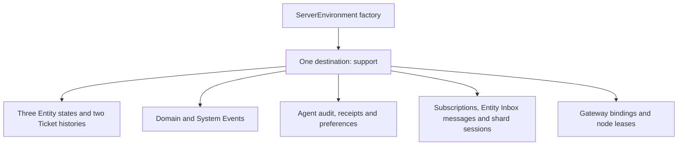
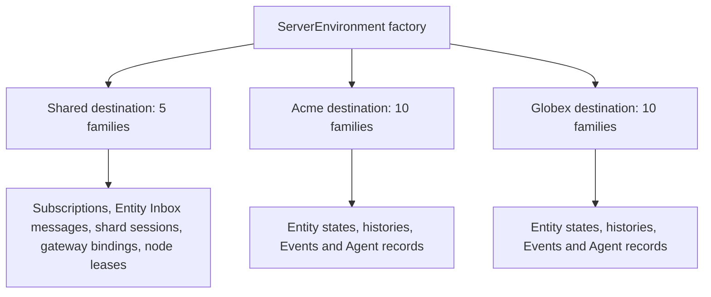
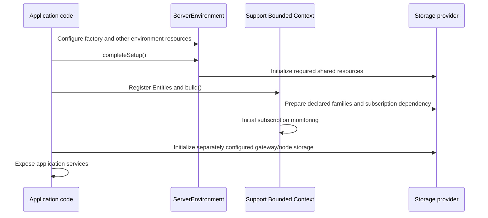

# Storage layout and provisioning

This guide takes a small Support application and shows what it stores. Choose
the single-tenant or multitenant chapter, then the storage provider you use.
Each table or Datastore kind is listed with every field, its Protobuf source,
and an example value. Beside each layout, you can see who creates it and how
to change its name where the API supports that.

Chapter 3 follows values from their Proto definitions into storage. The
remaining chapters explain Agent records, gateway/authentication records, and
the startup calls that prepare the application.

## Contents

<!-- storage-layout-toc -->

- [1. Single-tenant mode](#1-single-tenant-mode)
  - [The Support example](#the-support-example)
  - [PostgreSQL](#postgresql)
    - [Domain Entity state tables](#domain-entity-state-tables)
      - [Ticket current state: `spine.example_support_ticket`](#ticket-current-state-spineexample_support_ticket)
      - [TicketList current state: `spine.example_support_ticketlist`](#ticketlist-current-state-spineexample_support_ticketlist)
      - [ReplyAssistant current state: `spine.example_support_replyassistant`](#replyassistant-current-state-spineexample_support_replyassistant)
    - [Framework tables for Events, histories and services](#framework-tables-for-events-histories-and-services)
      - [Ticket state history: `spine.example_support_ticket_entityrecord`](#ticket-state-history-spineexample_support_ticket_entityrecord)
      - [Ticket diagnostic Event history: `spine.example_support_ticket_event`](#ticket-diagnostic-event-history-spineexample_support_ticket_event)
      - [Support domain Events: `spine.support_event`](#support-domain-events-spinesupport_event)
      - [Support System Events: `spine.support_system_event`](#support-system-events-spinesupport_system_event)
      - [Agent audit: `spine.agent_history_agenthistoryrecord`](#agent-audit-spineagent_history_agenthistoryrecord)
      - [Agent acceptance receipts: `spine.spine_agent_acceptance_agentacceptancereceipt`](#agent-acceptance-receipts-spinespine_agent_acceptance_agentacceptancereceipt)
      - [Agent model preferences: `spine.spine_agent_model_preferences_agentmodelpreferencesrecord`](#agent-model-preferences-spinespine_agent_model_preferences_agentmodelpreferencesrecord)
      - [Subscription registry: `spine.spine_client_subscriptionrecord`](#subscription-registry-spinespine_client_subscriptionrecord)
      - [Entity Inbox messages: `spine.spine_server_delivery_inboxmessage`](#entity-inbox-messages-spinespine_server_delivery_inboxmessage)
      - [Delivery shard sessions: `spine.spine_server_delivery_shardsessionrecord`](#delivery-shard-sessions-spinespine_server_delivery_shardsessionrecord)
      - [Gateway authenticated bindings: `spine.spine_auth_gatewayauthenticatedsubscription`](#gateway-authenticated-bindings-spinespine_auth_gatewayauthenticatedsubscription)
      - [Application node leases: `spine.spine_deployment_applicationnodelease`](#application-node-leases-spinespine_deployment_applicationnodelease)
    - [Factory setup](#factory-setup)
    - [Human configuration checklist](#human-configuration-checklist)
  - [MySQL and MariaDB](#mysql-and-mariadb)
    - [Domain Entity state tables](#domain-entity-state-tables-1)
      - [Ticket current state: `example_support_Ticket`](#ticket-current-state-example_support_ticket)
      - [TicketList current state: `example_support_TicketList`](#ticketlist-current-state-example_support_ticketlist)
      - [ReplyAssistant current state: `example_support_ReplyAssistant`](#replyassistant-current-state-example_support_replyassistant)
    - [Framework tables for Events, histories and services](#framework-tables-for-events-histories-and-services-1)
      - [Ticket state history: `example_support_Ticket_EntityRecord`](#ticket-state-history-example_support_ticket_entityrecord)
      - [Ticket diagnostic Event history: `example_support_Ticket_Event`](#ticket-diagnostic-event-history-example_support_ticket_event)
      - [Support domain Events: `Support_Event`](#support-domain-events-support_event)
      - [Support System Events: `Support_System_Event`](#support-system-events-support_system_event)
      - [Agent audit: `agent_history_AgentHistoryRecord`](#agent-audit-agent_history_agenthistoryrecord)
      - [Agent acceptance receipts: `spine_agent_acceptance_AgentAcceptanceReceipt`](#agent-acceptance-receipts-spine_agent_acceptance_agentacceptancereceipt)
      - [Agent model preferences: `spine_agent_model_preferences_AgentModelPreferencesRecord`](#agent-model-preferences-spine_agent_model_preferences_agentmodelpreferencesrecord)
      - [Subscription registry: `spine_client_SubscriptionRecord`](#subscription-registry-spine_client_subscriptionrecord)
      - [Entity Inbox messages: `spine_server_delivery_InboxMessage`](#entity-inbox-messages-spine_server_delivery_inboxmessage)
      - [Delivery shard sessions: `spine_server_delivery_ShardSessionRecord`](#delivery-shard-sessions-spine_server_delivery_shardsessionrecord)
      - [Gateway authenticated bindings: `spine_auth_GatewayAuthenticatedSubscription`](#gateway-authenticated-bindings-spine_auth_gatewayauthenticatedsubscription)
      - [Application node leases: `spine_deployment_ApplicationNodeLease`](#application-node-leases-spine_deployment_applicationnodelease)
    - [Factory setup](#factory-setup-1)
    - [Human configuration checklist](#human-configuration-checklist-1)
  - [Google Cloud Datastore](#google-cloud-datastore)
    - [Domain Entity state kinds](#domain-entity-state-kinds)
      - [Ticket current state: `example.support.Ticket`](#ticket-current-state-examplesupportticket)
      - [TicketList current state: `example.support.TicketList`](#ticketlist-current-state-examplesupportticketlist)
      - [ReplyAssistant current state: `example.support.ReplyAssistant`](#replyassistant-current-state-examplesupportreplyassistant)
    - [Framework kinds for Events, histories and services](#framework-kinds-for-events-histories-and-services)
      - [Ticket state history: `example.support.Ticket_EntityRecord`](#ticket-state-history-examplesupportticket_entityrecord)
      - [Ticket diagnostic Event history: `example.support.Ticket_Event`](#ticket-diagnostic-event-history-examplesupportticket_event)
      - [Support domain Events: `Support-Event`](#support-domain-events-support-event)
      - [Support System Events: `Support_System-Event`](#support-system-events-support_system-event)
      - [Agent audit: `spine_agent_history`](#agent-audit-spine_agent_history)
      - [Agent acceptance receipts: `spine_agent_acceptance_AgentAcceptanceReceipt`](#agent-acceptance-receipts-spine_agent_acceptance_agentacceptancereceipt-1)
      - [Agent model preferences: `spine_agent_model_preferences`](#agent-model-preferences-spine_agent_model_preferences)
      - [Subscription registry: `spine.client.SubscriptionRecord`](#subscription-registry-spineclientsubscriptionrecord)
      - [Entity Inbox messages: `spine.server.delivery.InboxMessage`](#entity-inbox-messages-spineserverdeliveryinboxmessage)
      - [Delivery shard sessions: `spine.server.delivery.ShardSessionRecord`](#delivery-shard-sessions-spineserverdeliveryshardsessionrecord)
      - [Gateway authenticated bindings: `spine.auth.GatewayAuthenticatedSubscription`](#gateway-authenticated-bindings-spineauthgatewayauthenticatedsubscription)
      - [Application node leases: `spine.deployment.ApplicationNodeLease`](#application-node-leases-spinedeploymentapplicationnodelease)
    - [Factory setup](#factory-setup-2)
    - [Composite indexes for this example](#composite-indexes-for-this-example)
    - [Human configuration checklist](#human-configuration-checklist-2)
  - [In-memory storage](#in-memory-storage)
- [2. Multitenant mode](#2-multitenant-mode)
  - [The Support example](#the-support-example-1)
  - [PostgreSQL](#postgresql-1)
    - [Domain Entity state tables](#domain-entity-state-tables-2)
      - [Ticket current state: `spine.example_support_ticket`](#ticket-current-state-spineexample_support_ticket-1)
      - [TicketList current state: `spine.example_support_ticketlist`](#ticketlist-current-state-spineexample_support_ticketlist-1)
      - [ReplyAssistant current state: `spine.example_support_replyassistant`](#replyassistant-current-state-spineexample_support_replyassistant-1)
    - [Framework tables for Events, histories and services](#framework-tables-for-events-histories-and-services-2)
      - [Ticket state history: `spine.example_support_ticket_entityrecord`](#ticket-state-history-spineexample_support_ticket_entityrecord-1)
      - [Ticket diagnostic Event history: `spine.example_support_ticket_event`](#ticket-diagnostic-event-history-spineexample_support_ticket_event-1)
      - [Support domain Events: `spine.support_event`](#support-domain-events-spinesupport_event-1)
      - [Support System Events: `spine.support_system_event`](#support-system-events-spinesupport_system_event-1)
      - [Agent audit: `spine.agent_history_agenthistoryrecord`](#agent-audit-spineagent_history_agenthistoryrecord-1)
      - [Agent acceptance receipts: `spine.spine_agent_acceptance_agentacceptancereceipt`](#agent-acceptance-receipts-spinespine_agent_acceptance_agentacceptancereceipt-1)
      - [Agent model preferences: `spine.spine_agent_model_preferences_agentmodelpreferencesrecord`](#agent-model-preferences-spinespine_agent_model_preferences_agentmodelpreferencesrecord-1)
      - [Subscription registry: `spine.spine_client_subscriptionrecord`](#subscription-registry-spinespine_client_subscriptionrecord-1)
      - [Entity Inbox messages: `spine.spine_server_delivery_inboxmessage`](#entity-inbox-messages-spinespine_server_delivery_inboxmessage-1)
      - [Delivery shard sessions: `spine.spine_server_delivery_shardsessionrecord`](#delivery-shard-sessions-spinespine_server_delivery_shardsessionrecord-1)
      - [Gateway authenticated bindings: `spine.spine_auth_gatewayauthenticatedsubscription`](#gateway-authenticated-bindings-spinespine_auth_gatewayauthenticatedsubscription-1)
      - [Application node leases: `spine.spine_deployment_applicationnodelease`](#application-node-leases-spinespine_deployment_applicationnodelease-1)
    - [Factory setup](#factory-setup-3)
    - [Human configuration checklist](#human-configuration-checklist-3)
  - [MySQL and MariaDB](#mysql-and-mariadb-1)
    - [Domain Entity state tables](#domain-entity-state-tables-3)
      - [Ticket current state: `example_support_Ticket`](#ticket-current-state-example_support_ticket-1)
      - [TicketList current state: `example_support_TicketList`](#ticketlist-current-state-example_support_ticketlist-1)
      - [ReplyAssistant current state: `example_support_ReplyAssistant`](#replyassistant-current-state-example_support_replyassistant-1)
    - [Framework tables for Events, histories and services](#framework-tables-for-events-histories-and-services-3)
      - [Ticket state history: `example_support_Ticket_EntityRecord`](#ticket-state-history-example_support_ticket_entityrecord-1)
      - [Ticket diagnostic Event history: `example_support_Ticket_Event`](#ticket-diagnostic-event-history-example_support_ticket_event-1)
      - [Support domain Events: `Support_Event`](#support-domain-events-support_event-1)
      - [Support System Events: `Support_System_Event`](#support-system-events-support_system_event-1)
      - [Agent audit: `agent_history_AgentHistoryRecord`](#agent-audit-agent_history_agenthistoryrecord-1)
      - [Agent acceptance receipts: `spine_agent_acceptance_AgentAcceptanceReceipt`](#agent-acceptance-receipts-spine_agent_acceptance_agentacceptancereceipt-2)
      - [Agent model preferences: `spine_agent_model_preferences_AgentModelPreferencesRecord`](#agent-model-preferences-spine_agent_model_preferences_agentmodelpreferencesrecord-1)
      - [Subscription registry: `spine_client_SubscriptionRecord`](#subscription-registry-spine_client_subscriptionrecord-1)
      - [Entity Inbox messages: `spine_server_delivery_InboxMessage`](#entity-inbox-messages-spine_server_delivery_inboxmessage-1)
      - [Delivery shard sessions: `spine_server_delivery_ShardSessionRecord`](#delivery-shard-sessions-spine_server_delivery_shardsessionrecord-1)
      - [Gateway authenticated bindings: `spine_auth_GatewayAuthenticatedSubscription`](#gateway-authenticated-bindings-spine_auth_gatewayauthenticatedsubscription-1)
      - [Application node leases: `spine_deployment_ApplicationNodeLease`](#application-node-leases-spine_deployment_applicationnodelease-1)
    - [Factory setup](#factory-setup-4)
    - [Human configuration checklist](#human-configuration-checklist-4)
  - [Google Cloud Datastore](#google-cloud-datastore-1)
    - [Domain Entity state kinds](#domain-entity-state-kinds-1)
      - [Ticket current state: `example.support.Ticket`](#ticket-current-state-examplesupportticket-1)
      - [TicketList current state: `example.support.TicketList`](#ticketlist-current-state-examplesupportticketlist-1)
      - [ReplyAssistant current state: `example.support.ReplyAssistant`](#replyassistant-current-state-examplesupportreplyassistant-1)
    - [Framework kinds for Events, histories and services](#framework-kinds-for-events-histories-and-services-1)
      - [Ticket state history: `example.support.Ticket_EntityRecord`](#ticket-state-history-examplesupportticket_entityrecord-1)
      - [Ticket diagnostic Event history: `example.support.Ticket_Event`](#ticket-diagnostic-event-history-examplesupportticket_event-1)
      - [Support domain Events: `Support-Event`](#support-domain-events-support-event-1)
      - [Support System Events: `Support_System-Event`](#support-system-events-support_system-event-1)
      - [Agent audit: `spine_agent_history`](#agent-audit-spine_agent_history-1)
      - [Agent acceptance receipts: `spine_agent_acceptance_AgentAcceptanceReceipt`](#agent-acceptance-receipts-spine_agent_acceptance_agentacceptancereceipt-3)
      - [Agent model preferences: `spine_agent_model_preferences`](#agent-model-preferences-spine_agent_model_preferences-1)
      - [Subscription registry: `spine.client.SubscriptionRecord`](#subscription-registry-spineclientsubscriptionrecord-1)
      - [Entity Inbox messages: `spine.server.delivery.InboxMessage`](#entity-inbox-messages-spineserverdeliveryinboxmessage-1)
      - [Delivery shard sessions: `spine.server.delivery.ShardSessionRecord`](#delivery-shard-sessions-spineserverdeliveryshardsessionrecord-1)
      - [Gateway authenticated bindings: `spine.auth.GatewayAuthenticatedSubscription`](#gateway-authenticated-bindings-spineauthgatewayauthenticatedsubscription-1)
      - [Application node leases: `spine.deployment.ApplicationNodeLease`](#application-node-leases-spinedeploymentapplicationnodelease-1)
    - [Factory setup](#factory-setup-5)
    - [Composite indexes for this example](#composite-indexes-for-this-example-1)
    - [Human configuration checklist](#human-configuration-checklist-5)
  - [In-memory storage](#in-memory-storage-1)
  - [Adding tenants and what happens](#adding-tenants-and-what-happens)
- [3. Value conversion and customization](#3-value-conversion-and-customization)
  - [Follow one Ticket from Protobuf to storage](#follow-one-ticket-from-protobuf-to-storage)
    - [First, save the complete state](#first-save-the-complete-state)
    - [Then, copy the fields needed for queries](#then-copy-the-fields-needed-for-queries)
    - [A string: `subject`](#a-string-subject)
    - [An enum: `priority`](#an-enum-priority)
    - [A message: `requester`](#a-message-requester)
    - [A timestamp: `opened_at`](#a-timestamp-opened_at)
    - [A packed message: `detail`](#a-packed-message-detail)
    - [Lists and maps: `tags` and `attributes`](#lists-and-maps-tags-and-attributes)
    - [Other field types and missing values](#other-field-types-and-missing-values)
  - [Entity identifiers, step by step](#entity-identifiers-step-by-step)
    - [PostgreSQL identifiers](#postgresql-identifiers)
    - [MySQL and MariaDB identifiers](#mysql-and-mariadb-identifiers)
    - [Datastore identifiers](#datastore-identifiers)
    - [In-memory identifiers](#in-memory-identifiers)
    - [One-field messages and primitive identifiers](#one-field-messages-and-primitive-identifiers)
  - [Customize message and identifier conversion](#customize-message-and-identifier-conversion)
    - [Use a separate registry when a factory needs different conversions](#use-a-separate-registry-when-a-factory-needs-different-conversions)
  - [Provider differences and supported overrides](#provider-differences-and-supported-overrides)
    - [PostgreSQL: database and schema](#postgresql-database-and-schema)
    - [PostgreSQL: current-state, history, and Event table names](#postgresql-current-state-history-and-event-table-names)
    - [PostgreSQL: custom table-creation SQL](#postgresql-custom-table-creation-sql)
    - [MySQL/MariaDB: database and table names](#mysqlmariadb-database-and-table-names)
    - [MySQL/MariaDB: larger binary records](#mysqlmariadb-larger-binary-records)
    - [Datastore: project, namespace, and kind](#datastore-project-namespace-and-kind)
    - [Datastore: tenant namespace conversion](#datastore-tenant-namespace-conversion)
    - [Datastore: custom storage implementations](#datastore-custom-storage-implementations)
    - [In-memory: records without database structures](#in-memory-records-without-database-structures)
- [4. Agent storage](#4-agent-storage)
  - [Current Agent state](#current-agent-state)
  - [Acceptance receipt](#acceptance-receipt)
  - [Audit trail for a reply](#audit-trail-for-a-reply)
  - [Model preferences](#model-preferences)
  - [How Agent record keys are calculated](#how-agent-record-keys-are-calculated)
  - [Restart and history reads](#restart-and-history-reads)
- [5. Gateway and authentication storage](#5-gateway-and-authentication-storage)
  - [A browser subscription after authentication](#a-browser-subscription-after-authentication)
  - [Node discovery](#node-discovery)
  - [Sessions do not add these tables](#sessions-do-not-add-these-tables)
  - [OIDC and trusted identity](#oidc-and-trusted-identity)
- [6. Startup sequence](#6-startup-sequence)
  - [Build and preparation order](#build-and-preparation-order)

<!-- /storage-layout-toc -->

Spine creates tables inside databases you have already provided. It does not
create SQL databases, Google Cloud projects, accounts, or permissions.
Datastore kinds appear when records are written; you deploy their composite
indexes. Each provider checklist explains the required work.

## 1. Single-tenant mode

### The Support example

The example is a support application with one domain Bounded Context named
`Support`. Its paired System Context is named `Support_System`.

| Entity                           | Kind       | Identifier                         | Persistence enabled for this example                                                                    |
| -------------------------------- | ---------- | ---------------------------------- | ------------------------------------------------------------------------------------------------------- |
| `example.support.Ticket`         | Aggregate  | `example.support.TicketId`         | Current state, `stateHistory: true`, Aggregate diagnostic Event history                                 |
| `example.support.TicketList`     | Projection | `example.support.TicketListId`     | Current state; state history disabled                                                                   |
| `example.support.ReplyAssistant` | Agent      | `example.support.ReplyAssistantId` | Current state, mandatory Agent audit, acceptance receipts and model preferences; state history disabled |

System Event persistence is enabled with `persistSystemEvents()`, as required
for Agents. The example also uses the default persistent subscription registry,
environment Delivery, `DurableSubscriptionBindings` for browser subscriptions,
and `LeasedNodeRegistry` for node discovery. The latter two are explicitly
constructed application components; registering the three Entities alone does
not instantiate them.

This model excerpt fixes the exact names and illustrates the field types. It is
not a complete application: handlers, Commands, Events and generated imports
would be added in the application project.

```proto
syntax = "proto3";

package example.support;

import "google/protobuf/any.proto";
import "google/protobuf/timestamp.proto";
import "spine/options.proto";

// Identifies a Ticket within a named support queue.
message TicketId {
  // Queue that contains the Ticket.
  string queue = 1;

  // Ticket number within that queue.
  string number = 2;
}

// Identifies one list of Tickets shown to clients.
message TicketListId {
  // Name of the list.
  string value = 1;
}

// Identifies an Agent that drafts support replies.
message ReplyAssistantId {
  // Stable name of the Agent instance.
  string value = 1;
}

// Urgency assigned to a Ticket.
enum Priority {
  // No urgency has been selected.
  PRIORITY_UNSPECIFIED = 0;

  // The Ticket can follow the ordinary support process.
  NORMAL = 1;

  // The Ticket needs prompt attention.
  URGENT = 2;
}

// Contact details supplied with a Ticket.
message Requester {
  // Contact name shown to support staff.
  string name = 1;

  // Address to which a reply can be sent.
  string email = 2;

  // Other names used by this contact.
  repeated string aliases = 3;
}

// Browser information attached to a Ticket.
message BrowserInfo {
  // Browser reported by the client.
  string browser = 1;
}

// Details retained for a support Ticket.
message Ticket {
  option (entity).kind = AGGREGATE;

  // Queue and number assigned when the Ticket was opened.
  TicketId id = 1;

  // Short description, available to storage queries.
  string subject = 2 [(column) = true];

  // Urgency, available to storage queries.
  Priority priority = 3 [(column) = true];

  // Complete contact details, queryable as one message value.
  Requester requester = 4 [(column) = true];

  // Opening time, available for filtering and ordering.
  google.protobuf.Timestamp opened_at = 5 [(column) = true];

  // Labels retained in the state without a separate query column.
  repeated string tags = 6;

  // Additional attributes retained in the state.
  map<string, string> attributes = 7;

  // Typed extra details, queryable as one packed message value.
  google.protobuf.Any detail = 8 [(column) = true];
}

// Tickets included in a list shown to support staff.
message TicketList {
  option (entity).kind = PROJECTION;
  option (entity).visibility = QUERY;

  // Name used to retrieve this list of Tickets.
  TicketListId id = 1;

  // Tickets currently included in the list.
  repeated TicketId tickets = 2;
}

// Current state of the Agent that drafts support replies.
message ReplyAssistant {
  option (entity).kind = ENTITY;

  // Identifies this Agent instance.
  ReplyAssistantId id = 1;

  // Most recently saved draft.
  string last_draft = 2;
}
```

The one application-specific storage query in this example selects Tickets by
`priority` and orders by `opened_at ASC`. This is a query against the Aggregate's
record storage; it does not turn an Aggregate into a public query Projection.
Public clients query/subscribe to the Projection. The index checklist includes
that specified storage query and the built-in queries for the enabled features.
An application adding different queries must add the indexes those queries need.

The full example has **15 record families**: ten for domain/Agent data and five
for shared framework services. A family means a table in SQL, a kind within a
namespace in Datastore, or the corresponding logical collection in memory.
The provider inventories below list every family, including optional features
that this example deliberately enables.

All 15 families use one SQL database named `support`, or one Datastore namespace
named `support`. For PostgreSQL the selected schema is `spine`. In-memory storage
keeps the corresponding logical records in one backend.



The gateway/node families appear only because this example explicitly enables
those components. Omitting the Agent removes its state/audit/receipt/preference
requirements; omitting optional Ticket state history removes that history
family. Enabling further Entity repositories adds their corresponding families.

### PostgreSQL

The `spine` schema in these tables is explicitly selected for this example.
It is not the adapter default. If `schema` is omitted from `setOptions`, the
adapter uses PostgreSQL's `current_schema()` (often `public`, depending on the
connection's search path). The factory setup below shows `schema: "spine"`;
chapter 3 shows how to select a different schema. Create that schema before
startup: Spine creates its tables, but does not create the schema itself.

Start with the three Entity state tables below. The following tables store Events, history, and the records used by framework services. Each field is listed with its database type, the Protobuf field it comes from, and an example value. The `bytes` column contains the complete serialized record.

Each naming example imports the concrete provider factory and generated schemas.
The relative imports use the guide model generated from
[storage_layout.proto](../packages/server-blackbox-tests/proto/example/support/storage_layout.proto).
In your application, use the corresponding path under your configured generation
output directory. Complete connection setup appears after the tables; chapter 3
explains value conversion and optional custom stringifiers.

Copy the settings you need into your application's factory builder before calling `build()`.

#### Domain Entity state tables

##### Ticket current state: `spine.example_support_ticket`

**Table location:** `support` database, `spine` schema.

**Created by:** The PostgreSQL adapter creates and checks this table when the Support Bounded Context prepares the Ticket repository. The application must provision the database first; administrators may instead precreate the table and run compatibility checks.

| Physical field     | Database type                  | Exact source                                                    | Example value                                                                     |
| ------------------ | ------------------------------ | --------------------------------------------------------------- | --------------------------------------------------------------------------------- |
| `ID` (primary key) | `VARCHAR(512) NOT NULL`        | Ticket.id: TicketId, encoded with the configured key conversion | `{"queue":"billing","number":"T-42"}`                                             |
| `bytes`            | BYTEA NOT NULL                 | Entire serialized `EntityRecord`                                | Protobuf message serialized into binary array                                     |
| `archived`         | BOOLEAN NOT NULL DEFAULT false | `EntityRecord.lifecycle_flags.archived`                         | `false`                                                                           |
| `deleted`          | BOOLEAN NOT NULL DEFAULT false | `EntityRecord.lifecycle_flags.deleted`                          | `false`                                                                           |
| `version`          | INTEGER NOT NULL DEFAULT 0     | `EntityRecord.version.number`                                   | `3`                                                                               |
| `subject`          | TEXT                           | `Ticket.subject`                                                | `Cannot download invoice`                                                         |
| `priority`         | INTEGER                        | `Ticket.priority`                                               | `2 (URGENT)`                                                                      |
| `requester`        | TEXT                           | `Ticket.requester`                                              | `{"name":"Billing desk","email":"billing@example.test","aliases":["Invoices"]}`   |
| `opened_at`        | BIGINT                         | `Ticket.opened_at`                                              | `42000000007`                                                                     |
| `detail`           | TEXT                           | `Ticket.detail`                                                 | `{"@type":"type.googleapis.com/example.support.BrowserInfo","browser":"Firefox"}` |

Ticket.tags and Ticket.attributes remain only in EntityRecord.state inside bytes.

**Change this table:** Configure the provider builder before `.build()`. Use a distinct table name in each destination.

<!-- docs-snippet-path: packages/server-blackbox-tests/test/native-public-preparation.integration.test.ts -->

```ts
import { TicketSchema } from "../generated/example/support/storage_layout_pb.js";
import { PostgresStorageFactory } from "@spine-event-engine/storage-postgres";

const postgresBuilder = PostgresStorageFactory.newBuilder();
postgresBuilder.setTableName(TicketSchema, "support_ticket");
```

##### TicketList current state: `spine.example_support_ticketlist`

**Table location:** `support` database, `spine` schema.

**Created by:** The PostgreSQL adapter creates and checks this table when the Support Bounded Context prepares the TicketList repository. The application must provision the database first; administrators may instead precreate the table and run compatibility checks.

| Physical field     | Database type                  | Exact source                                                            | Example value                                 |
| ------------------ | ------------------------------ | ----------------------------------------------------------------------- | --------------------------------------------- |
| `ID` (primary key) | `VARCHAR(512) NOT NULL`        | TicketList.id: TicketListId, encoded with the configured key conversion | `{"value":"billing-open"}`                    |
| `bytes`            | BYTEA NOT NULL                 | Entire serialized `EntityRecord`                                        | Protobuf message serialized into binary array |
| `archived`         | BOOLEAN NOT NULL DEFAULT false | `EntityRecord.lifecycle_flags.archived`                                 | `false`                                       |
| `deleted`          | BOOLEAN NOT NULL DEFAULT false | `EntityRecord.lifecycle_flags.deleted`                                  | `false`                                       |
| `version`          | INTEGER NOT NULL DEFAULT 0     | `EntityRecord.version.number`                                           | `1`                                           |

TicketList.tickets stays inside EntityRecord.state in bytes.

**Change this table:** Configure the provider builder before `.build()`. Use a distinct table name in each destination.

<!-- docs-snippet-path: packages/server-blackbox-tests/test/native-public-preparation.integration.test.ts -->

```ts
import { TicketListSchema } from "../generated/example/support/storage_layout_pb.js";
import { PostgresStorageFactory } from "@spine-event-engine/storage-postgres";

const postgresBuilder = PostgresStorageFactory.newBuilder();
postgresBuilder.setTableName(TicketListSchema, "support_ticket_list");
```

##### ReplyAssistant current state: `spine.example_support_replyassistant`

**Table location:** `support` database, `spine` schema.

**Created by:** The PostgreSQL adapter creates and checks this table when the Support Bounded Context prepares the ReplyAssistant Agent repository. The application must provision the database first; administrators may instead precreate the table and run compatibility checks.

| Physical field     | Database type                  | Exact source                                                                    | Example value                                 |
| ------------------ | ------------------------------ | ------------------------------------------------------------------------------- | --------------------------------------------- |
| `ID` (primary key) | `VARCHAR(512) NOT NULL`        | ReplyAssistant.id: ReplyAssistantId, encoded with the configured key conversion | `{"value":"assistant-7"}`                     |
| `bytes`            | BYTEA NOT NULL                 | Entire serialized `EntityRecord`                                                | Protobuf message serialized into binary array |
| `archived`         | BOOLEAN NOT NULL DEFAULT false | `EntityRecord.lifecycle_flags.archived`                                         | `false`                                       |
| `deleted`          | BOOLEAN NOT NULL DEFAULT false | `EntityRecord.lifecycle_flags.deleted`                                          | `false`                                       |
| `version`          | INTEGER NOT NULL DEFAULT 0     | `EntityRecord.version.number`                                                   | `2`                                           |

ReplyAssistant.last_draft stays inside EntityRecord.state in bytes.

**Change this table:** Configure the provider builder before `.build()`. Use a distinct table name in each destination.

<!-- docs-snippet-path: packages/server-blackbox-tests/test/native-public-preparation.integration.test.ts -->

```ts
import { ReplyAssistantSchema } from "../generated/example/support/storage_layout_pb.js";
import { PostgresStorageFactory } from "@spine-event-engine/storage-postgres";

const postgresBuilder = PostgresStorageFactory.newBuilder();
postgresBuilder.setTableName(ReplyAssistantSchema, "support_reply_assistant");
```

#### Framework tables for Events, histories and services

##### Ticket state history: `spine.example_support_ticket_entityrecord`

**Table location:** `support` database, `spine` schema.

**Created by:** The PostgreSQL adapter creates and checks this table when Support prepares the Ticket repository with `stateHistory: true`. The application must provision the database first; administrators may instead precreate the table and run compatibility checks.

| Physical field     | Database type           | Exact source                                                                              | Example value                                                                                                         |
| ------------------ | ----------------------- | ----------------------------------------------------------------------------------------- | --------------------------------------------------------------------------------------------------------------------- |
| `ID` (primary key) | `VARCHAR(512) NOT NULL` | EntityStateKey(entity_id=TicketId, version=2), encoded with the configured key conversion | `{"entityId":{"@type":"type.googleapis.com/example.support.TicketId","queue":"billing","number":"T-42"},"version":2}` |
| `bytes`            | BYTEA NOT NULL          | Entire serialized `EntityRecord`                                                          | Protobuf message serialized into binary array                                                                         |
| `entity_id`        | TEXT                    | `EntityRecord.entity_id`                                                                  | `{"@type":"type.googleapis.com/example.support.TicketId","queue":"billing","number":"T-42"}`                          |
| `created`          | BIGINT                  | `EntityRecord.version.timestamp`                                                          | `42000000007`                                                                                                         |
| `version`          | INTEGER                 | `EntityRecord.version.number`                                                             | `2`                                                                                                                   |

This historical EntityRecord keeps the complete Ticket state and lifecycle flags inside bytes; history has no separate archived or deleted column.

**Change this table:** Configure the provider builder before `.build()`. Use a distinct table name in each destination.

<!-- docs-snippet-path: packages/server-blackbox-tests/test/native-public-preparation.integration.test.ts -->

```ts
import { TicketSchema } from "../generated/example/support/storage_layout_pb.js";
import { PostgresStorageFactory } from "@spine-event-engine/storage-postgres";
import { EntityRecordSchema } from "@spine-event-engine/proto/generated/spine/server/entity/entity_pb.js";

const postgresBuilder = PostgresStorageFactory.newBuilder();
postgresBuilder.setTableName(TicketSchema, EntityRecordSchema, "ticket_state_history");
```

##### Ticket diagnostic Event history: `spine.example_support_ticket_event`

**Table location:** `support` database, `spine` schema.

**Created by:** The PostgreSQL adapter creates and checks this table when Support prepares the Ticket Aggregate repository. The application must provision the database first; administrators may instead precreate the table and run compatibility checks.

| Physical field     | Database type           | Exact source                                                  | Example value                                                                                |
| ------------------ | ----------------------- | ------------------------------------------------------------- | -------------------------------------------------------------------------------------------- |
| `ID` (primary key) | `VARCHAR(512) NOT NULL` | Event.id: EventId, encoded with the configured key conversion | `{"value":"ticket-event-8"}`                                                                 |
| `bytes`            | BYTEA NOT NULL          | Entire serialized `Event`                                     | Protobuf message serialized into binary array                                                |
| `entity_id`        | TEXT                    | `Event.context.producer_id`                                   | `{"@type":"type.googleapis.com/example.support.TicketId","queue":"billing","number":"T-42"}` |
| `created`          | BIGINT                  | `Event.context.timestamp`                                     | `42000000007`                                                                                |
| `version`          | INTEGER                 | `Event.context.version.number`                                | `2`                                                                                          |

This is a diagnostic history for the Aggregate, distinct from the domain Event store.

**Change this layout:** There is no narrow SQL naming override for this diagnostic Event family: `setTableName(TicketSchema, EventSchema, ...)` does not select its current `(EventSchema, EventSchema)` key.

##### Support domain Events: `spine.support_event`

**Table location:** `support` database, `spine` schema.

**Created by:** The PostgreSQL adapter creates and checks this table when Support prepares the domain Event store. The application must provision the database first; administrators may instead precreate the table and run compatibility checks.

| Physical field     | Database type           | Exact source                                                  | Example value                                      |
| ------------------ | ----------------------- | ------------------------------------------------------------- | -------------------------------------------------- |
| `ID` (primary key) | `VARCHAR(512) NOT NULL` | Event.id: EventId, encoded with the configured key conversion | `{"value":"domain-event-8"}`                       |
| `bytes`            | BYTEA NOT NULL          | Entire serialized `Event`                                     | Protobuf message serialized into binary array      |
| `created`          | BIGINT                  | `Event.context.timestamp`                                     | `42000000007`                                      |
| `type`             | TEXT                    | `Event.message.type_url`                                      | `type.googleapis.com/example.support.TicketOpened` |

The packed Event payload and its context stay in bytes; no table appears for each Event message type.

**Change this table:**

<!-- docs-snippet-path: packages/server-blackbox-tests/test/native-public-preparation.integration.test.ts -->

```ts
import { PostgresStorageFactory } from "@spine-event-engine/storage-postgres";

const postgresBuilder = PostgresStorageFactory.newBuilder();
postgresBuilder.setEventStoreTable("Support", "support_events");
```

##### Support System Events: `spine.support_system_event`

**Table location:** `support` database, `spine` schema.

**Created by:** The PostgreSQL adapter creates and checks this table when Support prepares the System Event store enabled by `persistSystemEvents()`. The application must provision the database first; administrators may instead precreate the table and run compatibility checks.

| Physical field     | Database type           | Exact source                                                  | Example value                                          |
| ------------------ | ----------------------- | ------------------------------------------------------------- | ------------------------------------------------------ |
| `ID` (primary key) | `VARCHAR(512) NOT NULL` | Event.id: EventId, encoded with the configured key conversion | `{"value":"system-event-9"}`                           |
| `bytes`            | BYTEA NOT NULL          | Entire serialized `Event`                                     | Protobuf message serialized into binary array          |
| `created`          | BIGINT                  | `Event.context.timestamp`                                     | `42000000007`                                          |
| `type`             | TEXT                    | `Event.message.type_url`                                      | `type.spine.io/spine.ts.agent.AgentAiOperationStarted` |

This System Event table also stores the Agent interaction Events. Each row contains a complete Event envelope, including its typed payload.

**Change this table:**

<!-- docs-snippet-path: packages/server-blackbox-tests/test/native-public-preparation.integration.test.ts -->

```ts
import { PostgresStorageFactory } from "@spine-event-engine/storage-postgres";

const postgresBuilder = PostgresStorageFactory.newBuilder();
postgresBuilder.setEventStoreTable("Support_System", "support_system_events", "system");
```

##### Agent audit: `spine.agent_history_agenthistoryrecord`

**Table location:** `support` database, `spine` schema.

**Created by:** The PostgreSQL adapter creates and checks this table when Support prepares the Agent repository. The application must provision the database first; administrators may instead precreate the table and run compatibility checks.

| Physical field        | Database type           | Exact source                                                                                       | Example value                                                      |
| --------------------- | ----------------------- | -------------------------------------------------------------------------------------------------- | ------------------------------------------------------------------ |
| `ID` (primary key)    | `VARCHAR(512) NOT NULL` | digest of [state type, agent key, category, record ID], encoded with the configured key conversion | `ea81db35be48d55aaf1cf19c1c6bcb339a21909d76aab87afabfda5df13d89fb` |
| `bytes`               | BYTEA NOT NULL          | Entire serialized `AgentHistoryRecord`                                                             | Protobuf message serialized into binary array                      |
| `state_type`          | TEXT                    | `AgentHistoryRecord.scope.state_type`                                                              | `example.support.ReplyAssistant`                                   |
| `agent_key`           | TEXT                    | `AgentHistoryRecord.scope.agent_key`                                                               | `{"value":"assistant-7"}`                                          |
| `scope_digest`        | TEXT                    | `SHA-256 of [scope.state_type, scope.agent_key]`                                                   | `f74b42a1ecc3fc5b54ebb0cfed131529534c0d48fcba7b71cf52e28fa1b0b4e8` |
| `category`            | TEXT                    | `derived from AgentHistoryRecord.entry`                                                            | `conversation`                                                     |
| `conversation_key`    | TEXT                    | `AgentHistoryRecord.entry.conversation_record.conversation.value`; empty for Events                | `conversation-5`                                                   |
| `conversation_digest` | TEXT                    | `digest of conversation_key`                                                                       | `dfb001c45affbadd14a71a2e6ee6b6fed7c7687ff136ceb23b23d5544fb602fb` |
| `order_key`           | TEXT                    | `derived AgentHistoryKeys ordering key`                                                            | `2534023007579999999920636f6e766572736174696f6e2d35!`              |

The original scope and entire AgentHistoryEntry remain in bytes: prompt and tool content, model requests/responses, decision records, usage, System Events, and domain Events. The hash is only a storage slot. PostgreSQL indexes `order_key` with binary `C` collation.

**Change this table:** Configure the provider builder before `.build()`. Use a distinct table name in each destination.

<!-- docs-snippet-path: packages/server-blackbox-tests/test/native-public-preparation.integration.test.ts -->

```ts
import { PostgresStorageFactory } from "@spine-event-engine/storage-postgres";
import { AgentHistoryEntrySchema } from "@spine-event-engine/proto/agent";
import { AgentHistoryRecordSchema } from "@spine-event-engine/proto/generated/spine/server/agent/history_record_pb.js";

const postgresBuilder = PostgresStorageFactory.newBuilder();
postgresBuilder.setTableName(
  AgentHistoryEntrySchema,
  AgentHistoryRecordSchema,
  "support_agent_history",
);
```

##### Agent acceptance receipts: `spine.spine_agent_acceptance_agentacceptancereceipt`

**Table location:** `support` database, `spine` schema.

**Created by:** The PostgreSQL adapter creates and checks this table when Support prepares the Agent repository. The application must provision the database first; administrators may instead precreate the table and run compatibility checks.

| Physical field     | Database type           | Exact source                                                                     | Example value                                                         |
| ------------------ | ----------------------- | -------------------------------------------------------------------------------- | --------------------------------------------------------------------- |
| `ID` (primary key) | `VARCHAR(512) NOT NULL` | digest of AgentAcceptanceReceipt.key, encoded with the configured key conversion | `v1:678e976d5088dfdf24b02234440d7f5ceb83e454898200f24327d3a472a36894` |
| `bytes`            | BYTEA NOT NULL          | Entire serialized `AgentAcceptanceReceipt`                                       | Protobuf message serialized into binary array                         |

The complete key in bytes retains state_type, recipient_id Any, original command or event ID, and action. It records acceptance, not a runnable queue.

**Change this table:** Configure the provider builder before `.build()`. Use a distinct table name in each destination.

<!-- docs-snippet-path: packages/server-blackbox-tests/test/native-public-preparation.integration.test.ts -->

```ts
import { PostgresStorageFactory } from "@spine-event-engine/storage-postgres";
import { AgentAcceptanceReceiptSchema } from "@spine-event-engine/proto/generated/spine/server/agent/acceptance_receipt_pb.js";

const postgresBuilder = PostgresStorageFactory.newBuilder();
postgresBuilder.setTableName(
  AgentAcceptanceReceiptSchema,
  AgentAcceptanceReceiptSchema,
  "support_agent_receipts",
);
```

##### Agent model preferences: `spine.spine_agent_model_preferences_agentmodelpreferencesrecord`

**Table location:** `support` database, `spine` schema.

**Created by:** The PostgreSQL adapter creates and checks this table when Support prepares the Agent repository. The application must provision the database first; administrators may instead precreate the table and run compatibility checks.

| Physical field     | Database type           | Exact source                                                                        | Example value                                                         |
| ------------------ | ----------------------- | ----------------------------------------------------------------------------------- | --------------------------------------------------------------------- |
| `ID` (primary key) | `VARCHAR(512) NOT NULL` | digest of key(state_type, recipient_id), encoded with the configured key conversion | `v1:d3012cb12aaa88c0ad96a478344f74c9c6f736d80bd564da57c137fd3b92d7b1` |
| `bytes`            | BYTEA NOT NULL          | Entire serialized `AgentModelPreferencesRecord`                                     | Protobuf message serialized into binary array                         |

The key and repeated preferences stay in bytes; for example GENERATION selects support-drafter revision v2. No model weights, credentials, or paused handler are stored.

**Change this table:** Configure the provider builder before `.build()`. Use a distinct table name in each destination.

<!-- docs-snippet-path: packages/server-blackbox-tests/test/native-public-preparation.integration.test.ts -->

```ts
import { PostgresStorageFactory } from "@spine-event-engine/storage-postgres";
import { AgentModelPreferencesRecordSchema } from "@spine-event-engine/proto/generated/spine/server/agent/model_preferences_record_pb.js";

const postgresBuilder = PostgresStorageFactory.newBuilder();
postgresBuilder.setTableName(
  AgentModelPreferencesRecordSchema,
  AgentModelPreferencesRecordSchema,
  "support_agent_preferences",
);
```

##### Subscription registry: `spine.spine_client_subscriptionrecord`

**Table location:** `support` database, `spine` schema.

**Created by:** The PostgreSQL adapter creates and checks this table when Support prepares or starts persistent subscription monitoring. The application must provision the database first; administrators may instead precreate the table and run compatibility checks.

| Physical field            | Database type           | Exact source                                                                      | Example value                                 |
| ------------------------- | ----------------------- | --------------------------------------------------------------------------------- | --------------------------------------------- |
| `ID` (primary key)        | `VARCHAR(512) NOT NULL` | SubscriptionRecord.id: SubscriptionId, encoded with the configured key conversion | `{"value":"sub-4"}`                           |
| `bytes`                   | BYTEA NOT NULL          | Entire serialized `SubscriptionRecord`                                            | Protobuf message serialized into binary array |
| `status`                  | INTEGER                 | `SubscriptionRecord.status`                                                       | `1 (PENDING)`                                 |
| `when_activation_expires` | BIGINT                  | `SubscriptionRecord.when_activation_expires; absent uses Number.MAX_SAFE_INTEGER` | `1,800,000,000,000 epoch ms`                  |

The subscription definition, target, Actor/Tenant context, creation timestamp and full optional expiry remain in bytes.

**Change this table:** Configure the provider builder before `.build()`. Use a distinct table name in each destination.

<!-- docs-snippet-path: packages/server-blackbox-tests/test/native-public-preparation.integration.test.ts -->

```ts
import { PostgresStorageFactory } from "@spine-event-engine/storage-postgres";
import { SubscriptionRecordSchema } from "@spine-event-engine/proto/generated/spine/client/subscription_record_pb.js";

const postgresBuilder = PostgresStorageFactory.newBuilder();
postgresBuilder.setTableName(SubscriptionRecordSchema, "support_subscriptions");
```

##### Entity Inbox messages: `spine.spine_server_delivery_inboxmessage`

**Table location:** `support` database, `spine` schema.

**Created by:** The PostgreSQL adapter issues `CREATE TABLE IF NOT EXISTS` and validates this table on its first Inbox storage use, normally when an Entity Inbox receives its first routed signal. The application must provision the database first. Administrators may precreate the table, but first use still issues creation SQL and validates its layout; SQL privileges must allow that path. Bounded Context build alone does not prepare this Delivery table, and no public standalone checker is available.

| Physical field     | Database type           | Exact source                                                                | Example value                                           |
| ------------------ | ----------------------- | --------------------------------------------------------------------------- | ------------------------------------------------------- |
| `ID` (primary key) | `VARCHAR(512) NOT NULL` | InboxMessage.id: InboxMessageId, encoded with the configured key conversion | `{"uuid":"message-3","index":{"index":2,"ofTotal":16}}` |
| `bytes`            | BYTEA NOT NULL          | Entire serialized `InboxMessage`                                            | Protobuf message serialized into binary array           |
| `shard_index`      | INTEGER                 | `InboxMessage.id.index.index`                                               | `2`                                                     |
| `shard_total`      | INTEGER                 | `InboxMessage.id.index.of_total`                                            | `16`                                                    |
| `status`           | INTEGER                 | `InboxMessage.status`                                                       | `1 (TO_DELIVER)`                                        |
| `when_received`    | BIGINT                  | `InboxMessage.when_received`                                                | `42000000007`                                           |
| `version`          | INTEGER                 | `InboxMessage.version`                                                      | `1`                                                     |
| `message_id`       | TEXT                    | `InboxMessage.id.uuid`                                                      | `message-3`                                             |

Each Entity has a distinct Inbox. This table stores messages for those Inboxes,
including messages for different tenants. The packed signal supplies the Tenant
ID when Delivery dispatches it. The full signal, destination Inbox, signal ID,
label, and retention time remain in `bytes`.

The six separate query fields have these uses:

- `shard_index` and `shard_total` select one Delivery shard.
- `status` filters messages when `InboxStorage.read()` is given a `statuses`
  option. For example, `["TO_DELIVER"]` selects messages waiting for delivery.
- `when_received`, `version`, and `message_id` put the selected messages in a
  stable order. The message ID resolves ties when time and version are equal,
  so paging can continue without skipping or repeating equal-position rows.

For example, these reads use the same shard and ordering, but only the second
adds a status condition:

<!-- docs-snippet-path: packages/server-blackbox-tests/test/native-public-preparation.integration.test.ts -->

```ts
import type { InboxStorage, ShardIndex } from "@spine-event-engine/server";

declare const inboxStorage: InboxStorage;
declare const shard: ShardIndex;

await inboxStorage.read(shard);
await inboxStorage.read(shard, { statuses: ["TO_DELIVER"] });
```

The ordinary Delivery scan reads all states unless its operation options supply
a filter. This is why the Datastore checklist includes both query forms.

`inbox_id` and `signal_id` have no separate query fields because Delivery does
not filter or sort by them. They remain available in the complete record.
For SQL this gives eight columns in total: `ID`, `bytes`, and those six query
columns. The adapter creates the primary key; it does not create an additional
Inbox SQL index for every query column.

JVM storage has a different column set. Its `InboxColumn` also declares
`inbox_id` and `signal_id`, even though its current Inbox query does not filter
by them. JVM additionally declares event/command indicators and a label, while
its shard is one composite value. The TS layout above follows the queries TS
actually runs. See the pinned [JVM column declarations](https://github.com/SpineEventEngine/core-jvm/blob/6b6219dc5f10bca1d4b137938b8a0b892fe61099/server/src/main/java/io/spine/server/delivery/InboxColumn.java)
and [TS Inbox queries](../packages/server/src/delivery/inbox-storage.ts).

**Change this table:** Configure the provider builder before `.build()`. Use a distinct table name in each destination.

<!-- docs-snippet-path: packages/server-blackbox-tests/test/native-public-preparation.integration.test.ts -->

```ts
import { PostgresStorageFactory } from "@spine-event-engine/storage-postgres";
import { InboxMessageSchema } from "@spine-event-engine/proto/generated/spine/server/delivery/inbox_pb.js";

const postgresBuilder = PostgresStorageFactory.newBuilder();
postgresBuilder.setTableName(InboxMessageSchema, "support_inbox_messages");
```

##### Delivery shard sessions: `spine.spine_server_delivery_shardsessionrecord`

**Table location:** `support` database, `spine` schema.

**Created by:** The PostgreSQL adapter issues `CREATE TABLE IF NOT EXISTS` and validates this table on its first shard-session storage use, normally when Delivery picks up a shard. The application must provision the database first. Administrators may precreate the table, but first use still issues creation SQL and validates its layout; SQL privileges must allow that path. Bounded Context build alone does not prepare this Delivery table, and no public standalone checker is available.

| Physical field     | Database type           | Exact source                                                                     | Example value                                 |
| ------------------ | ----------------------- | -------------------------------------------------------------------------------- | --------------------------------------------- |
| `ID` (primary key) | `VARCHAR(512) NOT NULL` | ShardSessionRecord.index: ShardIndex, encoded with the configured key conversion | `{"index":2,"ofTotal":16}`                    |
| `bytes`            | BYTEA NOT NULL          | Entire serialized `ShardSessionRecord`                                           | Protobuf message serialized into binary array |

The index, when_last_picked and worker are in bytes. There is no materialized expiry column.

**Change this table:** Configure the provider builder before `.build()`. Use a distinct table name in each destination.

<!-- docs-snippet-path: packages/server-blackbox-tests/test/native-public-preparation.integration.test.ts -->

```ts
import { PostgresStorageFactory } from "@spine-event-engine/storage-postgres";
import { ShardSessionRecordSchema } from "@spine-event-engine/proto/generated/spine/server/delivery/delivery_pb.js";

const postgresBuilder = PostgresStorageFactory.newBuilder();
postgresBuilder.setTableName(ShardSessionRecordSchema, "support_shard_sessions");
```

##### Gateway authenticated bindings: `spine.spine_auth_gatewayauthenticatedsubscription`

**Table location:** `support` database, `spine` schema.

**Created by:** The PostgreSQL adapter creates and checks this table on the first binding storage operation after the application constructs `DurableSubscriptionBindings`. The application must provision the database first. Bounded Context build does not prepare this separately constructed component, and it has no public standalone table checker.

| Physical field     | Database type           | Exact source                                                                                    | Example value                                 |
| ------------------ | ----------------------- | ----------------------------------------------------------------------------------------------- | --------------------------------------------- |
| `ID` (primary key) | `VARCHAR(512) NOT NULL` | GatewayAuthenticatedSubscription.id: SubscriptionId, encoded with the configured key conversion | `{"value":"sub-4"}`                           |
| `bytes`            | BYTEA NOT NULL          | Entire serialized `GatewayAuthenticatedSubscription`                                            | Protobuf message serialized into binary array |
| `when_expires`     | BIGINT                  | `GatewayAuthenticatedSubscription.when_expires`                                                 | `1,800,000,000,000 epoch ms`                  |

The approved subscription with Actor/Tenant context remains in bytes. Live network streams do not.

**Change this table:** Configure the provider builder before `.build()`. Use a distinct table name in each destination.

<!-- docs-snippet-path: packages/server-blackbox-tests/test/native-public-preparation.integration.test.ts -->

```ts
import { PostgresStorageFactory } from "@spine-event-engine/storage-postgres";
import { GatewayAuthenticatedSubscriptionSchema } from "@spine-event-engine/proto/generated/spine/auth/authenticated_subscription_pb.js";

const postgresBuilder = PostgresStorageFactory.newBuilder();
postgresBuilder.setTableName(GatewayAuthenticatedSubscriptionSchema, "support_gateway_bindings");
```

##### Application node leases: `spine.spine_deployment_applicationnodelease`

**Table location:** `support` database, `spine` schema.

**Created by:** The PostgreSQL adapter creates and checks this table on the first lease storage operation after the application constructs `LeasedNodeRegistry`. The application must provision the database first. Bounded Context build does not prepare this separately constructed component, and it has no public standalone table checker.

| Physical field     | Database type           | Exact source                                                                     | Example value                                 |
| ------------------ | ----------------------- | -------------------------------------------------------------------------------- | --------------------------------------------- |
| `ID` (primary key) | `VARCHAR(512) NOT NULL` | ApplicationNodeLease.node_id: NodeId, encoded with the configured key conversion | `{"value":"node-2"}`                          |
| `bytes`            | BYTEA NOT NULL          | Entire serialized `ApplicationNodeLease`                                         | Protobuf message serialized into binary array |

The endpoint origin, optional TLS server name, expiry and registration ID remain in bytes; expiry is checked by application logic.

**Change this table:** Configure the provider builder before `.build()`. Use a distinct table name in each destination.

<!-- docs-snippet-path: packages/server-blackbox-tests/test/native-public-preparation.integration.test.ts -->

```ts
import { PostgresStorageFactory } from "@spine-event-engine/storage-postgres";
import { ApplicationNodeLeaseSchema } from "@spine-event-engine/proto/generated/spine/deployment/node_discovery_pb.js";

const postgresBuilder = PostgresStorageFactory.newBuilder();
postgresBuilder.setTableName(ApplicationNodeLeaseSchema, "support_node_leases");
```

#### Factory setup

<!-- docs-snippet-path: packages/server-blackbox-tests/test/native-public-preparation.integration.test.ts -->

```ts
import { PostgresStorageFactory } from "@spine-event-engine/storage-postgres";

const postgresBuilder = PostgresStorageFactory.newBuilder().setOptions({
  url: "postgresql://localhost/support",
  schema: "spine",
});
const factory = await postgresBuilder.build();
```

#### Human configuration checklist

- [ ] **1. Provision PostgreSQL and connection access.** Start the server or
      provision a managed instance. Configure network access, TLS and the
      application login. The examples use local URLs to make database names clear;
      production credentials/TLS settings must come from deployment configuration.
      Spine does not install PostgreSQL, create accounts or grant permissions.
- [ ] **2. Create the database and schema destinations.** As an administrator,
      first create/configure the `support_app` login using your credential process.
      Then run the following with `psql` connected initially to `postgres`:

```sql
CREATE DATABASE support;
\connect support
CREATE SCHEMA spine AUTHORIZATION support_app;
\connect postgres
```

`CREATE SCHEMA` runs separately in each selected database. Supplying
`schema: "spine"` to the factory does not create that schema. PostgreSQL's
[CREATE SCHEMA reference](https://www.postgresql.org/docs/current/sql-createschema.html)
describes the required privileges.

- [ ] **3. Give the application the required privileges.** It needs database
      connection access, schema usage, and CRUD access to its tables. If Spine will
      create tables/indexes, it also needs schema creation privileges and the
      ability to create the required indexes. If administrators precreate the
      tables, grant runtime access explicitly; do not assume a different
      administrative role's tables are automatically accessible. The separately
      constructed gateway/node components still issue creation SQL on first use
      and expose no public read-only preparation method. Retain the privileges
      required for that path even when their tables already exist.
- [ ] **4. Decide how values are compared and converted.** Use a collation that
      preserves distinctions in Entity IDs. Import the generated model module so packed `Any` values can be resolved.
      Register any custom converters before first storage use, with the same
      settings on every application instance. Check identifier and
      indexed integer/timestamp limits in chapter 3.
- [ ] **5. Configure the factory and environment.** Use the factory setup above, then supply it to `ServerEnvironment`. Complete environment setup
      before building the Bounded Context. Register all three Entity types, enable
      Ticket state history and System Event persistence, and configure the Agent's
      AI services. Merely importing an Entity class does not declare its storage.
- [ ] **6. Prepare or precreate every enabled family.** Normal Bounded Context
      preparation creates its missing tables and validates them. If administrators
      create tables, use the exact schemas in this chapter and run compatibility
      checks before allowing traffic. Include the separately constructed gateway
      bindings and node registry in startup; their tables are prepared by their
      initial storage use, not by Entity registration alone.
- [ ] **7. Add application query indexes.** Spine creates primary keys and the
      three Agent audit indexes described beside the audit table. It does not create
      an index for every `(column)`. For the example Ticket query, create an index
      on `(priority, opened_at, ID)` in each database containing Ticket records:

```sql
CREATE INDEX support_ticket_priority_opened
  ON spine.example_support_ticket (priority, opened_at, ID);
```

Evaluate indexes for diagnostic/state history, subscription expiry and Inbox
queries against the expected workload as well. SQL can run those queries
without a composite index, but a large scan can make them slow. The Datastore
query/index matrix also names those query shapes for capacity planning.

- [ ] **8. Check the whole startup path.** Run the explicit preparation/checks,
      the first gateway binding access and node registration when those components
      are enabled, and representative reads/writes using the actual runtime role.
      A connection check alone proves neither table compatibility nor all privileges.
      Start accepting external work only after required startup operations succeed.

### MySQL and MariaDB

Start with the three Entity state tables below. The following tables store Events, history, and the records used by framework services. Each field is listed with its database type, the Protobuf field it comes from, and an example value. The `bytes` column contains the complete serialized record.

Each naming example imports the concrete provider factory and generated schemas.
The relative imports use the guide model generated from
[storage_layout.proto](../packages/server-blackbox-tests/proto/example/support/storage_layout.proto).
In your application, use the corresponding path under your configured generation
output directory. Complete connection setup appears after the tables; chapter 3
explains value conversion and optional custom stringifiers.

Copy the settings you need into your application's factory builder before calling `build()`.

#### Domain Entity state tables

##### Ticket current state: `example_support_Ticket`

**Table location:** `support` database.

**Created by:** The MySQL/MariaDB adapter creates and checks this table when the Support Bounded Context prepares the Ticket repository. The application must provision the database first; administrators may instead precreate the table and run compatibility checks.

| Physical field     | Database type                  | Exact source                                                    | Example value                                                                     |
| ------------------ | ------------------------------ | --------------------------------------------------------------- | --------------------------------------------------------------------------------- |
| `ID` (primary key) | `VARCHAR(512) NOT NULL`        | Ticket.id: TicketId, encoded with the configured key conversion | `{"queue":"billing","number":"T-42"}`                                             |
| `bytes`            | BLOB NOT NULL                  | Entire serialized `EntityRecord`                                | Protobuf message serialized into binary array                                     |
| `archived`         | BOOLEAN NOT NULL DEFAULT false | `EntityRecord.lifecycle_flags.archived`                         | `false`                                                                           |
| `deleted`          | BOOLEAN NOT NULL DEFAULT false | `EntityRecord.lifecycle_flags.deleted`                          | `false`                                                                           |
| `version`          | INT NOT NULL DEFAULT 0         | `EntityRecord.version.number`                                   | `3`                                                                               |
| `subject`          | TEXT                           | `Ticket.subject`                                                | `Cannot download invoice`                                                         |
| `priority`         | INT                            | `Ticket.priority`                                               | `2 (URGENT)`                                                                      |
| `requester`        | TEXT                           | `Ticket.requester`                                              | `{"name":"Billing desk","email":"billing@example.test","aliases":["Invoices"]}`   |
| `opened_at`        | BIGINT                         | `Ticket.opened_at`                                              | `42000000007`                                                                     |
| `detail`           | TEXT                           | `Ticket.detail`                                                 | `{"@type":"type.googleapis.com/example.support.BrowserInfo","browser":"Firefox"}` |

Ticket.tags and Ticket.attributes remain only in EntityRecord.state inside bytes.

**Change this table:** Configure the provider builder before `.build()`. Use a distinct table name in each destination.

<!-- docs-snippet-path: packages/server-blackbox-tests/test/native-public-preparation.integration.test.ts -->

```ts
import { TicketSchema } from "../generated/example/support/storage_layout_pb.js";
import { MysqlStorageFactory } from "@spine-event-engine/storage-mysql";

const mysqlBuilder = MysqlStorageFactory.newBuilder();
mysqlBuilder.setTableName(TicketSchema, "support_ticket");
```

##### TicketList current state: `example_support_TicketList`

**Table location:** `support` database.

**Created by:** The MySQL/MariaDB adapter creates and checks this table when the Support Bounded Context prepares the TicketList repository. The application must provision the database first; administrators may instead precreate the table and run compatibility checks.

| Physical field     | Database type                  | Exact source                                                            | Example value                                 |
| ------------------ | ------------------------------ | ----------------------------------------------------------------------- | --------------------------------------------- |
| `ID` (primary key) | `VARCHAR(512) NOT NULL`        | TicketList.id: TicketListId, encoded with the configured key conversion | `{"value":"billing-open"}`                    |
| `bytes`            | BLOB NOT NULL                  | Entire serialized `EntityRecord`                                        | Protobuf message serialized into binary array |
| `archived`         | BOOLEAN NOT NULL DEFAULT false | `EntityRecord.lifecycle_flags.archived`                                 | `false`                                       |
| `deleted`          | BOOLEAN NOT NULL DEFAULT false | `EntityRecord.lifecycle_flags.deleted`                                  | `false`                                       |
| `version`          | INT NOT NULL DEFAULT 0         | `EntityRecord.version.number`                                           | `1`                                           |

TicketList.tickets stays inside EntityRecord.state in bytes.

**Change this table:** Configure the provider builder before `.build()`. Use a distinct table name in each destination.

<!-- docs-snippet-path: packages/server-blackbox-tests/test/native-public-preparation.integration.test.ts -->

```ts
import { TicketListSchema } from "../generated/example/support/storage_layout_pb.js";
import { MysqlStorageFactory } from "@spine-event-engine/storage-mysql";

const mysqlBuilder = MysqlStorageFactory.newBuilder();
mysqlBuilder.setTableName(TicketListSchema, "support_ticket_list");
```

##### ReplyAssistant current state: `example_support_ReplyAssistant`

**Table location:** `support` database.

**Created by:** The MySQL/MariaDB adapter creates and checks this table when the Support Bounded Context prepares the ReplyAssistant Agent repository. The application must provision the database first; administrators may instead precreate the table and run compatibility checks.

| Physical field     | Database type                  | Exact source                                                                    | Example value                                 |
| ------------------ | ------------------------------ | ------------------------------------------------------------------------------- | --------------------------------------------- |
| `ID` (primary key) | `VARCHAR(512) NOT NULL`        | ReplyAssistant.id: ReplyAssistantId, encoded with the configured key conversion | `{"value":"assistant-7"}`                     |
| `bytes`            | BLOB NOT NULL                  | Entire serialized `EntityRecord`                                                | Protobuf message serialized into binary array |
| `archived`         | BOOLEAN NOT NULL DEFAULT false | `EntityRecord.lifecycle_flags.archived`                                         | `false`                                       |
| `deleted`          | BOOLEAN NOT NULL DEFAULT false | `EntityRecord.lifecycle_flags.deleted`                                          | `false`                                       |
| `version`          | INT NOT NULL DEFAULT 0         | `EntityRecord.version.number`                                                   | `2`                                           |

ReplyAssistant.last_draft stays inside EntityRecord.state in bytes.

**Change this table:** Configure the provider builder before `.build()`. Use a distinct table name in each destination.

<!-- docs-snippet-path: packages/server-blackbox-tests/test/native-public-preparation.integration.test.ts -->

```ts
import { ReplyAssistantSchema } from "../generated/example/support/storage_layout_pb.js";
import { MysqlStorageFactory } from "@spine-event-engine/storage-mysql";

const mysqlBuilder = MysqlStorageFactory.newBuilder();
mysqlBuilder.setTableName(ReplyAssistantSchema, "support_reply_assistant");
```

#### Framework tables for Events, histories and services

##### Ticket state history: `example_support_Ticket_EntityRecord`

**Table location:** `support` database.

**Created by:** The MySQL/MariaDB adapter creates and checks this table when Support prepares the Ticket repository with `stateHistory: true`. The application must provision the database first; administrators may instead precreate the table and run compatibility checks.

| Physical field     | Database type           | Exact source                                                                              | Example value                                                                                                         |
| ------------------ | ----------------------- | ----------------------------------------------------------------------------------------- | --------------------------------------------------------------------------------------------------------------------- |
| `ID` (primary key) | `VARCHAR(512) NOT NULL` | EntityStateKey(entity_id=TicketId, version=2), encoded with the configured key conversion | `{"entityId":{"@type":"type.googleapis.com/example.support.TicketId","queue":"billing","number":"T-42"},"version":2}` |
| `bytes`            | BLOB NOT NULL           | Entire serialized `EntityRecord`                                                          | Protobuf message serialized into binary array                                                                         |
| `entity_id`        | TEXT                    | `EntityRecord.entity_id`                                                                  | `{"@type":"type.googleapis.com/example.support.TicketId","queue":"billing","number":"T-42"}`                          |
| `created`          | BIGINT                  | `EntityRecord.version.timestamp`                                                          | `42000000007`                                                                                                         |
| `version`          | INT                     | `EntityRecord.version.number`                                                             | `2`                                                                                                                   |

This historical EntityRecord keeps the complete Ticket state and lifecycle flags inside bytes; history has no separate archived or deleted column.

**Change this table:** Configure the provider builder before `.build()`. Use a distinct table name in each destination.

<!-- docs-snippet-path: packages/server-blackbox-tests/test/native-public-preparation.integration.test.ts -->

```ts
import { TicketSchema } from "../generated/example/support/storage_layout_pb.js";
import { MysqlStorageFactory } from "@spine-event-engine/storage-mysql";
import { EntityRecordSchema } from "@spine-event-engine/proto/generated/spine/server/entity/entity_pb.js";

const mysqlBuilder = MysqlStorageFactory.newBuilder();
mysqlBuilder.setTableName(TicketSchema, EntityRecordSchema, "ticket_state_history");
```

##### Ticket diagnostic Event history: `example_support_Ticket_Event`

**Table location:** `support` database.

**Created by:** The MySQL/MariaDB adapter creates and checks this table when Support prepares the Ticket Aggregate repository. The application must provision the database first; administrators may instead precreate the table and run compatibility checks.

| Physical field     | Database type           | Exact source                                                  | Example value                                                                                |
| ------------------ | ----------------------- | ------------------------------------------------------------- | -------------------------------------------------------------------------------------------- |
| `ID` (primary key) | `VARCHAR(512) NOT NULL` | Event.id: EventId, encoded with the configured key conversion | `{"value":"ticket-event-8"}`                                                                 |
| `bytes`            | BLOB NOT NULL           | Entire serialized `Event`                                     | Protobuf message serialized into binary array                                                |
| `entity_id`        | TEXT                    | `Event.context.producer_id`                                   | `{"@type":"type.googleapis.com/example.support.TicketId","queue":"billing","number":"T-42"}` |
| `created`          | BIGINT                  | `Event.context.timestamp`                                     | `42000000007`                                                                                |
| `version`          | INT                     | `Event.context.version.number`                                | `2`                                                                                          |

This is a diagnostic history for the Aggregate, distinct from the domain Event store.

**Change this layout:** There is no narrow SQL naming override for this diagnostic Event family: `setTableName(TicketSchema, EventSchema, ...)` does not select its current `(EventSchema, EventSchema)` key.

##### Support domain Events: `Support_Event`

**Table location:** `support` database.

**Created by:** The MySQL/MariaDB adapter creates and checks this table when Support prepares the domain Event store. The application must provision the database first; administrators may instead precreate the table and run compatibility checks.

| Physical field     | Database type           | Exact source                                                  | Example value                                      |
| ------------------ | ----------------------- | ------------------------------------------------------------- | -------------------------------------------------- |
| `ID` (primary key) | `VARCHAR(512) NOT NULL` | Event.id: EventId, encoded with the configured key conversion | `{"value":"domain-event-8"}`                       |
| `bytes`            | BLOB NOT NULL           | Entire serialized `Event`                                     | Protobuf message serialized into binary array      |
| `created`          | BIGINT                  | `Event.context.timestamp`                                     | `42000000007`                                      |
| `type`             | TEXT                    | `Event.message.type_url`                                      | `type.googleapis.com/example.support.TicketOpened` |

The packed Event payload and its context stay in bytes; no table appears for each Event message type.

**Change this table:**

<!-- docs-snippet-path: packages/server-blackbox-tests/test/native-public-preparation.integration.test.ts -->

```ts
import { MysqlStorageFactory } from "@spine-event-engine/storage-mysql";

const mysqlBuilder = MysqlStorageFactory.newBuilder();
mysqlBuilder.setEventStoreTable("Support", "support_events");
```

##### Support System Events: `Support_System_Event`

**Table location:** `support` database.

**Created by:** The MySQL/MariaDB adapter creates and checks this table when Support prepares the System Event store enabled by `persistSystemEvents()`. The application must provision the database first; administrators may instead precreate the table and run compatibility checks.

| Physical field     | Database type           | Exact source                                                  | Example value                                          |
| ------------------ | ----------------------- | ------------------------------------------------------------- | ------------------------------------------------------ |
| `ID` (primary key) | `VARCHAR(512) NOT NULL` | Event.id: EventId, encoded with the configured key conversion | `{"value":"system-event-9"}`                           |
| `bytes`            | BLOB NOT NULL           | Entire serialized `Event`                                     | Protobuf message serialized into binary array          |
| `created`          | BIGINT                  | `Event.context.timestamp`                                     | `42000000007`                                          |
| `type`             | TEXT                    | `Event.message.type_url`                                      | `type.spine.io/spine.ts.agent.AgentAiOperationStarted` |

This System Event table also stores the Agent interaction Events. Each row contains a complete Event envelope, including its typed payload.

**Change this table:**

<!-- docs-snippet-path: packages/server-blackbox-tests/test/native-public-preparation.integration.test.ts -->

```ts
import { MysqlStorageFactory } from "@spine-event-engine/storage-mysql";

const mysqlBuilder = MysqlStorageFactory.newBuilder();
mysqlBuilder.setEventStoreTable("Support_System", "support_system_events", "system");
```

##### Agent audit: `agent_history_AgentHistoryRecord`

**Table location:** `support` database.

**Created by:** The MySQL/MariaDB adapter creates and checks this table when Support prepares the Agent repository. The application must provision the database first; administrators may instead precreate the table and run compatibility checks.

| Physical field        | Database type           | Exact source                                                                                       | Example value                                                      |
| --------------------- | ----------------------- | -------------------------------------------------------------------------------------------------- | ------------------------------------------------------------------ |
| `ID` (primary key)    | `VARCHAR(512) NOT NULL` | digest of [state type, agent key, category, record ID], encoded with the configured key conversion | `ea81db35be48d55aaf1cf19c1c6bcb339a21909d76aab87afabfda5df13d89fb` |
| `bytes`               | BLOB NOT NULL           | Entire serialized `AgentHistoryRecord`                                                             | Protobuf message serialized into binary array                      |
| `state_type`          | TEXT                    | `AgentHistoryRecord.scope.state_type`                                                              | `example.support.ReplyAssistant`                                   |
| `agent_key`           | TEXT                    | `AgentHistoryRecord.scope.agent_key`                                                               | `{"value":"assistant-7"}`                                          |
| `scope_digest`        | VARBINARY(64)           | `SHA-256 of [scope.state_type, scope.agent_key]`                                                   | `f74b42a1ecc3fc5b54ebb0cfed131529534c0d48fcba7b71cf52e28fa1b0b4e8` |
| `category`            | VARBINARY(12)           | `derived from AgentHistoryRecord.entry`                                                            | `conversation`                                                     |
| `conversation_key`    | TEXT                    | `AgentHistoryRecord.entry.conversation_record.conversation.value`; empty for Events                | `conversation-5`                                                   |
| `conversation_digest` | VARBINARY(64)           | `digest of conversation_key`                                                                       | `dfb001c45affbadd14a71a2e6ee6b6fed7c7687ff136ceb23b23d5544fb602fb` |
| `order_key`           | VARBINARY(2944)         | `derived AgentHistoryKeys ordering key`                                                            | `2534023007579999999920636f6e766572736174696f6e2d35!`              |

The original scope and entire AgentHistoryEntry remain in bytes: prompt and tool content, model requests/responses, decision records, usage, System Events, and domain Events. The hash is only a storage slot.

**Change this table:** Configure the provider builder before `.build()`. Use a distinct table name in each destination.

<!-- docs-snippet-path: packages/server-blackbox-tests/test/native-public-preparation.integration.test.ts -->

```ts
import { MysqlStorageFactory } from "@spine-event-engine/storage-mysql";
import { AgentHistoryEntrySchema } from "@spine-event-engine/proto/agent";
import { AgentHistoryRecordSchema } from "@spine-event-engine/proto/generated/spine/server/agent/history_record_pb.js";

const mysqlBuilder = MysqlStorageFactory.newBuilder();
mysqlBuilder.setTableName(
  AgentHistoryEntrySchema,
  AgentHistoryRecordSchema,
  "support_agent_history",
);
```

##### Agent acceptance receipts: `spine_agent_acceptance_AgentAcceptanceReceipt`

**Table location:** `support` database.

**Created by:** The MySQL/MariaDB adapter creates and checks this table when Support prepares the Agent repository. The application must provision the database first; administrators may instead precreate the table and run compatibility checks.

| Physical field     | Database type           | Exact source                                                                     | Example value                                                         |
| ------------------ | ----------------------- | -------------------------------------------------------------------------------- | --------------------------------------------------------------------- |
| `ID` (primary key) | `VARCHAR(512) NOT NULL` | digest of AgentAcceptanceReceipt.key, encoded with the configured key conversion | `v1:678e976d5088dfdf24b02234440d7f5ceb83e454898200f24327d3a472a36894` |
| `bytes`            | BLOB NOT NULL           | Entire serialized `AgentAcceptanceReceipt`                                       | Protobuf message serialized into binary array                         |

The complete key in bytes retains state_type, recipient_id Any, original command or event ID, and action. It records acceptance, not a runnable queue.

**Change this table:** Configure the provider builder before `.build()`. Use a distinct table name in each destination.

<!-- docs-snippet-path: packages/server-blackbox-tests/test/native-public-preparation.integration.test.ts -->

```ts
import { MysqlStorageFactory } from "@spine-event-engine/storage-mysql";
import { AgentAcceptanceReceiptSchema } from "@spine-event-engine/proto/generated/spine/server/agent/acceptance_receipt_pb.js";

const mysqlBuilder = MysqlStorageFactory.newBuilder();
mysqlBuilder.setTableName(
  AgentAcceptanceReceiptSchema,
  AgentAcceptanceReceiptSchema,
  "support_agent_receipts",
);
```

##### Agent model preferences: `spine_agent_model_preferences_AgentModelPreferencesRecord`

**Table location:** `support` database.

**Created by:** The MySQL/MariaDB adapter creates and checks this table when Support prepares the Agent repository. The application must provision the database first; administrators may instead precreate the table and run compatibility checks.

| Physical field     | Database type           | Exact source                                                                        | Example value                                                         |
| ------------------ | ----------------------- | ----------------------------------------------------------------------------------- | --------------------------------------------------------------------- |
| `ID` (primary key) | `VARCHAR(512) NOT NULL` | digest of key(state_type, recipient_id), encoded with the configured key conversion | `v1:d3012cb12aaa88c0ad96a478344f74c9c6f736d80bd564da57c137fd3b92d7b1` |
| `bytes`            | BLOB NOT NULL           | Entire serialized `AgentModelPreferencesRecord`                                     | Protobuf message serialized into binary array                         |

The key and repeated preferences stay in bytes; for example GENERATION selects support-drafter revision v2. No model weights, credentials, or paused handler are stored.

**Change this table:** Configure the provider builder before `.build()`. Use a distinct table name in each destination.

<!-- docs-snippet-path: packages/server-blackbox-tests/test/native-public-preparation.integration.test.ts -->

```ts
import { MysqlStorageFactory } from "@spine-event-engine/storage-mysql";
import { AgentModelPreferencesRecordSchema } from "@spine-event-engine/proto/generated/spine/server/agent/model_preferences_record_pb.js";

const mysqlBuilder = MysqlStorageFactory.newBuilder();
mysqlBuilder.setTableName(
  AgentModelPreferencesRecordSchema,
  AgentModelPreferencesRecordSchema,
  "support_agent_preferences",
);
```

##### Subscription registry: `spine_client_SubscriptionRecord`

**Table location:** `support` database.

**Created by:** The MySQL/MariaDB adapter creates and checks this table when Support prepares or starts persistent subscription monitoring. The application must provision the database first; administrators may instead precreate the table and run compatibility checks.

| Physical field            | Database type           | Exact source                                                                      | Example value                                 |
| ------------------------- | ----------------------- | --------------------------------------------------------------------------------- | --------------------------------------------- |
| `ID` (primary key)        | `VARCHAR(512) NOT NULL` | SubscriptionRecord.id: SubscriptionId, encoded with the configured key conversion | `{"value":"sub-4"}`                           |
| `bytes`                   | BLOB NOT NULL           | Entire serialized `SubscriptionRecord`                                            | Protobuf message serialized into binary array |
| `status`                  | INT                     | `SubscriptionRecord.status`                                                       | `1 (PENDING)`                                 |
| `when_activation_expires` | BIGINT                  | `SubscriptionRecord.when_activation_expires; absent uses Number.MAX_SAFE_INTEGER` | `1,800,000,000,000 epoch ms`                  |

The subscription definition, target, Actor/Tenant context, creation timestamp and full optional expiry remain in bytes.

**Change this table:** Configure the provider builder before `.build()`. Use a distinct table name in each destination.

<!-- docs-snippet-path: packages/server-blackbox-tests/test/native-public-preparation.integration.test.ts -->

```ts
import { MysqlStorageFactory } from "@spine-event-engine/storage-mysql";
import { SubscriptionRecordSchema } from "@spine-event-engine/proto/generated/spine/client/subscription_record_pb.js";

const mysqlBuilder = MysqlStorageFactory.newBuilder();
mysqlBuilder.setTableName(SubscriptionRecordSchema, "support_subscriptions");
```

##### Entity Inbox messages: `spine_server_delivery_InboxMessage`

**Table location:** `support` database.

**Created by:** The MySQL/MariaDB adapter issues `CREATE TABLE IF NOT EXISTS` and validates this table on its first Inbox storage use, normally when an Entity Inbox receives its first routed signal. The application must provision the database first. Administrators may precreate the table, but first use still issues creation SQL and validates its layout; SQL privileges must allow that path. Bounded Context build alone does not prepare this Delivery table, and no public standalone checker is available.

| Physical field     | Database type           | Exact source                                                                | Example value                                           |
| ------------------ | ----------------------- | --------------------------------------------------------------------------- | ------------------------------------------------------- |
| `ID` (primary key) | `VARCHAR(512) NOT NULL` | InboxMessage.id: InboxMessageId, encoded with the configured key conversion | `{"uuid":"message-3","index":{"index":2,"ofTotal":16}}` |
| `bytes`            | BLOB NOT NULL           | Entire serialized `InboxMessage`                                            | Protobuf message serialized into binary array           |
| `shard_index`      | INT                     | `InboxMessage.id.index.index`                                               | `2`                                                     |
| `shard_total`      | INT                     | `InboxMessage.id.index.of_total`                                            | `16`                                                    |
| `status`           | INT                     | `InboxMessage.status`                                                       | `1 (TO_DELIVER)`                                        |
| `when_received`    | BIGINT                  | `InboxMessage.when_received`                                                | `42000000007`                                           |
| `version`          | INT                     | `InboxMessage.version`                                                      | `1`                                                     |
| `message_id`       | TEXT                    | `InboxMessage.id.uuid`                                                      | `message-3`                                             |

Each Entity has a distinct Inbox. This table stores messages for those Inboxes,
including messages for different tenants. The packed signal supplies the Tenant
ID when Delivery dispatches it. The full signal, destination Inbox, signal ID,
label, and retention time remain in `bytes`.

The six separate query fields have these uses:

- `shard_index` and `shard_total` select one Delivery shard.
- `status` filters messages when `InboxStorage.read()` is given a `statuses`
  option. For example, `["TO_DELIVER"]` selects messages waiting for delivery.
- `when_received`, `version`, and `message_id` put the selected messages in a
  stable order. The message ID resolves ties when time and version are equal,
  so paging can continue without skipping or repeating equal-position rows.

For example, these reads use the same shard and ordering, but only the second
adds a status condition:

<!-- docs-snippet-path: packages/server-blackbox-tests/test/native-public-preparation.integration.test.ts -->

```ts
import type { InboxStorage, ShardIndex } from "@spine-event-engine/server";

declare const inboxStorage: InboxStorage;
declare const shard: ShardIndex;

await inboxStorage.read(shard);
await inboxStorage.read(shard, { statuses: ["TO_DELIVER"] });
```

The ordinary Delivery scan reads all states unless its operation options supply
a filter. This is why the Datastore checklist includes both query forms.

`inbox_id` and `signal_id` have no separate query fields because Delivery does
not filter or sort by them. They remain available in the complete record.
For SQL this gives eight columns in total: `ID`, `bytes`, and those six query
columns. The adapter creates the primary key; it does not create an additional
Inbox SQL index for every query column.

JVM storage has a different column set. Its `InboxColumn` also declares
`inbox_id` and `signal_id`, even though its current Inbox query does not filter
by them. JVM additionally declares event/command indicators and a label, while
its shard is one composite value. The TS layout above follows the queries TS
actually runs. See the pinned [JVM column declarations](https://github.com/SpineEventEngine/core-jvm/blob/6b6219dc5f10bca1d4b137938b8a0b892fe61099/server/src/main/java/io/spine/server/delivery/InboxColumn.java)
and [TS Inbox queries](../packages/server/src/delivery/inbox-storage.ts).

**Change this table:** Configure the provider builder before `.build()`. Use a distinct table name in each destination.

<!-- docs-snippet-path: packages/server-blackbox-tests/test/native-public-preparation.integration.test.ts -->

```ts
import { MysqlStorageFactory } from "@spine-event-engine/storage-mysql";
import { InboxMessageSchema } from "@spine-event-engine/proto/generated/spine/server/delivery/inbox_pb.js";

const mysqlBuilder = MysqlStorageFactory.newBuilder();
mysqlBuilder.setTableName(InboxMessageSchema, "support_inbox_messages");
```

##### Delivery shard sessions: `spine_server_delivery_ShardSessionRecord`

**Table location:** `support` database.

**Created by:** The MySQL/MariaDB adapter issues `CREATE TABLE IF NOT EXISTS` and validates this table on its first shard-session storage use, normally when Delivery picks up a shard. The application must provision the database first. Administrators may precreate the table, but first use still issues creation SQL and validates its layout; SQL privileges must allow that path. Bounded Context build alone does not prepare this Delivery table, and no public standalone checker is available.

| Physical field     | Database type           | Exact source                                                                     | Example value                                 |
| ------------------ | ----------------------- | -------------------------------------------------------------------------------- | --------------------------------------------- |
| `ID` (primary key) | `VARCHAR(512) NOT NULL` | ShardSessionRecord.index: ShardIndex, encoded with the configured key conversion | `{"index":2,"ofTotal":16}`                    |
| `bytes`            | BLOB NOT NULL           | Entire serialized `ShardSessionRecord`                                           | Protobuf message serialized into binary array |

The index, when_last_picked and worker are in bytes. There is no materialized expiry column.

**Change this table:** Configure the provider builder before `.build()`. Use a distinct table name in each destination.

<!-- docs-snippet-path: packages/server-blackbox-tests/test/native-public-preparation.integration.test.ts -->

```ts
import { MysqlStorageFactory } from "@spine-event-engine/storage-mysql";
import { ShardSessionRecordSchema } from "@spine-event-engine/proto/generated/spine/server/delivery/delivery_pb.js";

const mysqlBuilder = MysqlStorageFactory.newBuilder();
mysqlBuilder.setTableName(ShardSessionRecordSchema, "support_shard_sessions");
```

##### Gateway authenticated bindings: `spine_auth_GatewayAuthenticatedSubscription`

**Table location:** `support` database.

**Created by:** The MySQL/MariaDB adapter creates and checks this table on the first binding storage operation after the application constructs `DurableSubscriptionBindings`. The application must provision the database first. Bounded Context build does not prepare this separately constructed component, and it has no public standalone table checker.

| Physical field     | Database type           | Exact source                                                                                    | Example value                                 |
| ------------------ | ----------------------- | ----------------------------------------------------------------------------------------------- | --------------------------------------------- |
| `ID` (primary key) | `VARCHAR(512) NOT NULL` | GatewayAuthenticatedSubscription.id: SubscriptionId, encoded with the configured key conversion | `{"value":"sub-4"}`                           |
| `bytes`            | BLOB NOT NULL           | Entire serialized `GatewayAuthenticatedSubscription`                                            | Protobuf message serialized into binary array |
| `when_expires`     | BIGINT                  | `GatewayAuthenticatedSubscription.when_expires`                                                 | `1,800,000,000,000 epoch ms`                  |

The approved subscription with Actor/Tenant context remains in bytes. Live network streams do not.

**Change this table:** Configure the provider builder before `.build()`. Use a distinct table name in each destination.

<!-- docs-snippet-path: packages/server-blackbox-tests/test/native-public-preparation.integration.test.ts -->

```ts
import { MysqlStorageFactory } from "@spine-event-engine/storage-mysql";
import { GatewayAuthenticatedSubscriptionSchema } from "@spine-event-engine/proto/generated/spine/auth/authenticated_subscription_pb.js";

const mysqlBuilder = MysqlStorageFactory.newBuilder();
mysqlBuilder.setTableName(GatewayAuthenticatedSubscriptionSchema, "support_gateway_bindings");
```

##### Application node leases: `spine_deployment_ApplicationNodeLease`

**Table location:** `support` database.

**Created by:** The MySQL/MariaDB adapter creates and checks this table on the first lease storage operation after the application constructs `LeasedNodeRegistry`. The application must provision the database first. Bounded Context build does not prepare this separately constructed component, and it has no public standalone table checker.

| Physical field     | Database type           | Exact source                                                                     | Example value                                 |
| ------------------ | ----------------------- | -------------------------------------------------------------------------------- | --------------------------------------------- |
| `ID` (primary key) | `VARCHAR(512) NOT NULL` | ApplicationNodeLease.node_id: NodeId, encoded with the configured key conversion | `{"value":"node-2"}`                          |
| `bytes`            | BLOB NOT NULL           | Entire serialized `ApplicationNodeLease`                                         | Protobuf message serialized into binary array |

The endpoint origin, optional TLS server name, expiry and registration ID remain in bytes; expiry is checked by application logic.

**Change this table:** Configure the provider builder before `.build()`. Use a distinct table name in each destination.

<!-- docs-snippet-path: packages/server-blackbox-tests/test/native-public-preparation.integration.test.ts -->

```ts
import { MysqlStorageFactory } from "@spine-event-engine/storage-mysql";
import { ApplicationNodeLeaseSchema } from "@spine-event-engine/proto/generated/spine/deployment/node_discovery_pb.js";

const mysqlBuilder = MysqlStorageFactory.newBuilder();
mysqlBuilder.setTableName(ApplicationNodeLeaseSchema, "support_node_leases");
```

#### Factory setup

<!-- docs-snippet-path: packages/server-blackbox-tests/test/native-public-preparation.integration.test.ts -->

```ts
import { MysqlStorageFactory } from "@spine-event-engine/storage-mysql";

const mysqlBuilder = MysqlStorageFactory.newBuilder().setOptions({
  url: "mysql://localhost/support",
});
const factory = await mysqlBuilder.build();
```

#### Human configuration checklist

### Google Cloud Datastore

Start with the three Entity state kinds below. The following kinds store Events, history, and the records used by framework services. Each field is listed with its database type, the Protobuf field it comes from, and an example value. The `bytes` property contains the complete serialized record.

Each naming example imports the concrete provider factory and generated schemas.
The relative imports use the guide model generated from
[storage_layout.proto](../packages/server-blackbox-tests/proto/example/support/storage_layout.proto).
In your application, use the corresponding path under your configured generation
output directory. Complete connection setup appears after the tables; chapter 3
explains value conversion and optional custom stringifiers.

Copy the settings you need into your application's factory builder before calling `build()`.

#### Domain Entity state kinds

##### Ticket current state: `example.support.Ticket`

**Kind location:** namespace `support`.

**Created by:** The Datastore adapter makes this kind visible on the first Ticket state write after Support prepares its repository. Preparation can check provider access, but creates no empty kind. The application deploys the required composite indexes.

| Physical field                     | Database type       | Exact source                                                    | Example value                                                                     |
| ---------------------------------- | ------------------- | --------------------------------------------------------------- | --------------------------------------------------------------------------------- |
| Native key name (no `ID` property) | Datastore key name  | Ticket.id: TicketId, encoded with the configured key conversion | `{"queue":"billing","number":"T-42"}`                                             |
| `bytes`                            | Unindexed Blob      | Entire serialized `EntityRecord`                                | Protobuf message serialized into binary array                                     |
| `archived`                         | Boolean             | `EntityRecord.lifecycle_flags.archived`                         | `false`                                                                           |
| `deleted`                          | Boolean             | `EntityRecord.lifecycle_flags.deleted`                          | `false`                                                                           |
| `version`                          | Integer             | `EntityRecord.version.number`                                   | `3`                                                                               |
| `subject`                          | String              | `Ticket.subject`                                                | `Cannot download invoice`                                                         |
| `priority`                         | Integer             | `Ticket.priority`                                               | `2 (URGENT)`                                                                      |
| `requester`                        | String (Proto JSON) | `Ticket.requester`                                              | `{"name":"Billing desk","email":"billing@example.test","aliases":["Invoices"]}`   |
| `opened_at`                        | Timestamp           | `Ticket.opened_at`                                              | `1970-01-01T00:00:42.000000007Z`                                                  |
| `detail`                           | String (Proto JSON) | `Ticket.detail`                                                 | `{"@type":"type.googleapis.com/example.support.BrowserInfo","browser":"Firefox"}` |

Ticket.tags and Ticket.attributes remain only in EntityRecord.state inside bytes.

**Change this kind:** Configure the provider builder before `.build()`. For a renamed Datastore kind, update and deploy its composite indexes.

<!-- docs-snippet-path: packages/server-blackbox-tests/test/native-public-preparation.integration.test.ts -->

```ts
import { TicketSchema } from "../generated/example/support/storage_layout_pb.js";
import { DatastoreStorageFactory } from "@spine-event-engine/storage-datastore";

const datastoreBuilder = DatastoreStorageFactory.newBuilder();
datastoreBuilder.organizeRecords(TicketSchema, { kind: "support_ticket" });
```

##### TicketList current state: `example.support.TicketList`

**Kind location:** namespace `support`.

**Created by:** The Datastore adapter makes this kind visible on the first TicketList state write after Support prepares its repository. Preparation can check provider access, but creates no empty kind. The application deploys the required composite indexes.

| Physical field                     | Database type      | Exact source                                                            | Example value                                 |
| ---------------------------------- | ------------------ | ----------------------------------------------------------------------- | --------------------------------------------- |
| Native key name (no `ID` property) | Datastore key name | TicketList.id: TicketListId, encoded with the configured key conversion | `{"value":"billing-open"}`                    |
| `bytes`                            | Unindexed Blob     | Entire serialized `EntityRecord`                                        | Protobuf message serialized into binary array |
| `archived`                         | Boolean            | `EntityRecord.lifecycle_flags.archived`                                 | `false`                                       |
| `deleted`                          | Boolean            | `EntityRecord.lifecycle_flags.deleted`                                  | `false`                                       |
| `version`                          | Integer            | `EntityRecord.version.number`                                           | `1`                                           |

TicketList.tickets stays inside EntityRecord.state in bytes.

**Change this kind:** Configure the provider builder before `.build()`. For a renamed Datastore kind, update and deploy its composite indexes.

<!-- docs-snippet-path: packages/server-blackbox-tests/test/native-public-preparation.integration.test.ts -->

```ts
import { TicketListSchema } from "../generated/example/support/storage_layout_pb.js";
import { DatastoreStorageFactory } from "@spine-event-engine/storage-datastore";

const datastoreBuilder = DatastoreStorageFactory.newBuilder();
datastoreBuilder.organizeRecords(TicketListSchema, { kind: "support_ticket_list" });
```

##### ReplyAssistant current state: `example.support.ReplyAssistant`

**Kind location:** namespace `support`.

**Created by:** The Datastore adapter makes this kind visible on the first ReplyAssistant state write after Support prepares its Agent repository. Preparation can check provider access, but creates no empty kind. The application deploys the required composite indexes.

| Physical field                     | Database type      | Exact source                                                                    | Example value                                 |
| ---------------------------------- | ------------------ | ------------------------------------------------------------------------------- | --------------------------------------------- |
| Native key name (no `ID` property) | Datastore key name | ReplyAssistant.id: ReplyAssistantId, encoded with the configured key conversion | `{"value":"assistant-7"}`                     |
| `bytes`                            | Unindexed Blob     | Entire serialized `EntityRecord`                                                | Protobuf message serialized into binary array |
| `archived`                         | Boolean            | `EntityRecord.lifecycle_flags.archived`                                         | `false`                                       |
| `deleted`                          | Boolean            | `EntityRecord.lifecycle_flags.deleted`                                          | `false`                                       |
| `version`                          | Integer            | `EntityRecord.version.number`                                                   | `2`                                           |

ReplyAssistant.last_draft stays inside EntityRecord.state in bytes.

**Change this kind:** Configure the provider builder before `.build()`. For a renamed Datastore kind, update and deploy its composite indexes.

<!-- docs-snippet-path: packages/server-blackbox-tests/test/native-public-preparation.integration.test.ts -->

```ts
import { ReplyAssistantSchema } from "../generated/example/support/storage_layout_pb.js";
import { DatastoreStorageFactory } from "@spine-event-engine/storage-datastore";

const datastoreBuilder = DatastoreStorageFactory.newBuilder();
datastoreBuilder.organizeRecords(ReplyAssistantSchema, { kind: "support_reply_assistant" });
```

#### Framework kinds for Events, histories and services

##### Ticket state history: `example.support.Ticket_EntityRecord`

**Kind location:** namespace `support`.

**Created by:** The Datastore adapter makes this kind visible on the first Ticket history write after Support prepares the repository with `stateHistory: true`. Preparation can check provider access, but creates no empty kind. The application deploys the required composite indexes.

| Physical field                     | Database type       | Exact source                                                                              | Example value                                                                                                         |
| ---------------------------------- | ------------------- | ----------------------------------------------------------------------------------------- | --------------------------------------------------------------------------------------------------------------------- |
| Native key name (no `ID` property) | Datastore key name  | EntityStateKey(entity_id=TicketId, version=2), encoded with the configured key conversion | `{"entityId":{"@type":"type.googleapis.com/example.support.TicketId","queue":"billing","number":"T-42"},"version":2}` |
| `bytes`                            | Unindexed Blob      | Entire serialized `EntityRecord`                                                          | Protobuf message serialized into binary array                                                                         |
| `entity_id`                        | String (Proto JSON) | `EntityRecord.entity_id`                                                                  | `{"@type":"type.googleapis.com/example.support.TicketId","queue":"billing","number":"T-42"}`                          |
| `created`                          | Timestamp           | `EntityRecord.version.timestamp`                                                          | `1970-01-01T00:00:42.000000007Z`                                                                                      |
| `version`                          | Integer             | `EntityRecord.version.number`                                                             | `2`                                                                                                                   |

This historical EntityRecord keeps the complete Ticket state and lifecycle flags inside bytes; history has no separate archived or deleted column.

**Naming limitation:** The Datastore builder has no separate override for only
the Ticket's state-history kind. A source-and-record override for Ticket and
EntityRecord also affects current state and can cause a collision. Keep the
default history kind when both current state and state history are enabled.

##### Ticket diagnostic Event history: `example.support.Ticket_Event`

**Kind location:** namespace `support`.

**Created by:** The Datastore adapter makes this kind visible on the first Ticket diagnostic Event write after Support prepares the Aggregate repository. Preparation can check provider access, but creates no empty kind. The application deploys the required composite indexes.

| Physical field                     | Database type       | Exact source                                                  | Example value                                                                                |
| ---------------------------------- | ------------------- | ------------------------------------------------------------- | -------------------------------------------------------------------------------------------- |
| Native key name (no `ID` property) | Datastore key name  | Event.id: EventId, encoded with the configured key conversion | `{"value":"ticket-event-8"}`                                                                 |
| `bytes`                            | Unindexed Blob      | Entire serialized `Event`                                     | Protobuf message serialized into binary array                                                |
| `entity_id`                        | String (Proto JSON) | `Event.context.producer_id`                                   | `{"@type":"type.googleapis.com/example.support.TicketId","queue":"billing","number":"T-42"}` |
| `created`                          | Timestamp           | `Event.context.timestamp`                                     | `1970-01-01T00:00:42.000000007Z`                                                             |
| `version`                          | Integer             | `Event.context.version.number`                                | `2`                                                                                          |

This is a diagnostic history for the Aggregate, distinct from the domain Event store.

**Change this kind:** Configure the provider builder before `.build()`. For a renamed Datastore kind, update and deploy its composite indexes.

<!-- docs-snippet-path: packages/server-blackbox-tests/test/native-public-preparation.integration.test.ts -->

```ts
import { TicketSchema } from "../generated/example/support/storage_layout_pb.js";
import { DatastoreStorageFactory } from "@spine-event-engine/storage-datastore";
import { EventSchema } from "@spine-event-engine/proto";

const datastoreBuilder = DatastoreStorageFactory.newBuilder();
datastoreBuilder.organizeRecords(TicketSchema, EventSchema, { kind: "support_ticket_events" });
```

##### Support domain Events: `Support-Event`

**Kind location:** namespace `support`.

**Created by:** The Datastore adapter makes this kind visible on the first domain Event write after Support prepares its Event store. Preparation can check provider access, but creates no empty kind. The application deploys the required composite indexes.

| Physical field                     | Database type      | Exact source                                                  | Example value                                      |
| ---------------------------------- | ------------------ | ------------------------------------------------------------- | -------------------------------------------------- |
| Native key name (no `ID` property) | Datastore key name | Event.id: EventId, encoded with the configured key conversion | `{"value":"domain-event-8"}`                       |
| `bytes`                            | Unindexed Blob     | Entire serialized `Event`                                     | Protobuf message serialized into binary array      |
| `created`                          | Timestamp          | `Event.context.timestamp`                                     | `1970-01-01T00:00:42.000000007Z`                   |
| `type`                             | String             | `Event.message.type_url`                                      | `type.googleapis.com/example.support.TicketOpened` |

The packed Event payload and its context stay in bytes; no table appears for each Event message type.

**Change this layout:** These generated Event groups should retain distinct kinds. A broad record-only Event layout override can collide with another Event family.

##### Support System Events: `Support_System-Event`

**Kind location:** namespace `support`.

**Created by:** The Datastore adapter makes this kind visible on the first System Event write after Support prepares the Event store enabled by `persistSystemEvents()`. Preparation can check provider access, but creates no empty kind. The application deploys the required composite indexes.

| Physical field                     | Database type      | Exact source                                                  | Example value                                          |
| ---------------------------------- | ------------------ | ------------------------------------------------------------- | ------------------------------------------------------ |
| Native key name (no `ID` property) | Datastore key name | Event.id: EventId, encoded with the configured key conversion | `{"value":"system-event-9"}`                           |
| `bytes`                            | Unindexed Blob     | Entire serialized `Event`                                     | Protobuf message serialized into binary array          |
| `created`                          | Timestamp          | `Event.context.timestamp`                                     | `1970-01-01T00:00:42.000000007Z`                       |
| `type`                             | String             | `Event.message.type_url`                                      | `type.spine.io/spine.ts.agent.AgentAiOperationStarted` |

This System Event kind also stores the Agent interaction Events. Each entity contains a complete Event envelope, including its typed payload.

**Change this layout:** These generated Event groups should retain distinct kinds. A broad record-only Event layout override can collide with another Event family.

##### Agent audit: `spine_agent_history`

**Kind location:** namespace `support`.

**Created by:** The Datastore adapter makes this kind visible on the first Agent audit write after Support prepares its Agent repository. Preparation can check provider access, but creates no empty kind. The application deploys the required composite indexes.

| Physical field                     | Database type      | Exact source                                                                                       | Example value                                                      |
| ---------------------------------- | ------------------ | -------------------------------------------------------------------------------------------------- | ------------------------------------------------------------------ |
| Native key name (no `ID` property) | Datastore key name | digest of [state type, agent key, category, record ID], encoded with the configured key conversion | `ea81db35be48d55aaf1cf19c1c6bcb339a21909d76aab87afabfda5df13d89fb` |
| `bytes`                            | Unindexed Blob     | Entire serialized `AgentHistoryRecord`                                                             | Protobuf message serialized into binary array                      |
| `state_type`                       | String             | `AgentHistoryRecord.scope.state_type`                                                              | `example.support.ReplyAssistant`                                   |
| `agent_key`                        | String             | `AgentHistoryRecord.scope.agent_key`                                                               | `{"value":"assistant-7"}`                                          |
| `scope_digest`                     | String             | `SHA-256 of [scope.state_type, scope.agent_key]`                                                   | `f74b42a1ecc3fc5b54ebb0cfed131529534c0d48fcba7b71cf52e28fa1b0b4e8` |
| `category`                         | String             | `derived from AgentHistoryRecord.entry`                                                            | `conversation`                                                     |
| `conversation_key`                 | String             | `AgentHistoryRecord.entry.conversation_record.conversation.value`; empty for Events                | `conversation-5`                                                   |
| `conversation_digest`              | String             | `digest of conversation_key`                                                                       | `dfb001c45affbadd14a71a2e6ee6b6fed7c7687ff136ceb23b23d5544fb602fb` |
| `order_key`                        | String             | `derived AgentHistoryKeys ordering key`                                                            | `2534023007579999999920636f6e766572736174696f6e2d35!`              |

The original scope and entire AgentHistoryEntry remain in bytes: prompt and tool content, model requests/responses, decision records, usage, System Events, and domain Events. The hash is only a storage slot.

**Change this layout:** This family uses an explicit internal layout. There is no supported narrow builder setting to rename it.

##### Agent acceptance receipts: `spine_agent_acceptance_AgentAcceptanceReceipt`

**Kind location:** namespace `support`.

**Created by:** The Datastore adapter makes this kind visible on the first Agent receipt write after Support prepares its Agent repository. Preparation can check provider access, but creates no empty kind. The application deploys the required composite indexes.

| Physical field                     | Database type      | Exact source                                                                     | Example value                                                         |
| ---------------------------------- | ------------------ | -------------------------------------------------------------------------------- | --------------------------------------------------------------------- |
| Native key name (no `ID` property) | Datastore key name | digest of AgentAcceptanceReceipt.key, encoded with the configured key conversion | `v1:678e976d5088dfdf24b02234440d7f5ceb83e454898200f24327d3a472a36894` |
| `bytes`                            | Unindexed Blob     | Entire serialized `AgentAcceptanceReceipt`                                       | Protobuf message serialized into binary array                         |

The complete key in bytes retains state_type, recipient_id Any, original command or event ID, and action. It records acceptance, not a runnable queue.

**Change this kind:** Configure the provider builder before `.build()`. For a renamed Datastore kind, update and deploy its composite indexes.

<!-- docs-snippet-path: packages/server-blackbox-tests/test/native-public-preparation.integration.test.ts -->

```ts
import { DatastoreStorageFactory } from "@spine-event-engine/storage-datastore";
import { AgentAcceptanceReceiptSchema } from "@spine-event-engine/proto/generated/spine/server/agent/acceptance_receipt_pb.js";

const datastoreBuilder = DatastoreStorageFactory.newBuilder();
datastoreBuilder.organizeRecords(AgentAcceptanceReceiptSchema, { kind: "support_agent_receipts" });
```

##### Agent model preferences: `spine_agent_model_preferences`

**Kind location:** namespace `support`.

**Created by:** The Datastore adapter makes this kind visible on the first Agent model-preference write after Support prepares its Agent repository. Preparation can check provider access, but creates no empty kind. The application deploys the required composite indexes.

| Physical field                     | Database type      | Exact source                                                                        | Example value                                                         |
| ---------------------------------- | ------------------ | ----------------------------------------------------------------------------------- | --------------------------------------------------------------------- |
| Native key name (no `ID` property) | Datastore key name | digest of key(state_type, recipient_id), encoded with the configured key conversion | `v1:d3012cb12aaa88c0ad96a478344f74c9c6f736d80bd564da57c137fd3b92d7b1` |
| `bytes`                            | Unindexed Blob     | Entire serialized `AgentModelPreferencesRecord`                                     | Protobuf message serialized into binary array                         |

The key and repeated preferences stay in bytes; for example GENERATION selects support-drafter revision v2. No model weights, credentials, or paused handler are stored.

**Change this layout:** This family uses an explicit internal layout. There is no supported narrow builder setting to rename it.

##### Subscription registry: `spine.client.SubscriptionRecord`

**Kind location:** namespace `support`.

**Created by:** The Datastore adapter makes this kind visible on the first subscription-registry write after Support prepares or starts subscription monitoring. Preparation can check provider access, but creates no empty kind. The application deploys the required composite indexes.

| Physical field                     | Database type                | Exact source                                                                      | Example value                                 |
| ---------------------------------- | ---------------------------- | --------------------------------------------------------------------------------- | --------------------------------------------- |
| Native key name (no `ID` property) | Datastore key name           | SubscriptionRecord.id: SubscriptionId, encoded with the configured key conversion | `{"value":"sub-4"}`                           |
| `bytes`                            | Unindexed Blob               | Entire serialized `SubscriptionRecord`                                            | Protobuf message serialized into binary array |
| `status`                           | Integer                      | `SubscriptionRecord.status`                                                       | `1 (PENDING)`                                 |
| `when_activation_expires`          | Integer (epoch milliseconds) | `SubscriptionRecord.when_activation_expires; absent uses Number.MAX_SAFE_INTEGER` | `1,800,000,000,000 epoch ms`                  |

The subscription definition, target, Actor/Tenant context, creation timestamp and full optional expiry remain in bytes.

**Change this kind:** Configure the provider builder before `.build()`. For a renamed Datastore kind, update and deploy its composite indexes.

<!-- docs-snippet-path: packages/server-blackbox-tests/test/native-public-preparation.integration.test.ts -->

```ts
import { DatastoreStorageFactory } from "@spine-event-engine/storage-datastore";
import { SubscriptionRecordSchema } from "@spine-event-engine/proto/generated/spine/client/subscription_record_pb.js";

const datastoreBuilder = DatastoreStorageFactory.newBuilder();
datastoreBuilder.organizeRecords(SubscriptionRecordSchema, { kind: "support_subscriptions" });
```

##### Entity Inbox messages: `spine.server.delivery.InboxMessage`

**Kind location:** namespace `support`.

**Created by:** The Datastore adapter makes this kind visible on the first Inbox message write, normally when an Entity Inbox receives a routed signal. Preparation can check provider access, but creates no empty kind. The application deploys the required composite indexes. Bounded Context build alone does not write a Delivery record.

| Physical field                     | Database type      | Exact source                                                                | Example value                                           |
| ---------------------------------- | ------------------ | --------------------------------------------------------------------------- | ------------------------------------------------------- |
| Native key name (no `ID` property) | Datastore key name | InboxMessage.id: InboxMessageId, encoded with the configured key conversion | `{"uuid":"message-3","index":{"index":2,"ofTotal":16}}` |
| `bytes`                            | Unindexed Blob     | Entire serialized `InboxMessage`                                            | Protobuf message serialized into binary array           |
| `shard_index`                      | Integer            | `InboxMessage.id.index.index`                                               | `2`                                                     |
| `shard_total`                      | Integer            | `InboxMessage.id.index.of_total`                                            | `16`                                                    |
| `status`                           | Integer            | `InboxMessage.status`                                                       | `1 (TO_DELIVER)`                                        |
| `when_received`                    | Timestamp          | `InboxMessage.when_received`                                                | `1970-01-01T00:00:42.000000007Z`                        |
| `version`                          | Integer            | `InboxMessage.version`                                                      | `1`                                                     |
| `message_id`                       | String             | `InboxMessage.id.uuid`                                                      | `message-3`                                             |

Each Entity has a distinct Inbox. This kind stores messages for those Inboxes,
including messages for different tenants. The packed signal supplies the Tenant
ID when Delivery dispatches it. The full signal, destination Inbox, signal ID,
label, and retention time remain in `bytes`.

The six separate query fields have these uses:

- `shard_index` and `shard_total` select one Delivery shard.
- `status` filters messages when `InboxStorage.read()` is given a `statuses`
  option. For example, `["TO_DELIVER"]` selects messages waiting for delivery.
- `when_received`, `version`, and `message_id` put the selected messages in a
  stable order. The message ID resolves ties when time and version are equal,
  so paging can continue without skipping or repeating equal-position rows.

For example, these reads use the same shard and ordering, but only the second
adds a status condition:

<!-- docs-snippet-path: packages/server-blackbox-tests/test/native-public-preparation.integration.test.ts -->

```ts
import type { InboxStorage, ShardIndex } from "@spine-event-engine/server";

declare const inboxStorage: InboxStorage;
declare const shard: ShardIndex;

await inboxStorage.read(shard);
await inboxStorage.read(shard, { statuses: ["TO_DELIVER"] });
```

The ordinary Delivery scan reads all states unless its operation options supply
a filter. This is why the Datastore checklist includes both query forms.

`inbox_id` and `signal_id` have no separate query fields because Delivery does
not filter or sort by them. They remain available in the complete record.
Datastore has a native key, `bytes`, and those six query properties. The
composite-index checklist below supplies the indexes for these query shapes.

JVM storage has a different column set. Its `InboxColumn` also declares
`inbox_id` and `signal_id`, even though its current Inbox query does not filter
by them. JVM additionally declares event/command indicators and a label, while
its shard is one composite value. The TS layout above follows the queries TS
actually runs. See the pinned [JVM column declarations](https://github.com/SpineEventEngine/core-jvm/blob/6b6219dc5f10bca1d4b137938b8a0b892fe61099/server/src/main/java/io/spine/server/delivery/InboxColumn.java)
and [TS Inbox queries](../packages/server/src/delivery/inbox-storage.ts).

**Change this kind:** Configure the provider builder before `.build()`. For a renamed Datastore kind, update and deploy its composite indexes.

<!-- docs-snippet-path: packages/server-blackbox-tests/test/native-public-preparation.integration.test.ts -->

```ts
import { DatastoreStorageFactory } from "@spine-event-engine/storage-datastore";
import { InboxMessageSchema } from "@spine-event-engine/proto/generated/spine/server/delivery/inbox_pb.js";

const datastoreBuilder = DatastoreStorageFactory.newBuilder();
datastoreBuilder.organizeRecords(InboxMessageSchema, { kind: "support_inbox_messages" });
```

##### Delivery shard sessions: `spine.server.delivery.ShardSessionRecord`

**Kind location:** namespace `support`.

**Created by:** The Datastore adapter makes this kind visible on the first shard-session write, normally when Delivery picks up a shard. Preparation can check provider access, but creates no empty kind. The application deploys the required composite indexes. Bounded Context build alone does not write a Delivery record.

| Physical field                     | Database type      | Exact source                                                                     | Example value                                 |
| ---------------------------------- | ------------------ | -------------------------------------------------------------------------------- | --------------------------------------------- |
| Native key name (no `ID` property) | Datastore key name | ShardSessionRecord.index: ShardIndex, encoded with the configured key conversion | `{"index":2,"ofTotal":16}`                    |
| `bytes`                            | Unindexed Blob     | Entire serialized `ShardSessionRecord`                                           | Protobuf message serialized into binary array |

The index, when_last_picked and worker are in bytes. There is no materialized expiry column.

**Change this kind:** Configure the provider builder before `.build()`. For a renamed Datastore kind, update and deploy its composite indexes.

<!-- docs-snippet-path: packages/server-blackbox-tests/test/native-public-preparation.integration.test.ts -->

```ts
import { DatastoreStorageFactory } from "@spine-event-engine/storage-datastore";
import { ShardSessionRecordSchema } from "@spine-event-engine/proto/generated/spine/server/delivery/delivery_pb.js";

const datastoreBuilder = DatastoreStorageFactory.newBuilder();
datastoreBuilder.organizeRecords(ShardSessionRecordSchema, { kind: "support_shard_sessions" });
```

##### Gateway authenticated bindings: `spine.auth.GatewayAuthenticatedSubscription`

**Kind location:** namespace `support`.

**Created by:** The Datastore adapter makes this kind visible on the first binding write after the application constructs `DurableSubscriptionBindings`. Preparation can check provider access, but creates no empty kind. The application deploys the required composite indexes. Bounded Context build does not construct this component.

| Physical field                     | Database type                | Exact source                                                                                    | Example value                                 |
| ---------------------------------- | ---------------------------- | ----------------------------------------------------------------------------------------------- | --------------------------------------------- |
| Native key name (no `ID` property) | Datastore key name           | GatewayAuthenticatedSubscription.id: SubscriptionId, encoded with the configured key conversion | `{"value":"sub-4"}`                           |
| `bytes`                            | Unindexed Blob               | Entire serialized `GatewayAuthenticatedSubscription`                                            | Protobuf message serialized into binary array |
| `when_expires`                     | Integer (epoch milliseconds) | `GatewayAuthenticatedSubscription.when_expires`                                                 | `1,800,000,000,000 epoch ms`                  |

The approved subscription with Actor/Tenant context remains in bytes. Live network streams do not.

**Change this kind:** Configure the provider builder before `.build()`. For a renamed Datastore kind, update and deploy its composite indexes.

<!-- docs-snippet-path: packages/server-blackbox-tests/test/native-public-preparation.integration.test.ts -->

```ts
import { DatastoreStorageFactory } from "@spine-event-engine/storage-datastore";
import { GatewayAuthenticatedSubscriptionSchema } from "@spine-event-engine/proto/generated/spine/auth/authenticated_subscription_pb.js";

const datastoreBuilder = DatastoreStorageFactory.newBuilder();
datastoreBuilder.organizeRecords(GatewayAuthenticatedSubscriptionSchema, {
  kind: "support_gateway_bindings",
});
```

##### Application node leases: `spine.deployment.ApplicationNodeLease`

**Kind location:** namespace `support`.

**Created by:** The Datastore adapter makes this kind visible on the first lease write after the application constructs `LeasedNodeRegistry`. Preparation can check provider access, but creates no empty kind. The application deploys the required composite indexes. Bounded Context build does not construct this component.

| Physical field                     | Database type      | Exact source                                                                     | Example value                                 |
| ---------------------------------- | ------------------ | -------------------------------------------------------------------------------- | --------------------------------------------- |
| Native key name (no `ID` property) | Datastore key name | ApplicationNodeLease.node_id: NodeId, encoded with the configured key conversion | `{"value":"node-2"}`                          |
| `bytes`                            | Unindexed Blob     | Entire serialized `ApplicationNodeLease`                                         | Protobuf message serialized into binary array |

The endpoint origin, optional TLS server name, expiry and registration ID remain in bytes; expiry is checked by application logic.

**Change this kind:** Configure the provider builder before `.build()`. For a renamed Datastore kind, update and deploy its composite indexes.

<!-- docs-snippet-path: packages/server-blackbox-tests/test/native-public-preparation.integration.test.ts -->

```ts
import { DatastoreStorageFactory } from "@spine-event-engine/storage-datastore";
import { ApplicationNodeLeaseSchema } from "@spine-event-engine/proto/generated/spine/deployment/node_discovery_pb.js";

const datastoreBuilder = DatastoreStorageFactory.newBuilder();
datastoreBuilder.organizeRecords(ApplicationNodeLeaseSchema, { kind: "support_node_leases" });
```

#### Factory setup

<!-- docs-snippet-path: packages/server-blackbox-tests/test/native-public-preparation.integration.test.ts -->

```ts
import { Datastore } from "@google-cloud/datastore";
import { DatastoreStorageFactory } from "@spine-event-engine/storage-datastore";

const client = new Datastore({
  projectId: "my-project",
  namespace: "support",
});

const datastoreBuilder = DatastoreStorageFactory.newBuilder().setClient(client);
const factory = datastoreBuilder.build();
```

The application supplies the client's credentials and manages its lifetime.

#### Composite indexes for this example

Datastore creates built-in single-property indexes. The application must deploy
composite indexes for the multi-property queries below. The complete YAML that
follows covers this example's declared application query and enabled framework
features; arbitrary additional application queries cannot be predicted from the
Entity schema alone.

| Query                                                                | Required composite properties, in order                                          |
| -------------------------------------------------------------------- | -------------------------------------------------------------------------------- |
| Ticket: priority equality, opened_at ascending                       | `priority`, `opened_at`                                                          |
| Ticket state history: Entity/version backward page or retention trim | `entity_id`, `version DESC`, `created DESC`                                      |
| Ticket state history: state at a time                                | `entity_id`, `created DESC`, `version DESC`                                      |
| Ticket state history: truncate by time                               | `created`, `version`                                                             |
| Ticket diagnostic Event history: backward page                       | `entity_id`, `version DESC`, `created DESC`                                      |
| Ticket diagnostic Event history: truncate by time                    | `created`, `version`                                                             |
| Inbox shard read without statuses                                    | `shard_index`, `shard_total`, `when_received`, `version`, `message_id`           |
| Inbox shard read with statuses                                       | `shard_index`, `shard_total`, `status`, `when_received`, `version`, `message_id` |
| Pending subscription expiry                                          | `status`, `when_activation_expires`                                              |
| Full Agent history                                                   | `scope_digest`, `order_key`                                                      |
| Agent history category                                               | `scope_digest`, `category`, `order_key`                                          |
| Agent conversation history                                           | `scope_digest`, `conversation_digest`, `order_key`                               |

The key is the final tie-breaker; `__key__` is implicit in these index definitions.
Ascending is the default direction. The Agent `order_key` encoding makes an
ascending provider scan yield newest-first history.

Gateway expiry uses a single `when_expires` property and needs no extra
composite. Node leases use key scans and check expiry in application code.
Preference/receipt accesses use keys. Default domain/System EventStore reads
are key scans; custom filtered/sorted EventStore queries may need additional
indexes. `TicketList` and `ReplyAssistant` have no additional application query
in this example. Enabling their state history later adds the analogous history
kinds and indexes.

Save this as your deployment's `index.yaml`:

```yaml
indexes:
  # Existing Datastore Agent full-history view.
  - kind: spine_agent_history
    properties:
      - name: scope_digest
      - name: order_key

  # Existing Datastore Agent category view.
  - kind: spine_agent_history
    properties:
      - name: scope_digest
      - name: category
      - name: order_key

  # Existing Datastore Agent conversation view.
  - kind: spine_agent_history
    properties:
      - name: scope_digest
      - name: conversation_digest
      - name: order_key

  # Ticket current-state query: priority equality, opened_at ascending.
  - kind: example.support.Ticket
    properties:
      - name: priority
      - name: opened_at

  # Ticket state history: Entity/version backward page and retention trim.
  - kind: example.support.Ticket_EntityRecord
    properties:
      - name: entity_id
      - name: version
        direction: desc
      - name: created
        direction: desc

  # Ticket state history: state-at-time page.
  - kind: example.support.Ticket_EntityRecord
    properties:
      - name: entity_id
      - name: created
        direction: desc
      - name: version
        direction: desc

  # Ticket state history and diagnostic Event history: truncate by time.
  - kind: example.support.Ticket_EntityRecord
    properties:
      - name: created
      - name: version

  # Ticket diagnostic Event history: backward page.
  - kind: example.support.Ticket_Event
    properties:
      - name: entity_id
      - name: version
        direction: desc
      - name: created
        direction: desc

  - kind: example.support.Ticket_Event
    properties:
      - name: created
      - name: version

  # Inbox direct reads without a status filter.
  - kind: spine.server.delivery.InboxMessage
    properties:
      - name: shard_index
      - name: shard_total
      - name: when_received
      - name: version
      - name: message_id

  # Inbox direct reads that specify one or more statuses.
  - kind: spine.server.delivery.InboxMessage
    properties:
      - name: shard_index
      - name: shard_total
      - name: status
      - name: when_received
      - name: version
      - name: message_id

  # Pending-subscription activation expiry cleanup.
  - kind: spine.client.SubscriptionRecord
    properties:
      - name: status
      - name: when_activation_expires
```

The repository's [Agent index file](../packages/storage-datastore/index.yaml)
contains only the three Agent entries. Copying that file alone does not cover
this example's Ticket history, Inbox and subscription queries. The emulator can
help generate index definitions for exercised queries; it cannot prove coverage
of queries that were never run.

Sources: [Datastore index concepts](https://docs.cloud.google.com/datastore/docs/concepts/indexes),
[index configuration](https://docs.cloud.google.com/datastore/docs/tools/indexconfig),
[Entity history queries](../packages/storage-datastore/src/datastore/entity-history.ts),
[Inbox queries](../packages/server/src/delivery/inbox-storage.ts),
[subscription queries](../packages/server/src/stand/subscription-registry.ts).

#### Human configuration checklist

### In-memory storage

In-memory storage has no database tables, Datastore kinds, external indexes or
DDL. The same 15 record purposes apply to this example: the three Entity states,
Ticket state/Event histories, domain/System Events, Agent audit/receipts/preferences,
subscription definitions, individual Inbox messages, shard sessions, gateway
bindings and node leases. Storage handles retain the corresponding collections
in the selected backend; this does not imply exactly 15 JavaScript `Map` objects.

- [ ] **1. Choose process-local persistence intentionally.** This is the
      environment's default factory. An application restart loses the backend's
      contents. Separate processes do not share these records.
- [ ] **2. Use the same backend where sharing is required.** Pass the
      environment's factory to separately constructed gateway bindings and the
      leased node registry. Separate unrelated factories/backends are not a shared
      database. A backend-sharing option only shares within the running process.
- [ ] **3. Configure the model and enabled features.** The same Entity,
      history, Agent, subscription and preparation contracts apply; no external
      database administrator steps are required.
- [ ] **4. Do not infer SQL/Datastore compatibility from memory alone.** Memory
      does not impose SQL text key collation, MySQL column restrictions, or
      Datastore composite-index deployment. Exercise the real provider before
      relying on its production behavior.

The provider has no table-name override because there are no physical tables.
Logical record identity still uses the storage specification and group. See
[in-memory provider](../packages/storage/src/memory/in-memory-storage-factory.ts).

## 2. Multitenant mode

### The Support example

The example is a support application with one domain Bounded Context named
`Support`. Its paired System Context is named `Support_System`.

| Entity                           | Kind       | Identifier                         | Persistence enabled for this example                                                                    |
| -------------------------------- | ---------- | ---------------------------------- | ------------------------------------------------------------------------------------------------------- |
| `example.support.Ticket`         | Aggregate  | `example.support.TicketId`         | Current state, `stateHistory: true`, Aggregate diagnostic Event history                                 |
| `example.support.TicketList`     | Projection | `example.support.TicketListId`     | Current state; state history disabled                                                                   |
| `example.support.ReplyAssistant` | Agent      | `example.support.ReplyAssistantId` | Current state, mandatory Agent audit, acceptance receipts and model preferences; state history disabled |

System Event persistence is enabled with `persistSystemEvents()`, as required
for Agents. The example also uses the default persistent subscription registry,
environment Delivery, `DurableSubscriptionBindings` for browser subscriptions,
and `LeasedNodeRegistry` for node discovery. The latter two are explicitly
constructed application components; registering the three Entities alone does
not instantiate them.

This model excerpt fixes the exact names and illustrates the field types. It is
not a complete application: handlers, Commands, Events and generated imports
would be added in the application project.

```proto
syntax = "proto3";

package example.support;

import "google/protobuf/any.proto";
import "google/protobuf/timestamp.proto";
import "spine/options.proto";

// Identifies a Ticket within a named support queue.
message TicketId {
  // Queue that contains the Ticket.
  string queue = 1;

  // Ticket number within that queue.
  string number = 2;
}

// Identifies one list of Tickets shown to clients.
message TicketListId {
  // Name of the list.
  string value = 1;
}

// Identifies an Agent that drafts support replies.
message ReplyAssistantId {
  // Stable name of the Agent instance.
  string value = 1;
}

// Urgency assigned to a Ticket.
enum Priority {
  // No urgency has been selected.
  PRIORITY_UNSPECIFIED = 0;

  // The Ticket can follow the ordinary support process.
  NORMAL = 1;

  // The Ticket needs prompt attention.
  URGENT = 2;
}

// Contact details supplied with a Ticket.
message Requester {
  // Contact name shown to support staff.
  string name = 1;

  // Address to which a reply can be sent.
  string email = 2;

  // Other names used by this contact.
  repeated string aliases = 3;
}

// Browser information attached to a Ticket.
message BrowserInfo {
  // Browser reported by the client.
  string browser = 1;
}

// Details retained for a support Ticket.
message Ticket {
  option (entity).kind = AGGREGATE;

  // Queue and number assigned when the Ticket was opened.
  TicketId id = 1;

  // Short description, available to storage queries.
  string subject = 2 [(column) = true];

  // Urgency, available to storage queries.
  Priority priority = 3 [(column) = true];

  // Complete contact details, queryable as one message value.
  Requester requester = 4 [(column) = true];

  // Opening time, available for filtering and ordering.
  google.protobuf.Timestamp opened_at = 5 [(column) = true];

  // Labels retained in the state without a separate query column.
  repeated string tags = 6;

  // Additional attributes retained in the state.
  map<string, string> attributes = 7;

  // Typed extra details, queryable as one packed message value.
  google.protobuf.Any detail = 8 [(column) = true];
}

// Tickets included in a list shown to support staff.
message TicketList {
  option (entity).kind = PROJECTION;
  option (entity).visibility = QUERY;

  // Name used to retrieve this list of Tickets.
  TicketListId id = 1;

  // Tickets currently included in the list.
  repeated TicketId tickets = 2;
}

// Current state of the Agent that drafts support replies.
message ReplyAssistant {
  option (entity).kind = ENTITY;

  // Identifies this Agent instance.
  ReplyAssistantId id = 1;

  // Most recently saved draft.
  string last_draft = 2;
}
```

The one application-specific storage query in this example selects Tickets by
`priority` and orders by `opened_at ASC`. This is a query against the Aggregate's
record storage; it does not turn an Aggregate into a public query Projection.
Public clients query/subscribe to the Projection. The index checklist includes
that specified storage query and the built-in queries for the enabled features.
An application adding different queries must add the indexes those queries need.

The full example has **15 record families**: ten for domain/Agent data and five
for shared framework services. A family means a table in SQL, a kind within a
namespace in Datastore, or the corresponding logical collection in memory.
The provider inventories below list every family, including optional features
that this example deliberately enables.

Two tenants, `acme` and `globex`, use the same model. Each has a separate Ticket
`billing/T-42` and Agent `assistant-7`; those equal identifiers refer to different
Entity instances because tenant destinations differ.

For SQL, the example uses `support_shared`, `support_acme`, and `support_globex`.
There are five tables in the shared database and ten in each tenant database:
**25 tables across three databases**. Each SQL tenant must resolve to a distinct
database; two PostgreSQL schemas in one database do not satisfy this adapter's
tenant isolation rule.

For Datastore, the client namespace is `support_shared`, and the default tenant
converter gives `Vacme` and `Vglobex`. There are 15 distinct kind names and
25 namespace/kind locations once records have been written. The five shared
families do not get copied into each tenant namespace.



Every Entity still has its own Inbox. Their messages are persisted in shared,
single-tenant InboxStorage. Delivery reads the tenant from each stored signal's
context before accessing that tenant's Entity state. A subscription definition
also retains its tenant even though the registry family is shared.

### PostgreSQL

The `spine` schema in these tables is explicitly selected for this example.
It is not the adapter default. If `schema` is omitted from `setOptions`, the
adapter uses PostgreSQL's `current_schema()` (often `public`, depending on the
connection's search path). The factory setup below shows `schema: "spine"`;
chapter 3 shows how to select a different schema. Create that schema before
startup: Spine creates its tables, but does not create the schema itself.

Start with the three Entity state tables below. The following tables store Events, history, and the records used by framework services. Each field is listed with its database type, the Protobuf field it comes from, and an example value. The `bytes` column contains the complete serialized record.

Each naming example imports the concrete provider factory and generated schemas.
The relative imports use the guide model generated from
[storage_layout.proto](../packages/server-blackbox-tests/proto/example/support/storage_layout.proto).
In your application, use the corresponding path under your configured generation
output directory. Complete connection setup appears after the tables; chapter 3
explains value conversion and optional custom stringifiers.

Copy the settings you need into your application's factory builder before calling `build()`.

#### Domain Entity state tables

##### Ticket current state: `spine.example_support_ticket`

**Table locations:** one in `support_acme` and one in `support_globex`, both in the `spine` schema.

**Created by:** The PostgreSQL adapter creates and checks this table when the Support Bounded Context prepares the Ticket repository. The application must provision the database first; administrators may instead precreate the table and run compatibility checks.

| Physical field     | Database type                  | Exact source                                                    | Example value                                                                     |
| ------------------ | ------------------------------ | --------------------------------------------------------------- | --------------------------------------------------------------------------------- |
| `ID` (primary key) | `VARCHAR(512) NOT NULL`        | Ticket.id: TicketId, encoded with the configured key conversion | `{"queue":"billing","number":"T-42"}`                                             |
| `bytes`            | BYTEA NOT NULL                 | Entire serialized `EntityRecord`                                | Protobuf message serialized into binary array                                     |
| `archived`         | BOOLEAN NOT NULL DEFAULT false | `EntityRecord.lifecycle_flags.archived`                         | `false`                                                                           |
| `deleted`          | BOOLEAN NOT NULL DEFAULT false | `EntityRecord.lifecycle_flags.deleted`                          | `false`                                                                           |
| `version`          | INTEGER NOT NULL DEFAULT 0     | `EntityRecord.version.number`                                   | `3`                                                                               |
| `subject`          | TEXT                           | `Ticket.subject`                                                | `Cannot download invoice`                                                         |
| `priority`         | INTEGER                        | `Ticket.priority`                                               | `2 (URGENT)`                                                                      |
| `requester`        | TEXT                           | `Ticket.requester`                                              | `{"name":"Billing desk","email":"billing@example.test","aliases":["Invoices"]}`   |
| `opened_at`        | BIGINT                         | `Ticket.opened_at`                                              | `42000000007`                                                                     |
| `detail`           | TEXT                           | `Ticket.detail`                                                 | `{"@type":"type.googleapis.com/example.support.BrowserInfo","browser":"Firefox"}` |

Ticket.tags and Ticket.attributes remain only in EntityRecord.state inside bytes.

**Change this table:** Configure the provider builder before `.build()`. Use a distinct table name in each destination.

<!-- docs-snippet-path: packages/server-blackbox-tests/test/native-public-preparation.integration.test.ts -->

```ts
import { TicketSchema } from "../generated/example/support/storage_layout_pb.js";
import { PostgresStorageFactory } from "@spine-event-engine/storage-postgres";

const postgresBuilder = PostgresStorageFactory.newBuilder();
postgresBuilder.setTableName(TicketSchema, "support_ticket");
```

##### TicketList current state: `spine.example_support_ticketlist`

**Table locations:** one in `support_acme` and one in `support_globex`, both in the `spine` schema.

**Created by:** The PostgreSQL adapter creates and checks this table when the Support Bounded Context prepares the TicketList repository. The application must provision the database first; administrators may instead precreate the table and run compatibility checks.

| Physical field     | Database type                  | Exact source                                                            | Example value                                 |
| ------------------ | ------------------------------ | ----------------------------------------------------------------------- | --------------------------------------------- |
| `ID` (primary key) | `VARCHAR(512) NOT NULL`        | TicketList.id: TicketListId, encoded with the configured key conversion | `{"value":"billing-open"}`                    |
| `bytes`            | BYTEA NOT NULL                 | Entire serialized `EntityRecord`                                        | Protobuf message serialized into binary array |
| `archived`         | BOOLEAN NOT NULL DEFAULT false | `EntityRecord.lifecycle_flags.archived`                                 | `false`                                       |
| `deleted`          | BOOLEAN NOT NULL DEFAULT false | `EntityRecord.lifecycle_flags.deleted`                                  | `false`                                       |
| `version`          | INTEGER NOT NULL DEFAULT 0     | `EntityRecord.version.number`                                           | `1`                                           |

TicketList.tickets stays inside EntityRecord.state in bytes.

**Change this table:** Configure the provider builder before `.build()`. Use a distinct table name in each destination.

<!-- docs-snippet-path: packages/server-blackbox-tests/test/native-public-preparation.integration.test.ts -->

```ts
import { TicketListSchema } from "../generated/example/support/storage_layout_pb.js";
import { PostgresStorageFactory } from "@spine-event-engine/storage-postgres";

const postgresBuilder = PostgresStorageFactory.newBuilder();
postgresBuilder.setTableName(TicketListSchema, "support_ticket_list");
```

##### ReplyAssistant current state: `spine.example_support_replyassistant`

**Table locations:** one in `support_acme` and one in `support_globex`, both in the `spine` schema.

**Created by:** The PostgreSQL adapter creates and checks this table when the Support Bounded Context prepares the ReplyAssistant Agent repository. The application must provision the database first; administrators may instead precreate the table and run compatibility checks.

| Physical field     | Database type                  | Exact source                                                                    | Example value                                 |
| ------------------ | ------------------------------ | ------------------------------------------------------------------------------- | --------------------------------------------- |
| `ID` (primary key) | `VARCHAR(512) NOT NULL`        | ReplyAssistant.id: ReplyAssistantId, encoded with the configured key conversion | `{"value":"assistant-7"}`                     |
| `bytes`            | BYTEA NOT NULL                 | Entire serialized `EntityRecord`                                                | Protobuf message serialized into binary array |
| `archived`         | BOOLEAN NOT NULL DEFAULT false | `EntityRecord.lifecycle_flags.archived`                                         | `false`                                       |
| `deleted`          | BOOLEAN NOT NULL DEFAULT false | `EntityRecord.lifecycle_flags.deleted`                                          | `false`                                       |
| `version`          | INTEGER NOT NULL DEFAULT 0     | `EntityRecord.version.number`                                                   | `2`                                           |

ReplyAssistant.last_draft stays inside EntityRecord.state in bytes.

**Change this table:** Configure the provider builder before `.build()`. Use a distinct table name in each destination.

<!-- docs-snippet-path: packages/server-blackbox-tests/test/native-public-preparation.integration.test.ts -->

```ts
import { ReplyAssistantSchema } from "../generated/example/support/storage_layout_pb.js";
import { PostgresStorageFactory } from "@spine-event-engine/storage-postgres";

const postgresBuilder = PostgresStorageFactory.newBuilder();
postgresBuilder.setTableName(ReplyAssistantSchema, "support_reply_assistant");
```

#### Framework tables for Events, histories and services

##### Ticket state history: `spine.example_support_ticket_entityrecord`

**Table locations:** one in `support_acme` and one in `support_globex`, both in the `spine` schema.

**Created by:** The PostgreSQL adapter creates and checks this table when Support prepares the Ticket repository with `stateHistory: true`. The application must provision the database first; administrators may instead precreate the table and run compatibility checks.

| Physical field     | Database type           | Exact source                                                                              | Example value                                                                                                         |
| ------------------ | ----------------------- | ----------------------------------------------------------------------------------------- | --------------------------------------------------------------------------------------------------------------------- |
| `ID` (primary key) | `VARCHAR(512) NOT NULL` | EntityStateKey(entity_id=TicketId, version=2), encoded with the configured key conversion | `{"entityId":{"@type":"type.googleapis.com/example.support.TicketId","queue":"billing","number":"T-42"},"version":2}` |
| `bytes`            | BYTEA NOT NULL          | Entire serialized `EntityRecord`                                                          | Protobuf message serialized into binary array                                                                         |
| `entity_id`        | TEXT                    | `EntityRecord.entity_id`                                                                  | `{"@type":"type.googleapis.com/example.support.TicketId","queue":"billing","number":"T-42"}`                          |
| `created`          | BIGINT                  | `EntityRecord.version.timestamp`                                                          | `42000000007`                                                                                                         |
| `version`          | INTEGER                 | `EntityRecord.version.number`                                                             | `2`                                                                                                                   |

This historical EntityRecord keeps the complete Ticket state and lifecycle flags inside bytes; history has no separate archived or deleted column.

**Change this table:** Configure the provider builder before `.build()`. Use a distinct table name in each destination.

<!-- docs-snippet-path: packages/server-blackbox-tests/test/native-public-preparation.integration.test.ts -->

```ts
import { TicketSchema } from "../generated/example/support/storage_layout_pb.js";
import { PostgresStorageFactory } from "@spine-event-engine/storage-postgres";
import { EntityRecordSchema } from "@spine-event-engine/proto/generated/spine/server/entity/entity_pb.js";

const postgresBuilder = PostgresStorageFactory.newBuilder();
postgresBuilder.setTableName(TicketSchema, EntityRecordSchema, "ticket_state_history");
```

##### Ticket diagnostic Event history: `spine.example_support_ticket_event`

**Table locations:** one in `support_acme` and one in `support_globex`, both in the `spine` schema.

**Created by:** The PostgreSQL adapter creates and checks this table when Support prepares the Ticket Aggregate repository. The application must provision the database first; administrators may instead precreate the table and run compatibility checks.

| Physical field     | Database type           | Exact source                                                  | Example value                                                                                |
| ------------------ | ----------------------- | ------------------------------------------------------------- | -------------------------------------------------------------------------------------------- |
| `ID` (primary key) | `VARCHAR(512) NOT NULL` | Event.id: EventId, encoded with the configured key conversion | `{"value":"ticket-event-8"}`                                                                 |
| `bytes`            | BYTEA NOT NULL          | Entire serialized `Event`                                     | Protobuf message serialized into binary array                                                |
| `entity_id`        | TEXT                    | `Event.context.producer_id`                                   | `{"@type":"type.googleapis.com/example.support.TicketId","queue":"billing","number":"T-42"}` |
| `created`          | BIGINT                  | `Event.context.timestamp`                                     | `42000000007`                                                                                |
| `version`          | INTEGER                 | `Event.context.version.number`                                | `2`                                                                                          |

This is a diagnostic history for the Aggregate, distinct from the domain Event store.

**Change this layout:** There is no narrow SQL naming override for this diagnostic Event family: `setTableName(TicketSchema, EventSchema, ...)` does not select its current `(EventSchema, EventSchema)` key.

##### Support domain Events: `spine.support_event`

**Table locations:** one in `support_acme` and one in `support_globex`, both in the `spine` schema.

**Created by:** The PostgreSQL adapter creates and checks this table when Support prepares the domain Event store. The application must provision the database first; administrators may instead precreate the table and run compatibility checks.

| Physical field     | Database type           | Exact source                                                  | Example value                                      |
| ------------------ | ----------------------- | ------------------------------------------------------------- | -------------------------------------------------- |
| `ID` (primary key) | `VARCHAR(512) NOT NULL` | Event.id: EventId, encoded with the configured key conversion | `{"value":"domain-event-8"}`                       |
| `bytes`            | BYTEA NOT NULL          | Entire serialized `Event`                                     | Protobuf message serialized into binary array      |
| `created`          | BIGINT                  | `Event.context.timestamp`                                     | `42000000007`                                      |
| `type`             | TEXT                    | `Event.message.type_url`                                      | `type.googleapis.com/example.support.TicketOpened` |

The packed Event payload and its context stay in bytes; no table appears for each Event message type.

**Change this table:**

<!-- docs-snippet-path: packages/server-blackbox-tests/test/native-public-preparation.integration.test.ts -->

```ts
import { PostgresStorageFactory } from "@spine-event-engine/storage-postgres";

const postgresBuilder = PostgresStorageFactory.newBuilder();
postgresBuilder.setEventStoreTable("Support", "support_events");
```

##### Support System Events: `spine.support_system_event`

**Table locations:** one in `support_acme` and one in `support_globex`, both in the `spine` schema.

**Created by:** The PostgreSQL adapter creates and checks this table when Support prepares the System Event store enabled by `persistSystemEvents()`. The application must provision the database first; administrators may instead precreate the table and run compatibility checks.

| Physical field     | Database type           | Exact source                                                  | Example value                                          |
| ------------------ | ----------------------- | ------------------------------------------------------------- | ------------------------------------------------------ |
| `ID` (primary key) | `VARCHAR(512) NOT NULL` | Event.id: EventId, encoded with the configured key conversion | `{"value":"system-event-9"}`                           |
| `bytes`            | BYTEA NOT NULL          | Entire serialized `Event`                                     | Protobuf message serialized into binary array          |
| `created`          | BIGINT                  | `Event.context.timestamp`                                     | `42000000007`                                          |
| `type`             | TEXT                    | `Event.message.type_url`                                      | `type.spine.io/spine.ts.agent.AgentAiOperationStarted` |

This System Event table also stores the Agent interaction Events. Each row contains a complete Event envelope, including its typed payload.

**Change this table:**

<!-- docs-snippet-path: packages/server-blackbox-tests/test/native-public-preparation.integration.test.ts -->

```ts
import { PostgresStorageFactory } from "@spine-event-engine/storage-postgres";

const postgresBuilder = PostgresStorageFactory.newBuilder();
postgresBuilder.setEventStoreTable("Support_System", "support_system_events", "system");
```

##### Agent audit: `spine.agent_history_agenthistoryrecord`

**Table locations:** one in `support_acme` and one in `support_globex`, both in the `spine` schema.

**Created by:** The PostgreSQL adapter creates and checks this table when Support prepares the Agent repository. The application must provision the database first; administrators may instead precreate the table and run compatibility checks.

| Physical field        | Database type           | Exact source                                                                                       | Example value                                                      |
| --------------------- | ----------------------- | -------------------------------------------------------------------------------------------------- | ------------------------------------------------------------------ |
| `ID` (primary key)    | `VARCHAR(512) NOT NULL` | digest of [state type, agent key, category, record ID], encoded with the configured key conversion | `ea81db35be48d55aaf1cf19c1c6bcb339a21909d76aab87afabfda5df13d89fb` |
| `bytes`               | BYTEA NOT NULL          | Entire serialized `AgentHistoryRecord`                                                             | Protobuf message serialized into binary array                      |
| `state_type`          | TEXT                    | `AgentHistoryRecord.scope.state_type`                                                              | `example.support.ReplyAssistant`                                   |
| `agent_key`           | TEXT                    | `AgentHistoryRecord.scope.agent_key`                                                               | `{"value":"assistant-7"}`                                          |
| `scope_digest`        | TEXT                    | `SHA-256 of [scope.state_type, scope.agent_key]`                                                   | `f74b42a1ecc3fc5b54ebb0cfed131529534c0d48fcba7b71cf52e28fa1b0b4e8` |
| `category`            | TEXT                    | `derived from AgentHistoryRecord.entry`                                                            | `conversation`                                                     |
| `conversation_key`    | TEXT                    | `AgentHistoryRecord.entry.conversation_record.conversation.value`; empty for Events                | `conversation-5`                                                   |
| `conversation_digest` | TEXT                    | `digest of conversation_key`                                                                       | `dfb001c45affbadd14a71a2e6ee6b6fed7c7687ff136ceb23b23d5544fb602fb` |
| `order_key`           | TEXT                    | `derived AgentHistoryKeys ordering key`                                                            | `2534023007579999999920636f6e766572736174696f6e2d35!`              |

The original scope and entire AgentHistoryEntry remain in bytes: prompt and tool content, model requests/responses, decision records, usage, System Events, and domain Events. The hash is only a storage slot. PostgreSQL indexes `order_key` with binary `C` collation.

**Change this table:** Configure the provider builder before `.build()`. Use a distinct table name in each destination.

<!-- docs-snippet-path: packages/server-blackbox-tests/test/native-public-preparation.integration.test.ts -->

```ts
import { PostgresStorageFactory } from "@spine-event-engine/storage-postgres";
import { AgentHistoryEntrySchema } from "@spine-event-engine/proto/agent";
import { AgentHistoryRecordSchema } from "@spine-event-engine/proto/generated/spine/server/agent/history_record_pb.js";

const postgresBuilder = PostgresStorageFactory.newBuilder();
postgresBuilder.setTableName(
  AgentHistoryEntrySchema,
  AgentHistoryRecordSchema,
  "support_agent_history",
);
```

##### Agent acceptance receipts: `spine.spine_agent_acceptance_agentacceptancereceipt`

**Table locations:** one in `support_acme` and one in `support_globex`, both in the `spine` schema.

**Created by:** The PostgreSQL adapter creates and checks this table when Support prepares the Agent repository. The application must provision the database first; administrators may instead precreate the table and run compatibility checks.

| Physical field     | Database type           | Exact source                                                                     | Example value                                                         |
| ------------------ | ----------------------- | -------------------------------------------------------------------------------- | --------------------------------------------------------------------- |
| `ID` (primary key) | `VARCHAR(512) NOT NULL` | digest of AgentAcceptanceReceipt.key, encoded with the configured key conversion | `v1:678e976d5088dfdf24b02234440d7f5ceb83e454898200f24327d3a472a36894` |
| `bytes`            | BYTEA NOT NULL          | Entire serialized `AgentAcceptanceReceipt`                                       | Protobuf message serialized into binary array                         |

The complete key in bytes retains state_type, recipient_id Any, original command or event ID, and action. It records acceptance, not a runnable queue.

**Change this table:** Configure the provider builder before `.build()`. Use a distinct table name in each destination.

<!-- docs-snippet-path: packages/server-blackbox-tests/test/native-public-preparation.integration.test.ts -->

```ts
import { PostgresStorageFactory } from "@spine-event-engine/storage-postgres";
import { AgentAcceptanceReceiptSchema } from "@spine-event-engine/proto/generated/spine/server/agent/acceptance_receipt_pb.js";

const postgresBuilder = PostgresStorageFactory.newBuilder();
postgresBuilder.setTableName(
  AgentAcceptanceReceiptSchema,
  AgentAcceptanceReceiptSchema,
  "support_agent_receipts",
);
```

##### Agent model preferences: `spine.spine_agent_model_preferences_agentmodelpreferencesrecord`

**Table locations:** one in `support_acme` and one in `support_globex`, both in the `spine` schema.

**Created by:** The PostgreSQL adapter creates and checks this table when Support prepares the Agent repository. The application must provision the database first; administrators may instead precreate the table and run compatibility checks.

| Physical field     | Database type           | Exact source                                                                        | Example value                                                         |
| ------------------ | ----------------------- | ----------------------------------------------------------------------------------- | --------------------------------------------------------------------- |
| `ID` (primary key) | `VARCHAR(512) NOT NULL` | digest of key(state_type, recipient_id), encoded with the configured key conversion | `v1:d3012cb12aaa88c0ad96a478344f74c9c6f736d80bd564da57c137fd3b92d7b1` |
| `bytes`            | BYTEA NOT NULL          | Entire serialized `AgentModelPreferencesRecord`                                     | Protobuf message serialized into binary array                         |

The key and repeated preferences stay in bytes; for example GENERATION selects support-drafter revision v2. No model weights, credentials, or paused handler are stored.

**Change this table:** Configure the provider builder before `.build()`. Use a distinct table name in each destination.

<!-- docs-snippet-path: packages/server-blackbox-tests/test/native-public-preparation.integration.test.ts -->

```ts
import { PostgresStorageFactory } from "@spine-event-engine/storage-postgres";
import { AgentModelPreferencesRecordSchema } from "@spine-event-engine/proto/generated/spine/server/agent/model_preferences_record_pb.js";

const postgresBuilder = PostgresStorageFactory.newBuilder();
postgresBuilder.setTableName(
  AgentModelPreferencesRecordSchema,
  AgentModelPreferencesRecordSchema,
  "support_agent_preferences",
);
```

##### Subscription registry: `spine.spine_client_subscriptionrecord`

**Table location:** one in `support_shared`, `spine` schema.

**Created by:** The PostgreSQL adapter creates and checks this table when Support prepares or starts persistent subscription monitoring. The application must provision the database first; administrators may instead precreate the table and run compatibility checks.

| Physical field            | Database type           | Exact source                                                                      | Example value                                 |
| ------------------------- | ----------------------- | --------------------------------------------------------------------------------- | --------------------------------------------- |
| `ID` (primary key)        | `VARCHAR(512) NOT NULL` | SubscriptionRecord.id: SubscriptionId, encoded with the configured key conversion | `{"value":"sub-4"}`                           |
| `bytes`                   | BYTEA NOT NULL          | Entire serialized `SubscriptionRecord`                                            | Protobuf message serialized into binary array |
| `status`                  | INTEGER                 | `SubscriptionRecord.status`                                                       | `1 (PENDING)`                                 |
| `when_activation_expires` | BIGINT                  | `SubscriptionRecord.when_activation_expires; absent uses Number.MAX_SAFE_INTEGER` | `1,800,000,000,000 epoch ms`                  |

The subscription definition, target, Actor/Tenant context, creation timestamp and full optional expiry remain in bytes.

**Change this table:** Configure the provider builder before `.build()`. Use a distinct table name in each destination.

<!-- docs-snippet-path: packages/server-blackbox-tests/test/native-public-preparation.integration.test.ts -->

```ts
import { PostgresStorageFactory } from "@spine-event-engine/storage-postgres";
import { SubscriptionRecordSchema } from "@spine-event-engine/proto/generated/spine/client/subscription_record_pb.js";

const postgresBuilder = PostgresStorageFactory.newBuilder();
postgresBuilder.setTableName(SubscriptionRecordSchema, "support_subscriptions");
```

##### Entity Inbox messages: `spine.spine_server_delivery_inboxmessage`

**Table location:** one in `support_shared`, `spine` schema.

**Created by:** The PostgreSQL adapter issues `CREATE TABLE IF NOT EXISTS` and validates this table on its first Inbox storage use, normally when an Entity Inbox receives its first routed signal. The application must provision the database first. Administrators may precreate the table, but first use still issues creation SQL and validates its layout; SQL privileges must allow that path. Bounded Context build alone does not prepare this Delivery table, and no public standalone checker is available.

| Physical field     | Database type           | Exact source                                                                | Example value                                           |
| ------------------ | ----------------------- | --------------------------------------------------------------------------- | ------------------------------------------------------- |
| `ID` (primary key) | `VARCHAR(512) NOT NULL` | InboxMessage.id: InboxMessageId, encoded with the configured key conversion | `{"uuid":"message-3","index":{"index":2,"ofTotal":16}}` |
| `bytes`            | BYTEA NOT NULL          | Entire serialized `InboxMessage`                                            | Protobuf message serialized into binary array           |
| `shard_index`      | INTEGER                 | `InboxMessage.id.index.index`                                               | `2`                                                     |
| `shard_total`      | INTEGER                 | `InboxMessage.id.index.of_total`                                            | `16`                                                    |
| `status`           | INTEGER                 | `InboxMessage.status`                                                       | `1 (TO_DELIVER)`                                        |
| `when_received`    | BIGINT                  | `InboxMessage.when_received`                                                | `42000000007`                                           |
| `version`          | INTEGER                 | `InboxMessage.version`                                                      | `1`                                                     |
| `message_id`       | TEXT                    | `InboxMessage.id.uuid`                                                      | `message-3`                                             |

Each Entity has a distinct Inbox. This table stores messages for those Inboxes,
including messages for different tenants. The packed signal supplies the Tenant
ID when Delivery dispatches it. The full signal, destination Inbox, signal ID,
label, and retention time remain in `bytes`.

The six separate query fields have these uses:

- `shard_index` and `shard_total` select one Delivery shard.
- `status` filters messages when `InboxStorage.read()` is given a `statuses`
  option. For example, `["TO_DELIVER"]` selects messages waiting for delivery.
- `when_received`, `version`, and `message_id` put the selected messages in a
  stable order. The message ID resolves ties when time and version are equal,
  so paging can continue without skipping or repeating equal-position rows.

For example, these reads use the same shard and ordering, but only the second
adds a status condition:

<!-- docs-snippet-path: packages/server-blackbox-tests/test/native-public-preparation.integration.test.ts -->

```ts
import type { InboxStorage, ShardIndex } from "@spine-event-engine/server";

declare const inboxStorage: InboxStorage;
declare const shard: ShardIndex;

await inboxStorage.read(shard);
await inboxStorage.read(shard, { statuses: ["TO_DELIVER"] });
```

The ordinary Delivery scan reads all states unless its operation options supply
a filter. This is why the Datastore checklist includes both query forms.

`inbox_id` and `signal_id` have no separate query fields because Delivery does
not filter or sort by them. They remain available in the complete record.
For SQL this gives eight columns in total: `ID`, `bytes`, and those six query
columns. The adapter creates the primary key; it does not create an additional
Inbox SQL index for every query column.

JVM storage has a different column set. Its `InboxColumn` also declares
`inbox_id` and `signal_id`, even though its current Inbox query does not filter
by them. JVM additionally declares event/command indicators and a label, while
its shard is one composite value. The TS layout above follows the queries TS
actually runs. See the pinned [JVM column declarations](https://github.com/SpineEventEngine/core-jvm/blob/6b6219dc5f10bca1d4b137938b8a0b892fe61099/server/src/main/java/io/spine/server/delivery/InboxColumn.java)
and [TS Inbox queries](../packages/server/src/delivery/inbox-storage.ts).

**Change this table:** Configure the provider builder before `.build()`. Use a distinct table name in each destination.

<!-- docs-snippet-path: packages/server-blackbox-tests/test/native-public-preparation.integration.test.ts -->

```ts
import { PostgresStorageFactory } from "@spine-event-engine/storage-postgres";
import { InboxMessageSchema } from "@spine-event-engine/proto/generated/spine/server/delivery/inbox_pb.js";

const postgresBuilder = PostgresStorageFactory.newBuilder();
postgresBuilder.setTableName(InboxMessageSchema, "support_inbox_messages");
```

##### Delivery shard sessions: `spine.spine_server_delivery_shardsessionrecord`

**Table location:** one in `support_shared`, `spine` schema.

**Created by:** The PostgreSQL adapter issues `CREATE TABLE IF NOT EXISTS` and validates this table on its first shard-session storage use, normally when Delivery picks up a shard. The application must provision the database first. Administrators may precreate the table, but first use still issues creation SQL and validates its layout; SQL privileges must allow that path. Bounded Context build alone does not prepare this Delivery table, and no public standalone checker is available.

| Physical field     | Database type           | Exact source                                                                     | Example value                                 |
| ------------------ | ----------------------- | -------------------------------------------------------------------------------- | --------------------------------------------- |
| `ID` (primary key) | `VARCHAR(512) NOT NULL` | ShardSessionRecord.index: ShardIndex, encoded with the configured key conversion | `{"index":2,"ofTotal":16}`                    |
| `bytes`            | BYTEA NOT NULL          | Entire serialized `ShardSessionRecord`                                           | Protobuf message serialized into binary array |

The index, when_last_picked and worker are in bytes. There is no materialized expiry column.

**Change this table:** Configure the provider builder before `.build()`. Use a distinct table name in each destination.

<!-- docs-snippet-path: packages/server-blackbox-tests/test/native-public-preparation.integration.test.ts -->

```ts
import { PostgresStorageFactory } from "@spine-event-engine/storage-postgres";
import { ShardSessionRecordSchema } from "@spine-event-engine/proto/generated/spine/server/delivery/delivery_pb.js";

const postgresBuilder = PostgresStorageFactory.newBuilder();
postgresBuilder.setTableName(ShardSessionRecordSchema, "support_shard_sessions");
```

##### Gateway authenticated bindings: `spine.spine_auth_gatewayauthenticatedsubscription`

**Table location:** one in `support_shared`, `spine` schema.

**Created by:** The PostgreSQL adapter creates and checks this table on the first binding storage operation after the application constructs `DurableSubscriptionBindings`. The application must provision the database first. Bounded Context build does not prepare this separately constructed component, and it has no public standalone table checker.

| Physical field     | Database type           | Exact source                                                                                    | Example value                                 |
| ------------------ | ----------------------- | ----------------------------------------------------------------------------------------------- | --------------------------------------------- |
| `ID` (primary key) | `VARCHAR(512) NOT NULL` | GatewayAuthenticatedSubscription.id: SubscriptionId, encoded with the configured key conversion | `{"value":"sub-4"}`                           |
| `bytes`            | BYTEA NOT NULL          | Entire serialized `GatewayAuthenticatedSubscription`                                            | Protobuf message serialized into binary array |
| `when_expires`     | BIGINT                  | `GatewayAuthenticatedSubscription.when_expires`                                                 | `1,800,000,000,000 epoch ms`                  |

The approved subscription with Actor/Tenant context remains in bytes. Live network streams do not.

**Change this table:** Configure the provider builder before `.build()`. Use a distinct table name in each destination.

<!-- docs-snippet-path: packages/server-blackbox-tests/test/native-public-preparation.integration.test.ts -->

```ts
import { PostgresStorageFactory } from "@spine-event-engine/storage-postgres";
import { GatewayAuthenticatedSubscriptionSchema } from "@spine-event-engine/proto/generated/spine/auth/authenticated_subscription_pb.js";

const postgresBuilder = PostgresStorageFactory.newBuilder();
postgresBuilder.setTableName(GatewayAuthenticatedSubscriptionSchema, "support_gateway_bindings");
```

##### Application node leases: `spine.spine_deployment_applicationnodelease`

**Table location:** one in `support_shared`, `spine` schema.

**Created by:** The PostgreSQL adapter creates and checks this table on the first lease storage operation after the application constructs `LeasedNodeRegistry`. The application must provision the database first. Bounded Context build does not prepare this separately constructed component, and it has no public standalone table checker.

| Physical field     | Database type           | Exact source                                                                     | Example value                                 |
| ------------------ | ----------------------- | -------------------------------------------------------------------------------- | --------------------------------------------- |
| `ID` (primary key) | `VARCHAR(512) NOT NULL` | ApplicationNodeLease.node_id: NodeId, encoded with the configured key conversion | `{"value":"node-2"}`                          |
| `bytes`            | BYTEA NOT NULL          | Entire serialized `ApplicationNodeLease`                                         | Protobuf message serialized into binary array |

The endpoint origin, optional TLS server name, expiry and registration ID remain in bytes; expiry is checked by application logic.

**Change this table:** Configure the provider builder before `.build()`. Use a distinct table name in each destination.

<!-- docs-snippet-path: packages/server-blackbox-tests/test/native-public-preparation.integration.test.ts -->

```ts
import { PostgresStorageFactory } from "@spine-event-engine/storage-postgres";
import { ApplicationNodeLeaseSchema } from "@spine-event-engine/proto/generated/spine/deployment/node_discovery_pb.js";

const postgresBuilder = PostgresStorageFactory.newBuilder();
postgresBuilder.setTableName(ApplicationNodeLeaseSchema, "support_node_leases");
```

#### Factory setup

<!-- docs-snippet-path: packages/server-blackbox-tests/test/native-public-preparation.integration.test.ts -->

```ts
import { PostgresStorageFactory } from "@spine-event-engine/storage-postgres";
import { create } from "@bufbuild/protobuf";
import { TenantIdSchema } from "@spine-event-engine/proto";

const acme = create(TenantIdSchema, { kind: { case: "value", value: "acme" } });
const globex = create(TenantIdSchema, { kind: { case: "value", value: "globex" } });

const postgresBuilder = PostgresStorageFactory.newBuilder()
  .setOptions({ url: "postgresql://localhost/support_shared", schema: "spine" })
  .setTenantOptions([
    { tenantId: acme, options: { url: "postgresql://localhost/support_acme", schema: "spine" } },
    {
      tenantId: globex,
      options: { url: "postgresql://localhost/support_globex", schema: "spine" },
    },
  ]);
const factory = await postgresBuilder.build();
```

#### Human configuration checklist

- [ ] **1. Provision PostgreSQL and connection access.** Start the server or
      provision a managed instance. Configure network access, TLS and the
      application login. The examples use local URLs to make database names clear;
      production credentials/TLS settings must come from deployment configuration.
      Spine does not install PostgreSQL, create accounts or grant permissions.
- [ ] **2. Create the database and schema destinations.** As an administrator,
      first create/configure the `support_app` login using your credential process.
      Then run the following with `psql` connected initially to `postgres`:

```sql
CREATE DATABASE support_shared;
\connect support_shared
CREATE SCHEMA spine AUTHORIZATION support_app;
\connect postgres
CREATE DATABASE support_acme;
\connect support_acme
CREATE SCHEMA spine AUTHORIZATION support_app;
\connect postgres
CREATE DATABASE support_globex;
\connect support_globex
CREATE SCHEMA spine AUTHORIZATION support_app;
\connect postgres
```

`CREATE SCHEMA` runs separately in each selected database. Supplying
`schema: "spine"` to the factory does not create that schema. PostgreSQL's
[CREATE SCHEMA reference](https://www.postgresql.org/docs/current/sql-createschema.html)
describes the required privileges.

- [ ] **3. Give the application the required privileges.** It needs database
      connection access, schema usage, and CRUD access to its tables. If Spine will
      create tables/indexes, it also needs schema creation privileges and the
      ability to create the required indexes. If administrators precreate the
      tables, grant runtime access explicitly; do not assume a different
      administrative role's tables are automatically accessible. The separately
      constructed gateway/node components still issue creation SQL on first use
      and expose no public read-only preparation method. Retain the privileges
      required for that path even when their tables already exist.
- [ ] **4. Decide how values are compared and converted.** Use a collation that
      preserves distinctions in Entity IDs. Import the generated model module so packed `Any` values can be resolved.
      Register any custom converters before first storage use, with the same
      settings on every application instance. Check identifier and
      indexed integer/timestamp limits in chapter 3.
- [ ] **5. Configure the factory and environment.** Use the factory setup above, then supply it to `ServerEnvironment`. Complete environment setup
      before building the Bounded Context. Register all three Entity types, enable
      Ticket state history and System Event persistence, and configure the Agent's
      AI services. Merely importing an Entity class does not declare its storage.
- [ ] **6. Prepare or precreate every enabled family.** Normal Bounded Context
      preparation creates its missing tables and validates them. If administrators
      create tables, use the exact schemas in this chapter and run compatibility
      checks before allowing traffic. Include the separately constructed gateway
      bindings and node registry in startup; their tables are prepared by their
      initial storage use, not by Entity registration alone.
- [ ] **7. Add application query indexes.** Spine creates primary keys and the
      three Agent audit indexes described beside the audit table. It does not create
      an index for every `(column)`. For the example Ticket query, create an index
      on `(priority, opened_at, ID)` in each database containing Ticket records:

```sql
CREATE INDEX support_ticket_priority_opened
  ON spine.example_support_ticket (priority, opened_at, ID);
```

Evaluate indexes for diagnostic/state history, subscription expiry and Inbox
queries against the expected workload as well. SQL can run those queries
without a composite index, but a large scan can make them slow. The Datastore
query/index matrix also names those query shapes for capacity planning.

- [ ] **8. Check the whole startup path.** Run the explicit preparation/checks,
      the first gateway binding access and node registration when those components
      are enabled, and representative reads/writes using the actual runtime role.
      A connection check alone proves neither table compatibility nor all privileges.
      Start accepting external work only after required startup operations succeed.

### MySQL and MariaDB

Start with the three Entity state tables below. The following tables store Events, history, and the records used by framework services. Each field is listed with its database type, the Protobuf field it comes from, and an example value. The `bytes` column contains the complete serialized record.

Each naming example imports the concrete provider factory and generated schemas.
The relative imports use the guide model generated from
[storage_layout.proto](../packages/server-blackbox-tests/proto/example/support/storage_layout.proto).
In your application, use the corresponding path under your configured generation
output directory. Complete connection setup appears after the tables; chapter 3
explains value conversion and optional custom stringifiers.

Copy the settings you need into your application's factory builder before calling `build()`.

#### Domain Entity state tables

##### Ticket current state: `example_support_Ticket`

**Table locations:** one in `support_acme` and one in `support_globex`.

**Created by:** The MySQL/MariaDB adapter creates and checks this table when the Support Bounded Context prepares the Ticket repository. The application must provision the database first; administrators may instead precreate the table and run compatibility checks.

| Physical field     | Database type                  | Exact source                                                    | Example value                                                                     |
| ------------------ | ------------------------------ | --------------------------------------------------------------- | --------------------------------------------------------------------------------- |
| `ID` (primary key) | `VARCHAR(512) NOT NULL`        | Ticket.id: TicketId, encoded with the configured key conversion | `{"queue":"billing","number":"T-42"}`                                             |
| `bytes`            | BLOB NOT NULL                  | Entire serialized `EntityRecord`                                | Protobuf message serialized into binary array                                     |
| `archived`         | BOOLEAN NOT NULL DEFAULT false | `EntityRecord.lifecycle_flags.archived`                         | `false`                                                                           |
| `deleted`          | BOOLEAN NOT NULL DEFAULT false | `EntityRecord.lifecycle_flags.deleted`                          | `false`                                                                           |
| `version`          | INT NOT NULL DEFAULT 0         | `EntityRecord.version.number`                                   | `3`                                                                               |
| `subject`          | TEXT                           | `Ticket.subject`                                                | `Cannot download invoice`                                                         |
| `priority`         | INT                            | `Ticket.priority`                                               | `2 (URGENT)`                                                                      |
| `requester`        | TEXT                           | `Ticket.requester`                                              | `{"name":"Billing desk","email":"billing@example.test","aliases":["Invoices"]}`   |
| `opened_at`        | BIGINT                         | `Ticket.opened_at`                                              | `42000000007`                                                                     |
| `detail`           | TEXT                           | `Ticket.detail`                                                 | `{"@type":"type.googleapis.com/example.support.BrowserInfo","browser":"Firefox"}` |

Ticket.tags and Ticket.attributes remain only in EntityRecord.state inside bytes.

**Change this table:** Configure the provider builder before `.build()`. Use a distinct table name in each destination.

<!-- docs-snippet-path: packages/server-blackbox-tests/test/native-public-preparation.integration.test.ts -->

```ts
import { TicketSchema } from "../generated/example/support/storage_layout_pb.js";
import { MysqlStorageFactory } from "@spine-event-engine/storage-mysql";

const mysqlBuilder = MysqlStorageFactory.newBuilder();
mysqlBuilder.setTableName(TicketSchema, "support_ticket");
```

##### TicketList current state: `example_support_TicketList`

**Table locations:** one in `support_acme` and one in `support_globex`.

**Created by:** The MySQL/MariaDB adapter creates and checks this table when the Support Bounded Context prepares the TicketList repository. The application must provision the database first; administrators may instead precreate the table and run compatibility checks.

| Physical field     | Database type                  | Exact source                                                            | Example value                                 |
| ------------------ | ------------------------------ | ----------------------------------------------------------------------- | --------------------------------------------- |
| `ID` (primary key) | `VARCHAR(512) NOT NULL`        | TicketList.id: TicketListId, encoded with the configured key conversion | `{"value":"billing-open"}`                    |
| `bytes`            | BLOB NOT NULL                  | Entire serialized `EntityRecord`                                        | Protobuf message serialized into binary array |
| `archived`         | BOOLEAN NOT NULL DEFAULT false | `EntityRecord.lifecycle_flags.archived`                                 | `false`                                       |
| `deleted`          | BOOLEAN NOT NULL DEFAULT false | `EntityRecord.lifecycle_flags.deleted`                                  | `false`                                       |
| `version`          | INT NOT NULL DEFAULT 0         | `EntityRecord.version.number`                                           | `1`                                           |

TicketList.tickets stays inside EntityRecord.state in bytes.

**Change this table:** Configure the provider builder before `.build()`. Use a distinct table name in each destination.

<!-- docs-snippet-path: packages/server-blackbox-tests/test/native-public-preparation.integration.test.ts -->

```ts
import { TicketListSchema } from "../generated/example/support/storage_layout_pb.js";
import { MysqlStorageFactory } from "@spine-event-engine/storage-mysql";

const mysqlBuilder = MysqlStorageFactory.newBuilder();
mysqlBuilder.setTableName(TicketListSchema, "support_ticket_list");
```

##### ReplyAssistant current state: `example_support_ReplyAssistant`

**Table locations:** one in `support_acme` and one in `support_globex`.

**Created by:** The MySQL/MariaDB adapter creates and checks this table when the Support Bounded Context prepares the ReplyAssistant Agent repository. The application must provision the database first; administrators may instead precreate the table and run compatibility checks.

| Physical field     | Database type                  | Exact source                                                                    | Example value                                 |
| ------------------ | ------------------------------ | ------------------------------------------------------------------------------- | --------------------------------------------- |
| `ID` (primary key) | `VARCHAR(512) NOT NULL`        | ReplyAssistant.id: ReplyAssistantId, encoded with the configured key conversion | `{"value":"assistant-7"}`                     |
| `bytes`            | BLOB NOT NULL                  | Entire serialized `EntityRecord`                                                | Protobuf message serialized into binary array |
| `archived`         | BOOLEAN NOT NULL DEFAULT false | `EntityRecord.lifecycle_flags.archived`                                         | `false`                                       |
| `deleted`          | BOOLEAN NOT NULL DEFAULT false | `EntityRecord.lifecycle_flags.deleted`                                          | `false`                                       |
| `version`          | INT NOT NULL DEFAULT 0         | `EntityRecord.version.number`                                                   | `2`                                           |

ReplyAssistant.last_draft stays inside EntityRecord.state in bytes.

**Change this table:** Configure the provider builder before `.build()`. Use a distinct table name in each destination.

<!-- docs-snippet-path: packages/server-blackbox-tests/test/native-public-preparation.integration.test.ts -->

```ts
import { ReplyAssistantSchema } from "../generated/example/support/storage_layout_pb.js";
import { MysqlStorageFactory } from "@spine-event-engine/storage-mysql";

const mysqlBuilder = MysqlStorageFactory.newBuilder();
mysqlBuilder.setTableName(ReplyAssistantSchema, "support_reply_assistant");
```

#### Framework tables for Events, histories and services

##### Ticket state history: `example_support_Ticket_EntityRecord`

**Table locations:** one in `support_acme` and one in `support_globex`.

**Created by:** The MySQL/MariaDB adapter creates and checks this table when Support prepares the Ticket repository with `stateHistory: true`. The application must provision the database first; administrators may instead precreate the table and run compatibility checks.

| Physical field     | Database type           | Exact source                                                                              | Example value                                                                                                         |
| ------------------ | ----------------------- | ----------------------------------------------------------------------------------------- | --------------------------------------------------------------------------------------------------------------------- |
| `ID` (primary key) | `VARCHAR(512) NOT NULL` | EntityStateKey(entity_id=TicketId, version=2), encoded with the configured key conversion | `{"entityId":{"@type":"type.googleapis.com/example.support.TicketId","queue":"billing","number":"T-42"},"version":2}` |
| `bytes`            | BLOB NOT NULL           | Entire serialized `EntityRecord`                                                          | Protobuf message serialized into binary array                                                                         |
| `entity_id`        | TEXT                    | `EntityRecord.entity_id`                                                                  | `{"@type":"type.googleapis.com/example.support.TicketId","queue":"billing","number":"T-42"}`                          |
| `created`          | BIGINT                  | `EntityRecord.version.timestamp`                                                          | `42000000007`                                                                                                         |
| `version`          | INT                     | `EntityRecord.version.number`                                                             | `2`                                                                                                                   |

This historical EntityRecord keeps the complete Ticket state and lifecycle flags inside bytes; history has no separate archived or deleted column.

**Change this table:** Configure the provider builder before `.build()`. Use a distinct table name in each destination.

<!-- docs-snippet-path: packages/server-blackbox-tests/test/native-public-preparation.integration.test.ts -->

```ts
import { TicketSchema } from "../generated/example/support/storage_layout_pb.js";
import { MysqlStorageFactory } from "@spine-event-engine/storage-mysql";
import { EntityRecordSchema } from "@spine-event-engine/proto/generated/spine/server/entity/entity_pb.js";

const mysqlBuilder = MysqlStorageFactory.newBuilder();
mysqlBuilder.setTableName(TicketSchema, EntityRecordSchema, "ticket_state_history");
```

##### Ticket diagnostic Event history: `example_support_Ticket_Event`

**Table locations:** one in `support_acme` and one in `support_globex`.

**Created by:** The MySQL/MariaDB adapter creates and checks this table when Support prepares the Ticket Aggregate repository. The application must provision the database first; administrators may instead precreate the table and run compatibility checks.

| Physical field     | Database type           | Exact source                                                  | Example value                                                                                |
| ------------------ | ----------------------- | ------------------------------------------------------------- | -------------------------------------------------------------------------------------------- |
| `ID` (primary key) | `VARCHAR(512) NOT NULL` | Event.id: EventId, encoded with the configured key conversion | `{"value":"ticket-event-8"}`                                                                 |
| `bytes`            | BLOB NOT NULL           | Entire serialized `Event`                                     | Protobuf message serialized into binary array                                                |
| `entity_id`        | TEXT                    | `Event.context.producer_id`                                   | `{"@type":"type.googleapis.com/example.support.TicketId","queue":"billing","number":"T-42"}` |
| `created`          | BIGINT                  | `Event.context.timestamp`                                     | `42000000007`                                                                                |
| `version`          | INT                     | `Event.context.version.number`                                | `2`                                                                                          |

This is a diagnostic history for the Aggregate, distinct from the domain Event store.

**Change this layout:** There is no narrow SQL naming override for this diagnostic Event family: `setTableName(TicketSchema, EventSchema, ...)` does not select its current `(EventSchema, EventSchema)` key.

##### Support domain Events: `Support_Event`

**Table locations:** one in `support_acme` and one in `support_globex`.

**Created by:** The MySQL/MariaDB adapter creates and checks this table when Support prepares the domain Event store. The application must provision the database first; administrators may instead precreate the table and run compatibility checks.

| Physical field     | Database type           | Exact source                                                  | Example value                                      |
| ------------------ | ----------------------- | ------------------------------------------------------------- | -------------------------------------------------- |
| `ID` (primary key) | `VARCHAR(512) NOT NULL` | Event.id: EventId, encoded with the configured key conversion | `{"value":"domain-event-8"}`                       |
| `bytes`            | BLOB NOT NULL           | Entire serialized `Event`                                     | Protobuf message serialized into binary array      |
| `created`          | BIGINT                  | `Event.context.timestamp`                                     | `42000000007`                                      |
| `type`             | TEXT                    | `Event.message.type_url`                                      | `type.googleapis.com/example.support.TicketOpened` |

The packed Event payload and its context stay in bytes; no table appears for each Event message type.

**Change this table:**

<!-- docs-snippet-path: packages/server-blackbox-tests/test/native-public-preparation.integration.test.ts -->

```ts
import { MysqlStorageFactory } from "@spine-event-engine/storage-mysql";

const mysqlBuilder = MysqlStorageFactory.newBuilder();
mysqlBuilder.setEventStoreTable("Support", "support_events");
```

##### Support System Events: `Support_System_Event`

**Table locations:** one in `support_acme` and one in `support_globex`.

**Created by:** The MySQL/MariaDB adapter creates and checks this table when Support prepares the System Event store enabled by `persistSystemEvents()`. The application must provision the database first; administrators may instead precreate the table and run compatibility checks.

| Physical field     | Database type           | Exact source                                                  | Example value                                          |
| ------------------ | ----------------------- | ------------------------------------------------------------- | ------------------------------------------------------ |
| `ID` (primary key) | `VARCHAR(512) NOT NULL` | Event.id: EventId, encoded with the configured key conversion | `{"value":"system-event-9"}`                           |
| `bytes`            | BLOB NOT NULL           | Entire serialized `Event`                                     | Protobuf message serialized into binary array          |
| `created`          | BIGINT                  | `Event.context.timestamp`                                     | `42000000007`                                          |
| `type`             | TEXT                    | `Event.message.type_url`                                      | `type.spine.io/spine.ts.agent.AgentAiOperationStarted` |

This System Event table also stores the Agent interaction Events. Each row contains a complete Event envelope, including its typed payload.

**Change this table:**

<!-- docs-snippet-path: packages/server-blackbox-tests/test/native-public-preparation.integration.test.ts -->

```ts
import { MysqlStorageFactory } from "@spine-event-engine/storage-mysql";

const mysqlBuilder = MysqlStorageFactory.newBuilder();
mysqlBuilder.setEventStoreTable("Support_System", "support_system_events", "system");
```

##### Agent audit: `agent_history_AgentHistoryRecord`

**Table locations:** one in `support_acme` and one in `support_globex`.

**Created by:** The MySQL/MariaDB adapter creates and checks this table when Support prepares the Agent repository. The application must provision the database first; administrators may instead precreate the table and run compatibility checks.

| Physical field        | Database type           | Exact source                                                                                       | Example value                                                      |
| --------------------- | ----------------------- | -------------------------------------------------------------------------------------------------- | ------------------------------------------------------------------ |
| `ID` (primary key)    | `VARCHAR(512) NOT NULL` | digest of [state type, agent key, category, record ID], encoded with the configured key conversion | `ea81db35be48d55aaf1cf19c1c6bcb339a21909d76aab87afabfda5df13d89fb` |
| `bytes`               | BLOB NOT NULL           | Entire serialized `AgentHistoryRecord`                                                             | Protobuf message serialized into binary array                      |
| `state_type`          | TEXT                    | `AgentHistoryRecord.scope.state_type`                                                              | `example.support.ReplyAssistant`                                   |
| `agent_key`           | TEXT                    | `AgentHistoryRecord.scope.agent_key`                                                               | `{"value":"assistant-7"}`                                          |
| `scope_digest`        | VARBINARY(64)           | `SHA-256 of [scope.state_type, scope.agent_key]`                                                   | `f74b42a1ecc3fc5b54ebb0cfed131529534c0d48fcba7b71cf52e28fa1b0b4e8` |
| `category`            | VARBINARY(12)           | `derived from AgentHistoryRecord.entry`                                                            | `conversation`                                                     |
| `conversation_key`    | TEXT                    | `AgentHistoryRecord.entry.conversation_record.conversation.value`; empty for Events                | `conversation-5`                                                   |
| `conversation_digest` | VARBINARY(64)           | `digest of conversation_key`                                                                       | `dfb001c45affbadd14a71a2e6ee6b6fed7c7687ff136ceb23b23d5544fb602fb` |
| `order_key`           | VARBINARY(2944)         | `derived AgentHistoryKeys ordering key`                                                            | `2534023007579999999920636f6e766572736174696f6e2d35!`              |

The original scope and entire AgentHistoryEntry remain in bytes: prompt and tool content, model requests/responses, decision records, usage, System Events, and domain Events. The hash is only a storage slot.

**Change this table:** Configure the provider builder before `.build()`. Use a distinct table name in each destination.

<!-- docs-snippet-path: packages/server-blackbox-tests/test/native-public-preparation.integration.test.ts -->

```ts
import { MysqlStorageFactory } from "@spine-event-engine/storage-mysql";
import { AgentHistoryEntrySchema } from "@spine-event-engine/proto/agent";
import { AgentHistoryRecordSchema } from "@spine-event-engine/proto/generated/spine/server/agent/history_record_pb.js";

const mysqlBuilder = MysqlStorageFactory.newBuilder();
mysqlBuilder.setTableName(
  AgentHistoryEntrySchema,
  AgentHistoryRecordSchema,
  "support_agent_history",
);
```

##### Agent acceptance receipts: `spine_agent_acceptance_AgentAcceptanceReceipt`

**Table locations:** one in `support_acme` and one in `support_globex`.

**Created by:** The MySQL/MariaDB adapter creates and checks this table when Support prepares the Agent repository. The application must provision the database first; administrators may instead precreate the table and run compatibility checks.

| Physical field     | Database type           | Exact source                                                                     | Example value                                                         |
| ------------------ | ----------------------- | -------------------------------------------------------------------------------- | --------------------------------------------------------------------- |
| `ID` (primary key) | `VARCHAR(512) NOT NULL` | digest of AgentAcceptanceReceipt.key, encoded with the configured key conversion | `v1:678e976d5088dfdf24b02234440d7f5ceb83e454898200f24327d3a472a36894` |
| `bytes`            | BLOB NOT NULL           | Entire serialized `AgentAcceptanceReceipt`                                       | Protobuf message serialized into binary array                         |

The complete key in bytes retains state_type, recipient_id Any, original command or event ID, and action. It records acceptance, not a runnable queue.

**Change this table:** Configure the provider builder before `.build()`. Use a distinct table name in each destination.

<!-- docs-snippet-path: packages/server-blackbox-tests/test/native-public-preparation.integration.test.ts -->

```ts
import { MysqlStorageFactory } from "@spine-event-engine/storage-mysql";
import { AgentAcceptanceReceiptSchema } from "@spine-event-engine/proto/generated/spine/server/agent/acceptance_receipt_pb.js";

const mysqlBuilder = MysqlStorageFactory.newBuilder();
mysqlBuilder.setTableName(
  AgentAcceptanceReceiptSchema,
  AgentAcceptanceReceiptSchema,
  "support_agent_receipts",
);
```

##### Agent model preferences: `spine_agent_model_preferences_AgentModelPreferencesRecord`

**Table locations:** one in `support_acme` and one in `support_globex`.

**Created by:** The MySQL/MariaDB adapter creates and checks this table when Support prepares the Agent repository. The application must provision the database first; administrators may instead precreate the table and run compatibility checks.

| Physical field     | Database type           | Exact source                                                                        | Example value                                                         |
| ------------------ | ----------------------- | ----------------------------------------------------------------------------------- | --------------------------------------------------------------------- |
| `ID` (primary key) | `VARCHAR(512) NOT NULL` | digest of key(state_type, recipient_id), encoded with the configured key conversion | `v1:d3012cb12aaa88c0ad96a478344f74c9c6f736d80bd564da57c137fd3b92d7b1` |
| `bytes`            | BLOB NOT NULL           | Entire serialized `AgentModelPreferencesRecord`                                     | Protobuf message serialized into binary array                         |

The key and repeated preferences stay in bytes; for example GENERATION selects support-drafter revision v2. No model weights, credentials, or paused handler are stored.

**Change this table:** Configure the provider builder before `.build()`. Use a distinct table name in each destination.

<!-- docs-snippet-path: packages/server-blackbox-tests/test/native-public-preparation.integration.test.ts -->

```ts
import { MysqlStorageFactory } from "@spine-event-engine/storage-mysql";
import { AgentModelPreferencesRecordSchema } from "@spine-event-engine/proto/generated/spine/server/agent/model_preferences_record_pb.js";

const mysqlBuilder = MysqlStorageFactory.newBuilder();
mysqlBuilder.setTableName(
  AgentModelPreferencesRecordSchema,
  AgentModelPreferencesRecordSchema,
  "support_agent_preferences",
);
```

##### Subscription registry: `spine_client_SubscriptionRecord`

**Table location:** one in `support_shared`.

**Created by:** The MySQL/MariaDB adapter creates and checks this table when Support prepares or starts persistent subscription monitoring. The application must provision the database first; administrators may instead precreate the table and run compatibility checks.

| Physical field            | Database type           | Exact source                                                                      | Example value                                 |
| ------------------------- | ----------------------- | --------------------------------------------------------------------------------- | --------------------------------------------- |
| `ID` (primary key)        | `VARCHAR(512) NOT NULL` | SubscriptionRecord.id: SubscriptionId, encoded with the configured key conversion | `{"value":"sub-4"}`                           |
| `bytes`                   | BLOB NOT NULL           | Entire serialized `SubscriptionRecord`                                            | Protobuf message serialized into binary array |
| `status`                  | INT                     | `SubscriptionRecord.status`                                                       | `1 (PENDING)`                                 |
| `when_activation_expires` | BIGINT                  | `SubscriptionRecord.when_activation_expires; absent uses Number.MAX_SAFE_INTEGER` | `1,800,000,000,000 epoch ms`                  |

The subscription definition, target, Actor/Tenant context, creation timestamp and full optional expiry remain in bytes.

**Change this table:** Configure the provider builder before `.build()`. Use a distinct table name in each destination.

<!-- docs-snippet-path: packages/server-blackbox-tests/test/native-public-preparation.integration.test.ts -->

```ts
import { MysqlStorageFactory } from "@spine-event-engine/storage-mysql";
import { SubscriptionRecordSchema } from "@spine-event-engine/proto/generated/spine/client/subscription_record_pb.js";

const mysqlBuilder = MysqlStorageFactory.newBuilder();
mysqlBuilder.setTableName(SubscriptionRecordSchema, "support_subscriptions");
```

##### Entity Inbox messages: `spine_server_delivery_InboxMessage`

**Table location:** one in `support_shared`.

**Created by:** The MySQL/MariaDB adapter issues `CREATE TABLE IF NOT EXISTS` and validates this table on its first Inbox storage use, normally when an Entity Inbox receives its first routed signal. The application must provision the database first. Administrators may precreate the table, but first use still issues creation SQL and validates its layout; SQL privileges must allow that path. Bounded Context build alone does not prepare this Delivery table, and no public standalone checker is available.

| Physical field     | Database type           | Exact source                                                                | Example value                                           |
| ------------------ | ----------------------- | --------------------------------------------------------------------------- | ------------------------------------------------------- |
| `ID` (primary key) | `VARCHAR(512) NOT NULL` | InboxMessage.id: InboxMessageId, encoded with the configured key conversion | `{"uuid":"message-3","index":{"index":2,"ofTotal":16}}` |
| `bytes`            | BLOB NOT NULL           | Entire serialized `InboxMessage`                                            | Protobuf message serialized into binary array           |
| `shard_index`      | INT                     | `InboxMessage.id.index.index`                                               | `2`                                                     |
| `shard_total`      | INT                     | `InboxMessage.id.index.of_total`                                            | `16`                                                    |
| `status`           | INT                     | `InboxMessage.status`                                                       | `1 (TO_DELIVER)`                                        |
| `when_received`    | BIGINT                  | `InboxMessage.when_received`                                                | `42000000007`                                           |
| `version`          | INT                     | `InboxMessage.version`                                                      | `1`                                                     |
| `message_id`       | TEXT                    | `InboxMessage.id.uuid`                                                      | `message-3`                                             |

Each Entity has a distinct Inbox. This table stores messages for those Inboxes,
including messages for different tenants. The packed signal supplies the Tenant
ID when Delivery dispatches it. The full signal, destination Inbox, signal ID,
label, and retention time remain in `bytes`.

The six separate query fields have these uses:

- `shard_index` and `shard_total` select one Delivery shard.
- `status` filters messages when `InboxStorage.read()` is given a `statuses`
  option. For example, `["TO_DELIVER"]` selects messages waiting for delivery.
- `when_received`, `version`, and `message_id` put the selected messages in a
  stable order. The message ID resolves ties when time and version are equal,
  so paging can continue without skipping or repeating equal-position rows.

For example, these reads use the same shard and ordering, but only the second
adds a status condition:

<!-- docs-snippet-path: packages/server-blackbox-tests/test/native-public-preparation.integration.test.ts -->

```ts
import type { InboxStorage, ShardIndex } from "@spine-event-engine/server";

declare const inboxStorage: InboxStorage;
declare const shard: ShardIndex;

await inboxStorage.read(shard);
await inboxStorage.read(shard, { statuses: ["TO_DELIVER"] });
```

The ordinary Delivery scan reads all states unless its operation options supply
a filter. This is why the Datastore checklist includes both query forms.

`inbox_id` and `signal_id` have no separate query fields because Delivery does
not filter or sort by them. They remain available in the complete record.
For SQL this gives eight columns in total: `ID`, `bytes`, and those six query
columns. The adapter creates the primary key; it does not create an additional
Inbox SQL index for every query column.

JVM storage has a different column set. Its `InboxColumn` also declares
`inbox_id` and `signal_id`, even though its current Inbox query does not filter
by them. JVM additionally declares event/command indicators and a label, while
its shard is one composite value. The TS layout above follows the queries TS
actually runs. See the pinned [JVM column declarations](https://github.com/SpineEventEngine/core-jvm/blob/6b6219dc5f10bca1d4b137938b8a0b892fe61099/server/src/main/java/io/spine/server/delivery/InboxColumn.java)
and [TS Inbox queries](../packages/server/src/delivery/inbox-storage.ts).

**Change this table:** Configure the provider builder before `.build()`. Use a distinct table name in each destination.

<!-- docs-snippet-path: packages/server-blackbox-tests/test/native-public-preparation.integration.test.ts -->

```ts
import { MysqlStorageFactory } from "@spine-event-engine/storage-mysql";
import { InboxMessageSchema } from "@spine-event-engine/proto/generated/spine/server/delivery/inbox_pb.js";

const mysqlBuilder = MysqlStorageFactory.newBuilder();
mysqlBuilder.setTableName(InboxMessageSchema, "support_inbox_messages");
```

##### Delivery shard sessions: `spine_server_delivery_ShardSessionRecord`

**Table location:** one in `support_shared`.

**Created by:** The MySQL/MariaDB adapter issues `CREATE TABLE IF NOT EXISTS` and validates this table on its first shard-session storage use, normally when Delivery picks up a shard. The application must provision the database first. Administrators may precreate the table, but first use still issues creation SQL and validates its layout; SQL privileges must allow that path. Bounded Context build alone does not prepare this Delivery table, and no public standalone checker is available.

| Physical field     | Database type           | Exact source                                                                     | Example value                                 |
| ------------------ | ----------------------- | -------------------------------------------------------------------------------- | --------------------------------------------- |
| `ID` (primary key) | `VARCHAR(512) NOT NULL` | ShardSessionRecord.index: ShardIndex, encoded with the configured key conversion | `{"index":2,"ofTotal":16}`                    |
| `bytes`            | BLOB NOT NULL           | Entire serialized `ShardSessionRecord`                                           | Protobuf message serialized into binary array |

The index, when_last_picked and worker are in bytes. There is no materialized expiry column.

**Change this table:** Configure the provider builder before `.build()`. Use a distinct table name in each destination.

<!-- docs-snippet-path: packages/server-blackbox-tests/test/native-public-preparation.integration.test.ts -->

```ts
import { MysqlStorageFactory } from "@spine-event-engine/storage-mysql";
import { ShardSessionRecordSchema } from "@spine-event-engine/proto/generated/spine/server/delivery/delivery_pb.js";

const mysqlBuilder = MysqlStorageFactory.newBuilder();
mysqlBuilder.setTableName(ShardSessionRecordSchema, "support_shard_sessions");
```

##### Gateway authenticated bindings: `spine_auth_GatewayAuthenticatedSubscription`

**Table location:** one in `support_shared`.

**Created by:** The MySQL/MariaDB adapter creates and checks this table on the first binding storage operation after the application constructs `DurableSubscriptionBindings`. The application must provision the database first. Bounded Context build does not prepare this separately constructed component, and it has no public standalone table checker.

| Physical field     | Database type           | Exact source                                                                                    | Example value                                 |
| ------------------ | ----------------------- | ----------------------------------------------------------------------------------------------- | --------------------------------------------- |
| `ID` (primary key) | `VARCHAR(512) NOT NULL` | GatewayAuthenticatedSubscription.id: SubscriptionId, encoded with the configured key conversion | `{"value":"sub-4"}`                           |
| `bytes`            | BLOB NOT NULL           | Entire serialized `GatewayAuthenticatedSubscription`                                            | Protobuf message serialized into binary array |
| `when_expires`     | BIGINT                  | `GatewayAuthenticatedSubscription.when_expires`                                                 | `1,800,000,000,000 epoch ms`                  |

The approved subscription with Actor/Tenant context remains in bytes. Live network streams do not.

**Change this table:** Configure the provider builder before `.build()`. Use a distinct table name in each destination.

<!-- docs-snippet-path: packages/server-blackbox-tests/test/native-public-preparation.integration.test.ts -->

```ts
import { MysqlStorageFactory } from "@spine-event-engine/storage-mysql";
import { GatewayAuthenticatedSubscriptionSchema } from "@spine-event-engine/proto/generated/spine/auth/authenticated_subscription_pb.js";

const mysqlBuilder = MysqlStorageFactory.newBuilder();
mysqlBuilder.setTableName(GatewayAuthenticatedSubscriptionSchema, "support_gateway_bindings");
```

##### Application node leases: `spine_deployment_ApplicationNodeLease`

**Table location:** one in `support_shared`.

**Created by:** The MySQL/MariaDB adapter creates and checks this table on the first lease storage operation after the application constructs `LeasedNodeRegistry`. The application must provision the database first. Bounded Context build does not prepare this separately constructed component, and it has no public standalone table checker.

| Physical field     | Database type           | Exact source                                                                     | Example value                                 |
| ------------------ | ----------------------- | -------------------------------------------------------------------------------- | --------------------------------------------- |
| `ID` (primary key) | `VARCHAR(512) NOT NULL` | ApplicationNodeLease.node_id: NodeId, encoded with the configured key conversion | `{"value":"node-2"}`                          |
| `bytes`            | BLOB NOT NULL           | Entire serialized `ApplicationNodeLease`                                         | Protobuf message serialized into binary array |

The endpoint origin, optional TLS server name, expiry and registration ID remain in bytes; expiry is checked by application logic.

**Change this table:** Configure the provider builder before `.build()`. Use a distinct table name in each destination.

<!-- docs-snippet-path: packages/server-blackbox-tests/test/native-public-preparation.integration.test.ts -->

```ts
import { MysqlStorageFactory } from "@spine-event-engine/storage-mysql";
import { ApplicationNodeLeaseSchema } from "@spine-event-engine/proto/generated/spine/deployment/node_discovery_pb.js";

const mysqlBuilder = MysqlStorageFactory.newBuilder();
mysqlBuilder.setTableName(ApplicationNodeLeaseSchema, "support_node_leases");
```

#### Factory setup

<!-- docs-snippet-path: packages/server-blackbox-tests/test/native-public-preparation.integration.test.ts -->

```ts
import { MysqlStorageFactory } from "@spine-event-engine/storage-mysql";
import { create } from "@bufbuild/protobuf";
import { TenantIdSchema } from "@spine-event-engine/proto";

const acme = create(TenantIdSchema, { kind: { case: "value", value: "acme" } });
const globex = create(TenantIdSchema, { kind: { case: "value", value: "globex" } });

const mysqlBuilder = MysqlStorageFactory.newBuilder()
  .setOptions({ url: "mysql://localhost/support_shared" })
  .setTenantOptions([
    { tenantId: acme, options: { url: "mysql://localhost/support_acme" } },
    { tenantId: globex, options: { url: "mysql://localhost/support_globex" } },
  ]);
const factory = await mysqlBuilder.build();
```

#### Human configuration checklist

- [ ] **1. Provision MySQL or MariaDB.** Configure network/TLS access and an
      application account. MariaDB uses `MysqlStorageFactory` too. Create the
      `support_app` account for the appropriate host using your secret-management
      process before running the example grants below; replace `app-host` with
      the deployment's actual account host.
- [ ] **2. Create the databases and grant access.** The example uses a binary
      Unicode collation so case differences in identifiers remain significant:

```sql
CREATE DATABASE support_shared CHARACTER SET utf8mb4 COLLATE utf8mb4_bin;
GRANT SELECT, INSERT, UPDATE, DELETE, CREATE, INDEX
  ON support_shared.* TO 'support_app'@'app-host';
CREATE DATABASE support_acme CHARACTER SET utf8mb4 COLLATE utf8mb4_bin;
GRANT SELECT, INSERT, UPDATE, DELETE, CREATE, INDEX
  ON support_acme.* TO 'support_app'@'app-host';
CREATE DATABASE support_globex CHARACTER SET utf8mb4 COLLATE utf8mb4_bin;
GRANT SELECT, INSERT, UPDATE, DELETE, CREATE, INDEX
  ON support_globex.* TO 'support_app'@'app-host';
```

The URL chooses the database. Spine creates tables inside it; it does not
create the database, users or grants. For administrator-created tables,
runtime permissions can be narrower for families explicitly checked through the
Bounded Context preparation API. The separately constructed gateway/node
components still issue creation SQL on first use, even for existing tables;
retain the required privileges for those components.

- [ ] **3. Use InnoDB for this example.** New tables default to InnoDB. Agent
      commits require its transaction support. The adapter also accepts compatible
      MyISAM/Aria ordinary record tables, but those engines are unsuitable for this
      Agent application. Their ID index/collation restrictions also differ; see the
      [provider reference](../packages/storage-mysql/REFERENCE.md).
- [ ] **4. Check field and identifier conversions.** MySQL does not support
      `float`/`double` as separate materialized record columns here. They can still
      occur in the full serialized message. Check signed numeric ranges, 512-character
      SQL keys and configured collation; register packed application types and any
      custom stringifiers consistently. The default `bytes BLOB` holds at most
      65,535 bytes, including the complete record envelope. Agent prompts/results
      can exceed that. For larger records, administrators can precreate `bytes` as
      `MEDIUMBLOB`/`LONGBLOB`, or use `useOperationFactory()` to emit that DDL;
      the adapter accepts these wider payload types during compatibility checks.
      Configure strict SQL mode so oversized values fail instead of being silently
      truncated. Size `max_allowed_packet` for the intended writes too. See
      [MySQL BLOB/TEXT sizes](https://dev.mysql.com/doc/refman/26.10/en/string-type-syntax.html)
      and [overflow behavior](https://dev.mysql.com/doc/refman/26.10/en/blob.html).
- [ ] **5. Configure and prepare the application.** Supply the factory setup above to
      the environment; complete setup, then build Support with the stated Entity
      and history features. Default preparation creates and checks missing tables.
      If tables are precreated, run read-only compatibility checks before traffic.
      Also initialize the separately constructed gateway bindings and node registry.
- [ ] **6. Add query indexes beyond those Spine manages.** Primary keys and the
      three Agent history indexes are framework-managed. For the example Ticket
      query, run this in every database containing Ticket records:

```sql
CREATE INDEX support_ticket_priority_opened
  ON example_support_Ticket (priority, opened_at, ID);
```

Review the other query shapes listed in the Datastore index matrix for
workload-specific SQL indexes. Unlike Datastore, SQL does not require a
composite index merely to execute each filtered/sorted query.

- [ ] **7. Exercise the actual runtime account.** Verify state writes, the
      first subscription, Agent audit reads, gateway restoration and node
      registration as applicable. Successful factory assembly does not prove the
      database is accessible. Required explicit startup failures must stop startup.

### Google Cloud Datastore

Start with the three Entity state kinds below. The following kinds store Events, history, and the records used by framework services. Each field is listed with its database type, the Protobuf field it comes from, and an example value. The `bytes` property contains the complete serialized record.

Each naming example imports the concrete provider factory and generated schemas.
The relative imports use the guide model generated from
[storage_layout.proto](../packages/server-blackbox-tests/proto/example/support/storage_layout.proto).
In your application, use the corresponding path under your configured generation
output directory. Complete connection setup appears after the tables; chapter 3
explains value conversion and optional custom stringifiers.

Copy the settings you need into your application's factory builder before calling `build()`.

#### Domain Entity state kinds

##### Ticket current state: `example.support.Ticket`

**Kind locations:** one in namespace `Vacme` and one in namespace `Vglobex`.

**Created by:** The Datastore adapter makes this kind visible on the first Ticket state write after Support prepares its repository. Preparation can check provider access, but creates no empty kind. The application deploys the required composite indexes.

| Physical field                     | Database type       | Exact source                                                    | Example value                                                                     |
| ---------------------------------- | ------------------- | --------------------------------------------------------------- | --------------------------------------------------------------------------------- |
| Native key name (no `ID` property) | Datastore key name  | Ticket.id: TicketId, encoded with the configured key conversion | `{"queue":"billing","number":"T-42"}`                                             |
| `bytes`                            | Unindexed Blob      | Entire serialized `EntityRecord`                                | Protobuf message serialized into binary array                                     |
| `archived`                         | Boolean             | `EntityRecord.lifecycle_flags.archived`                         | `false`                                                                           |
| `deleted`                          | Boolean             | `EntityRecord.lifecycle_flags.deleted`                          | `false`                                                                           |
| `version`                          | Integer             | `EntityRecord.version.number`                                   | `3`                                                                               |
| `subject`                          | String              | `Ticket.subject`                                                | `Cannot download invoice`                                                         |
| `priority`                         | Integer             | `Ticket.priority`                                               | `2 (URGENT)`                                                                      |
| `requester`                        | String (Proto JSON) | `Ticket.requester`                                              | `{"name":"Billing desk","email":"billing@example.test","aliases":["Invoices"]}`   |
| `opened_at`                        | Timestamp           | `Ticket.opened_at`                                              | `1970-01-01T00:00:42.000000007Z`                                                  |
| `detail`                           | String (Proto JSON) | `Ticket.detail`                                                 | `{"@type":"type.googleapis.com/example.support.BrowserInfo","browser":"Firefox"}` |

Ticket.tags and Ticket.attributes remain only in EntityRecord.state inside bytes.

**Change this kind:** Configure the provider builder before `.build()`. For a renamed Datastore kind, update and deploy its composite indexes.

<!-- docs-snippet-path: packages/server-blackbox-tests/test/native-public-preparation.integration.test.ts -->

```ts
import { TicketSchema } from "../generated/example/support/storage_layout_pb.js";
import { DatastoreStorageFactory } from "@spine-event-engine/storage-datastore";

const datastoreBuilder = DatastoreStorageFactory.newBuilder();
datastoreBuilder.organizeRecords(TicketSchema, { kind: "support_ticket" });
```

##### TicketList current state: `example.support.TicketList`

**Kind locations:** one in namespace `Vacme` and one in namespace `Vglobex`.

**Created by:** The Datastore adapter makes this kind visible on the first TicketList state write after Support prepares its repository. Preparation can check provider access, but creates no empty kind. The application deploys the required composite indexes.

| Physical field                     | Database type      | Exact source                                                            | Example value                                 |
| ---------------------------------- | ------------------ | ----------------------------------------------------------------------- | --------------------------------------------- |
| Native key name (no `ID` property) | Datastore key name | TicketList.id: TicketListId, encoded with the configured key conversion | `{"value":"billing-open"}`                    |
| `bytes`                            | Unindexed Blob     | Entire serialized `EntityRecord`                                        | Protobuf message serialized into binary array |
| `archived`                         | Boolean            | `EntityRecord.lifecycle_flags.archived`                                 | `false`                                       |
| `deleted`                          | Boolean            | `EntityRecord.lifecycle_flags.deleted`                                  | `false`                                       |
| `version`                          | Integer            | `EntityRecord.version.number`                                           | `1`                                           |

TicketList.tickets stays inside EntityRecord.state in bytes.

**Change this kind:** Configure the provider builder before `.build()`. For a renamed Datastore kind, update and deploy its composite indexes.

<!-- docs-snippet-path: packages/server-blackbox-tests/test/native-public-preparation.integration.test.ts -->

```ts
import { TicketListSchema } from "../generated/example/support/storage_layout_pb.js";
import { DatastoreStorageFactory } from "@spine-event-engine/storage-datastore";

const datastoreBuilder = DatastoreStorageFactory.newBuilder();
datastoreBuilder.organizeRecords(TicketListSchema, { kind: "support_ticket_list" });
```

##### ReplyAssistant current state: `example.support.ReplyAssistant`

**Kind locations:** one in namespace `Vacme` and one in namespace `Vglobex`.

**Created by:** The Datastore adapter makes this kind visible on the first ReplyAssistant state write after Support prepares its Agent repository. Preparation can check provider access, but creates no empty kind. The application deploys the required composite indexes.

| Physical field                     | Database type      | Exact source                                                                    | Example value                                 |
| ---------------------------------- | ------------------ | ------------------------------------------------------------------------------- | --------------------------------------------- |
| Native key name (no `ID` property) | Datastore key name | ReplyAssistant.id: ReplyAssistantId, encoded with the configured key conversion | `{"value":"assistant-7"}`                     |
| `bytes`                            | Unindexed Blob     | Entire serialized `EntityRecord`                                                | Protobuf message serialized into binary array |
| `archived`                         | Boolean            | `EntityRecord.lifecycle_flags.archived`                                         | `false`                                       |
| `deleted`                          | Boolean            | `EntityRecord.lifecycle_flags.deleted`                                          | `false`                                       |
| `version`                          | Integer            | `EntityRecord.version.number`                                                   | `2`                                           |

ReplyAssistant.last_draft stays inside EntityRecord.state in bytes.

**Change this kind:** Configure the provider builder before `.build()`. For a renamed Datastore kind, update and deploy its composite indexes.

<!-- docs-snippet-path: packages/server-blackbox-tests/test/native-public-preparation.integration.test.ts -->

```ts
import { ReplyAssistantSchema } from "../generated/example/support/storage_layout_pb.js";
import { DatastoreStorageFactory } from "@spine-event-engine/storage-datastore";

const datastoreBuilder = DatastoreStorageFactory.newBuilder();
datastoreBuilder.organizeRecords(ReplyAssistantSchema, { kind: "support_reply_assistant" });
```

#### Framework kinds for Events, histories and services

##### Ticket state history: `example.support.Ticket_EntityRecord`

**Kind locations:** one in namespace `Vacme` and one in namespace `Vglobex`.

**Created by:** The Datastore adapter makes this kind visible on the first Ticket history write after Support prepares the repository with `stateHistory: true`. Preparation can check provider access, but creates no empty kind. The application deploys the required composite indexes.

| Physical field                     | Database type       | Exact source                                                                              | Example value                                                                                                         |
| ---------------------------------- | ------------------- | ----------------------------------------------------------------------------------------- | --------------------------------------------------------------------------------------------------------------------- |
| Native key name (no `ID` property) | Datastore key name  | EntityStateKey(entity_id=TicketId, version=2), encoded with the configured key conversion | `{"entityId":{"@type":"type.googleapis.com/example.support.TicketId","queue":"billing","number":"T-42"},"version":2}` |
| `bytes`                            | Unindexed Blob      | Entire serialized `EntityRecord`                                                          | Protobuf message serialized into binary array                                                                         |
| `entity_id`                        | String (Proto JSON) | `EntityRecord.entity_id`                                                                  | `{"@type":"type.googleapis.com/example.support.TicketId","queue":"billing","number":"T-42"}`                          |
| `created`                          | Timestamp           | `EntityRecord.version.timestamp`                                                          | `1970-01-01T00:00:42.000000007Z`                                                                                      |
| `version`                          | Integer             | `EntityRecord.version.number`                                                             | `2`                                                                                                                   |

This historical EntityRecord keeps the complete Ticket state and lifecycle flags inside bytes; history has no separate archived or deleted column.

**Naming limitation:** The Datastore builder has no separate override for only
the Ticket's state-history kind. A source-and-record override for Ticket and
EntityRecord also affects current state and can cause a collision. Keep the
default history kind when both current state and state history are enabled.

##### Ticket diagnostic Event history: `example.support.Ticket_Event`

**Kind locations:** one in namespace `Vacme` and one in namespace `Vglobex`.

**Created by:** The Datastore adapter makes this kind visible on the first Ticket diagnostic Event write after Support prepares the Aggregate repository. Preparation can check provider access, but creates no empty kind. The application deploys the required composite indexes.

| Physical field                     | Database type       | Exact source                                                  | Example value                                                                                |
| ---------------------------------- | ------------------- | ------------------------------------------------------------- | -------------------------------------------------------------------------------------------- |
| Native key name (no `ID` property) | Datastore key name  | Event.id: EventId, encoded with the configured key conversion | `{"value":"ticket-event-8"}`                                                                 |
| `bytes`                            | Unindexed Blob      | Entire serialized `Event`                                     | Protobuf message serialized into binary array                                                |
| `entity_id`                        | String (Proto JSON) | `Event.context.producer_id`                                   | `{"@type":"type.googleapis.com/example.support.TicketId","queue":"billing","number":"T-42"}` |
| `created`                          | Timestamp           | `Event.context.timestamp`                                     | `1970-01-01T00:00:42.000000007Z`                                                             |
| `version`                          | Integer             | `Event.context.version.number`                                | `2`                                                                                          |

This is a diagnostic history for the Aggregate, distinct from the domain Event store.

**Change this kind:** Configure the provider builder before `.build()`. For a renamed Datastore kind, update and deploy its composite indexes.

<!-- docs-snippet-path: packages/server-blackbox-tests/test/native-public-preparation.integration.test.ts -->

```ts
import { TicketSchema } from "../generated/example/support/storage_layout_pb.js";
import { DatastoreStorageFactory } from "@spine-event-engine/storage-datastore";
import { EventSchema } from "@spine-event-engine/proto";

const datastoreBuilder = DatastoreStorageFactory.newBuilder();
datastoreBuilder.organizeRecords(TicketSchema, EventSchema, { kind: "support_ticket_events" });
```

##### Support domain Events: `Support-Event`

**Kind locations:** one in namespace `Vacme` and one in namespace `Vglobex`.

**Created by:** The Datastore adapter makes this kind visible on the first domain Event write after Support prepares its Event store. Preparation can check provider access, but creates no empty kind. The application deploys the required composite indexes.

| Physical field                     | Database type      | Exact source                                                  | Example value                                      |
| ---------------------------------- | ------------------ | ------------------------------------------------------------- | -------------------------------------------------- |
| Native key name (no `ID` property) | Datastore key name | Event.id: EventId, encoded with the configured key conversion | `{"value":"domain-event-8"}`                       |
| `bytes`                            | Unindexed Blob     | Entire serialized `Event`                                     | Protobuf message serialized into binary array      |
| `created`                          | Timestamp          | `Event.context.timestamp`                                     | `1970-01-01T00:00:42.000000007Z`                   |
| `type`                             | String             | `Event.message.type_url`                                      | `type.googleapis.com/example.support.TicketOpened` |

The packed Event payload and its context stay in bytes; no table appears for each Event message type.

**Change this layout:** These generated Event groups should retain distinct kinds. A broad record-only Event layout override can collide with another Event family.

##### Support System Events: `Support_System-Event`

**Kind locations:** one in namespace `Vacme` and one in namespace `Vglobex`.

**Created by:** The Datastore adapter makes this kind visible on the first System Event write after Support prepares the Event store enabled by `persistSystemEvents()`. Preparation can check provider access, but creates no empty kind. The application deploys the required composite indexes.

| Physical field                     | Database type      | Exact source                                                  | Example value                                          |
| ---------------------------------- | ------------------ | ------------------------------------------------------------- | ------------------------------------------------------ |
| Native key name (no `ID` property) | Datastore key name | Event.id: EventId, encoded with the configured key conversion | `{"value":"system-event-9"}`                           |
| `bytes`                            | Unindexed Blob     | Entire serialized `Event`                                     | Protobuf message serialized into binary array          |
| `created`                          | Timestamp          | `Event.context.timestamp`                                     | `1970-01-01T00:00:42.000000007Z`                       |
| `type`                             | String             | `Event.message.type_url`                                      | `type.spine.io/spine.ts.agent.AgentAiOperationStarted` |

This System Event kind also stores the Agent interaction Events. Each entity contains a complete Event envelope, including its typed payload.

**Change this layout:** These generated Event groups should retain distinct kinds. A broad record-only Event layout override can collide with another Event family.

##### Agent audit: `spine_agent_history`

**Kind locations:** one in namespace `Vacme` and one in namespace `Vglobex`.

**Created by:** The Datastore adapter makes this kind visible on the first Agent audit write after Support prepares its Agent repository. Preparation can check provider access, but creates no empty kind. The application deploys the required composite indexes.

| Physical field                     | Database type      | Exact source                                                                                       | Example value                                                      |
| ---------------------------------- | ------------------ | -------------------------------------------------------------------------------------------------- | ------------------------------------------------------------------ |
| Native key name (no `ID` property) | Datastore key name | digest of [state type, agent key, category, record ID], encoded with the configured key conversion | `ea81db35be48d55aaf1cf19c1c6bcb339a21909d76aab87afabfda5df13d89fb` |
| `bytes`                            | Unindexed Blob     | Entire serialized `AgentHistoryRecord`                                                             | Protobuf message serialized into binary array                      |
| `state_type`                       | String             | `AgentHistoryRecord.scope.state_type`                                                              | `example.support.ReplyAssistant`                                   |
| `agent_key`                        | String             | `AgentHistoryRecord.scope.agent_key`                                                               | `{"value":"assistant-7"}`                                          |
| `scope_digest`                     | String             | `SHA-256 of [scope.state_type, scope.agent_key]`                                                   | `f74b42a1ecc3fc5b54ebb0cfed131529534c0d48fcba7b71cf52e28fa1b0b4e8` |
| `category`                         | String             | `derived from AgentHistoryRecord.entry`                                                            | `conversation`                                                     |
| `conversation_key`                 | String             | `AgentHistoryRecord.entry.conversation_record.conversation.value`; empty for Events                | `conversation-5`                                                   |
| `conversation_digest`              | String             | `digest of conversation_key`                                                                       | `dfb001c45affbadd14a71a2e6ee6b6fed7c7687ff136ceb23b23d5544fb602fb` |
| `order_key`                        | String             | `derived AgentHistoryKeys ordering key`                                                            | `2534023007579999999920636f6e766572736174696f6e2d35!`              |

The original scope and entire AgentHistoryEntry remain in bytes: prompt and tool content, model requests/responses, decision records, usage, System Events, and domain Events. The hash is only a storage slot.

**Change this layout:** This family uses an explicit internal layout. There is no supported narrow builder setting to rename it.

##### Agent acceptance receipts: `spine_agent_acceptance_AgentAcceptanceReceipt`

**Kind locations:** one in namespace `Vacme` and one in namespace `Vglobex`.

**Created by:** The Datastore adapter makes this kind visible on the first Agent receipt write after Support prepares its Agent repository. Preparation can check provider access, but creates no empty kind. The application deploys the required composite indexes.

| Physical field                     | Database type      | Exact source                                                                     | Example value                                                         |
| ---------------------------------- | ------------------ | -------------------------------------------------------------------------------- | --------------------------------------------------------------------- |
| Native key name (no `ID` property) | Datastore key name | digest of AgentAcceptanceReceipt.key, encoded with the configured key conversion | `v1:678e976d5088dfdf24b02234440d7f5ceb83e454898200f24327d3a472a36894` |
| `bytes`                            | Unindexed Blob     | Entire serialized `AgentAcceptanceReceipt`                                       | Protobuf message serialized into binary array                         |

The complete key in bytes retains state_type, recipient_id Any, original command or event ID, and action. It records acceptance, not a runnable queue.

**Change this kind:** Configure the provider builder before `.build()`. For a renamed Datastore kind, update and deploy its composite indexes.

<!-- docs-snippet-path: packages/server-blackbox-tests/test/native-public-preparation.integration.test.ts -->

```ts
import { DatastoreStorageFactory } from "@spine-event-engine/storage-datastore";
import { AgentAcceptanceReceiptSchema } from "@spine-event-engine/proto/generated/spine/server/agent/acceptance_receipt_pb.js";

const datastoreBuilder = DatastoreStorageFactory.newBuilder();
datastoreBuilder.organizeRecords(AgentAcceptanceReceiptSchema, { kind: "support_agent_receipts" });
```

##### Agent model preferences: `spine_agent_model_preferences`

**Kind locations:** one in namespace `Vacme` and one in namespace `Vglobex`.

**Created by:** The Datastore adapter makes this kind visible on the first Agent model-preference write after Support prepares its Agent repository. Preparation can check provider access, but creates no empty kind. The application deploys the required composite indexes.

| Physical field                     | Database type      | Exact source                                                                        | Example value                                                         |
| ---------------------------------- | ------------------ | ----------------------------------------------------------------------------------- | --------------------------------------------------------------------- |
| Native key name (no `ID` property) | Datastore key name | digest of key(state_type, recipient_id), encoded with the configured key conversion | `v1:d3012cb12aaa88c0ad96a478344f74c9c6f736d80bd564da57c137fd3b92d7b1` |
| `bytes`                            | Unindexed Blob     | Entire serialized `AgentModelPreferencesRecord`                                     | Protobuf message serialized into binary array                         |

The key and repeated preferences stay in bytes; for example GENERATION selects support-drafter revision v2. No model weights, credentials, or paused handler are stored.

**Change this layout:** This family uses an explicit internal layout. There is no supported narrow builder setting to rename it.

##### Subscription registry: `spine.client.SubscriptionRecord`

**Kind location:** namespace `support_shared`.

**Created by:** The Datastore adapter makes this kind visible on the first subscription-registry write after Support prepares or starts subscription monitoring. Preparation can check provider access, but creates no empty kind. The application deploys the required composite indexes.

| Physical field                     | Database type                | Exact source                                                                      | Example value                                 |
| ---------------------------------- | ---------------------------- | --------------------------------------------------------------------------------- | --------------------------------------------- |
| Native key name (no `ID` property) | Datastore key name           | SubscriptionRecord.id: SubscriptionId, encoded with the configured key conversion | `{"value":"sub-4"}`                           |
| `bytes`                            | Unindexed Blob               | Entire serialized `SubscriptionRecord`                                            | Protobuf message serialized into binary array |
| `status`                           | Integer                      | `SubscriptionRecord.status`                                                       | `1 (PENDING)`                                 |
| `when_activation_expires`          | Integer (epoch milliseconds) | `SubscriptionRecord.when_activation_expires; absent uses Number.MAX_SAFE_INTEGER` | `1,800,000,000,000 epoch ms`                  |

The subscription definition, target, Actor/Tenant context, creation timestamp and full optional expiry remain in bytes.

**Change this kind:** Configure the provider builder before `.build()`. For a renamed Datastore kind, update and deploy its composite indexes.

<!-- docs-snippet-path: packages/server-blackbox-tests/test/native-public-preparation.integration.test.ts -->

```ts
import { DatastoreStorageFactory } from "@spine-event-engine/storage-datastore";
import { SubscriptionRecordSchema } from "@spine-event-engine/proto/generated/spine/client/subscription_record_pb.js";

const datastoreBuilder = DatastoreStorageFactory.newBuilder();
datastoreBuilder.organizeRecords(SubscriptionRecordSchema, { kind: "support_subscriptions" });
```

##### Entity Inbox messages: `spine.server.delivery.InboxMessage`

**Kind location:** namespace `support_shared`.

**Created by:** The Datastore adapter makes this kind visible on the first Inbox message write, normally when an Entity Inbox receives a routed signal. Preparation can check provider access, but creates no empty kind. The application deploys the required composite indexes. Bounded Context build alone does not write a Delivery record.

| Physical field                     | Database type      | Exact source                                                                | Example value                                           |
| ---------------------------------- | ------------------ | --------------------------------------------------------------------------- | ------------------------------------------------------- |
| Native key name (no `ID` property) | Datastore key name | InboxMessage.id: InboxMessageId, encoded with the configured key conversion | `{"uuid":"message-3","index":{"index":2,"ofTotal":16}}` |
| `bytes`                            | Unindexed Blob     | Entire serialized `InboxMessage`                                            | Protobuf message serialized into binary array           |
| `shard_index`                      | Integer            | `InboxMessage.id.index.index`                                               | `2`                                                     |
| `shard_total`                      | Integer            | `InboxMessage.id.index.of_total`                                            | `16`                                                    |
| `status`                           | Integer            | `InboxMessage.status`                                                       | `1 (TO_DELIVER)`                                        |
| `when_received`                    | Timestamp          | `InboxMessage.when_received`                                                | `1970-01-01T00:00:42.000000007Z`                        |
| `version`                          | Integer            | `InboxMessage.version`                                                      | `1`                                                     |
| `message_id`                       | String             | `InboxMessage.id.uuid`                                                      | `message-3`                                             |

Each Entity has a distinct Inbox. This kind stores messages for those Inboxes,
including messages for different tenants. The packed signal supplies the Tenant
ID when Delivery dispatches it. The full signal, destination Inbox, signal ID,
label, and retention time remain in `bytes`.

The six separate query fields have these uses:

- `shard_index` and `shard_total` select one Delivery shard.
- `status` filters messages when `InboxStorage.read()` is given a `statuses`
  option. For example, `["TO_DELIVER"]` selects messages waiting for delivery.
- `when_received`, `version`, and `message_id` put the selected messages in a
  stable order. The message ID resolves ties when time and version are equal,
  so paging can continue without skipping or repeating equal-position rows.

For example, these reads use the same shard and ordering, but only the second
adds a status condition:

<!-- docs-snippet-path: packages/server-blackbox-tests/test/native-public-preparation.integration.test.ts -->

```ts
import type { InboxStorage, ShardIndex } from "@spine-event-engine/server";

declare const inboxStorage: InboxStorage;
declare const shard: ShardIndex;

await inboxStorage.read(shard);
await inboxStorage.read(shard, { statuses: ["TO_DELIVER"] });
```

The ordinary Delivery scan reads all states unless its operation options supply
a filter. This is why the Datastore checklist includes both query forms.

`inbox_id` and `signal_id` have no separate query fields because Delivery does
not filter or sort by them. They remain available in the complete record.
Datastore has a native key, `bytes`, and those six query properties. The
composite-index checklist below supplies the indexes for these query shapes.

JVM storage has a different column set. Its `InboxColumn` also declares
`inbox_id` and `signal_id`, even though its current Inbox query does not filter
by them. JVM additionally declares event/command indicators and a label, while
its shard is one composite value. The TS layout above follows the queries TS
actually runs. See the pinned [JVM column declarations](https://github.com/SpineEventEngine/core-jvm/blob/6b6219dc5f10bca1d4b137938b8a0b892fe61099/server/src/main/java/io/spine/server/delivery/InboxColumn.java)
and [TS Inbox queries](../packages/server/src/delivery/inbox-storage.ts).

**Change this kind:** Configure the provider builder before `.build()`. For a renamed Datastore kind, update and deploy its composite indexes.

<!-- docs-snippet-path: packages/server-blackbox-tests/test/native-public-preparation.integration.test.ts -->

```ts
import { DatastoreStorageFactory } from "@spine-event-engine/storage-datastore";
import { InboxMessageSchema } from "@spine-event-engine/proto/generated/spine/server/delivery/inbox_pb.js";

const datastoreBuilder = DatastoreStorageFactory.newBuilder();
datastoreBuilder.organizeRecords(InboxMessageSchema, { kind: "support_inbox_messages" });
```

##### Delivery shard sessions: `spine.server.delivery.ShardSessionRecord`

**Kind location:** namespace `support_shared`.

**Created by:** The Datastore adapter makes this kind visible on the first shard-session write, normally when Delivery picks up a shard. Preparation can check provider access, but creates no empty kind. The application deploys the required composite indexes. Bounded Context build alone does not write a Delivery record.

| Physical field                     | Database type      | Exact source                                                                     | Example value                                 |
| ---------------------------------- | ------------------ | -------------------------------------------------------------------------------- | --------------------------------------------- |
| Native key name (no `ID` property) | Datastore key name | ShardSessionRecord.index: ShardIndex, encoded with the configured key conversion | `{"index":2,"ofTotal":16}`                    |
| `bytes`                            | Unindexed Blob     | Entire serialized `ShardSessionRecord`                                           | Protobuf message serialized into binary array |

The index, when_last_picked and worker are in bytes. There is no materialized expiry column.

**Change this kind:** Configure the provider builder before `.build()`. For a renamed Datastore kind, update and deploy its composite indexes.

<!-- docs-snippet-path: packages/server-blackbox-tests/test/native-public-preparation.integration.test.ts -->

```ts
import { DatastoreStorageFactory } from "@spine-event-engine/storage-datastore";
import { ShardSessionRecordSchema } from "@spine-event-engine/proto/generated/spine/server/delivery/delivery_pb.js";

const datastoreBuilder = DatastoreStorageFactory.newBuilder();
datastoreBuilder.organizeRecords(ShardSessionRecordSchema, { kind: "support_shard_sessions" });
```

##### Gateway authenticated bindings: `spine.auth.GatewayAuthenticatedSubscription`

**Kind location:** namespace `support_shared`.

**Created by:** The Datastore adapter makes this kind visible on the first binding write after the application constructs `DurableSubscriptionBindings`. Preparation can check provider access, but creates no empty kind. The application deploys the required composite indexes. Bounded Context build does not construct this component.

| Physical field                     | Database type                | Exact source                                                                                    | Example value                                 |
| ---------------------------------- | ---------------------------- | ----------------------------------------------------------------------------------------------- | --------------------------------------------- |
| Native key name (no `ID` property) | Datastore key name           | GatewayAuthenticatedSubscription.id: SubscriptionId, encoded with the configured key conversion | `{"value":"sub-4"}`                           |
| `bytes`                            | Unindexed Blob               | Entire serialized `GatewayAuthenticatedSubscription`                                            | Protobuf message serialized into binary array |
| `when_expires`                     | Integer (epoch milliseconds) | `GatewayAuthenticatedSubscription.when_expires`                                                 | `1,800,000,000,000 epoch ms`                  |

The approved subscription with Actor/Tenant context remains in bytes. Live network streams do not.

**Change this kind:** Configure the provider builder before `.build()`. For a renamed Datastore kind, update and deploy its composite indexes.

<!-- docs-snippet-path: packages/server-blackbox-tests/test/native-public-preparation.integration.test.ts -->

```ts
import { DatastoreStorageFactory } from "@spine-event-engine/storage-datastore";
import { GatewayAuthenticatedSubscriptionSchema } from "@spine-event-engine/proto/generated/spine/auth/authenticated_subscription_pb.js";

const datastoreBuilder = DatastoreStorageFactory.newBuilder();
datastoreBuilder.organizeRecords(GatewayAuthenticatedSubscriptionSchema, {
  kind: "support_gateway_bindings",
});
```

##### Application node leases: `spine.deployment.ApplicationNodeLease`

**Kind location:** namespace `support_shared`.

**Created by:** The Datastore adapter makes this kind visible on the first lease write after the application constructs `LeasedNodeRegistry`. Preparation can check provider access, but creates no empty kind. The application deploys the required composite indexes. Bounded Context build does not construct this component.

| Physical field                     | Database type      | Exact source                                                                     | Example value                                 |
| ---------------------------------- | ------------------ | -------------------------------------------------------------------------------- | --------------------------------------------- |
| Native key name (no `ID` property) | Datastore key name | ApplicationNodeLease.node_id: NodeId, encoded with the configured key conversion | `{"value":"node-2"}`                          |
| `bytes`                            | Unindexed Blob     | Entire serialized `ApplicationNodeLease`                                         | Protobuf message serialized into binary array |

The endpoint origin, optional TLS server name, expiry and registration ID remain in bytes; expiry is checked by application logic.

**Change this kind:** Configure the provider builder before `.build()`. For a renamed Datastore kind, update and deploy its composite indexes.

<!-- docs-snippet-path: packages/server-blackbox-tests/test/native-public-preparation.integration.test.ts -->

```ts
import { DatastoreStorageFactory } from "@spine-event-engine/storage-datastore";
import { ApplicationNodeLeaseSchema } from "@spine-event-engine/proto/generated/spine/deployment/node_discovery_pb.js";

const datastoreBuilder = DatastoreStorageFactory.newBuilder();
datastoreBuilder.organizeRecords(ApplicationNodeLeaseSchema, { kind: "support_node_leases" });
```

#### Factory setup

<!-- docs-snippet-path: packages/server-blackbox-tests/test/native-public-preparation.integration.test.ts -->

```ts
import { Datastore } from "@google-cloud/datastore";
import { DatastoreStorageFactory } from "@spine-event-engine/storage-datastore";

const client = new Datastore({
  projectId: "my-project",
  namespace: "support_shared",
});

const datastoreBuilder = DatastoreStorageFactory.newBuilder().setClient(client);
const factory = datastoreBuilder.build();
```

The application supplies the client's credentials and manages its lifetime.

The default namespace converter prefixes value Tenant IDs with `V` and domain
Tenant IDs with `D`: `acme` becomes `Vacme`, and `acme.example` becomes
`Dacme.example`. The client's `support_shared` namespace remains for shared
records. A custom converter must keep tenant namespaces distinct from each other
and from shared storage. Namespace discovery sees persisted namespaces, not a
promise that a tenant with no records has been durably registered. Supply an
application TenantIndex when an authoritative directory must include such tenants.

#### Composite indexes for this example

Datastore creates built-in single-property indexes. The application must deploy
composite indexes for the multi-property queries below. The complete YAML that
follows covers this example's declared application query and enabled framework
features; arbitrary additional application queries cannot be predicted from the
Entity schema alone.

| Query                                                                | Required composite properties, in order                                          |
| -------------------------------------------------------------------- | -------------------------------------------------------------------------------- |
| Ticket: priority equality, opened_at ascending                       | `priority`, `opened_at`                                                          |
| Ticket state history: Entity/version backward page or retention trim | `entity_id`, `version DESC`, `created DESC`                                      |
| Ticket state history: state at a time                                | `entity_id`, `created DESC`, `version DESC`                                      |
| Ticket state history: truncate by time                               | `created`, `version`                                                             |
| Ticket diagnostic Event history: backward page                       | `entity_id`, `version DESC`, `created DESC`                                      |
| Ticket diagnostic Event history: truncate by time                    | `created`, `version`                                                             |
| Inbox shard read without statuses                                    | `shard_index`, `shard_total`, `when_received`, `version`, `message_id`           |
| Inbox shard read with statuses                                       | `shard_index`, `shard_total`, `status`, `when_received`, `version`, `message_id` |
| Pending subscription expiry                                          | `status`, `when_activation_expires`                                              |
| Full Agent history                                                   | `scope_digest`, `order_key`                                                      |
| Agent history category                                               | `scope_digest`, `category`, `order_key`                                          |
| Agent conversation history                                           | `scope_digest`, `conversation_digest`, `order_key`                               |

The key is the final tie-breaker; `__key__` is implicit in these index definitions.
Ascending is the default direction. The Agent `order_key` encoding makes an
ascending provider scan yield newest-first history.

Gateway expiry uses a single `when_expires` property and needs no extra
composite. Node leases use key scans and check expiry in application code.
Preference/receipt accesses use keys. Default domain/System EventStore reads
are key scans; custom filtered/sorted EventStore queries may need additional
indexes. `TicketList` and `ReplyAssistant` have no additional application query
in this example. Enabling their state history later adds the analogous history
kinds and indexes.

Save this as your deployment's `index.yaml`:

```yaml
indexes:
  # Existing Datastore Agent full-history view.
  - kind: spine_agent_history
    properties:
      - name: scope_digest
      - name: order_key

  # Existing Datastore Agent category view.
  - kind: spine_agent_history
    properties:
      - name: scope_digest
      - name: category
      - name: order_key

  # Existing Datastore Agent conversation view.
  - kind: spine_agent_history
    properties:
      - name: scope_digest
      - name: conversation_digest
      - name: order_key

  # Ticket current-state query: priority equality, opened_at ascending.
  - kind: example.support.Ticket
    properties:
      - name: priority
      - name: opened_at

  # Ticket state history: Entity/version backward page and retention trim.
  - kind: example.support.Ticket_EntityRecord
    properties:
      - name: entity_id
      - name: version
        direction: desc
      - name: created
        direction: desc

  # Ticket state history: state-at-time page.
  - kind: example.support.Ticket_EntityRecord
    properties:
      - name: entity_id
      - name: created
        direction: desc
      - name: version
        direction: desc

  # Ticket state history and diagnostic Event history: truncate by time.
  - kind: example.support.Ticket_EntityRecord
    properties:
      - name: created
      - name: version

  # Ticket diagnostic Event history: backward page.
  - kind: example.support.Ticket_Event
    properties:
      - name: entity_id
      - name: version
        direction: desc
      - name: created
        direction: desc

  - kind: example.support.Ticket_Event
    properties:
      - name: created
      - name: version

  # Inbox direct reads without a status filter.
  - kind: spine.server.delivery.InboxMessage
    properties:
      - name: shard_index
      - name: shard_total
      - name: when_received
      - name: version
      - name: message_id

  # Inbox direct reads that specify one or more statuses.
  - kind: spine.server.delivery.InboxMessage
    properties:
      - name: shard_index
      - name: shard_total
      - name: status
      - name: when_received
      - name: version
      - name: message_id

  # Pending-subscription activation expiry cleanup.
  - kind: spine.client.SubscriptionRecord
    properties:
      - name: status
      - name: when_activation_expires
```

The repository's [Agent index file](../packages/storage-datastore/index.yaml)
contains only the three Agent entries. Copying that file alone does not cover
this example's Ticket history, Inbox and subscription queries. The emulator can
help generate index definitions for exercised queries; it cannot prove coverage
of queries that were never run.

Sources: [Datastore index concepts](https://docs.cloud.google.com/datastore/docs/concepts/indexes),
[index configuration](https://docs.cloud.google.com/datastore/docs/tools/indexconfig),
[Entity history queries](../packages/storage-datastore/src/datastore/entity-history.ts),
[Inbox queries](../packages/server/src/delivery/inbox-storage.ts),
[subscription queries](../packages/server/src/stand/subscription-registry.ts).

#### Human configuration checklist

- [ ] **1. Provision the Google Cloud project and database.** Configure billing
      and enable the required Datastore/Firestore APIs. Use a database in
      **Firestore in Datastore mode**. The examples use the project's `(default)`
      database. Choose its location deliberately before creation. For example:

```sh
gcloud services enable datastore.googleapis.com firestore.googleapis.com --project=PROJECT_ID
gcloud firestore databases create --project=PROJECT_ID \
  --database='(default)' --location=LOCATION --edition=standard --type=datastore-mode
```

Skip database creation if the correct database already exists. Spine does
not create the project/database. Current Datastore-mode databases do not
require creating an App Engine application first. See Google's
[database administration](https://docs.cloud.google.com/datastore/docs/manage-databases)
and [App Engine relationship](https://docs.cloud.google.com/datastore/docs/app-engine-requirement).

- [ ] **2. Supply credentials and permissions.** Use Application Default
      Credentials: an attached service identity in production, or
      `gcloud auth application-default login` for local development. Give the
      runtime identity the required entity read/write permissions (the standard
      `roles/datastore.user` role supplies these). If namespace discovery is used,
      allow namespace get/list as well. Use an administrative identity with index
      management permissions, such as `roles/datastore.indexAdmin`, to deploy
      indexes. Database/project creation needs separate administrative permissions.
      See [Datastore IAM](https://docs.cloud.google.com/datastore/docs/access/iam).
- [ ] **3. Set destinations and conversion rules.** Configure the client's
      namespace as `support_shared`. Register application types needed to convert `Any`
      columns, and any reversible custom stringifiers. Check key and indexed-value
      limits before admitting identifiers or large message-valued columns. A long
      JSON message is still an indexed string; putting it in a message does not
      evade Datastore's indexed-value limits. An indexed string is limited to
      1500 UTF-8 bytes; one entity to 1,048,572 bytes; one unindexed property to
      1,048,487 bytes. The serialized payload and search properties must fit these
      limits together. Keep large, unqueried content in the unindexed record rather
      than declaring an unnecessary column; this still does not remove the record
      size limit. See [Datastore limits](https://docs.cloud.google.com/datastore/docs/concepts/limits).
- [ ] **4. Deploy the full index file above.** Use the deployment identity:

```sh
gcloud datastore indexes create index.yaml --project=PROJECT_ID
gcloud datastore indexes list --project=PROJECT_ID
```

Wait until every required index is `READY`. Index creation is asynchronous.
Renaming a kind or adding a new query requires corresponding index changes.
The index definitions apply across namespaces in the database; do not copy
the YAML once per namespace. No namespace field belongs in this YAML.

- [ ] **5. Assemble and prepare Spine.** Use the client/factory setup above,
      configure the environment, then build Support with the stated features.
      Spine validates declarations and checks provider access. It does not create
      empty kinds, deploy composite indexes or prove all query indexes are ready.
      Kinds and namespaces appear as records are written.
- [ ] **6. Run the listed query forms with production-equivalent permissions.**
      Check Ticket reads, history pagination, pending subscription expiry, Inbox
      reads and all three Agent history query forms. Also exercise gateway expiry
      and node registration when enabled. Treat a missing-index error as incomplete
      deployment even if `checkConnection()` or structure preparation succeeded.
- [ ] **7. Keep the index file with the application deployment.** When adding
      a `(column)`, determine which actual queries will use it. Update and deploy
      the corresponding indexes before sending those queries in production.
      Spine has no automatic index-deployment step.

### In-memory storage

In-memory storage has no database tables, Datastore kinds, external indexes or
DDL. The same 15 record purposes apply to this example: the three Entity states,
Ticket state/Event histories, domain/System Events, Agent audit/receipts/preferences,
subscription definitions, individual Inbox messages, shard sessions, gateway
bindings and node leases. Storage handles retain the corresponding collections
in the selected backend; this does not imply exactly 15 JavaScript `Map` objects.

- [ ] **1. Choose process-local persistence intentionally.** This is the
      environment's default factory. An application restart loses the backend's
      contents. Separate processes do not share these records.
- [ ] **2. Use the same backend where sharing is required.** Pass the
      environment's factory to separately constructed gateway bindings and the
      leased node registry. Separate unrelated factories/backends are not a shared
      database. A backend-sharing option only shares within the running process.
- [ ] **3. Configure the model and enabled features.** The same Entity,
      history, Agent, subscription and preparation contracts apply; no external
      database administrator steps are required.
- [ ] **4. Do not infer SQL/Datastore compatibility from memory alone.** Memory
      does not impose SQL text key collation, MySQL column restrictions, or
      Datastore composite-index deployment. Exercise the real provider before
      relying on its production behavior.

The provider has no table-name override because there are no physical tables.
Logical record identity still uses the storage specification and group. See
[in-memory provider](../packages/storage/src/memory/in-memory-storage-factory.ts).

Domain/Agent records are separated by tenant inside the backend. The five
shared service families remain single-tenant. Supply a TenantIndex that admits
the intended tenants; an empty or reset process-local index is not a durable
tenant directory. There are no external namespaces to provision.

### Adding tenants and what happens

`TenantIndex` answers which tenants currently exist. The database resolver
answers where a known tenant's data goes. These are separate responsibilities.
The current environment index is `ServerEnvironment.instance().tenantIndex`;
a Bounded Context exposes its effective `boundedContext.tenantIndex` and may
configure a different implementation through `withTenantIndex()`.

A fixed SQL tenant list can supply the default index's catalogue. A dynamic
resolver cannot enumerate tenants, so configure an application index with
membership/list operations. Its persistence is application-defined: Spine does
not create a hidden SQL TenantIndex table. Datastore can discover persisted
namespaces, but a durable directory is needed if tenants must exist independently
of whether their namespaces already contain data.

Here is an application-provided persistent directory and dynamic PostgreSQL
resolver. The declarations represent application implementations, not new Spine
classes:

<!-- docs-snippet-path: packages/server-blackbox-tests/test/native-public-preparation.integration.test.ts -->

```ts
import type { TenantId } from "@spine-event-engine/proto";
import { EnvironmentType, ServerEnvironment, type TenantIndex } from "@spine-event-engine/server";
import {
  PostgresStorageFactory,
  type PostgresStorageFactoryOptions,
} from "@spine-event-engine/storage-postgres";

declare const tenantIndex: TenantIndex;
declare const directory: {
  databaseOptions(tenant: TenantId): Promise<PostgresStorageFactoryOptions>;
};

const postgresBuilder = PostgresStorageFactory.newBuilder()
  .setOptions({ url: "postgresql://localhost/support_shared", schema: "spine" })
  .setTenantResolver((tenant) => directory.databaseOptions(tenant));
const factory = await postgresBuilder.build();

ServerEnvironment.when(EnvironmentType.Local).use({ storageFactory: factory, tenantIndex });
await ServerEnvironment.instance().completeSetup();
```

MySQL has the analogous `setTenantResolver()` with MySQL options. A successful
binding is retained for the factory lifetime; changing the callback result is
not a live database-relocation operation. Fixed tenant options and a resolver
cannot be combined. Unknown input tenants receive `TENANT_UNKNOWN` before
Spine resolves their database or prepares their Entity structures.

To add `initech`, run these steps in order:

1. Create its destination and grant access. For PostgreSQL this means the
   `support_initech` database and its chosen schema; for MySQL, the database.
   For Datastore, assign a distinct namespace through the converter.
2. Make the database resolver return that destination's connection settings.
3. Add the Tenant ID to the persistent TenantIndex. If the implementation
   supports `keep()`, the call below performs that registration. Otherwise,
   update the application directory that the index reads.
4. Prepare the already-built Bounded Contexts that admit the tenant.
   `createStorageStructures()` creates missing structures and verifies their
   layouts. A separate `checkStructureCompatibility()` is optional; use it when
   you want a read-only check of existing structures.
5. Add the application's SQL query indexes to the newly prepared tables.
   Datastore's deployed kind indexes already apply in the new namespace.
6. Allow external traffic for the tenant after these steps succeed.

The shared subscription, Inbox, gateway, and node tables do not need another
copy for each tenant. If you allow traffic before explicit preparation, the
first valid input can trigger lazy preparation instead.

<!-- docs-snippet-path: packages/server-blackbox-tests/test/native-public-preparation.integration.test.ts -->

```ts
import type { TenantId } from "@spine-event-engine/proto";
import { ServerEnvironment } from "@spine-event-engine/server";

declare const initech: TenantId;
const environment = ServerEnvironment.instance();
await environment.tenantIndex.keep(initech);
await environment.createStorageStructures(initech);
await environment.checkStructureCompatibility(initech);
```

No arguments means all current tenants of the relevant open Bounded Contexts;
one or more Tenant IDs limit the operation. Bounded Context methods select just
that Bounded Context. Environment methods cannot prepare an unbuilt Bounded
Context. A per-Bounded-Context index override must admit the tenant too.

Explicit required startup preparation must fail startup if it fails. Without
explicit new-tenant preparation, a failure rejects that tenant's triggering
request; other tenants remain running, and subsequent input can retry. A known
tenant with an unreachable database is a storage failure, distinct from an
unknown tenant. Once periodic subscription monitoring has started successfully,
its later failures cause WARN logs and restart attempts, not application shutdown.

## 3. Value conversion and customization

### Follow one Ticket from Protobuf to storage

Start with the fields we want to save. This is the `Ticket` definition from
chapter 1, with the supporting message definitions immediately below it.

```proto
// Details retained for a support Ticket.
message Ticket {
  option (entity).kind = AGGREGATE;

  // Queue and number assigned when the Ticket was opened.
  TicketId id = 1;

  // Short description, available to storage queries.
  string subject = 2 [(column) = true];

  // Urgency, available to storage queries.
  Priority priority = 3 [(column) = true];

  // Complete contact details, queryable as one message value.
  Requester requester = 4 [(column) = true];

  // Opening time, available for filtering and ordering.
  google.protobuf.Timestamp opened_at = 5 [(column) = true];

  // Labels retained in the state without a separate query column.
  repeated string tags = 6;

  // Additional attributes retained in the state.
  map<string, string> attributes = 7;

  // Typed extra details, queryable as one packed message value.
  google.protobuf.Any detail = 8 [(column) = true];
}

// Contact details supplied with a Ticket.
message Requester {
  // Contact name shown to support staff.
  string name = 1;

  // Address to which a reply can be sent.
  string email = 2;

  // Other names used by this contact.
  repeated string aliases = 3;
}

// Browser information attached to a Ticket.
message BrowserInfo {
  // Browser reported by the client.
  string browser = 1;
}
```

The full file in chapter 1 also supplies the imports, `Priority`, and
`TicketId`. For the following example, assume these field values:

| Field        | Value in the Protobuf message                                                              |
| ------------ | ------------------------------------------------------------------------------------------ |
| `id`         | `TicketId { queue: "billing", number: "T-42" }`                                            |
| `subject`    | `"Cannot download invoice"`                                                                |
| `priority`   | `URGENT`, whose enum number is `2`                                                         |
| `requester`  | `Requester { name: "Billing desk", email: "billing@example.test", aliases: ["Invoices"] }` |
| `opened_at`  | `Timestamp { seconds: 42, nanos: 7 }`                                                      |
| `tags`       | `["invoice"]`                                                                              |
| `attributes` | `{ "tier": "pro" }`                                                                        |
| `detail`     | A packed `BrowserInfo { browser: "Firefox" }`                                              |

The timestamp is deliberately close to the Unix epoch so its stored number
is easy to check. It means `1970-01-01T00:00:42.000000007Z`.

#### First, save the complete state

For persistence, Spine wraps the current Entity state in a record called
`EntityRecord`. The wrapper stores the complete Ticket, its typed ID, version,
and archived/deleted flags together. `EntityRecord.state` and `EntityRecord.entity_id` are Protobuf `Any`
fields: each has a type URL identifying the message and the encoded message
bytes.

The persistent adapters serialize the whole `EntityRecord` and save the result
in `bytes`:

| Provider      | Where the complete record goes                |
| ------------- | --------------------------------------------- |
| PostgreSQL    | The row's `bytes BYTEA` column.               |
| MySQL/MariaDB | The row's `bytes BLOB` column.                |
| Datastore     | The entity's unindexed `bytes` Blob property. |

Every field in the Ticket above is in that value. This includes `tags`,
`attributes`, and every field inside `requester` and `detail`.

When Spine reads a row, it decodes `bytes` to recover the `EntityRecord`, then
unpacks its `state` to recover the Ticket. It does not rebuild a Ticket by
joining tables or collecting the separate query columns. This is why a field
can survive a write/read even when it has no separate column.

In-memory storage keeps typed records in memory. There is no database byte
column in that provider.

#### Then, copy the fields needed for queries

A database cannot use a normal `WHERE priority = 2` condition to look inside
arbitrary Protobuf bytes. The `(column) = true` option tells Spine to save an
additional, queryable copy of a field beside `bytes`.

In this model, `subject`, `priority`, `requester`, `opened_at`, and `detail`
have that option. The next sections show exactly what is copied. A column
makes a query possible; it does not automatically create an SQL index.

#### A string: `subject`

The input is:

```text
Ticket.subject = "Cannot download invoice"
```

PostgreSQL and MySQL/MariaDB store the same characters in a `TEXT` column named
`subject`. Datastore stores a string property named `subject`. There is no
JSON quoting added to this scalar value.

#### An enum: `priority`

The input is `URGENT`, defined as enum number `2`. The separate SQL column is
an integer (`INTEGER` in PostgreSQL; `INT` in MySQL/MariaDB), and its value is
`2`. The Datastore property is also the integer `2`.

This differs from an enum _inside a message converted to JSON_: Proto JSON
normally writes its enum name, such as `"URGENT"`. The conversion depends on
whether the column itself is an enum or a message containing an enum.

#### A message: `requester`

The input has three fields:

```text
Requester {
  name: "Billing desk"
  email: "billing@example.test"
  aliases: ["Invoices"]
}
```

All three persistent providers convert this message to one string:

```json
{ "name": "Billing desk", "email": "billing@example.test", "aliases": ["Invoices"] }
```

PostgreSQL and MySQL/MariaDB put that string in `requester TEXT`. Datastore
puts it in the string property `requester`.

There is one query column for the whole Requester. There is no `requester_name`
column, no table for aliases, and no separate Requester table. If you need to
filter by email alone, add a suitable field to a queryable Entity state and
mark that field as a column. Declaring the entire Requester as a column does
not turn its nested fields into independently searchable fields.

#### A timestamp: `opened_at`

For PostgreSQL and MySQL/MariaDB, Spine calculates:

```text
seconds × 1,000,000,000 + nanos
42      × 1,000,000,000 + 7     = 42000000007
```

The SQL value is `42000000007` in `BIGINT`. Datastore instead stores a native
timestamp. In both cases, the complete Protobuf timestamp is still in `bytes`.

An SQL `BIGINT` has a finite range. With nanoseconds as the unit, these query
columns cover approximately the years 1677–2262. The wider range supported by
a Protobuf Timestamp does not increase the SQL column's range.

#### A packed message: `detail`

The field type is `google.protobuf.Any`. In this example, its `type_url` is
`type.googleapis.com/example.support.BrowserInfo`, and its binary `value`
contains `BrowserInfo { browser: "Firefox" }`.

For the separate query column, the default stringifier produces:

```json
{ "@type": "type.googleapis.com/example.support.BrowserInfo", "browser": "Firefox" }
```

PostgreSQL and MySQL/MariaDB store this as `TEXT`; Datastore stores it as a
string. The `@type` entry tells the reader which message the remaining fields
belong to.

To produce or read that JSON, Spine needs the generated `BrowserInfo` schema.
Generated model modules register their schemas when imported. The shared
`defaultStringifierRegistry` uses that information automatically. An ordinary
application no longer needs to construct a registry and pass it to each
factory. Keep the generated model-registry import in the application's startup
code. A model-only package's generated `proto-module` import also registers its
schemas.

If the schema for a packed type has never been imported, conversion fails
with an unknown-type error. A type URL alone cannot describe all the fields
and their types. Import the generated module containing that type before using
it in storage.

`AnyPacker` preserves an existing type URL when unpacking and repacking a
message. This matters for identifiers and query values: reading a message must
not quietly change the string used to find it again.

#### Lists and maps: `tags` and `attributes`

These fields have no `(column)` option in the example. Their values are saved
inside the complete Ticket in `bytes`:

```text
tags       = ["invoice"]
attributes = { "tier": "pro" }
```

No tag table, attribute table, or extra property is created. Reading the Ticket
restores both fields from the binary record. Repeated and map fields are not
supported as standalone singular query columns by these adapters.

#### Other field types and missing values

The same rules apply to the framework records listed in chapters 1 and 2.
Here is the complete reference for a declared query column:

| Protobuf field                            | PostgreSQL                             | MySQL/MariaDB                 | Datastore                                   |
| ----------------------------------------- | -------------------------------------- | ----------------------------- | ------------------------------------------- |
| `string`                                  | `TEXT`                                 | `TEXT`                        | String                                      |
| 32-bit integer                            | `INTEGER`                              | `INT`                         | Integer                                     |
| Enum                                      | Integer enum number                    | Integer enum number           | Integer enum number                         |
| 64-bit integer                            | `BIGINT`                               | `BIGINT`                      | Integer, using the SDK's integer conversion |
| `bool`                                    | `BOOLEAN`                              | `BOOLEAN`                     | Boolean                                     |
| `bytes`                                   | `BYTEA`                                | `BLOB`                        | Blob                                        |
| `float`                                   | `REAL`                                 | Unsupported as a query column | Double                                      |
| `double`                                  | `DOUBLE PRECISION`                     | Unsupported as a query column | Double                                      |
| `google.protobuf.Timestamp`               | Nanoseconds in `BIGINT`                | Nanoseconds in `BIGINT`       | Native timestamp                            |
| `spine.core.Version`                      | Version number in `INTEGER`            | Version number in `INT`       | Integer version number                      |
| Another singular message, including `Any` | String in `TEXT`                       | String in `TEXT`              | String                                      |
| Repeated field or map                     | Unsupported as a singular query column | Same                          | Same                                        |

"Unsupported as a query column" does not prohibit a field inside the state.
For example, MySQL can retain a `double` inside `bytes` even though this adapter
does not support a separate query column for it.

The default message-to-string conversion follows Proto JSON conventions.
Field names use lowerCamelCase; 64-bit integers become decimal strings; byte
fields inside JSON become base64 strings; nested timestamps become RFC 3339
strings. A raw SQL `BYTEA` or `BLOB` value is binary and does not use base64.

An absent materialized value is saved as SQL `NULL` or Datastore null.
An ordinary proto3 scalar has a default value, so an unset scalar does not
necessarily produce `NULL`. The Protobuf `(required)` option controls message
validation; it does not change the table definition to add `NOT NULL`.

Values must also fit native integer ranges. An unsigned Protobuf integer does not
make an SQL column unsigned. The value must fit the selected database type.

Datastore's binary codec currently drops unknown Protobuf fields. This matters
when an older application reads a record written by a newer application: fields
unknown to the older schema may be lost if that record is written again. Known
fields in this example are decoded normally.

### Entity identifiers, step by step

Start with the identifier definition and its use as the first state field:

```proto
// Identifies a Ticket within a named support queue.
message TicketId {
  // Queue that contains the Ticket.
  string queue = 1;

  // Ticket number within that queue.
  string number = 2;
}

// Details retained for a support Ticket.
message Ticket {
  option (entity).kind = AGGREGATE;

  // Queue and number assigned when the Ticket was opened.
  TicketId id = 1;

  // Other fields appear in the complete definition above.
}
```

For the value `{ queue: "billing", number: "T-42" }`, the default stringifier
produces this exact compact string:

```text
{"queue":"billing","number":"T-42"}
```

The schema is already known from the Entity definition, so this string does
not need to include `example.support.TicketId`. The complete typed ID is also
saved in `EntityRecord.entity_id` inside the binary record.

#### PostgreSQL identifiers

The Ticket row has a primary-key column named `ID`, with type
`VARCHAR(512) NOT NULL`. Its value is the complete string above, including the
braces and both field names.

A read by `TicketId { queue: "billing", number: "T-42" }` applies the same
conversion and selects that primary key. The adapter then reads the complete
EntityRecord from `bytes`.

The adapter limits string and message keys to 512 characters. Choose a database
collation that preserves the distinctions your identifiers need. If `T-42` and
`t-42` identify different Tickets, the database must compare those keys as
different values.

#### MySQL and MariaDB identifiers

The Ticket key is also stored in `ID VARCHAR(512) NOT NULL`, with exactly the
same compact JSON string. Writes and reads use the same stringifier.

Pay particular attention to collation here: a case-insensitive collation can
make two different domain IDs compare equal. Configure the database/table so
its key comparison agrees with the identifiers used by the application.

#### Datastore identifiers

Datastore has a native entity key instead of an `ID` property. In the
single-tenant example, this Ticket's key consists of:

```text
namespace: support
kind:      example.support.Ticket
name:      {"queue":"billing","number":"T-42"}
```

In the multitenant example, tenant `acme` changes the namespace to `Vacme`.
The kind and key name stay the same. Thus two tenants can have a Ticket with
this ID without sharing the same Datastore entity.

The name must be nonempty and no longer than 1,500 UTF-8 bytes. The adapter
uses name strings even for numeric IDs; it does not request an automatically
allocated numeric Datastore ID.

#### In-memory identifiers

The in-memory provider receives the generated TicketId object. For this example,
its fields are:

```json
{ "$typeName": "example.support.TicketId", "queue": "billing", "number": "T-42" }
```

The backend keeps a copy of that typed ID. To find the record in its internal
Map, it also builds a canonical string: fields are sorted and each value is
marked with its JavaScript type. For this ID the internal Map key is:

```json
[
  "object",
  ["$typeName", ["string", "example.support.TicketId"]],
  ["number", ["string", "T-42"]],
  ["queue", ["string", "billing"]]
]
```

This makes separately constructed TicketId objects with the same field values
find the same record. This string is an internal Map key, with no SQL column
or Datastore key to configure. The shared stringifier registry does not change
this in-memory comparison format.

#### One-field messages and primitive identifiers

A message with one `value` field is still a message. For example:

```proto
// Identifies a list of Tickets.
message TicketListId {
  // Name of the list.
  string value = 1;
}
```

`TicketListId { value: "billing-open" }` becomes `{"value":"billing-open"}`
with the default message stringifier. It does not automatically become
`billing-open`.

Primitive record IDs have different mappings. A primitive string remains a
string; primitive `int32` and `int64` IDs use SQL `INTEGER`/`BIGINT`
(`INT`/`BIGINT` in MySQL). Datastore converts those numeric IDs to decimal key
names. When a primitive Entity ID is packed into Protobuf `Any`, Spine uses the
appropriate Protobuf wrapper message.

### Customize message and identifier conversion

For normal application startup, use the shared default registry. The factory
already uses it. You only need to register a converter when you want a format
different from compact Proto JSON.

For example, suppose you want the Ticket's physical key to be `billing/T-42`.
Both parts must be escaped: otherwise a slash inside a queue name could be
mistaken for the separator. Register the following converter before the first
use of `TicketId` in storage.

The import below uses the guide's generated TicketId schema. The complete Proto
source is [storage_layout.proto](../packages/server-blackbox-tests/proto/example/support/storage_layout.proto).
Use the path emitted by your own model build when adapting this example.

<!-- docs-snippet-path: packages/server-blackbox-tests/test/native-public-preparation.integration.test.ts -->

```ts
import { TicketIdSchema, type TicketId } from "../generated/example/support/storage_layout_pb.js";
import { create } from "@bufbuild/protobuf";
import { defaultStringifierRegistry } from "@spine-event-engine/core";

defaultStringifierRegistry.register(TicketIdSchema, {
  toString(id) {
    return `${encodeURIComponent(id.queue)}/${encodeURIComponent(id.number)}`;
  },
  fromString(value) {
    const parts = value.split("/");
    if (parts.length !== 2 || parts.some((part) => part.length === 0)) {
      throw new Error("Invalid TicketId key.");
    }
    return create(TicketIdSchema, {
      queue: decodeURIComponent(parts[0]),
      number: decodeURIComponent(parts[1]),
    });
  },
});
```

PostgreSQL, MySQL/MariaDB, and Datastore factories now use that converter without
another setter call. A write produces `billing/T-42`; a read by the same typed
ID produces that same key. `fromString` restores the two fields when the adapter
needs to read a stored key.

This registration also affects message-valued columns whose declared type is
`TicketId`. A converter for `TicketId` does not replace the entire conversion
of an `Any` column containing a TicketId: that column is declared as `Any` and
uses the Any conversion.

Once the shared registry has selected a converter for a type, it rejects a
replacement for that type. Otherwise, a later read could calculate a different
key from the one used by an earlier write. Use the same registrations on every
application instance.

#### Use a separate registry when a factory needs different conversions

An explicit `StringifierRegistry` is still available. This is an optional
configuration, not a required part of constructing a storage factory.

<!-- docs-snippet-path: packages/server-blackbox-tests/test/native-public-preparation.integration.test.ts -->

```ts
import { StringifierRegistry } from "@spine-event-engine/core";
import { PostgresStorageFactory } from "@spine-event-engine/storage-postgres";

const separateStringifiers = new StringifierRegistry();
// Register application-specific converters here, before building the factory.
const factory = await PostgresStorageFactory.newBuilder()
  .setOptions({ url: "postgresql://localhost/support" })
  .setStringifierRegistry(separateStringifiers)
  .build();
```

MySQL and Datastore builders expose the same `setStringifierRegistry` method.
The factory takes a snapshot of this explicit registry's converter settings.
Editing it afterwards does not reconfigure the factory. Generated modules imported later can still supply schemas to either registry
unless the explicit registry has been given its own `TypeRegistry`. Converter
settings and schema availability are separate concerns.

A separate registry can also use an explicit `TypeRegistry` through
`setTypeRegistry`. That is useful when you deliberately need to restrict which
schemas it resolves. The shared default gets its schemas from generated modules
and does not allow that source to be replaced.

Changing a key format does not rename existing records. Select the intended
format before storing data with that factory.

### Provider differences and supported overrides

The examples below create factory builders explicitly. Apply the settings you
need to the builder used by your application before calling `build()`.

#### PostgreSQL: database and schema

The URL selects the database. The `schema` option selects an existing schema
inside that database:

<!-- docs-snippet-path: packages/server-blackbox-tests/test/native-public-preparation.integration.test.ts -->

```ts
import { PostgresStorageFactory } from "@spine-event-engine/storage-postgres";

const postgresBuilder = PostgresStorageFactory.newBuilder().setOptions({
  url: "postgresql://localhost/support",
  schema: "app_data",
});
const factory = await postgresBuilder.build();
```

The administrator creates `support` and `app_data` beforehand. For example,
when connected to the `support` database as an appropriate administrative role:

```sql
CREATE SCHEMA app_data AUTHORIZATION support_app;
```

If you omit `schema`, the adapter asks PostgreSQL for `current_schema()`.
With a conventional PostgreSQL search path this is often `public`; it depends
on that connection's configuration. `spine` in chapters 1 and 2 is an explicit
choice made by the guide, not an adapter default.

Changing `schema` moves all this factory's tables to the selected schema. It
does not rename the tables, create the schema, or copy records from another
schema. For multitenant storage, each tenant's resolved connection options can
select its own existing database and schema.

#### PostgreSQL: current-state, history, and Event table names

These are three distinct naming choices:

<!-- docs-snippet-path: packages/server-blackbox-tests/test/native-public-preparation.integration.test.ts -->

```ts
import { TicketSchema } from "../generated/example/support/storage_layout_pb.js";
import { EntityRecordSchema } from "@spine-event-engine/proto/generated/spine/server/entity/entity_pb.js";
import { PostgresStorageFactory } from "@spine-event-engine/storage-postgres";

const postgresBuilder = PostgresStorageFactory.newBuilder()
  .setOptions({ url: "postgresql://localhost/support", schema: "app_data" })
  .setTableName(TicketSchema, "tickets")
  .setTableName(TicketSchema, EntityRecordSchema, "ticket_history")
  .setEventStoreTable("Support", "support_events")
  .setEventStoreTable("Support_System", "support_system_events", "system");
```

`setTableName(TicketSchema, "tickets")` changes the current-state table.
The overload with both `TicketSchema` and `EntityRecordSchema` changes the
Ticket's state-history table. Each keeps the columns shown earlier in this
guide.

`setEventStoreTable` selects the Event table for a named Bounded Context.
The first call selects the domain Event Store. The second selects the paired
System Context, using its actual name and the `"system"` argument. You can
change either name without affecting another Bounded Context's Event Store.

Without overrides, these two Event tables are `support_event` and
`support_system_event`. All domain Event types published by Support go into
its domain Event table; the packed message's type URL identifies each Event
type. Spine does not create a table for each domain Event type.

PostgreSQL names are limited to 63 bytes. Choose distinct physical names.
If two names would resolve to the same table, the factory rejects the collision
instead of mixing the records. For example, Bounded Context names `Support-A`
and `Support_A` both normalize to the same default SQL name; give one an
explicit, distinct table name.

#### PostgreSQL: custom table-creation SQL

Usually the adapter's generated SQL is sufficient. If you need to control the
creation statement, `useOperationFactory` receives the resolved table name,
schema, columns, and primary key. Here is a complete example that reproduces
the required layout while showing where an application can customize the SQL:

<!-- docs-snippet-path: packages/server-blackbox-tests/test/native-public-preparation.integration.test.ts -->

```ts
import { PostgresStorageFactory } from "@spine-event-engine/storage-postgres";

const postgresBuilder = PostgresStorageFactory.newBuilder()
  .setOptions({ url: "postgresql://localhost/support", schema: "app_data" })
  .useOperationFactory((table) => {
    const quote = (name: string) => `"${name.replaceAll('"', '""')}"`;
    const columns = table.columns.map((column) => {
      const required = column.nullable ? "" : " NOT NULL";
      const fallback = column.defaultSql === undefined ? "" : ` DEFAULT ${column.defaultSql}`;
      return `${quote(column.name)} ${column.postgresType}${required}${fallback}`;
    });
    const primaryKey = table.primaryKey.map(quote).join(", ");
    return {
      sql: `CREATE TABLE IF NOT EXISTS ${quote(table.schema)}.${quote(table.tableName)}
        (${columns.join(", ")}, PRIMARY KEY (${primaryKey}))`,
    };
  });
```

The adapter still checks that the resulting table supports its required
layout. This callback does not change how values are encoded or which columns
queries use. Renaming a required column only in the SQL would break that
agreement. Use the table-name setters for naming changes and the stringifier
registry for supported message-to-string changes.

You can also create compatible tables with administrative SQL before startup.
The startup chapter shows how to check those structures explicitly.

#### MySQL/MariaDB: database and table names

The connection URL selects the database. There is no separate PostgreSQL-style
`schema` option. MariaDB uses the same factory and mapping as MySQL:

<!-- docs-snippet-path: packages/server-blackbox-tests/test/native-public-preparation.integration.test.ts -->

```ts
import { TicketSchema } from "../generated/example/support/storage_layout_pb.js";
import { EntityRecordSchema } from "@spine-event-engine/proto/generated/spine/server/entity/entity_pb.js";
import { MysqlStorageFactory } from "@spine-event-engine/storage-mysql";

const mysqlBuilder = MysqlStorageFactory.newBuilder()
  .setOptions({ url: "mysql://localhost/support" })
  .setTableName(TicketSchema, "tickets")
  .setTableName(TicketSchema, EntityRecordSchema, "ticket_history")
  .setEventStoreTable("Support", "support_events")
  .setEventStoreTable("Support_System", "support_system_events", "system");
```

These setters have the same scope as their PostgreSQL counterparts. The default
Event table names preserve case: `Support_Event` and `Support_System_Event`.
Use distinct names even on installations where table names are case-sensitive;
the factory checks naming collisions conservatively without relying on that
server setting. MySQL table names are limited to 64 bytes.

#### MySQL/MariaDB: larger binary records

The default `bytes BLOB` column can hold at most 65,535 bytes. A long Agent
conversation or a large Entity state may need a larger column. The application
can precreate a compatible table or supply creation SQL that uses `LONGBLOB`
for the complete-record column:

<!-- docs-snippet-path: packages/server-blackbox-tests/test/native-public-preparation.integration.test.ts -->

```ts
import { MysqlStorageFactory } from "@spine-event-engine/storage-mysql";

const mysqlBuilder = MysqlStorageFactory.newBuilder()
  .setOptions({ url: "mysql://localhost/support" })
  .useOperationFactory((table) => {
    const quote = (name: string) => "`" + name.replaceAll("`", "``") + "`";
    const columns = table.columns.map((column) => {
      const type = column.name === "bytes" ? "LONGBLOB" : column.mysqlType;
      const required = column.nullable ? "" : " NOT NULL";
      const fallback = column.defaultSql === undefined ? "" : ` DEFAULT ${column.defaultSql}`;
      return `${quote(column.name)} ${type}${required}${fallback}`;
    });
    const primaryKey = table.primaryKey.map(quote).join(", ");
    return {
      sql: `CREATE TABLE IF NOT EXISTS ${quote(table.tableName)}
        (${columns.join(", ")}, PRIMARY KEY (${primaryKey})) ENGINE=InnoDB`,
    };
  });
```

This changes the capacity of `bytes`; it keeps binary Protobuf encoding and the
other required columns. `CREATE TABLE IF NOT EXISTS` does not alter an existing
table. Keep InnoDB for the transactional operations used by Agent storage.

MySQL/MariaDB do not support separate `float` or `double` query columns through
this adapter. Changing the creation SQL alone cannot add the missing conversion
and query behavior.

#### Datastore: project, namespace, and kind

The `Datastore` client selects the Google Cloud project and the namespace used
for single-tenant/shared records. Spine does not create that project or its
credentials:

<!-- docs-snippet-path: packages/server-blackbox-tests/test/native-public-preparation.integration.test.ts -->

```ts
import { TicketSchema } from "../generated/example/support/storage_layout_pb.js";
import { Datastore } from "@google-cloud/datastore";
import { EntityRecordSchema } from "@spine-event-engine/proto/generated/spine/server/entity/entity_pb.js";
import { DatastoreStorageFactory } from "@spine-event-engine/storage-datastore";

const datastoreBuilder = DatastoreStorageFactory.newBuilder()
  .setClient(new Datastore({ projectId: "my-project", namespace: "support_shared" }))
  .organizeRecords(TicketSchema, { kind: "tickets" })
  .setEventStoreKind("Support", "support_events")
  .setEventStoreKind("Support_System", "support_system_events", "system");
```

`organizeRecords(TicketSchema, { kind: "tickets" })` selects the kind for the
Ticket's current state. The factory's source-and-record overload has a
limitation for Entity history: current state and state history both use the
Ticket source and EntityRecord record type. An override for that pair can
therefore affect both. There is currently no separate built-in setter for only
that Entity's state-history kind; leave its default name when both are enabled.

Without Event overrides, the kinds are `Support-Event` and
`Support_System-Event`. Kind names are case-sensitive. A rename also requires
updating any composite-index declarations that refer to the old kind. Spine
cannot deploy those indexes on your behalf.

#### Datastore: tenant namespace conversion

The default mapping uses `V` before a value Tenant ID and `D` before a domain
Tenant ID. Thus `acme` maps to `Vacme`, and the domain `acme.example` maps to
`Dacme.example`.

Here is a custom mapping that adds an application prefix while retaining those
existing rules:

<!-- docs-snippet-path: packages/server-blackbox-tests/test/native-public-preparation.integration.test.ts -->

```ts
import { Datastore } from "@google-cloud/datastore";
import {
  DatastoreStorageFactory,
  DefaultNamespaceConverter,
} from "@spine-event-engine/storage-datastore";

const standardNamespaces = new DefaultNamespaceConverter();
const datastoreBuilder = DatastoreStorageFactory.newBuilder()
  .setClient(new Datastore({ projectId: "my-project", namespace: "support_shared" }))
  .setNamespaceConverter({
    toNamespace(tenantId) {
      return `customer_${standardNamespaces.toNamespace(tenantId)}`;
    },
    fromNamespace(namespace) {
      if (!namespace.startsWith("customer_")) return undefined;
      return standardNamespaces.fromNamespace(namespace.slice("customer_".length));
    },
  });
```

Value tenant `acme` now uses `customer_Vacme`. Shared records still use the
client's `support_shared` namespace. Every tenant must map to a different
namespace, and conversion back must recover the complete original Tenant ID.
The factory checks these round trips.

The standard converter rejects email Tenant IDs because the legacy JVM email
mapping can assign different IDs to the same namespace. Applications using
email Tenant IDs must supply a reversible mapping for them explicitly. The
prefixing example above intentionally retains that rejection.

#### Datastore: custom storage implementations

`organizeRecords` and `setNamespaceConverter` change names and destinations.
They leave the declared record properties and their conversions intact.

The advanced `useRecordStorage` and `useEntityStorage` callbacks replace a
storage implementation. Such an implementation must handle ID conversion,
query columns, tenant selection, and preparation consistently. The callbacks
do not automatically receive this builder's stringifier registry or namespace
converter. These are substantial provider implementations; use the naming
setters above when your requirement is simply to rename a kind.

The complete callback contracts are in the
[Datastore package reference](../packages/storage-datastore/README.md).

#### In-memory: records without database structures

In-memory storage has no database/schema/table/kind options. It keeps typed
records and compares their identifiers in memory. It does not perform the
SQL or Datastore conversions described above.

Use this provider when process-local storage is sufficient. Its records do not
survive loss of the backend or application process. Selecting it does not
create a file or another persistent store.

## 4. Agent storage

The `ReplyAssistant` Agent in this example uses four kinds of records: its
current Entity state, acceptance receipts, audit history, and model preferences.
They answer different questions, so it helps to follow one Command through them.

### Current Agent state

Suppose a Command asks Agent `assistant-7` to draft a reply for Ticket
`billing/T-42`. The handler eventually saves the text in
`ReplyAssistant.last_draft`.

That state goes into an EntityRecord, just like the Ticket state in chapter 3.
The complete record is stored in `bytes`. There is no separate `last_draft`
query column because the example did not mark that field `(column)`.

The current-state locations are:

| Provider      | Table or kind                          |
| ------------- | -------------------------------------- |
| PostgreSQL    | `spine.example_support_replyassistant` |
| MySQL/MariaDB | `example_support_ReplyAssistant`       |
| Datastore     | `example.support.ReplyAssistant`       |

The tables in chapters 1 and 2 list the primary key, `bytes`, and the lifecycle
and version fields for this record.

### Acceptance receipt

Before the accepted Command runs, Spine saves an acceptance receipt. It records
which Agent accepted which original signal and for which delivery action.

The receipt has only a key and the complete binary record. The record includes
the Agent's typed ID, its state type, the Command/Event ID, and the action. The
physical key is a digest calculated from that identity.

This receipt prevents the same accepted work from starting again after an
interruption. It does not contain steps that a background worker can resume.
A genuinely new Command has a new signal identity and can start new work.

| Provider      | Table or kind                                         |
| ------------- | ----------------------------------------------------- |
| PostgreSQL    | `spine.spine_agent_acceptance_agentacceptancereceipt` |
| MySQL/MariaDB | `spine_agent_acceptance_AgentAcceptanceReceipt`       |
| Datastore     | `spine_agent_acceptance_AgentAcceptanceReceipt`       |

### Audit trail for a reply

Now the handler calls a model. Spine records the interaction as it happens.
For example, conversation `conversation-5` can contain the request to draft the
reply and the model's response, “I can help with your invoice.”

These entries go into the Agent audit records:

| Provider      | Table or kind                            |
| ------------- | ---------------------------------------- |
| PostgreSQL    | `spine.agent_history_agenthistoryrecord` |
| MySQL/MariaDB | `agent_history_AgentHistoryRecord`       |
| Datastore     | `spine_agent_history`                    |

Each row's `bytes` contains a complete AgentHistoryRecord. A model request can
include the typed input, rendered developer instructions, prompt JSON, available
tools, and the expected output schema. A response can include the returned
text, the validated typed result, the model name, and token usage.

Those details stay inside the binary record. There is no separate SQL prompt
column or table of token counts in this layout.

The separate query fields help find the right entries. For example, reading
conversation `conversation-5` for Agent `assistant-7` uses the Agent scope and
conversation fields to select records, then uses the ordering field to page
through them. Once selected, each record is decoded from `bytes`.

The audit can contain more than a plain text conversation:

- A tool request records the proposed tool and its arguments; the corresponding
  result records what the tool returned.
- A decision records the question, answer, and the decision details supplied by
  that interaction.
- System and domain Event entries retain the complete Event and its typed
  payload.
- Provider-specific response fields are retained when supplied. For example,
  Anthropic responses can contain thinking text/signatures or redacted thinking
  bytes. OpenAI responses can contain refusals, reasoning summaries, or encrypted
  continuation fields.

These values describe what occurred during the live execution. Reading them
later does not make the framework repeat the model call or continue the handler.

### Model preferences

An Agent can have a model choice that differs from its repository's default.
For example, Agent `assistant-7` may select the generation model named
`support-drafter`, revision `v2`.

That choice is stored separately from the generated reply and its audit:

| Provider      | Table or kind                                                     |
| ------------- | ----------------------------------------------------------------- |
| PostgreSQL    | `spine.spine_agent_model_preferences_agentmodelpreferencesrecord` |
| MySQL/MariaDB | `spine_agent_model_preferences_AgentModelPreferencesRecord`       |
| Datastore     | `spine_agent_model_preferences`                                   |

The record contains the Agent's typed identity and its explicit model
selections. It has a key and `bytes`, with no extra query columns. The selection
names a configured model; it does not save model weights or provider credentials.

For each model use, such as `GENERATION` or `DECISION`, selection works in this
order:

1. Use the Agent instance's explicit preference when one is present.
2. Otherwise use the repository's setting.
3. Otherwise use the effective AI registry's default.

The Bounded Context gets that AI registry from `.withAi(ai)` or inherits it from
`ServerEnvironment`. Setting `inherit_repository_default` removes the Agent's
explicit preference for that use. A preference staged by a handler is saved
only when normal processing succeeds.

In multitenant mode, all four Agent record types described here go into the
Agent's tenant database or namespace. Their table/kind names repeat in each
tenant destination.

### How Agent record keys are calculated

For this example's conversation audit entry, the key calculation starts with:

```text
["example.support.ReplyAssistant","{\"value\":\"assistant-7\"}","conversation","conversation-5"]
```

SHA-256 of that exact text produces:

```text
ea81db35be48d55aaf1cf19c1c6bcb339a21909d76aab87afabfda5df13d89fb
```

The `scope_digest` query field hashes the first two values of the tuple, which
together identify the Agent. The `conversation_digest` field hashes the raw
conversation ID, `conversation-5`. The complete original values remain in the
record so they are available when it is read.

Acceptance receipts and preferences also include the exact typed ID in their
key calculation. For this example, ReplyAssistantId's encoded bytes are
`Cgthc3Npc3RhbnQtNw==` in base64, and its type URL is
`type.googleapis.com/example.support.ReplyAssistantId`. The receipt also
includes the original signal identity and delivery action. The table examples
show the resulting digest keys.

### Restart and history reads

Consider a stop between these two actions:

1. Spine records the model's response in audit history.
2. The handler saves `ReplyAssistant.last_draft`.

After restart, the response from step 1 is still readable when persistent
storage is used. Current state remains at its last committed version. The
framework does not rerun the handler to finish step 2. A new Command can ask
for new work explicitly.

`repository.agentHistory(...)` exposes four views: `fullHistory`,
`conversationHistory`, `systemEventHistory`, and `domainEventHistory`. Each
returns entries newest first and provides a continuation for the next page.
Reading these views does not start an Agent execution.

Marking the Agent Entity deleted does not purge its audit, receipt, or preference
records. The current API has no per-Agent history purge or automatic cascade.

Prompts and tool results can include sensitive application information. Provider
credentials are configured separately, but the recorded application content is
not automatically redacted. Apply the access controls that this information
requires.

Sources: [typed interaction content](../packages/proto/proto/spine/ts/agent/content.proto),
[conversation/history schema](../packages/proto/proto/spine/ts/agent/history.proto),
[model selection types](../packages/proto/proto/spine/ts/agent/model.proto),
[live AI audit](../packages/server/src/agent/agent-live-ai-audit.ts),
[Agent model selection](../packages/server/src/agent/agent-model-selection.ts).

## 5. Gateway and authentication storage

### A browser subscription after authentication

When a browser subscribes to TicketList updates, the application first
authenticates the caller and checks the requested Actor and Tenant context.
`DurableSubscriptionBindings` can then save an authenticated binding. It
uses the shared PostgreSQL table
`spine.spine_auth_gatewayauthenticatedsubscription`, MySQL table
`spine_auth_GatewayAuthenticatedSubscription`, or Datastore kind
`spine.auth.GatewayAuthenticatedSubscription`. Its key is the Subscription ID;
`bytes` holds the approved subscription, including Actor/Tenant context, and
`when_expires` is copied for expiry queries. The backend's separate
`SubscriptionRecord` table tracks the subscription lifecycle. A live socket
and local callback remain in the running gateway process, not in either row.

The application constructs `DurableSubscriptionBindings` explicitly with the
storage factory, ID generation and cleanup callback. Its first storage use
prepares the SQL table; Bounded Context build does not. The `namespace` option
is a diagnostic label and does not select a SQL database/schema or Datastore
namespace. The binding family remains in the shared destination even when the
approved subscription names a tenant.

### Node discovery

If the deployment uses `LeasedNodeRegistry`, application code constructs it
with the same factory and manages registration, renewal and close. It saves
`ApplicationNodeLease` records in PostgreSQL
`spine.spine_deployment_applicationnodelease`, MySQL
`spine_deployment_ApplicationNodeLease`, or Datastore kind
`spine.deployment.ApplicationNodeLease`. The key is the Node ID; `bytes`
retains the endpoint, expiry and registration ID. There is no separate expiry
search column. The registry's first storage operation prepares its SQL table.
Its `namespace` argument is also a diagnostic label, not physical isolation.

### Sessions do not add these tables

Authentication itself creates no user, password, signing-key, refresh-token or
permissions table in this inventory. The following table shows what happens to login data after a process restart:

| Component               | Where the login data is kept                                 | Consequence for this inventory                                                                                           |
| ----------------------- | ------------------------------------------------------------ | ------------------------------------------------------------------------------------------------------------------------ |
| `OpaqueSessions`        | Credentials and session records in process memory.           | No SQL table or Datastore kind. Choose another implementation if sessions must survive restart or work across instances. |
| `SignedSessions`        | Session claims inside signed credentials held by the client. | No session table. The application supplies signing and verification keys, rotation, and any revocation store it needs.   |
| Browser session wrapper | Client memory and browser state.                             | No server storage table.                                                                                                 |

### OIDC and trusted identity

During an OIDC login, `OidcFlow` keeps the pending nonce, PKCE
verifier, redirect and one-time grant in process memory. Its provider JWKS
cache is local too; keys are fetched again after expiry or restart. These
pieces do not create a framework SQL table or Datastore kind. Arrange login
completion so a process can find the pending flow state.

The application supplies trusted Actor/Tenant resolution and authorization
policies. If those collaborators use a directory, permissions database, token
store or shared revocation store, the application provisions and secures that
storage separately. A trusted Tenant in a session does not create a tenant
session table. Live subscription streams remain network/process state; the
saved gateway binding can restore a subscription definition, not its socket.

- [ ] Include the first binding and node-registry storage operations in startup
      when those components are enabled; handle restoration and registration failures.
- [ ] Supply identity-provider settings, signing/verification keys, rotation,
      Actor/Tenant mapping and authorization collaborators.
- [ ] Decide whether sessions and revocation need shared durable storage, and
      provision any application-specific stores they require.
- [ ] Route OIDC completion and live subscriptions to processes that can finish
      those operations.

Sources: [authentication package](../packages/auth/README.md),
[session implementations](../packages/auth/src),
[OIDC flow](../packages/auth/src/oidc/index.ts),
[provider key cache](../packages/auth/src/providers/index.ts),
[browser authentication guide](BROWSER_CLIENT_AUTH_EXTENSION_GUIDE.md).

## 6. Startup sequence

### Build and preparation order

This code uses the generated `example.support.Ticket`, `TicketList`, and
`ReplyAssistant` schemas shown in the tables. The Entity class declarations
stand for your application's implementations and handlers; the generated model
registry is supplied by that application's build. The `factory` is one of
the configured providers above; `ai` and `agentAi` come from its model
configuration. The explicit Ticket repository enables state history.

<!-- docs-snippet-path: packages/server-blackbox-tests/test/native-public-preparation.integration.test.ts -->

```ts
import {
  TicketSchema,
  TicketListSchema,
  ReplyAssistantSchema,
  type TicketId,
  type TicketListId,
  type ReplyAssistantId,
  type Ticket,
  type TicketList,
  type ReplyAssistant,
} from "../generated/example/support/storage_layout_pb.js";
import type { AiRegistry } from "@spine-event-engine/ai";
import { TypeRegistry } from "@spine-event-engine/core";
import { serverBlackBoxTestsProtoModule as supportProtoModule } from "../generated/proto-module.js";
import type { StorageFactory } from "@spine-event-engine/storage";
import {
  Agent,
  Aggregate,
  BoundedContext,
  EnvironmentType,
  Projection,
  Repository,
  Server,
  ServerEnvironment,
  type GeneratedRepositoryOptions,
} from "@spine-event-engine/server";

declare class TicketAggregate extends Aggregate<TicketId, typeof TicketSchema> {}
declare class TicketListProjection extends Projection<TicketListId, typeof TicketListSchema> {}
declare class ReplyAssistantAgent extends Agent<ReplyAssistantId, typeof ReplyAssistantSchema> {}
declare const generatedRegistryRoot: URL;
declare const factory: StorageFactory;
declare const ai: AiRegistry;
declare const agentAi: NonNullable<GeneratedRepositoryOptions<typeof ReplyAssistantAgent>["ai"]>;

ServerEnvironment.when(EnvironmentType.Production).use({
  storageFactory: factory,
  typeRegistry: TypeRegistry.from(supportProtoModule),
});
const environment = ServerEnvironment.instance();
await environment.completeSetup();

const support = await BoundedContext.singleTenant("Support")
  .withAi(ai)
  .persistSystemEvents()
  .add(new Repository({ entityType: TicketAggregate, schema: TicketSchema, stateHistory: true }))
  .add(TicketListProjection)
  .add(ReplyAssistantAgent, { ai: agentAi })
  .build({ createStorageStructures: true, startSubscriptionMonitoring: true });

await support.runtime.checkStructureCompatibility();
const running = await new Server({ port: 8080 }).add(support).start();
// During application shutdown: await running.close();
```

`completeSetup()` must finish before context build. Eager `build()` prepares
the listed model families and starts subscription monitoring. `Server.start()`
opens the listener after this assembly succeeds. For multitenant Support,
use `BoundedContext.multitenant()`, configure a `TenantIndex` and tenant
destinations before setup, and prepare each new tenant as shown in chapter 2.

Factory `build()` validates configuration without connecting to the database.
`factory.checkConnection()` explicitly checks the shared destination. Successful
checks are remembered; failed checks can be retried. A SQL check releases its
temporary pool unless an existing runtime pool can be reused.

`ServerEnvironment.completeSetup()` checks the shared storage connection,
initializes integration transport, and opens Delivery. It does not create
Entity/Event tables or open Inbox and shard-session record handles. Build
Bounded Contexts after setup; their registrations identify the required
model-dependent families.

| When                                    | Physical effect in this example                                                                                                                                                         |
| --------------------------------------- | --------------------------------------------------------------------------------------------------------------------------------------------------------------------------------------- |
| Factory `.build()`                      | Validates settings; no database connection or table creation.                                                                                                                           |
| `completeSetup()`                       | Checks shared connection and initializes shared services. Delivery is constructed, but Inbox and shard-session tables are not prepared yet.                                             |
| Eager Support `.build()`                | Prepares current Entity states, Ticket histories, domain/System Events, Agent records and the shared subscription registry for current tenants; starts initial subscription monitoring. |
| First routed signal                     | Its Entity's distinct Inbox receives a message, preparing the shared InboxMessage family on first storage use.                                                                          |
| First shard pickup during delivery      | Prepares the shared ShardSessionRecord family on first storage use.                                                                                                                     |
| Gateway binding or node lease first use | Prepares its separately constructed shared family; Bounded Context build does not do this.                                                                                              |

Thus the 15-family inventory describes every physical family this fully used
example eventually needs, not 15 tables synchronously created by one build call.
A remote-source supervisor can touch Delivery earlier during completed-context
recovery; the hosting application should still exercise all enabled facilities
before exposing traffic.

| Operation                                                          | Effect                                                                                                                                |
| ------------------------------------------------------------------ | ------------------------------------------------------------------------------------------------------------------------------------- |
| `boundedContextBuilder.build()`                                    | Prepares required structures for current tenants and starts the initial subscription-monitoring pass                                  |
| `build({ createStorageStructures: false })`                        | Defers model structure preparation until needed; subscription monitoring still starts by default and prepares its registry dependency |
| `build({ startSubscriptionMonitoring: false })`                    | Prepares structures by default, but defers subscription monitoring                                                                    |
| Both flags `false`                                                 | Defers both operations until the first valid input needs them                                                                         |
| `boundedContext.runtime.createStorageStructures(...tenantIds)`     | Creates missing structures for that Bounded Context and verifies the resulting layouts                                                |
| `boundedContext.runtime.checkStructureCompatibility(...tenantIds)` | Inspects the expected structures without creating or altering them                                                                    |
| `boundedContext.runtime.startSubscriptionMonitoring()`             | Prepares its registry dependency and starts that Bounded Context's monitoring                                                         |
| The corresponding environment structure methods                    | Apply preparation across relevant completed, open Bounded Contexts                                                                    |

For a multitenant Bounded Context, no tenant arguments means all tenants
currently returned by its index. One or more arguments select those tenants.
The shared registry dependency remains shared.

SQL creation uses `CREATE TABLE IF NOT EXISTS` followed by compatibility checks.
It does not automatically alter an incompatible table. A successful read-only
compatibility check also establishes that the family is ready, avoiding later
creation SQL for that family. This read-only setup path applies to the families
exposed through the Bounded Context/environment preparation APIs. Delivery tables, separately constructed gateway bindings, and node
registries expose no equivalent public check; their first SQL storage use still issues `CREATE TABLE IF NOT EXISTS`
and then validates the table, even when administrators have precreated it.
Provide the privileges needed for that first-use path and exercise it at startup.
Do not assume a CRUD-only role works for every component in this example.

On Datastore, these methods validate declarations and perform provider access
checks; they do not create empty kinds or deploy composite indexes. A successful
Datastore preparation is not proof that every application query's index is ready.

Explicit required startup preparation fails startup on error. Lazy preparation
fails the triggering operation and can be retried by later input. After the
initial subscription monitor has started successfully, later monitoring failures
produce WARN logs and restart attempts rather than terminating the application.

The application sequence is:



Building the factory itself performs no silent database connection check.
For an explicit connection-only check use `await factory.checkConnection()`.
The object is a factory; it produces the individual storage objects.
`Server` remains responsible for gRPC service hosting, not for choosing or
passing storage factories to Bounded Contexts.

To configure the already assembled factory:

<!-- docs-snippet-path: packages/server-blackbox-tests/test/native-public-preparation.integration.test.ts -->

```ts
import { EnvironmentType, ServerEnvironment } from "@spine-event-engine/server";
import type { StorageFactory } from "@spine-event-engine/storage";

declare const factory: StorageFactory; // One of the provider factories above.
ServerEnvironment.when(EnvironmentType.Local).use({ storageFactory: factory });
await ServerEnvironment.instance().completeSetup();
```

The diagram shows eager startup. Both `build` flags set to `false` select lazy
initialization: the first valid operation starts the work it needs. They do not
permanently disable structure creation or monitoring. If administrators want
precreated Bounded Context tables checked without creation, perform its read-only
compatibility checks before accepting input. Separately constructed gateway/node
components still prepare on first use and need the corresponding SQL privileges;
there is currently no public read-only preparation API on those components.

There is no universal table for every Proto message. Adding a Command, Event
payload, nested message or identifier type alone does not add a table. Registering
an Entity adds its current-state family; enabling its histories adds their
families. Event payloads are packed into the existing Event store records.
Authentication configuration alone adds no SQL tables. The exact inventory
changes only when a corresponding storage-using feature is enabled.

Ordinary Entity family names do not include the Bounded Context name. Registering
the same Entity state type in two open domain Bounded Contexts is prohibited,
including in tests. Event Store names come from the Bounded Context names:
`Support` and `Support_System` in this example. Changing a Bounded Context name
therefore changes its default Event table or kind name. Use the provider's
`setEventStoreTable` or `setEventStoreKind` setting when you want an explicit
physical name.
