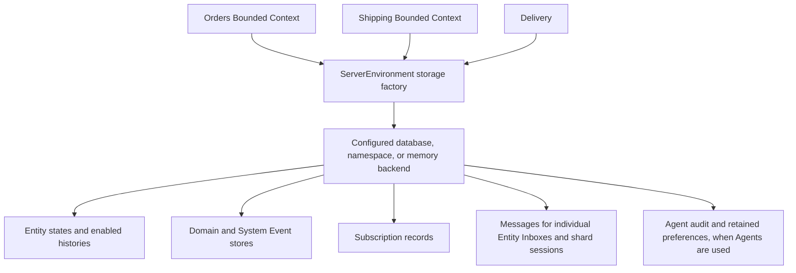
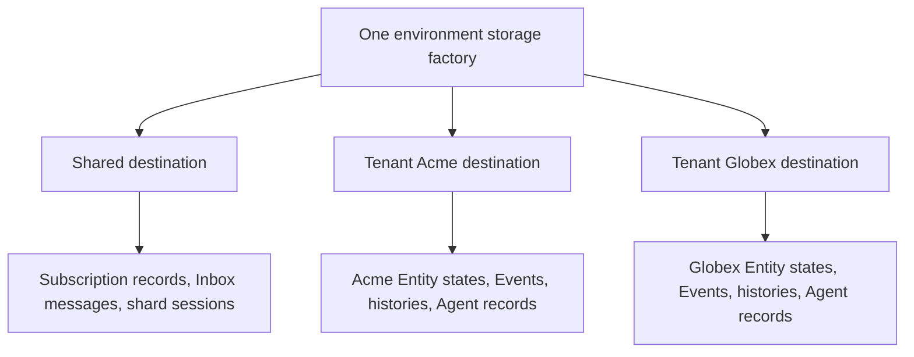

# Storage layout and database preparation

This reference explains what an application must provide before using storage,
what Spine creates, and how the resulting structures differ between
single-tenant and multitenant applications. It covers the in-memory,
PostgreSQL, MySQL/MariaDB, and Google Cloud Datastore providers shipped in this
repository.

The examples assume one storage provider configured in `ServerEnvironment`.
All Bounded Contexts use that factory. A factory can serve both shared framework
records and tenant-specific records; it is not itself exclusively
“single-tenant” or “multitenant”.

The layouts below describe the current implementation. Internal record schemas
are documented to help you inspect storage and prepare a deployment. Use the
framework APIs to write those records: changing a serialized payload or its
searchable columns independently can make them disagree.

## Contents

- [What is stored](#what-is-stored)
- [Single-tenant applications](#single-tenant-applications)
- [Multitenant applications](#multitenant-applications)
- [When preparation happens](#when-preparation-happens)
- [Names and record families](#names-and-record-families)
- [SQL columns and value types](#sql-columns-and-value-types)
- [Framework record catalogue](#framework-record-catalogue)
- [Authentication, sessions, and gateway state](#authentication-sessions-and-gateway-state)
- [PostgreSQL](#postgresql)
- [MySQL and MariaDB](#mysql-and-mariadb)
- [Google Cloud Datastore](#google-cloud-datastore)
- [In-memory storage](#in-memory-storage)
- [What can be customized](#what-can-be-customized)

## What is stored

A **record family** is a collection of records with the same layout. A SQL
provider normally maps a family to a table; Datastore maps it to a kind. The
in-memory provider keeps it in memory.

An Entity's current state is stored inside an `EntityRecord`. The complete
record is serialized as Protobuf bytes. A few values are also materialized as
SQL columns or Datastore properties so that queries can filter and order them.
An application field becomes a query column when the Proto model declares it
with `(column)`. The adapter does not turn every Proto field into a column.

For example, consider an application state:

```proto
package example.orders;

message Order {
    OrderId id = 1;
    string customer = 2 [(column) = true];
    string notes = 3;
}
```

Its current-state storage has the identifier, complete serialized
`EntityRecord`, the framework's `archived`, `deleted`, and `version` values,
and the application column `customer`. `notes` remains inside the serialized
state. A required Proto field does not automatically become a SQL `NOT NULL`
column; Proto validation and physical column nullability are separate rules.

Other families support Event storage, optional Entity histories, subscriptions,
Delivery, and Agent audit. Not every application uses every optional family.
See the [record catalogue](#framework-record-catalogue) for their fields and
creation conditions.

“System” has two meanings worth distinguishing here. A Bounded Context has a
paired **System Context**, which processes framework Events and can persist
them when configured. Other internal records, such as subscription definitions and
Delivery shard sessions, support the application as a whole. They do not all
belong in the same physical database in a multitenant application.

## Single-tenant applications

In a single-tenant application there is no tenant selection for an operation.
All Bounded Contexts and shared services use the provider's configured shared
destination. Multiple Bounded Contexts do not imply multiple databases.



| Provider        | Application supplies beforehand                                                                                       | Structures Spine supplies                                                                                           |
| --------------- | --------------------------------------------------------------------------------------------------------------------- | ------------------------------------------------------------------------------------------------------------------- |
| PostgreSQL      | Running PostgreSQL service; database; selected schema; credentials and permissions                                    | Tables for required record families, their primary keys, and the dedicated Agent audit indexes                      |
| MySQL / MariaDB | Running database service; database; credentials and permissions                                                       | Tables for required record families, primary keys, and dedicated Agent audit indexes; default engine is InnoDB      |
| Datastore       | Google Cloud project and Datastore database, or a configured emulator; client credentials; required composite indexes | Entities with native keys and properties; kinds become populated through writes, without a table-creation operation |
| In-memory       | An `InMemoryStorageFactory`, or the environment's default                                                             | Runtime maps and indexes; no external structures                                                                    |

PostgreSQL and MySQL configuration starts with `setOptions()`. In single-tenant
mode these options select the destination for application records as well as
shared framework records.

<!-- docs-snippet-path: packages/server-blackbox-tests/test/native-public-preparation.integration.test.ts -->

```ts
import { PostgresStorageFactory } from "@spine-event-engine/storage-postgres";
import { EnvironmentType, ServerEnvironment } from "@spine-event-engine/server";

const factory = await PostgresStorageFactory.newBuilder()
  .setOptions({
    url: "postgresql://localhost/orders",
    schema: "spine",
  })
  .build();

ServerEnvironment.when(EnvironmentType.Local).use({ storageFactory: factory });
await ServerEnvironment.instance().completeSetup();
```

The database `orders` and schema `spine` must already exist. This code does not
create either one. Production configuration also supplies the application's
complete `typeRegistry`; configure credentials and TLS through deployment
settings rather than embedding secrets in source code.

## Multitenant applications

A multitenant application has **shared framework storage** and **tenant
storage**. The same factory supplies both.

| Records                                                                                  | Destination                                                       |
| ---------------------------------------------------------------------------------------- | ----------------------------------------------------------------- |
| Messages for Entity Inboxes; Delivery shard sessions                                     | Shared destination, always single-tenant storage                  |
| Subscription definitions and their activation status                                     | Shared destination, including subscriptions for different tenants |
| Gateway authenticated subscription bindings and application node leases, when configured | Shared destination; explicitly constructed integrations           |
| Current domain Entity states and enabled histories                                       | Destination selected for the tenant                               |
| Domain Event store and enabled paired System Event store                                 | Destination selected for the tenant                               |
| Agent state, audit, acceptance receipts, and model preferences                           | Destination selected for the tenant                               |

Each Entity instance has its own logical Inbox. `InboxStorage` holds the
messages for those Inboxes across tenants. Delivery obtains the tenant ID
from the Command or Event being dispatched. There is no application-wide
single logical Inbox, and no separate Inbox database for every tenant.



### PostgreSQL and MySQL/MariaDB

`setOptions()` supplies shared storage. Add either a fixed tenant list or an
application callback for tenant database settings. Each tenant must resolve to
a distinct database. Separate schemas in one PostgreSQL database do not satisfy
that tenant-isolation requirement.

<!-- docs-snippet-path: packages/server-blackbox-tests/test/native-public-preparation.integration.test.ts -->

```ts
import { create } from "@bufbuild/protobuf";
import { TenantIdSchema } from "@spine-event-engine/proto";
import { PostgresStorageFactory } from "@spine-event-engine/storage-postgres";

const acme = create(TenantIdSchema, {
  kind: { case: "value", value: "acme" },
});
const globex = create(TenantIdSchema, {
  kind: { case: "value", value: "globex" },
});

const factory = await PostgresStorageFactory.newBuilder()
  .setOptions({ url: "postgresql://localhost/shared", schema: "spine" })
  .setTenantOptions([
    { tenantId: acme, options: { url: "postgresql://localhost/acme", schema: "spine" } },
    { tenantId: globex, options: { url: "postgresql://localhost/globex", schema: "spine" } },
  ])
  .build();
```

For MySQL or MariaDB, use `MysqlStorageFactory` from
`@spine-event-engine/storage-mysql`, `mysql:` URLs, and omit the PostgreSQL
`schema` setting.

All three databases in this example must already exist. For PostgreSQL, their
selected schemas must exist too. Shared storage can coincide with one tenant's
database only when the resulting table families do not collide; a separate
shared database is often easier to understand and administer. Never use one
physical table for two independent tenant families.

For tenants added at runtime, use the resolver instead of the fixed list:

<!-- docs-snippet-path: packages/server-blackbox-tests/test/native-public-preparation.integration.test.ts -->

```ts
import type { TenantId } from "@spine-event-engine/proto";
import {
  PostgresStorageFactory,
  type PostgresStorageFactoryOptions,
} from "@spine-event-engine/storage-postgres";

// Implemented by the application; this method is not part of TenantIndex.
declare const directory: {
  databaseOptions(tenantId: TenantId): Promise<PostgresStorageFactoryOptions>;
};

const factory = await PostgresStorageFactory.newBuilder()
  .setOptions({ url: "postgresql://localhost/shared", schema: "spine" })
  .setTenantResolver((tenantId) => directory.databaseOptions(tenantId))
  .build();
```

The resolver supplies settings for an existing database. It neither registers
a tenant nor creates infrastructure. Successful bindings are retained for the
factory's lifetime; changing the callback's result is not a live database-move
API. Fixed tenant entries and a resolver cannot be combined.

### Tenant membership is a separate decision

`TenantIndex` determines which tenants may use a Bounded Context. The environment
supplies its default; a Bounded Context may override it through
`withTenantIndex()`. The current implementations are available through
`ServerEnvironment.instance().tenantIndex` and `boundedContext.tenantIndex`.

A SQL factory with a fixed tenant list can supply that catalogue to the default
index. A dynamic database resolver cannot enumerate tenants: configure an
application index that can report membership and list the current tenants.
If membership must survive restart, the application's index must provide that
persistence. Spine does not create a hidden tenant catalogue table for the
resolver.

After application code creates a database and registers its tenant, it can
prepare storage explicitly:

<!-- docs-snippet-path: packages/server-blackbox-tests/test/native-public-preparation.integration.test.ts -->

```ts
import type { TenantId } from "@spine-event-engine/proto";
import { ServerEnvironment } from "@spine-event-engine/server";

declare const tenantId: TenantId;
const environment = ServerEnvironment.instance();

// Requires an index implementation that supports adding tenants.
await environment.tenantIndex.keep(tenantId);
await environment.createStorageStructures(tenantId);
await environment.checkStructureCompatibility(tenantId);
```

These calls cover the relevant completed, open Bounded Contexts and respect
their effective tenant indexes. They do not prepare Bounded Contexts that have
not yet been built. Without explicit preparation, the first admitted operation
prepares the necessary structures lazily. Unknown tenants are rejected before
their databases are resolved.

### Datastore and in-memory tenancy

Datastore uses namespaces instead of separate tenant databases. Shared records
use the configured client's namespace, or the default namespace if none was
set. Tenant records use the namespace converter. With the default converter,
value tenant `acme` uses `Vacme`, and domain tenant `acme.example` uses
`Dacme.example`.

In-memory storage keeps separate logical tenant collections inside its backend.
There is no database or namespace to provision. Neither provider changes the
logical record definitions when switching tenancy modes: placement changes,
while the record fields remain the same.

## When preparation happens

Factory `build()` validates configuration without connecting to the database.
`factory.checkConnection()` explicitly checks the shared destination. Successful
checks are remembered; failed checks can be retried. A SQL check releases its
temporary pool unless an existing runtime pool can be reused.

`ServerEnvironment.completeSetup()` initializes the configured shared resources.
Build Bounded Contexts after it completes. The assembled Entity registrations
then tell the framework which model-dependent structures are required.

| Operation                                                          | Effect                                                                                                                                |
| ------------------------------------------------------------------ | ------------------------------------------------------------------------------------------------------------------------------------- |
| `boundedContextBuilder.build()`                                    | Prepares required structures for current tenants and starts the initial subscription-monitoring pass                                  |
| `build({ createStorageStructures: false })`                        | Defers model structure preparation until needed; subscription monitoring still starts by default and prepares its registry dependency |
| `build({ startSubscriptionMonitoring: false })`                    | Prepares structures by default, but defers subscription monitoring                                                                    |
| Both flags `false`                                                 | Defers both operations until the first valid input needs them                                                                         |
| `boundedContext.runtime.createStorageStructures(...tenantIds)`     | Creates missing structures for that Bounded Context and verifies the resulting layouts                                                |
| `boundedContext.runtime.checkStructureCompatibility(...tenantIds)` | Inspects the expected structures without creating or altering them                                                                    |
| `boundedContext.runtime.startSubscriptionMonitoring()`             | Prepares its registry dependency and starts that Bounded Context's monitoring                                                         |
| The corresponding environment structure methods                    | Apply preparation across relevant completed, open Bounded Contexts                                                                    |

For a multitenant Bounded Context, no tenant arguments means all tenants
currently returned by its index. One or more arguments select those tenants.
The shared registry dependency remains shared.

SQL creation uses `CREATE TABLE IF NOT EXISTS` followed by compatibility checks.
It does not automatically alter an incompatible table. A successful read-only
compatibility check also establishes that the family is ready, avoiding later
creation SQL for that family. To run with precreated tables, defer automatic
preparation, call the compatibility checks, and only then accept work.

On Datastore, these methods validate declarations and perform provider access
checks; they do not create empty kinds or deploy composite indexes. A successful
Datastore preparation is not proof that every application query's index is ready.

Explicit required startup preparation fails startup on error. Lazy preparation
fails the triggering operation and can be retried by later input. After the
initial subscription monitor has started successfully, later monitoring failures
produce WARN logs and restart attempts rather than terminating the application.

## Names and record families

A family has a **source type**, a **stored record type**, and sometimes a
**storage group**. For current Entity state, the source is the application's
state type while the stored record is `spine.server.entity.EntityRecord`.

| Family    | SQL default before provider-specific identifier rendering                             | Datastore default kind                                       |
| --------- | ------------------------------------------------------------------------------------- | ------------------------------------------------------------ |
| Ungrouped | Full source type name, replacing `.` with `_`                                         | Full source type name                                        |
| Grouped   | Full group name with `.` replaced by `_`, then `_` and the stored record's short name | Full group name, then `_` and the stored record's short name |

For `example.orders.Order`:

| Family                           | PostgreSQL                          | MySQL/MariaDB                       | Datastore                           |
| -------------------------------- | ----------------------------------- | ----------------------------------- | ----------------------------------- |
| Current state                    | `example_orders_order`              | `example_orders_Order`              | `example.orders.Order`              |
| Enabled state history            | `example_orders_order_entityrecord` | `example_orders_Order_EntityRecord` | `example.orders.Order_EntityRecord` |
| Enabled diagnostic Event history | `example_orders_order_event`        | `example_orders_Order_Event`        | `example.orders.Order_Event`        |

PostgreSQL folds ordinary unquoted-style ASCII names to lowercase. Its renderer
preserves spelling for names that require quoting, including reserved words.
The renderer rejects invalid names, names over PostgreSQL's 63-byte limit, and
collisions after rendering. MySQL requires a plain ASCII identifier beginning
with a letter or underscore, followed by letters, digits, or underscores, with
a 64-byte maximum. Long Proto package names may therefore need explicit table
names. Datastore's default kind retains the dots.

Ordinary family naming does not automatically include the Bounded Context
name. The same Entity state type cannot be registered in two open domain
Bounded Contexts, including in tests. Event stores deliberately use separate
Bounded Context-specific groups, described below.

Sources: [PostgreSQL name resolver](../packages/storage-postgres/src/postgres/table-resolver.ts),
[MySQL name resolver](../packages/storage-mysql/src/mysql/table-resolver.ts),
[Datastore factory](../packages/storage-datastore/src/datastore/storage-factory.ts).

## SQL columns and value types

Every ordinary SQL record table contains:

| Column           | PostgreSQL                             | MySQL/MariaDB                      | Meaning                                                                                                        |
| ---------------- | -------------------------------------- | ---------------------------------- | -------------------------------------------------------------------------------------------------------------- |
| `ID`             | `VARCHAR(512)`, `INTEGER`, or `BIGINT` | `VARCHAR(512)`, `INT`, or `BIGINT` | Non-null primary key. Message IDs and string IDs use text; primitive `int32` and `int64` IDs use integer types |
| `bytes`          | `BYTEA NOT NULL`                       | `BLOB NOT NULL`                    | Complete authoritative Protobuf record                                                                         |
| Declared columns | See mapping below                      | See mapping below                  | Searchable values copied from the record                                                                       |

Message identifiers use a reversible stringifier, compact Proto JSON by
default. Configure the application's `TypeRegistry` when stringifying values
containing `Any`, so the packed application types can be resolved. The same
stringifier is used for writes, key lookups, query operands, and decoding.
SQL string/message IDs currently have a 512-character limit.

| Declared Protobuf type       | PostgreSQL                                | MySQL/MariaDB                               |
| ---------------------------- | ----------------------------------------- | ------------------------------------------- |
| `string`                     | `TEXT`                                    | `TEXT`                                      |
| 32-bit integral scalar, enum | `INTEGER`                                 | `INT`                                       |
| 64-bit integral scalar       | `BIGINT`                                  | `BIGINT`                                    |
| `bool`                       | `BOOLEAN`                                 | `BOOLEAN`                                   |
| `bytes`                      | `BYTEA`                                   | `BLOB`                                      |
| `float`                      | `REAL`                                    | Unsupported as a materialized record column |
| `double`                     | `DOUBLE PRECISION`                        | Unsupported as a materialized record column |
| `google.protobuf.Timestamp`  | `BIGINT` epoch nanoseconds                | `BIGINT` epoch nanoseconds                  |
| `spine.core.Version`         | `INTEGER`, its version number             | `INT`, its version number                   |
| Other message                | `TEXT` through the configured stringifier | `TEXT` through the configured stringifier   |

Integer columns must fit their native signed range. A Protobuf unsigned type
does not create an unsigned SQL column. Indexed timestamps must fit signed
64-bit epoch nanoseconds, approximately years 1677–2262. The serialized payload
still uses the original Protobuf representation.

Declared columns are normally nullable. The current Entity columns `archived`
and `deleted` are non-null with default `false`; `version` is non-null with
default `0`. These are Entity values, not a hidden storage revision.

The providers create primary keys. They do not automatically add indexes for
all `(column)` fields. Applications manage indexes needed by their query
patterns. Agent audit storage has additional framework-managed indexes described
in its catalogue entry. Custom indexes must preserve the provider's required
keys and constraints.

Sources: [PostgreSQL table specification](../packages/storage-postgres/src/postgres/table-spec.ts),
[MySQL table specification](../packages/storage-mysql/src/mysql/table-spec.ts),
[record specification](../packages/storage/src/record/record-spec.ts).

## Framework record catalogue

The tables below use Proto field names. Unless stated otherwise, SQL stores the
complete message in `bytes` and materializes only the listed search columns.
Datastore stores `bytes` plus the equivalent properties, with native keys
instead of an `ID` property.

### Current Entity state

One family per registered state type, in the tenant destination when the
Bounded Context is multitenant. The identifier is the Entity's typed ID.
The stored message is `spine.server.entity.EntityRecord`:

| Field             | Proto type                           | Meaning                              |
| ----------------- | ------------------------------------ | ------------------------------------ |
| `entity_id`       | `google.protobuf.Any`                | Complete typed Entity identifier     |
| `state`           | `google.protobuf.Any`                | Complete application state           |
| `version`         | `spine.core.Version`                 | Version number and timestamp         |
| `lifecycle_flags` | `spine.server.entity.LifecycleFlags` | `archived: bool` and `deleted: bool` |

Search columns are `archived: bool`, `deleted: bool`, `version: Version`, and
the application's declared `(column)` fields. Archiving or marking an Entity
deleted changes its lifecycle flags. These operations do not create a separate
tombstone table. Physical deletion removes retained data according to the
Entity deletion rules.

Sources: [Entity record Proto](../packages/proto/proto/spine/server/entity/entity.proto),
[Entity storage descriptor](../packages/server/src/entity/entity-storage-descriptor.ts).

### Optional Entity histories

State history stores another `EntityRecord` for each retained version. Its key
is `EntityStateKey`, containing `entity_id: Any` and `version: int64`. The group
is the state type's full Proto name. Materialized columns are:

| Column      | Logical type | Source                     |
| ----------- | ------------ | -------------------------- |
| `entity_id` | `Any`        | Entity identifier          |
| `created`   | `Timestamp`  | `record.version.timestamp` |
| `version`   | `int32`      | `record.version.number`    |

Diagnostic Event history stores `spine.core.Event`, keyed by `EventId`, under
the same state-type group but with record short name `Event`. It materializes
`entity_id: Any` from the producer ID, `created: Timestamp` from the Event time,
and `version: int32` from the Event version.

State history is disabled by default and can be enabled with the repository's
`stateHistory` option. Aggregate repositories prepare diagnostic Event history.
Process Managers prepare it when `processManagerEventHistory` is enabled
(default `false`). These families are not a universal copy of every record.
Current Entity state remains the stored state rather than being reconstructed
by replaying these diagnostic Events.

Sources: [history specifications](../packages/storage/src/entity/entity-history-record-spec.ts),
[repository history configuration](../packages/server/src/repository/repository.ts),
[state-history key](../packages/proto/proto/spine/server/entity/state_key.proto).

### Domain and System Event stores

Each Bounded Context has a domain Event store. Persisting its paired System
Events is optional through `persistSystemEvents()` and is required when
registering Agents. Both stores follow the Bounded Context's tenant selection.

Both store complete `spine.core.Event` messages keyed by `spine.core.EventId`:

| Field     | Proto type            | Meaning                                                        |
| --------- | --------------------- | -------------------------------------------------------------- |
| `id`      | `EventId`             | String `value` identifying the Event                           |
| `message` | `google.protobuf.Any` | Packed domain or System Event payload                          |
| `context` | `EventContext`        | Timestamp, origin, producer, version, and other Event metadata |

The searchable columns are `created: Timestamp` and `type: string`, where
`type` is the payload's type URL. The Event envelope retains its ID, packed
payload, and Event context, including producer, timestamp, tenant origin,
version, and causal information as defined by the Proto schema.

The physical group is:

```text
logical = JSON.stringify(["spine.EventStoreGroup/v1", role, contextName])
group   = "es_" + SHA256(logical), encoded in base 36 and padded to 50 characters
```

`role` is `domain` or `system`. For the System store the name supplied is the
paired System Context's name. The SQL table is `<group>_Event`, with PostgreSQL
rendering the suffix as `_event`; the Datastore kind is `<group>_Event`.
This intentionally separates stores even when the same Event ID appears in
different Bounded Contexts.

Entity lifecycle Events and Agent interaction Events are payloads inside these
Event records. Their Proto definitions do not imply one table per System Event
message. The paired System Context does not automatically register a separate
Entity repository for every system Proto type.

Sources: [Event store and group calculation](../packages/storage/src/event/event-store.ts),
[Event envelope](../packages/proto/proto/spine/core/event.proto),
[System store construction](../packages/server/src/context/bounded-context.ts).

### Subscription registry

The default registry stores `spine.client.SubscriptionRecord` in shared,
single-tenant storage. Its key is `SubscriptionId`, a message with a string
`value`.

| Field                     | Proto type            | Meaning                                                                                  |
| ------------------------- | --------------------- | ---------------------------------------------------------------------------------------- |
| `id`                      | `SubscriptionId`      | Registry key                                                                             |
| `subscription`            | `Subscription`        | Subscription identity and Topic, including the requested target and subscription context |
| `status`                  | `SubscriptionStatus`  | `PENDING` or `ACTIVE`                                                                    |
| `when_created`            | `Timestamp`           | Creation time                                                                            |
| `when_activation_expires` | `Timestamp`, optional | Deadline to activate a pending subscription                                              |

Its additional physical columns/properties are:

| Name                      | Logical materialized type | Stored value                                                              |
| ------------------------- | ------------------------- | ------------------------------------------------------------------------- |
| `status`                  | enum                      | Numeric lifecycle status                                                  |
| `when_activation_expires` | `int64`                   | Unix epoch **milliseconds**; absent expiry uses `Number.MAX_SAFE_INTEGER` |

The expiry column deliberately differs from ordinary Timestamp columns, which
SQL stores in nanoseconds. The complete timestamp remains in the Protobuf
payload.

Default names are `spine_client_subscriptionrecord` in PostgreSQL,
`spine_client_SubscriptionRecord` in MySQL/MariaDB, and
`spine.client.SubscriptionRecord` in Datastore.

A registry instance is attached to each Bounded Context, with a diagnostic
storage context name such as `Orders:subscriptions`. That name does **not**
create a table per Bounded Context. The default ungrouped subscription family
is physically shared; each record is identified by its Subscription ID.
Subscription monitoring runs per Bounded Context.

This explains why SQL multitenancy still needs shared `setOptions()`: writing
a subscription definition must work before selecting any particular tenant's
Entity storage. The default registry is prepared as a shared dependency, both
when starting eagerly and when the first admitted subscription request triggers
lazy initialization. A custom `withSubscriptionRegistry()` implementation can
replace it and determines its own persistence requirements.

Sources: [Subscription record Proto](../packages/proto/proto/spine/client/subscription_record.proto),
[Subscription and Topic](../packages/proto/proto/spine/client/subscription.proto),
[registry specification](../packages/server/src/stand/subscription-registry.ts).

### Inbox messages

`spine.server.delivery.InboxMessage` stores one message destined for an Entity's
Inbox. This family always uses the shared destination, including for
multitenant Bounded Contexts.

| Field               | Proto type                                      | Meaning                                                                      |
| ------------------- | ----------------------------------------------- | ---------------------------------------------------------------------------- |
| `id`                | `InboxMessageId`                                | `uuid: string` and `index: ShardIndex`                                       |
| `signal_id`         | `InboxSignalId`                                 | Original signal ID, in its string `value`                                    |
| `inbox_id`          | `InboxId`                                       | Target Entity ID and state type URL                                          |
| `event` / `command` | oneof `spine.core.Event` / `spine.core.Command` | Complete signal, including its tenant context                                |
| `label`             | `InboxLabel`                                    | How to deliver it: Command handling, Event reaction, subscriber update, etc. |
| `status`            | `InboxMessageStatus`                            | Delivery status, such as `TO_DELIVER` or `DELIVERED`                         |
| `when_received`     | `Timestamp`                                     | Receipt time                                                                 |
| `version`           | `int32`                                         | Ordering value for messages received at the same time                        |
| `keep_until`        | `Timestamp`, optional                           | Retention time after delivery for deduplication                              |

`InboxId` contains `entity_id: spine.client.EntityId` (which packs the typed ID)
and `type_url: string`. `ShardIndex` contains `index: int32` and
`of_total: int32`.

Materialized columns are `inbox_id: InboxId`, `signal_id: InboxSignalId`,
`shard_index: int32`, `shard_total: int32`, `status: enum`,
`when_received: Timestamp`, `version: int32`, and `message_id: string`.
The last value copies the UUID for ordering. There is no separate materialized
`tenant_id` column in this specification; the tenant is in the stored signal.

Default names are `spine_server_delivery_inboxmessage` in PostgreSQL,
`spine_server_delivery_InboxMessage` in MySQL/MariaDB, and
`spine.server.delivery.InboxMessage` in Datastore. The primary key represents
the complete `InboxMessageId`, not just the UUID column.

Sources: [Inbox Proto](../packages/proto/proto/spine/server/delivery/inbox.proto),
[Inbox record specification](../packages/server/src/delivery/inbox-records.ts).

### Delivery shard sessions

`spine.server.delivery.ShardSessionRecord` records which worker is processing
a shard. It shares the non-tenant destination with Inbox messages. Its key is
the complete `ShardIndex`.

| Field              | Proto type   | Meaning                                                 |
| ------------------ | ------------ | ------------------------------------------------------- |
| `index`            | `ShardIndex` | Shard number and total shard count                      |
| `when_last_picked` | `Timestamp`  | Last acquisition time; may be absent before acquisition |
| `worker`           | `WorkerId`   | Node identity and worker string identifier              |

There are no additional declared query columns. SQL tables contain `ID` and
`bytes`; Datastore uses the key and `bytes` property. Default names are
`spine_server_delivery_shardsessionrecord`,
`spine_server_delivery_ShardSessionRecord`, and
`spine.server.delivery.ShardSessionRecord`, respectively.

These records coordinate Delivery. They are unrelated to the removed Agent
execution-recovery scheduler.

Sources: [Delivery Proto](../packages/proto/proto/spine/server/delivery/delivery.proto),
[shard registry](../packages/server/src/delivery/sharded-work-registry.ts).

### Agent audit history

Agents add immutable audit records in the tenant destination. The record is
`spine.server.agent.AgentHistoryRecord`:

| Field   | Proto type                         | Meaning                                                         |
| ------- | ---------------------------------- | --------------------------------------------------------------- |
| `scope` | `AgentHistoryStorageKey`           | `state_type: string`, `agent_key: string` identifying the Agent |
| `entry` | `spine.ts.agent.AgentHistoryEntry` | Original recorded interaction or Event                          |

`AgentHistoryEntry` contains `occurred_at: Timestamp` and exactly one of
`conversation_record: ConversationRecord`, `system_event: Event`, or
`domain_event: Event`. A `ConversationRecord` contains `id`, `conversation`,
`operation`, `occurred_at`, packed `content: Any`, and optional `attempt` and
`tool_call` identifiers. Their complete field definitions are linked below.

The logical group is `agent_history`. Default SQL names are
`agent_history_agenthistoryrecord` for PostgreSQL and
`agent_history_AgentHistoryRecord` for MySQL/MariaDB. Datastore uses the explicit
kind `spine_agent_history`.

The record ID is a SHA-256-derived digest of its complete logical identity.
The original identity and content remain in the payload. Materialized columns
are:

| Column                | Logical type | Purpose                                                     |
| --------------------- | ------------ | ----------------------------------------------------------- |
| `state_type`          | string       | Agent state type                                            |
| `agent_key`           | string       | Complete canonical typed identifier                         |
| `scope_digest`        | string       | Digest for indexed selection of that Agent                  |
| `category`            | string       | Conversation, System Event, or domain Event category        |
| `conversation_key`    | string       | Conversation identifier, empty for non-conversation entries |
| `conversation_digest` | string       | Indexed digest of that identifier                           |
| `order_key`           | string       | Complete stable history ordering key                        |

PostgreSQL uses `TEXT` for these columns and binary `C` collation for indexed
`order_key` ordering. MySQL uses `TEXT` for `state_type`, `agent_key`, and
`conversation_key`, but `VARBINARY(64)` for the two digests, `VARBINARY(12)` for
`category`, and `VARBINARY(2944)` for `order_key` to fit its native index layout.
These are existing provider constraints, not application configuration knobs.

SQL providers create and check three audit indexes:

- `agent_history_full`: `(scope_digest, order_key)`.
- `agent_history_category`: `(scope_digest, category, order_key)`.
- `agent_history_conversation`: `(scope_digest, conversation_digest, order_key)`.

For Datastore, the application must deploy the corresponding composite indexes
from the provider's [index.yaml](../packages/storage-datastore/index.yaml).
Preparation does not deploy them.

The four history APIs read these records. Interrupted Agent work stays
interrupted after restart; these rows never request handler replay or recovery.
History remains until physical Entity deletion under the framework's deletion
rules.

Sources: [audit record](../packages/proto/proto/spine/server/agent/history_record.proto),
[history entries and conversations](../packages/proto/proto/spine/ts/agent/history.proto),
[materialized audit columns](../packages/storage/src/entity/agent-history-record-spec.ts),
[PostgreSQL audit indexes](../packages/storage-postgres/src/postgres/agent-history.ts),
[MySQL audit indexes](../packages/storage-mysql/src/mysql/agent-history.ts).

### Agent acceptance receipts

`AgentAcceptanceReceipt` contains a single `key: AgentAcceptanceKey`:

| Key field           | Proto type                                          |
| ------------------- | --------------------------------------------------- |
| `state_type`        | string                                              |
| `recipient_id`      | Any, preserving the complete typed Agent identifier |
| `command` / `event` | oneof CommandId / EventId                           |
| `action`            | string, identifying the delivery action             |

The physical ID is derived from this complete identity. There are no declared
query columns. The group is `spine_agent_acceptance`; default names are
`spine_agent_acceptance_agentacceptancereceipt`,
`spine_agent_acceptance_AgentAcceptanceReceipt`, and
`spine_agent_acceptance_AgentAcceptanceReceipt` for PostgreSQL, MySQL/MariaDB,
and Datastore respectively.

Receipts record that an Agent signal has already been accepted. They prevent
that accepted execution from restarting after interruption. They do not contain
a runnable backlog. The family is prepared for tenants of Bounded Contexts
that register Agents.

Sources: [receipt schema](../packages/proto/proto/spine/server/agent/acceptance_receipt.proto),
[receipt identity and family](../packages/server/src/agent/agent-acceptance-receipts.ts).

### Agent model preferences

`AgentModelPreferencesRecord` contains:

| Field         | Proto type                                                                    |
| ------------- | ----------------------------------------------------------------------------- |
| `key`         | `AgentModelPreferencesKey`, with `state_type: string` and `recipient_id: Any` |
| `preferences` | repeated `spine.ts.agent.ModelPreference`                                     |

A preference identifies an AI model kind and either a model reference or an
instruction to inherit the repository default. The key is stored as `v1:`
followed by a digest of the complete Agent identity. There are no additional
query columns.

The group is `spine_agent_model_preferences`. Default SQL names are
`spine_agent_model_preferences_agentmodelpreferencesrecord` and
`spine_agent_model_preferences_AgentModelPreferencesRecord`. Datastore uses
`spine_agent_model_preferences` explicitly. These records retain model choices;
they do not retain a suspended executable invocation.

Sources: [preference schema](../packages/proto/proto/spine/server/agent/model_preferences_record.proto),
[model preference types](../packages/proto/proto/spine/ts/agent/model.proto),
[preference storage specification](../packages/storage/src/internal/agent-model-preferences.ts).

### Gateway authenticated subscription bindings

A browser gateway can use `DurableSubscriptionBindings` from
`@spine-event-engine/server/browser`. This adds a second subscription-related
family: `spine.auth.GatewayAuthenticatedSubscription`. It records the
subscription admitted through authentication. The Bounded Context's
`SubscriptionRecord` separately tracks the backend subscription lifecycle.

| Field          | Proto type                    | Meaning                                                 |
| -------------- | ----------------------------- | ------------------------------------------------------- |
| `id`           | `spine.client.SubscriptionId` | Binding key                                             |
| `subscription` | `spine.client.Subscription`   | Approved definition, including Actor and Tenant context |
| `when_expires` | `Timestamp`                   | Expiry of the authenticated definition                  |

The sole additional query column/property is `when_expires: int64`, measured
in epoch **milliseconds**. Default physical names are:

| Provider      | Name                                                                     |
| ------------- | ------------------------------------------------------------------------ |
| PostgreSQL    | `spine_auth_gatewayauthenticatedsubscription`                            |
| MySQL/MariaDB | `spine_auth_GatewayAuthenticatedSubscription`                            |
| Datastore     | `spine.auth.GatewayAuthenticatedSubscription`                            |
| In-memory     | Corresponding record family in the supplied backend; no durable database |

Application code constructs the bindings with `storageFactory`, `namespace`,
`nextId`, and a backend `cleanup` callback. To keep one provider across the
application, pass the same factory configured in `ServerEnvironment`. The
bindings require atomic compare-and-set support from the record storage.

In **both** tenancy modes, this family uses the shared single-tenant destination.
The stored subscription retains the tenant identity; activation and cancellation
check the authenticated Actor/Tenant context. The `namespace` option is used
in a diagnostic storage-context name. It does **not** select a PostgreSQL
schema, MySQL database, Datastore namespace, or a separate family. Independent
applications sharing a physical destination must not rely on changing that
label to isolate their records.

Bindings are created through gateway subscription operations and can be restored
after restart. Active network connections and local callbacks are not stored.
The component serializes operations locally; durable rows alone do not make
all callbacks coordinated across gateway processes.

This family is not an Entity repository and is not automatically part of the
Bounded Context's structure-preparation list. When an application constructs
these bindings separately, it must include their storage access in its gateway
startup plan. SQL storage prepares the family on first use. If application code
precreates tables, it must include this family as well as the backend registry.
Gateway startup/restore failures must be handled by the hosting application;
`completeSetup()` is not a declaration of every separately constructed gateway
component's readiness.

Sources: [binding schema](../packages/proto/proto/spine/auth/authenticated_subscription.proto),
[durable bindings](../packages/server/src/browser/durable-subscription-bindings.ts),
[browser authentication guide](BROWSER_CLIENT_AUTH_EXTENSION_GUIDE.md).

### Application node leases

Deployment integrations can use `LeasedNodeRegistry` from
`@spine-event-engine/deployment`. This is optional, rather than a table created
merely by constructing a gRPC `Server`.

The stored message is `spine.deployment.ApplicationNodeLease`, keyed by
`spine.server.NodeId`:

| Field             | Proto type                | Meaning                                               |
| ----------------- | ------------------------- | ----------------------------------------------------- |
| `node_id`         | `NodeId`                  | Application node identifier                           |
| `endpoint`        | `ApplicationNodeEndpoint` | `origin: string` and `tls_server_name: string`        |
| `when_expires`    | `Timestamp`               | Lease expiry                                          |
| `registration_id` | `NodeRegistrationId`      | String `value` distinguishing a registration lifetime |

There are no declared query columns, so SQL has `ID` and `bytes`, and Datastore
has a native key and `bytes`. Default names are
`spine_deployment_applicationnodelease`, `spine_deployment_ApplicationNodeLease`,
and `spine.deployment.ApplicationNodeLease` respectively.

The caller supplies `factory` and `namespace`. The registry requires atomic
compare-and-set and uses the shared destination in both tenancy modes.
As with gateway bindings, `namespace` is a diagnostic storage-context label;
it does not isolate deployments physically. Registrations, renewals, removals,
and expiry cleanup operate on these records. Application code manages the
registry lifetime and closes it when finished.

This separately constructed registry is not automatically included in Bounded
Context preparation. Applications using it must prepare its required physical
layout beforehand or allow its initial storage operations to do so.

Sources: [lease schema](../packages/proto/proto/spine/deployment/node_discovery.proto),
[leased registry](../packages/deployment/src/registry/leased-node-registry.ts).

## Authentication, sessions, and gateway state

The durable subscription binding above is the main gateway-specific framework
record. Authentication also uses state that does **not** automatically become
Spine storage tables or Datastore kinds.

| Component                                                  | Where state lives                                                              | What the application must supply                                                                                                        |
| ---------------------------------------------------------- | ------------------------------------------------------------------------------ | --------------------------------------------------------------------------------------------------------------------------------------- |
| `OpaqueSessions`                                           | Process-local maps of credentials and session records                          | Its settings and lifetime; a different session implementation if sessions must be shared or survive restart                             |
| `SignedSessions`                                           | Session data in signed credentials; configured keys in the running instance    | Signing and verification keys, key rotation, and an optional application revocation implementation                                      |
| Signed-session revocation                                  | Behind the application-supplied revocation contract                            | Shared/durable revocation storage if required; the framework supplies no revocation table schema                                        |
| `OidcFlow`                                                 | Process-local pending login transactions and one-time grants                   | Provider configuration, identity mapping, session issuance, and deployment routing that can complete a login in the appropriate process |
| Provider JWKS cache                                        | Per-verifier in-memory cache                                                   | Provider settings and HTTP access; keys are fetched again after cache expiry or restart                                                 |
| Browser session wrapper                                    | Client-side runtime state; cookies are handled by the browser where configured | Cookie/HTTP/session behavior selected by the application; no automatic Spine database storage                                           |
| Authorization policies and trusted Actor/Tenant resolution | Application collaborators                                                      | Any user directory, permissions store, or identity-provider integration those collaborators require                                     |
| Live subscription streams and pending gateway operations   | Memory and network connections                                                 | Hosting lifecycle; durable definitions do not preserve a network stream across restart                                                  |

`OidcFlow` retains nonce, PKCE and redirect information during a login and
consumes one-time state/grants during completion. Those values are not written
to `StorageFactory`. `OpaqueSessions` likewise does not become persistent just
because the application configured PostgreSQL in `ServerEnvironment`.

The same distinction applies to multitenancy. An authenticated session or
trusted Actor context can identify a tenant, but that does not create a
per-tenant session table. If application code stores users, roles, sessions,
revocation information, or identity-provider tokens, it decides their tenancy,
schemas, persistence, and provisioning.

The gateway authenticates and authorizes requests using supplied collaborators.
It does not create a user database, password table, signing-key table, refresh-token
store, or permissions database. Supply sensitive configuration through the
application's deployment and secret-management facilities.

Sources: [authentication package](../packages/auth/README.md),
[session implementations](../packages/auth/src),
[OIDC flow](../packages/auth/src/oidc/index.ts),
[provider key cache](../packages/auth/src/providers/index.ts),
[browser authentication guide](BROWSER_CLIENT_AUTH_EXTENSION_GUIDE.md).

## PostgreSQL

### Required setup

Create the database, schema, role, and permissions before starting Spine. The
adapter creates tables inside the selected schema; it never issues database or
schema creation on the application's behalf. If `schema` is omitted, the first
awaited use resolves `current_schema()` and retains the result.

For automatic preparation, the role needs access to the database and schema,
permission to create required tables/indexes, metadata visibility for layout
checks, and normal record reads/writes/deletes. Application-managed tables must
match the expected types, nullability, defaults, primary key, and required
indexes. Do not assume that an arbitrary similarly named existing table will
be accepted.

A single-tenant application supplies one `setOptions()` destination. A
multitenant application additionally supplies one database per tenant, with
`setTenantOptions()` or `setTenantResolver()`. The default table names and column
layouts are the same in each destination. Shared tables are created in the
shared destination; tenant families are created in each relevant tenant database.

### Table creation and customization

Use `setTableName()` to rename a family while retaining its required columns.
For example, this renames the default subscription table:

<!-- docs-snippet-path: packages/server-blackbox-tests/test/native-public-preparation.integration.test.ts -->

```ts
import { PostgresStorageFactory } from "@spine-event-engine/storage-postgres";
import { SubscriptionRecordSchema } from "@spine-event-engine/proto/generated/spine/client/subscription_record_pb.js";

const factory = await PostgresStorageFactory.newBuilder()
  .setOptions({ url: "postgresql://localhost/shared", schema: "spine" })
  .setTableName(SubscriptionRecordSchema, "subscription_definitions")
  .build();
```

The two-argument overload applies to an ungrouped source type. Current Entity
state uses the application's state schema as that source. The three-argument
overload, `setTableName(sourceType, recordType, name)`, applies to grouped
source/record pairs, such as a state-history family. It is not an arbitrary
per-Bounded-Context or per-tenant naming callback. A broad override that maps
distinct groups to one table is rejected as a collision.

There is a specific limitation for **diagnostic Event history**. Its group is
the Entity state type, but its source and record types are both `EventSchema`.
Consequently, `setTableName(OrderSchema, EventSchema, "order_events")` does
not rename that family's table. A SQL override for `(EventSchema, EventSchema)`
would apply across diagnostic histories and domain/System Event stores, which
can collapse different groups onto one name and be rejected. Keep the generated
group names for these families; the current SQL builder has no per-group naming
overload. Current Entity state and its state history do not have this ambiguity.

The Datastore layout selector is different: for grouped records its exact match
uses the group name and stored record type. Because diagnostic history uses the
state type's full name as its group, `organizeRecords(OrderSchema, EventSchema,
{ kind: "order_events" })` can select that history kind. Record-only Event
layout overrides remain too broad when multiple Event families are in use.

`useOperationFactory()` supplies custom table-creation SQL based on the resolved
table specification. The result must still create the required compatible
layout. It is not an exemption from validation, nor an API for changing the
record's mandatory columns. Inspect the specification's resolved schema/table,
columns, and primary key rather than reconstructing their names yourself.

Spine does not silently add missing columns to existing tables or change their
types. The checks concern the selected families, rather than scanning unrelated
tables whenever the factory is built.

See the [PostgreSQL package reference](../packages/storage-postgres/REFERENCE.md)
for connection settings and custom creation contracts.

## MySQL and MariaDB

Both use `MysqlStorageFactory` from `@spine-event-engine/storage-mysql`. There
is no separate MariaDB factory or alternative record schema. The selected
server must support the required SQL operations and one of the accepted engines.

Create each database and configure its account, permissions, charset, collation,
and network/TLS settings beforehand. Spine supplies required tables and keys.
Single-tenant operation uses `setOptions()`; multitenant operation adds a fixed
tenant list or resolver and keeps `setOptions()` for shared storage.

New tables default to InnoDB. Ordinary record storage also accepts compatible
existing MyISAM and Aria tables. Agent live commits require InnoDB transactions.
Do not select MyISAM or Aria for an application using Agent repositories.
MyISAM/Aria's indexed `VARCHAR(512)` IDs require a suitable one-byte binary
collation and representable identifiers. InnoDB permits the normal Unicode
configuration supported by its index constraints.

The table-name overloads and custom creation hook match the PostgreSQL pattern:

<!-- docs-snippet-path: packages/server-blackbox-tests/test/native-public-preparation.integration.test.ts -->

```ts
import { MysqlStorageFactory } from "@spine-event-engine/storage-mysql";
import { SubscriptionRecordSchema } from "@spine-event-engine/proto/generated/spine/client/subscription_record_pb.js";

const factory = await MysqlStorageFactory.newBuilder()
  .setOptions({ url: "mysql://localhost/shared" })
  .setTableName(SubscriptionRecordSchema, "subscription_definitions")
  .build();
```

`useOperationFactory()` can customize creation, for example an eligible ordinary
table's engine or collation, while satisfying required column and constraint
checks. It cannot turn an unsupported physical layout into a supported one.
The adapter checks only families used or explicitly prepared; factory `build()`
does not connect or inventory unrelated legacy tables.

See the [MySQL package reference](../packages/storage-mysql/REFERENCE.md) for
engine, ID, and custom-operation details.

## Google Cloud Datastore

### Required setup and physical representation

Supply a configured `@google-cloud/datastore` client for a Google Cloud project
with a Datastore database, including Firestore in Datastore mode. Firestore
Native mode is a different API and is not this provider. An emulator is also
supported for local use.

<!-- docs-snippet-path: packages/server-blackbox-tests/test/native-public-preparation.integration.test.ts -->

```ts
import { Datastore } from "@google-cloud/datastore";
import { DatastoreStorageFactory } from "@spine-event-engine/storage-datastore";

const client = new Datastore({
  projectId: "my-project",
  namespace: "application_shared",
});
const factory = DatastoreStorageFactory.newBuilder().setClient(client).build();
```

The application supplies credentials/IAM access and deploys required composite
indexes. Creating a factory does not create the Google Cloud project, provision
a database, or deploy indexes. The application manages the client's lifetime.

An ordinary stored entity has:

| Part                | Representation                                                                       |
| ------------------- | ------------------------------------------------------------------------------------ |
| Key                 | Native namespace, kind, and a string key name derived reversibly from the logical ID |
| `bytes`             | Complete serialized Protobuf record, excluded from indexes                           |
| Declared properties | Materialized query columns using Datastore-native values                             |

There is no copied `ID` property, hidden storage revision, generic scope
property, or separate marker entity for ordinary compare-and-set operations.
Conditional writes use Datastore transactions against the actual record keys.

| Declared type             | Datastore property representation                                                    |
| ------------------------- | ------------------------------------------------------------------------------------ |
| String / Boolean          | Native string / Boolean                                                              |
| Integral scalar / enum    | Native integer; constrained by the declared type and Datastore's signed 64-bit range |
| Float / double            | Native double                                                                        |
| Bytes                     | Native binary value                                                                  |
| Timestamp                 | Native timestamp, with seconds and nanos passed through the SDK timestamp conversion |
| Version                   | Native integer holding the version number                                            |
| Other message             | Text from the configured reversible stringifier                                      |
| Absent materialized value | Native null                                                                          |

The authoritative record in `bytes` preserves the full Proto representation. In Agent history,
`state_type`, `agent_key`, and `conversation_key` are also excluded from indexes;
the digest and ordering properties support indexed access instead.

### Single-tenant and multitenant placement

Single-tenant records use the configured client namespace, or the default
namespace. In multitenant operation, shared records stay there and tenant
records use namespaces selected from complete `TenantId` messages.

The built-in `DefaultNamespaceConverter` maps value and domain tenants to `V`
and `D` prefixes. Email tenant IDs require a custom reversible converter;
the unsafe lossy email mapping is rejected. `setNamespaceConverter()` installs
an application converter, which must round-trip exactly and distinguish all
admitted tenants. Changing it changes physical key locations, rather than
renaming existing records.

Datastore creates namespaces and kinds implicitly as data is written. There
is no empty namespace or kind DDL for Spine to execute. The default tenant
catalogue discovers native namespaces; an unwritten namespace does not provide
a durable tenant registration. Use an application `TenantIndex` when tenants
must exist before their first write.

### Indexes

Deploy composite indexes for the filters and sort orders that the application
actually uses. This includes internal queries when their shape needs a composite
index: Inbox delivery ordering, subscription expiry cleanup, retained histories,
and Agent history. An emulator accepting a query does not replace production
index deployment.

For Agent audit, deploy the three indexes in
[the provider's index.yaml](../packages/storage-datastore/index.yaml). Entity
history needs indexes for its generated kinds and query order, so one universal
file cannot cover every application's state types. The
[Datastore package guide](../packages/storage-datastore/README.md#configure-credentials-and-indexes)
shows an Entity history example.

`checkConnection()` probes namespace metadata. Native structure preparation
checks declarations and namespace access. Neither operation verifies that every
composite index is ready, nor does it prove write permissions by inserting data.

For the default shared kinds, the following entries match the fixed Inbox read
and pending-subscription cleanup query shapes. The two Inbox entries cover
reads with and without a status filter. Keep the kind names aligned with any
`organizeRecords()` overrides.

```yaml
indexes:
  - kind: spine.server.delivery.InboxMessage
    properties:
      - name: shard_index
      - name: shard_total
      - name: when_received
      - name: version
      - name: message_id
  - kind: spine.server.delivery.InboxMessage
    properties:
      - name: shard_index
      - name: shard_total
      - name: status
      - name: when_received
      - name: version
      - name: message_id
  - kind: spine.client.SubscriptionRecord
    properties:
      - name: status
      - name: when_activation_expires
```

Ordering is ascending here, including the final native key order. The native
key is not a stored `id` property. Gateway binding expiry cleanup sorts its
single `when_expires` property followed by the ascending key; shard-session and
node-lease scans use key order. Those simple shapes use native built-in indexes.
Additional application filters, sort directions, and history query variants
need their matching indexes as well.

Merge these entries with the Agent and application-specific indexes in the
application's `index.yaml`, deploy them, and wait for them to be ready:

```sh
gcloud datastore indexes create index.yaml --project YOUR_PROJECT
gcloud datastore indexes list --project YOUR_PROJECT
```

The query definitions are in [InboxStorage](../packages/server/src/delivery/inbox-storage.ts)
and the [subscription registry](../packages/server/src/stand/subscription-registry.ts).
Google documents the property ordering and deployment format in
[Composite Index Configuration](https://docs.cloud.google.com/datastore/docs/tools/indexconfig)
and which queries use [built-in indexes](https://docs.cloud.google.com/datastore/docs/concepts/indexes).
These definitions are derived from the framework's query shapes; deploying them
is an application operation, not something exercised by the PostgreSQL tests.

### Kind customization

`organizeRecords(recordType, { kind })` selects a kind for a record type.
`organizeRecords(sourceType, recordType, { kind })` selects a specific
source/record pair. For example:

<!-- docs-snippet-path: packages/server-blackbox-tests/test/native-public-preparation.integration.test.ts -->

```ts
import { Datastore } from "@google-cloud/datastore";
import { DatastoreStorageFactory } from "@spine-event-engine/storage-datastore";
import { SubscriptionRecordSchema } from "@spine-event-engine/proto/generated/spine/client/subscription_record_pb.js";

const client = new Datastore({ projectId: "my-project" });
const factory = DatastoreStorageFactory.newBuilder()
  .setClient(client)
  .organizeRecords(SubscriptionRecordSchema, { kind: "subscription_definitions" })
  .build();
```

Do not map unrelated families to the same namespace/kind. Built-in Agent audit
and preference kinds use explicit internal names and are not general layout
rename points. Custom `useRecordStorage()` and `useEntityStorage()` providers
are a deeper extension: they must implement the appropriate storage semantics,
tenant handling, ID conversion, and preparation contracts. Their callbacks do
not automatically receive the builder's namespace converter or stringifiers.

See the [Datastore package reference](../packages/storage-datastore/REFERENCE.md)
for extension contracts and query behavior.

## In-memory storage

The environment supplies an `InMemoryStorageFactory` by default. Application
code can also construct one explicitly. There are no external database, schema,
table, kind, index, or credential prerequisites.

The backend retains current records, optional histories, Event stores,
subscription records, Inbox messages, shard sessions, and Agent records in
logical collections. A shared singleton scope holds non-tenant records;
separate tenant scopes hold each tenant's data. A complete typed tenant ID,
rather than just its display text, determines the tenant identity.

An `InMemoryStorageBackend` token can be passed to factories that must share
these collections in one process. It does not provide persistence across a
process restart or shared memory across nodes. Gateway bindings and node leases
using this provider also lose their data when the backend is lost, despite
implementing the same record APIs.

Preparation checks compatible declarations. There is no SQL to emit or index
deployment to perform. SQL table-name and Datastore kind overrides have no
in-memory equivalent.

Source: [in-memory backend](../packages/storage/src/memory/in-memory-storage-backend.ts),
[in-memory factory](../packages/storage/src/memory/in-memory-storage-factory.ts).

## What can be customized

| Component                      | Supported configuration                                                                  | What remains fixed                                                                    |
| ------------------------------ | ---------------------------------------------------------------------------------------- | ------------------------------------------------------------------------------------- |
| SQL destination                | Shared options; tenant entries or resolver; PostgreSQL schema                            | Tenant selection must remain isolated; Spine does not provision databases/schemas     |
| SQL family name                | `setTableName(source, name)` or grouped source/record overload                           | Required record columns, identity semantics, and collision checks                     |
| SQL creation                   | `useOperationFactory()` using the resolved table specification                           | Resulting layout must pass compatibility checks                                       |
| SQL query indexes              | Application-managed nonconflicting indexes; required Agent indexes supplied by provider  | Required primary keys and Agent index definitions                                     |
| Datastore namespace            | Client namespace for shared records; `setNamespaceConverter()` for tenants               | Tenant conversion must be reversible and unambiguous                                  |
| Datastore kind                 | `organizeRecords()` for supported families                                               | Required record/property semantics; fixed built-in Agent kinds                        |
| Datastore indexes              | Application-deployed index configuration                                                 | Queries still need matching ready indexes                                             |
| Message ID/query-column text   | Reversible `StringifierRegistry` mappings, with a complete type registry where needed    | Reads and writes must use the same mapping; mandatory physical ID constraints remain  |
| Application query columns      | Proto `(column)` declarations                                                            | Serialized Entity envelope and framework metadata fields                              |
| Tenant membership              | Environment `tenantIndex`, optionally overridden per Bounded Context                     | Resolver settings alone do not establish membership                                   |
| Backend subscriptions          | `withSubscriptionRegistry()`                                                             | A custom implementation must provide its promised persistence and lifecycle semantics |
| Gateway authenticated bindings | Supplied bindings implementation and storage factory; SQL name or Datastore kind mapping | Default binding tenant/Actor checks and record shape                                  |
| Authentication state           | Application session/resolver/policy/revocation implementations                           | Selecting a storage provider does not automatically persist auth state                |

The environment shares the storage factory across Bounded Contexts. Gateways
and deployment utilities with explicit factory parameters should receive that
same selected factory when the application intends to use one provider.
Their API parameters called `namespace` are not interchangeable with native
Datastore namespaces or SQL databases.

For a deployment inventory, start with the application's registered Entity
types, enabled histories, System Event persistence, and use of Agents. Add the
shared subscription and Delivery families. Then add gateway bindings and node
leases if those integrations are configured. Finally list any application
session, identity, permissions, and tenant-directory stores, because the
framework cannot infer their schemas from the domain model.
