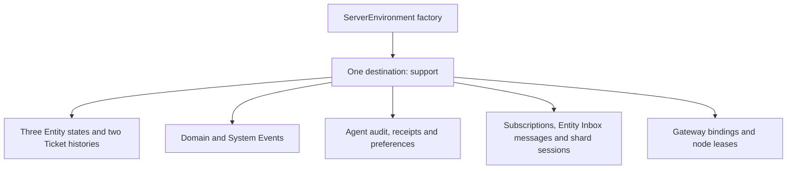
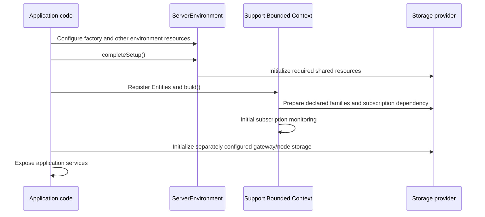
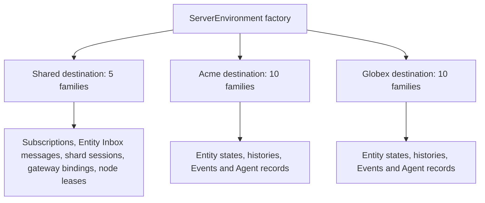

# Storage layout and provisioning

This guide answers “what will exist in my database?” for a small Support
application, including its Agent, browser gateway and authentication components.
It describes the current adapters: PostgreSQL, MySQL/MariaDB, Google Cloud
Datastore and in-memory storage.

Choose the chapter matching your deployment. Each repeats the model, value
conversion rules, record catalogue, provider inventories and operator checklists
so that it can be read independently. Names are exact for the model and settings
shown, rather than placeholders such as “one table per Entity.”

- [Single-tenant mode](#1-single-tenant-mode)
- [Multitenant mode](#2-multitenant-mode)

“Spine creates” below means preparation or first use creates the structure
**inside infrastructure you supplied**. Spine never creates SQL databases,
Google Cloud projects, accounts or permissions. Datastore creates kinds through
record writes and requires you to deploy composite indexes.

## 1. Single-tenant mode

### 1.1. The Support example

The example is a support application with one domain Bounded Context named
`Support`. Its paired System Context is named `Support_System`.

| Entity                           | Kind       | Identifier                         | Persistence enabled for this example                                                                    |
| -------------------------------- | ---------- | ---------------------------------- | ------------------------------------------------------------------------------------------------------- |
| `example.support.Ticket`         | Aggregate  | `example.support.TicketId`         | Current state, `stateHistory: true`, Aggregate diagnostic Event history                                 |
| `example.support.TicketList`     | Projection | `example.support.TicketListId`     | Current state; state history disabled                                                                   |
| `example.support.ReplyAssistant` | Agent      | `example.support.ReplyAssistantId` | Current state, mandatory Agent audit, acceptance receipts and model preferences; state history disabled |

System Event persistence is enabled with `persistSystemEvents()`, as required
for Agents. The example also uses the default persistent subscription registry,
environment Delivery, `DurableSubscriptionBindings` for browser subscriptions,
and `LeasedNodeRegistry` for node discovery. The latter two are explicitly
constructed application components; registering the three Entities alone does
not instantiate them.

This model excerpt fixes the exact names and illustrates the field types. It is
not a complete application: handlers, Commands, Events and generated imports
would be added in the application project.

```proto
syntax = "proto3";
package example.support;

import "spine/options.proto";
import "google/protobuf/any.proto";
import "google/protobuf/timestamp.proto";

message TicketId {
  string queue = 1;
  string number = 2;
}
message TicketListId { string value = 1; }
message ReplyAssistantId { string value = 1; }

enum Priority {
  PRIORITY_UNSPECIFIED = 0;
  NORMAL = 1;
  URGENT = 2;
}
message Requester {
  string name = 1;
  string email = 2;
  repeated string aliases = 3;
}
message BrowserInfo { string browser = 1; }

message Ticket {
  TicketId id = 1;
  string subject = 2 [(column) = true];
  Priority priority = 3 [(column) = true];
  Requester requester = 4 [(column) = true];
  google.protobuf.Timestamp opened_at = 5 [(column) = true];
  repeated string tags = 6;
  map<string, string> attributes = 7;
  google.protobuf.Any detail = 8 [(column) = true];
}
message TicketList {
  TicketListId id = 1;
  repeated TicketId tickets = 2;
}
message ReplyAssistant {
  ReplyAssistantId id = 1;
  string last_draft = 2;
}
```

The one application-specific storage query in this example selects Tickets by
`priority` and orders by `opened_at ASC`. This is a query against the Aggregate's
record storage; it does not turn an Aggregate into a public query Projection.
Public clients query/subscribe to the Projection. The index checklist includes
that specified storage query and the built-in queries for the enabled features.
An application adding different queries must add the indexes those queries need.

The full example has **15 record families**: ten for domain/Agent data and five
for shared framework services. A family means a table in SQL, a kind within a
namespace in Datastore, or the corresponding logical collection in memory.
The provider inventories below list every family, including optional features
that this example deliberately enables.

All 15 families use one SQL database named `support`, or one Datastore namespace
named `support`. For PostgreSQL the selected schema is `spine`. In-memory storage
keeps the corresponding logical records in one backend.



The gateway/node families appear only because this example explicitly enables
those components. Omitting the Agent removes its state/audit/receipt/preference
requirements; omitting optional Ticket state history removes that history
family. Enabling further Entity repositories adds their corresponding families.

### 1.2. How values and identifiers are stored

#### The full record and its searchable copies

When Ticket `billing/T-42` is saved, Spine writes an `EntityRecord`. Its
`entity_id` contains the typed `TicketId`, `state` contains the typed `Ticket`,
and it also contains the Entity version and lifecycle flags. Both packed fields
use Protobuf `Any`, with a type URL and binary value.

PostgreSQL and MySQL serialize that complete record to Protobuf binary in the
`bytes` column. Datastore likewise stores the serialized record in an unindexed
`bytes` property. Reads decode that payload using the record schema. The
searchable columns/properties are additional copies used to select records;
they are not a replacement for the full state. Datastore's codec does not retain
unknown Protobuf fields; do not rely on this provider to round-trip unknown
fields from a newer schema.

Only `(column)` fields and framework-declared search fields become searchable
columns. For the example Ticket, the ordinary SQL layout is:

| Column      | PostgreSQL                       | MySQL/MariaDB                    | Example value                                                                     |
| ----------- | -------------------------------- | -------------------------------- | --------------------------------------------------------------------------------- |
| `ID`        | `VARCHAR(512)` primary key       | `VARCHAR(512)` primary key       | `{"queue":"billing","number":"T-42"}`                                             |
| `bytes`     | `BYTEA NOT NULL`                 | `BLOB NOT NULL`                  | Binary `EntityRecord`, including all state fields                                 |
| `archived`  | `BOOLEAN NOT NULL DEFAULT false` | `BOOLEAN NOT NULL DEFAULT false` | `false`                                                                           |
| `deleted`   | `BOOLEAN NOT NULL DEFAULT false` | `BOOLEAN NOT NULL DEFAULT false` | `false`                                                                           |
| `version`   | `INTEGER NOT NULL DEFAULT 0`     | `INT NOT NULL DEFAULT 0`         | Current Entity version number                                                     |
| `subject`   | `TEXT`                           | `TEXT`                           | `Cannot download invoice`                                                         |
| `priority`  | `INTEGER`                        | `INT`                            | `2`, the numeric value of `URGENT`                                                |
| `requester` | `TEXT`                           | `TEXT`                           | `{"name":"Ada","email":"ada@example.test","aliases":["A."]}`                      |
| `opened_at` | `BIGINT`                         | `BIGINT`                         | `42000000007` for 42 seconds and 7 nanoseconds after epoch                        |
| `detail`    | `TEXT`                           | `TEXT`                           | `{"@type":"type.googleapis.com/example.support.BrowserInfo","browser":"Firefox"}` |

The identifier is a database key, not an additional `(column)` on `Ticket.id`.
`tags`, `attributes` and `last_draft` have no `(column)` annotation, so they are
present in the serialized state only. `TicketList` and `ReplyAssistant` have the
base `ID`, `bytes`, `archived`, `deleted`, `version` columns and no extra
application search columns in this model.

Datastore has no `ID` property: the identifier is the native key's **name**.
Its properties are `bytes` and the same declared search fields. `opened_at`
uses a native timestamp retaining seconds/nanoseconds, rather than the SQL
nanosecond integer. Message-valued properties such as `requester` and `detail`
are strings containing the same compact Proto JSON. They are not embedded
Datastore entities.

In-memory storage keeps typed record objects and column values in its backend.
It does not encode every ordinary record to Protobuf bytes or manufacture SQL
text columns. Its key comparison uses canonical structural values, including
sorted object keys and explicit representations for bigint and byte values.

#### Scalar and object conversion reference

This table concerns declared searchable fields. Every valid Protobuf field can
still occur inside the serialized record even when its type cannot be a
separate searchable column in a particular provider.

| Protobuf field                          | PostgreSQL search column                                 | MySQL/MariaDB search column        | Datastore search property                  |
| --------------------------------------- | -------------------------------------------------------- | ---------------------------------- | ------------------------------------------ |
| `string`                                | `TEXT`                                                   | `TEXT`                             | String                                     |
| 32-bit integral types                   | `INTEGER`                                                | `INT`                              | Integer                                    |
| Enum                                    | `INTEGER`, numeric enum value                            | `INT`, numeric enum value          | Integer, numeric enum value                |
| 64-bit integral types                   | `BIGINT`                                                 | `BIGINT`                           | Integer using the SDK's integer conversion |
| `bool`                                  | `BOOLEAN`                                                | `BOOLEAN`                          | Boolean                                    |
| `bytes`                                 | Raw `BYTEA`                                              | Raw `BLOB`                         | Blob                                       |
| `float`                                 | `REAL`                                                   | Unsupported as a searchable column | Double                                     |
| `double`                                | `DOUBLE PRECISION`                                       | Unsupported as a searchable column | Double                                     |
| `google.protobuf.Timestamp`             | Epoch nanoseconds in `BIGINT`                            | Epoch nanoseconds in `BIGINT`      | Native timestamp                           |
| `spine.core.Version`                    | Its number in `INTEGER`                                  | Its number in `INT`                | Integer version number                     |
| Other singular message, including `Any` | Reversible string, normally compact Proto JSON in `TEXT` | Same, in `TEXT`                    | Same, as a string                          |
| Repeated field or map                   | Not a supported singular search column                   | Same                               | Same                                       |

For SQL timestamps the conversion is `seconds * 1_000_000_000 + nanos`.
The signed 64-bit range limits such searchable timestamps to approximately
1677–2262. The full binary record retains the Protobuf Timestamp. Unsigned
Protobuf integer types do not make the SQL columns unsigned: values must fit
the selected native signed column. Driver-returned 64-bit decimal strings are
converted by the provider instead of being treated as application strings.

A message such as `Requester` is converted as one value. Spine does not create
a `Requester` table, foreign key, or separate columns for `requester.name`.
The nested `aliases` list remains inside that message's JSON string and inside
the complete binary state. Likewise, `Ticket.tags` and `Ticket.attributes`
remain inside the binary state without child tables. If an application needs a
separate searchable customer name, it must model and declare that column.

Default message stringification uses Proto JSON rules: lowerCamelCase field
names, enum names inside JSON, 64-bit integer values as decimal strings,
base64 for byte fields, and RFC 3339 strings for Timestamp fields. This explains
why a top-level enum search column holds `2`, while the same enum nested inside
a JSON message can appear as `"URGENT"`. Raw database byte columns are not
base64. Absent/default fields follow Proto JSON presence rules; ordinary
proto3 scalar defaults do not necessarily produce SQL `NULL`. An absent
materialized value is stored as SQL `NULL` or Datastore null.

The SQL declared columns are normally nullable; the Entity lifecycle/version
columns above are exceptions. Protobuf `(required)` validation does not turn
every field into a SQL `NOT NULL` column.

#### Entity identifiers, step by step

For a Ticket with this identifier:

```json
{ "queue": "billing", "number": "T-42" }
```

1. The Entity API uses a typed `example.support.TicketId` message.
2. `AnyPacker` packs the complete message into `EntityRecord.entity_id`. The
   `Any` contains the type URL and binary ID fields. An existing type URL is
   preserved through unpacking/repacking; the database key must not change
   because an `Any` was decoded. Newly packed types use their configured URL
   prefix, normally `type.googleapis.com`.
3. For PostgreSQL/MySQL's primary key, the ID stringifier produces
   `{"queue":"billing","number":"T-42"}`. The default JSON key does not
   contain a type name: the storage specification already knows the ID type.
4. Datastore uses that same string as the native key name, within the selected
   namespace and kind. Numeric identifiers also become decimal **name strings**,
   not automatically allocated numeric Datastore IDs.
5. A lookup applies the same stringifier. A key read back from SQL/Datastore
   can be converted to the typed identifier with the same schema/stringifier.
   The payload also retains the full typed ID, independently of the physical key.
6. In-memory storage compares the typed structural identifier. SQL text key
   formatting does not redefine the generic in-memory backend's key format.

A primitive string ID uses a string primary key; primitive `int32`/`int64` IDs
use SQL `INTEGER`/`BIGINT` (`INT`/`BIGINT` in MySQL). In the packed Entity ID,
primitive identifiers use the appropriate Protobuf wrapper message. Message
IDs, including one-field wrappers such as `SubscriptionId`, normally use the
message stringifier. Do not assume that a message with `{ value: "abc" }` has
the physical key `abc`: its default key is `{"value":"abc"}`.

SQL string/message IDs must fit the adapter's 512-character check and the
native column. Datastore key names must be nonempty and at most 1500 UTF-8
bytes. SQL string key equality also depends on the database collation: choose
one that preserves the application's intended case and character distinctions.
Do not let `T-42` and `t-42` collapse if the domain treats them as different IDs.

For custom identifiers, a `StringifierRegistry` may register a reversible
`toString`/`fromString` implementation for the ID schema and be supplied through
`setStringifierRegistry()`. For example, an application may deliberately encode
TicketId as `billing/T-42`, but it must define escaping for `/` and prove the
round trip. No such custom encoding is required for composite IDs. Keep the
same conversion on every application instance and for writes, reads and queries.

For `Any`-valued columns and IDs, set a complete application `TypeRegistry` on
the stringifier registry via `setTypeRegistry()`. Include the packed application
schemas, such as `BrowserInfo`. Otherwise Proto JSON conversion cannot resolve
those types. This is separate from preserving the original `Any.type_url`.

For this model, assemble the registry before the provider factory. The declared
schema constants below stand for imports from the application's generated
Support Protobuf module; `additionalPackedTypes` contains any further Command,
Event or nested types that its `Any` values can contain.

<!-- docs-snippet-path: packages/server-blackbox-tests/test/native-public-preparation.integration.test.ts -->

```ts
import type { Message } from "@bufbuild/protobuf";
import type { GenMessage } from "@bufbuild/protobuf/codegenv2";
import { StringifierRegistry, TypeRegistry } from "@spine-event-engine/core";

declare const TicketIdSchema: GenMessage<Message>;
declare const TicketSchema: GenMessage<Message>;
declare const TicketListIdSchema: GenMessage<Message>;
declare const TicketListSchema: GenMessage<Message>;
declare const ReplyAssistantIdSchema: GenMessage<Message>;
declare const ReplyAssistantSchema: GenMessage<Message>;
declare const RequesterSchema: GenMessage<Message>;
declare const BrowserInfoSchema: GenMessage<Message>;
declare const additionalPackedTypes: readonly GenMessage<Message>[];

const stringifiers = new StringifierRegistry();
stringifiers.setTypeRegistry(
  new TypeRegistry([
    TicketIdSchema,
    TicketSchema,
    TicketListIdSchema,
    TicketListSchema,
    ReplyAssistantIdSchema,
    ReplyAssistantSchema,
    RequesterSchema,
    BrowserInfoSchema,
    ...additionalPackedTypes,
  ]),
);
```

`TicketIdSchema` is needed for state history's packed `entity_id` column;
`BrowserInfoSchema` is needed for the example's nonempty `detail` column. Every
provider factory example below installs these stringifiers. Connection options
alone are insufficient for this model's searchable `Any` values.

Sources: [PostgreSQL table types](../packages/storage-postgres/src/postgres/table-spec.ts),
[MySQL table types](../packages/storage-mysql/src/mysql/table-spec.ts),
[Datastore record codec](../packages/storage-datastore/src/datastore/record-storage.ts),
[record specifications](../packages/storage/src/record/record-spec.ts).

### 1.3. Framework record fields and search columns

The tables below use Proto field names. Unless stated otherwise, SQL stores the
complete message in `bytes` and materializes only the listed search columns.
Datastore stores `bytes` plus the equivalent properties, with native keys
instead of an `ID` property.

#### Current Entity state

One family per registered state type, in the tenant destination when the
Bounded Context is multitenant. The identifier is the Entity's typed ID.
The stored message is `spine.server.entity.EntityRecord`:

| Field             | Proto type                           | Meaning                              |
| ----------------- | ------------------------------------ | ------------------------------------ |
| `entity_id`       | `google.protobuf.Any`                | Complete typed Entity identifier     |
| `state`           | `google.protobuf.Any`                | Complete application state           |
| `version`         | `spine.core.Version`                 | Version number and timestamp         |
| `lifecycle_flags` | `spine.server.entity.LifecycleFlags` | `archived: bool` and `deleted: bool` |

Search columns are `archived: bool`, `deleted: bool`, `version: Version`, and
the application's declared `(column)` fields. Archiving or marking an Entity
deleted changes its lifecycle flags. These operations do not create a separate
tombstone table. A lifecycle flag does not itself erase the state row or related audit records.

Sources: [Entity record Proto](../packages/proto/proto/spine/server/entity/entity.proto),
[Entity storage descriptor](../packages/server/src/entity/entity-storage-descriptor.ts).

#### Optional Entity histories

State history stores another `EntityRecord` for each retained version. Its key
is `EntityStateKey`, containing `entity_id: Any` and `version: int64`. The group
is the state type's full Proto name. Materialized columns are:

| Column      | Logical type | Source                     |
| ----------- | ------------ | -------------------------- |
| `entity_id` | `Any`        | Entity identifier          |
| `created`   | `Timestamp`  | `record.version.timestamp` |
| `version`   | `int32`      | `record.version.number`    |

Diagnostic Event history stores `spine.core.Event`, keyed by `EventId`, under
the same state-type group but with record short name `Event`. It materializes
`entity_id: Any` from the producer ID, `created: Timestamp` from the Event time,
and `version: int32` from the Event version.

State history is disabled by default and can be enabled with the repository's
`stateHistory` option. Aggregate repositories prepare diagnostic Event history.
Process Managers prepare it when `processManagerEventHistory` is enabled
(default `false`). These families are not a universal copy of every record.
Current Entity state remains the stored state rather than being reconstructed
by replaying these diagnostic Events.

Sources: [history specifications](../packages/storage/src/entity/entity-history-record-spec.ts),
[repository history configuration](../packages/server/src/repository/repository.ts),
[state-history key](../packages/proto/proto/spine/server/entity/state_key.proto).

#### Domain and System Event stores

Each Bounded Context has a domain Event store. Persisting its paired System
Events is optional through `persistSystemEvents()` and is required when
registering Agents. Both stores follow the Bounded Context's tenant selection.

Both store complete `spine.core.Event` messages keyed by `spine.core.EventId`:

| Field     | Proto type            | Meaning                                                        |
| --------- | --------------------- | -------------------------------------------------------------- |
| `id`      | `EventId`             | String `value` identifying the Event                           |
| `message` | `google.protobuf.Any` | Packed domain or System Event payload                          |
| `context` | `EventContext`        | Timestamp, origin, producer, version, and other Event metadata |

The searchable columns are `created: Timestamp` and `type: string`, where
`type` is the payload's type URL. The Event envelope retains its ID, packed
payload, and Event context, including producer, timestamp, tenant origin,
version, and causal information as defined by the Proto schema.

The physical group is:

```text
logical = JSON.stringify(["spine.EventStoreGroup/v1", role, contextName])
group   = "es_" + SHA256(logical), encoded in base 36 and padded to 50 characters
```

`role` is `domain` or `system`. For the System store the name supplied is the
paired System Context's name. The SQL table is `<group>_Event`, with PostgreSQL
rendering the suffix as `_event`; the Datastore kind is `<group>_Event`.
This intentionally separates stores even when the same Event ID appears in
different Bounded Contexts.

Entity lifecycle Events and Agent interaction Events are payloads inside these
Event records. Their Proto definitions do not imply one table per System Event
message. The paired System Context does not automatically register a separate
Entity repository for every system Proto type.

Sources: [Event store and group calculation](../packages/storage/src/event/event-store.ts),
[Event envelope](../packages/proto/proto/spine/core/event.proto),
[System store construction](../packages/server/src/context/bounded-context.ts).

#### Subscription registry

The default registry stores `spine.client.SubscriptionRecord` in shared,
single-tenant storage. Its key is `SubscriptionId`, a message with a string
`value`.

| Field                     | Proto type            | Meaning                                                                                  |
| ------------------------- | --------------------- | ---------------------------------------------------------------------------------------- |
| `id`                      | `SubscriptionId`      | Registry key                                                                             |
| `subscription`            | `Subscription`        | Subscription identity and Topic, including the requested target and subscription context |
| `status`                  | `SubscriptionStatus`  | `PENDING` or `ACTIVE`                                                                    |
| `when_created`            | `Timestamp`           | Creation time                                                                            |
| `when_activation_expires` | `Timestamp`, optional | Deadline to activate a pending subscription                                              |

Its additional physical columns/properties are:

| Name                      | Logical materialized type | Stored value                                                              |
| ------------------------- | ------------------------- | ------------------------------------------------------------------------- |
| `status`                  | enum                      | Numeric lifecycle status                                                  |
| `when_activation_expires` | `int64`                   | Unix epoch **milliseconds**; absent expiry uses `Number.MAX_SAFE_INTEGER` |

The expiry column deliberately differs from ordinary Timestamp columns, which
SQL stores in nanoseconds. The complete timestamp remains in the Protobuf
payload.

Default names are `spine_client_subscriptionrecord` in PostgreSQL,
`spine_client_SubscriptionRecord` in MySQL/MariaDB, and
`spine.client.SubscriptionRecord` in Datastore.

A registry instance is attached to each Bounded Context, with a diagnostic
storage context name such as `Support:subscriptions`. That name does **not**
create a table per Bounded Context. The default ungrouped subscription family
is physically shared; each record is identified by its Subscription ID.
Subscription monitoring runs per Bounded Context.

This explains why SQL multitenancy still needs shared `setOptions()`: writing
a subscription definition must work before selecting any particular tenant's
Entity storage. The default registry is prepared as a shared dependency, both
when starting eagerly and when the first admitted subscription request triggers
lazy initialization. A custom `withSubscriptionRegistry()` implementation can
replace it and determines its persistence requirements.

Sources: [Subscription record Proto](../packages/proto/proto/spine/client/subscription_record.proto),
[Subscription and Topic](../packages/proto/proto/spine/client/subscription.proto),
[registry specification](../packages/server/src/stand/subscription-registry.ts).

#### Inbox messages

`spine.server.delivery.InboxMessage` stores one message destined for an Entity's
Inbox. This family always uses the shared destination, including for
multitenant Bounded Contexts.

| Field               | Proto type                                      | Meaning                                                                      |
| ------------------- | ----------------------------------------------- | ---------------------------------------------------------------------------- |
| `id`                | `InboxMessageId`                                | `uuid: string` and `index: ShardIndex`                                       |
| `signal_id`         | `InboxSignalId`                                 | Original signal ID, in its string `value`                                    |
| `inbox_id`          | `InboxId`                                       | Target Entity ID and state type URL                                          |
| `event` / `command` | oneof `spine.core.Event` / `spine.core.Command` | Complete signal, including its tenant context                                |
| `label`             | `InboxLabel`                                    | How to deliver it: Command handling, Event reaction, subscriber update, etc. |
| `status`            | `InboxMessageStatus`                            | Delivery status, such as `TO_DELIVER` or `DELIVERED`                         |
| `when_received`     | `Timestamp`                                     | Receipt time                                                                 |
| `version`           | `int32`                                         | Ordering value for messages received at the same time                        |
| `keep_until`        | `Timestamp`, optional                           | Retention time after delivery for deduplication                              |

`InboxId` contains `entity_id: spine.client.EntityId` (which packs the typed ID)
and `type_url: string`. `ShardIndex` contains `index: int32` and
`of_total: int32`.

Materialized columns are `inbox_id: InboxId`, `signal_id: InboxSignalId`,
`shard_index: int32`, `shard_total: int32`, `status: enum`,
`when_received: Timestamp`, `version: int32`, and `message_id: string`.
The last value copies the UUID for ordering. There is no separate materialized
`tenant_id` column in this specification; the tenant is in the stored signal.

Default names are `spine_server_delivery_inboxmessage` in PostgreSQL,
`spine_server_delivery_InboxMessage` in MySQL/MariaDB, and
`spine.server.delivery.InboxMessage` in Datastore. The primary key represents
the complete `InboxMessageId`, not just the UUID column.

Sources: [Inbox Proto](../packages/proto/proto/spine/server/delivery/inbox.proto),
[Inbox record specification](../packages/server/src/delivery/inbox-records.ts).

#### Delivery shard sessions

`spine.server.delivery.ShardSessionRecord` records which worker is processing
a shard. It shares the non-tenant destination with Inbox messages. Its key is
the complete `ShardIndex`.

| Field              | Proto type   | Meaning                                                 |
| ------------------ | ------------ | ------------------------------------------------------- |
| `index`            | `ShardIndex` | Shard number and total shard count                      |
| `when_last_picked` | `Timestamp`  | Last acquisition time; may be absent before acquisition |
| `worker`           | `WorkerId`   | Node identity and worker string identifier              |

There are no additional declared query columns. SQL tables contain `ID` and
`bytes`; Datastore uses the key and `bytes` property. Default names are
`spine_server_delivery_shardsessionrecord`,
`spine_server_delivery_ShardSessionRecord`, and
`spine.server.delivery.ShardSessionRecord`, respectively.

These records coordinate Delivery. They are unrelated to the removed Agent
execution-recovery scheduler.

Sources: [Delivery Proto](../packages/proto/proto/spine/server/delivery/delivery.proto),
[shard registry](../packages/server/src/delivery/sharded-work-registry.ts).

#### Agent audit history

Agents add immutable audit records in the tenant destination. The record is
`spine.server.agent.AgentHistoryRecord`:

| Field   | Proto type                         | Meaning                                                         |
| ------- | ---------------------------------- | --------------------------------------------------------------- |
| `scope` | `AgentHistoryStorageKey`           | `state_type: string`, `agent_key: string` identifying the Agent |
| `entry` | `spine.ts.agent.AgentHistoryEntry` | Original recorded interaction or Event                          |

`AgentHistoryEntry` contains `occurred_at: Timestamp` and exactly one of
`conversation_record: ConversationRecord`, `system_event: Event`, or
`domain_event: Event`. A `ConversationRecord` contains `id`, `conversation`,
`operation`, `occurred_at`, packed `content: Any`, and optional `attempt` and
`tool_call` identifiers. Their complete field definitions are linked below.

The logical group is `agent_history`. Default SQL names are
`agent_history_agenthistoryrecord` for PostgreSQL and
`agent_history_AgentHistoryRecord` for MySQL/MariaDB. Datastore uses the explicit
kind `spine_agent_history`.

The record ID is a SHA-256-derived digest of its complete logical identity.
The original identity and content remain in the payload. Materialized columns
are:

| Column                | Logical type | Purpose                                                     |
| --------------------- | ------------ | ----------------------------------------------------------- |
| `state_type`          | string       | Agent state type                                            |
| `agent_key`           | string       | Complete canonical typed identifier                         |
| `scope_digest`        | string       | Digest for indexed selection of that Agent                  |
| `category`            | string       | Conversation, System Event, or domain Event category        |
| `conversation_key`    | string       | Conversation identifier, empty for non-conversation entries |
| `conversation_digest` | string       | Indexed digest of that identifier                           |
| `order_key`           | string       | Complete stable history ordering key                        |

PostgreSQL uses `TEXT` for these columns and binary `C` collation for indexed
`order_key` ordering. MySQL uses `TEXT` for `state_type`, `agent_key`, and
`conversation_key`, but `VARBINARY(64)` for the two digests, `VARBINARY(12)` for
`category`, and `VARBINARY(2944)` for `order_key` to fit its native index layout.
These are existing provider constraints, not application configuration knobs.

SQL providers create and check three audit indexes:

- `agent_history_full`: `(scope_digest, order_key)`.
- `agent_history_category`: `(scope_digest, category, order_key)`.
- `agent_history_conversation`: `(scope_digest, conversation_digest, order_key)`.

For Datastore, the application must deploy the corresponding composite indexes
from the provider's [index.yaml](../packages/storage-datastore/index.yaml).
Preparation does not deploy them.

The four history APIs read these records. Interrupted Agent work stays
interrupted after restart; these rows never request handler replay or recovery.
The history API exposes reads, not a per-Agent purge operation. Do not assume that
deleting a current-state row also deletes audit, receipt, or preference records.

Sources: [audit record](../packages/proto/proto/spine/server/agent/history_record.proto),
[history entries and conversations](../packages/proto/proto/spine/ts/agent/history.proto),
[materialized audit columns](../packages/storage/src/entity/agent-history-record-spec.ts),
[PostgreSQL audit indexes](../packages/storage-postgres/src/postgres/agent-history.ts),
[MySQL audit indexes](../packages/storage-mysql/src/mysql/agent-history.ts).

#### Agent acceptance receipts

`AgentAcceptanceReceipt` contains a single `key: AgentAcceptanceKey`:

| Key field           | Proto type                                          |
| ------------------- | --------------------------------------------------- |
| `state_type`        | string                                              |
| `recipient_id`      | Any, preserving the complete typed Agent identifier |
| `command` / `event` | oneof CommandId / EventId                           |
| `action`            | string, identifying the delivery action             |

The physical ID is derived from this complete identity. There are no declared
query columns. The group is `spine_agent_acceptance`; default names are
`spine_agent_acceptance_agentacceptancereceipt`,
`spine_agent_acceptance_AgentAcceptanceReceipt`, and
`spine_agent_acceptance_AgentAcceptanceReceipt` for PostgreSQL, MySQL/MariaDB,
and Datastore respectively.

Receipts record that an Agent signal has already been accepted. They prevent
that accepted execution from restarting after interruption. They do not contain
a runnable backlog. The family is prepared for tenants of Bounded Contexts
that register Agents.

Sources: [receipt schema](../packages/proto/proto/spine/server/agent/acceptance_receipt.proto),
[receipt identity and family](../packages/server/src/agent/agent-acceptance-receipts.ts).

#### Agent model preferences

`AgentModelPreferencesRecord` contains:

| Field         | Proto type                                                                    |
| ------------- | ----------------------------------------------------------------------------- |
| `key`         | `AgentModelPreferencesKey`, with `state_type: string` and `recipient_id: Any` |
| `preferences` | repeated `spine.ts.agent.ModelPreference`                                     |

The public preference type identifies an AI model kind and either a model reference
or an instruction to inherit the repository default. The stored preference image
retains explicit model overrides; an absent kind means inheritance. The key is stored as `v1:`
followed by a digest of the complete Agent identity. There are no additional
query columns.

The group is `spine_agent_model_preferences`. Default SQL names are
`spine_agent_model_preferences_agentmodelpreferencesrecord` and
`spine_agent_model_preferences_AgentModelPreferencesRecord`. Datastore uses
`spine_agent_model_preferences` explicitly. These records retain model choices;
they do not retain a suspended executable invocation.

Sources: [preference schema](../packages/proto/proto/spine/server/agent/model_preferences_record.proto),
[model preference types](../packages/proto/proto/spine/ts/agent/model.proto),
[preference storage specification](../packages/storage/src/internal/agent-model-preferences.ts).

#### Gateway authenticated subscription bindings

A browser gateway can use `DurableSubscriptionBindings` from
`@spine-event-engine/server/browser`. This adds a second subscription-related
family: `spine.auth.GatewayAuthenticatedSubscription`. It records the
subscription admitted through authentication. The Bounded Context's
`SubscriptionRecord` separately tracks the backend subscription lifecycle.

| Field          | Proto type                    | Meaning                                                 |
| -------------- | ----------------------------- | ------------------------------------------------------- |
| `id`           | `spine.client.SubscriptionId` | Binding key                                             |
| `subscription` | `spine.client.Subscription`   | Approved definition, including Actor and Tenant context |
| `when_expires` | `Timestamp`                   | Expiry of the authenticated definition                  |

The sole additional query column/property is `when_expires: int64`, measured
in epoch **milliseconds**. Default physical names are:

| Provider      | Name                                                                     |
| ------------- | ------------------------------------------------------------------------ |
| PostgreSQL    | `spine_auth_gatewayauthenticatedsubscription`                            |
| MySQL/MariaDB | `spine_auth_GatewayAuthenticatedSubscription`                            |
| Datastore     | `spine.auth.GatewayAuthenticatedSubscription`                            |
| In-memory     | Corresponding record family in the supplied backend; no durable database |

Application code constructs the bindings with `storageFactory`, `namespace`,
`nextId`, and a backend `cleanup` callback. To keep one provider across the
application, pass the same factory configured in `ServerEnvironment`. The
bindings require atomic compare-and-set support from the record storage.

In **both** tenancy modes, this family uses the shared single-tenant destination.
The stored subscription retains the tenant identity; activation and cancellation
check the authenticated Actor/Tenant context. The `namespace` option is used
in a diagnostic storage-context name. It does **not** select a PostgreSQL
schema, MySQL database, Datastore namespace, or a separate family. Independent
applications sharing a physical destination must not rely on changing that
label to isolate their records.

Bindings are created through gateway subscription operations and can be restored
after restart. Active network connections and local callbacks are not stored.
The component serializes operations locally; durable rows alone do not make
all callbacks coordinated across gateway processes.

This family is not an Entity repository and is not automatically part of the
Bounded Context's structure-preparation list. When an application constructs
these bindings separately, it must include their storage access in its gateway
startup plan. SQL storage prepares the family on first use. If application code
precreates tables, it must include this family as well as the backend registry.
Gateway startup/restore failures must be handled by the hosting application;
`completeSetup()` is not a declaration of every separately constructed gateway
component's readiness.

Sources: [binding schema](../packages/proto/proto/spine/auth/authenticated_subscription.proto),
[durable bindings](../packages/server/src/browser/durable-subscription-bindings.ts),
[browser authentication guide](BROWSER_CLIENT_AUTH_EXTENSION_GUIDE.md).

#### Application node leases

Deployment integrations can use `LeasedNodeRegistry` from
`@spine-event-engine/deployment`. This is optional, rather than a table created
merely by constructing a gRPC `Server`.

The stored message is `spine.deployment.ApplicationNodeLease`, keyed by
`spine.server.NodeId`:

| Field             | Proto type                | Meaning                                               |
| ----------------- | ------------------------- | ----------------------------------------------------- |
| `node_id`         | `NodeId`                  | Application node identifier                           |
| `endpoint`        | `ApplicationNodeEndpoint` | `origin: string` and `tls_server_name: string`        |
| `when_expires`    | `Timestamp`               | Lease expiry                                          |
| `registration_id` | `NodeRegistrationId`      | String `value` distinguishing a registration lifetime |

There are no declared query columns, so SQL has `ID` and `bytes`, and Datastore
has a native key and `bytes`. Default names are
`spine_deployment_applicationnodelease`, `spine_deployment_ApplicationNodeLease`,
and `spine.deployment.ApplicationNodeLease` respectively.

The caller supplies `factory` and `namespace`. The registry requires atomic
compare-and-set and uses the shared destination in both tenancy modes.
As with gateway bindings, `namespace` is a diagnostic storage-context label;
it does not isolate deployments physically. Registrations, renewals, removals,
and expiry cleanup operate on these records. Application code manages the
registry lifetime and closes it when finished.

This separately constructed registry is not automatically included in Bounded
Context preparation. Applications using it must prepare its required physical
layout beforehand or allow its initial storage operations to do so.

Sources: [lease schema](../packages/proto/proto/spine/deployment/node_discovery.proto),
[leased registry](../packages/deployment/src/registry/leased-node-registry.ts).

### 1.4. PostgreSQL: exact tables and human checklist

All names below use schema `spine`. PostgreSQL lowercases these default ASCII
names. Every table has its record-specific `ID` primary key and binary `bytes`,
plus the search columns described above. Agent audit adds its three named indexes.

| Table (exact default name)                                          | Destination | Purpose                                                                               |
| ------------------------------------------------------------------- | ----------- | ------------------------------------------------------------------------------------- |
| `spine.example_support_ticket`                                      | `support`   | Latest Ticket state, lifecycle flags and version.                                     |
| `spine.example_support_ticketlist`                                  | `support`   | Latest Projection state used by queries and subscriptions.                            |
| `spine.example_support_replyassistant`                              | `support`   | Latest persisted Agent Entity state.                                                  |
| `spine.example_support_ticket_entityrecord`                         | `support`   | Retained Ticket state versions; explicitly enabled in this example.                   |
| `spine.example_support_ticket_event`                                | `support`   | Events produced by the Ticket Aggregate, indexed by Entity and version.               |
| `spine.es_3zg7bqc0wuwdwaja0pfjqoalpwiatoj1us9z4hxitwvoy9ke7n_event` | `support`   | Domain Event envelopes published in Support.                                          |
| `spine.es_0k5kwy2zdeouv8i7yfp7aov3zknttgy54vkdl14iwhzrajnaoo_event` | `support`   | Persisted System Event envelopes, including Agent interaction Events.                 |
| `spine.agent_history_agenthistoryrecord`                            | `support`   | Conversation records and System/domain Events for Agent history views.                |
| `spine.spine_agent_acceptance_agentacceptancereceipt`               | `support`   | Remember which inputs an Agent has accepted so interrupted work is not started again. |
| `spine.spine_agent_model_preferences_agentmodelpreferencesrecord`   | `support`   | Committed per-Agent model selections.                                                 |
| `spine.spine_client_subscriptionrecord`                             | `support`   | Backend subscription definitions, status and activation deadline.                     |
| `spine.spine_server_delivery_inboxmessage`                          | `support`   | Signals in individual Entity Inboxes, plus delivery status and ordering.              |
| `spine.spine_server_delivery_shardsessionrecord`                    | `support`   | Which worker is dispatching each shard.                                               |
| `spine.spine_auth_gatewayauthenticatedsubscription`                 | `support`   | Authenticated browser subscription definitions and expiry.                            |
| `spine.spine_deployment_applicationnodelease`                       | `support`   | Node endpoints and registration expiry for discovery.                                 |

#### What the application team must do

- [ ] **1. Provision PostgreSQL and connection access.** Start the server or
      provision a managed instance. Configure network access, TLS and the
      application login. The examples use local URLs to make database names clear;
      production credentials/TLS settings must come from deployment configuration.
      Spine does not install PostgreSQL, create accounts or grant permissions.
- [ ] **2. Create the database and schema destinations.** As an administrator,
      first create/configure the `support_app` login using your credential process.
      Then run the following with `psql` connected initially to `postgres`:

```sql
CREATE DATABASE support;
\connect support
CREATE SCHEMA spine AUTHORIZATION support_app;
\connect postgres
```

`CREATE SCHEMA` runs separately in each selected database. Supplying
`schema: "spine"` to the factory does not create that schema. PostgreSQL's
[CREATE SCHEMA reference](https://www.postgresql.org/docs/current/sql-createschema.html)
describes the required privileges.

- [ ] **3. Give the application the required privileges.** It needs database
      connection access, schema usage, and CRUD access to its tables. If Spine will
      create tables/indexes, it also needs schema creation privileges and the
      ability to create the required indexes. If administrators precreate the
      tables, grant runtime access explicitly; do not assume a different
      administrative role's tables are automatically accessible. The separately
      constructed gateway/node components still issue creation SQL on first use
      and expose no public read-only preparation method. Retain the privileges
      required for that path even when their tables already exist.
- [ ] **4. Decide how values are compared and converted.** Use a collation that
      preserves distinctions in Entity IDs. Supply a complete TypeRegistry for
      application types packed into searchable `Any` values; configure any custom
      reversible stringifiers consistently on every instance. Check identifier and
      indexed integer/timestamp limits described above.
- [ ] **5. Configure the factory and environment.** Use the factory example
      below, then supply it to `ServerEnvironment`. Complete environment setup
      before building the Bounded Context. Register all three Entity types, enable
      Ticket state history and System Event persistence, and configure the Agent's
      AI services. Merely importing an Entity class does not declare its storage.
- [ ] **6. Prepare or precreate every enabled family.** Normal Bounded Context
      preparation creates its missing tables and validates them. If administrators
      create tables, use the exact schemas in this chapter and run compatibility
      checks before allowing traffic. Include the separately constructed gateway
      bindings and node registry in startup; their tables are prepared by their
      initial storage use, not by Entity registration alone.
- [ ] **7. Add application query indexes.** Spine creates primary keys and the
      three Agent audit indexes listed in the record catalogue. It does not create
      an index for every `(column)`. For the example Ticket query, create an index
      on `(priority, opened_at, ID)` in each database containing Ticket records:

```sql
CREATE INDEX support_ticket_priority_opened
  ON spine.example_support_ticket (priority, opened_at, ID);
```

Evaluate indexes for diagnostic/state history, subscription expiry and Inbox
queries against the expected workload as well. SQL can run those queries
without a composite index, but a large scan can make them slow. The Datastore
query/index matrix below also names those query shapes for capacity planning.

- [ ] **8. Check the whole startup path.** Run the explicit preparation/checks,
      the first gateway binding access and node registration when those components
      are enabled, and representative reads/writes using the actual runtime role.
      A connection check alone proves neither table compatibility nor all privileges.
      Start accepting external work only after required startup operations succeed.

#### Factory configuration

<!-- docs-snippet-path: packages/server-blackbox-tests/test/native-public-preparation.integration.test.ts -->

```ts
import type { StringifierRegistry } from "@spine-event-engine/core";
import { PostgresStorageFactory } from "@spine-event-engine/storage-postgres";

// Use the registry assembled in this chapter's conversion example.
declare const stringifiers: StringifierRegistry;

const factory = await PostgresStorageFactory.newBuilder()
  .setStringifierRegistry(stringifiers)
  .setOptions({ url: "postgresql://localhost/support", schema: "spine" })
  .build();
```

#### What can be changed

`setOptions({ url, schema, ... })` chooses an existing destination.
`setTableName(sourceType, name)` renames an ungrouped family, for example:

<!-- docs-snippet-path: packages/server-blackbox-tests/test/native-public-preparation.integration.test.ts -->

```ts
import type { StringifierRegistry } from "@spine-event-engine/core";
import { PostgresStorageFactory } from "@spine-event-engine/storage-postgres";
import { SubscriptionRecordSchema } from "@spine-event-engine/proto/generated/spine/client/subscription_record_pb.js";

// Use the registry assembled in this chapter's conversion example.
declare const stringifiers: StringifierRegistry;

const factory = await PostgresStorageFactory.newBuilder()
  .setStringifierRegistry(stringifiers)
  .setOptions({ url: "postgresql://localhost/support", schema: "spine" })
  .setTableName(SubscriptionRecordSchema, "subscription_definitions")
  .build();
```

The two-argument overload applies to an ungrouped source type. Current Entity
state uses the application's state schema as that source. The three-argument
overload, `setTableName(sourceType, recordType, name)`, applies to grouped
source/record pairs, such as a state-history family. It is not an arbitrary
per-Bounded-Context or per-tenant naming callback. A broad override that maps
distinct groups to one table is rejected as a collision.

There is a specific limitation for **diagnostic Event history**. Its group is
the Entity state type, but its source and record types are both `EventSchema`.
Consequently, `setTableName(TicketSchema, EventSchema, "ticket_events")` does
not rename that family's table. A SQL override for `(EventSchema, EventSchema)`
would apply across diagnostic histories and domain/System Event stores, which
can collapse different groups onto one name and be rejected. Keep the generated
group names for these families; the current SQL builder has no per-group naming
overload. Current Entity state and its state history do not have this ambiguity.

The Datastore layout selector is different: for grouped records its exact match
uses the group name and stored record type. Because diagnostic history uses the
state type's full name as its group, `organizeRecords(TicketSchema, EventSchema,
{ kind: "ticket_events" })` can select that history kind. Record-only Event
layout overrides remain too broad when multiple Event families are in use.

`useOperationFactory()` supplies custom table-creation SQL based on the resolved
table specification. The result must still create the required compatible
layout. It is not an exemption from validation, nor an API for changing the
record's mandatory columns. Inspect the specification's resolved schema/table,
columns, and primary key rather than reconstructing their names yourself.

Spine does not silently add missing columns to existing tables or change their
types. The checks concern the selected families, rather than scanning unrelated
tables whenever the factory is built.

Default names must fit PostgreSQL's 63-byte identifier limit; long application
Proto package names can require an override. The renderer rejects collisions.
See the [PostgreSQL provider reference](../packages/storage-postgres/REFERENCE.md).

### 1.5. MySQL and MariaDB: exact tables and human checklist

Both engines use the same adapter and table specification. These are the
resolved table names; server identifier-case settings can affect their physical
spelling. All have `ID`, `bytes` and the listed family-specific search columns.

| Table (exact default name)                                    | Destination | Purpose                                                                               |
| ------------------------------------------------------------- | ----------- | ------------------------------------------------------------------------------------- |
| `example_support_Ticket`                                      | `support`   | Latest Ticket state, lifecycle flags and version.                                     |
| `example_support_TicketList`                                  | `support`   | Latest Projection state used by queries and subscriptions.                            |
| `example_support_ReplyAssistant`                              | `support`   | Latest persisted Agent Entity state.                                                  |
| `example_support_Ticket_EntityRecord`                         | `support`   | Retained Ticket state versions; explicitly enabled in this example.                   |
| `example_support_Ticket_Event`                                | `support`   | Events produced by the Ticket Aggregate, indexed by Entity and version.               |
| `es_3zg7bqc0wuwdwaja0pfjqoalpwiatoj1us9z4hxitwvoy9ke7n_Event` | `support`   | Domain Event envelopes published in Support.                                          |
| `es_0k5kwy2zdeouv8i7yfp7aov3zknttgy54vkdl14iwhzrajnaoo_Event` | `support`   | Persisted System Event envelopes, including Agent interaction Events.                 |
| `agent_history_AgentHistoryRecord`                            | `support`   | Conversation records and System/domain Events for Agent history views.                |
| `spine_agent_acceptance_AgentAcceptanceReceipt`               | `support`   | Remember which inputs an Agent has accepted so interrupted work is not started again. |
| `spine_agent_model_preferences_AgentModelPreferencesRecord`   | `support`   | Committed per-Agent model selections.                                                 |
| `spine_client_SubscriptionRecord`                             | `support`   | Backend subscription definitions, status and activation deadline.                     |
| `spine_server_delivery_InboxMessage`                          | `support`   | Signals in individual Entity Inboxes, plus delivery status and ordering.              |
| `spine_server_delivery_ShardSessionRecord`                    | `support`   | Which worker is dispatching each shard.                                               |
| `spine_auth_GatewayAuthenticatedSubscription`                 | `support`   | Authenticated browser subscription definitions and expiry.                            |
| `spine_deployment_ApplicationNodeLease`                       | `support`   | Node endpoints and registration expiry for discovery.                                 |

#### What the application team must do

- [ ] **1. Provision MySQL or MariaDB.** Configure network/TLS access and an
      application account. MariaDB uses `MysqlStorageFactory` too. Create the
      `support_app` account for the appropriate host using your secret-management
      process before running the example grants below; replace `app-host` with
      the deployment's actual account host.
- [ ] **2. Create the databases and grant access.** The example uses a binary
      Unicode collation so case differences in identifiers remain significant:

```sql
CREATE DATABASE support CHARACTER SET utf8mb4 COLLATE utf8mb4_bin;
GRANT SELECT, INSERT, UPDATE, DELETE, CREATE, INDEX
  ON support.* TO 'support_app'@'app-host';
```

The URL chooses the database. Spine creates tables inside it; it does not
create the database, users or grants. For administrator-created tables,
runtime permissions can be narrower for families explicitly checked through the
Bounded Context preparation API. The separately constructed gateway/node
components still issue creation SQL on first use, even for existing tables;
retain the required privileges for those components.

- [ ] **3. Use InnoDB for this example.** New tables default to InnoDB. Agent
      commits require its transaction support. The adapter also accepts compatible
      MyISAM/Aria ordinary record tables, but those engines are unsuitable for this
      Agent application. Their ID index/collation restrictions also differ; see the
      [provider reference](../packages/storage-mysql/REFERENCE.md).
- [ ] **4. Check field and identifier conversions.** MySQL does not support
      `float`/`double` as separate materialized record columns here. They can still
      occur in the full serialized message. Check signed numeric ranges, 512-character
      SQL keys and configured collation; register packed application types and any
      custom stringifiers consistently. The default `bytes BLOB` holds at most
      65,535 bytes, including the complete record envelope. Agent prompts/results
      can exceed that. For larger records, administrators can precreate `bytes` as
      `MEDIUMBLOB`/`LONGBLOB`, or use `useOperationFactory()` to emit that DDL;
      the adapter accepts these wider payload types during compatibility checks.
      Configure strict SQL mode so oversized values fail instead of being silently
      truncated. Size `max_allowed_packet` for the intended writes too. See
      [MySQL BLOB/TEXT sizes](https://dev.mysql.com/doc/refman/26.10/en/string-type-syntax.html)
      and [overflow behavior](https://dev.mysql.com/doc/refman/26.10/en/blob.html).
- [ ] **5. Configure and prepare the application.** Supply the factory below to
      the environment; complete setup, then build Support with the stated Entity
      and history features. Default preparation creates and checks missing tables.
      If tables are precreated, run read-only compatibility checks before traffic.
      Also initialize the separately constructed gateway bindings and node registry.
- [ ] **6. Add query indexes beyond those Spine manages.** Primary keys and the
      three Agent history indexes are framework-managed. For the example Ticket
      query, run this in every database containing Ticket records:

```sql
CREATE INDEX support_ticket_priority_opened
  ON example_support_Ticket (priority, opened_at, ID);
```

Review the other query shapes listed in the Datastore index matrix for
workload-specific SQL indexes. Unlike Datastore, SQL does not require a
composite index merely to execute each filtered/sorted query.

- [ ] **7. Exercise the actual runtime account.** Verify state writes, the
      first subscription, Agent audit reads, gateway restoration and node
      registration as applicable. Successful factory assembly does not prove the
      database is accessible. Required explicit startup failures must stop startup.

#### Factory configuration

<!-- docs-snippet-path: packages/server-blackbox-tests/test/native-public-preparation.integration.test.ts -->

```ts
import type { StringifierRegistry } from "@spine-event-engine/core";
import { MysqlStorageFactory } from "@spine-event-engine/storage-mysql";

// Use the registry assembled in this chapter's conversion example.
declare const stringifiers: StringifierRegistry;

const factory = await MysqlStorageFactory.newBuilder()
  .setStringifierRegistry(stringifiers)
  .setOptions({ url: "mysql://localhost/support" })
  .build();
```

#### What can be changed

The builder has `setTableName(sourceType, name)` and
`setTableName(sourceType, recordType, name)` with the same selection rules and
diagnostic Event-history limitation explained in this chapter's PostgreSQL
section. Overrides apply to the family across destinations, not to one tenant.
`useOperationFactory()` can supply compatible creation SQL, including eligible
engine/collation choices. Required columns, keys and Agent transaction support
still apply. Names must be plain ASCII SQL identifiers, at most 64 bytes.
The adapter rejects collisions and does not repair incompatible existing tables.

### 1.6. Datastore: exact kinds, indexes and human checklist

The destination column below is a namespace in one Datastore-mode database.
Spine does not issue SQL-style create-table commands. The first write makes the
namespace/kind visible. The native key identifies the record; `bytes` is the
unindexed complete payload, with the listed family search properties beside it.

| Kind (exact default name)                                     | Destination | Purpose                                                                               |
| ------------------------------------------------------------- | ----------- | ------------------------------------------------------------------------------------- |
| `example.support.Ticket`                                      | `support`   | Latest Ticket state, lifecycle flags and version.                                     |
| `example.support.TicketList`                                  | `support`   | Latest Projection state used by queries and subscriptions.                            |
| `example.support.ReplyAssistant`                              | `support`   | Latest persisted Agent Entity state.                                                  |
| `example.support.Ticket_EntityRecord`                         | `support`   | Retained Ticket state versions; explicitly enabled in this example.                   |
| `example.support.Ticket_Event`                                | `support`   | Events produced by the Ticket Aggregate, indexed by Entity and version.               |
| `es_3zg7bqc0wuwdwaja0pfjqoalpwiatoj1us9z4hxitwvoy9ke7n_Event` | `support`   | Domain Event envelopes published in Support.                                          |
| `es_0k5kwy2zdeouv8i7yfp7aov3zknttgy54vkdl14iwhzrajnaoo_Event` | `support`   | Persisted System Event envelopes, including Agent interaction Events.                 |
| `spine_agent_history`                                         | `support`   | Conversation records and System/domain Events for Agent history views.                |
| `spine_agent_acceptance_AgentAcceptanceReceipt`               | `support`   | Remember which inputs an Agent has accepted so interrupted work is not started again. |
| `spine_agent_model_preferences`                               | `support`   | Committed per-Agent model selections.                                                 |
| `spine.client.SubscriptionRecord`                             | `support`   | Backend subscription definitions, status and activation deadline.                     |
| `spine.server.delivery.InboxMessage`                          | `support`   | Signals in individual Entity Inboxes, plus delivery status and ordering.              |
| `spine.server.delivery.ShardSessionRecord`                    | `support`   | Which worker is dispatching each shard.                                               |
| `spine.auth.GatewayAuthenticatedSubscription`                 | `support`   | Authenticated browser subscription definitions and expiry.                            |
| `spine.deployment.ApplicationNodeLease`                       | `support`   | Node endpoints and registration expiry for discovery.                                 |

Agent audit additionally leaves `state_type`, `agent_key` and
`conversation_key` unindexed; its digest/category/order properties support the
three history queries. Large audit content stays in `bytes`. Other ordinary
message-valued columns use indexed strings, so consider their size when
choosing `(column)` annotations.

#### Queries and indexes to deploy

Datastore creates built-in single-property indexes. The application must deploy
composite indexes for the multi-property queries below. The complete YAML that
follows covers this example's declared application query and enabled framework
features; arbitrary additional application queries cannot be predicted from the
Entity schema alone.

| Query                                                                | Required composite properties, in order                                          |
| -------------------------------------------------------------------- | -------------------------------------------------------------------------------- |
| Ticket: priority equality, opened_at ascending                       | `priority`, `opened_at`                                                          |
| Ticket state history: Entity/version backward page or retention trim | `entity_id`, `version DESC`, `created DESC`                                      |
| Ticket state history: state at a time                                | `entity_id`, `created DESC`, `version DESC`                                      |
| Ticket state history: truncate by time                               | `created`, `version`                                                             |
| Ticket diagnostic Event history: backward page                       | `entity_id`, `version DESC`, `created DESC`                                      |
| Ticket diagnostic Event history: truncate by time                    | `created`, `version`                                                             |
| Inbox shard read without statuses                                    | `shard_index`, `shard_total`, `when_received`, `version`, `message_id`           |
| Inbox shard read with statuses                                       | `shard_index`, `shard_total`, `status`, `when_received`, `version`, `message_id` |
| Pending subscription expiry                                          | `status`, `when_activation_expires`                                              |
| Full Agent history                                                   | `scope_digest`, `order_key`                                                      |
| Agent history category                                               | `scope_digest`, `category`, `order_key`                                          |
| Agent conversation history                                           | `scope_digest`, `conversation_digest`, `order_key`                               |

The key is the final tie-breaker; `__key__` is implicit in these index definitions.
Ascending is the default direction. The Agent `order_key` encoding makes an
ascending provider scan yield newest-first history.

Gateway expiry uses a single `when_expires` property and needs no extra
composite. Node leases use key scans and check expiry in application code.
Preference/receipt accesses use keys. Default domain/System EventStore reads
are key scans; custom filtered/sorted EventStore queries may need additional
indexes. `TicketList` and `ReplyAssistant` have no additional application query
in this example. Enabling their state history later adds the analogous history
kinds and indexes.

Save this as your deployment's `index.yaml`:

```yaml
indexes:
  # Existing Datastore Agent full-history view.
  - kind: spine_agent_history
    properties:
      - name: scope_digest
      - name: order_key

  # Existing Datastore Agent category view.
  - kind: spine_agent_history
    properties:
      - name: scope_digest
      - name: category
      - name: order_key

  # Existing Datastore Agent conversation view.
  - kind: spine_agent_history
    properties:
      - name: scope_digest
      - name: conversation_digest
      - name: order_key

  # Ticket current-state query: priority equality, opened_at ascending.
  - kind: example.support.Ticket
    properties:
      - name: priority
      - name: opened_at

  # Ticket state history: Entity/version backward page and retention trim.
  - kind: example.support.Ticket_EntityRecord
    properties:
      - name: entity_id
      - name: version
        direction: desc
      - name: created
        direction: desc

  # Ticket state history: state-at-time page.
  - kind: example.support.Ticket_EntityRecord
    properties:
      - name: entity_id
      - name: created
        direction: desc
      - name: version
        direction: desc

  # Ticket state history and diagnostic Event history: truncate by time.
  - kind: example.support.Ticket_EntityRecord
    properties:
      - name: created
      - name: version

  # Ticket diagnostic Event history: backward page.
  - kind: example.support.Ticket_Event
    properties:
      - name: entity_id
      - name: version
        direction: desc
      - name: created
        direction: desc

  - kind: example.support.Ticket_Event
    properties:
      - name: created
      - name: version

  # Inbox direct reads without a status filter.
  - kind: spine.server.delivery.InboxMessage
    properties:
      - name: shard_index
      - name: shard_total
      - name: when_received
      - name: version
      - name: message_id

  # Inbox direct reads that specify one or more statuses.
  - kind: spine.server.delivery.InboxMessage
    properties:
      - name: shard_index
      - name: shard_total
      - name: status
      - name: when_received
      - name: version
      - name: message_id

  # Pending-subscription activation expiry cleanup.
  - kind: spine.client.SubscriptionRecord
    properties:
      - name: status
      - name: when_activation_expires
```

The repository's [Agent index file](../packages/storage-datastore/index.yaml)
contains only the three Agent entries. Copying that file alone does not cover
this example's Ticket history, Inbox and subscription queries. The emulator can
help generate index definitions for exercised queries; it cannot prove coverage
of queries that were never run.

Sources: [Datastore index concepts](https://docs.cloud.google.com/datastore/docs/concepts/indexes),
[index configuration](https://docs.cloud.google.com/datastore/docs/tools/indexconfig),
[Entity history queries](../packages/storage-datastore/src/datastore/entity-history.ts),
[Inbox queries](../packages/server/src/delivery/inbox-storage.ts),
[subscription queries](../packages/server/src/stand/subscription-registry.ts).

#### What the application team must do

- [ ] **1. Provision the Google Cloud project and database.** Configure billing
      and enable the required Datastore/Firestore APIs. Use a database in
      **Firestore in Datastore mode**. The examples use the project's `(default)`
      database. Choose its location deliberately before creation. For example:

```sh
gcloud services enable datastore.googleapis.com firestore.googleapis.com --project=PROJECT_ID
gcloud firestore databases create --project=PROJECT_ID \
  --database='(default)' --location=LOCATION --edition=standard --type=datastore-mode
```

Skip database creation if the correct database already exists. Spine does
not create the project/database. Current Datastore-mode databases do not
require creating an App Engine application first. See Google's
[database administration](https://docs.cloud.google.com/datastore/docs/manage-databases)
and [App Engine relationship](https://docs.cloud.google.com/datastore/docs/app-engine-requirement).

- [ ] **2. Supply credentials and permissions.** Use Application Default
      Credentials: an attached service identity in production, or
      `gcloud auth application-default login` for local development. Give the
      runtime identity the required entity read/write permissions (the standard
      `roles/datastore.user` role supplies these). If namespace discovery is used,
      allow namespace get/list as well. Use an administrative identity with index
      management permissions, such as `roles/datastore.indexAdmin`, to deploy
      indexes. Database/project creation needs separate administrative permissions.
      See [Datastore IAM](https://docs.cloud.google.com/datastore/docs/access/iam).
- [ ] **3. Set destinations and conversion rules.** Configure the client's
      namespace as `support`. Register application types needed to convert `Any`
      columns, and any reversible custom stringifiers. Check key and indexed-value
      limits before admitting identifiers or large message-valued columns. A long
      JSON message is still an indexed string; putting it in a message does not
      evade Datastore's indexed-value limits. An indexed string is limited to
      1500 UTF-8 bytes; one entity to 1,048,572 bytes; one unindexed property to
      1,048,487 bytes. The serialized payload and search properties must fit these
      limits together. Keep large, unqueried content in the unindexed record rather
      than declaring an unnecessary column; this still does not remove the record
      size limit. See [Datastore limits](https://docs.cloud.google.com/datastore/docs/concepts/limits).
- [ ] **4. Deploy the full index file above.** Use the deployment identity:

```sh
gcloud datastore indexes create index.yaml --project=PROJECT_ID
gcloud datastore indexes list --project=PROJECT_ID
```

Wait until every required index is `READY`. Index creation is asynchronous.
Renaming a kind or adding a new query requires corresponding index changes.
The index definitions apply across namespaces in the database; do not copy
the YAML once per namespace. No namespace field belongs in this YAML.

- [ ] **5. Assemble and prepare Spine.** Use the client/factory example below,
      configure the environment, then build Support with the stated features.
      Spine validates declarations and checks provider access. It does not create
      empty kinds, deploy composite indexes or prove all query indexes are ready.
      Kinds and namespaces appear as records are written.
- [ ] **6. Run the listed query forms with production-equivalent permissions.**
      Check Ticket reads, history pagination, pending subscription expiry, Inbox
      reads and all three Agent history query forms. Also exercise gateway expiry
      and node registration when enabled. Treat a missing-index error as incomplete
      deployment even if `checkConnection()` or structure preparation succeeded.
- [ ] **7. Keep the index file with the application deployment.** When adding
      a `(column)`, determine which actual queries will use it. Update and deploy
      the corresponding indexes before sending those queries in production.
      Spine has no automatic index-deployment step.

#### Factory configuration

<!-- docs-snippet-path: packages/server-blackbox-tests/test/native-public-preparation.integration.test.ts -->

```ts
import type { StringifierRegistry } from "@spine-event-engine/core";
import { Datastore } from "@google-cloud/datastore";
import { DatastoreStorageFactory } from "@spine-event-engine/storage-datastore";

const client = new Datastore({
  projectId: "my-project",
  namespace: "support",
});
// Use the registry assembled in this chapter's conversion example.
declare const stringifiers: StringifierRegistry;

const factory = DatastoreStorageFactory.newBuilder()
  .setStringifierRegistry(stringifiers)
  .setClient(client)
  .build();
```

The application supplies the client's credentials and manages its lifetime.

#### What can be changed

`organizeRecords(sourceType, { kind })` changes an ungrouped kind. For example:

<!-- docs-snippet-path: packages/server-blackbox-tests/test/native-public-preparation.integration.test.ts -->

```ts
import type { StringifierRegistry } from "@spine-event-engine/core";
import { Datastore } from "@google-cloud/datastore";
import { DatastoreStorageFactory } from "@spine-event-engine/storage-datastore";
import { SubscriptionRecordSchema } from "@spine-event-engine/proto/generated/spine/client/subscription_record_pb.js";

// Use the registry assembled in this chapter's conversion example.
declare const stringifiers: StringifierRegistry;

const factory = DatastoreStorageFactory.newBuilder()
  .setStringifierRegistry(stringifiers)
  .setClient(new Datastore({ projectId: "my-project", namespace: "support" }))
  .organizeRecords(SubscriptionRecordSchema, { kind: "subscription_definitions" })
  .build();
```

Update the pending-subscription index's kind to `subscription_definitions` too.
For grouped records, `organizeRecords(groupType, recordType, layout)` selects
that group's stored record type. Thus `organizeRecords(TicketSchema, EventSchema,
{ kind: "ticket_events" })` can select Ticket diagnostic history. Broad Event
layout overrides can affect several groups; keep their physical destinations
separate. Built-in Agent audit and preference kinds have explicit internal names
and are not general layout rename points.

Custom `useRecordStorage()`/`useEntityStorage()` implementations must implement
all required persistence, atomic-operation, tenancy, conversion and preparation
contracts. Their callbacks do not automatically receive builder stringifiers or
the namespace converter. See the [Datastore provider reference](../packages/storage-datastore/REFERENCE.md).

### 1.7. In-memory storage and its checklist

In-memory storage has no database tables, Datastore kinds, external indexes or
DDL. The same 15 record purposes apply to this example: the three Entity states,
Ticket state/Event histories, domain/System Events, Agent audit/receipts/preferences,
subscription definitions, individual Inbox messages, shard sessions, gateway
bindings and node leases. Storage handles retain the corresponding collections
in the selected backend; this does not imply exactly 15 JavaScript `Map` objects.

- [ ] **1. Choose process-local persistence intentionally.** This is the
      environment's default factory. An application restart loses the backend's
      contents. Separate processes do not share these records.
- [ ] **2. Use the same backend where sharing is required.** Pass the
      environment's factory to separately constructed gateway bindings and the
      leased node registry. Separate unrelated factories/backends are not a shared
      database. A backend-sharing option only shares within the running process.
- [ ] **3. Configure the model and enabled features.** The same Entity,
      history, Agent, subscription and preparation contracts apply; no external
      database administrator steps are required.
- [ ] **4. Do not infer SQL/Datastore compatibility from memory alone.** Memory
      does not impose SQL text key collation, MySQL column restrictions, or
      Datastore composite-index deployment. Exercise the real provider before
      relying on its production behavior.

The provider has no table-name override because there are no physical tables.
Logical record identity still uses the storage specification and group. See
[in-memory provider](../packages/storage/src/memory/in-memory-storage-factory.ts).

### 1.8. Agent persistence, in detail

An Agent adds four different kinds of persisted information. For
`ReplyAssistantId { value: "assistant-7" }`, follow a Command that asks it to
draft a reply:

1. Spine records acceptance of that original Command for this Agent and action.
   The receipt contains the typed recipient ID and original Command ID. A later
   duplicate cannot restart the same accepted execution.
2. During a model interaction, Spine appends typed conversation records to the
   Agent audit. The request and result have a conversation ID, operation ID,
   occurrence time, and, when applicable, attempt/tool-call identifiers.
3. Successful normal processing persists the new `ReplyAssistant` Entity state,
   such as `last_draft`, and the resulting domain/System Events. The current
   state has its ordinary Entity record; audit records remain separately readable.
4. If authorized code changes this Agent's model selection, the committed model
   preferences retain that choice for subsequent new signals.

Here is what the conversation content can actually contain:

| Recorded content                   | Retained values                                                                                                                                                                             |
| ---------------------------------- | ------------------------------------------------------------------------------------------------------------------------------------------------------------------------------------------- |
| Generation request                 | Typed input facts (`Any`), rendered developer instructions, output schema JSON, prepared conversation/prompt JSON including advertised tool definitions, correction-attempt link and digest |
| Generation response                | Exact raw output, outcome, valid typed output when available, usage, digest, safe diagnostic ID, provider model name, proposed tool calls and their exact argument text                     |
| Provider-specific response content | Anthropic text/tool arguments/thinking text/signatures/redacted-thinking bytes; OpenAI text/refusals/reasoning summaries/encrypted continuation fields, where supplied by that provider     |
| Decision request                   | Typed input, questions, alternatives/instructions and digest                                                                                                                                |
| Decision response                  | Received answers, distributions/confidence, admitted typed output, outcome, usage, safe diagnostic ID and rounding information                                                              |
| Tool request                       | Validated canonical argument JSON, tool server/name, effect, and call identifier                                                                                                            |
| Tool response                      | Returned text and structured JSON, outcome, tool error flag, safe diagnostic ID and call identifier                                                                                         |
| System Event                       | Operational facts such as selected ModelRef, safe connection identity, capability revision, input/result digests, limits, usage, outcome and model-selection changes                        |
| Domain Event                       | The original Event envelope and packed domain payload produced by the Agent                                                                                                                 |

A conversation record's `content: Any` holds a typed content message. It is not
limited to one string or to a model name. The full binary audit payload retains
these objects. Search columns hold identity, category and ordering values;
there is no SQL column for every prompt fragment or tool argument.

**Prompts, inputs, model output and tool results can contain sensitive data.**
Provider credentials are configured separately and are not intentionally part
of these records. Safe diagnostic IDs replace raw provider exception bodies.
That does not mean arbitrary application text or returned tool content is
redacted. Apply the same access controls to Agent history as to the facts and
conversations it contains.

#### What model preferences mean

Preferences are per Agent instance and per supported kind: `GENERATION` or
`DECISION`. A `ModelRef` contains a deployment name and an application-assigned
revision. For example, an instance may select generation model
`support-drafter`, revision `v2`, and leave decision selection inherited.
Its stored image then contains one explicit generation preference. It does not
contain a copy of model weights, an API key, a suspended request or a program
counter.

An explicit instance preference takes precedence over the repository default;
then the configured AI defaults/registry selection apply. Selecting
`inherit_repository_default` removes that kind's explicit override. It does
not copy today's default into the record. The preference family may retain an
empty preference image after all overrides are removed.

A selection staged during an Agent handler is committed with successful normal
processing. If that handler is interrupted before its commit, the previously
committed preference remains. A future new Command uses the last committed
preference and the application's current authorization, model configuration
and credentials.

#### Restart and history access

Suppose the model returned a draft, its response was recorded, and the process
stopped before the handler saved `last_draft`. After restart, the response is
still readable, while the Entity state is the last successfully persisted
state. Spine does not rerun the handler, reuse that response to finish the work,
call the model again, or send unfinished outgoing Commands from an Agent-private
backlog. A new Command may start new work.

`repository.agentHistory(...)` exposes four paged views:

- `fullHistory`: all retained Agent entries.
- `conversationHistory`: entries for a typed conversation identifier.
- `systemEventHistory`: the Agent's System Events.
- `domainEventHistory`: the Agent's domain Events.

They read newest first and use opaque continuations tied to the selected view.
History reads do not resume work. A logical Entity deletion flag does not purge
history. The current history API exposes no per-Agent purge operation, and
there is no automatic cascade from deleting a current-state row to deleting
Agent audit, receipt and preference families. Do not implement data erasure by
assuming those records disappeared with the state row.

Sources: [typed interaction content](../packages/proto/proto/spine/ts/agent/content.proto),
[conversation/history schema](../packages/proto/proto/spine/ts/agent/history.proto),
[model selection types](../packages/proto/proto/spine/ts/agent/model.proto),
[live AI audit](../packages/server/src/agent/agent-live-ai-audit.ts),
[Agent model selection](../packages/server/src/agent/agent-model-selection.ts).

### 1.9. Gateway and authentication responsibilities

The durable subscription binding above is the main gateway-specific framework
record. Authentication also uses state that does **not** automatically become
Spine storage tables or Datastore kinds.

| Component                                                  | Where state lives                                                              | What the application must supply                                                                                                        |
| ---------------------------------------------------------- | ------------------------------------------------------------------------------ | --------------------------------------------------------------------------------------------------------------------------------------- |
| `OpaqueSessions`                                           | Process-local maps of credentials and session records                          | Its settings and lifetime; a different session implementation if sessions must be shared or survive restart                             |
| `SignedSessions`                                           | Session data in signed credentials; configured keys in the running instance    | Signing and verification keys, key rotation, and an optional application revocation implementation                                      |
| Signed-session revocation                                  | Behind the application-supplied revocation contract                            | Shared/durable revocation storage if required; the framework supplies no revocation table schema                                        |
| `OidcFlow`                                                 | Process-local pending login transactions and one-time grants                   | Provider configuration, identity mapping, session issuance, and deployment routing that can complete a login in the appropriate process |
| Provider JWKS cache                                        | Per-verifier in-memory cache                                                   | Provider settings and HTTP access; keys are fetched again after cache expiry or restart                                                 |
| Browser session wrapper                                    | Client-side runtime state; cookies are handled by the browser where configured | Cookie/HTTP/session behavior selected by the application; no automatic Spine database storage                                           |
| Authorization policies and trusted Actor/Tenant resolution | Application collaborators                                                      | Any user directory, permissions store, or identity-provider integration those collaborators require                                     |
| Live subscription streams and pending gateway operations   | Memory and network connections                                                 | Hosting lifecycle; durable definitions do not preserve a network stream across restart                                                  |

`OidcFlow` retains nonce, PKCE and redirect information during a login and
consumes one-time state/grants during completion. Those values are not written
to `StorageFactory`. `OpaqueSessions` likewise does not become persistent just
because the application configured PostgreSQL in `ServerEnvironment`.

The same distinction applies to multitenancy. An authenticated session or
trusted Actor context can identify a tenant, but that does not create a
per-tenant session table. If application code stores users, roles, sessions,
revocation information, or identity-provider tokens, it decides their tenancy,
schemas, persistence, and provisioning.

The gateway authenticates and authorizes requests using supplied collaborators.
It does not create a user database, password table, signing-key table, refresh-token
store, or permissions database. Supply sensitive configuration through the
application's deployment and secret-management facilities.

Sources: [authentication package](../packages/auth/README.md),
[session implementations](../packages/auth/src),
[OIDC flow](../packages/auth/src/oidc/index.ts),
[provider key cache](../packages/auth/src/providers/index.ts),
[browser authentication guide](BROWSER_CLIENT_AUTH_EXTENSION_GUIDE.md).

#### Additional application checklist

- [ ] Configure `DurableSubscriptionBindings` with the environment's factory,
      ID generation and cleanup callback; include its initial storage access and
      restoration in gateway startup. The diagnostic `namespace` option does not
      select a separate physical schema, database or Datastore namespace.
- [ ] If using `LeasedNodeRegistry`, give it the same factory and manage its
      registration/renewal/close lifetime. Include its first storage access in startup.
- [ ] Choose whether sessions may be process-local. If they must survive restart
      or be shared across gateway instances, provide the appropriate session and/or
      revocation implementation and provision its storage separately.
- [ ] Supply identity-provider configuration, signing/verification keys, rotation,
      Actor/Tenant mapping and authorization collaborators. Provision any user,
      permission or token stores those collaborators use; none appears automatically
      in the 15-family inventory.
- [ ] Arrange OIDC login completion and live subscription connections for the
      deployment's process routing. Durable subscription definitions do not persist
      sockets, pending login transactions or local callbacks.

### 1.10. Startup, preparation and changes to the example

Factory `build()` validates configuration without connecting to the database.
`factory.checkConnection()` explicitly checks the shared destination. Successful
checks are remembered; failed checks can be retried. A SQL check releases its
temporary pool unless an existing runtime pool can be reused.

`ServerEnvironment.completeSetup()` initializes the configured shared resources.
Build Bounded Contexts after it completes. The assembled Entity registrations
then tell the framework which model-dependent structures are required.

| Operation                                                          | Effect                                                                                                                                |
| ------------------------------------------------------------------ | ------------------------------------------------------------------------------------------------------------------------------------- |
| `boundedContextBuilder.build()`                                    | Prepares required structures for current tenants and starts the initial subscription-monitoring pass                                  |
| `build({ createStorageStructures: false })`                        | Defers model structure preparation until needed; subscription monitoring still starts by default and prepares its registry dependency |
| `build({ startSubscriptionMonitoring: false })`                    | Prepares structures by default, but defers subscription monitoring                                                                    |
| Both flags `false`                                                 | Defers both operations until the first valid input needs them                                                                         |
| `boundedContext.runtime.createStorageStructures(...tenantIds)`     | Creates missing structures for that Bounded Context and verifies the resulting layouts                                                |
| `boundedContext.runtime.checkStructureCompatibility(...tenantIds)` | Inspects the expected structures without creating or altering them                                                                    |
| `boundedContext.runtime.startSubscriptionMonitoring()`             | Prepares its registry dependency and starts that Bounded Context's monitoring                                                         |
| The corresponding environment structure methods                    | Apply preparation across relevant completed, open Bounded Contexts                                                                    |

For a multitenant Bounded Context, no tenant arguments means all tenants
currently returned by its index. One or more arguments select those tenants.
The shared registry dependency remains shared.

SQL creation uses `CREATE TABLE IF NOT EXISTS` followed by compatibility checks.
It does not automatically alter an incompatible table. A successful read-only
compatibility check also establishes that the family is ready, avoiding later
creation SQL for that family. This read-only setup path applies to the families
exposed through the Bounded Context/environment preparation APIs. Separately
constructed gateway bindings and node registries expose no equivalent public
check; their first SQL storage use still issues `CREATE TABLE IF NOT EXISTS`
and then validates the table, even when administrators have precreated it.
Provide the privileges needed for that first-use path and exercise it at startup.
Do not assume a CRUD-only role works for every component in this example.

On Datastore, these methods validate declarations and perform provider access
checks; they do not create empty kinds or deploy composite indexes. A successful
Datastore preparation is not proof that every application query's index is ready.

Explicit required startup preparation fails startup on error. Lazy preparation
fails the triggering operation and can be retried by later input. After the
initial subscription monitor has started successfully, later monitoring failures
produce WARN logs and restart attempts rather than terminating the application.

The application sequence is:



Building the factory itself performs no silent database connection check.
For an explicit connection-only check use `await factory.checkConnection()`.
The object is a factory; it produces the individual storage objects.
`Server` remains responsible for gRPC service hosting, not for choosing or
passing storage factories to Bounded Contexts.

To configure the already assembled factory:

<!-- docs-snippet-path: packages/server-blackbox-tests/test/native-public-preparation.integration.test.ts -->

```ts
import { EnvironmentType, ServerEnvironment } from "@spine-event-engine/server";
import type { StorageFactory } from "@spine-event-engine/storage";

declare const factory: StorageFactory; // One of the provider factories above.
ServerEnvironment.when(EnvironmentType.Local).use({ storageFactory: factory });
await ServerEnvironment.instance().completeSetup();
```

The diagram shows eager startup. Both `build` flags set to `false` select lazy
initialization: the first valid operation starts the work it needs. They do not
permanently disable structure creation or monitoring. If administrators want
precreated Bounded Context tables checked without creation, perform its read-only
compatibility checks before accepting input. Separately constructed gateway/node
components still prepare on first use and need the corresponding SQL privileges;
there is currently no public read-only preparation API on those components.

There is no universal table for every Proto message. Adding a Command, Event
payload, nested message or identifier type alone does not add a table. Registering
an Entity adds its current-state family; enabling its histories adds their
families. Event payloads are packed into the existing Event store records.
Authentication configuration alone adds no SQL tables. The exact inventory
changes only when a corresponding storage-using feature is enabled.

Ordinary Entity family names do not include the Bounded Context name. Registering
the same Entity state type in two open domain Bounded Contexts is prohibited,
including in tests. Event stores use Bounded Context-specific groups: the hash
inputs for this example are `["spine.EventStoreGroup/v1","domain","Support"]`
and `["spine.EventStoreGroup/v1","system","Support_System"]`. Changing these
names changes the Event store family names in the inventories.

## 2. Multitenant mode

### 2.1. The Support example

The example is a support application with one domain Bounded Context named
`Support`. Its paired System Context is named `Support_System`.

| Entity                           | Kind       | Identifier                         | Persistence enabled for this example                                                                    |
| -------------------------------- | ---------- | ---------------------------------- | ------------------------------------------------------------------------------------------------------- |
| `example.support.Ticket`         | Aggregate  | `example.support.TicketId`         | Current state, `stateHistory: true`, Aggregate diagnostic Event history                                 |
| `example.support.TicketList`     | Projection | `example.support.TicketListId`     | Current state; state history disabled                                                                   |
| `example.support.ReplyAssistant` | Agent      | `example.support.ReplyAssistantId` | Current state, mandatory Agent audit, acceptance receipts and model preferences; state history disabled |

System Event persistence is enabled with `persistSystemEvents()`, as required
for Agents. The example also uses the default persistent subscription registry,
environment Delivery, `DurableSubscriptionBindings` for browser subscriptions,
and `LeasedNodeRegistry` for node discovery. The latter two are explicitly
constructed application components; registering the three Entities alone does
not instantiate them.

This model excerpt fixes the exact names and illustrates the field types. It is
not a complete application: handlers, Commands, Events and generated imports
would be added in the application project.

```proto
syntax = "proto3";
package example.support;

import "spine/options.proto";
import "google/protobuf/any.proto";
import "google/protobuf/timestamp.proto";

message TicketId {
  string queue = 1;
  string number = 2;
}
message TicketListId { string value = 1; }
message ReplyAssistantId { string value = 1; }

enum Priority {
  PRIORITY_UNSPECIFIED = 0;
  NORMAL = 1;
  URGENT = 2;
}
message Requester {
  string name = 1;
  string email = 2;
  repeated string aliases = 3;
}
message BrowserInfo { string browser = 1; }

message Ticket {
  TicketId id = 1;
  string subject = 2 [(column) = true];
  Priority priority = 3 [(column) = true];
  Requester requester = 4 [(column) = true];
  google.protobuf.Timestamp opened_at = 5 [(column) = true];
  repeated string tags = 6;
  map<string, string> attributes = 7;
  google.protobuf.Any detail = 8 [(column) = true];
}
message TicketList {
  TicketListId id = 1;
  repeated TicketId tickets = 2;
}
message ReplyAssistant {
  ReplyAssistantId id = 1;
  string last_draft = 2;
}
```

The one application-specific storage query in this example selects Tickets by
`priority` and orders by `opened_at ASC`. This is a query against the Aggregate's
record storage; it does not turn an Aggregate into a public query Projection.
Public clients query/subscribe to the Projection. The index checklist includes
that specified storage query and the built-in queries for the enabled features.
An application adding different queries must add the indexes those queries need.

The full example has **15 record families**: ten for domain/Agent data and five
for shared framework services. A family means a table in SQL, a kind within a
namespace in Datastore, or the corresponding logical collection in memory.
The provider inventories below list every family, including optional features
that this example deliberately enables.

Two tenants, `acme` and `globex`, use the same model. Each has a separate Ticket
`billing/T-42` and Agent `assistant-7`; those equal identifiers refer to different
Entity instances because tenant destinations differ.

For SQL, the example uses `support_shared`, `support_acme`, and `support_globex`.
There are five tables in the shared database and ten in each tenant database:
**25 tables across three databases**. Each SQL tenant must resolve to a distinct
database; two PostgreSQL schemas in one database do not satisfy this adapter's
tenant isolation rule.

For Datastore, the client namespace is `support_shared`, and the default tenant
converter gives `Vacme` and `Vglobex`. There are 15 distinct kind names and
25 namespace/kind locations once records have been written. The five shared
families do not get copied into each tenant namespace.



Every Entity still has its own Inbox. Their messages are persisted in shared,
single-tenant InboxStorage. Delivery reads the tenant from each stored signal's
context before accessing that tenant's Entity state. A subscription definition
also retains its tenant even though the registry family is shared.

### 2.2. How values and identifiers are stored

#### The full record and its searchable copies

When Ticket `billing/T-42` is saved, Spine writes an `EntityRecord`. Its
`entity_id` contains the typed `TicketId`, `state` contains the typed `Ticket`,
and it also contains the Entity version and lifecycle flags. Both packed fields
use Protobuf `Any`, with a type URL and binary value.

PostgreSQL and MySQL serialize that complete record to Protobuf binary in the
`bytes` column. Datastore likewise stores the serialized record in an unindexed
`bytes` property. Reads decode that payload using the record schema. The
searchable columns/properties are additional copies used to select records;
they are not a replacement for the full state. Datastore's codec does not retain
unknown Protobuf fields; do not rely on this provider to round-trip unknown
fields from a newer schema.

Only `(column)` fields and framework-declared search fields become searchable
columns. For the example Ticket, the ordinary SQL layout is:

| Column      | PostgreSQL                       | MySQL/MariaDB                    | Example value                                                                     |
| ----------- | -------------------------------- | -------------------------------- | --------------------------------------------------------------------------------- |
| `ID`        | `VARCHAR(512)` primary key       | `VARCHAR(512)` primary key       | `{"queue":"billing","number":"T-42"}`                                             |
| `bytes`     | `BYTEA NOT NULL`                 | `BLOB NOT NULL`                  | Binary `EntityRecord`, including all state fields                                 |
| `archived`  | `BOOLEAN NOT NULL DEFAULT false` | `BOOLEAN NOT NULL DEFAULT false` | `false`                                                                           |
| `deleted`   | `BOOLEAN NOT NULL DEFAULT false` | `BOOLEAN NOT NULL DEFAULT false` | `false`                                                                           |
| `version`   | `INTEGER NOT NULL DEFAULT 0`     | `INT NOT NULL DEFAULT 0`         | Current Entity version number                                                     |
| `subject`   | `TEXT`                           | `TEXT`                           | `Cannot download invoice`                                                         |
| `priority`  | `INTEGER`                        | `INT`                            | `2`, the numeric value of `URGENT`                                                |
| `requester` | `TEXT`                           | `TEXT`                           | `{"name":"Ada","email":"ada@example.test","aliases":["A."]}`                      |
| `opened_at` | `BIGINT`                         | `BIGINT`                         | `42000000007` for 42 seconds and 7 nanoseconds after epoch                        |
| `detail`    | `TEXT`                           | `TEXT`                           | `{"@type":"type.googleapis.com/example.support.BrowserInfo","browser":"Firefox"}` |

The identifier is a database key, not an additional `(column)` on `Ticket.id`.
`tags`, `attributes` and `last_draft` have no `(column)` annotation, so they are
present in the serialized state only. `TicketList` and `ReplyAssistant` have the
base `ID`, `bytes`, `archived`, `deleted`, `version` columns and no extra
application search columns in this model.

Datastore has no `ID` property: the identifier is the native key's **name**.
Its properties are `bytes` and the same declared search fields. `opened_at`
uses a native timestamp retaining seconds/nanoseconds, rather than the SQL
nanosecond integer. Message-valued properties such as `requester` and `detail`
are strings containing the same compact Proto JSON. They are not embedded
Datastore entities.

In-memory storage keeps typed record objects and column values in its backend.
It does not encode every ordinary record to Protobuf bytes or manufacture SQL
text columns. Its key comparison uses canonical structural values, including
sorted object keys and explicit representations for bigint and byte values.

#### Scalar and object conversion reference

This table concerns declared searchable fields. Every valid Protobuf field can
still occur inside the serialized record even when its type cannot be a
separate searchable column in a particular provider.

| Protobuf field                          | PostgreSQL search column                                 | MySQL/MariaDB search column        | Datastore search property                  |
| --------------------------------------- | -------------------------------------------------------- | ---------------------------------- | ------------------------------------------ |
| `string`                                | `TEXT`                                                   | `TEXT`                             | String                                     |
| 32-bit integral types                   | `INTEGER`                                                | `INT`                              | Integer                                    |
| Enum                                    | `INTEGER`, numeric enum value                            | `INT`, numeric enum value          | Integer, numeric enum value                |
| 64-bit integral types                   | `BIGINT`                                                 | `BIGINT`                           | Integer using the SDK's integer conversion |
| `bool`                                  | `BOOLEAN`                                                | `BOOLEAN`                          | Boolean                                    |
| `bytes`                                 | Raw `BYTEA`                                              | Raw `BLOB`                         | Blob                                       |
| `float`                                 | `REAL`                                                   | Unsupported as a searchable column | Double                                     |
| `double`                                | `DOUBLE PRECISION`                                       | Unsupported as a searchable column | Double                                     |
| `google.protobuf.Timestamp`             | Epoch nanoseconds in `BIGINT`                            | Epoch nanoseconds in `BIGINT`      | Native timestamp                           |
| `spine.core.Version`                    | Its number in `INTEGER`                                  | Its number in `INT`                | Integer version number                     |
| Other singular message, including `Any` | Reversible string, normally compact Proto JSON in `TEXT` | Same, in `TEXT`                    | Same, as a string                          |
| Repeated field or map                   | Not a supported singular search column                   | Same                               | Same                                       |

For SQL timestamps the conversion is `seconds * 1_000_000_000 + nanos`.
The signed 64-bit range limits such searchable timestamps to approximately
1677–2262. The full binary record retains the Protobuf Timestamp. Unsigned
Protobuf integer types do not make the SQL columns unsigned: values must fit
the selected native signed column. Driver-returned 64-bit decimal strings are
converted by the provider instead of being treated as application strings.

A message such as `Requester` is converted as one value. Spine does not create
a `Requester` table, foreign key, or separate columns for `requester.name`.
The nested `aliases` list remains inside that message's JSON string and inside
the complete binary state. Likewise, `Ticket.tags` and `Ticket.attributes`
remain inside the binary state without child tables. If an application needs a
separate searchable customer name, it must model and declare that column.

Default message stringification uses Proto JSON rules: lowerCamelCase field
names, enum names inside JSON, 64-bit integer values as decimal strings,
base64 for byte fields, and RFC 3339 strings for Timestamp fields. This explains
why a top-level enum search column holds `2`, while the same enum nested inside
a JSON message can appear as `"URGENT"`. Raw database byte columns are not
base64. Absent/default fields follow Proto JSON presence rules; ordinary
proto3 scalar defaults do not necessarily produce SQL `NULL`. An absent
materialized value is stored as SQL `NULL` or Datastore null.

The SQL declared columns are normally nullable; the Entity lifecycle/version
columns above are exceptions. Protobuf `(required)` validation does not turn
every field into a SQL `NOT NULL` column.

#### Entity identifiers, step by step

For a Ticket with this identifier:

```json
{ "queue": "billing", "number": "T-42" }
```

1. The Entity API uses a typed `example.support.TicketId` message.
2. `AnyPacker` packs the complete message into `EntityRecord.entity_id`. The
   `Any` contains the type URL and binary ID fields. An existing type URL is
   preserved through unpacking/repacking; the database key must not change
   because an `Any` was decoded. Newly packed types use their configured URL
   prefix, normally `type.googleapis.com`.
3. For PostgreSQL/MySQL's primary key, the ID stringifier produces
   `{"queue":"billing","number":"T-42"}`. The default JSON key does not
   contain a type name: the storage specification already knows the ID type.
4. Datastore uses that same string as the native key name, within the selected
   namespace and kind. Numeric identifiers also become decimal **name strings**,
   not automatically allocated numeric Datastore IDs.
5. A lookup applies the same stringifier. A key read back from SQL/Datastore
   can be converted to the typed identifier with the same schema/stringifier.
   The payload also retains the full typed ID, independently of the physical key.
6. In-memory storage compares the typed structural identifier. SQL text key
   formatting does not redefine the generic in-memory backend's key format.

A primitive string ID uses a string primary key; primitive `int32`/`int64` IDs
use SQL `INTEGER`/`BIGINT` (`INT`/`BIGINT` in MySQL). In the packed Entity ID,
primitive identifiers use the appropriate Protobuf wrapper message. Message
IDs, including one-field wrappers such as `SubscriptionId`, normally use the
message stringifier. Do not assume that a message with `{ value: "abc" }` has
the physical key `abc`: its default key is `{"value":"abc"}`.

SQL string/message IDs must fit the adapter's 512-character check and the
native column. Datastore key names must be nonempty and at most 1500 UTF-8
bytes. SQL string key equality also depends on the database collation: choose
one that preserves the application's intended case and character distinctions.
Do not let `T-42` and `t-42` collapse if the domain treats them as different IDs.

For custom identifiers, a `StringifierRegistry` may register a reversible
`toString`/`fromString` implementation for the ID schema and be supplied through
`setStringifierRegistry()`. For example, an application may deliberately encode
TicketId as `billing/T-42`, but it must define escaping for `/` and prove the
round trip. No such custom encoding is required for composite IDs. Keep the
same conversion on every application instance and for writes, reads and queries.

For `Any`-valued columns and IDs, set a complete application `TypeRegistry` on
the stringifier registry via `setTypeRegistry()`. Include the packed application
schemas, such as `BrowserInfo`. Otherwise Proto JSON conversion cannot resolve
those types. This is separate from preserving the original `Any.type_url`.

For this model, assemble the registry before the provider factory. The declared
schema constants below stand for imports from the application's generated
Support Protobuf module; `additionalPackedTypes` contains any further Command,
Event or nested types that its `Any` values can contain.

<!-- docs-snippet-path: packages/server-blackbox-tests/test/native-public-preparation.integration.test.ts -->

```ts
import type { Message } from "@bufbuild/protobuf";
import type { GenMessage } from "@bufbuild/protobuf/codegenv2";
import { StringifierRegistry, TypeRegistry } from "@spine-event-engine/core";

declare const TicketIdSchema: GenMessage<Message>;
declare const TicketSchema: GenMessage<Message>;
declare const TicketListIdSchema: GenMessage<Message>;
declare const TicketListSchema: GenMessage<Message>;
declare const ReplyAssistantIdSchema: GenMessage<Message>;
declare const ReplyAssistantSchema: GenMessage<Message>;
declare const RequesterSchema: GenMessage<Message>;
declare const BrowserInfoSchema: GenMessage<Message>;
declare const additionalPackedTypes: readonly GenMessage<Message>[];

const stringifiers = new StringifierRegistry();
stringifiers.setTypeRegistry(
  new TypeRegistry([
    TicketIdSchema,
    TicketSchema,
    TicketListIdSchema,
    TicketListSchema,
    ReplyAssistantIdSchema,
    ReplyAssistantSchema,
    RequesterSchema,
    BrowserInfoSchema,
    ...additionalPackedTypes,
  ]),
);
```

`TicketIdSchema` is needed for state history's packed `entity_id` column;
`BrowserInfoSchema` is needed for the example's nonempty `detail` column. Every
provider factory example below installs these stringifiers. Connection options
alone are insufficient for this model's searchable `Any` values.

Sources: [PostgreSQL table types](../packages/storage-postgres/src/postgres/table-spec.ts),
[MySQL table types](../packages/storage-mysql/src/mysql/table-spec.ts),
[Datastore record codec](../packages/storage-datastore/src/datastore/record-storage.ts),
[record specifications](../packages/storage/src/record/record-spec.ts).

The converted Ticket key is identical in `acme` and `globex`. Isolation comes
from the selected database/namespace, not a tenant prefix added to TicketId.
Tenant identity remains in signal/subscription contexts where the schema defines it.

### 2.3. Framework record fields and search columns

The tables below use Proto field names. Unless stated otherwise, SQL stores the
complete message in `bytes` and materializes only the listed search columns.
Datastore stores `bytes` plus the equivalent properties, with native keys
instead of an `ID` property.

#### Current Entity state

One family per registered state type, in the tenant destination when the
Bounded Context is multitenant. The identifier is the Entity's typed ID.
The stored message is `spine.server.entity.EntityRecord`:

| Field             | Proto type                           | Meaning                              |
| ----------------- | ------------------------------------ | ------------------------------------ |
| `entity_id`       | `google.protobuf.Any`                | Complete typed Entity identifier     |
| `state`           | `google.protobuf.Any`                | Complete application state           |
| `version`         | `spine.core.Version`                 | Version number and timestamp         |
| `lifecycle_flags` | `spine.server.entity.LifecycleFlags` | `archived: bool` and `deleted: bool` |

Search columns are `archived: bool`, `deleted: bool`, `version: Version`, and
the application's declared `(column)` fields. Archiving or marking an Entity
deleted changes its lifecycle flags. These operations do not create a separate
tombstone table. A lifecycle flag does not itself erase the state row or related audit records.

Sources: [Entity record Proto](../packages/proto/proto/spine/server/entity/entity.proto),
[Entity storage descriptor](../packages/server/src/entity/entity-storage-descriptor.ts).

#### Optional Entity histories

State history stores another `EntityRecord` for each retained version. Its key
is `EntityStateKey`, containing `entity_id: Any` and `version: int64`. The group
is the state type's full Proto name. Materialized columns are:

| Column      | Logical type | Source                     |
| ----------- | ------------ | -------------------------- |
| `entity_id` | `Any`        | Entity identifier          |
| `created`   | `Timestamp`  | `record.version.timestamp` |
| `version`   | `int32`      | `record.version.number`    |

Diagnostic Event history stores `spine.core.Event`, keyed by `EventId`, under
the same state-type group but with record short name `Event`. It materializes
`entity_id: Any` from the producer ID, `created: Timestamp` from the Event time,
and `version: int32` from the Event version.

State history is disabled by default and can be enabled with the repository's
`stateHistory` option. Aggregate repositories prepare diagnostic Event history.
Process Managers prepare it when `processManagerEventHistory` is enabled
(default `false`). These families are not a universal copy of every record.
Current Entity state remains the stored state rather than being reconstructed
by replaying these diagnostic Events.

Sources: [history specifications](../packages/storage/src/entity/entity-history-record-spec.ts),
[repository history configuration](../packages/server/src/repository/repository.ts),
[state-history key](../packages/proto/proto/spine/server/entity/state_key.proto).

#### Domain and System Event stores

Each Bounded Context has a domain Event store. Persisting its paired System
Events is optional through `persistSystemEvents()` and is required when
registering Agents. Both stores follow the Bounded Context's tenant selection.

Both store complete `spine.core.Event` messages keyed by `spine.core.EventId`:

| Field     | Proto type            | Meaning                                                        |
| --------- | --------------------- | -------------------------------------------------------------- |
| `id`      | `EventId`             | String `value` identifying the Event                           |
| `message` | `google.protobuf.Any` | Packed domain or System Event payload                          |
| `context` | `EventContext`        | Timestamp, origin, producer, version, and other Event metadata |

The searchable columns are `created: Timestamp` and `type: string`, where
`type` is the payload's type URL. The Event envelope retains its ID, packed
payload, and Event context, including producer, timestamp, tenant origin,
version, and causal information as defined by the Proto schema.

The physical group is:

```text
logical = JSON.stringify(["spine.EventStoreGroup/v1", role, contextName])
group   = "es_" + SHA256(logical), encoded in base 36 and padded to 50 characters
```

`role` is `domain` or `system`. For the System store the name supplied is the
paired System Context's name. The SQL table is `<group>_Event`, with PostgreSQL
rendering the suffix as `_event`; the Datastore kind is `<group>_Event`.
This intentionally separates stores even when the same Event ID appears in
different Bounded Contexts.

Entity lifecycle Events and Agent interaction Events are payloads inside these
Event records. Their Proto definitions do not imply one table per System Event
message. The paired System Context does not automatically register a separate
Entity repository for every system Proto type.

Sources: [Event store and group calculation](../packages/storage/src/event/event-store.ts),
[Event envelope](../packages/proto/proto/spine/core/event.proto),
[System store construction](../packages/server/src/context/bounded-context.ts).

#### Subscription registry

The default registry stores `spine.client.SubscriptionRecord` in shared,
single-tenant storage. Its key is `SubscriptionId`, a message with a string
`value`.

| Field                     | Proto type            | Meaning                                                                                  |
| ------------------------- | --------------------- | ---------------------------------------------------------------------------------------- |
| `id`                      | `SubscriptionId`      | Registry key                                                                             |
| `subscription`            | `Subscription`        | Subscription identity and Topic, including the requested target and subscription context |
| `status`                  | `SubscriptionStatus`  | `PENDING` or `ACTIVE`                                                                    |
| `when_created`            | `Timestamp`           | Creation time                                                                            |
| `when_activation_expires` | `Timestamp`, optional | Deadline to activate a pending subscription                                              |

Its additional physical columns/properties are:

| Name                      | Logical materialized type | Stored value                                                              |
| ------------------------- | ------------------------- | ------------------------------------------------------------------------- |
| `status`                  | enum                      | Numeric lifecycle status                                                  |
| `when_activation_expires` | `int64`                   | Unix epoch **milliseconds**; absent expiry uses `Number.MAX_SAFE_INTEGER` |

The expiry column deliberately differs from ordinary Timestamp columns, which
SQL stores in nanoseconds. The complete timestamp remains in the Protobuf
payload.

Default names are `spine_client_subscriptionrecord` in PostgreSQL,
`spine_client_SubscriptionRecord` in MySQL/MariaDB, and
`spine.client.SubscriptionRecord` in Datastore.

A registry instance is attached to each Bounded Context, with a diagnostic
storage context name such as `Support:subscriptions`. That name does **not**
create a table per Bounded Context. The default ungrouped subscription family
is physically shared; each record is identified by its Subscription ID.
Subscription monitoring runs per Bounded Context.

This explains why SQL multitenancy still needs shared `setOptions()`: writing
a subscription definition must work before selecting any particular tenant's
Entity storage. The default registry is prepared as a shared dependency, both
when starting eagerly and when the first admitted subscription request triggers
lazy initialization. A custom `withSubscriptionRegistry()` implementation can
replace it and determines its persistence requirements.

Sources: [Subscription record Proto](../packages/proto/proto/spine/client/subscription_record.proto),
[Subscription and Topic](../packages/proto/proto/spine/client/subscription.proto),
[registry specification](../packages/server/src/stand/subscription-registry.ts).

#### Inbox messages

`spine.server.delivery.InboxMessage` stores one message destined for an Entity's
Inbox. This family always uses the shared destination, including for
multitenant Bounded Contexts.

| Field               | Proto type                                      | Meaning                                                                      |
| ------------------- | ----------------------------------------------- | ---------------------------------------------------------------------------- |
| `id`                | `InboxMessageId`                                | `uuid: string` and `index: ShardIndex`                                       |
| `signal_id`         | `InboxSignalId`                                 | Original signal ID, in its string `value`                                    |
| `inbox_id`          | `InboxId`                                       | Target Entity ID and state type URL                                          |
| `event` / `command` | oneof `spine.core.Event` / `spine.core.Command` | Complete signal, including its tenant context                                |
| `label`             | `InboxLabel`                                    | How to deliver it: Command handling, Event reaction, subscriber update, etc. |
| `status`            | `InboxMessageStatus`                            | Delivery status, such as `TO_DELIVER` or `DELIVERED`                         |
| `when_received`     | `Timestamp`                                     | Receipt time                                                                 |
| `version`           | `int32`                                         | Ordering value for messages received at the same time                        |
| `keep_until`        | `Timestamp`, optional                           | Retention time after delivery for deduplication                              |

`InboxId` contains `entity_id: spine.client.EntityId` (which packs the typed ID)
and `type_url: string`. `ShardIndex` contains `index: int32` and
`of_total: int32`.

Materialized columns are `inbox_id: InboxId`, `signal_id: InboxSignalId`,
`shard_index: int32`, `shard_total: int32`, `status: enum`,
`when_received: Timestamp`, `version: int32`, and `message_id: string`.
The last value copies the UUID for ordering. There is no separate materialized
`tenant_id` column in this specification; the tenant is in the stored signal.

Default names are `spine_server_delivery_inboxmessage` in PostgreSQL,
`spine_server_delivery_InboxMessage` in MySQL/MariaDB, and
`spine.server.delivery.InboxMessage` in Datastore. The primary key represents
the complete `InboxMessageId`, not just the UUID column.

Sources: [Inbox Proto](../packages/proto/proto/spine/server/delivery/inbox.proto),
[Inbox record specification](../packages/server/src/delivery/inbox-records.ts).

#### Delivery shard sessions

`spine.server.delivery.ShardSessionRecord` records which worker is processing
a shard. It shares the non-tenant destination with Inbox messages. Its key is
the complete `ShardIndex`.

| Field              | Proto type   | Meaning                                                 |
| ------------------ | ------------ | ------------------------------------------------------- |
| `index`            | `ShardIndex` | Shard number and total shard count                      |
| `when_last_picked` | `Timestamp`  | Last acquisition time; may be absent before acquisition |
| `worker`           | `WorkerId`   | Node identity and worker string identifier              |

There are no additional declared query columns. SQL tables contain `ID` and
`bytes`; Datastore uses the key and `bytes` property. Default names are
`spine_server_delivery_shardsessionrecord`,
`spine_server_delivery_ShardSessionRecord`, and
`spine.server.delivery.ShardSessionRecord`, respectively.

These records coordinate Delivery. They are unrelated to the removed Agent
execution-recovery scheduler.

Sources: [Delivery Proto](../packages/proto/proto/spine/server/delivery/delivery.proto),
[shard registry](../packages/server/src/delivery/sharded-work-registry.ts).

#### Agent audit history

Agents add immutable audit records in the tenant destination. The record is
`spine.server.agent.AgentHistoryRecord`:

| Field   | Proto type                         | Meaning                                                         |
| ------- | ---------------------------------- | --------------------------------------------------------------- |
| `scope` | `AgentHistoryStorageKey`           | `state_type: string`, `agent_key: string` identifying the Agent |
| `entry` | `spine.ts.agent.AgentHistoryEntry` | Original recorded interaction or Event                          |

`AgentHistoryEntry` contains `occurred_at: Timestamp` and exactly one of
`conversation_record: ConversationRecord`, `system_event: Event`, or
`domain_event: Event`. A `ConversationRecord` contains `id`, `conversation`,
`operation`, `occurred_at`, packed `content: Any`, and optional `attempt` and
`tool_call` identifiers. Their complete field definitions are linked below.

The logical group is `agent_history`. Default SQL names are
`agent_history_agenthistoryrecord` for PostgreSQL and
`agent_history_AgentHistoryRecord` for MySQL/MariaDB. Datastore uses the explicit
kind `spine_agent_history`.

The record ID is a SHA-256-derived digest of its complete logical identity.
The original identity and content remain in the payload. Materialized columns
are:

| Column                | Logical type | Purpose                                                     |
| --------------------- | ------------ | ----------------------------------------------------------- |
| `state_type`          | string       | Agent state type                                            |
| `agent_key`           | string       | Complete canonical typed identifier                         |
| `scope_digest`        | string       | Digest for indexed selection of that Agent                  |
| `category`            | string       | Conversation, System Event, or domain Event category        |
| `conversation_key`    | string       | Conversation identifier, empty for non-conversation entries |
| `conversation_digest` | string       | Indexed digest of that identifier                           |
| `order_key`           | string       | Complete stable history ordering key                        |

PostgreSQL uses `TEXT` for these columns and binary `C` collation for indexed
`order_key` ordering. MySQL uses `TEXT` for `state_type`, `agent_key`, and
`conversation_key`, but `VARBINARY(64)` for the two digests, `VARBINARY(12)` for
`category`, and `VARBINARY(2944)` for `order_key` to fit its native index layout.
These are existing provider constraints, not application configuration knobs.

SQL providers create and check three audit indexes:

- `agent_history_full`: `(scope_digest, order_key)`.
- `agent_history_category`: `(scope_digest, category, order_key)`.
- `agent_history_conversation`: `(scope_digest, conversation_digest, order_key)`.

For Datastore, the application must deploy the corresponding composite indexes
from the provider's [index.yaml](../packages/storage-datastore/index.yaml).
Preparation does not deploy them.

The four history APIs read these records. Interrupted Agent work stays
interrupted after restart; these rows never request handler replay or recovery.
The history API exposes reads, not a per-Agent purge operation. Do not assume that
deleting a current-state row also deletes audit, receipt, or preference records.

Sources: [audit record](../packages/proto/proto/spine/server/agent/history_record.proto),
[history entries and conversations](../packages/proto/proto/spine/ts/agent/history.proto),
[materialized audit columns](../packages/storage/src/entity/agent-history-record-spec.ts),
[PostgreSQL audit indexes](../packages/storage-postgres/src/postgres/agent-history.ts),
[MySQL audit indexes](../packages/storage-mysql/src/mysql/agent-history.ts).

#### Agent acceptance receipts

`AgentAcceptanceReceipt` contains a single `key: AgentAcceptanceKey`:

| Key field           | Proto type                                          |
| ------------------- | --------------------------------------------------- |
| `state_type`        | string                                              |
| `recipient_id`      | Any, preserving the complete typed Agent identifier |
| `command` / `event` | oneof CommandId / EventId                           |
| `action`            | string, identifying the delivery action             |

The physical ID is derived from this complete identity. There are no declared
query columns. The group is `spine_agent_acceptance`; default names are
`spine_agent_acceptance_agentacceptancereceipt`,
`spine_agent_acceptance_AgentAcceptanceReceipt`, and
`spine_agent_acceptance_AgentAcceptanceReceipt` for PostgreSQL, MySQL/MariaDB,
and Datastore respectively.

Receipts record that an Agent signal has already been accepted. They prevent
that accepted execution from restarting after interruption. They do not contain
a runnable backlog. The family is prepared for tenants of Bounded Contexts
that register Agents.

Sources: [receipt schema](../packages/proto/proto/spine/server/agent/acceptance_receipt.proto),
[receipt identity and family](../packages/server/src/agent/agent-acceptance-receipts.ts).

#### Agent model preferences

`AgentModelPreferencesRecord` contains:

| Field         | Proto type                                                                    |
| ------------- | ----------------------------------------------------------------------------- |
| `key`         | `AgentModelPreferencesKey`, with `state_type: string` and `recipient_id: Any` |
| `preferences` | repeated `spine.ts.agent.ModelPreference`                                     |

The public preference type identifies an AI model kind and either a model reference
or an instruction to inherit the repository default. The stored preference image
retains explicit model overrides; an absent kind means inheritance. The key is stored as `v1:`
followed by a digest of the complete Agent identity. There are no additional
query columns.

The group is `spine_agent_model_preferences`. Default SQL names are
`spine_agent_model_preferences_agentmodelpreferencesrecord` and
`spine_agent_model_preferences_AgentModelPreferencesRecord`. Datastore uses
`spine_agent_model_preferences` explicitly. These records retain model choices;
they do not retain a suspended executable invocation.

Sources: [preference schema](../packages/proto/proto/spine/server/agent/model_preferences_record.proto),
[model preference types](../packages/proto/proto/spine/ts/agent/model.proto),
[preference storage specification](../packages/storage/src/internal/agent-model-preferences.ts).

#### Gateway authenticated subscription bindings

A browser gateway can use `DurableSubscriptionBindings` from
`@spine-event-engine/server/browser`. This adds a second subscription-related
family: `spine.auth.GatewayAuthenticatedSubscription`. It records the
subscription admitted through authentication. The Bounded Context's
`SubscriptionRecord` separately tracks the backend subscription lifecycle.

| Field          | Proto type                    | Meaning                                                 |
| -------------- | ----------------------------- | ------------------------------------------------------- |
| `id`           | `spine.client.SubscriptionId` | Binding key                                             |
| `subscription` | `spine.client.Subscription`   | Approved definition, including Actor and Tenant context |
| `when_expires` | `Timestamp`                   | Expiry of the authenticated definition                  |

The sole additional query column/property is `when_expires: int64`, measured
in epoch **milliseconds**. Default physical names are:

| Provider      | Name                                                                     |
| ------------- | ------------------------------------------------------------------------ |
| PostgreSQL    | `spine_auth_gatewayauthenticatedsubscription`                            |
| MySQL/MariaDB | `spine_auth_GatewayAuthenticatedSubscription`                            |
| Datastore     | `spine.auth.GatewayAuthenticatedSubscription`                            |
| In-memory     | Corresponding record family in the supplied backend; no durable database |

Application code constructs the bindings with `storageFactory`, `namespace`,
`nextId`, and a backend `cleanup` callback. To keep one provider across the
application, pass the same factory configured in `ServerEnvironment`. The
bindings require atomic compare-and-set support from the record storage.

In **both** tenancy modes, this family uses the shared single-tenant destination.
The stored subscription retains the tenant identity; activation and cancellation
check the authenticated Actor/Tenant context. The `namespace` option is used
in a diagnostic storage-context name. It does **not** select a PostgreSQL
schema, MySQL database, Datastore namespace, or a separate family. Independent
applications sharing a physical destination must not rely on changing that
label to isolate their records.

Bindings are created through gateway subscription operations and can be restored
after restart. Active network connections and local callbacks are not stored.
The component serializes operations locally; durable rows alone do not make
all callbacks coordinated across gateway processes.

This family is not an Entity repository and is not automatically part of the
Bounded Context's structure-preparation list. When an application constructs
these bindings separately, it must include their storage access in its gateway
startup plan. SQL storage prepares the family on first use. If application code
precreates tables, it must include this family as well as the backend registry.
Gateway startup/restore failures must be handled by the hosting application;
`completeSetup()` is not a declaration of every separately constructed gateway
component's readiness.

Sources: [binding schema](../packages/proto/proto/spine/auth/authenticated_subscription.proto),
[durable bindings](../packages/server/src/browser/durable-subscription-bindings.ts),
[browser authentication guide](BROWSER_CLIENT_AUTH_EXTENSION_GUIDE.md).

#### Application node leases

Deployment integrations can use `LeasedNodeRegistry` from
`@spine-event-engine/deployment`. This is optional, rather than a table created
merely by constructing a gRPC `Server`.

The stored message is `spine.deployment.ApplicationNodeLease`, keyed by
`spine.server.NodeId`:

| Field             | Proto type                | Meaning                                               |
| ----------------- | ------------------------- | ----------------------------------------------------- |
| `node_id`         | `NodeId`                  | Application node identifier                           |
| `endpoint`        | `ApplicationNodeEndpoint` | `origin: string` and `tls_server_name: string`        |
| `when_expires`    | `Timestamp`               | Lease expiry                                          |
| `registration_id` | `NodeRegistrationId`      | String `value` distinguishing a registration lifetime |

There are no declared query columns, so SQL has `ID` and `bytes`, and Datastore
has a native key and `bytes`. Default names are
`spine_deployment_applicationnodelease`, `spine_deployment_ApplicationNodeLease`,
and `spine.deployment.ApplicationNodeLease` respectively.

The caller supplies `factory` and `namespace`. The registry requires atomic
compare-and-set and uses the shared destination in both tenancy modes.
As with gateway bindings, `namespace` is a diagnostic storage-context label;
it does not isolate deployments physically. Registrations, renewals, removals,
and expiry cleanup operate on these records. Application code manages the
registry lifetime and closes it when finished.

This separately constructed registry is not automatically included in Bounded
Context preparation. Applications using it must prepare its required physical
layout beforehand or allow its initial storage operations to do so.

Sources: [lease schema](../packages/proto/proto/spine/deployment/node_discovery.proto),
[leased registry](../packages/deployment/src/registry/leased-node-registry.ts).

### 2.4. PostgreSQL: exact tables and human checklist

All names below use schema `spine`. PostgreSQL lowercases these default ASCII
names. Every table has its record-specific `ID` primary key and binary `bytes`,
plus the search columns described above. Agent audit adds its three named indexes.

| Table (exact default name)                                          | Destination                         | Purpose                                                                               |
| ------------------------------------------------------------------- | ----------------------------------- | ------------------------------------------------------------------------------------- |
| `spine.example_support_ticket`                                      | `support_acme` and `support_globex` | Latest Ticket state, lifecycle flags and version.                                     |
| `spine.example_support_ticketlist`                                  | `support_acme` and `support_globex` | Latest Projection state used by queries and subscriptions.                            |
| `spine.example_support_replyassistant`                              | `support_acme` and `support_globex` | Latest persisted Agent Entity state.                                                  |
| `spine.example_support_ticket_entityrecord`                         | `support_acme` and `support_globex` | Retained Ticket state versions; explicitly enabled in this example.                   |
| `spine.example_support_ticket_event`                                | `support_acme` and `support_globex` | Events produced by the Ticket Aggregate, indexed by Entity and version.               |
| `spine.es_3zg7bqc0wuwdwaja0pfjqoalpwiatoj1us9z4hxitwvoy9ke7n_event` | `support_acme` and `support_globex` | Domain Event envelopes published in Support.                                          |
| `spine.es_0k5kwy2zdeouv8i7yfp7aov3zknttgy54vkdl14iwhzrajnaoo_event` | `support_acme` and `support_globex` | Persisted System Event envelopes, including Agent interaction Events.                 |
| `spine.agent_history_agenthistoryrecord`                            | `support_acme` and `support_globex` | Conversation records and System/domain Events for Agent history views.                |
| `spine.spine_agent_acceptance_agentacceptancereceipt`               | `support_acme` and `support_globex` | Remember which inputs an Agent has accepted so interrupted work is not started again. |
| `spine.spine_agent_model_preferences_agentmodelpreferencesrecord`   | `support_acme` and `support_globex` | Committed per-Agent model selections.                                                 |
| `spine.spine_client_subscriptionrecord`                             | `support_shared`                    | Backend subscription definitions, status and activation deadline.                     |
| `spine.spine_server_delivery_inboxmessage`                          | `support_shared`                    | Signals in individual Entity Inboxes, plus delivery status and ordering.              |
| `spine.spine_server_delivery_shardsessionrecord`                    | `support_shared`                    | Which worker is dispatching each shard.                                               |
| `spine.spine_auth_gatewayauthenticatedsubscription`                 | `support_shared`                    | Authenticated browser subscription definitions and expiry.                            |
| `spine.spine_deployment_applicationnodelease`                       | `support_shared`                    | Node endpoints and registration expiry for discovery.                                 |

#### What the application team must do

- [ ] **1. Provision PostgreSQL and connection access.** Start the server or
      provision a managed instance. Configure network access, TLS and the
      application login. The examples use local URLs to make database names clear;
      production credentials/TLS settings must come from deployment configuration.
      Spine does not install PostgreSQL, create accounts or grant permissions.
- [ ] **2. Create the database and schema destinations.** As an administrator,
      first create/configure the `support_app` login using your credential process.
      Then run the following with `psql` connected initially to `postgres`:

```sql
CREATE DATABASE support_shared;
\connect support_shared
CREATE SCHEMA spine AUTHORIZATION support_app;
\connect postgres
CREATE DATABASE support_acme;
\connect support_acme
CREATE SCHEMA spine AUTHORIZATION support_app;
\connect postgres
CREATE DATABASE support_globex;
\connect support_globex
CREATE SCHEMA spine AUTHORIZATION support_app;
\connect postgres
```

`CREATE SCHEMA` runs separately in each selected database. Supplying
`schema: "spine"` to the factory does not create that schema. PostgreSQL's
[CREATE SCHEMA reference](https://www.postgresql.org/docs/current/sql-createschema.html)
describes the required privileges.

- [ ] **3. Give the application the required privileges.** It needs database
      connection access, schema usage, and CRUD access to its tables. If Spine will
      create tables/indexes, it also needs schema creation privileges and the
      ability to create the required indexes. If administrators precreate the
      tables, grant runtime access explicitly; do not assume a different
      administrative role's tables are automatically accessible. The separately
      constructed gateway/node components still issue creation SQL on first use
      and expose no public read-only preparation method. Retain the privileges
      required for that path even when their tables already exist.
- [ ] **4. Decide how values are compared and converted.** Use a collation that
      preserves distinctions in Entity IDs. Supply a complete TypeRegistry for
      application types packed into searchable `Any` values; configure any custom
      reversible stringifiers consistently on every instance. Check identifier and
      indexed integer/timestamp limits described above.
- [ ] **5. Configure the factory and environment.** Use the factory example
      below, then supply it to `ServerEnvironment`. Complete environment setup
      before building the Bounded Context. Register all three Entity types, enable
      Ticket state history and System Event persistence, and configure the Agent's
      AI services. Merely importing an Entity class does not declare its storage.
- [ ] **6. Prepare or precreate every enabled family.** Normal Bounded Context
      preparation creates its missing tables and validates them. If administrators
      create tables, use the exact schemas in this chapter and run compatibility
      checks before allowing traffic. Include the separately constructed gateway
      bindings and node registry in startup; their tables are prepared by their
      initial storage use, not by Entity registration alone.
- [ ] **7. Add application query indexes.** Spine creates primary keys and the
      three Agent audit indexes listed in the record catalogue. It does not create
      an index for every `(column)`. For the example Ticket query, create an index
      on `(priority, opened_at, ID)` in each database containing Ticket records:

```sql
CREATE INDEX support_ticket_priority_opened
  ON spine.example_support_ticket (priority, opened_at, ID);
```

Evaluate indexes for diagnostic/state history, subscription expiry and Inbox
queries against the expected workload as well. SQL can run those queries
without a composite index, but a large scan can make them slow. The Datastore
query/index matrix below also names those query shapes for capacity planning.

- [ ] **8. Check the whole startup path.** Run the explicit preparation/checks,
      the first gateway binding access and node registration when those components
      are enabled, and representative reads/writes using the actual runtime role.
      A connection check alone proves neither table compatibility nor all privileges.
      Start accepting external work only after required startup operations succeed.

#### Factory configuration

<!-- docs-snippet-path: packages/server-blackbox-tests/test/native-public-preparation.integration.test.ts -->

```ts
import type { StringifierRegistry } from "@spine-event-engine/core";
import { PostgresStorageFactory } from "@spine-event-engine/storage-postgres";
import { create } from "@bufbuild/protobuf";
import { TenantIdSchema } from "@spine-event-engine/proto";

const acme = create(TenantIdSchema, { kind: { case: "value", value: "acme" } });
const globex = create(TenantIdSchema, { kind: { case: "value", value: "globex" } });

// Use the registry assembled in this chapter's conversion example.
declare const stringifiers: StringifierRegistry;

const factory = await PostgresStorageFactory.newBuilder()
  .setStringifierRegistry(stringifiers)
  .setOptions({ url: "postgresql://localhost/support_shared", schema: "spine" })
  .setTenantOptions([
    { tenantId: acme, options: { url: "postgresql://localhost/support_acme", schema: "spine" } },
    {
      tenantId: globex,
      options: { url: "postgresql://localhost/support_globex", schema: "spine" },
    },
  ])
  .build();
```

#### What can be changed

`setOptions({ url, schema, ... })` chooses an existing destination.
`setTableName(sourceType, name)` renames an ungrouped family, for example:

<!-- docs-snippet-path: packages/server-blackbox-tests/test/native-public-preparation.integration.test.ts -->

```ts
import type { StringifierRegistry } from "@spine-event-engine/core";
import { PostgresStorageFactory } from "@spine-event-engine/storage-postgres";
import { SubscriptionRecordSchema } from "@spine-event-engine/proto/generated/spine/client/subscription_record_pb.js";

// Use the registry assembled in this chapter's conversion example.
declare const stringifiers: StringifierRegistry;

const factory = await PostgresStorageFactory.newBuilder()
  .setStringifierRegistry(stringifiers)
  .setOptions({ url: "postgresql://localhost/support_shared", schema: "spine" })
  .setTableName(SubscriptionRecordSchema, "subscription_definitions")
  .build();
```

The two-argument overload applies to an ungrouped source type. Current Entity
state uses the application's state schema as that source. The three-argument
overload, `setTableName(sourceType, recordType, name)`, applies to grouped
source/record pairs, such as a state-history family. It is not an arbitrary
per-Bounded-Context or per-tenant naming callback. A broad override that maps
distinct groups to one table is rejected as a collision.

There is a specific limitation for **diagnostic Event history**. Its group is
the Entity state type, but its source and record types are both `EventSchema`.
Consequently, `setTableName(TicketSchema, EventSchema, "ticket_events")` does
not rename that family's table. A SQL override for `(EventSchema, EventSchema)`
would apply across diagnostic histories and domain/System Event stores, which
can collapse different groups onto one name and be rejected. Keep the generated
group names for these families; the current SQL builder has no per-group naming
overload. Current Entity state and its state history do not have this ambiguity.

The Datastore layout selector is different: for grouped records its exact match
uses the group name and stored record type. Because diagnostic history uses the
state type's full name as its group, `organizeRecords(TicketSchema, EventSchema,
{ kind: "ticket_events" })` can select that history kind. Record-only Event
layout overrides remain too broad when multiple Event families are in use.

`useOperationFactory()` supplies custom table-creation SQL based on the resolved
table specification. The result must still create the required compatible
layout. It is not an exemption from validation, nor an API for changing the
record's mandatory columns. Inspect the specification's resolved schema/table,
columns, and primary key rather than reconstructing their names yourself.

Spine does not silently add missing columns to existing tables or change their
types. The checks concern the selected families, rather than scanning unrelated
tables whenever the factory is built.

Default names must fit PostgreSQL's 63-byte identifier limit; long application
Proto package names can require an override. The renderer rejects collisions.
See the [PostgreSQL provider reference](../packages/storage-postgres/REFERENCE.md).

### 2.5. MySQL and MariaDB: exact tables and human checklist

Both engines use the same adapter and table specification. These are the
resolved table names; server identifier-case settings can affect their physical
spelling. All have `ID`, `bytes` and the listed family-specific search columns.

| Table (exact default name)                                    | Destination                         | Purpose                                                                               |
| ------------------------------------------------------------- | ----------------------------------- | ------------------------------------------------------------------------------------- |
| `example_support_Ticket`                                      | `support_acme` and `support_globex` | Latest Ticket state, lifecycle flags and version.                                     |
| `example_support_TicketList`                                  | `support_acme` and `support_globex` | Latest Projection state used by queries and subscriptions.                            |
| `example_support_ReplyAssistant`                              | `support_acme` and `support_globex` | Latest persisted Agent Entity state.                                                  |
| `example_support_Ticket_EntityRecord`                         | `support_acme` and `support_globex` | Retained Ticket state versions; explicitly enabled in this example.                   |
| `example_support_Ticket_Event`                                | `support_acme` and `support_globex` | Events produced by the Ticket Aggregate, indexed by Entity and version.               |
| `es_3zg7bqc0wuwdwaja0pfjqoalpwiatoj1us9z4hxitwvoy9ke7n_Event` | `support_acme` and `support_globex` | Domain Event envelopes published in Support.                                          |
| `es_0k5kwy2zdeouv8i7yfp7aov3zknttgy54vkdl14iwhzrajnaoo_Event` | `support_acme` and `support_globex` | Persisted System Event envelopes, including Agent interaction Events.                 |
| `agent_history_AgentHistoryRecord`                            | `support_acme` and `support_globex` | Conversation records and System/domain Events for Agent history views.                |
| `spine_agent_acceptance_AgentAcceptanceReceipt`               | `support_acme` and `support_globex` | Remember which inputs an Agent has accepted so interrupted work is not started again. |
| `spine_agent_model_preferences_AgentModelPreferencesRecord`   | `support_acme` and `support_globex` | Committed per-Agent model selections.                                                 |
| `spine_client_SubscriptionRecord`                             | `support_shared`                    | Backend subscription definitions, status and activation deadline.                     |
| `spine_server_delivery_InboxMessage`                          | `support_shared`                    | Signals in individual Entity Inboxes, plus delivery status and ordering.              |
| `spine_server_delivery_ShardSessionRecord`                    | `support_shared`                    | Which worker is dispatching each shard.                                               |
| `spine_auth_GatewayAuthenticatedSubscription`                 | `support_shared`                    | Authenticated browser subscription definitions and expiry.                            |
| `spine_deployment_ApplicationNodeLease`                       | `support_shared`                    | Node endpoints and registration expiry for discovery.                                 |

#### What the application team must do

- [ ] **1. Provision MySQL or MariaDB.** Configure network/TLS access and an
      application account. MariaDB uses `MysqlStorageFactory` too. Create the
      `support_app` account for the appropriate host using your secret-management
      process before running the example grants below; replace `app-host` with
      the deployment's actual account host.
- [ ] **2. Create the databases and grant access.** The example uses a binary
      Unicode collation so case differences in identifiers remain significant:

```sql
CREATE DATABASE support_shared CHARACTER SET utf8mb4 COLLATE utf8mb4_bin;
GRANT SELECT, INSERT, UPDATE, DELETE, CREATE, INDEX
  ON support_shared.* TO 'support_app'@'app-host';
CREATE DATABASE support_acme CHARACTER SET utf8mb4 COLLATE utf8mb4_bin;
GRANT SELECT, INSERT, UPDATE, DELETE, CREATE, INDEX
  ON support_acme.* TO 'support_app'@'app-host';
CREATE DATABASE support_globex CHARACTER SET utf8mb4 COLLATE utf8mb4_bin;
GRANT SELECT, INSERT, UPDATE, DELETE, CREATE, INDEX
  ON support_globex.* TO 'support_app'@'app-host';
```

The URL chooses the database. Spine creates tables inside it; it does not
create the database, users or grants. For administrator-created tables,
runtime permissions can be narrower for families explicitly checked through the
Bounded Context preparation API. The separately constructed gateway/node
components still issue creation SQL on first use, even for existing tables;
retain the required privileges for those components.

- [ ] **3. Use InnoDB for this example.** New tables default to InnoDB. Agent
      commits require its transaction support. The adapter also accepts compatible
      MyISAM/Aria ordinary record tables, but those engines are unsuitable for this
      Agent application. Their ID index/collation restrictions also differ; see the
      [provider reference](../packages/storage-mysql/REFERENCE.md).
- [ ] **4. Check field and identifier conversions.** MySQL does not support
      `float`/`double` as separate materialized record columns here. They can still
      occur in the full serialized message. Check signed numeric ranges, 512-character
      SQL keys and configured collation; register packed application types and any
      custom stringifiers consistently. The default `bytes BLOB` holds at most
      65,535 bytes, including the complete record envelope. Agent prompts/results
      can exceed that. For larger records, administrators can precreate `bytes` as
      `MEDIUMBLOB`/`LONGBLOB`, or use `useOperationFactory()` to emit that DDL;
      the adapter accepts these wider payload types during compatibility checks.
      Configure strict SQL mode so oversized values fail instead of being silently
      truncated. Size `max_allowed_packet` for the intended writes too. See
      [MySQL BLOB/TEXT sizes](https://dev.mysql.com/doc/refman/26.10/en/string-type-syntax.html)
      and [overflow behavior](https://dev.mysql.com/doc/refman/26.10/en/blob.html).
- [ ] **5. Configure and prepare the application.** Supply the factory below to
      the environment; complete setup, then build Support with the stated Entity
      and history features. Default preparation creates and checks missing tables.
      If tables are precreated, run read-only compatibility checks before traffic.
      Also initialize the separately constructed gateway bindings and node registry.
- [ ] **6. Add query indexes beyond those Spine manages.** Primary keys and the
      three Agent history indexes are framework-managed. For the example Ticket
      query, run this in every database containing Ticket records:

```sql
CREATE INDEX support_ticket_priority_opened
  ON example_support_Ticket (priority, opened_at, ID);
```

Review the other query shapes listed in the Datastore index matrix for
workload-specific SQL indexes. Unlike Datastore, SQL does not require a
composite index merely to execute each filtered/sorted query.

- [ ] **7. Exercise the actual runtime account.** Verify state writes, the
      first subscription, Agent audit reads, gateway restoration and node
      registration as applicable. Successful factory assembly does not prove the
      database is accessible. Required explicit startup failures must stop startup.

#### Factory configuration

<!-- docs-snippet-path: packages/server-blackbox-tests/test/native-public-preparation.integration.test.ts -->

```ts
import type { StringifierRegistry } from "@spine-event-engine/core";
import { MysqlStorageFactory } from "@spine-event-engine/storage-mysql";
import { create } from "@bufbuild/protobuf";
import { TenantIdSchema } from "@spine-event-engine/proto";

const acme = create(TenantIdSchema, { kind: { case: "value", value: "acme" } });
const globex = create(TenantIdSchema, { kind: { case: "value", value: "globex" } });

// Use the registry assembled in this chapter's conversion example.
declare const stringifiers: StringifierRegistry;

const factory = await MysqlStorageFactory.newBuilder()
  .setStringifierRegistry(stringifiers)
  .setOptions({ url: "mysql://localhost/support_shared" })
  .setTenantOptions([
    { tenantId: acme, options: { url: "mysql://localhost/support_acme" } },
    { tenantId: globex, options: { url: "mysql://localhost/support_globex" } },
  ])
  .build();
```

#### What can be changed

The builder has `setTableName(sourceType, name)` and
`setTableName(sourceType, recordType, name)` with the same selection rules and
diagnostic Event-history limitation explained in this chapter's PostgreSQL
section. Overrides apply to the family across destinations, not to one tenant.
`useOperationFactory()` can supply compatible creation SQL, including eligible
engine/collation choices. Required columns, keys and Agent transaction support
still apply. Names must be plain ASCII SQL identifiers, at most 64 bytes.
The adapter rejects collisions and does not repair incompatible existing tables.

### 2.6. Datastore: exact kinds, indexes and human checklist

The destination column below is a namespace in one Datastore-mode database.
Spine does not issue SQL-style create-table commands. The first write makes the
namespace/kind visible. The native key identifies the record; `bytes` is the
unindexed complete payload, with the listed family search properties beside it.

| Kind (exact default name)                                     | Destination           | Purpose                                                                               |
| ------------------------------------------------------------- | --------------------- | ------------------------------------------------------------------------------------- |
| `example.support.Ticket`                                      | `Vacme` and `Vglobex` | Latest Ticket state, lifecycle flags and version.                                     |
| `example.support.TicketList`                                  | `Vacme` and `Vglobex` | Latest Projection state used by queries and subscriptions.                            |
| `example.support.ReplyAssistant`                              | `Vacme` and `Vglobex` | Latest persisted Agent Entity state.                                                  |
| `example.support.Ticket_EntityRecord`                         | `Vacme` and `Vglobex` | Retained Ticket state versions; explicitly enabled in this example.                   |
| `example.support.Ticket_Event`                                | `Vacme` and `Vglobex` | Events produced by the Ticket Aggregate, indexed by Entity and version.               |
| `es_3zg7bqc0wuwdwaja0pfjqoalpwiatoj1us9z4hxitwvoy9ke7n_Event` | `Vacme` and `Vglobex` | Domain Event envelopes published in Support.                                          |
| `es_0k5kwy2zdeouv8i7yfp7aov3zknttgy54vkdl14iwhzrajnaoo_Event` | `Vacme` and `Vglobex` | Persisted System Event envelopes, including Agent interaction Events.                 |
| `spine_agent_history`                                         | `Vacme` and `Vglobex` | Conversation records and System/domain Events for Agent history views.                |
| `spine_agent_acceptance_AgentAcceptanceReceipt`               | `Vacme` and `Vglobex` | Remember which inputs an Agent has accepted so interrupted work is not started again. |
| `spine_agent_model_preferences`                               | `Vacme` and `Vglobex` | Committed per-Agent model selections.                                                 |
| `spine.client.SubscriptionRecord`                             | `support_shared`      | Backend subscription definitions, status and activation deadline.                     |
| `spine.server.delivery.InboxMessage`                          | `support_shared`      | Signals in individual Entity Inboxes, plus delivery status and ordering.              |
| `spine.server.delivery.ShardSessionRecord`                    | `support_shared`      | Which worker is dispatching each shard.                                               |
| `spine.auth.GatewayAuthenticatedSubscription`                 | `support_shared`      | Authenticated browser subscription definitions and expiry.                            |
| `spine.deployment.ApplicationNodeLease`                       | `support_shared`      | Node endpoints and registration expiry for discovery.                                 |

Agent audit additionally leaves `state_type`, `agent_key` and
`conversation_key` unindexed; its digest/category/order properties support the
three history queries. Large audit content stays in `bytes`. Other ordinary
message-valued columns use indexed strings, so consider their size when
choosing `(column)` annotations.

#### Queries and indexes to deploy

Datastore creates built-in single-property indexes. The application must deploy
composite indexes for the multi-property queries below. The complete YAML that
follows covers this example's declared application query and enabled framework
features; arbitrary additional application queries cannot be predicted from the
Entity schema alone.

| Query                                                                | Required composite properties, in order                                          |
| -------------------------------------------------------------------- | -------------------------------------------------------------------------------- |
| Ticket: priority equality, opened_at ascending                       | `priority`, `opened_at`                                                          |
| Ticket state history: Entity/version backward page or retention trim | `entity_id`, `version DESC`, `created DESC`                                      |
| Ticket state history: state at a time                                | `entity_id`, `created DESC`, `version DESC`                                      |
| Ticket state history: truncate by time                               | `created`, `version`                                                             |
| Ticket diagnostic Event history: backward page                       | `entity_id`, `version DESC`, `created DESC`                                      |
| Ticket diagnostic Event history: truncate by time                    | `created`, `version`                                                             |
| Inbox shard read without statuses                                    | `shard_index`, `shard_total`, `when_received`, `version`, `message_id`           |
| Inbox shard read with statuses                                       | `shard_index`, `shard_total`, `status`, `when_received`, `version`, `message_id` |
| Pending subscription expiry                                          | `status`, `when_activation_expires`                                              |
| Full Agent history                                                   | `scope_digest`, `order_key`                                                      |
| Agent history category                                               | `scope_digest`, `category`, `order_key`                                          |
| Agent conversation history                                           | `scope_digest`, `conversation_digest`, `order_key`                               |

The key is the final tie-breaker; `__key__` is implicit in these index definitions.
Ascending is the default direction. The Agent `order_key` encoding makes an
ascending provider scan yield newest-first history.

Gateway expiry uses a single `when_expires` property and needs no extra
composite. Node leases use key scans and check expiry in application code.
Preference/receipt accesses use keys. Default domain/System EventStore reads
are key scans; custom filtered/sorted EventStore queries may need additional
indexes. `TicketList` and `ReplyAssistant` have no additional application query
in this example. Enabling their state history later adds the analogous history
kinds and indexes.

Save this as your deployment's `index.yaml`:

```yaml
indexes:
  # Existing Datastore Agent full-history view.
  - kind: spine_agent_history
    properties:
      - name: scope_digest
      - name: order_key

  # Existing Datastore Agent category view.
  - kind: spine_agent_history
    properties:
      - name: scope_digest
      - name: category
      - name: order_key

  # Existing Datastore Agent conversation view.
  - kind: spine_agent_history
    properties:
      - name: scope_digest
      - name: conversation_digest
      - name: order_key

  # Ticket current-state query: priority equality, opened_at ascending.
  - kind: example.support.Ticket
    properties:
      - name: priority
      - name: opened_at

  # Ticket state history: Entity/version backward page and retention trim.
  - kind: example.support.Ticket_EntityRecord
    properties:
      - name: entity_id
      - name: version
        direction: desc
      - name: created
        direction: desc

  # Ticket state history: state-at-time page.
  - kind: example.support.Ticket_EntityRecord
    properties:
      - name: entity_id
      - name: created
        direction: desc
      - name: version
        direction: desc

  # Ticket state history and diagnostic Event history: truncate by time.
  - kind: example.support.Ticket_EntityRecord
    properties:
      - name: created
      - name: version

  # Ticket diagnostic Event history: backward page.
  - kind: example.support.Ticket_Event
    properties:
      - name: entity_id
      - name: version
        direction: desc
      - name: created
        direction: desc

  - kind: example.support.Ticket_Event
    properties:
      - name: created
      - name: version

  # Inbox direct reads without a status filter.
  - kind: spine.server.delivery.InboxMessage
    properties:
      - name: shard_index
      - name: shard_total
      - name: when_received
      - name: version
      - name: message_id

  # Inbox direct reads that specify one or more statuses.
  - kind: spine.server.delivery.InboxMessage
    properties:
      - name: shard_index
      - name: shard_total
      - name: status
      - name: when_received
      - name: version
      - name: message_id

  # Pending-subscription activation expiry cleanup.
  - kind: spine.client.SubscriptionRecord
    properties:
      - name: status
      - name: when_activation_expires
```

The repository's [Agent index file](../packages/storage-datastore/index.yaml)
contains only the three Agent entries. Copying that file alone does not cover
this example's Ticket history, Inbox and subscription queries. The emulator can
help generate index definitions for exercised queries; it cannot prove coverage
of queries that were never run.

Sources: [Datastore index concepts](https://docs.cloud.google.com/datastore/docs/concepts/indexes),
[index configuration](https://docs.cloud.google.com/datastore/docs/tools/indexconfig),
[Entity history queries](../packages/storage-datastore/src/datastore/entity-history.ts),
[Inbox queries](../packages/server/src/delivery/inbox-storage.ts),
[subscription queries](../packages/server/src/stand/subscription-registry.ts).

#### What the application team must do

- [ ] **1. Provision the Google Cloud project and database.** Configure billing
      and enable the required Datastore/Firestore APIs. Use a database in
      **Firestore in Datastore mode**. The examples use the project's `(default)`
      database. Choose its location deliberately before creation. For example:

```sh
gcloud services enable datastore.googleapis.com firestore.googleapis.com --project=PROJECT_ID
gcloud firestore databases create --project=PROJECT_ID \
  --database='(default)' --location=LOCATION --edition=standard --type=datastore-mode
```

Skip database creation if the correct database already exists. Spine does
not create the project/database. Current Datastore-mode databases do not
require creating an App Engine application first. See Google's
[database administration](https://docs.cloud.google.com/datastore/docs/manage-databases)
and [App Engine relationship](https://docs.cloud.google.com/datastore/docs/app-engine-requirement).

- [ ] **2. Supply credentials and permissions.** Use Application Default
      Credentials: an attached service identity in production, or
      `gcloud auth application-default login` for local development. Give the
      runtime identity the required entity read/write permissions (the standard
      `roles/datastore.user` role supplies these). If namespace discovery is used,
      allow namespace get/list as well. Use an administrative identity with index
      management permissions, such as `roles/datastore.indexAdmin`, to deploy
      indexes. Database/project creation needs separate administrative permissions.
      See [Datastore IAM](https://docs.cloud.google.com/datastore/docs/access/iam).
- [ ] **3. Set destinations and conversion rules.** Configure the client's
      namespace as `support_shared`. Register application types needed to convert `Any`
      columns, and any reversible custom stringifiers. Check key and indexed-value
      limits before admitting identifiers or large message-valued columns. A long
      JSON message is still an indexed string; putting it in a message does not
      evade Datastore's indexed-value limits. An indexed string is limited to
      1500 UTF-8 bytes; one entity to 1,048,572 bytes; one unindexed property to
      1,048,487 bytes. The serialized payload and search properties must fit these
      limits together. Keep large, unqueried content in the unindexed record rather
      than declaring an unnecessary column; this still does not remove the record
      size limit. See [Datastore limits](https://docs.cloud.google.com/datastore/docs/concepts/limits).
- [ ] **4. Deploy the full index file above.** Use the deployment identity:

```sh
gcloud datastore indexes create index.yaml --project=PROJECT_ID
gcloud datastore indexes list --project=PROJECT_ID
```

Wait until every required index is `READY`. Index creation is asynchronous.
Renaming a kind or adding a new query requires corresponding index changes.
The index definitions apply across namespaces in the database; do not copy
the YAML once per namespace. No namespace field belongs in this YAML.

- [ ] **5. Assemble and prepare Spine.** Use the client/factory example below,
      configure the environment, then build Support with the stated features.
      Spine validates declarations and checks provider access. It does not create
      empty kinds, deploy composite indexes or prove all query indexes are ready.
      Kinds and namespaces appear as records are written.
- [ ] **6. Run the listed query forms with production-equivalent permissions.**
      Check Ticket reads, history pagination, pending subscription expiry, Inbox
      reads and all three Agent history query forms. Also exercise gateway expiry
      and node registration when enabled. Treat a missing-index error as incomplete
      deployment even if `checkConnection()` or structure preparation succeeded.
- [ ] **7. Keep the index file with the application deployment.** When adding
      a `(column)`, determine which actual queries will use it. Update and deploy
      the corresponding indexes before sending those queries in production.
      Spine has no automatic index-deployment step.

#### Factory configuration

<!-- docs-snippet-path: packages/server-blackbox-tests/test/native-public-preparation.integration.test.ts -->

```ts
import type { StringifierRegistry } from "@spine-event-engine/core";
import { Datastore } from "@google-cloud/datastore";
import { DatastoreStorageFactory } from "@spine-event-engine/storage-datastore";

const client = new Datastore({
  projectId: "my-project",
  namespace: "support_shared",
});
// Use the registry assembled in this chapter's conversion example.
declare const stringifiers: StringifierRegistry;

const factory = DatastoreStorageFactory.newBuilder()
  .setStringifierRegistry(stringifiers)
  .setClient(client)
  .build();
```

The application supplies the client's credentials and manages its lifetime.

The default namespace converter prefixes value Tenant IDs with `V` and domain
Tenant IDs with `D`: `acme` becomes `Vacme`, and `acme.example` becomes
`Dacme.example`. The client's `support_shared` namespace remains for shared
records. A custom converter must keep tenant namespaces distinct from each other
and from shared storage. Namespace discovery sees persisted namespaces, not a
promise that a tenant with no records has been durably registered. Supply an
application TenantIndex when an authoritative directory must include such tenants.

#### What can be changed

`organizeRecords(sourceType, { kind })` changes an ungrouped kind. For example:

<!-- docs-snippet-path: packages/server-blackbox-tests/test/native-public-preparation.integration.test.ts -->

```ts
import type { StringifierRegistry } from "@spine-event-engine/core";
import { Datastore } from "@google-cloud/datastore";
import { DatastoreStorageFactory } from "@spine-event-engine/storage-datastore";
import { SubscriptionRecordSchema } from "@spine-event-engine/proto/generated/spine/client/subscription_record_pb.js";

// Use the registry assembled in this chapter's conversion example.
declare const stringifiers: StringifierRegistry;

const factory = DatastoreStorageFactory.newBuilder()
  .setStringifierRegistry(stringifiers)
  .setClient(new Datastore({ projectId: "my-project", namespace: "support_shared" }))
  .organizeRecords(SubscriptionRecordSchema, { kind: "subscription_definitions" })
  .build();
```

Update the pending-subscription index's kind to `subscription_definitions` too.
For grouped records, `organizeRecords(groupType, recordType, layout)` selects
that group's stored record type. Thus `organizeRecords(TicketSchema, EventSchema,
{ kind: "ticket_events" })` can select Ticket diagnostic history. Broad Event
layout overrides can affect several groups; keep their physical destinations
separate. Built-in Agent audit and preference kinds have explicit internal names
and are not general layout rename points.

Custom `useRecordStorage()`/`useEntityStorage()` implementations must implement
all required persistence, atomic-operation, tenancy, conversion and preparation
contracts. Their callbacks do not automatically receive builder stringifiers or
the namespace converter. See the [Datastore provider reference](../packages/storage-datastore/REFERENCE.md).

### 2.7. In-memory storage and its checklist

In-memory storage has no database tables, Datastore kinds, external indexes or
DDL. The same 15 record purposes apply to this example: the three Entity states,
Ticket state/Event histories, domain/System Events, Agent audit/receipts/preferences,
subscription definitions, individual Inbox messages, shard sessions, gateway
bindings and node leases. Storage handles retain the corresponding collections
in the selected backend; this does not imply exactly 15 JavaScript `Map` objects.

- [ ] **1. Choose process-local persistence intentionally.** This is the
      environment's default factory. An application restart loses the backend's
      contents. Separate processes do not share these records.
- [ ] **2. Use the same backend where sharing is required.** Pass the
      environment's factory to separately constructed gateway bindings and the
      leased node registry. Separate unrelated factories/backends are not a shared
      database. A backend-sharing option only shares within the running process.
- [ ] **3. Configure the model and enabled features.** The same Entity,
      history, Agent, subscription and preparation contracts apply; no external
      database administrator steps are required.
- [ ] **4. Do not infer SQL/Datastore compatibility from memory alone.** Memory
      does not impose SQL text key collation, MySQL column restrictions, or
      Datastore composite-index deployment. Exercise the real provider before
      relying on its production behavior.

The provider has no table-name override because there are no physical tables.
Logical record identity still uses the storage specification and group. See
[in-memory provider](../packages/storage/src/memory/in-memory-storage-factory.ts).

Domain/Agent records are separated by tenant inside the backend. The five
shared service families remain single-tenant. Supply a TenantIndex that admits
the intended tenants; an empty or reset process-local index is not a durable
tenant directory. There are no external namespaces to provision.

### 2.8. Agent persistence, in detail

An Agent adds four different kinds of persisted information. For
`ReplyAssistantId { value: "assistant-7" }`, follow a Command that asks it to
draft a reply:

1. Spine records acceptance of that original Command for this Agent and action.
   The receipt contains the typed recipient ID and original Command ID. A later
   duplicate cannot restart the same accepted execution.
2. During a model interaction, Spine appends typed conversation records to the
   Agent audit. The request and result have a conversation ID, operation ID,
   occurrence time, and, when applicable, attempt/tool-call identifiers.
3. Successful normal processing persists the new `ReplyAssistant` Entity state,
   such as `last_draft`, and the resulting domain/System Events. The current
   state has its ordinary Entity record; audit records remain separately readable.
4. If authorized code changes this Agent's model selection, the committed model
   preferences retain that choice for subsequent new signals.

Here is what the conversation content can actually contain:

| Recorded content                   | Retained values                                                                                                                                                                             |
| ---------------------------------- | ------------------------------------------------------------------------------------------------------------------------------------------------------------------------------------------- |
| Generation request                 | Typed input facts (`Any`), rendered developer instructions, output schema JSON, prepared conversation/prompt JSON including advertised tool definitions, correction-attempt link and digest |
| Generation response                | Exact raw output, outcome, valid typed output when available, usage, digest, safe diagnostic ID, provider model name, proposed tool calls and their exact argument text                     |
| Provider-specific response content | Anthropic text/tool arguments/thinking text/signatures/redacted-thinking bytes; OpenAI text/refusals/reasoning summaries/encrypted continuation fields, where supplied by that provider     |
| Decision request                   | Typed input, questions, alternatives/instructions and digest                                                                                                                                |
| Decision response                  | Received answers, distributions/confidence, admitted typed output, outcome, usage, safe diagnostic ID and rounding information                                                              |
| Tool request                       | Validated canonical argument JSON, tool server/name, effect, and call identifier                                                                                                            |
| Tool response                      | Returned text and structured JSON, outcome, tool error flag, safe diagnostic ID and call identifier                                                                                         |
| System Event                       | Operational facts such as selected ModelRef, safe connection identity, capability revision, input/result digests, limits, usage, outcome and model-selection changes                        |
| Domain Event                       | The original Event envelope and packed domain payload produced by the Agent                                                                                                                 |

A conversation record's `content: Any` holds a typed content message. It is not
limited to one string or to a model name. The full binary audit payload retains
these objects. Search columns hold identity, category and ordering values;
there is no SQL column for every prompt fragment or tool argument.

**Prompts, inputs, model output and tool results can contain sensitive data.**
Provider credentials are configured separately and are not intentionally part
of these records. Safe diagnostic IDs replace raw provider exception bodies.
That does not mean arbitrary application text or returned tool content is
redacted. Apply the same access controls to Agent history as to the facts and
conversations it contains.

#### What model preferences mean

Preferences are per Agent instance and per supported kind: `GENERATION` or
`DECISION`. A `ModelRef` contains a deployment name and an application-assigned
revision. For example, an instance may select generation model
`support-drafter`, revision `v2`, and leave decision selection inherited.
Its stored image then contains one explicit generation preference. It does not
contain a copy of model weights, an API key, a suspended request or a program
counter.

An explicit instance preference takes precedence over the repository default;
then the configured AI defaults/registry selection apply. Selecting
`inherit_repository_default` removes that kind's explicit override. It does
not copy today's default into the record. The preference family may retain an
empty preference image after all overrides are removed.

A selection staged during an Agent handler is committed with successful normal
processing. If that handler is interrupted before its commit, the previously
committed preference remains. A future new Command uses the last committed
preference and the application's current authorization, model configuration
and credentials.

#### Restart and history access

Suppose the model returned a draft, its response was recorded, and the process
stopped before the handler saved `last_draft`. After restart, the response is
still readable, while the Entity state is the last successfully persisted
state. Spine does not rerun the handler, reuse that response to finish the work,
call the model again, or send unfinished outgoing Commands from an Agent-private
backlog. A new Command may start new work.

`repository.agentHistory(...)` exposes four paged views:

- `fullHistory`: all retained Agent entries.
- `conversationHistory`: entries for a typed conversation identifier.
- `systemEventHistory`: the Agent's System Events.
- `domainEventHistory`: the Agent's domain Events.

They read newest first and use opaque continuations tied to the selected view.
History reads do not resume work. A logical Entity deletion flag does not purge
history. The current history API exposes no per-Agent purge operation, and
there is no automatic cascade from deleting a current-state row to deleting
Agent audit, receipt and preference families. Do not implement data erasure by
assuming those records disappeared with the state row.

Sources: [typed interaction content](../packages/proto/proto/spine/ts/agent/content.proto),
[conversation/history schema](../packages/proto/proto/spine/ts/agent/history.proto),
[model selection types](../packages/proto/proto/spine/ts/agent/model.proto),
[live AI audit](../packages/server/src/agent/agent-live-ai-audit.ts),
[Agent model selection](../packages/server/src/agent/agent-model-selection.ts).

All four Agent persistence jobs use the selected tenant destination. The same
ReplyAssistantId in `acme` and `globex` has separate state, audit, receipts and
preferences. Their incoming Inbox messages still use shared InboxStorage and
carry tenant identity in the packed signal context.

### 2.9. Gateway and authentication responsibilities

The durable subscription binding above is the main gateway-specific framework
record. Authentication also uses state that does **not** automatically become
Spine storage tables or Datastore kinds.

| Component                                                  | Where state lives                                                              | What the application must supply                                                                                                        |
| ---------------------------------------------------------- | ------------------------------------------------------------------------------ | --------------------------------------------------------------------------------------------------------------------------------------- |
| `OpaqueSessions`                                           | Process-local maps of credentials and session records                          | Its settings and lifetime; a different session implementation if sessions must be shared or survive restart                             |
| `SignedSessions`                                           | Session data in signed credentials; configured keys in the running instance    | Signing and verification keys, key rotation, and an optional application revocation implementation                                      |
| Signed-session revocation                                  | Behind the application-supplied revocation contract                            | Shared/durable revocation storage if required; the framework supplies no revocation table schema                                        |
| `OidcFlow`                                                 | Process-local pending login transactions and one-time grants                   | Provider configuration, identity mapping, session issuance, and deployment routing that can complete a login in the appropriate process |
| Provider JWKS cache                                        | Per-verifier in-memory cache                                                   | Provider settings and HTTP access; keys are fetched again after cache expiry or restart                                                 |
| Browser session wrapper                                    | Client-side runtime state; cookies are handled by the browser where configured | Cookie/HTTP/session behavior selected by the application; no automatic Spine database storage                                           |
| Authorization policies and trusted Actor/Tenant resolution | Application collaborators                                                      | Any user directory, permissions store, or identity-provider integration those collaborators require                                     |
| Live subscription streams and pending gateway operations   | Memory and network connections                                                 | Hosting lifecycle; durable definitions do not preserve a network stream across restart                                                  |

`OidcFlow` retains nonce, PKCE and redirect information during a login and
consumes one-time state/grants during completion. Those values are not written
to `StorageFactory`. `OpaqueSessions` likewise does not become persistent just
because the application configured PostgreSQL in `ServerEnvironment`.

The same distinction applies to multitenancy. An authenticated session or
trusted Actor context can identify a tenant, but that does not create a
per-tenant session table. If application code stores users, roles, sessions,
revocation information, or identity-provider tokens, it decides their tenancy,
schemas, persistence, and provisioning.

The gateway authenticates and authorizes requests using supplied collaborators.
It does not create a user database, password table, signing-key table, refresh-token
store, or permissions database. Supply sensitive configuration through the
application's deployment and secret-management facilities.

Sources: [authentication package](../packages/auth/README.md),
[session implementations](../packages/auth/src),
[OIDC flow](../packages/auth/src/oidc/index.ts),
[provider key cache](../packages/auth/src/providers/index.ts),
[browser authentication guide](BROWSER_CLIENT_AUTH_EXTENSION_GUIDE.md).

#### Additional application checklist

- [ ] Configure `DurableSubscriptionBindings` with the environment's factory,
      ID generation and cleanup callback; include its initial storage access and
      restoration in gateway startup. The diagnostic `namespace` option does not
      select a separate physical schema, database or Datastore namespace.
- [ ] If using `LeasedNodeRegistry`, give it the same factory and manage its
      registration/renewal/close lifetime. Include its first storage access in startup.
- [ ] Choose whether sessions may be process-local. If they must survive restart
      or be shared across gateway instances, provide the appropriate session and/or
      revocation implementation and provision its storage separately.
- [ ] Supply identity-provider configuration, signing/verification keys, rotation,
      Actor/Tenant mapping and authorization collaborators. Provision any user,
      permission or token stores those collaborators use; none appears automatically
      in the 15-family inventory.
- [ ] Arrange OIDC login completion and live subscription connections for the
      deployment's process routing. Durable subscription definitions do not persist
      sockets, pending login transactions or local callbacks.

### 2.10. Startup, preparation and changes to the example

Factory `build()` validates configuration without connecting to the database.
`factory.checkConnection()` explicitly checks the shared destination. Successful
checks are remembered; failed checks can be retried. A SQL check releases its
temporary pool unless an existing runtime pool can be reused.

`ServerEnvironment.completeSetup()` initializes the configured shared resources.
Build Bounded Contexts after it completes. The assembled Entity registrations
then tell the framework which model-dependent structures are required.

| Operation                                                          | Effect                                                                                                                                |
| ------------------------------------------------------------------ | ------------------------------------------------------------------------------------------------------------------------------------- |
| `boundedContextBuilder.build()`                                    | Prepares required structures for current tenants and starts the initial subscription-monitoring pass                                  |
| `build({ createStorageStructures: false })`                        | Defers model structure preparation until needed; subscription monitoring still starts by default and prepares its registry dependency |
| `build({ startSubscriptionMonitoring: false })`                    | Prepares structures by default, but defers subscription monitoring                                                                    |
| Both flags `false`                                                 | Defers both operations until the first valid input needs them                                                                         |
| `boundedContext.runtime.createStorageStructures(...tenantIds)`     | Creates missing structures for that Bounded Context and verifies the resulting layouts                                                |
| `boundedContext.runtime.checkStructureCompatibility(...tenantIds)` | Inspects the expected structures without creating or altering them                                                                    |
| `boundedContext.runtime.startSubscriptionMonitoring()`             | Prepares its registry dependency and starts that Bounded Context's monitoring                                                         |
| The corresponding environment structure methods                    | Apply preparation across relevant completed, open Bounded Contexts                                                                    |

For a multitenant Bounded Context, no tenant arguments means all tenants
currently returned by its index. One or more arguments select those tenants.
The shared registry dependency remains shared.

SQL creation uses `CREATE TABLE IF NOT EXISTS` followed by compatibility checks.
It does not automatically alter an incompatible table. A successful read-only
compatibility check also establishes that the family is ready, avoiding later
creation SQL for that family. This read-only setup path applies to the families
exposed through the Bounded Context/environment preparation APIs. Separately
constructed gateway bindings and node registries expose no equivalent public
check; their first SQL storage use still issues `CREATE TABLE IF NOT EXISTS`
and then validates the table, even when administrators have precreated it.
Provide the privileges needed for that first-use path and exercise it at startup.
Do not assume a CRUD-only role works for every component in this example.

On Datastore, these methods validate declarations and perform provider access
checks; they do not create empty kinds or deploy composite indexes. A successful
Datastore preparation is not proof that every application query's index is ready.

Explicit required startup preparation fails startup on error. Lazy preparation
fails the triggering operation and can be retried by later input. After the
initial subscription monitor has started successfully, later monitoring failures
produce WARN logs and restart attempts rather than terminating the application.

The application sequence is:


Building the factory itself performs no silent database connection check.
For an explicit connection-only check use `await factory.checkConnection()`.
The object is a factory; it produces the individual storage objects.
`Server` remains responsible for gRPC service hosting, not for choosing or
passing storage factories to Bounded Contexts.

To configure the already assembled factory:

<!-- docs-snippet-path: packages/server-blackbox-tests/test/native-public-preparation.integration.test.ts -->

```ts
import { EnvironmentType, ServerEnvironment } from "@spine-event-engine/server";
import type { StorageFactory } from "@spine-event-engine/storage";

declare const factory: StorageFactory; // One of the provider factories above.
ServerEnvironment.when(EnvironmentType.Local).use({ storageFactory: factory });
await ServerEnvironment.instance().completeSetup();
```

The diagram shows eager startup. Both `build` flags set to `false` select lazy
initialization: the first valid operation starts the work it needs. They do not
permanently disable structure creation or monitoring. If administrators want
precreated Bounded Context tables checked without creation, perform its read-only
compatibility checks before accepting input. Separately constructed gateway/node
components still prepare on first use and need the corresponding SQL privileges;
there is currently no public read-only preparation API on those components.

There is no universal table for every Proto message. Adding a Command, Event
payload, nested message or identifier type alone does not add a table. Registering
an Entity adds its current-state family; enabling its histories adds their
families. Event payloads are packed into the existing Event store records.
Authentication configuration alone adds no SQL tables. The exact inventory
changes only when a corresponding storage-using feature is enabled.

Ordinary Entity family names do not include the Bounded Context name. Registering
the same Entity state type in two open domain Bounded Contexts is prohibited,
including in tests. Event stores use Bounded Context-specific groups: the hash
inputs for this example are `["spine.EventStoreGroup/v1","domain","Support"]`
and `["spine.EventStoreGroup/v1","system","Support_System"]`. Changing these
names changes the Event store family names in the inventories.

#### TenantIndex, database resolution and a new tenant

`TenantIndex` answers which tenants currently exist. The database resolver
answers where a known tenant's data goes. These are separate responsibilities.
The current environment index is `ServerEnvironment.instance().tenantIndex`;
a Bounded Context exposes its effective `boundedContext.tenantIndex` and may
configure a different implementation through `withTenantIndex()`.

A fixed SQL tenant list can supply the default index's catalogue. A dynamic
resolver cannot enumerate tenants, so configure an application index with
membership/list operations. Its persistence is application-defined: Spine does
not create a hidden SQL TenantIndex table. Datastore can discover persisted
namespaces, but a durable directory is needed if tenants must exist independently
of whether their namespaces already contain data.

Here is an application-provided persistent directory and dynamic PostgreSQL
resolver. The declarations represent application implementations, not new Spine
classes:

<!-- docs-snippet-path: packages/server-blackbox-tests/test/native-public-preparation.integration.test.ts -->

```ts
import type { StringifierRegistry } from "@spine-event-engine/core";
import type { TenantId } from "@spine-event-engine/proto";
import { EnvironmentType, ServerEnvironment, type TenantIndex } from "@spine-event-engine/server";
import {
  PostgresStorageFactory,
  type PostgresStorageFactoryOptions,
} from "@spine-event-engine/storage-postgres";

declare const tenantIndex: TenantIndex;
declare const directory: {
  databaseOptions(tenant: TenantId): Promise<PostgresStorageFactoryOptions>;
};

// Use the registry assembled in this chapter's conversion example.
declare const stringifiers: StringifierRegistry;

const factory = await PostgresStorageFactory.newBuilder()
  .setStringifierRegistry(stringifiers)
  .setOptions({ url: "postgresql://localhost/support_shared", schema: "spine" })
  .setTenantResolver((tenant) => directory.databaseOptions(tenant))
  .build();

ServerEnvironment.when(EnvironmentType.Local).use({ storageFactory: factory, tenantIndex });
await ServerEnvironment.instance().completeSetup();
```

MySQL has the analogous `setTenantResolver()` with MySQL options. A successful
binding is retained for the factory lifetime; changing the callback result is
not a live database-relocation operation. Fixed tenant options and a resolver
cannot be combined. Unknown input tenants receive `TENANT_UNKNOWN` before
Spine resolves their database or prepares their Entity structures.

To add `initech`, the application team must:

1. Create `support_initech` and its `spine` schema for PostgreSQL, or create the
   MySQL database; supply runtime permissions, collation and connection settings.
   For Datastore, choose a distinct namespace through the configured converter;
   the same kind indexes apply and need no per-namespace deployment.
2. Make the directory resolve `initech` to that existing destination. Update the
   persistent TenantIndex. If that index permits mutation, use `keep()` as below.
3. Explicitly prepare all already-built Bounded Contexts that admit this tenant.
   Keep new-tenant external traffic closed until this step succeeds if eager
   preparation is required. Registration alone can otherwise allow first input
   to trigger lazy preparation.
4. Include application-specific query indexes in the new SQL database. Existing
   Datastore indexes cover the same kinds in the new namespace. No additional
   shared subscription/Inbox/gateway/node tables are needed for each tenant.

<!-- docs-snippet-path: packages/server-blackbox-tests/test/native-public-preparation.integration.test.ts -->

```ts
import type { TenantId } from "@spine-event-engine/proto";
import { ServerEnvironment } from "@spine-event-engine/server";

declare const initech: TenantId;
const environment = ServerEnvironment.instance();
await environment.tenantIndex.keep(initech);
await environment.createStorageStructures(initech);
await environment.checkStructureCompatibility(initech);
```

No arguments means all current tenants of the relevant open Bounded Contexts;
one or more Tenant IDs limit the operation. Bounded Context methods select just
that Bounded Context. Environment methods cannot prepare an unbuilt Bounded
Context. A per-Bounded-Context index override must admit the tenant too.

Explicit required startup preparation must fail startup if it fails. Without
explicit new-tenant preparation, a failure rejects that tenant's triggering
request; other tenants remain running, and subsequent input can retry. A known
tenant with an unreachable database is a storage failure, distinct from an
unknown tenant. Once periodic subscription monitoring has started successfully,
its later failures cause WARN logs and restart attempts, not application shutdown.
