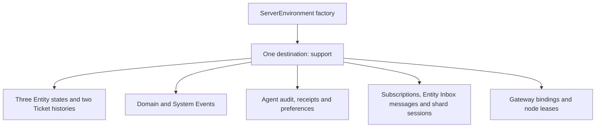
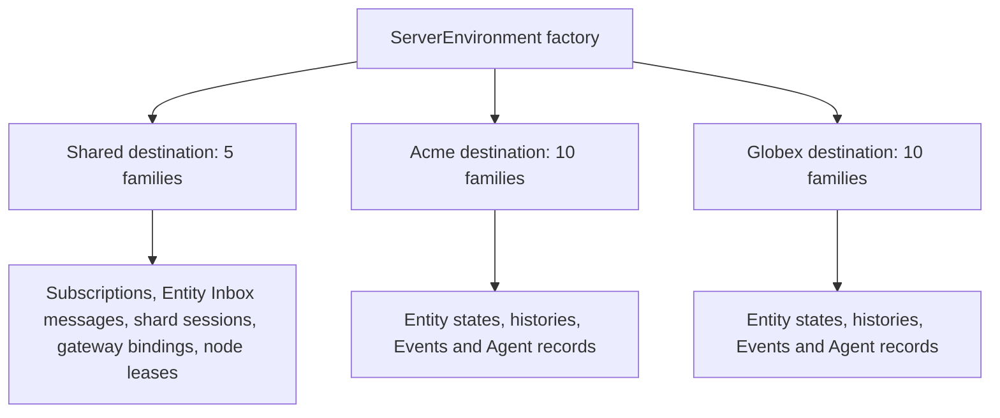
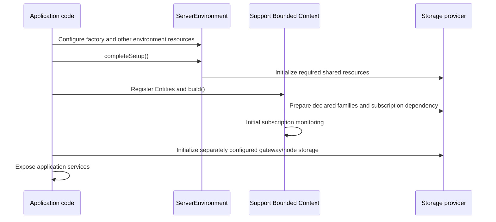

# Storage layout and provisioning

This guide shows the physical records produced by a Support application using
PostgreSQL, MySQL/MariaDB, Google Cloud Datastore or in-memory storage. Read the
single-tenant or multitenant chapter for your deployment. Each provider lists
all ten domain/Agent families and five shared framework families, with the
actual fields beside the corresponding default table or kind. The later chapters explain conversion, Agent and gateway storage, and startup timing.

- [1. Single-tenant mode](#1-single-tenant-mode)
- [2. Multitenant mode](#2-multitenant-mode)
- [3. Value conversion and customization](#3-value-conversion-and-customization)
- [4. Agent storage](#4-agent-storage)
- [5. Gateway and authentication storage](#5-gateway-and-authentication-storage)
- [6. Startup sequence](#6-startup-sequence)

“Creates a table” below means inside infrastructure the application has already
provisioned. The framework does not create SQL databases, Google Cloud projects,
accounts or permissions. Datastore kinds appear when records are written; the
application deploys its composite indexes.

## 1. Single-tenant mode

### The Support example

The example is a support application with one domain Bounded Context named
`Support`. Its paired System Context is named `Support_System`.

| Entity                           | Kind       | Identifier                         | Persistence enabled for this example                                                                    |
| -------------------------------- | ---------- | ---------------------------------- | ------------------------------------------------------------------------------------------------------- |
| `example.support.Ticket`         | Aggregate  | `example.support.TicketId`         | Current state, `stateHistory: true`, Aggregate diagnostic Event history                                 |
| `example.support.TicketList`     | Projection | `example.support.TicketListId`     | Current state; state history disabled                                                                   |
| `example.support.ReplyAssistant` | Agent      | `example.support.ReplyAssistantId` | Current state, mandatory Agent audit, acceptance receipts and model preferences; state history disabled |

System Event persistence is enabled with `persistSystemEvents()`, as required
for Agents. The example also uses the default persistent subscription registry,
environment Delivery, `DurableSubscriptionBindings` for browser subscriptions,
and `LeasedNodeRegistry` for node discovery. The latter two are explicitly
constructed application components; registering the three Entities alone does
not instantiate them.

This model excerpt fixes the exact names and illustrates the field types. It is
not a complete application: handlers, Commands, Events and generated imports
would be added in the application project.

```proto
syntax = "proto3";
package example.support;

import "spine/options.proto";
import "google/protobuf/any.proto";
import "google/protobuf/timestamp.proto";

message TicketId {
  string queue = 1;
  string number = 2;
}
message TicketListId { string value = 1; }
message ReplyAssistantId { string value = 1; }

enum Priority {
  PRIORITY_UNSPECIFIED = 0;
  NORMAL = 1;
  URGENT = 2;
}
message Requester {
  string name = 1;
  string email = 2;
  repeated string aliases = 3;
}
message BrowserInfo { string browser = 1; }

message Ticket {
  TicketId id = 1;
  string subject = 2 [(column) = true];
  Priority priority = 3 [(column) = true];
  Requester requester = 4 [(column) = true];
  google.protobuf.Timestamp opened_at = 5 [(column) = true];
  repeated string tags = 6;
  map<string, string> attributes = 7;
  google.protobuf.Any detail = 8 [(column) = true];
}
message TicketList {
  TicketListId id = 1;
  repeated TicketId tickets = 2;
}
message ReplyAssistant {
  ReplyAssistantId id = 1;
  string last_draft = 2;
}
```

The one application-specific storage query in this example selects Tickets by
`priority` and orders by `opened_at ASC`. This is a query against the Aggregate's
record storage; it does not turn an Aggregate into a public query Projection.
Public clients query/subscribe to the Projection. The index checklist includes
that specified storage query and the built-in queries for the enabled features.
An application adding different queries must add the indexes those queries need.

The full example has **15 record families**: ten for domain/Agent data and five
for shared framework services. A family means a table in SQL, a kind within a
namespace in Datastore, or the corresponding logical collection in memory.
The provider inventories below list every family, including optional features
that this example deliberately enables.

All 15 families use one SQL database named `support`, or one Datastore namespace
named `support`. For PostgreSQL the selected schema is `spine`. In-memory storage
keeps the corresponding logical records in one backend.



The gateway/node families appear only because this example explicitly enables
those components. Omitting the Agent removes its state/audit/receipt/preference
requirements; omitting optional Ticket state history removes that history
family. Enabling further Entity repositories adds their corresponding families.

### PostgreSQL

These are the default physical names for the Support example. The three example-defined Entity state families come first; framework-managed layouts for histories, Events, Agent records and services follow. Framework-managed describes the layout, not its tenant destination. `bytes` holds a complete binary Protobuf record; the table shows a short decoded view so the example value is readable.

The named `*Schema` constants below come from generated application/framework modules. The complete provider factory setup appears after the family sections; the shared stringifier setup is in [chapter 3](#3-value-conversion-and-customization).

The table or kind settings below apply to the same builder used in the factory setup at the end of this provider section.

#### Domain Entity state tables

##### Ticket current state: `spine.example_support_ticket`

**Table location:** `support` database, `spine` schema.

**Created by:** The PostgreSQL adapter creates and checks this table when the Support Bounded Context prepares the Ticket repository. The application must provision the database first; administrators may instead precreate the table and run compatibility checks.

| Physical field     | Database type                  | Exact source                                                    | Example value                                                                                                                                                                                                      |
| ------------------ | ------------------------------ | --------------------------------------------------------------- | ------------------------------------------------------------------------------------------------------------------------------------------------------------------------------------------------------------------ |
| `ID` (primary key) | `VARCHAR(512) NOT NULL`        | Ticket.id: TicketId, encoded with the configured key conversion | `{"queue":"billing","number":"T-42"}`                                                                                                                                                                              |
| `bytes`            | BYTEA NOT NULL                 | Entire serialized `EntityRecord`                                | Binary Protobuf; decoded view: `entity_id=TicketId(billing,T-42); state=Ticket(subject=Cannot download invoice, priority=URGENT, tags=[invoice], attributes={tier:pro}); version=3; archived=false; deleted=false` |
| `archived`         | BOOLEAN NOT NULL DEFAULT false | `EntityRecord.lifecycle_flags.archived`                         | `false`                                                                                                                                                                                                            |
| `deleted`          | BOOLEAN NOT NULL DEFAULT false | `EntityRecord.lifecycle_flags.deleted`                          | `false`                                                                                                                                                                                                            |
| `version`          | INTEGER NOT NULL DEFAULT 0     | `EntityRecord.version.number`                                   | `3`                                                                                                                                                                                                                |
| `subject`          | TEXT                           | `Ticket.subject`                                                | `Cannot download invoice`                                                                                                                                                                                          |
| `priority`         | INTEGER                        | `Ticket.priority`                                               | `2 (URGENT)`                                                                                                                                                                                                       |
| `requester`        | TEXT                           | `Ticket.requester`                                              | `{"name":"Ada","email":"ada@example.test","aliases":["A."]}`                                                                                                                                                       |
| `opened_at`        | BIGINT                         | `Ticket.opened_at`                                              | `42000000007`                                                                                                                                                                                                      |
| `detail`           | TEXT                           | `Ticket.detail`                                                 | `{"@type":"type.googleapis.com/example.support.BrowserInfo","browser":"Firefox"}`                                                                                                                                  |

Ticket.tags and Ticket.attributes remain only in EntityRecord.state inside bytes.

**Change this table:** Configure the provider builder before `.build()`. Use a distinct table name in each destination.

<!-- docs-snippet-path: packages/server-blackbox-tests/test/native-public-preparation.integration.test.ts -->

```ts
import type { Message } from "@bufbuild/protobuf";
import type { GenMessage } from "@bufbuild/protobuf/codegenv2";
import { PostgresStorageFactory } from "@spine-event-engine/storage-postgres";
declare const TicketSchema: GenMessage<Message>; // Application-generated Support schema.

const builder = PostgresStorageFactory.newBuilder();
builder.setTableName(TicketSchema, "support_ticket");
```

##### TicketList current state: `spine.example_support_ticketlist`

**Table location:** `support` database, `spine` schema.

**Created by:** The PostgreSQL adapter creates and checks this table when the Support Bounded Context prepares the TicketList repository. The application must provision the database first; administrators may instead precreate the table and run compatibility checks.

| Physical field     | Database type                  | Exact source                                                            | Example value                                                                                                                        |
| ------------------ | ------------------------------ | ----------------------------------------------------------------------- | ------------------------------------------------------------------------------------------------------------------------------------ |
| `ID` (primary key) | `VARCHAR(512) NOT NULL`        | TicketList.id: TicketListId, encoded with the configured key conversion | `{"value":"billing-open"}`                                                                                                           |
| `bytes`            | BYTEA NOT NULL                 | Entire serialized `EntityRecord`                                        | Binary Protobuf; decoded view: `entity_id=TicketListId(billing-open); state=TicketList(tickets=[TicketId(billing,T-42)]); version=1` |
| `archived`         | BOOLEAN NOT NULL DEFAULT false | `EntityRecord.lifecycle_flags.archived`                                 | `false`                                                                                                                              |
| `deleted`          | BOOLEAN NOT NULL DEFAULT false | `EntityRecord.lifecycle_flags.deleted`                                  | `false`                                                                                                                              |
| `version`          | INTEGER NOT NULL DEFAULT 0     | `EntityRecord.version.number`                                           | `1`                                                                                                                                  |

TicketList.tickets stays inside EntityRecord.state in bytes.

**Change this table:** Configure the provider builder before `.build()`. Use a distinct table name in each destination.

<!-- docs-snippet-path: packages/server-blackbox-tests/test/native-public-preparation.integration.test.ts -->

```ts
import type { Message } from "@bufbuild/protobuf";
import type { GenMessage } from "@bufbuild/protobuf/codegenv2";
import { PostgresStorageFactory } from "@spine-event-engine/storage-postgres";
declare const TicketListSchema: GenMessage<Message>; // Application-generated Support schema.

const builder = PostgresStorageFactory.newBuilder();
builder.setTableName(TicketListSchema, "support_ticket_list");
```

##### ReplyAssistant current state: `spine.example_support_replyassistant`

**Table location:** `support` database, `spine` schema.

**Created by:** The PostgreSQL adapter creates and checks this table when the Support Bounded Context prepares the ReplyAssistant Agent repository. The application must provision the database first; administrators may instead precreate the table and run compatibility checks.

| Physical field     | Database type                  | Exact source                                                                    | Example value                                                                                                                          |
| ------------------ | ------------------------------ | ------------------------------------------------------------------------------- | -------------------------------------------------------------------------------------------------------------------------------------- |
| `ID` (primary key) | `VARCHAR(512) NOT NULL`        | ReplyAssistant.id: ReplyAssistantId, encoded with the configured key conversion | `{"value":"assistant-7"}`                                                                                                              |
| `bytes`            | BYTEA NOT NULL                 | Entire serialized `EntityRecord`                                                | Binary Protobuf; decoded view: `entity_id=ReplyAssistantId(assistant-7); state=ReplyAssistant(last_draft=Please try again); version=2` |
| `archived`         | BOOLEAN NOT NULL DEFAULT false | `EntityRecord.lifecycle_flags.archived`                                         | `false`                                                                                                                                |
| `deleted`          | BOOLEAN NOT NULL DEFAULT false | `EntityRecord.lifecycle_flags.deleted`                                          | `false`                                                                                                                                |
| `version`          | INTEGER NOT NULL DEFAULT 0     | `EntityRecord.version.number`                                                   | `2`                                                                                                                                    |

ReplyAssistant.last_draft stays inside EntityRecord.state in bytes.

**Change this table:** Configure the provider builder before `.build()`. Use a distinct table name in each destination.

<!-- docs-snippet-path: packages/server-blackbox-tests/test/native-public-preparation.integration.test.ts -->

```ts
import type { Message } from "@bufbuild/protobuf";
import type { GenMessage } from "@bufbuild/protobuf/codegenv2";
import { PostgresStorageFactory } from "@spine-event-engine/storage-postgres";
declare const ReplyAssistantSchema: GenMessage<Message>; // Application-generated Support schema.

const builder = PostgresStorageFactory.newBuilder();
builder.setTableName(ReplyAssistantSchema, "support_reply_assistant");
```

#### Framework tables for Events, histories and services

##### Ticket state history: `spine.example_support_ticket_entityrecord`

**Table location:** `support` database, `spine` schema.

**Created by:** The PostgreSQL adapter creates and checks this table when Support prepares the Ticket repository with `stateHistory: true`. The application must provision the database first; administrators may instead precreate the table and run compatibility checks.

| Physical field     | Database type           | Exact source                                                                              | Example value                                                                                                               |
| ------------------ | ----------------------- | ----------------------------------------------------------------------------------------- | --------------------------------------------------------------------------------------------------------------------------- |
| `ID` (primary key) | `VARCHAR(512) NOT NULL` | EntityStateKey(entity_id=TicketId, version=2), encoded with the configured key conversion | `{"entityId":{"@type":"type.googleapis.com/example.support.TicketId","queue":"billing","number":"T-42"},"version":2}`       |
| `bytes`            | BYTEA NOT NULL          | Entire serialized `EntityRecord`                                                          | Binary Protobuf; decoded view: `entity_id=TicketId(billing,T-42); state=Ticket(subject=Cannot download invoice); version=2` |
| `entity_id`        | TEXT                    | `EntityRecord.entity_id`                                                                  | `{"@type":"type.googleapis.com/example.support.TicketId","queue":"billing","number":"T-42"}`                                |
| `created`          | BIGINT                  | `EntityRecord.version.timestamp`                                                          | `42000000007`                                                                                                               |
| `version`          | INTEGER                 | `EntityRecord.version.number`                                                             | `2`                                                                                                                         |

This historical EntityRecord keeps the complete Ticket state and lifecycle flags inside bytes; history has no separate archived or deleted column.

**Change this table:** Configure the provider builder before `.build()`. Use a distinct table name in each destination.

<!-- docs-snippet-path: packages/server-blackbox-tests/test/native-public-preparation.integration.test.ts -->

```ts
import type { Message } from "@bufbuild/protobuf";
import type { GenMessage } from "@bufbuild/protobuf/codegenv2";
import { PostgresStorageFactory } from "@spine-event-engine/storage-postgres";
declare const TicketSchema: GenMessage<Message>; // Application-generated Support schema.
import { EntityRecordSchema } from "@spine-event-engine/proto/generated/spine/server/entity/entity_pb.js";

const builder = PostgresStorageFactory.newBuilder();
builder.setTableName(TicketSchema, EntityRecordSchema, "ticket_state_history");
```

##### Ticket diagnostic Event history: `spine.example_support_ticket_event`

**Table location:** `support` database, `spine` schema.

**Created by:** The PostgreSQL adapter creates and checks this table when Support prepares the Ticket Aggregate repository. The application must provision the database first; administrators may instead precreate the table and run compatibility checks.

| Physical field     | Database type           | Exact source                                                  | Example value                                                                                                                                         |
| ------------------ | ----------------------- | ------------------------------------------------------------- | ----------------------------------------------------------------------------------------------------------------------------------------------------- |
| `ID` (primary key) | `VARCHAR(512) NOT NULL` | Event.id: EventId, encoded with the configured key conversion | `{"value":"ticket-event-8"}`                                                                                                                          |
| `bytes`            | BYTEA NOT NULL          | Entire serialized `Event`                                     | Binary Protobuf; decoded view: `id=ticket-event-8; context.producer_id=TicketId(billing,T-42); context.version=2; message=packed Ticket domain Event` |
| `entity_id`        | TEXT                    | `Event.context.producer_id`                                   | `{"@type":"type.googleapis.com/example.support.TicketId","queue":"billing","number":"T-42"}`                                                          |
| `created`          | BIGINT                  | `Event.context.timestamp`                                     | `42000000007`                                                                                                                                         |
| `version`          | INTEGER                 | `Event.context.version.number`                                | `2`                                                                                                                                                   |

This is a diagnostic history for the Aggregate, distinct from the domain Event store.

**Change this layout:** There is no narrow SQL naming override for this diagnostic Event family: `setTableName(TicketSchema, EventSchema, ...)` does not select its current `(EventSchema, EventSchema)` key.

##### Support domain Events: `spine.es_3zg7bqc0wuwdwaja0pfjqoalpwiatoj1us9z4hxitwvoy9ke7n_event`

**Table location:** `support` database, `spine` schema.

**Created by:** The PostgreSQL adapter creates and checks this table when Support prepares the domain Event store. The application must provision the database first; administrators may instead precreate the table and run compatibility checks.

| Physical field     | Database type           | Exact source                                                  | Example value                                                                                                     |
| ------------------ | ----------------------- | ------------------------------------------------------------- | ----------------------------------------------------------------------------------------------------------------- |
| `ID` (primary key) | `VARCHAR(512) NOT NULL` | Event.id: EventId, encoded with the configured key conversion | `{"value":"domain-event-8"}`                                                                                      |
| `bytes`            | BYTEA NOT NULL          | Entire serialized `Event`                                     | Binary Protobuf; decoded view: `id=domain-event-8; message=packed Ticket domain Event; context.timestamp=42s+7ns` |
| `created`          | BIGINT                  | `Event.context.timestamp`                                     | `42000000007`                                                                                                     |
| `type`             | TEXT                    | `Event.message.type_url`                                      | `type.googleapis.com/example.support.TicketOpened`                                                                |

The packed Event payload and its context stay in bytes; no table appears for each Event message type.

**Change this layout:** No narrow per-group naming override is available for these Event stores. Keep their generated names; a broad `EventSchema` override can collide with another Event family.

##### Support System Events: `spine.es_0k5kwy2zdeouv8i7yfp7aov3zknttgy54vkdl14iwhzrajnaoo_event`

**Table location:** `support` database, `spine` schema.

**Created by:** The PostgreSQL adapter creates and checks this table when Support prepares the System Event store enabled by `persistSystemEvents()`. The application must provision the database first; administrators may instead precreate the table and run compatibility checks.

| Physical field     | Database type           | Exact source                                                  | Example value                                                                                                         |
| ------------------ | ----------------------- | ------------------------------------------------------------- | --------------------------------------------------------------------------------------------------------------------- |
| `ID` (primary key) | `VARCHAR(512) NOT NULL` | Event.id: EventId, encoded with the configured key conversion | `{"value":"system-event-9"}`                                                                                          |
| `bytes`            | BYTEA NOT NULL          | Entire serialized `Event`                                     | Binary Protobuf; decoded view: `id=system-event-9; message=packed AgentAiOperationStarted; context.timestamp=42s+7ns` |
| `created`          | BIGINT                  | `Event.context.timestamp`                                     | `42000000007`                                                                                                         |
| `type`             | TEXT                    | `Event.message.type_url`                                      | `type.spine.io/spine.ts.agent.AgentAiOperationStarted`                                                                |

This separately grouped Event family also retains Agent interaction Events inside complete Event records.

**Change this layout:** No narrow per-group naming override is available for these Event stores. Keep their generated names; a broad `EventSchema` override can collide with another Event family.

##### Agent audit: `spine.agent_history_agenthistoryrecord`

**Table location:** `support` database, `spine` schema.

**Created by:** The PostgreSQL adapter creates and checks this table when Support prepares the Agent repository. The application must provision the database first; administrators may instead precreate the table and run compatibility checks.

| Physical field        | Database type           | Exact source                                                                                       | Example value                                                                                                                                                    |
| --------------------- | ----------------------- | -------------------------------------------------------------------------------------------------- | ---------------------------------------------------------------------------------------------------------------------------------------------------------------- |
| `ID` (primary key)    | `VARCHAR(512) NOT NULL` | digest of [state type, agent key, category, record ID], encoded with the configured key conversion | `ea81db35be48d55aaf1cf19c1c6bcb339a21909d76aab87afabfda5df13d89fb`                                                                                               |
| `bytes`               | BYTEA NOT NULL          | Entire serialized `AgentHistoryRecord`                                                             | Binary Protobuf; decoded view: `scope=(example.support.ReplyAssistant, assistant-7); entry=conversation-5 at 42s+7ns with typed generation request and response` |
| `state_type`          | TEXT                    | `AgentHistoryRecord.scope.state_type`                                                              | `example.support.ReplyAssistant`                                                                                                                                 |
| `agent_key`           | TEXT                    | `AgentHistoryRecord.scope.agent_key`                                                               | `{"value":"assistant-7"}`                                                                                                                                        |
| `scope_digest`        | TEXT                    | `SHA-256 of [scope.state_type, scope.agent_key]`                                                   | `f74b42a1ecc3fc5b54ebb0cfed131529534c0d48fcba7b71cf52e28fa1b0b4e8`                                                                                               |
| `category`            | TEXT                    | `derived from AgentHistoryRecord.entry`                                                            | `conversation`                                                                                                                                                   |
| `conversation_key`    | TEXT                    | `AgentHistoryRecord.entry.conversation_record.conversation.value`; empty for Events                | `conversation-5`                                                                                                                                                 |
| `conversation_digest` | TEXT                    | `digest of conversation_key`                                                                       | `dfb001c45affbadd14a71a2e6ee6b6fed7c7687ff136ceb23b23d5544fb602fb`                                                                                               |
| `order_key`           | TEXT                    | `derived AgentHistoryKeys ordering key`                                                            | `2534023007579999999920636f6e766572736174696f6e2d35!`                                                                                                            |

The original scope and entire AgentHistoryEntry remain in bytes: prompt and tool content, model requests/responses, decision records, usage, System Events, and domain Events. The hash is only a storage slot. PostgreSQL indexes `order_key` with binary `C` collation.

**Change this table:** Configure the provider builder before `.build()`. Use a distinct table name in each destination.

<!-- docs-snippet-path: packages/server-blackbox-tests/test/native-public-preparation.integration.test.ts -->

```ts
import { PostgresStorageFactory } from "@spine-event-engine/storage-postgres";
import { AgentHistoryEntrySchema } from "@spine-event-engine/proto/agent";
import { AgentHistoryRecordSchema } from "@spine-event-engine/proto/generated/spine/server/agent/history_record_pb.js";

const builder = PostgresStorageFactory.newBuilder();
builder.setTableName(AgentHistoryEntrySchema, AgentHistoryRecordSchema, "support_agent_history");
```

##### Agent acceptance receipts: `spine.spine_agent_acceptance_agentacceptancereceipt`

**Table location:** `support` database, `spine` schema.

**Created by:** The PostgreSQL adapter creates and checks this table when Support prepares the Agent repository. The application must provision the database first; administrators may instead precreate the table and run compatibility checks.

| Physical field     | Database type           | Exact source                                                                     | Example value                                                                                                                              |
| ------------------ | ----------------------- | -------------------------------------------------------------------------------- | ------------------------------------------------------------------------------------------------------------------------------------------ |
| `ID` (primary key) | `VARCHAR(512) NOT NULL` | digest of AgentAcceptanceReceipt.key, encoded with the configured key conversion | `v1:678e976d5088dfdf24b02234440d7f5ceb83e454898200f24327d3a472a36894`                                                                      |
| `bytes`            | BYTEA NOT NULL          | Entire serialized `AgentAcceptanceReceipt`                                       | Binary Protobuf; decoded view: `key=(example.support.ReplyAssistant, ReplyAssistantId(assistant-7), CommandId(command-4), HANDLE_COMMAND)` |

The complete key in bytes retains state_type, recipient_id Any, original command or event ID, and action. It records acceptance, not a runnable queue.

**Change this table:** Configure the provider builder before `.build()`. Use a distinct table name in each destination.

<!-- docs-snippet-path: packages/server-blackbox-tests/test/native-public-preparation.integration.test.ts -->

```ts
import { PostgresStorageFactory } from "@spine-event-engine/storage-postgres";
import { AgentAcceptanceReceiptSchema } from "@spine-event-engine/proto/generated/spine/server/agent/acceptance_receipt_pb.js";

const builder = PostgresStorageFactory.newBuilder();
builder.setTableName(
  AgentAcceptanceReceiptSchema,
  AgentAcceptanceReceiptSchema,
  "support_agent_receipts",
);
```

##### Agent model preferences: `spine.spine_agent_model_preferences_agentmodelpreferencesrecord`

**Table location:** `support` database, `spine` schema.

**Created by:** The PostgreSQL adapter creates and checks this table when Support prepares the Agent repository. The application must provision the database first; administrators may instead precreate the table and run compatibility checks.

| Physical field     | Database type           | Exact source                                                                        | Example value                                                                                                                                     |
| ------------------ | ----------------------- | ----------------------------------------------------------------------------------- | ------------------------------------------------------------------------------------------------------------------------------------------------- |
| `ID` (primary key) | `VARCHAR(512) NOT NULL` | digest of key(state_type, recipient_id), encoded with the configured key conversion | `v1:d3012cb12aaa88c0ad96a478344f74c9c6f736d80bd564da57c137fd3b92d7b1`                                                                             |
| `bytes`            | BYTEA NOT NULL          | Entire serialized `AgentModelPreferencesRecord`                                     | Binary Protobuf; decoded view: `key=(example.support.ReplyAssistant, ReplyAssistantId(assistant-7)); preferences=[GENERATION:support-drafter@v2]` |

The key and repeated preferences stay in bytes; for example GENERATION selects support-drafter revision v2. No model weights, credentials, or paused handler are stored.

**Change this table:** Configure the provider builder before `.build()`. Use a distinct table name in each destination.

<!-- docs-snippet-path: packages/server-blackbox-tests/test/native-public-preparation.integration.test.ts -->

```ts
import { PostgresStorageFactory } from "@spine-event-engine/storage-postgres";
import { AgentModelPreferencesRecordSchema } from "@spine-event-engine/proto/generated/spine/server/agent/model_preferences_record_pb.js";

const builder = PostgresStorageFactory.newBuilder();
builder.setTableName(
  AgentModelPreferencesRecordSchema,
  AgentModelPreferencesRecordSchema,
  "support_agent_preferences",
);
```

##### Subscription registry: `spine.spine_client_subscriptionrecord`

**Table location:** `support` database, `spine` schema.

**Created by:** The PostgreSQL adapter creates and checks this table when Support prepares or starts persistent subscription monitoring. The application must provision the database first; administrators may instead precreate the table and run compatibility checks.

| Physical field            | Database type           | Exact source                                                                      | Example value                                                                                                                                     |
| ------------------------- | ----------------------- | --------------------------------------------------------------------------------- | ------------------------------------------------------------------------------------------------------------------------------------------------- |
| `ID` (primary key)        | `VARCHAR(512) NOT NULL` | SubscriptionRecord.id: SubscriptionId, encoded with the configured key conversion | `{"value":"sub-4"}`                                                                                                                               |
| `bytes`                   | BYTEA NOT NULL          | Entire serialized `SubscriptionRecord`                                            | Binary Protobuf; decoded view: `id=sub-4; status=PENDING; subscription=TicketList updates for acme; when_activation_expires=1,800,000,000,000 ms` |
| `status`                  | INTEGER                 | `SubscriptionRecord.status`                                                       | `1 (PENDING)`                                                                                                                                     |
| `when_activation_expires` | BIGINT                  | `SubscriptionRecord.when_activation_expires; absent uses Number.MAX_SAFE_INTEGER` | `1,800,000,000,000 epoch ms`                                                                                                                      |

The subscription definition, target, Actor/Tenant context, creation timestamp and full optional expiry remain in bytes.

**Change this table:** Configure the provider builder before `.build()`. Use a distinct table name in each destination.

<!-- docs-snippet-path: packages/server-blackbox-tests/test/native-public-preparation.integration.test.ts -->

```ts
import { PostgresStorageFactory } from "@spine-event-engine/storage-postgres";
import { SubscriptionRecordSchema } from "@spine-event-engine/proto/generated/spine/client/subscription_record_pb.js";

const builder = PostgresStorageFactory.newBuilder();
builder.setTableName(SubscriptionRecordSchema, "support_subscriptions");
```

##### Entity Inbox messages: `spine.spine_server_delivery_inboxmessage`

**Table location:** `support` database, `spine` schema.

**Created by:** The PostgreSQL adapter issues `CREATE TABLE IF NOT EXISTS` and validates this table on its first Inbox storage use, normally when an Entity Inbox receives its first routed signal. The application must provision the database first. Administrators may precreate the table, but first use still issues creation SQL and validates its layout; SQL privileges must allow that path. Bounded Context build alone does not prepare this Delivery table, and no public standalone checker is available.

| Physical field     | Database type           | Exact source                                                                | Example value                                                                                                                                                           |
| ------------------ | ----------------------- | --------------------------------------------------------------------------- | ----------------------------------------------------------------------------------------------------------------------------------------------------------------------- |
| `ID` (primary key) | `VARCHAR(512) NOT NULL` | InboxMessage.id: InboxMessageId, encoded with the configured key conversion | `{"uuid":"message-3","index":{"index":2,"ofTotal":16}}`                                                                                                                 |
| `bytes`            | BYTEA NOT NULL          | Entire serialized `InboxMessage`                                            | Binary Protobuf; decoded view: `id=(message-3, shard 2/16); inbox_id=Ticket(billing,T-42); signal_id=command-4; status=TO_DELIVER; signal=packed Command`               |
| `inbox_id`         | TEXT                    | `InboxMessage.inbox_id`                                                     | `{"entityId":{"id":{"@type":"type.googleapis.com/example.support.TicketId","queue":"billing","number":"T-42"}},"typeUrl":"type.googleapis.com/example.support.Ticket"}` |
| `signal_id`        | TEXT                    | `InboxMessage.signal_id`                                                    | `{"value":"command-4"}`                                                                                                                                                 |
| `shard_index`      | INTEGER                 | `InboxMessage.id.index.index`                                               | `2`                                                                                                                                                                     |
| `shard_total`      | INTEGER                 | `InboxMessage.id.index.of_total`                                            | `16`                                                                                                                                                                    |
| `status`           | INTEGER                 | `InboxMessage.status`                                                       | `1 (TO_DELIVER)`                                                                                                                                                        |
| `when_received`    | BIGINT                  | `InboxMessage.when_received`                                                | `42000000007`                                                                                                                                                           |
| `version`          | INTEGER                 | `InboxMessage.version`                                                      | `1`                                                                                                                                                                     |
| `message_id`       | TEXT                    | `InboxMessage.id.uuid`                                                      | `message-3`                                                                                                                                                             |

Each Entity has a distinct Inbox. Its messages share this physical family; the complete signal, tenant context, label, and keep_until remain in bytes.

**Change this table:** Configure the provider builder before `.build()`. Use a distinct table name in each destination.

<!-- docs-snippet-path: packages/server-blackbox-tests/test/native-public-preparation.integration.test.ts -->

```ts
import { PostgresStorageFactory } from "@spine-event-engine/storage-postgres";
import { InboxMessageSchema } from "@spine-event-engine/proto/generated/spine/server/delivery/inbox_pb.js";

const builder = PostgresStorageFactory.newBuilder();
builder.setTableName(InboxMessageSchema, "support_inbox_messages");
```

##### Delivery shard sessions: `spine.spine_server_delivery_shardsessionrecord`

**Table location:** `support` database, `spine` schema.

**Created by:** The PostgreSQL adapter issues `CREATE TABLE IF NOT EXISTS` and validates this table on its first shard-session storage use, normally when Delivery picks up a shard. The application must provision the database first. Administrators may precreate the table, but first use still issues creation SQL and validates its layout; SQL privileges must allow that path. Bounded Context build alone does not prepare this Delivery table, and no public standalone checker is available.

| Physical field     | Database type           | Exact source                                                                     | Example value                                                                                                          |
| ------------------ | ----------------------- | -------------------------------------------------------------------------------- | ---------------------------------------------------------------------------------------------------------------------- |
| `ID` (primary key) | `VARCHAR(512) NOT NULL` | ShardSessionRecord.index: ShardIndex, encoded with the configured key conversion | `{"index":2,"ofTotal":16}`                                                                                             |
| `bytes`            | BYTEA NOT NULL          | Entire serialized `ShardSessionRecord`                                           | Binary Protobuf; decoded view: `index=(2,16); when_last_picked=1970-01-01T00:00:42.000000007Z; worker=node-2/worker-1` |

The index, when_last_picked and worker are in bytes. There is no materialized expiry column.

**Change this table:** Configure the provider builder before `.build()`. Use a distinct table name in each destination.

<!-- docs-snippet-path: packages/server-blackbox-tests/test/native-public-preparation.integration.test.ts -->

```ts
import { PostgresStorageFactory } from "@spine-event-engine/storage-postgres";
import { ShardSessionRecordSchema } from "@spine-event-engine/proto/generated/spine/server/delivery/delivery_pb.js";

const builder = PostgresStorageFactory.newBuilder();
builder.setTableName(ShardSessionRecordSchema, "support_shard_sessions");
```

##### Gateway authenticated bindings: `spine.spine_auth_gatewayauthenticatedsubscription`

**Table location:** `support` database, `spine` schema.

**Created by:** The PostgreSQL adapter creates and checks this table on the first binding storage operation after the application constructs `DurableSubscriptionBindings`. The application must provision the database first. Bounded Context build does not prepare this separately constructed component, and it has no public standalone table checker.

| Physical field     | Database type           | Exact source                                                                                    | Example value                                                                                                                        |
| ------------------ | ----------------------- | ----------------------------------------------------------------------------------------------- | ------------------------------------------------------------------------------------------------------------------------------------ |
| `ID` (primary key) | `VARCHAR(512) NOT NULL` | GatewayAuthenticatedSubscription.id: SubscriptionId, encoded with the configured key conversion | `{"value":"sub-4"}`                                                                                                                  |
| `bytes`            | BYTEA NOT NULL          | Entire serialized `GatewayAuthenticatedSubscription`                                            | Binary Protobuf; decoded view: `id=sub-4; subscription=authenticated TicketList updates for acme; when_expires=1,800,000,000,000 ms` |
| `when_expires`     | BIGINT                  | `GatewayAuthenticatedSubscription.when_expires`                                                 | `1,800,000,000,000 epoch ms`                                                                                                         |

The approved subscription with Actor/Tenant context remains in bytes. Live network streams do not.

**Change this table:** Configure the provider builder before `.build()`. Use a distinct table name in each destination.

<!-- docs-snippet-path: packages/server-blackbox-tests/test/native-public-preparation.integration.test.ts -->

```ts
import { PostgresStorageFactory } from "@spine-event-engine/storage-postgres";
import { GatewayAuthenticatedSubscriptionSchema } from "@spine-event-engine/proto/generated/spine/auth/authenticated_subscription_pb.js";

const builder = PostgresStorageFactory.newBuilder();
builder.setTableName(GatewayAuthenticatedSubscriptionSchema, "support_gateway_bindings");
```

##### Application node leases: `spine.spine_deployment_applicationnodelease`

**Table location:** `support` database, `spine` schema.

**Created by:** The PostgreSQL adapter creates and checks this table on the first lease storage operation after the application constructs `LeasedNodeRegistry`. The application must provision the database first. Bounded Context build does not prepare this separately constructed component, and it has no public standalone table checker.

| Physical field     | Database type           | Exact source                                                                     | Example value                                                                                                                                                   |
| ------------------ | ----------------------- | -------------------------------------------------------------------------------- | --------------------------------------------------------------------------------------------------------------------------------------------------------------- |
| `ID` (primary key) | `VARCHAR(512) NOT NULL` | ApplicationNodeLease.node_id: NodeId, encoded with the configured key conversion | `{"value":"node-2"}`                                                                                                                                            |
| `bytes`            | BYTEA NOT NULL          | Entire serialized `ApplicationNodeLease`                                         | Binary Protobuf; decoded view: `node_id=node-2; endpoint.origin=https://node-2.example.test; when_expires=2030-01-01T00:00:00Z; registration_id=registration-9` |

The endpoint origin, optional TLS server name, expiry and registration ID remain in bytes; expiry is checked by application logic.

**Change this table:** Configure the provider builder before `.build()`. Use a distinct table name in each destination.

<!-- docs-snippet-path: packages/server-blackbox-tests/test/native-public-preparation.integration.test.ts -->

```ts
import { PostgresStorageFactory } from "@spine-event-engine/storage-postgres";
import { ApplicationNodeLeaseSchema } from "@spine-event-engine/proto/generated/spine/deployment/node_discovery_pb.js";

const builder = PostgresStorageFactory.newBuilder();
builder.setTableName(ApplicationNodeLeaseSchema, "support_node_leases");
```

#### Factory setup

<!-- docs-snippet-path: packages/server-blackbox-tests/test/native-public-preparation.integration.test.ts -->

```ts
import type { StringifierRegistry } from "@spine-event-engine/core";
import { PostgresStorageFactory } from "@spine-event-engine/storage-postgres";

// Use the registry assembled in chapter 3.
declare const stringifiers: StringifierRegistry;

const builder = PostgresStorageFactory.newBuilder()
  .setStringifierRegistry(stringifiers)
  .setOptions({ url: "postgresql://localhost/support", schema: "spine" });
const factory = await builder.build();
```

#### Human configuration checklist

- [ ] **1. Provision PostgreSQL and connection access.** Start the server or
      provision a managed instance. Configure network access, TLS and the
      application login. The examples use local URLs to make database names clear;
      production credentials/TLS settings must come from deployment configuration.
      Spine does not install PostgreSQL, create accounts or grant permissions.
- [ ] **2. Create the database and schema destinations.** As an administrator,
      first create/configure the `support_app` login using your credential process.
      Then run the following with `psql` connected initially to `postgres`:

```sql
CREATE DATABASE support;
\connect support
CREATE SCHEMA spine AUTHORIZATION support_app;
\connect postgres
```

`CREATE SCHEMA` runs separately in each selected database. Supplying
`schema: "spine"` to the factory does not create that schema. PostgreSQL's
[CREATE SCHEMA reference](https://www.postgresql.org/docs/current/sql-createschema.html)
describes the required privileges.

- [ ] **3. Give the application the required privileges.** It needs database
      connection access, schema usage, and CRUD access to its tables. If Spine will
      create tables/indexes, it also needs schema creation privileges and the
      ability to create the required indexes. If administrators precreate the
      tables, grant runtime access explicitly; do not assume a different
      administrative role's tables are automatically accessible. The separately
      constructed gateway/node components still issue creation SQL on first use
      and expose no public read-only preparation method. Retain the privileges
      required for that path even when their tables already exist.
- [ ] **4. Decide how values are compared and converted.** Use a collation that
      preserves distinctions in Entity IDs. Supply a complete TypeRegistry for
      application types packed into searchable `Any` values; configure any custom
      reversible stringifiers consistently on every instance. Check identifier and
      indexed integer/timestamp limits in chapter 3.
- [ ] **5. Configure the factory and environment.** Use the factory setup above, then supply it to `ServerEnvironment`. Complete environment setup
      before building the Bounded Context. Register all three Entity types, enable
      Ticket state history and System Event persistence, and configure the Agent's
      AI services. Merely importing an Entity class does not declare its storage.
- [ ] **6. Prepare or precreate every enabled family.** Normal Bounded Context
      preparation creates its missing tables and validates them. If administrators
      create tables, use the exact schemas in this chapter and run compatibility
      checks before allowing traffic. Include the separately constructed gateway
      bindings and node registry in startup; their tables are prepared by their
      initial storage use, not by Entity registration alone.
- [ ] **7. Add application query indexes.** Spine creates primary keys and the
      three Agent audit indexes described beside the audit table. It does not create
      an index for every `(column)`. For the example Ticket query, create an index
      on `(priority, opened_at, ID)` in each database containing Ticket records:

```sql
CREATE INDEX support_ticket_priority_opened
  ON spine.example_support_ticket (priority, opened_at, ID);
```

Evaluate indexes for diagnostic/state history, subscription expiry and Inbox
queries against the expected workload as well. SQL can run those queries
without a composite index, but a large scan can make them slow. The Datastore
Datastore query/index matrix also names those query shapes for capacity planning.

- [ ] **8. Check the whole startup path.** Run the explicit preparation/checks,
      the first gateway binding access and node registration when those components
      are enabled, and representative reads/writes using the actual runtime role.
      A connection check alone proves neither table compatibility nor all privileges.
      Start accepting external work only after required startup operations succeed.

### MySQL and MariaDB

These are the default physical names for the Support example. The three example-defined Entity state families come first; framework-managed layouts for histories, Events, Agent records and services follow. Framework-managed describes the layout, not its tenant destination. `bytes` holds a complete binary Protobuf record; the table shows a short decoded view so the example value is readable.

The named `*Schema` constants below come from generated application/framework modules. The complete provider factory setup appears after the family sections; the shared stringifier setup is in [chapter 3](#3-value-conversion-and-customization).

The table or kind settings below apply to the same builder used in the factory setup at the end of this provider section.

#### Domain Entity state tables

##### Ticket current state: `example_support_Ticket`

**Table location:** `support` database.

**Created by:** The MySQL/MariaDB adapter creates and checks this table when the Support Bounded Context prepares the Ticket repository. The application must provision the database first; administrators may instead precreate the table and run compatibility checks.

| Physical field     | Database type                  | Exact source                                                    | Example value                                                                                                                                                                                                      |
| ------------------ | ------------------------------ | --------------------------------------------------------------- | ------------------------------------------------------------------------------------------------------------------------------------------------------------------------------------------------------------------ |
| `ID` (primary key) | `VARCHAR(512) NOT NULL`        | Ticket.id: TicketId, encoded with the configured key conversion | `{"queue":"billing","number":"T-42"}`                                                                                                                                                                              |
| `bytes`            | BLOB NOT NULL                  | Entire serialized `EntityRecord`                                | Binary Protobuf; decoded view: `entity_id=TicketId(billing,T-42); state=Ticket(subject=Cannot download invoice, priority=URGENT, tags=[invoice], attributes={tier:pro}); version=3; archived=false; deleted=false` |
| `archived`         | BOOLEAN NOT NULL DEFAULT false | `EntityRecord.lifecycle_flags.archived`                         | `false`                                                                                                                                                                                                            |
| `deleted`          | BOOLEAN NOT NULL DEFAULT false | `EntityRecord.lifecycle_flags.deleted`                          | `false`                                                                                                                                                                                                            |
| `version`          | INT NOT NULL DEFAULT 0         | `EntityRecord.version.number`                                   | `3`                                                                                                                                                                                                                |
| `subject`          | TEXT                           | `Ticket.subject`                                                | `Cannot download invoice`                                                                                                                                                                                          |
| `priority`         | INT                            | `Ticket.priority`                                               | `2 (URGENT)`                                                                                                                                                                                                       |
| `requester`        | TEXT                           | `Ticket.requester`                                              | `{"name":"Ada","email":"ada@example.test","aliases":["A."]}`                                                                                                                                                       |
| `opened_at`        | BIGINT                         | `Ticket.opened_at`                                              | `42000000007`                                                                                                                                                                                                      |
| `detail`           | TEXT                           | `Ticket.detail`                                                 | `{"@type":"type.googleapis.com/example.support.BrowserInfo","browser":"Firefox"}`                                                                                                                                  |

Ticket.tags and Ticket.attributes remain only in EntityRecord.state inside bytes.

**Change this table:** Configure the provider builder before `.build()`. Use a distinct table name in each destination.

<!-- docs-snippet-path: packages/server-blackbox-tests/test/native-public-preparation.integration.test.ts -->

```ts
import type { Message } from "@bufbuild/protobuf";
import type { GenMessage } from "@bufbuild/protobuf/codegenv2";
import { MysqlStorageFactory } from "@spine-event-engine/storage-mysql";
declare const TicketSchema: GenMessage<Message>; // Application-generated Support schema.

const builder = MysqlStorageFactory.newBuilder();
builder.setTableName(TicketSchema, "support_ticket");
```

##### TicketList current state: `example_support_TicketList`

**Table location:** `support` database.

**Created by:** The MySQL/MariaDB adapter creates and checks this table when the Support Bounded Context prepares the TicketList repository. The application must provision the database first; administrators may instead precreate the table and run compatibility checks.

| Physical field     | Database type                  | Exact source                                                            | Example value                                                                                                                        |
| ------------------ | ------------------------------ | ----------------------------------------------------------------------- | ------------------------------------------------------------------------------------------------------------------------------------ |
| `ID` (primary key) | `VARCHAR(512) NOT NULL`        | TicketList.id: TicketListId, encoded with the configured key conversion | `{"value":"billing-open"}`                                                                                                           |
| `bytes`            | BLOB NOT NULL                  | Entire serialized `EntityRecord`                                        | Binary Protobuf; decoded view: `entity_id=TicketListId(billing-open); state=TicketList(tickets=[TicketId(billing,T-42)]); version=1` |
| `archived`         | BOOLEAN NOT NULL DEFAULT false | `EntityRecord.lifecycle_flags.archived`                                 | `false`                                                                                                                              |
| `deleted`          | BOOLEAN NOT NULL DEFAULT false | `EntityRecord.lifecycle_flags.deleted`                                  | `false`                                                                                                                              |
| `version`          | INT NOT NULL DEFAULT 0         | `EntityRecord.version.number`                                           | `1`                                                                                                                                  |

TicketList.tickets stays inside EntityRecord.state in bytes.

**Change this table:** Configure the provider builder before `.build()`. Use a distinct table name in each destination.

<!-- docs-snippet-path: packages/server-blackbox-tests/test/native-public-preparation.integration.test.ts -->

```ts
import type { Message } from "@bufbuild/protobuf";
import type { GenMessage } from "@bufbuild/protobuf/codegenv2";
import { MysqlStorageFactory } from "@spine-event-engine/storage-mysql";
declare const TicketListSchema: GenMessage<Message>; // Application-generated Support schema.

const builder = MysqlStorageFactory.newBuilder();
builder.setTableName(TicketListSchema, "support_ticket_list");
```

##### ReplyAssistant current state: `example_support_ReplyAssistant`

**Table location:** `support` database.

**Created by:** The MySQL/MariaDB adapter creates and checks this table when the Support Bounded Context prepares the ReplyAssistant Agent repository. The application must provision the database first; administrators may instead precreate the table and run compatibility checks.

| Physical field     | Database type                  | Exact source                                                                    | Example value                                                                                                                          |
| ------------------ | ------------------------------ | ------------------------------------------------------------------------------- | -------------------------------------------------------------------------------------------------------------------------------------- |
| `ID` (primary key) | `VARCHAR(512) NOT NULL`        | ReplyAssistant.id: ReplyAssistantId, encoded with the configured key conversion | `{"value":"assistant-7"}`                                                                                                              |
| `bytes`            | BLOB NOT NULL                  | Entire serialized `EntityRecord`                                                | Binary Protobuf; decoded view: `entity_id=ReplyAssistantId(assistant-7); state=ReplyAssistant(last_draft=Please try again); version=2` |
| `archived`         | BOOLEAN NOT NULL DEFAULT false | `EntityRecord.lifecycle_flags.archived`                                         | `false`                                                                                                                                |
| `deleted`          | BOOLEAN NOT NULL DEFAULT false | `EntityRecord.lifecycle_flags.deleted`                                          | `false`                                                                                                                                |
| `version`          | INT NOT NULL DEFAULT 0         | `EntityRecord.version.number`                                                   | `2`                                                                                                                                    |

ReplyAssistant.last_draft stays inside EntityRecord.state in bytes.

**Change this table:** Configure the provider builder before `.build()`. Use a distinct table name in each destination.

<!-- docs-snippet-path: packages/server-blackbox-tests/test/native-public-preparation.integration.test.ts -->

```ts
import type { Message } from "@bufbuild/protobuf";
import type { GenMessage } from "@bufbuild/protobuf/codegenv2";
import { MysqlStorageFactory } from "@spine-event-engine/storage-mysql";
declare const ReplyAssistantSchema: GenMessage<Message>; // Application-generated Support schema.

const builder = MysqlStorageFactory.newBuilder();
builder.setTableName(ReplyAssistantSchema, "support_reply_assistant");
```

#### Framework tables for Events, histories and services

##### Ticket state history: `example_support_Ticket_EntityRecord`

**Table location:** `support` database.

**Created by:** The MySQL/MariaDB adapter creates and checks this table when Support prepares the Ticket repository with `stateHistory: true`. The application must provision the database first; administrators may instead precreate the table and run compatibility checks.

| Physical field     | Database type           | Exact source                                                                              | Example value                                                                                                               |
| ------------------ | ----------------------- | ----------------------------------------------------------------------------------------- | --------------------------------------------------------------------------------------------------------------------------- |
| `ID` (primary key) | `VARCHAR(512) NOT NULL` | EntityStateKey(entity_id=TicketId, version=2), encoded with the configured key conversion | `{"entityId":{"@type":"type.googleapis.com/example.support.TicketId","queue":"billing","number":"T-42"},"version":2}`       |
| `bytes`            | BLOB NOT NULL           | Entire serialized `EntityRecord`                                                          | Binary Protobuf; decoded view: `entity_id=TicketId(billing,T-42); state=Ticket(subject=Cannot download invoice); version=2` |
| `entity_id`        | TEXT                    | `EntityRecord.entity_id`                                                                  | `{"@type":"type.googleapis.com/example.support.TicketId","queue":"billing","number":"T-42"}`                                |
| `created`          | BIGINT                  | `EntityRecord.version.timestamp`                                                          | `42000000007`                                                                                                               |
| `version`          | INT                     | `EntityRecord.version.number`                                                             | `2`                                                                                                                         |

This historical EntityRecord keeps the complete Ticket state and lifecycle flags inside bytes; history has no separate archived or deleted column.

**Change this table:** Configure the provider builder before `.build()`. Use a distinct table name in each destination.

<!-- docs-snippet-path: packages/server-blackbox-tests/test/native-public-preparation.integration.test.ts -->

```ts
import type { Message } from "@bufbuild/protobuf";
import type { GenMessage } from "@bufbuild/protobuf/codegenv2";
import { MysqlStorageFactory } from "@spine-event-engine/storage-mysql";
declare const TicketSchema: GenMessage<Message>; // Application-generated Support schema.
import { EntityRecordSchema } from "@spine-event-engine/proto/generated/spine/server/entity/entity_pb.js";

const builder = MysqlStorageFactory.newBuilder();
builder.setTableName(TicketSchema, EntityRecordSchema, "ticket_state_history");
```

##### Ticket diagnostic Event history: `example_support_Ticket_Event`

**Table location:** `support` database.

**Created by:** The MySQL/MariaDB adapter creates and checks this table when Support prepares the Ticket Aggregate repository. The application must provision the database first; administrators may instead precreate the table and run compatibility checks.

| Physical field     | Database type           | Exact source                                                  | Example value                                                                                                                                         |
| ------------------ | ----------------------- | ------------------------------------------------------------- | ----------------------------------------------------------------------------------------------------------------------------------------------------- |
| `ID` (primary key) | `VARCHAR(512) NOT NULL` | Event.id: EventId, encoded with the configured key conversion | `{"value":"ticket-event-8"}`                                                                                                                          |
| `bytes`            | BLOB NOT NULL           | Entire serialized `Event`                                     | Binary Protobuf; decoded view: `id=ticket-event-8; context.producer_id=TicketId(billing,T-42); context.version=2; message=packed Ticket domain Event` |
| `entity_id`        | TEXT                    | `Event.context.producer_id`                                   | `{"@type":"type.googleapis.com/example.support.TicketId","queue":"billing","number":"T-42"}`                                                          |
| `created`          | BIGINT                  | `Event.context.timestamp`                                     | `42000000007`                                                                                                                                         |
| `version`          | INT                     | `Event.context.version.number`                                | `2`                                                                                                                                                   |

This is a diagnostic history for the Aggregate, distinct from the domain Event store.

**Change this layout:** There is no narrow SQL naming override for this diagnostic Event family: `setTableName(TicketSchema, EventSchema, ...)` does not select its current `(EventSchema, EventSchema)` key.

##### Support domain Events: `es_3zg7bqc0wuwdwaja0pfjqoalpwiatoj1us9z4hxitwvoy9ke7n_Event`

**Table location:** `support` database.

**Created by:** The MySQL/MariaDB adapter creates and checks this table when Support prepares the domain Event store. The application must provision the database first; administrators may instead precreate the table and run compatibility checks.

| Physical field     | Database type           | Exact source                                                  | Example value                                                                                                     |
| ------------------ | ----------------------- | ------------------------------------------------------------- | ----------------------------------------------------------------------------------------------------------------- |
| `ID` (primary key) | `VARCHAR(512) NOT NULL` | Event.id: EventId, encoded with the configured key conversion | `{"value":"domain-event-8"}`                                                                                      |
| `bytes`            | BLOB NOT NULL           | Entire serialized `Event`                                     | Binary Protobuf; decoded view: `id=domain-event-8; message=packed Ticket domain Event; context.timestamp=42s+7ns` |
| `created`          | BIGINT                  | `Event.context.timestamp`                                     | `42000000007`                                                                                                     |
| `type`             | TEXT                    | `Event.message.type_url`                                      | `type.googleapis.com/example.support.TicketOpened`                                                                |

The packed Event payload and its context stay in bytes; no table appears for each Event message type.

**Change this layout:** No narrow per-group naming override is available for these Event stores. Keep their generated names; a broad `EventSchema` override can collide with another Event family.

##### Support System Events: `es_0k5kwy2zdeouv8i7yfp7aov3zknttgy54vkdl14iwhzrajnaoo_Event`

**Table location:** `support` database.

**Created by:** The MySQL/MariaDB adapter creates and checks this table when Support prepares the System Event store enabled by `persistSystemEvents()`. The application must provision the database first; administrators may instead precreate the table and run compatibility checks.

| Physical field     | Database type           | Exact source                                                  | Example value                                                                                                         |
| ------------------ | ----------------------- | ------------------------------------------------------------- | --------------------------------------------------------------------------------------------------------------------- |
| `ID` (primary key) | `VARCHAR(512) NOT NULL` | Event.id: EventId, encoded with the configured key conversion | `{"value":"system-event-9"}`                                                                                          |
| `bytes`            | BLOB NOT NULL           | Entire serialized `Event`                                     | Binary Protobuf; decoded view: `id=system-event-9; message=packed AgentAiOperationStarted; context.timestamp=42s+7ns` |
| `created`          | BIGINT                  | `Event.context.timestamp`                                     | `42000000007`                                                                                                         |
| `type`             | TEXT                    | `Event.message.type_url`                                      | `type.spine.io/spine.ts.agent.AgentAiOperationStarted`                                                                |

This separately grouped Event family also retains Agent interaction Events inside complete Event records.

**Change this layout:** No narrow per-group naming override is available for these Event stores. Keep their generated names; a broad `EventSchema` override can collide with another Event family.

##### Agent audit: `agent_history_AgentHistoryRecord`

**Table location:** `support` database.

**Created by:** The MySQL/MariaDB adapter creates and checks this table when Support prepares the Agent repository. The application must provision the database first; administrators may instead precreate the table and run compatibility checks.

| Physical field        | Database type           | Exact source                                                                                       | Example value                                                                                                                                                    |
| --------------------- | ----------------------- | -------------------------------------------------------------------------------------------------- | ---------------------------------------------------------------------------------------------------------------------------------------------------------------- |
| `ID` (primary key)    | `VARCHAR(512) NOT NULL` | digest of [state type, agent key, category, record ID], encoded with the configured key conversion | `ea81db35be48d55aaf1cf19c1c6bcb339a21909d76aab87afabfda5df13d89fb`                                                                                               |
| `bytes`               | BLOB NOT NULL           | Entire serialized `AgentHistoryRecord`                                                             | Binary Protobuf; decoded view: `scope=(example.support.ReplyAssistant, assistant-7); entry=conversation-5 at 42s+7ns with typed generation request and response` |
| `state_type`          | TEXT                    | `AgentHistoryRecord.scope.state_type`                                                              | `example.support.ReplyAssistant`                                                                                                                                 |
| `agent_key`           | TEXT                    | `AgentHistoryRecord.scope.agent_key`                                                               | `{"value":"assistant-7"}`                                                                                                                                        |
| `scope_digest`        | VARBINARY(64)           | `SHA-256 of [scope.state_type, scope.agent_key]`                                                   | `f74b42a1ecc3fc5b54ebb0cfed131529534c0d48fcba7b71cf52e28fa1b0b4e8`                                                                                               |
| `category`            | VARBINARY(12)           | `derived from AgentHistoryRecord.entry`                                                            | `conversation`                                                                                                                                                   |
| `conversation_key`    | TEXT                    | `AgentHistoryRecord.entry.conversation_record.conversation.value`; empty for Events                | `conversation-5`                                                                                                                                                 |
| `conversation_digest` | VARBINARY(64)           | `digest of conversation_key`                                                                       | `dfb001c45affbadd14a71a2e6ee6b6fed7c7687ff136ceb23b23d5544fb602fb`                                                                                               |
| `order_key`           | VARBINARY(2944)         | `derived AgentHistoryKeys ordering key`                                                            | `2534023007579999999920636f6e766572736174696f6e2d35!`                                                                                                            |

The original scope and entire AgentHistoryEntry remain in bytes: prompt and tool content, model requests/responses, decision records, usage, System Events, and domain Events. The hash is only a storage slot.

**Change this table:** Configure the provider builder before `.build()`. Use a distinct table name in each destination.

<!-- docs-snippet-path: packages/server-blackbox-tests/test/native-public-preparation.integration.test.ts -->

```ts
import { MysqlStorageFactory } from "@spine-event-engine/storage-mysql";
import { AgentHistoryEntrySchema } from "@spine-event-engine/proto/agent";
import { AgentHistoryRecordSchema } from "@spine-event-engine/proto/generated/spine/server/agent/history_record_pb.js";

const builder = MysqlStorageFactory.newBuilder();
builder.setTableName(AgentHistoryEntrySchema, AgentHistoryRecordSchema, "support_agent_history");
```

##### Agent acceptance receipts: `spine_agent_acceptance_AgentAcceptanceReceipt`

**Table location:** `support` database.

**Created by:** The MySQL/MariaDB adapter creates and checks this table when Support prepares the Agent repository. The application must provision the database first; administrators may instead precreate the table and run compatibility checks.

| Physical field     | Database type           | Exact source                                                                     | Example value                                                                                                                              |
| ------------------ | ----------------------- | -------------------------------------------------------------------------------- | ------------------------------------------------------------------------------------------------------------------------------------------ |
| `ID` (primary key) | `VARCHAR(512) NOT NULL` | digest of AgentAcceptanceReceipt.key, encoded with the configured key conversion | `v1:678e976d5088dfdf24b02234440d7f5ceb83e454898200f24327d3a472a36894`                                                                      |
| `bytes`            | BLOB NOT NULL           | Entire serialized `AgentAcceptanceReceipt`                                       | Binary Protobuf; decoded view: `key=(example.support.ReplyAssistant, ReplyAssistantId(assistant-7), CommandId(command-4), HANDLE_COMMAND)` |

The complete key in bytes retains state_type, recipient_id Any, original command or event ID, and action. It records acceptance, not a runnable queue.

**Change this table:** Configure the provider builder before `.build()`. Use a distinct table name in each destination.

<!-- docs-snippet-path: packages/server-blackbox-tests/test/native-public-preparation.integration.test.ts -->

```ts
import { MysqlStorageFactory } from "@spine-event-engine/storage-mysql";
import { AgentAcceptanceReceiptSchema } from "@spine-event-engine/proto/generated/spine/server/agent/acceptance_receipt_pb.js";

const builder = MysqlStorageFactory.newBuilder();
builder.setTableName(
  AgentAcceptanceReceiptSchema,
  AgentAcceptanceReceiptSchema,
  "support_agent_receipts",
);
```

##### Agent model preferences: `spine_agent_model_preferences_AgentModelPreferencesRecord`

**Table location:** `support` database.

**Created by:** The MySQL/MariaDB adapter creates and checks this table when Support prepares the Agent repository. The application must provision the database first; administrators may instead precreate the table and run compatibility checks.

| Physical field     | Database type           | Exact source                                                                        | Example value                                                                                                                                     |
| ------------------ | ----------------------- | ----------------------------------------------------------------------------------- | ------------------------------------------------------------------------------------------------------------------------------------------------- |
| `ID` (primary key) | `VARCHAR(512) NOT NULL` | digest of key(state_type, recipient_id), encoded with the configured key conversion | `v1:d3012cb12aaa88c0ad96a478344f74c9c6f736d80bd564da57c137fd3b92d7b1`                                                                             |
| `bytes`            | BLOB NOT NULL           | Entire serialized `AgentModelPreferencesRecord`                                     | Binary Protobuf; decoded view: `key=(example.support.ReplyAssistant, ReplyAssistantId(assistant-7)); preferences=[GENERATION:support-drafter@v2]` |

The key and repeated preferences stay in bytes; for example GENERATION selects support-drafter revision v2. No model weights, credentials, or paused handler are stored.

**Change this table:** Configure the provider builder before `.build()`. Use a distinct table name in each destination.

<!-- docs-snippet-path: packages/server-blackbox-tests/test/native-public-preparation.integration.test.ts -->

```ts
import { MysqlStorageFactory } from "@spine-event-engine/storage-mysql";
import { AgentModelPreferencesRecordSchema } from "@spine-event-engine/proto/generated/spine/server/agent/model_preferences_record_pb.js";

const builder = MysqlStorageFactory.newBuilder();
builder.setTableName(
  AgentModelPreferencesRecordSchema,
  AgentModelPreferencesRecordSchema,
  "support_agent_preferences",
);
```

##### Subscription registry: `spine_client_SubscriptionRecord`

**Table location:** `support` database.

**Created by:** The MySQL/MariaDB adapter creates and checks this table when Support prepares or starts persistent subscription monitoring. The application must provision the database first; administrators may instead precreate the table and run compatibility checks.

| Physical field            | Database type           | Exact source                                                                      | Example value                                                                                                                                     |
| ------------------------- | ----------------------- | --------------------------------------------------------------------------------- | ------------------------------------------------------------------------------------------------------------------------------------------------- |
| `ID` (primary key)        | `VARCHAR(512) NOT NULL` | SubscriptionRecord.id: SubscriptionId, encoded with the configured key conversion | `{"value":"sub-4"}`                                                                                                                               |
| `bytes`                   | BLOB NOT NULL           | Entire serialized `SubscriptionRecord`                                            | Binary Protobuf; decoded view: `id=sub-4; status=PENDING; subscription=TicketList updates for acme; when_activation_expires=1,800,000,000,000 ms` |
| `status`                  | INT                     | `SubscriptionRecord.status`                                                       | `1 (PENDING)`                                                                                                                                     |
| `when_activation_expires` | BIGINT                  | `SubscriptionRecord.when_activation_expires; absent uses Number.MAX_SAFE_INTEGER` | `1,800,000,000,000 epoch ms`                                                                                                                      |

The subscription definition, target, Actor/Tenant context, creation timestamp and full optional expiry remain in bytes.

**Change this table:** Configure the provider builder before `.build()`. Use a distinct table name in each destination.

<!-- docs-snippet-path: packages/server-blackbox-tests/test/native-public-preparation.integration.test.ts -->

```ts
import { MysqlStorageFactory } from "@spine-event-engine/storage-mysql";
import { SubscriptionRecordSchema } from "@spine-event-engine/proto/generated/spine/client/subscription_record_pb.js";

const builder = MysqlStorageFactory.newBuilder();
builder.setTableName(SubscriptionRecordSchema, "support_subscriptions");
```

##### Entity Inbox messages: `spine_server_delivery_InboxMessage`

**Table location:** `support` database.

**Created by:** The MySQL/MariaDB adapter issues `CREATE TABLE IF NOT EXISTS` and validates this table on its first Inbox storage use, normally when an Entity Inbox receives its first routed signal. The application must provision the database first. Administrators may precreate the table, but first use still issues creation SQL and validates its layout; SQL privileges must allow that path. Bounded Context build alone does not prepare this Delivery table, and no public standalone checker is available.

| Physical field     | Database type           | Exact source                                                                | Example value                                                                                                                                                           |
| ------------------ | ----------------------- | --------------------------------------------------------------------------- | ----------------------------------------------------------------------------------------------------------------------------------------------------------------------- |
| `ID` (primary key) | `VARCHAR(512) NOT NULL` | InboxMessage.id: InboxMessageId, encoded with the configured key conversion | `{"uuid":"message-3","index":{"index":2,"ofTotal":16}}`                                                                                                                 |
| `bytes`            | BLOB NOT NULL           | Entire serialized `InboxMessage`                                            | Binary Protobuf; decoded view: `id=(message-3, shard 2/16); inbox_id=Ticket(billing,T-42); signal_id=command-4; status=TO_DELIVER; signal=packed Command`               |
| `inbox_id`         | TEXT                    | `InboxMessage.inbox_id`                                                     | `{"entityId":{"id":{"@type":"type.googleapis.com/example.support.TicketId","queue":"billing","number":"T-42"}},"typeUrl":"type.googleapis.com/example.support.Ticket"}` |
| `signal_id`        | TEXT                    | `InboxMessage.signal_id`                                                    | `{"value":"command-4"}`                                                                                                                                                 |
| `shard_index`      | INT                     | `InboxMessage.id.index.index`                                               | `2`                                                                                                                                                                     |
| `shard_total`      | INT                     | `InboxMessage.id.index.of_total`                                            | `16`                                                                                                                                                                    |
| `status`           | INT                     | `InboxMessage.status`                                                       | `1 (TO_DELIVER)`                                                                                                                                                        |
| `when_received`    | BIGINT                  | `InboxMessage.when_received`                                                | `42000000007`                                                                                                                                                           |
| `version`          | INT                     | `InboxMessage.version`                                                      | `1`                                                                                                                                                                     |
| `message_id`       | TEXT                    | `InboxMessage.id.uuid`                                                      | `message-3`                                                                                                                                                             |

Each Entity has a distinct Inbox. Its messages share this physical family; the complete signal, tenant context, label, and keep_until remain in bytes.

**Change this table:** Configure the provider builder before `.build()`. Use a distinct table name in each destination.

<!-- docs-snippet-path: packages/server-blackbox-tests/test/native-public-preparation.integration.test.ts -->

```ts
import { MysqlStorageFactory } from "@spine-event-engine/storage-mysql";
import { InboxMessageSchema } from "@spine-event-engine/proto/generated/spine/server/delivery/inbox_pb.js";

const builder = MysqlStorageFactory.newBuilder();
builder.setTableName(InboxMessageSchema, "support_inbox_messages");
```

##### Delivery shard sessions: `spine_server_delivery_ShardSessionRecord`

**Table location:** `support` database.

**Created by:** The MySQL/MariaDB adapter issues `CREATE TABLE IF NOT EXISTS` and validates this table on its first shard-session storage use, normally when Delivery picks up a shard. The application must provision the database first. Administrators may precreate the table, but first use still issues creation SQL and validates its layout; SQL privileges must allow that path. Bounded Context build alone does not prepare this Delivery table, and no public standalone checker is available.

| Physical field     | Database type           | Exact source                                                                     | Example value                                                                                                          |
| ------------------ | ----------------------- | -------------------------------------------------------------------------------- | ---------------------------------------------------------------------------------------------------------------------- |
| `ID` (primary key) | `VARCHAR(512) NOT NULL` | ShardSessionRecord.index: ShardIndex, encoded with the configured key conversion | `{"index":2,"ofTotal":16}`                                                                                             |
| `bytes`            | BLOB NOT NULL           | Entire serialized `ShardSessionRecord`                                           | Binary Protobuf; decoded view: `index=(2,16); when_last_picked=1970-01-01T00:00:42.000000007Z; worker=node-2/worker-1` |

The index, when_last_picked and worker are in bytes. There is no materialized expiry column.

**Change this table:** Configure the provider builder before `.build()`. Use a distinct table name in each destination.

<!-- docs-snippet-path: packages/server-blackbox-tests/test/native-public-preparation.integration.test.ts -->

```ts
import { MysqlStorageFactory } from "@spine-event-engine/storage-mysql";
import { ShardSessionRecordSchema } from "@spine-event-engine/proto/generated/spine/server/delivery/delivery_pb.js";

const builder = MysqlStorageFactory.newBuilder();
builder.setTableName(ShardSessionRecordSchema, "support_shard_sessions");
```

##### Gateway authenticated bindings: `spine_auth_GatewayAuthenticatedSubscription`

**Table location:** `support` database.

**Created by:** The MySQL/MariaDB adapter creates and checks this table on the first binding storage operation after the application constructs `DurableSubscriptionBindings`. The application must provision the database first. Bounded Context build does not prepare this separately constructed component, and it has no public standalone table checker.

| Physical field     | Database type           | Exact source                                                                                    | Example value                                                                                                                        |
| ------------------ | ----------------------- | ----------------------------------------------------------------------------------------------- | ------------------------------------------------------------------------------------------------------------------------------------ |
| `ID` (primary key) | `VARCHAR(512) NOT NULL` | GatewayAuthenticatedSubscription.id: SubscriptionId, encoded with the configured key conversion | `{"value":"sub-4"}`                                                                                                                  |
| `bytes`            | BLOB NOT NULL           | Entire serialized `GatewayAuthenticatedSubscription`                                            | Binary Protobuf; decoded view: `id=sub-4; subscription=authenticated TicketList updates for acme; when_expires=1,800,000,000,000 ms` |
| `when_expires`     | BIGINT                  | `GatewayAuthenticatedSubscription.when_expires`                                                 | `1,800,000,000,000 epoch ms`                                                                                                         |

The approved subscription with Actor/Tenant context remains in bytes. Live network streams do not.

**Change this table:** Configure the provider builder before `.build()`. Use a distinct table name in each destination.

<!-- docs-snippet-path: packages/server-blackbox-tests/test/native-public-preparation.integration.test.ts -->

```ts
import { MysqlStorageFactory } from "@spine-event-engine/storage-mysql";
import { GatewayAuthenticatedSubscriptionSchema } from "@spine-event-engine/proto/generated/spine/auth/authenticated_subscription_pb.js";

const builder = MysqlStorageFactory.newBuilder();
builder.setTableName(GatewayAuthenticatedSubscriptionSchema, "support_gateway_bindings");
```

##### Application node leases: `spine_deployment_ApplicationNodeLease`

**Table location:** `support` database.

**Created by:** The MySQL/MariaDB adapter creates and checks this table on the first lease storage operation after the application constructs `LeasedNodeRegistry`. The application must provision the database first. Bounded Context build does not prepare this separately constructed component, and it has no public standalone table checker.

| Physical field     | Database type           | Exact source                                                                     | Example value                                                                                                                                                   |
| ------------------ | ----------------------- | -------------------------------------------------------------------------------- | --------------------------------------------------------------------------------------------------------------------------------------------------------------- |
| `ID` (primary key) | `VARCHAR(512) NOT NULL` | ApplicationNodeLease.node_id: NodeId, encoded with the configured key conversion | `{"value":"node-2"}`                                                                                                                                            |
| `bytes`            | BLOB NOT NULL           | Entire serialized `ApplicationNodeLease`                                         | Binary Protobuf; decoded view: `node_id=node-2; endpoint.origin=https://node-2.example.test; when_expires=2030-01-01T00:00:00Z; registration_id=registration-9` |

The endpoint origin, optional TLS server name, expiry and registration ID remain in bytes; expiry is checked by application logic.

**Change this table:** Configure the provider builder before `.build()`. Use a distinct table name in each destination.

<!-- docs-snippet-path: packages/server-blackbox-tests/test/native-public-preparation.integration.test.ts -->

```ts
import { MysqlStorageFactory } from "@spine-event-engine/storage-mysql";
import { ApplicationNodeLeaseSchema } from "@spine-event-engine/proto/generated/spine/deployment/node_discovery_pb.js";

const builder = MysqlStorageFactory.newBuilder();
builder.setTableName(ApplicationNodeLeaseSchema, "support_node_leases");
```

#### Factory setup

<!-- docs-snippet-path: packages/server-blackbox-tests/test/native-public-preparation.integration.test.ts -->

```ts
import type { StringifierRegistry } from "@spine-event-engine/core";
import { MysqlStorageFactory } from "@spine-event-engine/storage-mysql";

// Use the registry assembled in chapter 3.
declare const stringifiers: StringifierRegistry;

const builder = MysqlStorageFactory.newBuilder()
  .setStringifierRegistry(stringifiers)
  .setOptions({ url: "mysql://localhost/support" });
const factory = await builder.build();
```

#### Human configuration checklist

### Google Cloud Datastore

These are the default physical names for the Support example. The three example-defined Entity state families come first; framework-managed layouts for histories, Events, Agent records and services follow. Framework-managed describes the layout, not its tenant destination. `bytes` holds a complete binary Protobuf record; the table shows a short decoded view so the example value is readable.

The named `*Schema` constants below come from generated application/framework modules. The complete provider factory setup appears after the family sections; the shared stringifier setup is in [chapter 3](#3-value-conversion-and-customization).

The table or kind settings below apply to the same builder used in the factory setup at the end of this provider section.

#### Domain Entity state kinds

##### Ticket current state: `example.support.Ticket`

**Kind location:** namespace `support`.

**Created by:** The Datastore adapter makes this kind visible on the first Ticket state write after Support prepares its repository. Preparation can check provider access, but creates no empty kind. The application deploys the required composite indexes.

| Physical field                     | Database type       | Exact source                                                    | Example value                                                                                                                                                                                                      |
| ---------------------------------- | ------------------- | --------------------------------------------------------------- | ------------------------------------------------------------------------------------------------------------------------------------------------------------------------------------------------------------------ |
| Native key name (no `ID` property) | Datastore key name  | Ticket.id: TicketId, encoded with the configured key conversion | `{"queue":"billing","number":"T-42"}`                                                                                                                                                                              |
| `bytes`                            | Unindexed Blob      | Entire serialized `EntityRecord`                                | Binary Protobuf; decoded view: `entity_id=TicketId(billing,T-42); state=Ticket(subject=Cannot download invoice, priority=URGENT, tags=[invoice], attributes={tier:pro}); version=3; archived=false; deleted=false` |
| `archived`                         | Boolean             | `EntityRecord.lifecycle_flags.archived`                         | `false`                                                                                                                                                                                                            |
| `deleted`                          | Boolean             | `EntityRecord.lifecycle_flags.deleted`                          | `false`                                                                                                                                                                                                            |
| `version`                          | Integer             | `EntityRecord.version.number`                                   | `3`                                                                                                                                                                                                                |
| `subject`                          | String              | `Ticket.subject`                                                | `Cannot download invoice`                                                                                                                                                                                          |
| `priority`                         | Integer             | `Ticket.priority`                                               | `2 (URGENT)`                                                                                                                                                                                                       |
| `requester`                        | String (Proto JSON) | `Ticket.requester`                                              | `{"name":"Ada","email":"ada@example.test","aliases":["A."]}`                                                                                                                                                       |
| `opened_at`                        | Timestamp           | `Ticket.opened_at`                                              | `1970-01-01T00:00:42.000000007Z`                                                                                                                                                                                   |
| `detail`                           | String (Proto JSON) | `Ticket.detail`                                                 | `{"@type":"type.googleapis.com/example.support.BrowserInfo","browser":"Firefox"}`                                                                                                                                  |

Ticket.tags and Ticket.attributes remain only in EntityRecord.state inside bytes.

**Change this kind:** Configure the provider builder before `.build()`. For a renamed Datastore kind, update and deploy its composite indexes.

<!-- docs-snippet-path: packages/server-blackbox-tests/test/native-public-preparation.integration.test.ts -->

```ts
import type { Message } from "@bufbuild/protobuf";
import type { GenMessage } from "@bufbuild/protobuf/codegenv2";
import { DatastoreStorageFactory } from "@spine-event-engine/storage-datastore";
declare const TicketSchema: GenMessage<Message>; // Application-generated Support schema.

const builder = DatastoreStorageFactory.newBuilder();
builder.organizeRecords(TicketSchema, { kind: "support_ticket" });
```

##### TicketList current state: `example.support.TicketList`

**Kind location:** namespace `support`.

**Created by:** The Datastore adapter makes this kind visible on the first TicketList state write after Support prepares its repository. Preparation can check provider access, but creates no empty kind. The application deploys the required composite indexes.

| Physical field                     | Database type      | Exact source                                                            | Example value                                                                                                                        |
| ---------------------------------- | ------------------ | ----------------------------------------------------------------------- | ------------------------------------------------------------------------------------------------------------------------------------ |
| Native key name (no `ID` property) | Datastore key name | TicketList.id: TicketListId, encoded with the configured key conversion | `{"value":"billing-open"}`                                                                                                           |
| `bytes`                            | Unindexed Blob     | Entire serialized `EntityRecord`                                        | Binary Protobuf; decoded view: `entity_id=TicketListId(billing-open); state=TicketList(tickets=[TicketId(billing,T-42)]); version=1` |
| `archived`                         | Boolean            | `EntityRecord.lifecycle_flags.archived`                                 | `false`                                                                                                                              |
| `deleted`                          | Boolean            | `EntityRecord.lifecycle_flags.deleted`                                  | `false`                                                                                                                              |
| `version`                          | Integer            | `EntityRecord.version.number`                                           | `1`                                                                                                                                  |

TicketList.tickets stays inside EntityRecord.state in bytes.

**Change this kind:** Configure the provider builder before `.build()`. For a renamed Datastore kind, update and deploy its composite indexes.

<!-- docs-snippet-path: packages/server-blackbox-tests/test/native-public-preparation.integration.test.ts -->

```ts
import type { Message } from "@bufbuild/protobuf";
import type { GenMessage } from "@bufbuild/protobuf/codegenv2";
import { DatastoreStorageFactory } from "@spine-event-engine/storage-datastore";
declare const TicketListSchema: GenMessage<Message>; // Application-generated Support schema.

const builder = DatastoreStorageFactory.newBuilder();
builder.organizeRecords(TicketListSchema, { kind: "support_ticket_list" });
```

##### ReplyAssistant current state: `example.support.ReplyAssistant`

**Kind location:** namespace `support`.

**Created by:** The Datastore adapter makes this kind visible on the first ReplyAssistant state write after Support prepares its Agent repository. Preparation can check provider access, but creates no empty kind. The application deploys the required composite indexes.

| Physical field                     | Database type      | Exact source                                                                    | Example value                                                                                                                          |
| ---------------------------------- | ------------------ | ------------------------------------------------------------------------------- | -------------------------------------------------------------------------------------------------------------------------------------- |
| Native key name (no `ID` property) | Datastore key name | ReplyAssistant.id: ReplyAssistantId, encoded with the configured key conversion | `{"value":"assistant-7"}`                                                                                                              |
| `bytes`                            | Unindexed Blob     | Entire serialized `EntityRecord`                                                | Binary Protobuf; decoded view: `entity_id=ReplyAssistantId(assistant-7); state=ReplyAssistant(last_draft=Please try again); version=2` |
| `archived`                         | Boolean            | `EntityRecord.lifecycle_flags.archived`                                         | `false`                                                                                                                                |
| `deleted`                          | Boolean            | `EntityRecord.lifecycle_flags.deleted`                                          | `false`                                                                                                                                |
| `version`                          | Integer            | `EntityRecord.version.number`                                                   | `2`                                                                                                                                    |

ReplyAssistant.last_draft stays inside EntityRecord.state in bytes.

**Change this kind:** Configure the provider builder before `.build()`. For a renamed Datastore kind, update and deploy its composite indexes.

<!-- docs-snippet-path: packages/server-blackbox-tests/test/native-public-preparation.integration.test.ts -->

```ts
import type { Message } from "@bufbuild/protobuf";
import type { GenMessage } from "@bufbuild/protobuf/codegenv2";
import { DatastoreStorageFactory } from "@spine-event-engine/storage-datastore";
declare const ReplyAssistantSchema: GenMessage<Message>; // Application-generated Support schema.

const builder = DatastoreStorageFactory.newBuilder();
builder.organizeRecords(ReplyAssistantSchema, { kind: "support_reply_assistant" });
```

#### Framework kinds for Events, histories and services

##### Ticket state history: `example.support.Ticket_EntityRecord`

**Kind location:** namespace `support`.

**Created by:** The Datastore adapter makes this kind visible on the first Ticket history write after Support prepares the repository with `stateHistory: true`. Preparation can check provider access, but creates no empty kind. The application deploys the required composite indexes.

| Physical field                     | Database type       | Exact source                                                                              | Example value                                                                                                               |
| ---------------------------------- | ------------------- | ----------------------------------------------------------------------------------------- | --------------------------------------------------------------------------------------------------------------------------- |
| Native key name (no `ID` property) | Datastore key name  | EntityStateKey(entity_id=TicketId, version=2), encoded with the configured key conversion | `{"entityId":{"@type":"type.googleapis.com/example.support.TicketId","queue":"billing","number":"T-42"},"version":2}`       |
| `bytes`                            | Unindexed Blob      | Entire serialized `EntityRecord`                                                          | Binary Protobuf; decoded view: `entity_id=TicketId(billing,T-42); state=Ticket(subject=Cannot download invoice); version=2` |
| `entity_id`                        | String (Proto JSON) | `EntityRecord.entity_id`                                                                  | `{"@type":"type.googleapis.com/example.support.TicketId","queue":"billing","number":"T-42"}`                                |
| `created`                          | Timestamp           | `EntityRecord.version.timestamp`                                                          | `1970-01-01T00:00:42.000000007Z`                                                                                            |
| `version`                          | Integer             | `EntityRecord.version.number`                                                             | `2`                                                                                                                         |

This historical EntityRecord keeps the complete Ticket state and lifecycle flags inside bytes; history has no separate archived or deleted column.

**Change this kind:** Configure the provider builder before `.build()`. For a renamed Datastore kind, update and deploy its composite indexes.

<!-- docs-snippet-path: packages/server-blackbox-tests/test/native-public-preparation.integration.test.ts -->

```ts
import type { Message } from "@bufbuild/protobuf";
import type { GenMessage } from "@bufbuild/protobuf/codegenv2";
import { DatastoreStorageFactory } from "@spine-event-engine/storage-datastore";
declare const TicketSchema: GenMessage<Message>; // Application-generated Support schema.
import { EntityRecordSchema } from "@spine-event-engine/proto/generated/spine/server/entity/entity_pb.js";

const builder = DatastoreStorageFactory.newBuilder();
builder.organizeRecords(TicketSchema, EntityRecordSchema, { kind: "support_ticket_history" });
```

##### Ticket diagnostic Event history: `example.support.Ticket_Event`

**Kind location:** namespace `support`.

**Created by:** The Datastore adapter makes this kind visible on the first Ticket diagnostic Event write after Support prepares the Aggregate repository. Preparation can check provider access, but creates no empty kind. The application deploys the required composite indexes.

| Physical field                     | Database type       | Exact source                                                  | Example value                                                                                                                                         |
| ---------------------------------- | ------------------- | ------------------------------------------------------------- | ----------------------------------------------------------------------------------------------------------------------------------------------------- |
| Native key name (no `ID` property) | Datastore key name  | Event.id: EventId, encoded with the configured key conversion | `{"value":"ticket-event-8"}`                                                                                                                          |
| `bytes`                            | Unindexed Blob      | Entire serialized `Event`                                     | Binary Protobuf; decoded view: `id=ticket-event-8; context.producer_id=TicketId(billing,T-42); context.version=2; message=packed Ticket domain Event` |
| `entity_id`                        | String (Proto JSON) | `Event.context.producer_id`                                   | `{"@type":"type.googleapis.com/example.support.TicketId","queue":"billing","number":"T-42"}`                                                          |
| `created`                          | Timestamp           | `Event.context.timestamp`                                     | `1970-01-01T00:00:42.000000007Z`                                                                                                                      |
| `version`                          | Integer             | `Event.context.version.number`                                | `2`                                                                                                                                                   |

This is a diagnostic history for the Aggregate, distinct from the domain Event store.

**Change this kind:** Configure the provider builder before `.build()`. For a renamed Datastore kind, update and deploy its composite indexes.

<!-- docs-snippet-path: packages/server-blackbox-tests/test/native-public-preparation.integration.test.ts -->

```ts
import type { Message } from "@bufbuild/protobuf";
import type { GenMessage } from "@bufbuild/protobuf/codegenv2";
import { DatastoreStorageFactory } from "@spine-event-engine/storage-datastore";
declare const TicketSchema: GenMessage<Message>; // Application-generated Support schema.
import { EventSchema } from "@spine-event-engine/proto";

const builder = DatastoreStorageFactory.newBuilder();
builder.organizeRecords(TicketSchema, EventSchema, { kind: "support_ticket_events" });
```

##### Support domain Events: `es_3zg7bqc0wuwdwaja0pfjqoalpwiatoj1us9z4hxitwvoy9ke7n_Event`

**Kind location:** namespace `support`.

**Created by:** The Datastore adapter makes this kind visible on the first domain Event write after Support prepares its Event store. Preparation can check provider access, but creates no empty kind. The application deploys the required composite indexes.

| Physical field                     | Database type      | Exact source                                                  | Example value                                                                                                     |
| ---------------------------------- | ------------------ | ------------------------------------------------------------- | ----------------------------------------------------------------------------------------------------------------- |
| Native key name (no `ID` property) | Datastore key name | Event.id: EventId, encoded with the configured key conversion | `{"value":"domain-event-8"}`                                                                                      |
| `bytes`                            | Unindexed Blob     | Entire serialized `Event`                                     | Binary Protobuf; decoded view: `id=domain-event-8; message=packed Ticket domain Event; context.timestamp=42s+7ns` |
| `created`                          | Timestamp          | `Event.context.timestamp`                                     | `1970-01-01T00:00:42.000000007Z`                                                                                  |
| `type`                             | String             | `Event.message.type_url`                                      | `type.googleapis.com/example.support.TicketOpened`                                                                |

The packed Event payload and its context stay in bytes; no table appears for each Event message type.

**Change this layout:** These generated Event groups should retain distinct kinds. A broad record-only Event layout override can collide with another Event family.

##### Support System Events: `es_0k5kwy2zdeouv8i7yfp7aov3zknttgy54vkdl14iwhzrajnaoo_Event`

**Kind location:** namespace `support`.

**Created by:** The Datastore adapter makes this kind visible on the first System Event write after Support prepares the Event store enabled by `persistSystemEvents()`. Preparation can check provider access, but creates no empty kind. The application deploys the required composite indexes.

| Physical field                     | Database type      | Exact source                                                  | Example value                                                                                                         |
| ---------------------------------- | ------------------ | ------------------------------------------------------------- | --------------------------------------------------------------------------------------------------------------------- |
| Native key name (no `ID` property) | Datastore key name | Event.id: EventId, encoded with the configured key conversion | `{"value":"system-event-9"}`                                                                                          |
| `bytes`                            | Unindexed Blob     | Entire serialized `Event`                                     | Binary Protobuf; decoded view: `id=system-event-9; message=packed AgentAiOperationStarted; context.timestamp=42s+7ns` |
| `created`                          | Timestamp          | `Event.context.timestamp`                                     | `1970-01-01T00:00:42.000000007Z`                                                                                      |
| `type`                             | String             | `Event.message.type_url`                                      | `type.spine.io/spine.ts.agent.AgentAiOperationStarted`                                                                |

This separately grouped Event family also retains Agent interaction Events inside complete Event records.

**Change this layout:** These generated Event groups should retain distinct kinds. A broad record-only Event layout override can collide with another Event family.

##### Agent audit: `spine_agent_history`

**Kind location:** namespace `support`.

**Created by:** The Datastore adapter makes this kind visible on the first Agent audit write after Support prepares its Agent repository. Preparation can check provider access, but creates no empty kind. The application deploys the required composite indexes.

| Physical field                     | Database type      | Exact source                                                                                       | Example value                                                                                                                                                    |
| ---------------------------------- | ------------------ | -------------------------------------------------------------------------------------------------- | ---------------------------------------------------------------------------------------------------------------------------------------------------------------- |
| Native key name (no `ID` property) | Datastore key name | digest of [state type, agent key, category, record ID], encoded with the configured key conversion | `ea81db35be48d55aaf1cf19c1c6bcb339a21909d76aab87afabfda5df13d89fb`                                                                                               |
| `bytes`                            | Unindexed Blob     | Entire serialized `AgentHistoryRecord`                                                             | Binary Protobuf; decoded view: `scope=(example.support.ReplyAssistant, assistant-7); entry=conversation-5 at 42s+7ns with typed generation request and response` |
| `state_type`                       | String             | `AgentHistoryRecord.scope.state_type`                                                              | `example.support.ReplyAssistant`                                                                                                                                 |
| `agent_key`                        | String             | `AgentHistoryRecord.scope.agent_key`                                                               | `{"value":"assistant-7"}`                                                                                                                                        |
| `scope_digest`                     | String             | `SHA-256 of [scope.state_type, scope.agent_key]`                                                   | `f74b42a1ecc3fc5b54ebb0cfed131529534c0d48fcba7b71cf52e28fa1b0b4e8`                                                                                               |
| `category`                         | String             | `derived from AgentHistoryRecord.entry`                                                            | `conversation`                                                                                                                                                   |
| `conversation_key`                 | String             | `AgentHistoryRecord.entry.conversation_record.conversation.value`; empty for Events                | `conversation-5`                                                                                                                                                 |
| `conversation_digest`              | String             | `digest of conversation_key`                                                                       | `dfb001c45affbadd14a71a2e6ee6b6fed7c7687ff136ceb23b23d5544fb602fb`                                                                                               |
| `order_key`                        | String             | `derived AgentHistoryKeys ordering key`                                                            | `2534023007579999999920636f6e766572736174696f6e2d35!`                                                                                                            |

The original scope and entire AgentHistoryEntry remain in bytes: prompt and tool content, model requests/responses, decision records, usage, System Events, and domain Events. The hash is only a storage slot.

**Change this layout:** This family uses an explicit internal layout. There is no supported narrow builder setting to rename it.

##### Agent acceptance receipts: `spine_agent_acceptance_AgentAcceptanceReceipt`

**Kind location:** namespace `support`.

**Created by:** The Datastore adapter makes this kind visible on the first Agent receipt write after Support prepares its Agent repository. Preparation can check provider access, but creates no empty kind. The application deploys the required composite indexes.

| Physical field                     | Database type      | Exact source                                                                     | Example value                                                                                                                              |
| ---------------------------------- | ------------------ | -------------------------------------------------------------------------------- | ------------------------------------------------------------------------------------------------------------------------------------------ |
| Native key name (no `ID` property) | Datastore key name | digest of AgentAcceptanceReceipt.key, encoded with the configured key conversion | `v1:678e976d5088dfdf24b02234440d7f5ceb83e454898200f24327d3a472a36894`                                                                      |
| `bytes`                            | Unindexed Blob     | Entire serialized `AgentAcceptanceReceipt`                                       | Binary Protobuf; decoded view: `key=(example.support.ReplyAssistant, ReplyAssistantId(assistant-7), CommandId(command-4), HANDLE_COMMAND)` |

The complete key in bytes retains state_type, recipient_id Any, original command or event ID, and action. It records acceptance, not a runnable queue.

**Change this kind:** Configure the provider builder before `.build()`. For a renamed Datastore kind, update and deploy its composite indexes.

<!-- docs-snippet-path: packages/server-blackbox-tests/test/native-public-preparation.integration.test.ts -->

```ts
import { DatastoreStorageFactory } from "@spine-event-engine/storage-datastore";
import { AgentAcceptanceReceiptSchema } from "@spine-event-engine/proto/generated/spine/server/agent/acceptance_receipt_pb.js";

const builder = DatastoreStorageFactory.newBuilder();
builder.organizeRecords(AgentAcceptanceReceiptSchema, { kind: "support_agent_receipts" });
```

##### Agent model preferences: `spine_agent_model_preferences`

**Kind location:** namespace `support`.

**Created by:** The Datastore adapter makes this kind visible on the first Agent model-preference write after Support prepares its Agent repository. Preparation can check provider access, but creates no empty kind. The application deploys the required composite indexes.

| Physical field                     | Database type      | Exact source                                                                        | Example value                                                                                                                                     |
| ---------------------------------- | ------------------ | ----------------------------------------------------------------------------------- | ------------------------------------------------------------------------------------------------------------------------------------------------- |
| Native key name (no `ID` property) | Datastore key name | digest of key(state_type, recipient_id), encoded with the configured key conversion | `v1:d3012cb12aaa88c0ad96a478344f74c9c6f736d80bd564da57c137fd3b92d7b1`                                                                             |
| `bytes`                            | Unindexed Blob     | Entire serialized `AgentModelPreferencesRecord`                                     | Binary Protobuf; decoded view: `key=(example.support.ReplyAssistant, ReplyAssistantId(assistant-7)); preferences=[GENERATION:support-drafter@v2]` |

The key and repeated preferences stay in bytes; for example GENERATION selects support-drafter revision v2. No model weights, credentials, or paused handler are stored.

**Change this layout:** This family uses an explicit internal layout. There is no supported narrow builder setting to rename it.

##### Subscription registry: `spine.client.SubscriptionRecord`

**Kind location:** namespace `support`.

**Created by:** The Datastore adapter makes this kind visible on the first subscription-registry write after Support prepares or starts subscription monitoring. Preparation can check provider access, but creates no empty kind. The application deploys the required composite indexes.

| Physical field                     | Database type                | Exact source                                                                      | Example value                                                                                                                                     |
| ---------------------------------- | ---------------------------- | --------------------------------------------------------------------------------- | ------------------------------------------------------------------------------------------------------------------------------------------------- |
| Native key name (no `ID` property) | Datastore key name           | SubscriptionRecord.id: SubscriptionId, encoded with the configured key conversion | `{"value":"sub-4"}`                                                                                                                               |
| `bytes`                            | Unindexed Blob               | Entire serialized `SubscriptionRecord`                                            | Binary Protobuf; decoded view: `id=sub-4; status=PENDING; subscription=TicketList updates for acme; when_activation_expires=1,800,000,000,000 ms` |
| `status`                           | Integer                      | `SubscriptionRecord.status`                                                       | `1 (PENDING)`                                                                                                                                     |
| `when_activation_expires`          | Integer (epoch milliseconds) | `SubscriptionRecord.when_activation_expires; absent uses Number.MAX_SAFE_INTEGER` | `1,800,000,000,000 epoch ms`                                                                                                                      |

The subscription definition, target, Actor/Tenant context, creation timestamp and full optional expiry remain in bytes.

**Change this kind:** Configure the provider builder before `.build()`. For a renamed Datastore kind, update and deploy its composite indexes.

<!-- docs-snippet-path: packages/server-blackbox-tests/test/native-public-preparation.integration.test.ts -->

```ts
import { DatastoreStorageFactory } from "@spine-event-engine/storage-datastore";
import { SubscriptionRecordSchema } from "@spine-event-engine/proto/generated/spine/client/subscription_record_pb.js";

const builder = DatastoreStorageFactory.newBuilder();
builder.organizeRecords(SubscriptionRecordSchema, { kind: "support_subscriptions" });
```

##### Entity Inbox messages: `spine.server.delivery.InboxMessage`

**Kind location:** namespace `support`.

**Created by:** The Datastore adapter makes this kind visible on the first Inbox message write, normally when an Entity Inbox receives a routed signal. Preparation can check provider access, but creates no empty kind. The application deploys the required composite indexes. Bounded Context build alone does not write a Delivery record.

| Physical field                     | Database type       | Exact source                                                                | Example value                                                                                                                                                           |
| ---------------------------------- | ------------------- | --------------------------------------------------------------------------- | ----------------------------------------------------------------------------------------------------------------------------------------------------------------------- |
| Native key name (no `ID` property) | Datastore key name  | InboxMessage.id: InboxMessageId, encoded with the configured key conversion | `{"uuid":"message-3","index":{"index":2,"ofTotal":16}}`                                                                                                                 |
| `bytes`                            | Unindexed Blob      | Entire serialized `InboxMessage`                                            | Binary Protobuf; decoded view: `id=(message-3, shard 2/16); inbox_id=Ticket(billing,T-42); signal_id=command-4; status=TO_DELIVER; signal=packed Command`               |
| `inbox_id`                         | String (Proto JSON) | `InboxMessage.inbox_id`                                                     | `{"entityId":{"id":{"@type":"type.googleapis.com/example.support.TicketId","queue":"billing","number":"T-42"}},"typeUrl":"type.googleapis.com/example.support.Ticket"}` |
| `signal_id`                        | String (Proto JSON) | `InboxMessage.signal_id`                                                    | `{"value":"command-4"}`                                                                                                                                                 |
| `shard_index`                      | Integer             | `InboxMessage.id.index.index`                                               | `2`                                                                                                                                                                     |
| `shard_total`                      | Integer             | `InboxMessage.id.index.of_total`                                            | `16`                                                                                                                                                                    |
| `status`                           | Integer             | `InboxMessage.status`                                                       | `1 (TO_DELIVER)`                                                                                                                                                        |
| `when_received`                    | Timestamp           | `InboxMessage.when_received`                                                | `1970-01-01T00:00:42.000000007Z`                                                                                                                                        |
| `version`                          | Integer             | `InboxMessage.version`                                                      | `1`                                                                                                                                                                     |
| `message_id`                       | String              | `InboxMessage.id.uuid`                                                      | `message-3`                                                                                                                                                             |

Each Entity has a distinct Inbox. Its messages share this physical family; the complete signal, tenant context, label, and keep_until remain in bytes.

**Change this kind:** Configure the provider builder before `.build()`. For a renamed Datastore kind, update and deploy its composite indexes.

<!-- docs-snippet-path: packages/server-blackbox-tests/test/native-public-preparation.integration.test.ts -->

```ts
import { DatastoreStorageFactory } from "@spine-event-engine/storage-datastore";
import { InboxMessageSchema } from "@spine-event-engine/proto/generated/spine/server/delivery/inbox_pb.js";

const builder = DatastoreStorageFactory.newBuilder();
builder.organizeRecords(InboxMessageSchema, { kind: "support_inbox_messages" });
```

##### Delivery shard sessions: `spine.server.delivery.ShardSessionRecord`

**Kind location:** namespace `support`.

**Created by:** The Datastore adapter makes this kind visible on the first shard-session write, normally when Delivery picks up a shard. Preparation can check provider access, but creates no empty kind. The application deploys the required composite indexes. Bounded Context build alone does not write a Delivery record.

| Physical field                     | Database type      | Exact source                                                                     | Example value                                                                                                          |
| ---------------------------------- | ------------------ | -------------------------------------------------------------------------------- | ---------------------------------------------------------------------------------------------------------------------- |
| Native key name (no `ID` property) | Datastore key name | ShardSessionRecord.index: ShardIndex, encoded with the configured key conversion | `{"index":2,"ofTotal":16}`                                                                                             |
| `bytes`                            | Unindexed Blob     | Entire serialized `ShardSessionRecord`                                           | Binary Protobuf; decoded view: `index=(2,16); when_last_picked=1970-01-01T00:00:42.000000007Z; worker=node-2/worker-1` |

The index, when_last_picked and worker are in bytes. There is no materialized expiry column.

**Change this kind:** Configure the provider builder before `.build()`. For a renamed Datastore kind, update and deploy its composite indexes.

<!-- docs-snippet-path: packages/server-blackbox-tests/test/native-public-preparation.integration.test.ts -->

```ts
import { DatastoreStorageFactory } from "@spine-event-engine/storage-datastore";
import { ShardSessionRecordSchema } from "@spine-event-engine/proto/generated/spine/server/delivery/delivery_pb.js";

const builder = DatastoreStorageFactory.newBuilder();
builder.organizeRecords(ShardSessionRecordSchema, { kind: "support_shard_sessions" });
```

##### Gateway authenticated bindings: `spine.auth.GatewayAuthenticatedSubscription`

**Kind location:** namespace `support`.

**Created by:** The Datastore adapter makes this kind visible on the first binding write after the application constructs `DurableSubscriptionBindings`. Preparation can check provider access, but creates no empty kind. The application deploys the required composite indexes. Bounded Context build does not construct this component.

| Physical field                     | Database type                | Exact source                                                                                    | Example value                                                                                                                        |
| ---------------------------------- | ---------------------------- | ----------------------------------------------------------------------------------------------- | ------------------------------------------------------------------------------------------------------------------------------------ |
| Native key name (no `ID` property) | Datastore key name           | GatewayAuthenticatedSubscription.id: SubscriptionId, encoded with the configured key conversion | `{"value":"sub-4"}`                                                                                                                  |
| `bytes`                            | Unindexed Blob               | Entire serialized `GatewayAuthenticatedSubscription`                                            | Binary Protobuf; decoded view: `id=sub-4; subscription=authenticated TicketList updates for acme; when_expires=1,800,000,000,000 ms` |
| `when_expires`                     | Integer (epoch milliseconds) | `GatewayAuthenticatedSubscription.when_expires`                                                 | `1,800,000,000,000 epoch ms`                                                                                                         |

The approved subscription with Actor/Tenant context remains in bytes. Live network streams do not.

**Change this kind:** Configure the provider builder before `.build()`. For a renamed Datastore kind, update and deploy its composite indexes.

<!-- docs-snippet-path: packages/server-blackbox-tests/test/native-public-preparation.integration.test.ts -->

```ts
import { DatastoreStorageFactory } from "@spine-event-engine/storage-datastore";
import { GatewayAuthenticatedSubscriptionSchema } from "@spine-event-engine/proto/generated/spine/auth/authenticated_subscription_pb.js";

const builder = DatastoreStorageFactory.newBuilder();
builder.organizeRecords(GatewayAuthenticatedSubscriptionSchema, {
  kind: "support_gateway_bindings",
});
```

##### Application node leases: `spine.deployment.ApplicationNodeLease`

**Kind location:** namespace `support`.

**Created by:** The Datastore adapter makes this kind visible on the first lease write after the application constructs `LeasedNodeRegistry`. Preparation can check provider access, but creates no empty kind. The application deploys the required composite indexes. Bounded Context build does not construct this component.

| Physical field                     | Database type      | Exact source                                                                     | Example value                                                                                                                                                   |
| ---------------------------------- | ------------------ | -------------------------------------------------------------------------------- | --------------------------------------------------------------------------------------------------------------------------------------------------------------- |
| Native key name (no `ID` property) | Datastore key name | ApplicationNodeLease.node_id: NodeId, encoded with the configured key conversion | `{"value":"node-2"}`                                                                                                                                            |
| `bytes`                            | Unindexed Blob     | Entire serialized `ApplicationNodeLease`                                         | Binary Protobuf; decoded view: `node_id=node-2; endpoint.origin=https://node-2.example.test; when_expires=2030-01-01T00:00:00Z; registration_id=registration-9` |

The endpoint origin, optional TLS server name, expiry and registration ID remain in bytes; expiry is checked by application logic.

**Change this kind:** Configure the provider builder before `.build()`. For a renamed Datastore kind, update and deploy its composite indexes.

<!-- docs-snippet-path: packages/server-blackbox-tests/test/native-public-preparation.integration.test.ts -->

```ts
import { DatastoreStorageFactory } from "@spine-event-engine/storage-datastore";
import { ApplicationNodeLeaseSchema } from "@spine-event-engine/proto/generated/spine/deployment/node_discovery_pb.js";

const builder = DatastoreStorageFactory.newBuilder();
builder.organizeRecords(ApplicationNodeLeaseSchema, { kind: "support_node_leases" });
```

#### Factory setup

<!-- docs-snippet-path: packages/server-blackbox-tests/test/native-public-preparation.integration.test.ts -->

```ts
import type { StringifierRegistry } from "@spine-event-engine/core";
import { Datastore } from "@google-cloud/datastore";
import { DatastoreStorageFactory } from "@spine-event-engine/storage-datastore";

const client = new Datastore({
  projectId: "my-project",
  namespace: "support",
});
// Use the registry assembled in chapter 3.
declare const stringifiers: StringifierRegistry;

const builder = DatastoreStorageFactory.newBuilder()
  .setStringifierRegistry(stringifiers)
  .setClient(client);
const factory = builder.build();
```

The application supplies the client's credentials and manages its lifetime.

#### Composite indexes for this example

Datastore creates built-in single-property indexes. The application must deploy
composite indexes for the multi-property queries below. The complete YAML that
follows covers this example's declared application query and enabled framework
features; arbitrary additional application queries cannot be predicted from the
Entity schema alone.

| Query                                                                | Required composite properties, in order                                          |
| -------------------------------------------------------------------- | -------------------------------------------------------------------------------- |
| Ticket: priority equality, opened_at ascending                       | `priority`, `opened_at`                                                          |
| Ticket state history: Entity/version backward page or retention trim | `entity_id`, `version DESC`, `created DESC`                                      |
| Ticket state history: state at a time                                | `entity_id`, `created DESC`, `version DESC`                                      |
| Ticket state history: truncate by time                               | `created`, `version`                                                             |
| Ticket diagnostic Event history: backward page                       | `entity_id`, `version DESC`, `created DESC`                                      |
| Ticket diagnostic Event history: truncate by time                    | `created`, `version`                                                             |
| Inbox shard read without statuses                                    | `shard_index`, `shard_total`, `when_received`, `version`, `message_id`           |
| Inbox shard read with statuses                                       | `shard_index`, `shard_total`, `status`, `when_received`, `version`, `message_id` |
| Pending subscription expiry                                          | `status`, `when_activation_expires`                                              |
| Full Agent history                                                   | `scope_digest`, `order_key`                                                      |
| Agent history category                                               | `scope_digest`, `category`, `order_key`                                          |
| Agent conversation history                                           | `scope_digest`, `conversation_digest`, `order_key`                               |

The key is the final tie-breaker; `__key__` is implicit in these index definitions.
Ascending is the default direction. The Agent `order_key` encoding makes an
ascending provider scan yield newest-first history.

Gateway expiry uses a single `when_expires` property and needs no extra
composite. Node leases use key scans and check expiry in application code.
Preference/receipt accesses use keys. Default domain/System EventStore reads
are key scans; custom filtered/sorted EventStore queries may need additional
indexes. `TicketList` and `ReplyAssistant` have no additional application query
in this example. Enabling their state history later adds the analogous history
kinds and indexes.

Save this as your deployment's `index.yaml`:

```yaml
indexes:
  # Existing Datastore Agent full-history view.
  - kind: spine_agent_history
    properties:
      - name: scope_digest
      - name: order_key

  # Existing Datastore Agent category view.
  - kind: spine_agent_history
    properties:
      - name: scope_digest
      - name: category
      - name: order_key

  # Existing Datastore Agent conversation view.
  - kind: spine_agent_history
    properties:
      - name: scope_digest
      - name: conversation_digest
      - name: order_key

  # Ticket current-state query: priority equality, opened_at ascending.
  - kind: example.support.Ticket
    properties:
      - name: priority
      - name: opened_at

  # Ticket state history: Entity/version backward page and retention trim.
  - kind: example.support.Ticket_EntityRecord
    properties:
      - name: entity_id
      - name: version
        direction: desc
      - name: created
        direction: desc

  # Ticket state history: state-at-time page.
  - kind: example.support.Ticket_EntityRecord
    properties:
      - name: entity_id
      - name: created
        direction: desc
      - name: version
        direction: desc

  # Ticket state history and diagnostic Event history: truncate by time.
  - kind: example.support.Ticket_EntityRecord
    properties:
      - name: created
      - name: version

  # Ticket diagnostic Event history: backward page.
  - kind: example.support.Ticket_Event
    properties:
      - name: entity_id
      - name: version
        direction: desc
      - name: created
        direction: desc

  - kind: example.support.Ticket_Event
    properties:
      - name: created
      - name: version

  # Inbox direct reads without a status filter.
  - kind: spine.server.delivery.InboxMessage
    properties:
      - name: shard_index
      - name: shard_total
      - name: when_received
      - name: version
      - name: message_id

  # Inbox direct reads that specify one or more statuses.
  - kind: spine.server.delivery.InboxMessage
    properties:
      - name: shard_index
      - name: shard_total
      - name: status
      - name: when_received
      - name: version
      - name: message_id

  # Pending-subscription activation expiry cleanup.
  - kind: spine.client.SubscriptionRecord
    properties:
      - name: status
      - name: when_activation_expires
```

The repository's [Agent index file](../packages/storage-datastore/index.yaml)
contains only the three Agent entries. Copying that file alone does not cover
this example's Ticket history, Inbox and subscription queries. The emulator can
help generate index definitions for exercised queries; it cannot prove coverage
of queries that were never run.

Sources: [Datastore index concepts](https://docs.cloud.google.com/datastore/docs/concepts/indexes),
[index configuration](https://docs.cloud.google.com/datastore/docs/tools/indexconfig),
[Entity history queries](../packages/storage-datastore/src/datastore/entity-history.ts),
[Inbox queries](../packages/server/src/delivery/inbox-storage.ts),
[subscription queries](../packages/server/src/stand/subscription-registry.ts).

#### Human configuration checklist

### In-memory storage

In-memory storage has no database tables, Datastore kinds, external indexes or
DDL. The same 15 record purposes apply to this example: the three Entity states,
Ticket state/Event histories, domain/System Events, Agent audit/receipts/preferences,
subscription definitions, individual Inbox messages, shard sessions, gateway
bindings and node leases. Storage handles retain the corresponding collections
in the selected backend; this does not imply exactly 15 JavaScript `Map` objects.

- [ ] **1. Choose process-local persistence intentionally.** This is the
      environment's default factory. An application restart loses the backend's
      contents. Separate processes do not share these records.
- [ ] **2. Use the same backend where sharing is required.** Pass the
      environment's factory to separately constructed gateway bindings and the
      leased node registry. Separate unrelated factories/backends are not a shared
      database. A backend-sharing option only shares within the running process.
- [ ] **3. Configure the model and enabled features.** The same Entity,
      history, Agent, subscription and preparation contracts apply; no external
      database administrator steps are required.
- [ ] **4. Do not infer SQL/Datastore compatibility from memory alone.** Memory
      does not impose SQL text key collation, MySQL column restrictions, or
      Datastore composite-index deployment. Exercise the real provider before
      relying on its production behavior.

The provider has no table-name override because there are no physical tables.
Logical record identity still uses the storage specification and group. See
[in-memory provider](../packages/storage/src/memory/in-memory-storage-factory.ts).

## 2. Multitenant mode

### The Support example

The example is a support application with one domain Bounded Context named
`Support`. Its paired System Context is named `Support_System`.

| Entity                           | Kind       | Identifier                         | Persistence enabled for this example                                                                    |
| -------------------------------- | ---------- | ---------------------------------- | ------------------------------------------------------------------------------------------------------- |
| `example.support.Ticket`         | Aggregate  | `example.support.TicketId`         | Current state, `stateHistory: true`, Aggregate diagnostic Event history                                 |
| `example.support.TicketList`     | Projection | `example.support.TicketListId`     | Current state; state history disabled                                                                   |
| `example.support.ReplyAssistant` | Agent      | `example.support.ReplyAssistantId` | Current state, mandatory Agent audit, acceptance receipts and model preferences; state history disabled |

System Event persistence is enabled with `persistSystemEvents()`, as required
for Agents. The example also uses the default persistent subscription registry,
environment Delivery, `DurableSubscriptionBindings` for browser subscriptions,
and `LeasedNodeRegistry` for node discovery. The latter two are explicitly
constructed application components; registering the three Entities alone does
not instantiate them.

This model excerpt fixes the exact names and illustrates the field types. It is
not a complete application: handlers, Commands, Events and generated imports
would be added in the application project.

```proto
syntax = "proto3";
package example.support;

import "spine/options.proto";
import "google/protobuf/any.proto";
import "google/protobuf/timestamp.proto";

message TicketId {
  string queue = 1;
  string number = 2;
}
message TicketListId { string value = 1; }
message ReplyAssistantId { string value = 1; }

enum Priority {
  PRIORITY_UNSPECIFIED = 0;
  NORMAL = 1;
  URGENT = 2;
}
message Requester {
  string name = 1;
  string email = 2;
  repeated string aliases = 3;
}
message BrowserInfo { string browser = 1; }

message Ticket {
  TicketId id = 1;
  string subject = 2 [(column) = true];
  Priority priority = 3 [(column) = true];
  Requester requester = 4 [(column) = true];
  google.protobuf.Timestamp opened_at = 5 [(column) = true];
  repeated string tags = 6;
  map<string, string> attributes = 7;
  google.protobuf.Any detail = 8 [(column) = true];
}
message TicketList {
  TicketListId id = 1;
  repeated TicketId tickets = 2;
}
message ReplyAssistant {
  ReplyAssistantId id = 1;
  string last_draft = 2;
}
```

The one application-specific storage query in this example selects Tickets by
`priority` and orders by `opened_at ASC`. This is a query against the Aggregate's
record storage; it does not turn an Aggregate into a public query Projection.
Public clients query/subscribe to the Projection. The index checklist includes
that specified storage query and the built-in queries for the enabled features.
An application adding different queries must add the indexes those queries need.

The full example has **15 record families**: ten for domain/Agent data and five
for shared framework services. A family means a table in SQL, a kind within a
namespace in Datastore, or the corresponding logical collection in memory.
The provider inventories below list every family, including optional features
that this example deliberately enables.

Two tenants, `acme` and `globex`, use the same model. Each has a separate Ticket
`billing/T-42` and Agent `assistant-7`; those equal identifiers refer to different
Entity instances because tenant destinations differ.

For SQL, the example uses `support_shared`, `support_acme`, and `support_globex`.
There are five tables in the shared database and ten in each tenant database:
**25 tables across three databases**. Each SQL tenant must resolve to a distinct
database; two PostgreSQL schemas in one database do not satisfy this adapter's
tenant isolation rule.

For Datastore, the client namespace is `support_shared`, and the default tenant
converter gives `Vacme` and `Vglobex`. There are 15 distinct kind names and
25 namespace/kind locations once records have been written. The five shared
families do not get copied into each tenant namespace.



Every Entity still has its own Inbox. Their messages are persisted in shared,
single-tenant InboxStorage. Delivery reads the tenant from each stored signal's
context before accessing that tenant's Entity state. A subscription definition
also retains its tenant even though the registry family is shared.

### PostgreSQL

These are the default physical names for the Support example. The three example-defined Entity state families come first; framework-managed layouts for histories, Events, Agent records and services follow. Framework-managed describes the layout, not its tenant destination. `bytes` holds a complete binary Protobuf record; the table shows a short decoded view so the example value is readable.

The named `*Schema` constants below come from generated application/framework modules. The complete provider factory setup appears after the family sections; the shared stringifier setup is in [chapter 3](#3-value-conversion-and-customization).

The table or kind settings below apply to the same builder used in the factory setup at the end of this provider section.

#### Domain Entity state tables

##### Ticket current state: `spine.example_support_ticket`

**Table locations:** one in `support_acme` and one in `support_globex`, both in the `spine` schema.

**Created by:** The PostgreSQL adapter creates and checks this table when the Support Bounded Context prepares the Ticket repository. The application must provision the database first; administrators may instead precreate the table and run compatibility checks.

| Physical field     | Database type                  | Exact source                                                    | Example value                                                                                                                                                                                                      |
| ------------------ | ------------------------------ | --------------------------------------------------------------- | ------------------------------------------------------------------------------------------------------------------------------------------------------------------------------------------------------------------ |
| `ID` (primary key) | `VARCHAR(512) NOT NULL`        | Ticket.id: TicketId, encoded with the configured key conversion | `{"queue":"billing","number":"T-42"}`                                                                                                                                                                              |
| `bytes`            | BYTEA NOT NULL                 | Entire serialized `EntityRecord`                                | Binary Protobuf; decoded view: `entity_id=TicketId(billing,T-42); state=Ticket(subject=Cannot download invoice, priority=URGENT, tags=[invoice], attributes={tier:pro}); version=3; archived=false; deleted=false` |
| `archived`         | BOOLEAN NOT NULL DEFAULT false | `EntityRecord.lifecycle_flags.archived`                         | `false`                                                                                                                                                                                                            |
| `deleted`          | BOOLEAN NOT NULL DEFAULT false | `EntityRecord.lifecycle_flags.deleted`                          | `false`                                                                                                                                                                                                            |
| `version`          | INTEGER NOT NULL DEFAULT 0     | `EntityRecord.version.number`                                   | `3`                                                                                                                                                                                                                |
| `subject`          | TEXT                           | `Ticket.subject`                                                | `Cannot download invoice`                                                                                                                                                                                          |
| `priority`         | INTEGER                        | `Ticket.priority`                                               | `2 (URGENT)`                                                                                                                                                                                                       |
| `requester`        | TEXT                           | `Ticket.requester`                                              | `{"name":"Ada","email":"ada@example.test","aliases":["A."]}`                                                                                                                                                       |
| `opened_at`        | BIGINT                         | `Ticket.opened_at`                                              | `42000000007`                                                                                                                                                                                                      |
| `detail`           | TEXT                           | `Ticket.detail`                                                 | `{"@type":"type.googleapis.com/example.support.BrowserInfo","browser":"Firefox"}`                                                                                                                                  |

Ticket.tags and Ticket.attributes remain only in EntityRecord.state inside bytes.

**Change this table:** Configure the provider builder before `.build()`. Use a distinct table name in each destination.

<!-- docs-snippet-path: packages/server-blackbox-tests/test/native-public-preparation.integration.test.ts -->

```ts
import type { Message } from "@bufbuild/protobuf";
import type { GenMessage } from "@bufbuild/protobuf/codegenv2";
import { PostgresStorageFactory } from "@spine-event-engine/storage-postgres";
declare const TicketSchema: GenMessage<Message>; // Application-generated Support schema.

const builder = PostgresStorageFactory.newBuilder();
builder.setTableName(TicketSchema, "support_ticket");
```

##### TicketList current state: `spine.example_support_ticketlist`

**Table locations:** one in `support_acme` and one in `support_globex`, both in the `spine` schema.

**Created by:** The PostgreSQL adapter creates and checks this table when the Support Bounded Context prepares the TicketList repository. The application must provision the database first; administrators may instead precreate the table and run compatibility checks.

| Physical field     | Database type                  | Exact source                                                            | Example value                                                                                                                        |
| ------------------ | ------------------------------ | ----------------------------------------------------------------------- | ------------------------------------------------------------------------------------------------------------------------------------ |
| `ID` (primary key) | `VARCHAR(512) NOT NULL`        | TicketList.id: TicketListId, encoded with the configured key conversion | `{"value":"billing-open"}`                                                                                                           |
| `bytes`            | BYTEA NOT NULL                 | Entire serialized `EntityRecord`                                        | Binary Protobuf; decoded view: `entity_id=TicketListId(billing-open); state=TicketList(tickets=[TicketId(billing,T-42)]); version=1` |
| `archived`         | BOOLEAN NOT NULL DEFAULT false | `EntityRecord.lifecycle_flags.archived`                                 | `false`                                                                                                                              |
| `deleted`          | BOOLEAN NOT NULL DEFAULT false | `EntityRecord.lifecycle_flags.deleted`                                  | `false`                                                                                                                              |
| `version`          | INTEGER NOT NULL DEFAULT 0     | `EntityRecord.version.number`                                           | `1`                                                                                                                                  |

TicketList.tickets stays inside EntityRecord.state in bytes.

**Change this table:** Configure the provider builder before `.build()`. Use a distinct table name in each destination.

<!-- docs-snippet-path: packages/server-blackbox-tests/test/native-public-preparation.integration.test.ts -->

```ts
import type { Message } from "@bufbuild/protobuf";
import type { GenMessage } from "@bufbuild/protobuf/codegenv2";
import { PostgresStorageFactory } from "@spine-event-engine/storage-postgres";
declare const TicketListSchema: GenMessage<Message>; // Application-generated Support schema.

const builder = PostgresStorageFactory.newBuilder();
builder.setTableName(TicketListSchema, "support_ticket_list");
```

##### ReplyAssistant current state: `spine.example_support_replyassistant`

**Table locations:** one in `support_acme` and one in `support_globex`, both in the `spine` schema.

**Created by:** The PostgreSQL adapter creates and checks this table when the Support Bounded Context prepares the ReplyAssistant Agent repository. The application must provision the database first; administrators may instead precreate the table and run compatibility checks.

| Physical field     | Database type                  | Exact source                                                                    | Example value                                                                                                                          |
| ------------------ | ------------------------------ | ------------------------------------------------------------------------------- | -------------------------------------------------------------------------------------------------------------------------------------- |
| `ID` (primary key) | `VARCHAR(512) NOT NULL`        | ReplyAssistant.id: ReplyAssistantId, encoded with the configured key conversion | `{"value":"assistant-7"}`                                                                                                              |
| `bytes`            | BYTEA NOT NULL                 | Entire serialized `EntityRecord`                                                | Binary Protobuf; decoded view: `entity_id=ReplyAssistantId(assistant-7); state=ReplyAssistant(last_draft=Please try again); version=2` |
| `archived`         | BOOLEAN NOT NULL DEFAULT false | `EntityRecord.lifecycle_flags.archived`                                         | `false`                                                                                                                                |
| `deleted`          | BOOLEAN NOT NULL DEFAULT false | `EntityRecord.lifecycle_flags.deleted`                                          | `false`                                                                                                                                |
| `version`          | INTEGER NOT NULL DEFAULT 0     | `EntityRecord.version.number`                                                   | `2`                                                                                                                                    |

ReplyAssistant.last_draft stays inside EntityRecord.state in bytes.

**Change this table:** Configure the provider builder before `.build()`. Use a distinct table name in each destination.

<!-- docs-snippet-path: packages/server-blackbox-tests/test/native-public-preparation.integration.test.ts -->

```ts
import type { Message } from "@bufbuild/protobuf";
import type { GenMessage } from "@bufbuild/protobuf/codegenv2";
import { PostgresStorageFactory } from "@spine-event-engine/storage-postgres";
declare const ReplyAssistantSchema: GenMessage<Message>; // Application-generated Support schema.

const builder = PostgresStorageFactory.newBuilder();
builder.setTableName(ReplyAssistantSchema, "support_reply_assistant");
```

#### Framework tables for Events, histories and services

##### Ticket state history: `spine.example_support_ticket_entityrecord`

**Table locations:** one in `support_acme` and one in `support_globex`, both in the `spine` schema.

**Created by:** The PostgreSQL adapter creates and checks this table when Support prepares the Ticket repository with `stateHistory: true`. The application must provision the database first; administrators may instead precreate the table and run compatibility checks.

| Physical field     | Database type           | Exact source                                                                              | Example value                                                                                                               |
| ------------------ | ----------------------- | ----------------------------------------------------------------------------------------- | --------------------------------------------------------------------------------------------------------------------------- |
| `ID` (primary key) | `VARCHAR(512) NOT NULL` | EntityStateKey(entity_id=TicketId, version=2), encoded with the configured key conversion | `{"entityId":{"@type":"type.googleapis.com/example.support.TicketId","queue":"billing","number":"T-42"},"version":2}`       |
| `bytes`            | BYTEA NOT NULL          | Entire serialized `EntityRecord`                                                          | Binary Protobuf; decoded view: `entity_id=TicketId(billing,T-42); state=Ticket(subject=Cannot download invoice); version=2` |
| `entity_id`        | TEXT                    | `EntityRecord.entity_id`                                                                  | `{"@type":"type.googleapis.com/example.support.TicketId","queue":"billing","number":"T-42"}`                                |
| `created`          | BIGINT                  | `EntityRecord.version.timestamp`                                                          | `42000000007`                                                                                                               |
| `version`          | INTEGER                 | `EntityRecord.version.number`                                                             | `2`                                                                                                                         |

This historical EntityRecord keeps the complete Ticket state and lifecycle flags inside bytes; history has no separate archived or deleted column.

**Change this table:** Configure the provider builder before `.build()`. Use a distinct table name in each destination.

<!-- docs-snippet-path: packages/server-blackbox-tests/test/native-public-preparation.integration.test.ts -->

```ts
import type { Message } from "@bufbuild/protobuf";
import type { GenMessage } from "@bufbuild/protobuf/codegenv2";
import { PostgresStorageFactory } from "@spine-event-engine/storage-postgres";
declare const TicketSchema: GenMessage<Message>; // Application-generated Support schema.
import { EntityRecordSchema } from "@spine-event-engine/proto/generated/spine/server/entity/entity_pb.js";

const builder = PostgresStorageFactory.newBuilder();
builder.setTableName(TicketSchema, EntityRecordSchema, "ticket_state_history");
```

##### Ticket diagnostic Event history: `spine.example_support_ticket_event`

**Table locations:** one in `support_acme` and one in `support_globex`, both in the `spine` schema.

**Created by:** The PostgreSQL adapter creates and checks this table when Support prepares the Ticket Aggregate repository. The application must provision the database first; administrators may instead precreate the table and run compatibility checks.

| Physical field     | Database type           | Exact source                                                  | Example value                                                                                                                                         |
| ------------------ | ----------------------- | ------------------------------------------------------------- | ----------------------------------------------------------------------------------------------------------------------------------------------------- |
| `ID` (primary key) | `VARCHAR(512) NOT NULL` | Event.id: EventId, encoded with the configured key conversion | `{"value":"ticket-event-8"}`                                                                                                                          |
| `bytes`            | BYTEA NOT NULL          | Entire serialized `Event`                                     | Binary Protobuf; decoded view: `id=ticket-event-8; context.producer_id=TicketId(billing,T-42); context.version=2; message=packed Ticket domain Event` |
| `entity_id`        | TEXT                    | `Event.context.producer_id`                                   | `{"@type":"type.googleapis.com/example.support.TicketId","queue":"billing","number":"T-42"}`                                                          |
| `created`          | BIGINT                  | `Event.context.timestamp`                                     | `42000000007`                                                                                                                                         |
| `version`          | INTEGER                 | `Event.context.version.number`                                | `2`                                                                                                                                                   |

This is a diagnostic history for the Aggregate, distinct from the domain Event store.

**Change this layout:** There is no narrow SQL naming override for this diagnostic Event family: `setTableName(TicketSchema, EventSchema, ...)` does not select its current `(EventSchema, EventSchema)` key.

##### Support domain Events: `spine.es_3zg7bqc0wuwdwaja0pfjqoalpwiatoj1us9z4hxitwvoy9ke7n_event`

**Table locations:** one in `support_acme` and one in `support_globex`, both in the `spine` schema.

**Created by:** The PostgreSQL adapter creates and checks this table when Support prepares the domain Event store. The application must provision the database first; administrators may instead precreate the table and run compatibility checks.

| Physical field     | Database type           | Exact source                                                  | Example value                                                                                                     |
| ------------------ | ----------------------- | ------------------------------------------------------------- | ----------------------------------------------------------------------------------------------------------------- |
| `ID` (primary key) | `VARCHAR(512) NOT NULL` | Event.id: EventId, encoded with the configured key conversion | `{"value":"domain-event-8"}`                                                                                      |
| `bytes`            | BYTEA NOT NULL          | Entire serialized `Event`                                     | Binary Protobuf; decoded view: `id=domain-event-8; message=packed Ticket domain Event; context.timestamp=42s+7ns` |
| `created`          | BIGINT                  | `Event.context.timestamp`                                     | `42000000007`                                                                                                     |
| `type`             | TEXT                    | `Event.message.type_url`                                      | `type.googleapis.com/example.support.TicketOpened`                                                                |

The packed Event payload and its context stay in bytes; no table appears for each Event message type.

**Change this layout:** No narrow per-group naming override is available for these Event stores. Keep their generated names; a broad `EventSchema` override can collide with another Event family.

##### Support System Events: `spine.es_0k5kwy2zdeouv8i7yfp7aov3zknttgy54vkdl14iwhzrajnaoo_event`

**Table locations:** one in `support_acme` and one in `support_globex`, both in the `spine` schema.

**Created by:** The PostgreSQL adapter creates and checks this table when Support prepares the System Event store enabled by `persistSystemEvents()`. The application must provision the database first; administrators may instead precreate the table and run compatibility checks.

| Physical field     | Database type           | Exact source                                                  | Example value                                                                                                         |
| ------------------ | ----------------------- | ------------------------------------------------------------- | --------------------------------------------------------------------------------------------------------------------- |
| `ID` (primary key) | `VARCHAR(512) NOT NULL` | Event.id: EventId, encoded with the configured key conversion | `{"value":"system-event-9"}`                                                                                          |
| `bytes`            | BYTEA NOT NULL          | Entire serialized `Event`                                     | Binary Protobuf; decoded view: `id=system-event-9; message=packed AgentAiOperationStarted; context.timestamp=42s+7ns` |
| `created`          | BIGINT                  | `Event.context.timestamp`                                     | `42000000007`                                                                                                         |
| `type`             | TEXT                    | `Event.message.type_url`                                      | `type.spine.io/spine.ts.agent.AgentAiOperationStarted`                                                                |

This separately grouped Event family also retains Agent interaction Events inside complete Event records.

**Change this layout:** No narrow per-group naming override is available for these Event stores. Keep their generated names; a broad `EventSchema` override can collide with another Event family.

##### Agent audit: `spine.agent_history_agenthistoryrecord`

**Table locations:** one in `support_acme` and one in `support_globex`, both in the `spine` schema.

**Created by:** The PostgreSQL adapter creates and checks this table when Support prepares the Agent repository. The application must provision the database first; administrators may instead precreate the table and run compatibility checks.

| Physical field        | Database type           | Exact source                                                                                       | Example value                                                                                                                                                    |
| --------------------- | ----------------------- | -------------------------------------------------------------------------------------------------- | ---------------------------------------------------------------------------------------------------------------------------------------------------------------- |
| `ID` (primary key)    | `VARCHAR(512) NOT NULL` | digest of [state type, agent key, category, record ID], encoded with the configured key conversion | `ea81db35be48d55aaf1cf19c1c6bcb339a21909d76aab87afabfda5df13d89fb`                                                                                               |
| `bytes`               | BYTEA NOT NULL          | Entire serialized `AgentHistoryRecord`                                                             | Binary Protobuf; decoded view: `scope=(example.support.ReplyAssistant, assistant-7); entry=conversation-5 at 42s+7ns with typed generation request and response` |
| `state_type`          | TEXT                    | `AgentHistoryRecord.scope.state_type`                                                              | `example.support.ReplyAssistant`                                                                                                                                 |
| `agent_key`           | TEXT                    | `AgentHistoryRecord.scope.agent_key`                                                               | `{"value":"assistant-7"}`                                                                                                                                        |
| `scope_digest`        | TEXT                    | `SHA-256 of [scope.state_type, scope.agent_key]`                                                   | `f74b42a1ecc3fc5b54ebb0cfed131529534c0d48fcba7b71cf52e28fa1b0b4e8`                                                                                               |
| `category`            | TEXT                    | `derived from AgentHistoryRecord.entry`                                                            | `conversation`                                                                                                                                                   |
| `conversation_key`    | TEXT                    | `AgentHistoryRecord.entry.conversation_record.conversation.value`; empty for Events                | `conversation-5`                                                                                                                                                 |
| `conversation_digest` | TEXT                    | `digest of conversation_key`                                                                       | `dfb001c45affbadd14a71a2e6ee6b6fed7c7687ff136ceb23b23d5544fb602fb`                                                                                               |
| `order_key`           | TEXT                    | `derived AgentHistoryKeys ordering key`                                                            | `2534023007579999999920636f6e766572736174696f6e2d35!`                                                                                                            |

The original scope and entire AgentHistoryEntry remain in bytes: prompt and tool content, model requests/responses, decision records, usage, System Events, and domain Events. The hash is only a storage slot. PostgreSQL indexes `order_key` with binary `C` collation.

**Change this table:** Configure the provider builder before `.build()`. Use a distinct table name in each destination.

<!-- docs-snippet-path: packages/server-blackbox-tests/test/native-public-preparation.integration.test.ts -->

```ts
import { PostgresStorageFactory } from "@spine-event-engine/storage-postgres";
import { AgentHistoryEntrySchema } from "@spine-event-engine/proto/agent";
import { AgentHistoryRecordSchema } from "@spine-event-engine/proto/generated/spine/server/agent/history_record_pb.js";

const builder = PostgresStorageFactory.newBuilder();
builder.setTableName(AgentHistoryEntrySchema, AgentHistoryRecordSchema, "support_agent_history");
```

##### Agent acceptance receipts: `spine.spine_agent_acceptance_agentacceptancereceipt`

**Table locations:** one in `support_acme` and one in `support_globex`, both in the `spine` schema.

**Created by:** The PostgreSQL adapter creates and checks this table when Support prepares the Agent repository. The application must provision the database first; administrators may instead precreate the table and run compatibility checks.

| Physical field     | Database type           | Exact source                                                                     | Example value                                                                                                                              |
| ------------------ | ----------------------- | -------------------------------------------------------------------------------- | ------------------------------------------------------------------------------------------------------------------------------------------ |
| `ID` (primary key) | `VARCHAR(512) NOT NULL` | digest of AgentAcceptanceReceipt.key, encoded with the configured key conversion | `v1:678e976d5088dfdf24b02234440d7f5ceb83e454898200f24327d3a472a36894`                                                                      |
| `bytes`            | BYTEA NOT NULL          | Entire serialized `AgentAcceptanceReceipt`                                       | Binary Protobuf; decoded view: `key=(example.support.ReplyAssistant, ReplyAssistantId(assistant-7), CommandId(command-4), HANDLE_COMMAND)` |

The complete key in bytes retains state_type, recipient_id Any, original command or event ID, and action. It records acceptance, not a runnable queue.

**Change this table:** Configure the provider builder before `.build()`. Use a distinct table name in each destination.

<!-- docs-snippet-path: packages/server-blackbox-tests/test/native-public-preparation.integration.test.ts -->

```ts
import { PostgresStorageFactory } from "@spine-event-engine/storage-postgres";
import { AgentAcceptanceReceiptSchema } from "@spine-event-engine/proto/generated/spine/server/agent/acceptance_receipt_pb.js";

const builder = PostgresStorageFactory.newBuilder();
builder.setTableName(
  AgentAcceptanceReceiptSchema,
  AgentAcceptanceReceiptSchema,
  "support_agent_receipts",
);
```

##### Agent model preferences: `spine.spine_agent_model_preferences_agentmodelpreferencesrecord`

**Table locations:** one in `support_acme` and one in `support_globex`, both in the `spine` schema.

**Created by:** The PostgreSQL adapter creates and checks this table when Support prepares the Agent repository. The application must provision the database first; administrators may instead precreate the table and run compatibility checks.

| Physical field     | Database type           | Exact source                                                                        | Example value                                                                                                                                     |
| ------------------ | ----------------------- | ----------------------------------------------------------------------------------- | ------------------------------------------------------------------------------------------------------------------------------------------------- |
| `ID` (primary key) | `VARCHAR(512) NOT NULL` | digest of key(state_type, recipient_id), encoded with the configured key conversion | `v1:d3012cb12aaa88c0ad96a478344f74c9c6f736d80bd564da57c137fd3b92d7b1`                                                                             |
| `bytes`            | BYTEA NOT NULL          | Entire serialized `AgentModelPreferencesRecord`                                     | Binary Protobuf; decoded view: `key=(example.support.ReplyAssistant, ReplyAssistantId(assistant-7)); preferences=[GENERATION:support-drafter@v2]` |

The key and repeated preferences stay in bytes; for example GENERATION selects support-drafter revision v2. No model weights, credentials, or paused handler are stored.

**Change this table:** Configure the provider builder before `.build()`. Use a distinct table name in each destination.

<!-- docs-snippet-path: packages/server-blackbox-tests/test/native-public-preparation.integration.test.ts -->

```ts
import { PostgresStorageFactory } from "@spine-event-engine/storage-postgres";
import { AgentModelPreferencesRecordSchema } from "@spine-event-engine/proto/generated/spine/server/agent/model_preferences_record_pb.js";

const builder = PostgresStorageFactory.newBuilder();
builder.setTableName(
  AgentModelPreferencesRecordSchema,
  AgentModelPreferencesRecordSchema,
  "support_agent_preferences",
);
```

##### Subscription registry: `spine.spine_client_subscriptionrecord`

**Table location:** one in `support_shared`, `spine` schema.

**Created by:** The PostgreSQL adapter creates and checks this table when Support prepares or starts persistent subscription monitoring. The application must provision the database first; administrators may instead precreate the table and run compatibility checks.

| Physical field            | Database type           | Exact source                                                                      | Example value                                                                                                                                     |
| ------------------------- | ----------------------- | --------------------------------------------------------------------------------- | ------------------------------------------------------------------------------------------------------------------------------------------------- |
| `ID` (primary key)        | `VARCHAR(512) NOT NULL` | SubscriptionRecord.id: SubscriptionId, encoded with the configured key conversion | `{"value":"sub-4"}`                                                                                                                               |
| `bytes`                   | BYTEA NOT NULL          | Entire serialized `SubscriptionRecord`                                            | Binary Protobuf; decoded view: `id=sub-4; status=PENDING; subscription=TicketList updates for acme; when_activation_expires=1,800,000,000,000 ms` |
| `status`                  | INTEGER                 | `SubscriptionRecord.status`                                                       | `1 (PENDING)`                                                                                                                                     |
| `when_activation_expires` | BIGINT                  | `SubscriptionRecord.when_activation_expires; absent uses Number.MAX_SAFE_INTEGER` | `1,800,000,000,000 epoch ms`                                                                                                                      |

The subscription definition, target, Actor/Tenant context, creation timestamp and full optional expiry remain in bytes.

**Change this table:** Configure the provider builder before `.build()`. Use a distinct table name in each destination.

<!-- docs-snippet-path: packages/server-blackbox-tests/test/native-public-preparation.integration.test.ts -->

```ts
import { PostgresStorageFactory } from "@spine-event-engine/storage-postgres";
import { SubscriptionRecordSchema } from "@spine-event-engine/proto/generated/spine/client/subscription_record_pb.js";

const builder = PostgresStorageFactory.newBuilder();
builder.setTableName(SubscriptionRecordSchema, "support_subscriptions");
```

##### Entity Inbox messages: `spine.spine_server_delivery_inboxmessage`

**Table location:** one in `support_shared`, `spine` schema.

**Created by:** The PostgreSQL adapter issues `CREATE TABLE IF NOT EXISTS` and validates this table on its first Inbox storage use, normally when an Entity Inbox receives its first routed signal. The application must provision the database first. Administrators may precreate the table, but first use still issues creation SQL and validates its layout; SQL privileges must allow that path. Bounded Context build alone does not prepare this Delivery table, and no public standalone checker is available.

| Physical field     | Database type           | Exact source                                                                | Example value                                                                                                                                                           |
| ------------------ | ----------------------- | --------------------------------------------------------------------------- | ----------------------------------------------------------------------------------------------------------------------------------------------------------------------- |
| `ID` (primary key) | `VARCHAR(512) NOT NULL` | InboxMessage.id: InboxMessageId, encoded with the configured key conversion | `{"uuid":"message-3","index":{"index":2,"ofTotal":16}}`                                                                                                                 |
| `bytes`            | BYTEA NOT NULL          | Entire serialized `InboxMessage`                                            | Binary Protobuf; decoded view: `id=(message-3, shard 2/16); inbox_id=Ticket(billing,T-42); signal_id=command-4; status=TO_DELIVER; signal=packed Command`               |
| `inbox_id`         | TEXT                    | `InboxMessage.inbox_id`                                                     | `{"entityId":{"id":{"@type":"type.googleapis.com/example.support.TicketId","queue":"billing","number":"T-42"}},"typeUrl":"type.googleapis.com/example.support.Ticket"}` |
| `signal_id`        | TEXT                    | `InboxMessage.signal_id`                                                    | `{"value":"command-4"}`                                                                                                                                                 |
| `shard_index`      | INTEGER                 | `InboxMessage.id.index.index`                                               | `2`                                                                                                                                                                     |
| `shard_total`      | INTEGER                 | `InboxMessage.id.index.of_total`                                            | `16`                                                                                                                                                                    |
| `status`           | INTEGER                 | `InboxMessage.status`                                                       | `1 (TO_DELIVER)`                                                                                                                                                        |
| `when_received`    | BIGINT                  | `InboxMessage.when_received`                                                | `42000000007`                                                                                                                                                           |
| `version`          | INTEGER                 | `InboxMessage.version`                                                      | `1`                                                                                                                                                                     |
| `message_id`       | TEXT                    | `InboxMessage.id.uuid`                                                      | `message-3`                                                                                                                                                             |

Each Entity has a distinct Inbox. Its messages share this physical family; the complete signal, tenant context, label, and keep_until remain in bytes.

**Change this table:** Configure the provider builder before `.build()`. Use a distinct table name in each destination.

<!-- docs-snippet-path: packages/server-blackbox-tests/test/native-public-preparation.integration.test.ts -->

```ts
import { PostgresStorageFactory } from "@spine-event-engine/storage-postgres";
import { InboxMessageSchema } from "@spine-event-engine/proto/generated/spine/server/delivery/inbox_pb.js";

const builder = PostgresStorageFactory.newBuilder();
builder.setTableName(InboxMessageSchema, "support_inbox_messages");
```

##### Delivery shard sessions: `spine.spine_server_delivery_shardsessionrecord`

**Table location:** one in `support_shared`, `spine` schema.

**Created by:** The PostgreSQL adapter issues `CREATE TABLE IF NOT EXISTS` and validates this table on its first shard-session storage use, normally when Delivery picks up a shard. The application must provision the database first. Administrators may precreate the table, but first use still issues creation SQL and validates its layout; SQL privileges must allow that path. Bounded Context build alone does not prepare this Delivery table, and no public standalone checker is available.

| Physical field     | Database type           | Exact source                                                                     | Example value                                                                                                          |
| ------------------ | ----------------------- | -------------------------------------------------------------------------------- | ---------------------------------------------------------------------------------------------------------------------- |
| `ID` (primary key) | `VARCHAR(512) NOT NULL` | ShardSessionRecord.index: ShardIndex, encoded with the configured key conversion | `{"index":2,"ofTotal":16}`                                                                                             |
| `bytes`            | BYTEA NOT NULL          | Entire serialized `ShardSessionRecord`                                           | Binary Protobuf; decoded view: `index=(2,16); when_last_picked=1970-01-01T00:00:42.000000007Z; worker=node-2/worker-1` |

The index, when_last_picked and worker are in bytes. There is no materialized expiry column.

**Change this table:** Configure the provider builder before `.build()`. Use a distinct table name in each destination.

<!-- docs-snippet-path: packages/server-blackbox-tests/test/native-public-preparation.integration.test.ts -->

```ts
import { PostgresStorageFactory } from "@spine-event-engine/storage-postgres";
import { ShardSessionRecordSchema } from "@spine-event-engine/proto/generated/spine/server/delivery/delivery_pb.js";

const builder = PostgresStorageFactory.newBuilder();
builder.setTableName(ShardSessionRecordSchema, "support_shard_sessions");
```

##### Gateway authenticated bindings: `spine.spine_auth_gatewayauthenticatedsubscription`

**Table location:** one in `support_shared`, `spine` schema.

**Created by:** The PostgreSQL adapter creates and checks this table on the first binding storage operation after the application constructs `DurableSubscriptionBindings`. The application must provision the database first. Bounded Context build does not prepare this separately constructed component, and it has no public standalone table checker.

| Physical field     | Database type           | Exact source                                                                                    | Example value                                                                                                                        |
| ------------------ | ----------------------- | ----------------------------------------------------------------------------------------------- | ------------------------------------------------------------------------------------------------------------------------------------ |
| `ID` (primary key) | `VARCHAR(512) NOT NULL` | GatewayAuthenticatedSubscription.id: SubscriptionId, encoded with the configured key conversion | `{"value":"sub-4"}`                                                                                                                  |
| `bytes`            | BYTEA NOT NULL          | Entire serialized `GatewayAuthenticatedSubscription`                                            | Binary Protobuf; decoded view: `id=sub-4; subscription=authenticated TicketList updates for acme; when_expires=1,800,000,000,000 ms` |
| `when_expires`     | BIGINT                  | `GatewayAuthenticatedSubscription.when_expires`                                                 | `1,800,000,000,000 epoch ms`                                                                                                         |

The approved subscription with Actor/Tenant context remains in bytes. Live network streams do not.

**Change this table:** Configure the provider builder before `.build()`. Use a distinct table name in each destination.

<!-- docs-snippet-path: packages/server-blackbox-tests/test/native-public-preparation.integration.test.ts -->

```ts
import { PostgresStorageFactory } from "@spine-event-engine/storage-postgres";
import { GatewayAuthenticatedSubscriptionSchema } from "@spine-event-engine/proto/generated/spine/auth/authenticated_subscription_pb.js";

const builder = PostgresStorageFactory.newBuilder();
builder.setTableName(GatewayAuthenticatedSubscriptionSchema, "support_gateway_bindings");
```

##### Application node leases: `spine.spine_deployment_applicationnodelease`

**Table location:** one in `support_shared`, `spine` schema.

**Created by:** The PostgreSQL adapter creates and checks this table on the first lease storage operation after the application constructs `LeasedNodeRegistry`. The application must provision the database first. Bounded Context build does not prepare this separately constructed component, and it has no public standalone table checker.

| Physical field     | Database type           | Exact source                                                                     | Example value                                                                                                                                                   |
| ------------------ | ----------------------- | -------------------------------------------------------------------------------- | --------------------------------------------------------------------------------------------------------------------------------------------------------------- |
| `ID` (primary key) | `VARCHAR(512) NOT NULL` | ApplicationNodeLease.node_id: NodeId, encoded with the configured key conversion | `{"value":"node-2"}`                                                                                                                                            |
| `bytes`            | BYTEA NOT NULL          | Entire serialized `ApplicationNodeLease`                                         | Binary Protobuf; decoded view: `node_id=node-2; endpoint.origin=https://node-2.example.test; when_expires=2030-01-01T00:00:00Z; registration_id=registration-9` |

The endpoint origin, optional TLS server name, expiry and registration ID remain in bytes; expiry is checked by application logic.

**Change this table:** Configure the provider builder before `.build()`. Use a distinct table name in each destination.

<!-- docs-snippet-path: packages/server-blackbox-tests/test/native-public-preparation.integration.test.ts -->

```ts
import { PostgresStorageFactory } from "@spine-event-engine/storage-postgres";
import { ApplicationNodeLeaseSchema } from "@spine-event-engine/proto/generated/spine/deployment/node_discovery_pb.js";

const builder = PostgresStorageFactory.newBuilder();
builder.setTableName(ApplicationNodeLeaseSchema, "support_node_leases");
```

#### Factory setup

<!-- docs-snippet-path: packages/server-blackbox-tests/test/native-public-preparation.integration.test.ts -->

```ts
import type { StringifierRegistry } from "@spine-event-engine/core";
import { PostgresStorageFactory } from "@spine-event-engine/storage-postgres";
import { create } from "@bufbuild/protobuf";
import { TenantIdSchema } from "@spine-event-engine/proto";

const acme = create(TenantIdSchema, { kind: { case: "value", value: "acme" } });
const globex = create(TenantIdSchema, { kind: { case: "value", value: "globex" } });

// Use the registry assembled in chapter 3.
declare const stringifiers: StringifierRegistry;

const builder = PostgresStorageFactory.newBuilder()
  .setStringifierRegistry(stringifiers)
  .setOptions({ url: "postgresql://localhost/support_shared", schema: "spine" })
  .setTenantOptions([
    { tenantId: acme, options: { url: "postgresql://localhost/support_acme", schema: "spine" } },
    {
      tenantId: globex,
      options: { url: "postgresql://localhost/support_globex", schema: "spine" },
    },
  ]);
const factory = await builder.build();
```

#### Human configuration checklist

- [ ] **1. Provision PostgreSQL and connection access.** Start the server or
      provision a managed instance. Configure network access, TLS and the
      application login. The examples use local URLs to make database names clear;
      production credentials/TLS settings must come from deployment configuration.
      Spine does not install PostgreSQL, create accounts or grant permissions.
- [ ] **2. Create the database and schema destinations.** As an administrator,
      first create/configure the `support_app` login using your credential process.
      Then run the following with `psql` connected initially to `postgres`:

```sql
CREATE DATABASE support_shared;
\connect support_shared
CREATE SCHEMA spine AUTHORIZATION support_app;
\connect postgres
CREATE DATABASE support_acme;
\connect support_acme
CREATE SCHEMA spine AUTHORIZATION support_app;
\connect postgres
CREATE DATABASE support_globex;
\connect support_globex
CREATE SCHEMA spine AUTHORIZATION support_app;
\connect postgres
```

`CREATE SCHEMA` runs separately in each selected database. Supplying
`schema: "spine"` to the factory does not create that schema. PostgreSQL's
[CREATE SCHEMA reference](https://www.postgresql.org/docs/current/sql-createschema.html)
describes the required privileges.

- [ ] **3. Give the application the required privileges.** It needs database
      connection access, schema usage, and CRUD access to its tables. If Spine will
      create tables/indexes, it also needs schema creation privileges and the
      ability to create the required indexes. If administrators precreate the
      tables, grant runtime access explicitly; do not assume a different
      administrative role's tables are automatically accessible. The separately
      constructed gateway/node components still issue creation SQL on first use
      and expose no public read-only preparation method. Retain the privileges
      required for that path even when their tables already exist.
- [ ] **4. Decide how values are compared and converted.** Use a collation that
      preserves distinctions in Entity IDs. Supply a complete TypeRegistry for
      application types packed into searchable `Any` values; configure any custom
      reversible stringifiers consistently on every instance. Check identifier and
      indexed integer/timestamp limits in chapter 3.
- [ ] **5. Configure the factory and environment.** Use the factory setup above, then supply it to `ServerEnvironment`. Complete environment setup
      before building the Bounded Context. Register all three Entity types, enable
      Ticket state history and System Event persistence, and configure the Agent's
      AI services. Merely importing an Entity class does not declare its storage.
- [ ] **6. Prepare or precreate every enabled family.** Normal Bounded Context
      preparation creates its missing tables and validates them. If administrators
      create tables, use the exact schemas in this chapter and run compatibility
      checks before allowing traffic. Include the separately constructed gateway
      bindings and node registry in startup; their tables are prepared by their
      initial storage use, not by Entity registration alone.
- [ ] **7. Add application query indexes.** Spine creates primary keys and the
      three Agent audit indexes described beside the audit table. It does not create
      an index for every `(column)`. For the example Ticket query, create an index
      on `(priority, opened_at, ID)` in each database containing Ticket records:

```sql
CREATE INDEX support_ticket_priority_opened
  ON spine.example_support_ticket (priority, opened_at, ID);
```

Evaluate indexes for diagnostic/state history, subscription expiry and Inbox
queries against the expected workload as well. SQL can run those queries
without a composite index, but a large scan can make them slow. The Datastore
Datastore query/index matrix also names those query shapes for capacity planning.

- [ ] **8. Check the whole startup path.** Run the explicit preparation/checks,
      the first gateway binding access and node registration when those components
      are enabled, and representative reads/writes using the actual runtime role.
      A connection check alone proves neither table compatibility nor all privileges.
      Start accepting external work only after required startup operations succeed.

### MySQL and MariaDB

These are the default physical names for the Support example. The three example-defined Entity state families come first; framework-managed layouts for histories, Events, Agent records and services follow. Framework-managed describes the layout, not its tenant destination. `bytes` holds a complete binary Protobuf record; the table shows a short decoded view so the example value is readable.

The named `*Schema` constants below come from generated application/framework modules. The complete provider factory setup appears after the family sections; the shared stringifier setup is in [chapter 3](#3-value-conversion-and-customization).

The table or kind settings below apply to the same builder used in the factory setup at the end of this provider section.

#### Domain Entity state tables

##### Ticket current state: `example_support_Ticket`

**Table locations:** one in `support_acme` and one in `support_globex`.

**Created by:** The MySQL/MariaDB adapter creates and checks this table when the Support Bounded Context prepares the Ticket repository. The application must provision the database first; administrators may instead precreate the table and run compatibility checks.

| Physical field     | Database type                  | Exact source                                                    | Example value                                                                                                                                                                                                      |
| ------------------ | ------------------------------ | --------------------------------------------------------------- | ------------------------------------------------------------------------------------------------------------------------------------------------------------------------------------------------------------------ |
| `ID` (primary key) | `VARCHAR(512) NOT NULL`        | Ticket.id: TicketId, encoded with the configured key conversion | `{"queue":"billing","number":"T-42"}`                                                                                                                                                                              |
| `bytes`            | BLOB NOT NULL                  | Entire serialized `EntityRecord`                                | Binary Protobuf; decoded view: `entity_id=TicketId(billing,T-42); state=Ticket(subject=Cannot download invoice, priority=URGENT, tags=[invoice], attributes={tier:pro}); version=3; archived=false; deleted=false` |
| `archived`         | BOOLEAN NOT NULL DEFAULT false | `EntityRecord.lifecycle_flags.archived`                         | `false`                                                                                                                                                                                                            |
| `deleted`          | BOOLEAN NOT NULL DEFAULT false | `EntityRecord.lifecycle_flags.deleted`                          | `false`                                                                                                                                                                                                            |
| `version`          | INT NOT NULL DEFAULT 0         | `EntityRecord.version.number`                                   | `3`                                                                                                                                                                                                                |
| `subject`          | TEXT                           | `Ticket.subject`                                                | `Cannot download invoice`                                                                                                                                                                                          |
| `priority`         | INT                            | `Ticket.priority`                                               | `2 (URGENT)`                                                                                                                                                                                                       |
| `requester`        | TEXT                           | `Ticket.requester`                                              | `{"name":"Ada","email":"ada@example.test","aliases":["A."]}`                                                                                                                                                       |
| `opened_at`        | BIGINT                         | `Ticket.opened_at`                                              | `42000000007`                                                                                                                                                                                                      |
| `detail`           | TEXT                           | `Ticket.detail`                                                 | `{"@type":"type.googleapis.com/example.support.BrowserInfo","browser":"Firefox"}`                                                                                                                                  |

Ticket.tags and Ticket.attributes remain only in EntityRecord.state inside bytes.

**Change this table:** Configure the provider builder before `.build()`. Use a distinct table name in each destination.

<!-- docs-snippet-path: packages/server-blackbox-tests/test/native-public-preparation.integration.test.ts -->

```ts
import type { Message } from "@bufbuild/protobuf";
import type { GenMessage } from "@bufbuild/protobuf/codegenv2";
import { MysqlStorageFactory } from "@spine-event-engine/storage-mysql";
declare const TicketSchema: GenMessage<Message>; // Application-generated Support schema.

const builder = MysqlStorageFactory.newBuilder();
builder.setTableName(TicketSchema, "support_ticket");
```

##### TicketList current state: `example_support_TicketList`

**Table locations:** one in `support_acme` and one in `support_globex`.

**Created by:** The MySQL/MariaDB adapter creates and checks this table when the Support Bounded Context prepares the TicketList repository. The application must provision the database first; administrators may instead precreate the table and run compatibility checks.

| Physical field     | Database type                  | Exact source                                                            | Example value                                                                                                                        |
| ------------------ | ------------------------------ | ----------------------------------------------------------------------- | ------------------------------------------------------------------------------------------------------------------------------------ |
| `ID` (primary key) | `VARCHAR(512) NOT NULL`        | TicketList.id: TicketListId, encoded with the configured key conversion | `{"value":"billing-open"}`                                                                                                           |
| `bytes`            | BLOB NOT NULL                  | Entire serialized `EntityRecord`                                        | Binary Protobuf; decoded view: `entity_id=TicketListId(billing-open); state=TicketList(tickets=[TicketId(billing,T-42)]); version=1` |
| `archived`         | BOOLEAN NOT NULL DEFAULT false | `EntityRecord.lifecycle_flags.archived`                                 | `false`                                                                                                                              |
| `deleted`          | BOOLEAN NOT NULL DEFAULT false | `EntityRecord.lifecycle_flags.deleted`                                  | `false`                                                                                                                              |
| `version`          | INT NOT NULL DEFAULT 0         | `EntityRecord.version.number`                                           | `1`                                                                                                                                  |

TicketList.tickets stays inside EntityRecord.state in bytes.

**Change this table:** Configure the provider builder before `.build()`. Use a distinct table name in each destination.

<!-- docs-snippet-path: packages/server-blackbox-tests/test/native-public-preparation.integration.test.ts -->

```ts
import type { Message } from "@bufbuild/protobuf";
import type { GenMessage } from "@bufbuild/protobuf/codegenv2";
import { MysqlStorageFactory } from "@spine-event-engine/storage-mysql";
declare const TicketListSchema: GenMessage<Message>; // Application-generated Support schema.

const builder = MysqlStorageFactory.newBuilder();
builder.setTableName(TicketListSchema, "support_ticket_list");
```

##### ReplyAssistant current state: `example_support_ReplyAssistant`

**Table locations:** one in `support_acme` and one in `support_globex`.

**Created by:** The MySQL/MariaDB adapter creates and checks this table when the Support Bounded Context prepares the ReplyAssistant Agent repository. The application must provision the database first; administrators may instead precreate the table and run compatibility checks.

| Physical field     | Database type                  | Exact source                                                                    | Example value                                                                                                                          |
| ------------------ | ------------------------------ | ------------------------------------------------------------------------------- | -------------------------------------------------------------------------------------------------------------------------------------- |
| `ID` (primary key) | `VARCHAR(512) NOT NULL`        | ReplyAssistant.id: ReplyAssistantId, encoded with the configured key conversion | `{"value":"assistant-7"}`                                                                                                              |
| `bytes`            | BLOB NOT NULL                  | Entire serialized `EntityRecord`                                                | Binary Protobuf; decoded view: `entity_id=ReplyAssistantId(assistant-7); state=ReplyAssistant(last_draft=Please try again); version=2` |
| `archived`         | BOOLEAN NOT NULL DEFAULT false | `EntityRecord.lifecycle_flags.archived`                                         | `false`                                                                                                                                |
| `deleted`          | BOOLEAN NOT NULL DEFAULT false | `EntityRecord.lifecycle_flags.deleted`                                          | `false`                                                                                                                                |
| `version`          | INT NOT NULL DEFAULT 0         | `EntityRecord.version.number`                                                   | `2`                                                                                                                                    |

ReplyAssistant.last_draft stays inside EntityRecord.state in bytes.

**Change this table:** Configure the provider builder before `.build()`. Use a distinct table name in each destination.

<!-- docs-snippet-path: packages/server-blackbox-tests/test/native-public-preparation.integration.test.ts -->

```ts
import type { Message } from "@bufbuild/protobuf";
import type { GenMessage } from "@bufbuild/protobuf/codegenv2";
import { MysqlStorageFactory } from "@spine-event-engine/storage-mysql";
declare const ReplyAssistantSchema: GenMessage<Message>; // Application-generated Support schema.

const builder = MysqlStorageFactory.newBuilder();
builder.setTableName(ReplyAssistantSchema, "support_reply_assistant");
```

#### Framework tables for Events, histories and services

##### Ticket state history: `example_support_Ticket_EntityRecord`

**Table locations:** one in `support_acme` and one in `support_globex`.

**Created by:** The MySQL/MariaDB adapter creates and checks this table when Support prepares the Ticket repository with `stateHistory: true`. The application must provision the database first; administrators may instead precreate the table and run compatibility checks.

| Physical field     | Database type           | Exact source                                                                              | Example value                                                                                                               |
| ------------------ | ----------------------- | ----------------------------------------------------------------------------------------- | --------------------------------------------------------------------------------------------------------------------------- |
| `ID` (primary key) | `VARCHAR(512) NOT NULL` | EntityStateKey(entity_id=TicketId, version=2), encoded with the configured key conversion | `{"entityId":{"@type":"type.googleapis.com/example.support.TicketId","queue":"billing","number":"T-42"},"version":2}`       |
| `bytes`            | BLOB NOT NULL           | Entire serialized `EntityRecord`                                                          | Binary Protobuf; decoded view: `entity_id=TicketId(billing,T-42); state=Ticket(subject=Cannot download invoice); version=2` |
| `entity_id`        | TEXT                    | `EntityRecord.entity_id`                                                                  | `{"@type":"type.googleapis.com/example.support.TicketId","queue":"billing","number":"T-42"}`                                |
| `created`          | BIGINT                  | `EntityRecord.version.timestamp`                                                          | `42000000007`                                                                                                               |
| `version`          | INT                     | `EntityRecord.version.number`                                                             | `2`                                                                                                                         |

This historical EntityRecord keeps the complete Ticket state and lifecycle flags inside bytes; history has no separate archived or deleted column.

**Change this table:** Configure the provider builder before `.build()`. Use a distinct table name in each destination.

<!-- docs-snippet-path: packages/server-blackbox-tests/test/native-public-preparation.integration.test.ts -->

```ts
import type { Message } from "@bufbuild/protobuf";
import type { GenMessage } from "@bufbuild/protobuf/codegenv2";
import { MysqlStorageFactory } from "@spine-event-engine/storage-mysql";
declare const TicketSchema: GenMessage<Message>; // Application-generated Support schema.
import { EntityRecordSchema } from "@spine-event-engine/proto/generated/spine/server/entity/entity_pb.js";

const builder = MysqlStorageFactory.newBuilder();
builder.setTableName(TicketSchema, EntityRecordSchema, "ticket_state_history");
```

##### Ticket diagnostic Event history: `example_support_Ticket_Event`

**Table locations:** one in `support_acme` and one in `support_globex`.

**Created by:** The MySQL/MariaDB adapter creates and checks this table when Support prepares the Ticket Aggregate repository. The application must provision the database first; administrators may instead precreate the table and run compatibility checks.

| Physical field     | Database type           | Exact source                                                  | Example value                                                                                                                                         |
| ------------------ | ----------------------- | ------------------------------------------------------------- | ----------------------------------------------------------------------------------------------------------------------------------------------------- |
| `ID` (primary key) | `VARCHAR(512) NOT NULL` | Event.id: EventId, encoded with the configured key conversion | `{"value":"ticket-event-8"}`                                                                                                                          |
| `bytes`            | BLOB NOT NULL           | Entire serialized `Event`                                     | Binary Protobuf; decoded view: `id=ticket-event-8; context.producer_id=TicketId(billing,T-42); context.version=2; message=packed Ticket domain Event` |
| `entity_id`        | TEXT                    | `Event.context.producer_id`                                   | `{"@type":"type.googleapis.com/example.support.TicketId","queue":"billing","number":"T-42"}`                                                          |
| `created`          | BIGINT                  | `Event.context.timestamp`                                     | `42000000007`                                                                                                                                         |
| `version`          | INT                     | `Event.context.version.number`                                | `2`                                                                                                                                                   |

This is a diagnostic history for the Aggregate, distinct from the domain Event store.

**Change this layout:** There is no narrow SQL naming override for this diagnostic Event family: `setTableName(TicketSchema, EventSchema, ...)` does not select its current `(EventSchema, EventSchema)` key.

##### Support domain Events: `es_3zg7bqc0wuwdwaja0pfjqoalpwiatoj1us9z4hxitwvoy9ke7n_Event`

**Table locations:** one in `support_acme` and one in `support_globex`.

**Created by:** The MySQL/MariaDB adapter creates and checks this table when Support prepares the domain Event store. The application must provision the database first; administrators may instead precreate the table and run compatibility checks.

| Physical field     | Database type           | Exact source                                                  | Example value                                                                                                     |
| ------------------ | ----------------------- | ------------------------------------------------------------- | ----------------------------------------------------------------------------------------------------------------- |
| `ID` (primary key) | `VARCHAR(512) NOT NULL` | Event.id: EventId, encoded with the configured key conversion | `{"value":"domain-event-8"}`                                                                                      |
| `bytes`            | BLOB NOT NULL           | Entire serialized `Event`                                     | Binary Protobuf; decoded view: `id=domain-event-8; message=packed Ticket domain Event; context.timestamp=42s+7ns` |
| `created`          | BIGINT                  | `Event.context.timestamp`                                     | `42000000007`                                                                                                     |
| `type`             | TEXT                    | `Event.message.type_url`                                      | `type.googleapis.com/example.support.TicketOpened`                                                                |

The packed Event payload and its context stay in bytes; no table appears for each Event message type.

**Change this layout:** No narrow per-group naming override is available for these Event stores. Keep their generated names; a broad `EventSchema` override can collide with another Event family.

##### Support System Events: `es_0k5kwy2zdeouv8i7yfp7aov3zknttgy54vkdl14iwhzrajnaoo_Event`

**Table locations:** one in `support_acme` and one in `support_globex`.

**Created by:** The MySQL/MariaDB adapter creates and checks this table when Support prepares the System Event store enabled by `persistSystemEvents()`. The application must provision the database first; administrators may instead precreate the table and run compatibility checks.

| Physical field     | Database type           | Exact source                                                  | Example value                                                                                                         |
| ------------------ | ----------------------- | ------------------------------------------------------------- | --------------------------------------------------------------------------------------------------------------------- |
| `ID` (primary key) | `VARCHAR(512) NOT NULL` | Event.id: EventId, encoded with the configured key conversion | `{"value":"system-event-9"}`                                                                                          |
| `bytes`            | BLOB NOT NULL           | Entire serialized `Event`                                     | Binary Protobuf; decoded view: `id=system-event-9; message=packed AgentAiOperationStarted; context.timestamp=42s+7ns` |
| `created`          | BIGINT                  | `Event.context.timestamp`                                     | `42000000007`                                                                                                         |
| `type`             | TEXT                    | `Event.message.type_url`                                      | `type.spine.io/spine.ts.agent.AgentAiOperationStarted`                                                                |

This separately grouped Event family also retains Agent interaction Events inside complete Event records.

**Change this layout:** No narrow per-group naming override is available for these Event stores. Keep their generated names; a broad `EventSchema` override can collide with another Event family.

##### Agent audit: `agent_history_AgentHistoryRecord`

**Table locations:** one in `support_acme` and one in `support_globex`.

**Created by:** The MySQL/MariaDB adapter creates and checks this table when Support prepares the Agent repository. The application must provision the database first; administrators may instead precreate the table and run compatibility checks.

| Physical field        | Database type           | Exact source                                                                                       | Example value                                                                                                                                                    |
| --------------------- | ----------------------- | -------------------------------------------------------------------------------------------------- | ---------------------------------------------------------------------------------------------------------------------------------------------------------------- |
| `ID` (primary key)    | `VARCHAR(512) NOT NULL` | digest of [state type, agent key, category, record ID], encoded with the configured key conversion | `ea81db35be48d55aaf1cf19c1c6bcb339a21909d76aab87afabfda5df13d89fb`                                                                                               |
| `bytes`               | BLOB NOT NULL           | Entire serialized `AgentHistoryRecord`                                                             | Binary Protobuf; decoded view: `scope=(example.support.ReplyAssistant, assistant-7); entry=conversation-5 at 42s+7ns with typed generation request and response` |
| `state_type`          | TEXT                    | `AgentHistoryRecord.scope.state_type`                                                              | `example.support.ReplyAssistant`                                                                                                                                 |
| `agent_key`           | TEXT                    | `AgentHistoryRecord.scope.agent_key`                                                               | `{"value":"assistant-7"}`                                                                                                                                        |
| `scope_digest`        | VARBINARY(64)           | `SHA-256 of [scope.state_type, scope.agent_key]`                                                   | `f74b42a1ecc3fc5b54ebb0cfed131529534c0d48fcba7b71cf52e28fa1b0b4e8`                                                                                               |
| `category`            | VARBINARY(12)           | `derived from AgentHistoryRecord.entry`                                                            | `conversation`                                                                                                                                                   |
| `conversation_key`    | TEXT                    | `AgentHistoryRecord.entry.conversation_record.conversation.value`; empty for Events                | `conversation-5`                                                                                                                                                 |
| `conversation_digest` | VARBINARY(64)           | `digest of conversation_key`                                                                       | `dfb001c45affbadd14a71a2e6ee6b6fed7c7687ff136ceb23b23d5544fb602fb`                                                                                               |
| `order_key`           | VARBINARY(2944)         | `derived AgentHistoryKeys ordering key`                                                            | `2534023007579999999920636f6e766572736174696f6e2d35!`                                                                                                            |

The original scope and entire AgentHistoryEntry remain in bytes: prompt and tool content, model requests/responses, decision records, usage, System Events, and domain Events. The hash is only a storage slot.

**Change this table:** Configure the provider builder before `.build()`. Use a distinct table name in each destination.

<!-- docs-snippet-path: packages/server-blackbox-tests/test/native-public-preparation.integration.test.ts -->

```ts
import { MysqlStorageFactory } from "@spine-event-engine/storage-mysql";
import { AgentHistoryEntrySchema } from "@spine-event-engine/proto/agent";
import { AgentHistoryRecordSchema } from "@spine-event-engine/proto/generated/spine/server/agent/history_record_pb.js";

const builder = MysqlStorageFactory.newBuilder();
builder.setTableName(AgentHistoryEntrySchema, AgentHistoryRecordSchema, "support_agent_history");
```

##### Agent acceptance receipts: `spine_agent_acceptance_AgentAcceptanceReceipt`

**Table locations:** one in `support_acme` and one in `support_globex`.

**Created by:** The MySQL/MariaDB adapter creates and checks this table when Support prepares the Agent repository. The application must provision the database first; administrators may instead precreate the table and run compatibility checks.

| Physical field     | Database type           | Exact source                                                                     | Example value                                                                                                                              |
| ------------------ | ----------------------- | -------------------------------------------------------------------------------- | ------------------------------------------------------------------------------------------------------------------------------------------ |
| `ID` (primary key) | `VARCHAR(512) NOT NULL` | digest of AgentAcceptanceReceipt.key, encoded with the configured key conversion | `v1:678e976d5088dfdf24b02234440d7f5ceb83e454898200f24327d3a472a36894`                                                                      |
| `bytes`            | BLOB NOT NULL           | Entire serialized `AgentAcceptanceReceipt`                                       | Binary Protobuf; decoded view: `key=(example.support.ReplyAssistant, ReplyAssistantId(assistant-7), CommandId(command-4), HANDLE_COMMAND)` |

The complete key in bytes retains state_type, recipient_id Any, original command or event ID, and action. It records acceptance, not a runnable queue.

**Change this table:** Configure the provider builder before `.build()`. Use a distinct table name in each destination.

<!-- docs-snippet-path: packages/server-blackbox-tests/test/native-public-preparation.integration.test.ts -->

```ts
import { MysqlStorageFactory } from "@spine-event-engine/storage-mysql";
import { AgentAcceptanceReceiptSchema } from "@spine-event-engine/proto/generated/spine/server/agent/acceptance_receipt_pb.js";

const builder = MysqlStorageFactory.newBuilder();
builder.setTableName(
  AgentAcceptanceReceiptSchema,
  AgentAcceptanceReceiptSchema,
  "support_agent_receipts",
);
```

##### Agent model preferences: `spine_agent_model_preferences_AgentModelPreferencesRecord`

**Table locations:** one in `support_acme` and one in `support_globex`.

**Created by:** The MySQL/MariaDB adapter creates and checks this table when Support prepares the Agent repository. The application must provision the database first; administrators may instead precreate the table and run compatibility checks.

| Physical field     | Database type           | Exact source                                                                        | Example value                                                                                                                                     |
| ------------------ | ----------------------- | ----------------------------------------------------------------------------------- | ------------------------------------------------------------------------------------------------------------------------------------------------- |
| `ID` (primary key) | `VARCHAR(512) NOT NULL` | digest of key(state_type, recipient_id), encoded with the configured key conversion | `v1:d3012cb12aaa88c0ad96a478344f74c9c6f736d80bd564da57c137fd3b92d7b1`                                                                             |
| `bytes`            | BLOB NOT NULL           | Entire serialized `AgentModelPreferencesRecord`                                     | Binary Protobuf; decoded view: `key=(example.support.ReplyAssistant, ReplyAssistantId(assistant-7)); preferences=[GENERATION:support-drafter@v2]` |

The key and repeated preferences stay in bytes; for example GENERATION selects support-drafter revision v2. No model weights, credentials, or paused handler are stored.

**Change this table:** Configure the provider builder before `.build()`. Use a distinct table name in each destination.

<!-- docs-snippet-path: packages/server-blackbox-tests/test/native-public-preparation.integration.test.ts -->

```ts
import { MysqlStorageFactory } from "@spine-event-engine/storage-mysql";
import { AgentModelPreferencesRecordSchema } from "@spine-event-engine/proto/generated/spine/server/agent/model_preferences_record_pb.js";

const builder = MysqlStorageFactory.newBuilder();
builder.setTableName(
  AgentModelPreferencesRecordSchema,
  AgentModelPreferencesRecordSchema,
  "support_agent_preferences",
);
```

##### Subscription registry: `spine_client_SubscriptionRecord`

**Table location:** one in `support_shared`.

**Created by:** The MySQL/MariaDB adapter creates and checks this table when Support prepares or starts persistent subscription monitoring. The application must provision the database first; administrators may instead precreate the table and run compatibility checks.

| Physical field            | Database type           | Exact source                                                                      | Example value                                                                                                                                     |
| ------------------------- | ----------------------- | --------------------------------------------------------------------------------- | ------------------------------------------------------------------------------------------------------------------------------------------------- |
| `ID` (primary key)        | `VARCHAR(512) NOT NULL` | SubscriptionRecord.id: SubscriptionId, encoded with the configured key conversion | `{"value":"sub-4"}`                                                                                                                               |
| `bytes`                   | BLOB NOT NULL           | Entire serialized `SubscriptionRecord`                                            | Binary Protobuf; decoded view: `id=sub-4; status=PENDING; subscription=TicketList updates for acme; when_activation_expires=1,800,000,000,000 ms` |
| `status`                  | INT                     | `SubscriptionRecord.status`                                                       | `1 (PENDING)`                                                                                                                                     |
| `when_activation_expires` | BIGINT                  | `SubscriptionRecord.when_activation_expires; absent uses Number.MAX_SAFE_INTEGER` | `1,800,000,000,000 epoch ms`                                                                                                                      |

The subscription definition, target, Actor/Tenant context, creation timestamp and full optional expiry remain in bytes.

**Change this table:** Configure the provider builder before `.build()`. Use a distinct table name in each destination.

<!-- docs-snippet-path: packages/server-blackbox-tests/test/native-public-preparation.integration.test.ts -->

```ts
import { MysqlStorageFactory } from "@spine-event-engine/storage-mysql";
import { SubscriptionRecordSchema } from "@spine-event-engine/proto/generated/spine/client/subscription_record_pb.js";

const builder = MysqlStorageFactory.newBuilder();
builder.setTableName(SubscriptionRecordSchema, "support_subscriptions");
```

##### Entity Inbox messages: `spine_server_delivery_InboxMessage`

**Table location:** one in `support_shared`.

**Created by:** The MySQL/MariaDB adapter issues `CREATE TABLE IF NOT EXISTS` and validates this table on its first Inbox storage use, normally when an Entity Inbox receives its first routed signal. The application must provision the database first. Administrators may precreate the table, but first use still issues creation SQL and validates its layout; SQL privileges must allow that path. Bounded Context build alone does not prepare this Delivery table, and no public standalone checker is available.

| Physical field     | Database type           | Exact source                                                                | Example value                                                                                                                                                           |
| ------------------ | ----------------------- | --------------------------------------------------------------------------- | ----------------------------------------------------------------------------------------------------------------------------------------------------------------------- |
| `ID` (primary key) | `VARCHAR(512) NOT NULL` | InboxMessage.id: InboxMessageId, encoded with the configured key conversion | `{"uuid":"message-3","index":{"index":2,"ofTotal":16}}`                                                                                                                 |
| `bytes`            | BLOB NOT NULL           | Entire serialized `InboxMessage`                                            | Binary Protobuf; decoded view: `id=(message-3, shard 2/16); inbox_id=Ticket(billing,T-42); signal_id=command-4; status=TO_DELIVER; signal=packed Command`               |
| `inbox_id`         | TEXT                    | `InboxMessage.inbox_id`                                                     | `{"entityId":{"id":{"@type":"type.googleapis.com/example.support.TicketId","queue":"billing","number":"T-42"}},"typeUrl":"type.googleapis.com/example.support.Ticket"}` |
| `signal_id`        | TEXT                    | `InboxMessage.signal_id`                                                    | `{"value":"command-4"}`                                                                                                                                                 |
| `shard_index`      | INT                     | `InboxMessage.id.index.index`                                               | `2`                                                                                                                                                                     |
| `shard_total`      | INT                     | `InboxMessage.id.index.of_total`                                            | `16`                                                                                                                                                                    |
| `status`           | INT                     | `InboxMessage.status`                                                       | `1 (TO_DELIVER)`                                                                                                                                                        |
| `when_received`    | BIGINT                  | `InboxMessage.when_received`                                                | `42000000007`                                                                                                                                                           |
| `version`          | INT                     | `InboxMessage.version`                                                      | `1`                                                                                                                                                                     |
| `message_id`       | TEXT                    | `InboxMessage.id.uuid`                                                      | `message-3`                                                                                                                                                             |

Each Entity has a distinct Inbox. Its messages share this physical family; the complete signal, tenant context, label, and keep_until remain in bytes.

**Change this table:** Configure the provider builder before `.build()`. Use a distinct table name in each destination.

<!-- docs-snippet-path: packages/server-blackbox-tests/test/native-public-preparation.integration.test.ts -->

```ts
import { MysqlStorageFactory } from "@spine-event-engine/storage-mysql";
import { InboxMessageSchema } from "@spine-event-engine/proto/generated/spine/server/delivery/inbox_pb.js";

const builder = MysqlStorageFactory.newBuilder();
builder.setTableName(InboxMessageSchema, "support_inbox_messages");
```

##### Delivery shard sessions: `spine_server_delivery_ShardSessionRecord`

**Table location:** one in `support_shared`.

**Created by:** The MySQL/MariaDB adapter issues `CREATE TABLE IF NOT EXISTS` and validates this table on its first shard-session storage use, normally when Delivery picks up a shard. The application must provision the database first. Administrators may precreate the table, but first use still issues creation SQL and validates its layout; SQL privileges must allow that path. Bounded Context build alone does not prepare this Delivery table, and no public standalone checker is available.

| Physical field     | Database type           | Exact source                                                                     | Example value                                                                                                          |
| ------------------ | ----------------------- | -------------------------------------------------------------------------------- | ---------------------------------------------------------------------------------------------------------------------- |
| `ID` (primary key) | `VARCHAR(512) NOT NULL` | ShardSessionRecord.index: ShardIndex, encoded with the configured key conversion | `{"index":2,"ofTotal":16}`                                                                                             |
| `bytes`            | BLOB NOT NULL           | Entire serialized `ShardSessionRecord`                                           | Binary Protobuf; decoded view: `index=(2,16); when_last_picked=1970-01-01T00:00:42.000000007Z; worker=node-2/worker-1` |

The index, when_last_picked and worker are in bytes. There is no materialized expiry column.

**Change this table:** Configure the provider builder before `.build()`. Use a distinct table name in each destination.

<!-- docs-snippet-path: packages/server-blackbox-tests/test/native-public-preparation.integration.test.ts -->

```ts
import { MysqlStorageFactory } from "@spine-event-engine/storage-mysql";
import { ShardSessionRecordSchema } from "@spine-event-engine/proto/generated/spine/server/delivery/delivery_pb.js";

const builder = MysqlStorageFactory.newBuilder();
builder.setTableName(ShardSessionRecordSchema, "support_shard_sessions");
```

##### Gateway authenticated bindings: `spine_auth_GatewayAuthenticatedSubscription`

**Table location:** one in `support_shared`.

**Created by:** The MySQL/MariaDB adapter creates and checks this table on the first binding storage operation after the application constructs `DurableSubscriptionBindings`. The application must provision the database first. Bounded Context build does not prepare this separately constructed component, and it has no public standalone table checker.

| Physical field     | Database type           | Exact source                                                                                    | Example value                                                                                                                        |
| ------------------ | ----------------------- | ----------------------------------------------------------------------------------------------- | ------------------------------------------------------------------------------------------------------------------------------------ |
| `ID` (primary key) | `VARCHAR(512) NOT NULL` | GatewayAuthenticatedSubscription.id: SubscriptionId, encoded with the configured key conversion | `{"value":"sub-4"}`                                                                                                                  |
| `bytes`            | BLOB NOT NULL           | Entire serialized `GatewayAuthenticatedSubscription`                                            | Binary Protobuf; decoded view: `id=sub-4; subscription=authenticated TicketList updates for acme; when_expires=1,800,000,000,000 ms` |
| `when_expires`     | BIGINT                  | `GatewayAuthenticatedSubscription.when_expires`                                                 | `1,800,000,000,000 epoch ms`                                                                                                         |

The approved subscription with Actor/Tenant context remains in bytes. Live network streams do not.

**Change this table:** Configure the provider builder before `.build()`. Use a distinct table name in each destination.

<!-- docs-snippet-path: packages/server-blackbox-tests/test/native-public-preparation.integration.test.ts -->

```ts
import { MysqlStorageFactory } from "@spine-event-engine/storage-mysql";
import { GatewayAuthenticatedSubscriptionSchema } from "@spine-event-engine/proto/generated/spine/auth/authenticated_subscription_pb.js";

const builder = MysqlStorageFactory.newBuilder();
builder.setTableName(GatewayAuthenticatedSubscriptionSchema, "support_gateway_bindings");
```

##### Application node leases: `spine_deployment_ApplicationNodeLease`

**Table location:** one in `support_shared`.

**Created by:** The MySQL/MariaDB adapter creates and checks this table on the first lease storage operation after the application constructs `LeasedNodeRegistry`. The application must provision the database first. Bounded Context build does not prepare this separately constructed component, and it has no public standalone table checker.

| Physical field     | Database type           | Exact source                                                                     | Example value                                                                                                                                                   |
| ------------------ | ----------------------- | -------------------------------------------------------------------------------- | --------------------------------------------------------------------------------------------------------------------------------------------------------------- |
| `ID` (primary key) | `VARCHAR(512) NOT NULL` | ApplicationNodeLease.node_id: NodeId, encoded with the configured key conversion | `{"value":"node-2"}`                                                                                                                                            |
| `bytes`            | BLOB NOT NULL           | Entire serialized `ApplicationNodeLease`                                         | Binary Protobuf; decoded view: `node_id=node-2; endpoint.origin=https://node-2.example.test; when_expires=2030-01-01T00:00:00Z; registration_id=registration-9` |

The endpoint origin, optional TLS server name, expiry and registration ID remain in bytes; expiry is checked by application logic.

**Change this table:** Configure the provider builder before `.build()`. Use a distinct table name in each destination.

<!-- docs-snippet-path: packages/server-blackbox-tests/test/native-public-preparation.integration.test.ts -->

```ts
import { MysqlStorageFactory } from "@spine-event-engine/storage-mysql";
import { ApplicationNodeLeaseSchema } from "@spine-event-engine/proto/generated/spine/deployment/node_discovery_pb.js";

const builder = MysqlStorageFactory.newBuilder();
builder.setTableName(ApplicationNodeLeaseSchema, "support_node_leases");
```

#### Factory setup

<!-- docs-snippet-path: packages/server-blackbox-tests/test/native-public-preparation.integration.test.ts -->

```ts
import type { StringifierRegistry } from "@spine-event-engine/core";
import { MysqlStorageFactory } from "@spine-event-engine/storage-mysql";
import { create } from "@bufbuild/protobuf";
import { TenantIdSchema } from "@spine-event-engine/proto";

const acme = create(TenantIdSchema, { kind: { case: "value", value: "acme" } });
const globex = create(TenantIdSchema, { kind: { case: "value", value: "globex" } });

// Use the registry assembled in chapter 3.
declare const stringifiers: StringifierRegistry;

const builder = MysqlStorageFactory.newBuilder()
  .setStringifierRegistry(stringifiers)
  .setOptions({ url: "mysql://localhost/support_shared" })
  .setTenantOptions([
    { tenantId: acme, options: { url: "mysql://localhost/support_acme" } },
    { tenantId: globex, options: { url: "mysql://localhost/support_globex" } },
  ]);
const factory = await builder.build();
```

#### Human configuration checklist

- [ ] **1. Provision MySQL or MariaDB.** Configure network/TLS access and an
      application account. MariaDB uses `MysqlStorageFactory` too. Create the
      `support_app` account for the appropriate host using your secret-management
      process before running the example grants below; replace `app-host` with
      the deployment's actual account host.
- [ ] **2. Create the databases and grant access.** The example uses a binary
      Unicode collation so case differences in identifiers remain significant:

```sql
CREATE DATABASE support_shared CHARACTER SET utf8mb4 COLLATE utf8mb4_bin;
GRANT SELECT, INSERT, UPDATE, DELETE, CREATE, INDEX
  ON support_shared.* TO 'support_app'@'app-host';
CREATE DATABASE support_acme CHARACTER SET utf8mb4 COLLATE utf8mb4_bin;
GRANT SELECT, INSERT, UPDATE, DELETE, CREATE, INDEX
  ON support_acme.* TO 'support_app'@'app-host';
CREATE DATABASE support_globex CHARACTER SET utf8mb4 COLLATE utf8mb4_bin;
GRANT SELECT, INSERT, UPDATE, DELETE, CREATE, INDEX
  ON support_globex.* TO 'support_app'@'app-host';
```

The URL chooses the database. Spine creates tables inside it; it does not
create the database, users or grants. For administrator-created tables,
runtime permissions can be narrower for families explicitly checked through the
Bounded Context preparation API. The separately constructed gateway/node
components still issue creation SQL on first use, even for existing tables;
retain the required privileges for those components.

- [ ] **3. Use InnoDB for this example.** New tables default to InnoDB. Agent
      commits require its transaction support. The adapter also accepts compatible
      MyISAM/Aria ordinary record tables, but those engines are unsuitable for this
      Agent application. Their ID index/collation restrictions also differ; see the
      [provider reference](../packages/storage-mysql/REFERENCE.md).
- [ ] **4. Check field and identifier conversions.** MySQL does not support
      `float`/`double` as separate materialized record columns here. They can still
      occur in the full serialized message. Check signed numeric ranges, 512-character
      SQL keys and configured collation; register packed application types and any
      custom stringifiers consistently. The default `bytes BLOB` holds at most
      65,535 bytes, including the complete record envelope. Agent prompts/results
      can exceed that. For larger records, administrators can precreate `bytes` as
      `MEDIUMBLOB`/`LONGBLOB`, or use `useOperationFactory()` to emit that DDL;
      the adapter accepts these wider payload types during compatibility checks.
      Configure strict SQL mode so oversized values fail instead of being silently
      truncated. Size `max_allowed_packet` for the intended writes too. See
      [MySQL BLOB/TEXT sizes](https://dev.mysql.com/doc/refman/26.10/en/string-type-syntax.html)
      and [overflow behavior](https://dev.mysql.com/doc/refman/26.10/en/blob.html).
- [ ] **5. Configure and prepare the application.** Supply the factory setup above to
      the environment; complete setup, then build Support with the stated Entity
      and history features. Default preparation creates and checks missing tables.
      If tables are precreated, run read-only compatibility checks before traffic.
      Also initialize the separately constructed gateway bindings and node registry.
- [ ] **6. Add query indexes beyond those Spine manages.** Primary keys and the
      three Agent history indexes are framework-managed. For the example Ticket
      query, run this in every database containing Ticket records:

```sql
CREATE INDEX support_ticket_priority_opened
  ON example_support_Ticket (priority, opened_at, ID);
```

Review the other query shapes listed in the Datastore index matrix for
workload-specific SQL indexes. Unlike Datastore, SQL does not require a
composite index merely to execute each filtered/sorted query.

- [ ] **7. Exercise the actual runtime account.** Verify state writes, the
      first subscription, Agent audit reads, gateway restoration and node
      registration as applicable. Successful factory assembly does not prove the
      database is accessible. Required explicit startup failures must stop startup.

### Google Cloud Datastore

These are the default physical names for the Support example. The three example-defined Entity state families come first; framework-managed layouts for histories, Events, Agent records and services follow. Framework-managed describes the layout, not its tenant destination. `bytes` holds a complete binary Protobuf record; the table shows a short decoded view so the example value is readable.

The named `*Schema` constants below come from generated application/framework modules. The complete provider factory setup appears after the family sections; the shared stringifier setup is in [chapter 3](#3-value-conversion-and-customization).

The table or kind settings below apply to the same builder used in the factory setup at the end of this provider section.

#### Domain Entity state kinds

##### Ticket current state: `example.support.Ticket`

**Kind locations:** one in namespace `Vacme` and one in namespace `Vglobex`.

**Created by:** The Datastore adapter makes this kind visible on the first Ticket state write after Support prepares its repository. Preparation can check provider access, but creates no empty kind. The application deploys the required composite indexes.

| Physical field                     | Database type       | Exact source                                                    | Example value                                                                                                                                                                                                      |
| ---------------------------------- | ------------------- | --------------------------------------------------------------- | ------------------------------------------------------------------------------------------------------------------------------------------------------------------------------------------------------------------ |
| Native key name (no `ID` property) | Datastore key name  | Ticket.id: TicketId, encoded with the configured key conversion | `{"queue":"billing","number":"T-42"}`                                                                                                                                                                              |
| `bytes`                            | Unindexed Blob      | Entire serialized `EntityRecord`                                | Binary Protobuf; decoded view: `entity_id=TicketId(billing,T-42); state=Ticket(subject=Cannot download invoice, priority=URGENT, tags=[invoice], attributes={tier:pro}); version=3; archived=false; deleted=false` |
| `archived`                         | Boolean             | `EntityRecord.lifecycle_flags.archived`                         | `false`                                                                                                                                                                                                            |
| `deleted`                          | Boolean             | `EntityRecord.lifecycle_flags.deleted`                          | `false`                                                                                                                                                                                                            |
| `version`                          | Integer             | `EntityRecord.version.number`                                   | `3`                                                                                                                                                                                                                |
| `subject`                          | String              | `Ticket.subject`                                                | `Cannot download invoice`                                                                                                                                                                                          |
| `priority`                         | Integer             | `Ticket.priority`                                               | `2 (URGENT)`                                                                                                                                                                                                       |
| `requester`                        | String (Proto JSON) | `Ticket.requester`                                              | `{"name":"Ada","email":"ada@example.test","aliases":["A."]}`                                                                                                                                                       |
| `opened_at`                        | Timestamp           | `Ticket.opened_at`                                              | `1970-01-01T00:00:42.000000007Z`                                                                                                                                                                                   |
| `detail`                           | String (Proto JSON) | `Ticket.detail`                                                 | `{"@type":"type.googleapis.com/example.support.BrowserInfo","browser":"Firefox"}`                                                                                                                                  |

Ticket.tags and Ticket.attributes remain only in EntityRecord.state inside bytes.

**Change this kind:** Configure the provider builder before `.build()`. For a renamed Datastore kind, update and deploy its composite indexes.

<!-- docs-snippet-path: packages/server-blackbox-tests/test/native-public-preparation.integration.test.ts -->

```ts
import type { Message } from "@bufbuild/protobuf";
import type { GenMessage } from "@bufbuild/protobuf/codegenv2";
import { DatastoreStorageFactory } from "@spine-event-engine/storage-datastore";
declare const TicketSchema: GenMessage<Message>; // Application-generated Support schema.

const builder = DatastoreStorageFactory.newBuilder();
builder.organizeRecords(TicketSchema, { kind: "support_ticket" });
```

##### TicketList current state: `example.support.TicketList`

**Kind locations:** one in namespace `Vacme` and one in namespace `Vglobex`.

**Created by:** The Datastore adapter makes this kind visible on the first TicketList state write after Support prepares its repository. Preparation can check provider access, but creates no empty kind. The application deploys the required composite indexes.

| Physical field                     | Database type      | Exact source                                                            | Example value                                                                                                                        |
| ---------------------------------- | ------------------ | ----------------------------------------------------------------------- | ------------------------------------------------------------------------------------------------------------------------------------ |
| Native key name (no `ID` property) | Datastore key name | TicketList.id: TicketListId, encoded with the configured key conversion | `{"value":"billing-open"}`                                                                                                           |
| `bytes`                            | Unindexed Blob     | Entire serialized `EntityRecord`                                        | Binary Protobuf; decoded view: `entity_id=TicketListId(billing-open); state=TicketList(tickets=[TicketId(billing,T-42)]); version=1` |
| `archived`                         | Boolean            | `EntityRecord.lifecycle_flags.archived`                                 | `false`                                                                                                                              |
| `deleted`                          | Boolean            | `EntityRecord.lifecycle_flags.deleted`                                  | `false`                                                                                                                              |
| `version`                          | Integer            | `EntityRecord.version.number`                                           | `1`                                                                                                                                  |

TicketList.tickets stays inside EntityRecord.state in bytes.

**Change this kind:** Configure the provider builder before `.build()`. For a renamed Datastore kind, update and deploy its composite indexes.

<!-- docs-snippet-path: packages/server-blackbox-tests/test/native-public-preparation.integration.test.ts -->

```ts
import type { Message } from "@bufbuild/protobuf";
import type { GenMessage } from "@bufbuild/protobuf/codegenv2";
import { DatastoreStorageFactory } from "@spine-event-engine/storage-datastore";
declare const TicketListSchema: GenMessage<Message>; // Application-generated Support schema.

const builder = DatastoreStorageFactory.newBuilder();
builder.organizeRecords(TicketListSchema, { kind: "support_ticket_list" });
```

##### ReplyAssistant current state: `example.support.ReplyAssistant`

**Kind locations:** one in namespace `Vacme` and one in namespace `Vglobex`.

**Created by:** The Datastore adapter makes this kind visible on the first ReplyAssistant state write after Support prepares its Agent repository. Preparation can check provider access, but creates no empty kind. The application deploys the required composite indexes.

| Physical field                     | Database type      | Exact source                                                                    | Example value                                                                                                                          |
| ---------------------------------- | ------------------ | ------------------------------------------------------------------------------- | -------------------------------------------------------------------------------------------------------------------------------------- |
| Native key name (no `ID` property) | Datastore key name | ReplyAssistant.id: ReplyAssistantId, encoded with the configured key conversion | `{"value":"assistant-7"}`                                                                                                              |
| `bytes`                            | Unindexed Blob     | Entire serialized `EntityRecord`                                                | Binary Protobuf; decoded view: `entity_id=ReplyAssistantId(assistant-7); state=ReplyAssistant(last_draft=Please try again); version=2` |
| `archived`                         | Boolean            | `EntityRecord.lifecycle_flags.archived`                                         | `false`                                                                                                                                |
| `deleted`                          | Boolean            | `EntityRecord.lifecycle_flags.deleted`                                          | `false`                                                                                                                                |
| `version`                          | Integer            | `EntityRecord.version.number`                                                   | `2`                                                                                                                                    |

ReplyAssistant.last_draft stays inside EntityRecord.state in bytes.

**Change this kind:** Configure the provider builder before `.build()`. For a renamed Datastore kind, update and deploy its composite indexes.

<!-- docs-snippet-path: packages/server-blackbox-tests/test/native-public-preparation.integration.test.ts -->

```ts
import type { Message } from "@bufbuild/protobuf";
import type { GenMessage } from "@bufbuild/protobuf/codegenv2";
import { DatastoreStorageFactory } from "@spine-event-engine/storage-datastore";
declare const ReplyAssistantSchema: GenMessage<Message>; // Application-generated Support schema.

const builder = DatastoreStorageFactory.newBuilder();
builder.organizeRecords(ReplyAssistantSchema, { kind: "support_reply_assistant" });
```

#### Framework kinds for Events, histories and services

##### Ticket state history: `example.support.Ticket_EntityRecord`

**Kind locations:** one in namespace `Vacme` and one in namespace `Vglobex`.

**Created by:** The Datastore adapter makes this kind visible on the first Ticket history write after Support prepares the repository with `stateHistory: true`. Preparation can check provider access, but creates no empty kind. The application deploys the required composite indexes.

| Physical field                     | Database type       | Exact source                                                                              | Example value                                                                                                               |
| ---------------------------------- | ------------------- | ----------------------------------------------------------------------------------------- | --------------------------------------------------------------------------------------------------------------------------- |
| Native key name (no `ID` property) | Datastore key name  | EntityStateKey(entity_id=TicketId, version=2), encoded with the configured key conversion | `{"entityId":{"@type":"type.googleapis.com/example.support.TicketId","queue":"billing","number":"T-42"},"version":2}`       |
| `bytes`                            | Unindexed Blob      | Entire serialized `EntityRecord`                                                          | Binary Protobuf; decoded view: `entity_id=TicketId(billing,T-42); state=Ticket(subject=Cannot download invoice); version=2` |
| `entity_id`                        | String (Proto JSON) | `EntityRecord.entity_id`                                                                  | `{"@type":"type.googleapis.com/example.support.TicketId","queue":"billing","number":"T-42"}`                                |
| `created`                          | Timestamp           | `EntityRecord.version.timestamp`                                                          | `1970-01-01T00:00:42.000000007Z`                                                                                            |
| `version`                          | Integer             | `EntityRecord.version.number`                                                             | `2`                                                                                                                         |

This historical EntityRecord keeps the complete Ticket state and lifecycle flags inside bytes; history has no separate archived or deleted column.

**Change this kind:** Configure the provider builder before `.build()`. For a renamed Datastore kind, update and deploy its composite indexes.

<!-- docs-snippet-path: packages/server-blackbox-tests/test/native-public-preparation.integration.test.ts -->

```ts
import type { Message } from "@bufbuild/protobuf";
import type { GenMessage } from "@bufbuild/protobuf/codegenv2";
import { DatastoreStorageFactory } from "@spine-event-engine/storage-datastore";
declare const TicketSchema: GenMessage<Message>; // Application-generated Support schema.
import { EntityRecordSchema } from "@spine-event-engine/proto/generated/spine/server/entity/entity_pb.js";

const builder = DatastoreStorageFactory.newBuilder();
builder.organizeRecords(TicketSchema, EntityRecordSchema, { kind: "support_ticket_history" });
```

##### Ticket diagnostic Event history: `example.support.Ticket_Event`

**Kind locations:** one in namespace `Vacme` and one in namespace `Vglobex`.

**Created by:** The Datastore adapter makes this kind visible on the first Ticket diagnostic Event write after Support prepares the Aggregate repository. Preparation can check provider access, but creates no empty kind. The application deploys the required composite indexes.

| Physical field                     | Database type       | Exact source                                                  | Example value                                                                                                                                         |
| ---------------------------------- | ------------------- | ------------------------------------------------------------- | ----------------------------------------------------------------------------------------------------------------------------------------------------- |
| Native key name (no `ID` property) | Datastore key name  | Event.id: EventId, encoded with the configured key conversion | `{"value":"ticket-event-8"}`                                                                                                                          |
| `bytes`                            | Unindexed Blob      | Entire serialized `Event`                                     | Binary Protobuf; decoded view: `id=ticket-event-8; context.producer_id=TicketId(billing,T-42); context.version=2; message=packed Ticket domain Event` |
| `entity_id`                        | String (Proto JSON) | `Event.context.producer_id`                                   | `{"@type":"type.googleapis.com/example.support.TicketId","queue":"billing","number":"T-42"}`                                                          |
| `created`                          | Timestamp           | `Event.context.timestamp`                                     | `1970-01-01T00:00:42.000000007Z`                                                                                                                      |
| `version`                          | Integer             | `Event.context.version.number`                                | `2`                                                                                                                                                   |

This is a diagnostic history for the Aggregate, distinct from the domain Event store.

**Change this kind:** Configure the provider builder before `.build()`. For a renamed Datastore kind, update and deploy its composite indexes.

<!-- docs-snippet-path: packages/server-blackbox-tests/test/native-public-preparation.integration.test.ts -->

```ts
import type { Message } from "@bufbuild/protobuf";
import type { GenMessage } from "@bufbuild/protobuf/codegenv2";
import { DatastoreStorageFactory } from "@spine-event-engine/storage-datastore";
declare const TicketSchema: GenMessage<Message>; // Application-generated Support schema.
import { EventSchema } from "@spine-event-engine/proto";

const builder = DatastoreStorageFactory.newBuilder();
builder.organizeRecords(TicketSchema, EventSchema, { kind: "support_ticket_events" });
```

##### Support domain Events: `es_3zg7bqc0wuwdwaja0pfjqoalpwiatoj1us9z4hxitwvoy9ke7n_Event`

**Kind locations:** one in namespace `Vacme` and one in namespace `Vglobex`.

**Created by:** The Datastore adapter makes this kind visible on the first domain Event write after Support prepares its Event store. Preparation can check provider access, but creates no empty kind. The application deploys the required composite indexes.

| Physical field                     | Database type      | Exact source                                                  | Example value                                                                                                     |
| ---------------------------------- | ------------------ | ------------------------------------------------------------- | ----------------------------------------------------------------------------------------------------------------- |
| Native key name (no `ID` property) | Datastore key name | Event.id: EventId, encoded with the configured key conversion | `{"value":"domain-event-8"}`                                                                                      |
| `bytes`                            | Unindexed Blob     | Entire serialized `Event`                                     | Binary Protobuf; decoded view: `id=domain-event-8; message=packed Ticket domain Event; context.timestamp=42s+7ns` |
| `created`                          | Timestamp          | `Event.context.timestamp`                                     | `1970-01-01T00:00:42.000000007Z`                                                                                  |
| `type`                             | String             | `Event.message.type_url`                                      | `type.googleapis.com/example.support.TicketOpened`                                                                |

The packed Event payload and its context stay in bytes; no table appears for each Event message type.

**Change this layout:** These generated Event groups should retain distinct kinds. A broad record-only Event layout override can collide with another Event family.

##### Support System Events: `es_0k5kwy2zdeouv8i7yfp7aov3zknttgy54vkdl14iwhzrajnaoo_Event`

**Kind locations:** one in namespace `Vacme` and one in namespace `Vglobex`.

**Created by:** The Datastore adapter makes this kind visible on the first System Event write after Support prepares the Event store enabled by `persistSystemEvents()`. Preparation can check provider access, but creates no empty kind. The application deploys the required composite indexes.

| Physical field                     | Database type      | Exact source                                                  | Example value                                                                                                         |
| ---------------------------------- | ------------------ | ------------------------------------------------------------- | --------------------------------------------------------------------------------------------------------------------- |
| Native key name (no `ID` property) | Datastore key name | Event.id: EventId, encoded with the configured key conversion | `{"value":"system-event-9"}`                                                                                          |
| `bytes`                            | Unindexed Blob     | Entire serialized `Event`                                     | Binary Protobuf; decoded view: `id=system-event-9; message=packed AgentAiOperationStarted; context.timestamp=42s+7ns` |
| `created`                          | Timestamp          | `Event.context.timestamp`                                     | `1970-01-01T00:00:42.000000007Z`                                                                                      |
| `type`                             | String             | `Event.message.type_url`                                      | `type.spine.io/spine.ts.agent.AgentAiOperationStarted`                                                                |

This separately grouped Event family also retains Agent interaction Events inside complete Event records.

**Change this layout:** These generated Event groups should retain distinct kinds. A broad record-only Event layout override can collide with another Event family.

##### Agent audit: `spine_agent_history`

**Kind locations:** one in namespace `Vacme` and one in namespace `Vglobex`.

**Created by:** The Datastore adapter makes this kind visible on the first Agent audit write after Support prepares its Agent repository. Preparation can check provider access, but creates no empty kind. The application deploys the required composite indexes.

| Physical field                     | Database type      | Exact source                                                                                       | Example value                                                                                                                                                    |
| ---------------------------------- | ------------------ | -------------------------------------------------------------------------------------------------- | ---------------------------------------------------------------------------------------------------------------------------------------------------------------- |
| Native key name (no `ID` property) | Datastore key name | digest of [state type, agent key, category, record ID], encoded with the configured key conversion | `ea81db35be48d55aaf1cf19c1c6bcb339a21909d76aab87afabfda5df13d89fb`                                                                                               |
| `bytes`                            | Unindexed Blob     | Entire serialized `AgentHistoryRecord`                                                             | Binary Protobuf; decoded view: `scope=(example.support.ReplyAssistant, assistant-7); entry=conversation-5 at 42s+7ns with typed generation request and response` |
| `state_type`                       | String             | `AgentHistoryRecord.scope.state_type`                                                              | `example.support.ReplyAssistant`                                                                                                                                 |
| `agent_key`                        | String             | `AgentHistoryRecord.scope.agent_key`                                                               | `{"value":"assistant-7"}`                                                                                                                                        |
| `scope_digest`                     | String             | `SHA-256 of [scope.state_type, scope.agent_key]`                                                   | `f74b42a1ecc3fc5b54ebb0cfed131529534c0d48fcba7b71cf52e28fa1b0b4e8`                                                                                               |
| `category`                         | String             | `derived from AgentHistoryRecord.entry`                                                            | `conversation`                                                                                                                                                   |
| `conversation_key`                 | String             | `AgentHistoryRecord.entry.conversation_record.conversation.value`; empty for Events                | `conversation-5`                                                                                                                                                 |
| `conversation_digest`              | String             | `digest of conversation_key`                                                                       | `dfb001c45affbadd14a71a2e6ee6b6fed7c7687ff136ceb23b23d5544fb602fb`                                                                                               |
| `order_key`                        | String             | `derived AgentHistoryKeys ordering key`                                                            | `2534023007579999999920636f6e766572736174696f6e2d35!`                                                                                                            |

The original scope and entire AgentHistoryEntry remain in bytes: prompt and tool content, model requests/responses, decision records, usage, System Events, and domain Events. The hash is only a storage slot.

**Change this layout:** This family uses an explicit internal layout. There is no supported narrow builder setting to rename it.

##### Agent acceptance receipts: `spine_agent_acceptance_AgentAcceptanceReceipt`

**Kind locations:** one in namespace `Vacme` and one in namespace `Vglobex`.

**Created by:** The Datastore adapter makes this kind visible on the first Agent receipt write after Support prepares its Agent repository. Preparation can check provider access, but creates no empty kind. The application deploys the required composite indexes.

| Physical field                     | Database type      | Exact source                                                                     | Example value                                                                                                                              |
| ---------------------------------- | ------------------ | -------------------------------------------------------------------------------- | ------------------------------------------------------------------------------------------------------------------------------------------ |
| Native key name (no `ID` property) | Datastore key name | digest of AgentAcceptanceReceipt.key, encoded with the configured key conversion | `v1:678e976d5088dfdf24b02234440d7f5ceb83e454898200f24327d3a472a36894`                                                                      |
| `bytes`                            | Unindexed Blob     | Entire serialized `AgentAcceptanceReceipt`                                       | Binary Protobuf; decoded view: `key=(example.support.ReplyAssistant, ReplyAssistantId(assistant-7), CommandId(command-4), HANDLE_COMMAND)` |

The complete key in bytes retains state_type, recipient_id Any, original command or event ID, and action. It records acceptance, not a runnable queue.

**Change this kind:** Configure the provider builder before `.build()`. For a renamed Datastore kind, update and deploy its composite indexes.

<!-- docs-snippet-path: packages/server-blackbox-tests/test/native-public-preparation.integration.test.ts -->

```ts
import { DatastoreStorageFactory } from "@spine-event-engine/storage-datastore";
import { AgentAcceptanceReceiptSchema } from "@spine-event-engine/proto/generated/spine/server/agent/acceptance_receipt_pb.js";

const builder = DatastoreStorageFactory.newBuilder();
builder.organizeRecords(AgentAcceptanceReceiptSchema, { kind: "support_agent_receipts" });
```

##### Agent model preferences: `spine_agent_model_preferences`

**Kind locations:** one in namespace `Vacme` and one in namespace `Vglobex`.

**Created by:** The Datastore adapter makes this kind visible on the first Agent model-preference write after Support prepares its Agent repository. Preparation can check provider access, but creates no empty kind. The application deploys the required composite indexes.

| Physical field                     | Database type      | Exact source                                                                        | Example value                                                                                                                                     |
| ---------------------------------- | ------------------ | ----------------------------------------------------------------------------------- | ------------------------------------------------------------------------------------------------------------------------------------------------- |
| Native key name (no `ID` property) | Datastore key name | digest of key(state_type, recipient_id), encoded with the configured key conversion | `v1:d3012cb12aaa88c0ad96a478344f74c9c6f736d80bd564da57c137fd3b92d7b1`                                                                             |
| `bytes`                            | Unindexed Blob     | Entire serialized `AgentModelPreferencesRecord`                                     | Binary Protobuf; decoded view: `key=(example.support.ReplyAssistant, ReplyAssistantId(assistant-7)); preferences=[GENERATION:support-drafter@v2]` |

The key and repeated preferences stay in bytes; for example GENERATION selects support-drafter revision v2. No model weights, credentials, or paused handler are stored.

**Change this layout:** This family uses an explicit internal layout. There is no supported narrow builder setting to rename it.

##### Subscription registry: `spine.client.SubscriptionRecord`

**Kind location:** namespace `support_shared`.

**Created by:** The Datastore adapter makes this kind visible on the first subscription-registry write after Support prepares or starts subscription monitoring. Preparation can check provider access, but creates no empty kind. The application deploys the required composite indexes.

| Physical field                     | Database type                | Exact source                                                                      | Example value                                                                                                                                     |
| ---------------------------------- | ---------------------------- | --------------------------------------------------------------------------------- | ------------------------------------------------------------------------------------------------------------------------------------------------- |
| Native key name (no `ID` property) | Datastore key name           | SubscriptionRecord.id: SubscriptionId, encoded with the configured key conversion | `{"value":"sub-4"}`                                                                                                                               |
| `bytes`                            | Unindexed Blob               | Entire serialized `SubscriptionRecord`                                            | Binary Protobuf; decoded view: `id=sub-4; status=PENDING; subscription=TicketList updates for acme; when_activation_expires=1,800,000,000,000 ms` |
| `status`                           | Integer                      | `SubscriptionRecord.status`                                                       | `1 (PENDING)`                                                                                                                                     |
| `when_activation_expires`          | Integer (epoch milliseconds) | `SubscriptionRecord.when_activation_expires; absent uses Number.MAX_SAFE_INTEGER` | `1,800,000,000,000 epoch ms`                                                                                                                      |

The subscription definition, target, Actor/Tenant context, creation timestamp and full optional expiry remain in bytes.

**Change this kind:** Configure the provider builder before `.build()`. For a renamed Datastore kind, update and deploy its composite indexes.

<!-- docs-snippet-path: packages/server-blackbox-tests/test/native-public-preparation.integration.test.ts -->

```ts
import { DatastoreStorageFactory } from "@spine-event-engine/storage-datastore";
import { SubscriptionRecordSchema } from "@spine-event-engine/proto/generated/spine/client/subscription_record_pb.js";

const builder = DatastoreStorageFactory.newBuilder();
builder.organizeRecords(SubscriptionRecordSchema, { kind: "support_subscriptions" });
```

##### Entity Inbox messages: `spine.server.delivery.InboxMessage`

**Kind location:** namespace `support_shared`.

**Created by:** The Datastore adapter makes this kind visible on the first Inbox message write, normally when an Entity Inbox receives a routed signal. Preparation can check provider access, but creates no empty kind. The application deploys the required composite indexes. Bounded Context build alone does not write a Delivery record.

| Physical field                     | Database type       | Exact source                                                                | Example value                                                                                                                                                           |
| ---------------------------------- | ------------------- | --------------------------------------------------------------------------- | ----------------------------------------------------------------------------------------------------------------------------------------------------------------------- |
| Native key name (no `ID` property) | Datastore key name  | InboxMessage.id: InboxMessageId, encoded with the configured key conversion | `{"uuid":"message-3","index":{"index":2,"ofTotal":16}}`                                                                                                                 |
| `bytes`                            | Unindexed Blob      | Entire serialized `InboxMessage`                                            | Binary Protobuf; decoded view: `id=(message-3, shard 2/16); inbox_id=Ticket(billing,T-42); signal_id=command-4; status=TO_DELIVER; signal=packed Command`               |
| `inbox_id`                         | String (Proto JSON) | `InboxMessage.inbox_id`                                                     | `{"entityId":{"id":{"@type":"type.googleapis.com/example.support.TicketId","queue":"billing","number":"T-42"}},"typeUrl":"type.googleapis.com/example.support.Ticket"}` |
| `signal_id`                        | String (Proto JSON) | `InboxMessage.signal_id`                                                    | `{"value":"command-4"}`                                                                                                                                                 |
| `shard_index`                      | Integer             | `InboxMessage.id.index.index`                                               | `2`                                                                                                                                                                     |
| `shard_total`                      | Integer             | `InboxMessage.id.index.of_total`                                            | `16`                                                                                                                                                                    |
| `status`                           | Integer             | `InboxMessage.status`                                                       | `1 (TO_DELIVER)`                                                                                                                                                        |
| `when_received`                    | Timestamp           | `InboxMessage.when_received`                                                | `1970-01-01T00:00:42.000000007Z`                                                                                                                                        |
| `version`                          | Integer             | `InboxMessage.version`                                                      | `1`                                                                                                                                                                     |
| `message_id`                       | String              | `InboxMessage.id.uuid`                                                      | `message-3`                                                                                                                                                             |

Each Entity has a distinct Inbox. Its messages share this physical family; the complete signal, tenant context, label, and keep_until remain in bytes.

**Change this kind:** Configure the provider builder before `.build()`. For a renamed Datastore kind, update and deploy its composite indexes.

<!-- docs-snippet-path: packages/server-blackbox-tests/test/native-public-preparation.integration.test.ts -->

```ts
import { DatastoreStorageFactory } from "@spine-event-engine/storage-datastore";
import { InboxMessageSchema } from "@spine-event-engine/proto/generated/spine/server/delivery/inbox_pb.js";

const builder = DatastoreStorageFactory.newBuilder();
builder.organizeRecords(InboxMessageSchema, { kind: "support_inbox_messages" });
```

##### Delivery shard sessions: `spine.server.delivery.ShardSessionRecord`

**Kind location:** namespace `support_shared`.

**Created by:** The Datastore adapter makes this kind visible on the first shard-session write, normally when Delivery picks up a shard. Preparation can check provider access, but creates no empty kind. The application deploys the required composite indexes. Bounded Context build alone does not write a Delivery record.

| Physical field                     | Database type      | Exact source                                                                     | Example value                                                                                                          |
| ---------------------------------- | ------------------ | -------------------------------------------------------------------------------- | ---------------------------------------------------------------------------------------------------------------------- |
| Native key name (no `ID` property) | Datastore key name | ShardSessionRecord.index: ShardIndex, encoded with the configured key conversion | `{"index":2,"ofTotal":16}`                                                                                             |
| `bytes`                            | Unindexed Blob     | Entire serialized `ShardSessionRecord`                                           | Binary Protobuf; decoded view: `index=(2,16); when_last_picked=1970-01-01T00:00:42.000000007Z; worker=node-2/worker-1` |

The index, when_last_picked and worker are in bytes. There is no materialized expiry column.

**Change this kind:** Configure the provider builder before `.build()`. For a renamed Datastore kind, update and deploy its composite indexes.

<!-- docs-snippet-path: packages/server-blackbox-tests/test/native-public-preparation.integration.test.ts -->

```ts
import { DatastoreStorageFactory } from "@spine-event-engine/storage-datastore";
import { ShardSessionRecordSchema } from "@spine-event-engine/proto/generated/spine/server/delivery/delivery_pb.js";

const builder = DatastoreStorageFactory.newBuilder();
builder.organizeRecords(ShardSessionRecordSchema, { kind: "support_shard_sessions" });
```

##### Gateway authenticated bindings: `spine.auth.GatewayAuthenticatedSubscription`

**Kind location:** namespace `support_shared`.

**Created by:** The Datastore adapter makes this kind visible on the first binding write after the application constructs `DurableSubscriptionBindings`. Preparation can check provider access, but creates no empty kind. The application deploys the required composite indexes. Bounded Context build does not construct this component.

| Physical field                     | Database type                | Exact source                                                                                    | Example value                                                                                                                        |
| ---------------------------------- | ---------------------------- | ----------------------------------------------------------------------------------------------- | ------------------------------------------------------------------------------------------------------------------------------------ |
| Native key name (no `ID` property) | Datastore key name           | GatewayAuthenticatedSubscription.id: SubscriptionId, encoded with the configured key conversion | `{"value":"sub-4"}`                                                                                                                  |
| `bytes`                            | Unindexed Blob               | Entire serialized `GatewayAuthenticatedSubscription`                                            | Binary Protobuf; decoded view: `id=sub-4; subscription=authenticated TicketList updates for acme; when_expires=1,800,000,000,000 ms` |
| `when_expires`                     | Integer (epoch milliseconds) | `GatewayAuthenticatedSubscription.when_expires`                                                 | `1,800,000,000,000 epoch ms`                                                                                                         |

The approved subscription with Actor/Tenant context remains in bytes. Live network streams do not.

**Change this kind:** Configure the provider builder before `.build()`. For a renamed Datastore kind, update and deploy its composite indexes.

<!-- docs-snippet-path: packages/server-blackbox-tests/test/native-public-preparation.integration.test.ts -->

```ts
import { DatastoreStorageFactory } from "@spine-event-engine/storage-datastore";
import { GatewayAuthenticatedSubscriptionSchema } from "@spine-event-engine/proto/generated/spine/auth/authenticated_subscription_pb.js";

const builder = DatastoreStorageFactory.newBuilder();
builder.organizeRecords(GatewayAuthenticatedSubscriptionSchema, {
  kind: "support_gateway_bindings",
});
```

##### Application node leases: `spine.deployment.ApplicationNodeLease`

**Kind location:** namespace `support_shared`.

**Created by:** The Datastore adapter makes this kind visible on the first lease write after the application constructs `LeasedNodeRegistry`. Preparation can check provider access, but creates no empty kind. The application deploys the required composite indexes. Bounded Context build does not construct this component.

| Physical field                     | Database type      | Exact source                                                                     | Example value                                                                                                                                                   |
| ---------------------------------- | ------------------ | -------------------------------------------------------------------------------- | --------------------------------------------------------------------------------------------------------------------------------------------------------------- |
| Native key name (no `ID` property) | Datastore key name | ApplicationNodeLease.node_id: NodeId, encoded with the configured key conversion | `{"value":"node-2"}`                                                                                                                                            |
| `bytes`                            | Unindexed Blob     | Entire serialized `ApplicationNodeLease`                                         | Binary Protobuf; decoded view: `node_id=node-2; endpoint.origin=https://node-2.example.test; when_expires=2030-01-01T00:00:00Z; registration_id=registration-9` |

The endpoint origin, optional TLS server name, expiry and registration ID remain in bytes; expiry is checked by application logic.

**Change this kind:** Configure the provider builder before `.build()`. For a renamed Datastore kind, update and deploy its composite indexes.

<!-- docs-snippet-path: packages/server-blackbox-tests/test/native-public-preparation.integration.test.ts -->

```ts
import { DatastoreStorageFactory } from "@spine-event-engine/storage-datastore";
import { ApplicationNodeLeaseSchema } from "@spine-event-engine/proto/generated/spine/deployment/node_discovery_pb.js";

const builder = DatastoreStorageFactory.newBuilder();
builder.organizeRecords(ApplicationNodeLeaseSchema, { kind: "support_node_leases" });
```

#### Factory setup

<!-- docs-snippet-path: packages/server-blackbox-tests/test/native-public-preparation.integration.test.ts -->

```ts
import type { StringifierRegistry } from "@spine-event-engine/core";
import { Datastore } from "@google-cloud/datastore";
import { DatastoreStorageFactory } from "@spine-event-engine/storage-datastore";

const client = new Datastore({
  projectId: "my-project",
  namespace: "support_shared",
});
// Use the registry assembled in chapter 3.
declare const stringifiers: StringifierRegistry;

const builder = DatastoreStorageFactory.newBuilder()
  .setStringifierRegistry(stringifiers)
  .setClient(client);
const factory = builder.build();
```

The application supplies the client's credentials and manages its lifetime.

The default namespace converter prefixes value Tenant IDs with `V` and domain
Tenant IDs with `D`: `acme` becomes `Vacme`, and `acme.example` becomes
`Dacme.example`. The client's `support_shared` namespace remains for shared
records. A custom converter must keep tenant namespaces distinct from each other
and from shared storage. Namespace discovery sees persisted namespaces, not a
promise that a tenant with no records has been durably registered. Supply an
application TenantIndex when an authoritative directory must include such tenants.

#### Composite indexes for this example

Datastore creates built-in single-property indexes. The application must deploy
composite indexes for the multi-property queries below. The complete YAML that
follows covers this example's declared application query and enabled framework
features; arbitrary additional application queries cannot be predicted from the
Entity schema alone.

| Query                                                                | Required composite properties, in order                                          |
| -------------------------------------------------------------------- | -------------------------------------------------------------------------------- |
| Ticket: priority equality, opened_at ascending                       | `priority`, `opened_at`                                                          |
| Ticket state history: Entity/version backward page or retention trim | `entity_id`, `version DESC`, `created DESC`                                      |
| Ticket state history: state at a time                                | `entity_id`, `created DESC`, `version DESC`                                      |
| Ticket state history: truncate by time                               | `created`, `version`                                                             |
| Ticket diagnostic Event history: backward page                       | `entity_id`, `version DESC`, `created DESC`                                      |
| Ticket diagnostic Event history: truncate by time                    | `created`, `version`                                                             |
| Inbox shard read without statuses                                    | `shard_index`, `shard_total`, `when_received`, `version`, `message_id`           |
| Inbox shard read with statuses                                       | `shard_index`, `shard_total`, `status`, `when_received`, `version`, `message_id` |
| Pending subscription expiry                                          | `status`, `when_activation_expires`                                              |
| Full Agent history                                                   | `scope_digest`, `order_key`                                                      |
| Agent history category                                               | `scope_digest`, `category`, `order_key`                                          |
| Agent conversation history                                           | `scope_digest`, `conversation_digest`, `order_key`                               |

The key is the final tie-breaker; `__key__` is implicit in these index definitions.
Ascending is the default direction. The Agent `order_key` encoding makes an
ascending provider scan yield newest-first history.

Gateway expiry uses a single `when_expires` property and needs no extra
composite. Node leases use key scans and check expiry in application code.
Preference/receipt accesses use keys. Default domain/System EventStore reads
are key scans; custom filtered/sorted EventStore queries may need additional
indexes. `TicketList` and `ReplyAssistant` have no additional application query
in this example. Enabling their state history later adds the analogous history
kinds and indexes.

Save this as your deployment's `index.yaml`:

```yaml
indexes:
  # Existing Datastore Agent full-history view.
  - kind: spine_agent_history
    properties:
      - name: scope_digest
      - name: order_key

  # Existing Datastore Agent category view.
  - kind: spine_agent_history
    properties:
      - name: scope_digest
      - name: category
      - name: order_key

  # Existing Datastore Agent conversation view.
  - kind: spine_agent_history
    properties:
      - name: scope_digest
      - name: conversation_digest
      - name: order_key

  # Ticket current-state query: priority equality, opened_at ascending.
  - kind: example.support.Ticket
    properties:
      - name: priority
      - name: opened_at

  # Ticket state history: Entity/version backward page and retention trim.
  - kind: example.support.Ticket_EntityRecord
    properties:
      - name: entity_id
      - name: version
        direction: desc
      - name: created
        direction: desc

  # Ticket state history: state-at-time page.
  - kind: example.support.Ticket_EntityRecord
    properties:
      - name: entity_id
      - name: created
        direction: desc
      - name: version
        direction: desc

  # Ticket state history and diagnostic Event history: truncate by time.
  - kind: example.support.Ticket_EntityRecord
    properties:
      - name: created
      - name: version

  # Ticket diagnostic Event history: backward page.
  - kind: example.support.Ticket_Event
    properties:
      - name: entity_id
      - name: version
        direction: desc
      - name: created
        direction: desc

  - kind: example.support.Ticket_Event
    properties:
      - name: created
      - name: version

  # Inbox direct reads without a status filter.
  - kind: spine.server.delivery.InboxMessage
    properties:
      - name: shard_index
      - name: shard_total
      - name: when_received
      - name: version
      - name: message_id

  # Inbox direct reads that specify one or more statuses.
  - kind: spine.server.delivery.InboxMessage
    properties:
      - name: shard_index
      - name: shard_total
      - name: status
      - name: when_received
      - name: version
      - name: message_id

  # Pending-subscription activation expiry cleanup.
  - kind: spine.client.SubscriptionRecord
    properties:
      - name: status
      - name: when_activation_expires
```

The repository's [Agent index file](../packages/storage-datastore/index.yaml)
contains only the three Agent entries. Copying that file alone does not cover
this example's Ticket history, Inbox and subscription queries. The emulator can
help generate index definitions for exercised queries; it cannot prove coverage
of queries that were never run.

Sources: [Datastore index concepts](https://docs.cloud.google.com/datastore/docs/concepts/indexes),
[index configuration](https://docs.cloud.google.com/datastore/docs/tools/indexconfig),
[Entity history queries](../packages/storage-datastore/src/datastore/entity-history.ts),
[Inbox queries](../packages/server/src/delivery/inbox-storage.ts),
[subscription queries](../packages/server/src/stand/subscription-registry.ts).

#### Human configuration checklist

- [ ] **1. Provision the Google Cloud project and database.** Configure billing
      and enable the required Datastore/Firestore APIs. Use a database in
      **Firestore in Datastore mode**. The examples use the project's `(default)`
      database. Choose its location deliberately before creation. For example:

```sh
gcloud services enable datastore.googleapis.com firestore.googleapis.com --project=PROJECT_ID
gcloud firestore databases create --project=PROJECT_ID \
  --database='(default)' --location=LOCATION --edition=standard --type=datastore-mode
```

Skip database creation if the correct database already exists. Spine does
not create the project/database. Current Datastore-mode databases do not
require creating an App Engine application first. See Google's
[database administration](https://docs.cloud.google.com/datastore/docs/manage-databases)
and [App Engine relationship](https://docs.cloud.google.com/datastore/docs/app-engine-requirement).

- [ ] **2. Supply credentials and permissions.** Use Application Default
      Credentials: an attached service identity in production, or
      `gcloud auth application-default login` for local development. Give the
      runtime identity the required entity read/write permissions (the standard
      `roles/datastore.user` role supplies these). If namespace discovery is used,
      allow namespace get/list as well. Use an administrative identity with index
      management permissions, such as `roles/datastore.indexAdmin`, to deploy
      indexes. Database/project creation needs separate administrative permissions.
      See [Datastore IAM](https://docs.cloud.google.com/datastore/docs/access/iam).
- [ ] **3. Set destinations and conversion rules.** Configure the client's
      namespace as `support_shared`. Register application types needed to convert `Any`
      columns, and any reversible custom stringifiers. Check key and indexed-value
      limits before admitting identifiers or large message-valued columns. A long
      JSON message is still an indexed string; putting it in a message does not
      evade Datastore's indexed-value limits. An indexed string is limited to
      1500 UTF-8 bytes; one entity to 1,048,572 bytes; one unindexed property to
      1,048,487 bytes. The serialized payload and search properties must fit these
      limits together. Keep large, unqueried content in the unindexed record rather
      than declaring an unnecessary column; this still does not remove the record
      size limit. See [Datastore limits](https://docs.cloud.google.com/datastore/docs/concepts/limits).
- [ ] **4. Deploy the full index file above.** Use the deployment identity:

```sh
gcloud datastore indexes create index.yaml --project=PROJECT_ID
gcloud datastore indexes list --project=PROJECT_ID
```

Wait until every required index is `READY`. Index creation is asynchronous.
Renaming a kind or adding a new query requires corresponding index changes.
The index definitions apply across namespaces in the database; do not copy
the YAML once per namespace. No namespace field belongs in this YAML.

- [ ] **5. Assemble and prepare Spine.** Use the client/factory setup above,
      configure the environment, then build Support with the stated features.
      Spine validates declarations and checks provider access. It does not create
      empty kinds, deploy composite indexes or prove all query indexes are ready.
      Kinds and namespaces appear as records are written.
- [ ] **6. Run the listed query forms with production-equivalent permissions.**
      Check Ticket reads, history pagination, pending subscription expiry, Inbox
      reads and all three Agent history query forms. Also exercise gateway expiry
      and node registration when enabled. Treat a missing-index error as incomplete
      deployment even if `checkConnection()` or structure preparation succeeded.
- [ ] **7. Keep the index file with the application deployment.** When adding
      a `(column)`, determine which actual queries will use it. Update and deploy
      the corresponding indexes before sending those queries in production.
      Spine has no automatic index-deployment step.

### In-memory storage

In-memory storage has no database tables, Datastore kinds, external indexes or
DDL. The same 15 record purposes apply to this example: the three Entity states,
Ticket state/Event histories, domain/System Events, Agent audit/receipts/preferences,
subscription definitions, individual Inbox messages, shard sessions, gateway
bindings and node leases. Storage handles retain the corresponding collections
in the selected backend; this does not imply exactly 15 JavaScript `Map` objects.

- [ ] **1. Choose process-local persistence intentionally.** This is the
      environment's default factory. An application restart loses the backend's
      contents. Separate processes do not share these records.
- [ ] **2. Use the same backend where sharing is required.** Pass the
      environment's factory to separately constructed gateway bindings and the
      leased node registry. Separate unrelated factories/backends are not a shared
      database. A backend-sharing option only shares within the running process.
- [ ] **3. Configure the model and enabled features.** The same Entity,
      history, Agent, subscription and preparation contracts apply; no external
      database administrator steps are required.
- [ ] **4. Do not infer SQL/Datastore compatibility from memory alone.** Memory
      does not impose SQL text key collation, MySQL column restrictions, or
      Datastore composite-index deployment. Exercise the real provider before
      relying on its production behavior.

The provider has no table-name override because there are no physical tables.
Logical record identity still uses the storage specification and group. See
[in-memory provider](../packages/storage/src/memory/in-memory-storage-factory.ts).

Domain/Agent records are separated by tenant inside the backend. The five
shared service families remain single-tenant. Supply a TenantIndex that admits
the intended tenants; an empty or reset process-local index is not a durable
tenant directory. There are no external namespaces to provision.

### Adding tenants and what happens

`TenantIndex` answers which tenants currently exist. The database resolver
answers where a known tenant's data goes. These are separate responsibilities.
The current environment index is `ServerEnvironment.instance().tenantIndex`;
a Bounded Context exposes its effective `boundedContext.tenantIndex` and may
configure a different implementation through `withTenantIndex()`.

A fixed SQL tenant list can supply the default index's catalogue. A dynamic
resolver cannot enumerate tenants, so configure an application index with
membership/list operations. Its persistence is application-defined: Spine does
not create a hidden SQL TenantIndex table. Datastore can discover persisted
namespaces, but a durable directory is needed if tenants must exist independently
of whether their namespaces already contain data.

Here is an application-provided persistent directory and dynamic PostgreSQL
resolver. The declarations represent application implementations, not new Spine
classes:

<!-- docs-snippet-path: packages/server-blackbox-tests/test/native-public-preparation.integration.test.ts -->

```ts
import type { StringifierRegistry } from "@spine-event-engine/core";
import type { TenantId } from "@spine-event-engine/proto";
import { EnvironmentType, ServerEnvironment, type TenantIndex } from "@spine-event-engine/server";
import {
  PostgresStorageFactory,
  type PostgresStorageFactoryOptions,
} from "@spine-event-engine/storage-postgres";

declare const tenantIndex: TenantIndex;
declare const directory: {
  databaseOptions(tenant: TenantId): Promise<PostgresStorageFactoryOptions>;
};

// Use the registry assembled in chapter 3.
declare const stringifiers: StringifierRegistry;

const builder = PostgresStorageFactory.newBuilder()
  .setStringifierRegistry(stringifiers)
  .setOptions({ url: "postgresql://localhost/support_shared", schema: "spine" })
  .setTenantResolver((tenant) => directory.databaseOptions(tenant));
const factory = await builder.build();

ServerEnvironment.when(EnvironmentType.Local).use({ storageFactory: factory, tenantIndex });
await ServerEnvironment.instance().completeSetup();
```

MySQL has the analogous `setTenantResolver()` with MySQL options. A successful
binding is retained for the factory lifetime; changing the callback result is
not a live database-relocation operation. Fixed tenant options and a resolver
cannot be combined. Unknown input tenants receive `TENANT_UNKNOWN` before
Spine resolves their database or prepares their Entity structures.

To add `initech`, the application team must:

1. Create `support_initech` and its `spine` schema for PostgreSQL, or create the
   MySQL database; supply runtime permissions, collation and connection settings.
   For Datastore, choose a distinct namespace through the configured converter;
   the same kind indexes apply and need no per-namespace deployment.
2. Make the directory resolve `initech` to that existing destination. Update the
   persistent TenantIndex. If that index permits mutation, use `keep()` as below.
3. Explicitly prepare all already-built Bounded Contexts that admit this tenant.
   Keep new-tenant external traffic closed until this step succeeds if eager
   preparation is required. Registration alone can otherwise allow first input
   to trigger lazy preparation.
4. Include application-specific query indexes in the new SQL database. Existing
   Datastore indexes cover the same kinds in the new namespace. No additional
   shared subscription/Inbox/gateway/node tables are needed for each tenant.

<!-- docs-snippet-path: packages/server-blackbox-tests/test/native-public-preparation.integration.test.ts -->

```ts
import type { TenantId } from "@spine-event-engine/proto";
import { ServerEnvironment } from "@spine-event-engine/server";

declare const initech: TenantId;
const environment = ServerEnvironment.instance();
await environment.tenantIndex.keep(initech);
await environment.createStorageStructures(initech);
await environment.checkStructureCompatibility(initech);
```

No arguments means all current tenants of the relevant open Bounded Contexts;
one or more Tenant IDs limit the operation. Bounded Context methods select just
that Bounded Context. Environment methods cannot prepare an unbuilt Bounded
Context. A per-Bounded-Context index override must admit the tenant too.

Explicit required startup preparation must fail startup if it fails. Without
explicit new-tenant preparation, a failure rejects that tenant's triggering
request; other tenants remain running, and subsequent input can retry. A known
tenant with an unreachable database is a storage failure, distinct from an
unknown tenant. Once periodic subscription monitoring has started successfully,
its later failures cause WARN logs and restart attempts, not application shutdown.

## 3. Value conversion and customization

### How a full record and its searchable copies relate

Imagine Ada opens Ticket `billing/T-42` with subject “Cannot download
invoice,” priority `URGENT`, the tag `invoice`, and an attribute
`{ "tier": "pro" }`. The application passes a typed `Ticket` state to the
Aggregate. The framework wraps it in an `EntityRecord`: its `entity_id` holds
the typed `TicketId`, its `state` holds the complete Ticket, and its version
and lifecycle flags describe the current state. The ID and state are packed
as Protobuf `Any`, each with a type URL and binary value.

A SQL write saves the entire `EntityRecord` as binary Protobuf in `bytes`.
Datastore saves the same binary record in an unindexed `bytes` Blob. That is
where the Ticket's tag and attribute live. They do not produce a tag table,
attribute table, or extra search property. A read by ID decodes `bytes` and
rebuilds the complete state, including those fields. The provider tables in
chapters 1 and 2 show a short decoded view of each binary record; the binary
value itself is not a JSON or SQL text literal.

Now suppose a support screen asks for urgent Tickets ordered by opening time.
The storage query needs to compare `priority` and `opened_at` without decoding
every Ticket. The provider therefore writes searchable copies of those two
fields beside `bytes`, because the example marked them `(column)`. It also
copies `subject`, `requester`, and `detail`, though this particular query does
not use them. After the query selects a row, the full Ticket still comes from
`bytes`; the copied values do not replace its state.

`Ticket.id` supplies the database key, not another ordinary search field.
For SQL it is the `ID` primary key. For Datastore it is the native key name,
with no `ID` property. The complete typed identifier is also present in the
serialized `EntityRecord`. Datastore's codec does not retain unknown
Protobuf fields, so do not rely on this provider to round-trip fields from a
newer schema that the running code does not know.

#### Scalar and object conversion reference

This table concerns declared searchable fields. Every valid Protobuf field can
still occur inside the serialized record even when its type cannot be a
separate searchable column in a particular provider.

| Protobuf field                          | PostgreSQL search column                                 | MySQL/MariaDB search column        | Datastore search property                  |
| --------------------------------------- | -------------------------------------------------------- | ---------------------------------- | ------------------------------------------ |
| `string`                                | `TEXT`                                                   | `TEXT`                             | String                                     |
| 32-bit integral types                   | `INTEGER`                                                | `INT`                              | Integer                                    |
| Enum                                    | `INTEGER`, numeric enum value                            | `INT`, numeric enum value          | Integer, numeric enum value                |
| 64-bit integral types                   | `BIGINT`                                                 | `BIGINT`                           | Integer using the SDK's integer conversion |
| `bool`                                  | `BOOLEAN`                                                | `BOOLEAN`                          | Boolean                                    |
| `bytes`                                 | Raw `BYTEA`                                              | Raw `BLOB`                         | Blob                                       |
| `float`                                 | `REAL`                                                   | Unsupported as a searchable column | Double                                     |
| `double`                                | `DOUBLE PRECISION`                                       | Unsupported as a searchable column | Double                                     |
| `google.protobuf.Timestamp`             | Epoch nanoseconds in `BIGINT`                            | Epoch nanoseconds in `BIGINT`      | Native timestamp                           |
| `spine.core.Version`                    | Its number in `INTEGER`                                  | Its number in `INT`                | Integer version number                     |
| Other singular message, including `Any` | Reversible string, normally compact Proto JSON in `TEXT` | Same, in `TEXT`                    | Same, as a string                          |
| Repeated field or map                   | Not a supported singular search column                   | Same                               | Same                                       |

For SQL timestamps the conversion is `seconds * 1_000_000_000 + nanos`.
The signed 64-bit range limits such searchable timestamps to approximately
1677–2262. The full binary record retains the Protobuf Timestamp. Unsigned
Protobuf integer types do not make the SQL columns unsigned: values must fit
the selected native signed column. Driver-returned 64-bit decimal strings are
converted by the provider instead of being treated as application strings.

A message such as `Requester` is converted as one value. Spine does not create
a `Requester` table, foreign key, or separate columns for `requester.name`.
The nested `aliases` list remains inside that message's JSON string and inside
the complete binary state. Likewise, `Ticket.tags` and `Ticket.attributes`
remain inside the binary state without child tables. If an application needs a
separate searchable customer name, it must model and declare that column.

Default message stringification uses Proto JSON rules: lowerCamelCase field
names, enum names inside JSON, 64-bit integer values as decimal strings,
base64 for byte fields, and RFC 3339 strings for Timestamp fields. This explains
why a top-level enum search column holds `2`, while the same enum nested inside
a JSON message can appear as `"URGENT"`. Raw database byte columns are not
base64. Absent/default fields follow Proto JSON presence rules; ordinary
proto3 scalar defaults do not necessarily produce SQL `NULL`. An absent
materialized value is stored as SQL `NULL` or Datastore null.

The SQL declared search columns are normally nullable; the Entity lifecycle/version
columns shown in each provider table are exceptions. Protobuf `(required)` validation does not turn
every field into a SQL `NOT NULL` column.

#### Entity identifiers, step by step

For a Ticket with this identifier:

```json
{ "queue": "billing", "number": "T-42" }
```

1. The Entity API uses a typed `example.support.TicketId` message.
2. `AnyPacker` packs the complete message into `EntityRecord.entity_id`. The
   `Any` contains the type URL and binary ID fields. An existing type URL is
   preserved through unpacking/repacking; the database key must not change
   because an `Any` was decoded. Newly packed types use their configured URL
   prefix, normally `type.googleapis.com`.
3. For PostgreSQL/MySQL's primary key, the ID stringifier produces
   `{"queue":"billing","number":"T-42"}`. The default JSON key does not
   contain a type name: the storage specification already knows the ID type.
4. Datastore uses that same string as the native key name, within the selected
   namespace and kind. Numeric identifiers also become decimal **name strings**,
   not automatically allocated numeric Datastore IDs.
5. A lookup applies the same stringifier. A key read back from SQL/Datastore
   can be converted to the typed identifier with the same schema/stringifier.
   The payload also retains the full typed ID, independently of the physical key.
6. In-memory storage compares the typed structural identifier. SQL text key
   formatting does not redefine the generic in-memory backend's key format.

A primitive string ID uses a string primary key; primitive `int32`/`int64` IDs
use SQL `INTEGER`/`BIGINT` (`INT`/`BIGINT` in MySQL). In the packed Entity ID,
primitive identifiers use the appropriate Protobuf wrapper message. Message
IDs, including one-field wrappers such as `SubscriptionId`, normally use the
message stringifier. Do not assume that a message with `{ value: "abc" }` has
the physical key `abc`: its default key is `{"value":"abc"}`.

SQL string/message IDs must fit the adapter's 512-character check and the
native column. Datastore key names must be nonempty and at most 1500 UTF-8
bytes. SQL string key equality also depends on the database collation: choose
one that preserves the application's intended case and character distinctions.
Do not let `T-42` and `t-42` collapse if the domain treats them as different IDs.

For custom identifiers, a `StringifierRegistry` may register a reversible
`toString`/`fromString` implementation for the ID schema and be supplied through
`setStringifierRegistry()`. For example, an application may deliberately encode
TicketId as `billing/T-42`, but it must define escaping for `/` and prove the
round trip. No such custom encoding is required for composite IDs. Keep the
same conversion on every application instance and for writes, reads and queries.

For `Any`-valued columns and IDs, set a complete application `TypeRegistry` on
the stringifier registry via `setTypeRegistry()`. Include the packed application
schemas, such as `BrowserInfo`. Otherwise Proto JSON conversion cannot resolve
those types. This is separate from preserving the original `Any.type_url`.

For this model, use the application's generated `ProtoModule` as the source
of schema knowledge. It includes the model's declared schemas and their
module dependencies. Generate that module from the Support Proto files, then
import it in the application. The declaration in this excerpt stands for that
import; it does not install itself into the storage factory.

<!-- docs-snippet-path: packages/server-blackbox-tests/test/native-public-preparation.integration.test.ts -->

```ts
import { StringifierRegistry, TypeRegistry } from "@spine-event-engine/core";
import type { ProtoModule } from "@spine-event-engine/proto";

declare const supportProtoModule: ProtoModule; // Import the application's generated module.

const stringifiers = new StringifierRegistry();
stringifiers.setTypeRegistry(TypeRegistry.from(supportProtoModule));
```

The module must include types packed into searchable `Any` values, including
`TicketId` for history's `entity_id` and `BrowserInfo` for Ticket's `detail`.
The application still creates `StringifierRegistry`, installs this type registry,
and passes it to each SQL or Datastore factory with
`setStringifierRegistry(stringifiers)`. There is no automatic bridge from the
generated module to a global default stringifier registry in the current API.
Connection settings alone cannot resolve those `Any` values.

A custom reversible `TicketId` key can use `billing/T-42` if the application
chooses it before writing data. This mapping escapes separators in both parts
and rejects malformed stored keys:

<!-- docs-snippet-path: packages/server-blackbox-tests/test/native-public-preparation.integration.test.ts -->

```ts
import { create, type Message } from "@bufbuild/protobuf";
import type { GenMessage } from "@bufbuild/protobuf/codegenv2";
import { StringifierRegistry, TypeRegistry } from "@spine-event-engine/core";
import type { ProtoModule } from "@spine-event-engine/proto";

declare const supportProtoModule: ProtoModule;
type TicketId = Message & { queue: string; number: string };
declare const TicketIdSchema: GenMessage<TicketId>;
const stringifiers = new StringifierRegistry();
stringifiers.setTypeRegistry(TypeRegistry.from(supportProtoModule));

stringifiers.register(TicketIdSchema, {
  toString(id) {
    return `${encodeURIComponent(id.queue)}/${encodeURIComponent(id.number)}`;
  },
  fromString(value) {
    const parts = value.split("/");
    if (parts.length !== 2 || parts.some((part) => part.length === 0)) {
      throw new Error("Invalid TicketId key.");
    }
    return create(TicketIdSchema, {
      queue: decodeURIComponent(parts[0]),
      number: decodeURIComponent(parts[1]),
    });
  },
});
```

Install the same registry on every SQL or Datastore factory instance before
writing the first record. Changing key conversion after data exists changes
where subsequent lookups search; the adapter does not rewrite old keys.

For the Agent audit example, the physical ID is SHA-256 hex of this exact input:

```text
["example.support.ReplyAssistant","{\"value\":\"assistant-7\"}","conversation","conversation-5"]
  -> ea81db35be48d55aaf1cf19c1c6bcb339a21909d76aab87afabfda5df13d89fb
```

The scope digest hashes the first two tuple values; the conversation digest
hashes the raw string `conversation-5`. Acceptance receipts and model
preferences also hash the typed ID's exact `Any` bytes. For this illustrative
`ReplyAssistantId`, those bytes encode to base64 `Cgthc3Npc3RhbnQtNw==`, with
type URL `type.googleapis.com/example.support.ReplyAssistantId`. The receipt
example adds original Command ID `command-4` and action `HANDLE_COMMAND`; its
physical slot is
`v1:678e976d5088dfdf24b02234440d7f5ceb83e454898200f24327d3a472a36894`.
The complete identity is also inside the serialized record.

Sources: [PostgreSQL table types](../packages/storage-postgres/src/postgres/table-spec.ts),
[MySQL table types](../packages/storage-mysql/src/mysql/table-spec.ts),
[Datastore record codec](../packages/storage-datastore/src/datastore/record-storage.ts),
[record specifications](../packages/storage/src/record/record-spec.ts).

### Provider differences and supported overrides

#### PostgreSQL

`ID` is a native SQL primary key. Message IDs and message-valued search fields
use the configured reversible stringifiers. Ordinary Timestamp search fields
become epoch nanoseconds in `BIGINT`; the complete timestamp remains in the
binary record. The builder's `setTableName` methods change selected table names,
and `useOperationFactory()` can issue compatible table-creation SQL from the
resolved table specification. Neither method changes the adapter's required
columns or its read/query conversion. Current-state lifecycle columns have the
non-null defaults listed above; other declared columns are nullable. PostgreSQL
limits identifiers to 63 bytes.

#### MySQL and MariaDB

The same stringifier and naming methods apply. Ordinary Timestamp search fields
also use epoch nanoseconds in `BIGINT`. The adapter rejects `float` and `double`
as declared search columns; these values may still be inside `bytes`. Default
`bytes BLOB` has the engine's 65,535-byte limit. When larger complete records
are expected, compatible `MEDIUMBLOB` or `LONGBLOB` DDL can be supplied through
`useOperationFactory()` or precreated tables. Keep InnoDB for the Agent's
transactional commits and use a collation that preserves distinct IDs. Table
names are limited to 64 bytes.

#### Google Cloud Datastore

The native key has a name derived from the same message stringifier; there is
no `ID` property. A searchable Timestamp is a native Datastore timestamp.
`organizeRecords` changes a kind, and `setNamespaceConverter` changes the
mapping of tenant IDs to namespaces. Neither changes the record's declared
properties. The built-in provider stores complete records in an unindexed Blob;
Datastore's codec does not preserve unknown Protobuf fields. A custom
`useRecordStorage()` or `useEntityStorage()` provider must provide matching
ID, column, tenant and preparation behavior; those hooks are not naming-only
settings. The custom callback does not automatically receive the builder's
stringifier registry or namespace converter.

#### In-memory

The backend retains typed records and structural keys in logical collections.
It has no SQL key text, Datastore kind or physical column conversion to
configure. Closing the backend loses those records unless the application
provides a different durable provider.

## 4. Agent storage

### Current Agent state

Suppose `ReplyAssistant` with ID `assistant-7` receives a Command asking for a
reply to Ticket `billing/T-42`. Its latest state is an `EntityRecord` in the
ReplyAssistant table: PostgreSQL `spine.example_support_replyassistant`, MySQL
`example_support_ReplyAssistant`, or Datastore kind
`example.support.ReplyAssistant`. The table has `ID`, `bytes`, and lifecycle
search fields. A successful handler can save `last_draft` inside the binary
state in `bytes`. There is no separate `last_draft` column in this example.

### Acceptance receipt

Before that work starts, the Agent stores an acceptance receipt for the
original Command and delivery action. Its `bytes` value retains the typed
Agent ID and original Command ID. The physical key is a digest of that identity.
The receipt has no prompt or executable backlog. It prevents the same accepted
work from restarting after interruption. In the single-tenant example, the
receipt table is PostgreSQL
`spine.spine_agent_acceptance_agentacceptancereceipt`, MySQL
`spine_agent_acceptance_AgentAcceptanceReceipt`, or Datastore kind
`spine_agent_acceptance_AgentAcceptanceReceipt`.

### Audit trail for a reply

As the Agent calls a model, it appends audit entries. They go to the Agent
audit table, not to `ReplyAssistant` state. For PostgreSQL the table is
`spine.agent_history_agenthistoryrecord`; for MySQL it is
`agent_history_AgentHistoryRecord`; for Datastore it is `spine_agent_history`.
The full `AgentHistoryRecord` is in `bytes`. Suppose the Agent drafts “I can
help with your invoice” for conversation `conversation-5`. The audit record can
save the typed input facts, the rendered developer instructions, the JSON
prompt sent to the provider, and the requested output schema. The response
can save that draft as raw text alongside the validated typed result, model
name and token usage. The table does not create a prompt column or a token
column: these values remain inside the binary record.

Searchable copies answer a different question: _which entries belong to this
Agent and conversation, and in what order?_ The `agent_key`, scope digest,
conversation digest, category and ordering fields shown in the physical tables
support that lookup. Reading conversation `conversation-5` selects those rows
first, then decodes each complete record from `bytes`.

Other audit entries can preserve the details needed to understand a decision:

| Entry                    | Facts retained inside the binary record                                                                                                                                                                                                                                                   |
| ------------------------ | ----------------------------------------------------------------------------------------------------------------------------------------------------------------------------------------------------------------------------------------------------------------------------------------- |
| Model request            | Advertised tool definitions, prompt JSON, developer instructions and output schema JSON.                                                                                                                                                                                                  |
| Model response           | Proposed tool calls and exact argument text, raw output, typed result, usage and model name. Anthropic content may include thinking text/signatures or redacted thinking bytes; OpenAI content may include refusals, reasoning summaries or encrypted continuation fields, when supplied. |
| Decision and tool work   | Questions, answers, confidence or distributions, tool request arguments, tool results, outcomes and safe diagnostic IDs.                                                                                                                                                                  |
| System and domain Events | Operational facts such as selected ModelRef, capability revision, digests, limits and usage; the original domain Event and packed domain payload.                                                                                                                                         |

### Model preferences

An authorized model change updates the separate preferences record.
It is PostgreSQL
`spine.spine_agent_model_preferences_agentmodelpreferencesrecord`, MySQL
`spine_agent_model_preferences_AgentModelPreferencesRecord`, or Datastore kind
`spine_agent_model_preferences`. Its `bytes` contains the typed Agent key and
explicit selections, such as generation model `support-drafter` revision `v2`.
There are no extra search columns. A selection staged in a handler becomes
durable only after successful normal processing. A missing `GENERATION` or
`DECISION` selection means the Agent inherits the repository setting, then the
effective AI registry default. `.withAi(ai)` selects the Bounded Context's
registry; without it, the Bounded Context inherits the `ServerEnvironment` AI
registry. `inherit_repository_default` removes that kind's explicit choice. The record contains no model weights, API key, paused request or
program counter.

In multitenant mode, each tenant's ReplyAssistant state, receipts, audit and
preferences go to that tenant's SQL database or Datastore namespace. The
physical table or kind names repeat within those separate destinations.

### Restart and history reads

If a model response was audited but the process stopped before `last_draft`
was saved, the audit response remains readable and current Entity state stays
at its last committed version. The framework does not replay that handler,
reuse the response to finish it, or send a private backlog after restart.
A later new Command can begin new work.

`repository.agentHistory(...)` provides `fullHistory`, `conversationHistory`,
`systemEventHistory` and `domainEventHistory`. Each pages newest first with an
opaque continuation for that view. Reading history does not resume work.
Marking the Agent Entity deleted does not purge audit, acceptance or preference
records. The current API has no per-Agent history purge or automatic cascade.

Prompts, model output and tool results can contain sensitive information.
Provider credentials are configured separately and are not intentionally
recorded, and safe diagnostic IDs replace raw provider exception bodies.
Application text and tool results are not automatically redacted. Apply access
controls appropriate to the facts in these records.

Sources: [typed interaction content](../packages/proto/proto/spine/ts/agent/content.proto),
[conversation/history schema](../packages/proto/proto/spine/ts/agent/history.proto),
[model selection types](../packages/proto/proto/spine/ts/agent/model.proto),
[live AI audit](../packages/server/src/agent/agent-live-ai-audit.ts),
[Agent model selection](../packages/server/src/agent/agent-model-selection.ts).

## 5. Gateway and authentication storage

### A browser subscription after authentication

When a browser subscribes to TicketList updates, the application first
authenticates the caller and checks the requested Actor and Tenant context.
`DurableSubscriptionBindings` can then save an authenticated binding. It
uses the shared PostgreSQL table
`spine.spine_auth_gatewayauthenticatedsubscription`, MySQL table
`spine_auth_GatewayAuthenticatedSubscription`, or Datastore kind
`spine.auth.GatewayAuthenticatedSubscription`. Its key is the Subscription ID;
`bytes` holds the approved subscription, including Actor/Tenant context, and
`when_expires` is copied for expiry queries. The backend's separate
`SubscriptionRecord` table tracks the subscription lifecycle. A live socket
and local callback remain in the running gateway process, not in either row.

The application constructs `DurableSubscriptionBindings` explicitly with the
storage factory, ID generation and cleanup callback. Its first storage use
prepares the SQL table; Bounded Context build does not. The `namespace` option
is a diagnostic label and does not select a SQL database/schema or Datastore
namespace. The binding family remains in the shared destination even when the
approved subscription names a tenant.

### Node discovery

If the deployment uses `LeasedNodeRegistry`, application code constructs it
with the same factory and manages registration, renewal and close. It saves
`ApplicationNodeLease` records in PostgreSQL
`spine.spine_deployment_applicationnodelease`, MySQL
`spine_deployment_ApplicationNodeLease`, or Datastore kind
`spine.deployment.ApplicationNodeLease`. The key is the Node ID; `bytes`
retains the endpoint, expiry and registration ID. There is no separate expiry
search column. The registry's first storage operation prepares its SQL table.
Its `namespace` argument is also a diagnostic label, not physical isolation.

### Sessions do not add these tables

Authentication itself creates no user, password, signing-key, refresh-token or
permissions table in this inventory. The storage choice is visible if Ada logs
in and then the process restarts:

| Component               | Where the login data is kept                                 | Consequence for this inventory                                                                                           |
| ----------------------- | ------------------------------------------------------------ | ------------------------------------------------------------------------------------------------------------------------ |
| `OpaqueSessions`        | Credentials and session records in process memory.           | No SQL table or Datastore kind. Choose another implementation if sessions must survive restart or work across instances. |
| `SignedSessions`        | Session claims inside signed credentials held by the client. | No session table. The application supplies signing and verification keys, rotation, and any revocation store it needs.   |
| Browser session wrapper | Client memory and browser state.                             | No server storage table.                                                                                                 |

### OIDC and trusted identity

While Ada completes an OIDC login, `OidcFlow` keeps the pending nonce, PKCE
verifier, redirect and one-time grant in process memory. Its provider JWKS
cache is local too; keys are fetched again after expiry or restart. These
pieces do not create a framework SQL table or Datastore kind. Arrange login
completion so a process can find the pending flow state.

The application supplies trusted Actor/Tenant resolution and authorization
policies. If those collaborators use a directory, permissions database, token
store or shared revocation store, the application provisions and secures that
storage separately. A trusted Tenant in a session does not create a tenant
session table. Live subscription streams remain network/process state; the
saved gateway binding can restore a subscription definition, not its socket.

- [ ] Include the first binding and node-registry storage operations in startup
      when those components are enabled; handle restoration and registration failures.
- [ ] Supply identity-provider settings, signing/verification keys, rotation,
      Actor/Tenant mapping and authorization collaborators.
- [ ] Decide whether sessions and revocation need shared durable storage, and
      provision any application-specific stores they require.
- [ ] Route OIDC completion and live subscriptions to processes that can finish
      those operations.

Sources: [authentication package](../packages/auth/README.md),
[session implementations](../packages/auth/src),
[OIDC flow](../packages/auth/src/oidc/index.ts),
[provider key cache](../packages/auth/src/providers/index.ts),
[browser authentication guide](BROWSER_CLIENT_AUTH_EXTENSION_GUIDE.md).

## 6. Startup sequence

### Build and preparation order

This code wires the same `example.support.Ticket`, `TicketList`, and
`ReplyAssistant` model used in the tables. The declarations stand for imports
from the application's generated Protobuf and Entity modules, with handlers
and generated registry supplied by that application. The `factory` is one of
the configured providers above; `ai` and `agentAi` come from its model
configuration. The explicit Ticket repository enables state history.

<!-- docs-snippet-path: packages/server-blackbox-tests/test/native-public-preparation.integration.test.ts -->

```ts
import type { Message } from "@bufbuild/protobuf";
import type { GenMessage } from "@bufbuild/protobuf/codegenv2";
import type { AiRegistry } from "@spine-event-engine/ai";
import { TypeRegistry } from "@spine-event-engine/core";
import type { ProtoModule } from "@spine-event-engine/proto";
import type { StorageFactory } from "@spine-event-engine/storage";
import {
  Agent,
  Aggregate,
  BoundedContext,
  EnvironmentType,
  Projection,
  Repository,
  Server,
  ServerEnvironment,
  type GeneratedRepositoryOptions,
} from "@spine-event-engine/server";

type TicketId = Message & { queue: string; number: string };
type TicketListId = Message & { value: string };
type ReplyAssistantId = Message & { value: string };
type Ticket = Message & { id?: TicketId };
type TicketList = Message & { id?: TicketListId };
type ReplyAssistant = Message & { id?: ReplyAssistantId };
declare const TicketSchema: GenMessage<Ticket> & { readonly typeName: "example.support.Ticket" };
declare const TicketListSchema: GenMessage<TicketList> & {
  readonly typeName: "example.support.TicketList";
};
declare const ReplyAssistantSchema: GenMessage<ReplyAssistant> & {
  readonly typeName: "example.support.ReplyAssistant";
};
declare class TicketAggregate extends Aggregate<TicketId, typeof TicketSchema> {}
declare class TicketListProjection extends Projection<TicketListId, typeof TicketListSchema> {}
declare class ReplyAssistantAgent extends Agent<ReplyAssistantId, typeof ReplyAssistantSchema> {}
declare const supportProtoModule: ProtoModule;
declare const generatedRegistryRoot: URL;
declare const factory: StorageFactory;
declare const ai: AiRegistry;
declare const agentAi: NonNullable<GeneratedRepositoryOptions<typeof ReplyAssistantAgent>["ai"]>;

ServerEnvironment.when(EnvironmentType.Production).use({
  storageFactory: factory,
  typeRegistry: TypeRegistry.from(supportProtoModule),
});
const environment = ServerEnvironment.instance();
await environment.completeSetup();

const support = await BoundedContext.singleTenant("Support")
  .withGeneratedRegistryRoot(generatedRegistryRoot)
  .withAi(ai)
  .persistSystemEvents()
  .add(new Repository({ entityType: TicketAggregate, schema: TicketSchema, stateHistory: true }))
  .add(TicketListProjection)
  .add(ReplyAssistantAgent, { ai: agentAi })
  .build({ createStorageStructures: true, startSubscriptionMonitoring: true });

await support.runtime.checkStructureCompatibility();
const running = await new Server({ port: 8080 }).add(support).start();
// During application shutdown: await running.close();
```

`completeSetup()` must finish before context build. Eager `build()` prepares
the listed model families and starts subscription monitoring. `Server.start()`
opens the listener after this assembly succeeds. For multitenant Support,
use `BoundedContext.multitenant()`, configure a `TenantIndex` and tenant
destinations before setup, and prepare each new tenant as shown in chapter 2.

Factory `build()` validates configuration without connecting to the database.
`factory.checkConnection()` explicitly checks the shared destination. Successful
checks are remembered; failed checks can be retried. A SQL check releases its
temporary pool unless an existing runtime pool can be reused.

`ServerEnvironment.completeSetup()` checks the shared storage connection,
initializes integration transport, and opens Delivery. It does not create
Entity/Event tables or open Inbox and shard-session record handles. Build
Bounded Contexts after setup; their registrations identify the required
model-dependent families.

| When                                    | Physical effect in this example                                                                                                                                                         |
| --------------------------------------- | --------------------------------------------------------------------------------------------------------------------------------------------------------------------------------------- |
| Factory `.build()`                      | Validates settings; no database connection or table creation.                                                                                                                           |
| `completeSetup()`                       | Checks shared connection and initializes shared services. Delivery is constructed, but Inbox and shard-session tables are not prepared yet.                                             |
| Eager Support `.build()`                | Prepares current Entity states, Ticket histories, domain/System Events, Agent records and the shared subscription registry for current tenants; starts initial subscription monitoring. |
| First routed signal                     | Its Entity's distinct Inbox receives a message, preparing the shared InboxMessage family on first storage use.                                                                          |
| First shard pickup during delivery      | Prepares the shared ShardSessionRecord family on first storage use.                                                                                                                     |
| Gateway binding or node lease first use | Prepares its separately constructed shared family; Bounded Context build does not do this.                                                                                              |

Thus the 15-family inventory describes every physical family this fully used
example eventually needs, not 15 tables synchronously created by one build call.
A remote-source supervisor can touch Delivery earlier during completed-context
recovery; the hosting application should still exercise all enabled facilities
before exposing traffic.

| Operation                                                          | Effect                                                                                                                                |
| ------------------------------------------------------------------ | ------------------------------------------------------------------------------------------------------------------------------------- |
| `boundedContextBuilder.build()`                                    | Prepares required structures for current tenants and starts the initial subscription-monitoring pass                                  |
| `build({ createStorageStructures: false })`                        | Defers model structure preparation until needed; subscription monitoring still starts by default and prepares its registry dependency |
| `build({ startSubscriptionMonitoring: false })`                    | Prepares structures by default, but defers subscription monitoring                                                                    |
| Both flags `false`                                                 | Defers both operations until the first valid input needs them                                                                         |
| `boundedContext.runtime.createStorageStructures(...tenantIds)`     | Creates missing structures for that Bounded Context and verifies the resulting layouts                                                |
| `boundedContext.runtime.checkStructureCompatibility(...tenantIds)` | Inspects the expected structures without creating or altering them                                                                    |
| `boundedContext.runtime.startSubscriptionMonitoring()`             | Prepares its registry dependency and starts that Bounded Context's monitoring                                                         |
| The corresponding environment structure methods                    | Apply preparation across relevant completed, open Bounded Contexts                                                                    |

For a multitenant Bounded Context, no tenant arguments means all tenants
currently returned by its index. One or more arguments select those tenants.
The shared registry dependency remains shared.

SQL creation uses `CREATE TABLE IF NOT EXISTS` followed by compatibility checks.
It does not automatically alter an incompatible table. A successful read-only
compatibility check also establishes that the family is ready, avoiding later
creation SQL for that family. This read-only setup path applies to the families
exposed through the Bounded Context/environment preparation APIs. Delivery tables, separately constructed gateway bindings, and node
registries expose no equivalent public check; their first SQL storage use still issues `CREATE TABLE IF NOT EXISTS`
and then validates the table, even when administrators have precreated it.
Provide the privileges needed for that first-use path and exercise it at startup.
Do not assume a CRUD-only role works for every component in this example.

On Datastore, these methods validate declarations and perform provider access
checks; they do not create empty kinds or deploy composite indexes. A successful
Datastore preparation is not proof that every application query's index is ready.

Explicit required startup preparation fails startup on error. Lazy preparation
fails the triggering operation and can be retried by later input. After the
initial subscription monitor has started successfully, later monitoring failures
produce WARN logs and restart attempts rather than terminating the application.

The application sequence is:



Building the factory itself performs no silent database connection check.
For an explicit connection-only check use `await factory.checkConnection()`.
The object is a factory; it produces the individual storage objects.
`Server` remains responsible for gRPC service hosting, not for choosing or
passing storage factories to Bounded Contexts.

To configure the already assembled factory:

<!-- docs-snippet-path: packages/server-blackbox-tests/test/native-public-preparation.integration.test.ts -->

```ts
import { EnvironmentType, ServerEnvironment } from "@spine-event-engine/server";
import type { StorageFactory } from "@spine-event-engine/storage";

declare const factory: StorageFactory; // One of the provider factories above.
ServerEnvironment.when(EnvironmentType.Local).use({ storageFactory: factory });
await ServerEnvironment.instance().completeSetup();
```

The diagram shows eager startup. Both `build` flags set to `false` select lazy
initialization: the first valid operation starts the work it needs. They do not
permanently disable structure creation or monitoring. If administrators want
precreated Bounded Context tables checked without creation, perform its read-only
compatibility checks before accepting input. Separately constructed gateway/node
components still prepare on first use and need the corresponding SQL privileges;
there is currently no public read-only preparation API on those components.

There is no universal table for every Proto message. Adding a Command, Event
payload, nested message or identifier type alone does not add a table. Registering
an Entity adds its current-state family; enabling its histories adds their
families. Event payloads are packed into the existing Event store records.
Authentication configuration alone adds no SQL tables. The exact inventory
changes only when a corresponding storage-using feature is enabled.

Ordinary Entity family names do not include the Bounded Context name. Registering
the same Entity state type in two open domain Bounded Contexts is prohibited,
including in tests. Event stores use Bounded Context-specific groups: the hash
inputs for this example are `["spine.EventStoreGroup/v1","domain","Support"]`
and `["spine.EventStoreGroup/v1","system","Support_System"]`. Changing these
names changes the Event store family names in the inventories.
