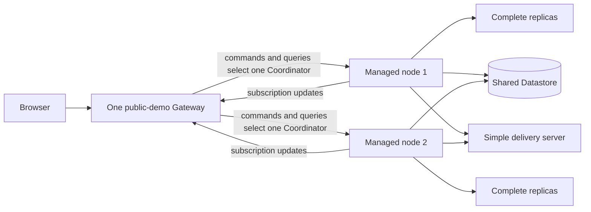

# Distributed Message Board

This example lets you run the existing Message Board model, application package,
and React UI as a local distributed topology. It adds no copied domain or UI
code: use the packages under `../message-board/` for both.



## Start

Build the local images once from the repository root, then start all topology
processes with one command. Select a unique image tag, Compose project, and
loopback Gateway port when another local demonstration may be running:

```bash
export MESSAGE_BOARD_IMAGE_TAG=distributed-demo
export GATEWAY_PORT=18081 MESSAGE_BOARD_WEB_PORT=5174
pnpm images:build:local
docker compose -p distributed-demo \
  --file examples/distributed-message-board/deploy/compose.yaml up
```

Start the existing UI separately with its Gateway URL:

```bash
VITE_MESSAGE_BOARD_GATEWAY_URL="http://127.0.0.1:$GATEWAY_PORT" \
  pnpm --dir examples/message-board/web exec vite \
    --host 127.0.0.1 --port "$MESSAGE_BOARD_WEB_PORT" --strictPort
```

The Compose file starts exactly two managed Message Board nodes. Each node has
one Coordinator and two complete application replicas (`PROCESS_COUNT=2`),
with a separately selected two-shard Delivery strategy
(`DELIVERY_SHARD_COUNT=2`). It also starts one Gateway, one in-memory simple
delivery server, and one shared Datastore emulator. Both nodes use the same
application-selected storage and delivery endpoint. Delivery chooses which
complete replica performs durable entity work; the Coordinator only selects a
child for an incoming gRPC call. The Gateway separately fans in subscription
updates from both Coordinators. This is a fixed Compose topology with one
Gateway, not a Multiple-Gateway example.

Stop the topology with `Ctrl-C`, or from the repository root run
`docker compose -p distributed-demo --file examples/distributed-message-board/deploy/compose.yaml down`.

## Limits

Shared Delivery is recommended for this multi-process topology. Database-only
Delivery has local notifications, so missed work can wait for recovery. The
simple Delivery server used here is in-memory and is not highly available.
Restarting it can lose accepted pending Commands while separately stored
Datastore business state survives. See the separate [recovery timers](../../packages/delivery-server/REFERENCE.md#recovery-timers);
the default 10-second scan is not a delivery or takeover deadline.

The Gateway keeps browser subscription bindings in process memory and does not
record every update sent to a browser. If the browser disconnects and
misses an update, it asks the Gateway for the board's current state after it
reconnects, replaces its local copy, and resumes listening. It does not make a
new query after every normal update.

See the reused [Message Board model and app](../message-board/README.md) for
the domain and UI implementation, or the [operator reference](REFERENCE.md)
for this topology's exact lifecycle and limits.
