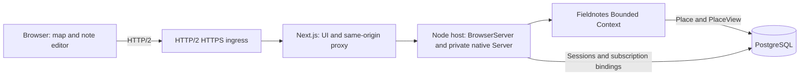
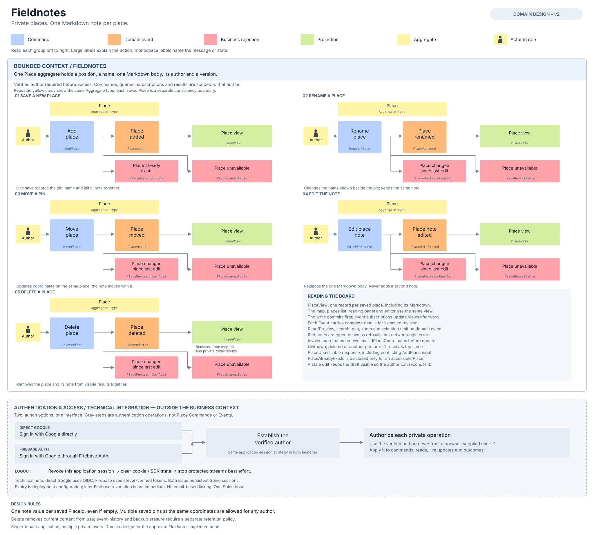

# Fieldnotes: private map notes

Fieldnotes is a Next.js application for saving places on a map. Each saved
place has a name, coordinates, and one Markdown note. Sign in to see your
private places, select a pin to read its note, or edit the note beside the map.
Several saved places can share the same coordinates.

The example demonstrates authentication in a single-tenant application. Each
user has a private collection, while all users share one Fieldnotes Bounded
Context and PostgreSQL database. Users are authorization identities, not
tenants, so this application creates no tenant index.

## Prerequisites

Use the repository's Node version from `.node-version` and its pinned pnpm
version. The Firebase client dependency requires Node 24.12 or newer; the
repository currently selects Node 24.18.0. Provision PostgreSQL and configure
an HTTP/2 HTTPS public origin before starting the application. The included
Caddy configuration provides the local ingress. Secure application
cookies require HTTPS during local browser use too. Map rendering requires a
browser with WebGL2 support.

Provider setup and both launch configurations are described in the
[user guide](USER_GUIDE.md).

## Sign-in options

| Launch option                | Provider integration                                                      | Application requests                  |
| ---------------------------- | ------------------------------------------------------------------------- | ------------------------------------- |
| Direct Google                | Google OpenID Connect through the framework's OIDC integration            | Persistent opaque application session |
| Google through Firebase Auth | Official Firebase browser SDK and server-side Firebase Admin verification | The same opaque session mechanism     |

The two launch options use the same interface and domain. PostgreSQL stores
places and application sessions in both. Firebase verifies identities; it does
not replace the application's storage factory.

Provider-qualified identities remain separate. Signing in through Firebase
can show a different private collection from direct Google sign-in, even when
the email address is the same. Accounts are not linked by email.

The [user guide](USER_GUIDE.md) describes provider configuration, local startup,
private queries and subscriptions, editing, and logout. The
[coding-agent reference](REFERENCE.md) records the application contracts and
source layout.

## Application layout

Next.js serves the page and forwards application requests to one long-lived
Node host. That host configures `ServerEnvironment`, creates the single-tenant
Bounded Context, and starts the authenticated browser gateway and private
native services. The UI process does not create a second environment.

The map uses MapLibre with OpenFreeMap and needs no map API key. The interface
uses shadcn components and a maintained Markdown editor. GitHub-flavored
Markdown supports headings, lists, task lists, tables, code, and links. Saved
notes and editor previews use the same sanitization and external-image policy.

## Places and notes

One `PlaceAggregate` accepts five operations:

| Operation                             | Command         | Resulting Event   |
| ------------------------------------- | --------------- | ----------------- |
| Save a new place and its initial note | `AddPlace`      | `PlaceAdded`      |
| Rename a place                        | `RenamePlace`   | `PlaceRenamed`    |
| Move its pin                          | `MovePlace`     | `PlaceMoved`      |
| Replace its note                      | `EditPlaceNote` | `PlaceNoteEdited` |
| Delete the place and note             | `DeletePlace`   | `PlaceDeleted`    |

One `PlaceViewProjection` supplies the map, list, and note panel. Each edit
carries the revision the editor observed. The Aggregate checks the author
before checking that revision, so another user cannot obtain private state
through a conflict response. The interface preserves an unsaved draft when
an edit fails or conflicts with a newer saved version.

The map reads the complete private collection newest first by each place's
immutable creation time, then merges those pages with live updates. A reconnect
starts another complete scan; a
single response page does not replace the whole collection.

The [event-storming diagram](docs/event-storming.svg) shows these interactions
and separates authentication from the Fieldnotes domain:

## Persistence and privacy

Persistent auth factories prepare and check their supported storage structures
when awaited. PostgreSQL databases, users, and permissions must already exist.
Keeping the same database and session secrets across a restart preserves saved
places and allows existing application credentials to be resolved again.

The gateway derives each Command actor from the verified session. Queries,
subscriptions, outcomes, and native forwarding apply the same principal
boundary. A subscription handle alone does not authorize another user to read
or cancel it.

Logout revokes the application session and stops local protected activity best
effort. Later provider-side revocation does not automatically revoke an already
issued application session. This example runs one host; the guide explains the
session lifetime and deployment boundaries in detail.

Deleting a place clears its current content from the application. Retained
Events and database backups follow the deployment's separate retention policy.
