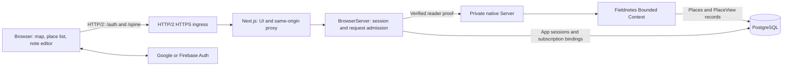
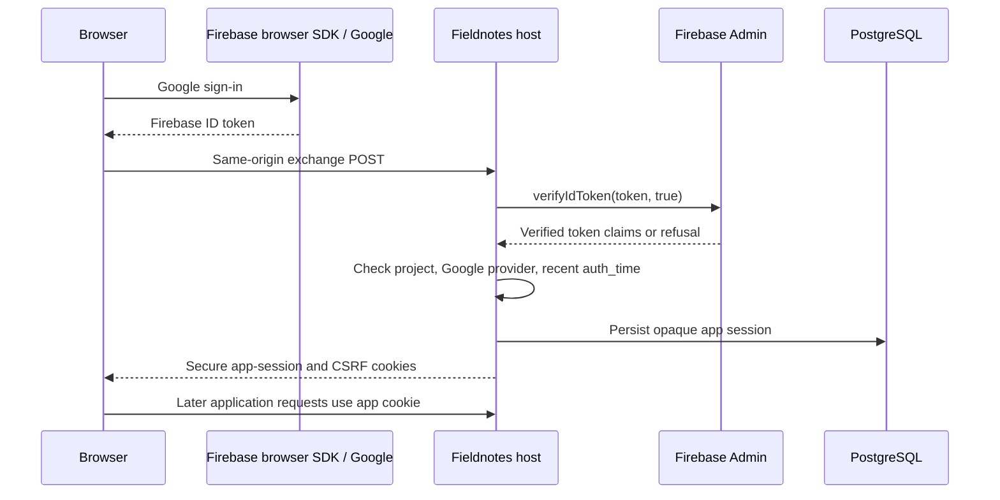

# Fieldnotes: private places and notes

Fieldnotes is a web application for saving places on a map. Each place has a
name, a position, and one Markdown note. A note may be empty. Two saved places
may have identical coordinates: each has a separate `PlaceId`, so selecting a
place in the list still identifies the intended record.

The application demonstrates persistent authentication in a single-tenant
application. Several people can use the same deployment, while each person sees
and changes only their private places. A user account is an authorization
identity; it is not a tenant. Fieldnotes therefore creates no tenant index.

## Application processes



Next.js serves the interface and forwards the two application route groups to
one long-lived Node host. That host runs the gateway, private native services,
and Fieldnotes Bounded Context in the same process. `ServerEnvironment` is
configured in this host. The Next.js process does not create a Bounded Context
or configure an environment.

The gateway verifies the application session before forwarding an operation.
It derives the Command actor from that verified identity. A separate `jose`
signing key lets the native services verify the gateway's reader proof. The
native listener is private; the browser does not receive this key or choose
its forwarding identity.

## One place, one note

The write model is `PlaceAggregate`. It decides whether an operation is
permitted and records accepted changes. `PlaceViewProjection` maintains the
read model used by the map, the list, and the note panel.

| UI operation                           | Command         | Accepted Event    |
| -------------------------------------- | --------------- | ----------------- |
| Save a new pin, name, and initial note | `AddPlace`      | `PlaceAdded`      |
| Change a saved name                    | `RenamePlace`   | `PlaceRenamed`    |
| Move a saved pin                       | `MovePlace`     | `PlaceMoved`      |
| Replace the note text                  | `EditPlaceNote` | `PlaceNoteEdited` |
| Delete the place and its note          | `DeletePlace`   | `PlaceDeleted`    |

A second Projection is unnecessary because all three views display the same
saved-place data. Selecting a pin, searching the local list, switching between
editor and preview, and moving the map do not change the domain state.

```mermaid
sequenceDiagram
    participant UI as Browser editor
    participant Gateway as Authenticated gateway
    participant Place as PlaceAggregate
    participant View as PlaceViewProjection
    UI->>Gateway: EditPlaceNote(id, expectedRevision, markdown)
    Gateway->>Place: Command with verified actor
    Place->>Place: Check author, then revision; commit change
    Place-->>View: PlaceNoteEdited with complete resulting data
    Place-->>UI: Permitted Command outcome
    View-->>UI: Updated PlaceView with new revision
```

The Aggregate checks the author before revealing a revision conflict. A request
for an absent, removed, or another person's place receives `PlaceUnavailable`.
A permitted edit using an old revision receives `PlaceRevisionConflict`. The
interface can keep the draft and show the latest committed value for comparison.

Each accepted Event carries the resulting place data and its revision. The
Projection accepts a newer complete result and preserves the author and
creation time. A delayed earlier Event cannot overwrite a newer note. A
removal is terminal for that `PlaceId`, so delayed updates cannot make a deleted
pin visible again.

Deleting a place removes its current content from the application. It does not
promise physical erasure of retained Events or database backups. Retention and
backup policy are separate deployment responsibilities.

## Explicit saves and conflicts

Each edit sends the revision captured when editing began. For example, an edit
to a place at revision 4 sends `expectedRevision: 4`. If another tab has
already changed it to revision 5, the Aggregate refuses the stale edit with
`PlaceRevisionConflict` instead of replacing the newer note.

<!-- docs-snippet-path: examples/fieldnotes/server/src/fieldnotes-host.ts -->

```ts
import { create } from "@bufbuild/protobuf";
import type { Client, CommandAcknowledgement } from "@spine-event-engine/client-web";
import { EditPlaceNoteSchema } from "@spine-event-engine/example-fieldnotes-model/generated/spine/examples/fieldnotes/commands_pb.js";
import type { PlaceView } from "@spine-event-engine/example-fieldnotes-model/generated/spine/examples/fieldnotes/entities_pb.js";

/**
 * Posts an explicit note edit and returns its admission acknowledgement.
 * Outcome and resulting view observation are handled by the caller.
 *
 * @param client Authenticated browser client.
 * @param principalId Identity returned by session bootstrap.
 * @param current PlaceView captured when editing began.
 * @param draft Separate, unsaved Markdown text.
 * @returns Admission acknowledgement, not a committed-save confirmation.
 */
async function postNote(
  client: Client,
  principalId: string,
  current: PlaceView,
  draft: string,
): Promise<CommandAcknowledgement> {
  const command = create(EditPlaceNoteSchema, {
    id: current.id,
    expectedRevision: current.revision,
    markdown: draft,
  });
  return client.onBehalfOf(principalId).post(EditPlaceNoteSchema, command);
}
```

The acknowledgement reports admission. It does not replace the Command outcome
or prove that the updated Projection is visible. The interface starts outcome
observation before posting, waits for the accepted result and corresponding
view revision, then clears the saved draft. On a refusal or network failure it
keeps the draft. A remote update changes the committed value without silently
replacing text currently being edited.

The browser uses `postAndSubscribe()` to activate outcome observation before
posting the edit. This avoids missing a fast accepted Event between posting a
Command and starting to listen for its result:

<!-- docs-snippet-path: examples/fieldnotes/server/src/fieldnotes-host.ts -->

```ts
import { create } from "@bufbuild/protobuf";
import type { ClientRequest, PostAndSubscribeResult } from "@spine-event-engine/client-web";
import { EditPlaceNoteSchema } from "@spine-event-engine/example-fieldnotes-model/generated/spine/examples/fieldnotes/commands_pb.js";
import type { PlaceView } from "@spine-event-engine/example-fieldnotes-model/generated/spine/examples/fieldnotes/entities_pb.js";
import { PlaceNoteEditedSchema } from "@spine-event-engine/example-fieldnotes-model/generated/spine/examples/fieldnotes/events_pb.js";
import {
  PlaceRevisionConflictSchema,
  PlaceUnavailableSchema,
} from "@spine-event-engine/example-fieldnotes-model/generated/spine/examples/fieldnotes/rejections_pb.js";

/**
 * Activates outcome observation before posting a note edit.
 *
 * @param request Client request scoped to the verified principal.
 * @param current PlaceView captured when editing began.
 * @param draft Unsaved Markdown that remains separate from the view.
 * @returns Admission and the activated selected-outcome subscription.
 */
async function beginNoteEdit(
  request: ClientRequest,
  current: PlaceView,
  draft: string,
): Promise<PostAndSubscribeResult> {
  return request.postAndSubscribe(
    EditPlaceNoteSchema,
    create(EditPlaceNoteSchema, {
      id: current.id,
      expectedRevision: current.revision,
      markdown: draft,
    }),
    {
      events: [PlaceNoteEditedSchema],
      rejections: [PlaceRevisionConflictSchema, PlaceUnavailableSchema],
    },
  );
}
```

The returned admitted result contains an active subscription. The application
consumes that subscription, handles a selected rejection without clearing the
draft, and waits for the matching projected revision after an accepted
`PlaceNoteEdited`. It cancels the outcome subscription when the operation
finishes. `FieldnotesPlaceCommands` implements that sequence; the private
collection supplies the resulting-view wait.

Rename, move, and note editing are separate operations. A failed move therefore
does not leave the user guessing whether a note in a combined save was accepted.
Deletion has a separate confirmation and closes the selected place after its
committed removal.

## Application screens and actions

After sign-in and the initial collection read, the desktop displays **Saved
places**, the map, and the selected place's details. Search filters place names
and note text in the loaded private collection. It does not search addresses
or call a geocoding provider. Selecting a list row or a map pin selects the
same saved place.

**Add a place** starts a new draft at the map's current position. Enter a name,
adjust the latitude and longitude or click the map, and optionally write the
initial Markdown note. **Save** creates that place. A second place at the same
coordinates is allowed and remains separately selectable in the list.

A saved place offers four separate actions:

| Action           | Editable data                 | Result                                                             |
| ---------------- | ----------------------------- | ------------------------------------------------------------------ |
| **Rename**       | Place name                    | The name changes; the note and position remain as saved.           |
| **Move pin**     | Latitude and longitude        | The position changes; the name and note remain as saved.           |
| **Edit note**    | One Markdown body             | The note changes after explicit save.                              |
| **Delete place** | Confirmation naming the place | The committed removal hides its pin, list entry, and current note. |

The editor provides Markdown editing and preview. Fenced code is displayed
without syntax coloring. Raw HTML is skipped, and images are represented by
placeholders rather than fetched automatically.
**Cancel** discards the current edit and returns to the saved value.

If another browser changes the place while an edit is open, the draft retains
its starting revision. A refused stale save keeps the draft. For note edits,
the panel also shows **Current saved note** for comparison. After reconciling
the text, **Reapply draft to current version** explicitly selects the newer
revision as the edit base; **Save** submits that revision. Reapplication does
not silently save or replace the draft.

On a phone, **Places** and **Details** open panels over the map. They use the
same collection, selection, drafts, and save behavior as the desktop. Closing
a panel is navigation; **Cancel** is the explicit action for discarding an
edit.

## Authentication and application sessions

There are two launch options. They use the same map, domain model, PostgreSQL
storage, and application-session mechanism.

| Launch                       | Provider verification                                                        | Session used for application requests |
| ---------------------------- | ---------------------------------------------------------------------------- | ------------------------------------- |
| Direct Google                | Existing OIDC provider integration verifies Google's response                | Persistent Spine opaque session       |
| Google through Firebase Auth | Official Firebase browser SDK signs in; Firebase Admin verifies the ID token | Persistent Spine opaque session       |

An opaque session is a browser credential whose application record is stored
on the server. The cookie does not supply an editable user identity. The
application resolves its credential through `OpaqueSessions` and
`PersistentOpaqueSessionStore` before admitting requests.

OpenID Connect (OIDC) is the sign-in protocol used for direct Google login.
Its short-lived transaction records are separate from the longer-lived
application session. PKCE binds the browser's exchange to the login it
started: the browser retains a verifier and submits it when redeeming the
one-use application grant.

Firebase authenticates the Google account and supplies an ID token. Fieldnotes
checks that token with Firebase Admin, including its configured project,
Google provider, revocation status, and recent authentication time. It then
issues the same kind of opaque application session as direct Google login.
Firebase does not store the places or Markdown notes.

The two modes deliberately use distinct identity namespaces. Direct Google
uses the provider issuer and subject; Firebase uses its project and UID. An
email address does not link these accounts. Switching launch modes can
therefore show a different private collection even when the same Google email
appears in both sign-in screens.

## Provider setup

### Direct Google

Create a web application OAuth client in Google Cloud, configure its consent
screen, and register Fieldnotes' exact callback URL as an authorized redirect.
The URL must match the public HTTPS origin and callback path used by the host.
A different port, scheme, or path is a different redirect URL. Keep the client
secret in the Node host's configuration. Google's
[web server OAuth guide](https://developers.google.com/identity/protocols/oauth2/web-server)
explains client registration and redirect matching.

```mermaid
sequenceDiagram
    participant Browser
    participant Host as Fieldnotes host
    participant Google
    participant PG as PostgreSQL
    Browser->>Host: Start login with browser PKCE challenge
    Host->>PG: Store login transaction
    Host-->>Browser: Google authorization URL
    Browser->>Google: Sign in and consent
    Google-->>Host: Callback with code and state
    Host->>Google: Exchange code; verify identity
    Host->>PG: Consume transaction; store one-use app grant
    Host-->>Browser: Fixed completion page with grant in fragment
    Browser->>Host: Exchange grant and retained PKCE verifier
    Host->>PG: Consume grant; persist app session
    Host-->>Browser: Secure app-session and CSRF cookies
```

The provider's authorization code and the application's one-use grant are
separate values. The host exchanges the code with Google. The browser redeems
the application grant using the verifier it retained when login began. The
completion destination is fixed; a caller cannot turn it into an arbitrary
redirect. The grant is carried in the URL fragment, which is not sent as part
of the completion page's HTTP request.

A refused or replayed login returns to the same completion page with a generic
failure marker. The interface can offer another sign-in attempt without
showing provider errors, authorization codes, or transaction state. Malformed
callback parameters are rejected.

`PersistentOidcFlowStore` stores the temporary transactions and grants through
the application's storage factory. `PersistentOpaqueSessionStore` stores the
resulting application session. The two stores have different lifetimes and
purposes. Neither is a business Projection.

An in-progress login can survive a host restart when the deployment retains
its database, provider configuration, and session secrets. A replacement host
can read the pending transaction and later redeem its application grant while
those records remain valid. Redeeming a grant consumes it; restarting the host
does not make it reusable. The browser must also retain its PKCE verifier. If
that browser state is lost, start a new sign-in attempt.

### Google through Firebase Auth

Create a Firebase project and register its web application. Enable Google in
Authentication's sign-in providers and configure the application's authorized
domain. Check the domain list explicitly for local development as well. Use
the project's web configuration for the browser SDK, as described in the
[Firebase Google sign-in guide](https://firebase.google.com/docs/auth/web/google-signin).

The Node host needs privileged Admin credentials for that same project.
Application Default Credentials can use the deployment's configured identity
or a private credentials file supplied through `GOOGLE_APPLICATION_CREDENTIALS`.
Keep that file outside Git and outside the web application's public assets.
The [Admin setup guide](https://firebase.google.com/docs/admin/setup) describes
these credential options. Fieldnotes uses Firebase Authentication; it does not
need a Firebase business database.



The Firebase ID token proves the provider login during exchange. Subsequent
Commands, queries, and subscriptions use the application cookie. Fieldnotes
does not send Firebase tokens with every domain operation or store notes in
Firebase. Its explicit recent-login policy controls how old `auth_time` may be
when creating a new application session.

When Firebase clearly reports an invalid, expired, or revoked identity, or a
disabled or missing user, the exchange returns 401. Service failures return 503.
The Admin SDK uses one ambiguous error code for both public-key retrieval
failures and some malformed tokens, invalid signatures, or invalid claims.
Fieldnotes treats that ambiguous result as 503 too, so some invalid tokens
receive a service-failure response. It does not guess from error-message text.
Neither response exposes the provider error, returns a cookie, or creates an
application session. During shutdown, the host waits for admitted verification
work before releasing its Admin instance and session resources.

### Local identity services

The acceptance suite uses a local signed OIDC provider and the Firebase Auth
Emulator so it can exercise both paths without a personal Google account.
These are test services; passing their scenarios does not establish a live
Google or cloud Firebase login.

For Firebase Admin, `FIREBASE_AUTH_EMULATOR_HOST` contains a host and port,
such as `127.0.0.1:9099`, with no URL scheme. The browser SDK separately connects
to the emulator URL. Both must use the same project ID. Emulator tokens are
unsigned and are accepted only under emulator configuration; Fieldnotes rejects
that configuration in production. See the
[Authentication Emulator guide](https://firebase.google.com/docs/emulator-suite/connect_auth).

## Host configuration

The long-lived Node host reads these settings. Keep its secrets on the server;
they are not browser configuration.

| Variable                                | Meaning                                                                      |
| --------------------------------------- | ---------------------------------------------------------------------------- |
| `FIELDNOTES_POSTGRES_URL`               | Connection URL for a provisioned PostgreSQL database.                        |
| `FIELDNOTES_PUBLIC_ORIGIN`              | Exact public HTTPS origin, including the port for local development.         |
| `FIELDNOTES_GATEWAY_PORT`               | Explicit loopback port on which the Node host accepts requests from Next.js. |
| `FIELDNOTES_SESSION_PASSWORD`           | Stable password used to protect the opaque browser credential.               |
| `FIELDNOTES_CSRF_SECRET_BASE64`         | Separate Base64-encoded key for credential-bound CSRF protection.            |
| `FIELDNOTES_READER_PROOF_SECRET_BASE64` | Separate Base64-encoded key for trusted native forwarding.                   |
| `FIELDNOTES_SESSION_TTL_MS`             | Explicit application-session lifetime in milliseconds.                       |
| `FIELDNOTES_AUTH_ROUTE_TIMEOUT_MS`      | Explicit deadline for authentication routes.                                 |
| `FIELDNOTES_AUTH_ROUTE_MAX_BYTES`       | Explicit request-body policy for authentication routes.                      |

The provider selection is explicit on the host:

| Variable                              | When required | Meaning                                                                     |
| ------------------------------------- | ------------- | --------------------------------------------------------------------------- |
| `FIELDNOTES_AUTH_MODE`                | Both launches | `google` for direct OIDC, or `firebase` for Google through Firebase Auth.   |
| `FIELDNOTES_GOOGLE_CLIENT_ID`         | Direct Google | Web OAuth client registered for this deployment.                            |
| `FIELDNOTES_GOOGLE_CLIENT_SECRET`     | Direct Google | That client's server-side secret.                                           |
| `FIELDNOTES_FIREBASE_PROJECT_ID`      | Firebase      | Project accepted by the Admin verifier.                                     |
| `FIELDNOTES_FIREBASE_RECENT_LOGIN_MS` | Firebase      | Maximum accepted age of the provider login at application-session exchange. |

The application-session lifetime and Firebase recent-login age answer different
questions. The first controls how long Fieldnotes accepts its issued session.
The second controls whether a Firebase login is recent enough to create that
session. Expiring the provider token later does not automatically expire the
separate Fieldnotes session.

Choose the lifetime and route policies for the deployment. The example does
not silently supply values for these settings. The origin is an origin only:
for example, `https://localhost:3443`, without a callback path or trailing slash.
Provider callback addresses are separate settings derived from the public route.

Generate independent random values for the three secrets and retain them across
restarts. The session password must contain at least 32 characters, as required by the
credential protection library. The Base64 keys must decode to at least 32 bytes. Do not use a browser
public configuration variable for any of these secrets. Keep the environment
file or secret-manager values outside Git.

The direct Google launch also needs its OAuth client settings. The Firebase
launch needs its project and browser configuration plus server-side Admin
credentials. Those provider credentials establish the identity; the settings
above determine the resulting application's session and trusted request path.

## Host launch

From the repository root, install the pinned dependencies and build the
workspace packages:

```bash
pnpm install --frozen-lockfile
pnpm typecheck:build
```

Export the common host settings listed above, then the settings for the chosen
provider. Keep secrets in an external environment file or the deployment's
secret manager. Both launches use the same executable:

```bash
# Direct Google: common settings plus the Google client ID and secret.
FIELDNOTES_AUTH_MODE=google pnpm -C examples/fieldnotes/server start
```

```bash
# Firebase: common settings plus the Firebase project and recent-login policy.
FIELDNOTES_AUTH_MODE=firebase pnpm -C examples/fieldnotes/server start
```

To load a private environment file directly, Node's built-in option can start
the same built entry point. Include `FIELDNOTES_AUTH_MODE` and the other
required settings in that file:

```bash
node --env-file=/absolute/path/fieldnotes-host.env \
    examples/fieldnotes/server/dist/src/main.js
```

The host listens on `127.0.0.1` at `FIELDNOTES_GATEWAY_PORT`. Its downstream
native listener uses a private loopback port. The browser opens the public
Next.js origin, not either of these internal listeners. The Next.js process
must forward to this gateway and use the same configured public origin.

Register the direct Google callback as
`FIELDNOTES_PUBLIC_ORIGIN` followed by `/auth/google/callback`. For example,
if the public origin is `https://localhost:3443`, the full callback is
`https://localhost:3443/auth/google/callback`. The application's completion
page is `/auth/complete`; it is separate from the provider callback.

For a deployed host, set `NODE_ENV=production` before starting the process.
This selects the framework's production environment and rejects test-provider
injection and Firebase Emulator configuration. Keep the internal listeners
private and terminate browser HTTPS at the configured public ingress.

A normal interrupt or termination signal closes the host through its one
shutdown path. Keep the database and secrets for the next launch. Restarting
the example does not clear saved places or register a new identity for an
existing provider subject.

## Browser process configuration

Run Next.js and the Node host on the same machine or in the same network
namespace. The Next proxy accepts a fixed `http://127.0.0.1` upstream, and the
host binds its gateway to loopback. Only the public Next.js HTTPS origin is
opened in the browser.

The Next process reads these settings separately from the host's environment:

| Variable                           | Required for        | Meaning                                                                                  |
| ---------------------------------- | ------------------- | ---------------------------------------------------------------------------------------- |
| `FIELDNOTES_PUBLIC_ORIGIN`         | Both modes          | The same exact HTTPS origin configured on the host.                                      |
| `FIELDNOTES_UPSTREAM_ORIGIN`       | Both modes          | `http://127.0.0.1` and the host's configured gateway port, with no path.                 |
| `FIELDNOTES_AUTH_MODE`             | Both modes          | The same `google` or `firebase` selection as the host.                                   |
| `FIELDNOTES_FIREBASE_API_KEY`      | Firebase            | Public web API key from the Firebase project configuration.                              |
| `FIELDNOTES_FIREBASE_AUTH_DOMAIN`  | Firebase            | Public Firebase authentication domain.                                                   |
| `FIELDNOTES_FIREBASE_PROJECT_ID`   | Firebase            | The project accepted by the host's Admin verifier.                                       |
| `FIELDNOTES_FIREBASE_EMULATOR_URL` | Local emulator only | Explicit loopback HTTP origin, such as `http://127.0.0.1:9099`. Forbidden in production. |

The Next page passes only the selected mode and required public Firebase values
to the browser. Google mode does not need the OAuth client secret in Next.js.
The PostgreSQL URL, application-session password, CSRF key, reader-proof key,
and Firebase Admin credentials stay in the Node host's environment.

Firebase's web API key identifies its project. It is separate from the map:
MapLibre and OpenFreeMap require no map API key. For an emulator launch, the
host uses `FIREBASE_AUTH_EMULATOR_HOST=127.0.0.1:9099`, while the browser setting
includes the `http://` scheme. Both processes must select the same Firebase
project.

The proxy forwards the browser's actual Origin, cookies, and CSRF metadata. It
does not invent an Origin to make a request pass validation. Subscription
responses remain streamed, and canceling a browser stream cancels its upstream
request. The Google callback's fixed completion redirect and separate cookie
headers are preserved. Application and authentication responses are not cached.

## Browser launch

Start the host first, then start Next.js in a second terminal and the HTTPS
ingress in a third. Each process has its separate configuration. For example,
use `8080` for the host, `3000` for Next, and `3443` for the browser-facing
ingress. These are deployment choices, not framework limits.

The Next process uses:

```bash
export FIELDNOTES_PUBLIC_ORIGIN=https://localhost:3443
export FIELDNOTES_UPSTREAM_ORIGIN=http://127.0.0.1:8080
export FIELDNOTES_AUTH_MODE=google
pnpm -C examples/fieldnotes/web dev --port 3000
```

Set `FIELDNOTES_GATEWAY_PORT=8080` and the same public origin on the host. For
Firebase, select `FIELDNOTES_AUTH_MODE=firebase` in both processes and supply
the public Firebase settings from the previous table to Next.js.

The browser uses HTTP/2 through Caddy. Live collection and Command-outcome
subscriptions stay open while Commands, queries, and logout need additional
requests. HTTP/1.1 browsers have a small per-origin connection pool; enough
open streams can prevent those requests from reaching the server. HTTP/2
multiplexes them on the public connection, including when several tabs are
open. HTTPS alone does not establish that HTTP/2 is in use.

The example includes [a Caddy configuration](deploy/Caddyfile), tested with
Caddy 2.11.4. Install Caddy separately. Supply a trusted development certificate
and key from outside the repository, covering the hostname opened in the
browser. Do not disable TLS verification in application code. In the ingress
terminal, from the repository root:

```bash
export FIELDNOTES_PUBLIC_ORIGIN=https://localhost:3443
export FIELDNOTES_BIND_ADDRESS=127.0.0.1
export FIELDNOTES_NEXT_ADDRESS=127.0.0.1:3000
export FIELDNOTES_TLS_CERT=/absolute/path/localhost-cert.pem
export FIELDNOTES_TLS_KEY=/absolute/path/localhost-key.pem
caddy run --config examples/fieldnotes/deploy/Caddyfile --adapter caddyfile
```

Open `https://localhost:3443`. Caddy terminates HTTPS and forwards to Next at
`http://127.0.0.1:3000`; Next forwards the permitted application routes to the
host at `http://127.0.0.1:8080`. Register the direct Google callback as
`https://localhost:3443/auth/google/callback`. The browser uses this one public
origin for the page, authentication, queries, Commands, and subscriptions.

The supplied ingress preserves unknown-length streaming responses without
adding buffering or a stream deadline. Keep Caddy's `flush_interval` unset:
Caddy flushes these streams as data arrives, while its negative-interval mode
changes cancellation behavior. Closing a browser stream must still cancel the
request through Next to the host.

For production, build the workspace packages first as described above, then
build and start the Next application:

```bash
pnpm -C examples/fieldnotes/web build
NODE_ENV=production pnpm -C examples/fieldnotes/web start --port 3000
```

The production Next process listens on loopback HTTP at port 3000. Keep the
HTTP/2 ingress in front of it, with the deployed public origin, externally
managed trusted certificate/key, and appropriate explicit bind address. A
different ingress is possible when it provides the same HTTP/2, streaming,
cancellation, and privacy behavior. Run the host with `NODE_ENV=production`
too. Next and the host must retain their shared loopback network; unrelated
containers without shared networking cannot reach those listeners.

Callback URLs contain temporary authentication values. Next request logging
is disabled. The Caddy configuration leaves access logging disabled and
removes request URLs and headers from runtime error logs, while retaining
error and status diagnostics. If deployment access logs are added, omit
callback query strings and credential headers there too.
Logs must not contain authorization codes, grants, cookies, Firebase tokens,
or PKCE verifiers.

## Persistence and startup

The host supplies a PostgreSQL `StorageFactory` to `ServerEnvironment` before
assembling the Bounded Context. It passes that factory to the persistent auth
stores too. These stores use the framework's storage operations; the example
does not add a parallel SQL adapter for authentication.

<!-- docs-snippet-path: examples/fieldnotes/server/src/fieldnotes-host.ts -->

```ts
import { PersistentOpaqueSessionStore } from "@spine-event-engine/auth";
import { StorageGroup, type StorageFactory } from "@spine-event-engine/storage";

/**
 * Opens the app-session store through the host's existing storage factory.
 *
 * @param storageFactory PostgreSQL factory opened by the long-lived host.
 * @returns Store after its default structure preparation and checks.
 */
async function openSessions(storageFactory: StorageFactory): Promise<PersistentOpaqueSessionStore> {
  return await PersistentOpaqueSessionStore.create({
    storageFactory,
    group: new StorageGroup("fieldnotes-sessions"),
  });
}
```

Awaiting this factory prepares missing supported structures and checks their
compatibility by default. The PostgreSQL database, user, and permissions must
already exist. Keeping the database and session secrets across a restart lets
the host resolve an existing browser credential and read saved places again.

Durable subscription bindings have a different purpose: they associate a
browser subscription handle with the admitted reader and native subscription.
They are stored separately from login sessions. Possession of a copied handle
does not authorize another user to activate or cancel that subscription.

## Private reads and live updates

The browser requests `PlaceView` records for its verified author. The gateway
checks the author predicate before storage selects query candidates. State
and outcome filters independently check the authenticated principal before
returning data.

The live Entity subscription uses an exact author-only target. It includes
that author's removal markers, allowing deletion to remove a pin from the
interface. A broad subscription or a target for another author is rejected.
Filtering the displayed note alone would be insufficient: raw update controls
can also carry identifiers.

### Complete collection reads

An Entity query has a per-request result capacity. Fieldnotes uses the public
`QUERY_SERVICE_MAX_RESULTS` value for each request and continues through all
pages until an empty page confirms the end. There is no total-place or
page-count limit in the application.

Each `PlaceView` includes `when_created`, its trusted immutable creation time.
The collection is newest first, independent of display name and pin position.
The cursor retains the full Protobuf Timestamp, including seconds and nanos.

A page uses the generated query builder. Here `client` is the authenticated
browser client, `principalId` is the identity returned by session bootstrap,
and `cursor` is the previous raw page's last creation time, or `undefined` for page one:

<!-- docs-snippet-path: examples/fieldnotes/server/src/fieldnotes-host.ts -->

```ts
import { create } from "@bufbuild/protobuf";
import type { Timestamp } from "@bufbuild/protobuf/wkt";
import type { Client } from "@spine-event-engine/client-web";
import { QUERY_SERVICE_MAX_RESULTS } from "@spine-event-engine/core";
import { UserIdSchema } from "@spine-event-engine/proto";
import type { QueryResponse } from "@spine-event-engine/proto/client";
import { PlaceViewQuery } from "@spine-event-engine/example-fieldnotes-model/generated/spine/examples/fieldnotes/entities_query.js";

/**
 * Reads one active-place page for the authenticated principal.
 *
 * @param client Authenticated browser client.
 * @param principalId Identity returned by session bootstrap.
 * @param cursor Last raw page creation time, absent for the first page.
 * @returns One bounded response, not the complete collection.
 */
async function readPlacePage(
  client: Client,
  principalId: string,
  cursor?: Timestamp,
): Promise<QueryResponse> {
  const author = create(UserIdSchema, { value: principalId });
  let query = PlaceViewQuery.create().author().is(author).removed().is(false);
  if (cursor !== undefined) {
    query = query.whenCreated().isLessThan(cursor);
  }
  return client
    .onBehalfOf(principalId)
    .send(query.orderBy("whenCreated", "desc").limit(QUERY_SERVICE_MAX_RESULTS).build());
}
```

This reads one page. The collection controller repeats that operation and
reconciles its results with the live subscription; rendering only that response would
omit the remaining saved places. The author in this query is checked against
the session by the gateway, so changing `principalId` cannot select someone
else's collection.

The browser retains a detached Timestamp cursor from the raw returned page and
checks descending order with both seconds and nanos. Every page still has the
verified author predicate; a cursor never grants access to another collection.

The author-only live subscription includes removal markers. During an initial
load or reconnect, the application merges live updates with the pages by
revision and keeps terminal removal IDs. An older page cannot restore a deleted
place. The client's bounded reconnect response triggers a new complete scan;
it is not evidence that omitted places were deleted. A scan becomes complete
only after its final empty page and reconciliation with concurrent updates.
This is a live collection, not a database snapshot across several requests.

The browser keeps each observed deleted-place ID until that private workspace
closes, including across reconnect scans. It retains the ID, not the deleted
note. Memory therefore grows with observed deletions during that workspace
lifetime, as well as with active places. Clearing the ID after an empty query
would be unsafe: an older buffered stream update could still arrive afterward.
Logout or workspace disposal clears this collection state.

The map uses keyless OpenFreeMap tiles through MapLibre. Map rendering requires
a browser with WebGL2. The tile provider sees map requests for the viewed area. Private note content is not sent to the map
provider. Markdown rendering supports GitHub-flavored formatting and sanitized
preview. Images appear as placeholders with their alternative text; opening
a note or editor preview does not fetch their remote URLs. Ordinary Markdown
links remain available to open deliberately.

## Session expiry and logout

The deployment explicitly chooses the application-session lifetime. Provider
verification happens when signing in; later provider-side revocation does not
automatically revoke an application session already issued by Fieldnotes.

Logout revokes the application session before reporting success and clearing
its cookie. The host invalidates active protected streams that use the shared
session instance. The browser also closes its client and clears protected
rendered data; the Firebase mode signs out its SDK state. A failed server
revocation must remain visible as a failure, even though the interface stops
showing private content.

This example runs one host. It does not claim that logout on one replicated
host immediately interrupts streams on every other replica.

## Explicit expiry cleanup

Expired credentials are refused during authentication even before their records
are removed. Physical cleanup is a separate maintenance operation. The host
exposes `purgeExpired(cutoff)` for application code to invoke at a chosen time;
the example does not start a timer or install a cleanup schedule.

<!-- docs-snippet-path: examples/fieldnotes/server/src/main.ts -->

```ts
import { Time } from "@spine-event-engine/core";
import type { FieldnotesHost } from "./fieldnotes-host.js";

/**
 * Removes eligible expired auth records when application maintenance invokes it.
 *
 * @param host Running host whose persistent auth stores should be cleaned.
 * @returns Completion after the configured stores have been visited.
 */
async function removeExpiredAuth(host: FieldnotesHost): Promise<void> {
  await host.purgeExpired(Time.currentTime());
}
```

The operation visits application sessions and, in direct Google mode, OIDC
transactions and grants. It returns their removed-record counts. The cutoff
must be the current time or earlier; it does not authorize deletion of active
sessions. This operation concerns authentication records, not Place history,
database backups, or business-data retention.
