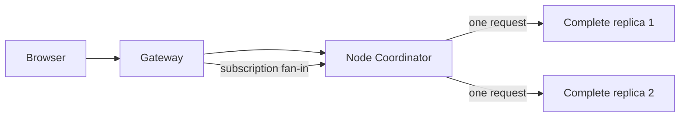

# Message Board deployment references

Use this guide to run the local Message Board deployment examples. The nearby
[reference](REFERENCE.md) holds exact guarantees and environment contracts.

## 🧭 Choose a topology



The two application connections shown for unary routing are alternatives, not
fan-out: one command or query is sent to one selected backend without retry.

Combined mode runs one Message Board application and browser
gateway in the same process. Use it to understand the smallest browser-facing
deployment. Standalone mode runs a managed application node separately from one
Gateway; Envoy is the only public service and the Gateway reaches its private
Coordinator, never a child listener.

Both modes require application-selected storage and a delivery server. The
Gateway admits this example's requests from their request actor and creates
process-local subscription bindings. A Gateway restart makes the browser
reconnect, query the current board, replace its local copy, and then resume live
updates. The supplied simple delivery server is in-memory and not highly
available. Shared Delivery is recommended for multiple application processes,
but restarting this simple server can lose accepted pending Commands despite
separately persisted business state. Gateway query recovery does not restore
lost Inbox work. See [Delivery restart limits](../../../packages/delivery-server/README.md)
and the separate [recovery timers](../../../packages/delivery-server/REFERENCE.md#recovery-timers).

For the smaller runnable development topology of exactly two identical
applications and one Gateway, use
[Distributed Message Board](../../distributed-message-board/README.md). The
standalone reference below is intentionally replica-oriented: it demonstrates
separately scalable application and Gateway processes.

## 🚀 Run the references

Create or supply a locally trusted certificate for `localhost` before starting Compose. The default file locations are `examples/message-board/web/.local/localhost-cert.pem` and `localhost-key.pem`; `MESSAGE_BOARD_TLS_CERT_FILE` and `MESSAGE_BOARD_TLS_KEY_FILE` can select other files. See the [local certificate commands](../README.md). Envoy terminates HTTPS, advertises HTTP/2 with ALPN, and proxies exact RPC paths and the stock web UI over its internal HTTP clusters.

Build the local-only images first:

```bash
pnpm typecheck:build
pnpm images:build:local
```

For concurrent task runs, select a distinct `MESSAGE_BOARD_IMAGE_TAG` for the
image build and each Compose command, a distinct `MESSAGE_BOARD_PUBLIC_PORT`,
and a distinct Compose project name. The HTTPS web runtime URL and Gateway browser origin follow the selected public port. For example:

```bash
export MESSAGE_BOARD_IMAGE_TAG=sqlrel-example MESSAGE_BOARD_PUBLIC_PORT=28080
pnpm images:build:local
docker compose --project-name sqlrel-example \
  --file examples/message-board/deploy/compose/combined.compose.yaml up --detach
```

Open `https://localhost:28080`, then use the same variables, project name and
file with `down --volumes --remove-orphans`. The default tag and port remain
`local` and `18080` for a single tutorial run.

```bash
docker compose --file examples/message-board/deploy/compose/combined.compose.yaml up --detach
```

Open the stock browser UI at https://localhost:18080. Stop it with:

```bash
docker compose --file examples/message-board/deploy/compose/combined.compose.yaml down --volumes --remove-orphans
```

Use `standalone.compose.yaml` for one managed node with two complete replicas.
It sets `PROCESS_COUNT=2` and `DELIVERY_SHARD_COUNT=2` independently, then
starts one Coordinator, one Gateway, Envoy, and exactly one in-memory delivery
server. `BACKEND_URLS` names that Coordinator in
this local-only static fixture, not a child listener.

Start it with:

```bash
docker compose --file examples/message-board/deploy/compose/standalone.compose.yaml up --detach
```

Open https://localhost:18080, then stop it with the matching `down --volumes --remove-orphans` command.

The Kubernetes YAML files are static references, not local-Kubernetes
instructions. They deploy the same stock UI behind Envoy and set its sole
runtime RPC URL (`MESSAGE_BOARD_GATEWAY_URL`) to the public Envoy origin. They
leave image distribution, storage provisioning, and TLS material to the cluster
operator.

```bash
kubectl apply --filename examples/message-board/deploy/kubernetes/combined.yaml
```

Application processes use the Datastore configuration for their topology. Each
application process creates its Datastore client and passes that exact client to
its storage factory.

For multiple managed nodes, apply `standalone.yaml`. Each pod chooses its own
explicit process and shard counts. Its public LoadBalancer service exposes Envoy
only; the one Gateway uses `GkeNodeDiscovery` against the application headless
Service and follows ready Coordinator DNS membership rather than fixed child
backend lists.
Public browser subscription state is local to the Gateway process. When that
process restarts, the browser reconnects, queries the current board, and resumes
live updates.
The references use TCP startup/readiness only and intentionally omit liveness
probes and application health endpoints.

## Signed admission

Set `MESSAGE_BOARD_AUTH_MODE=signed` on both the application and Gateway processes and the web container. Supply the same protected `MESSAGE_BOARD_SESSION_ISSUER`, `MESSAGE_BOARD_SESSION_AUDIENCE`, `MESSAGE_BOARD_SESSION_KEY_ID`, `MESSAGE_BOARD_SESSION_PRIVATE_KEY_PEM`, and `MESSAGE_BOARD_READER_PROOF_KEY_BASE64` to application and Gateway nodes. In Compose these values come from the invoking environment; in Kubernetes set `MESSAGE_BOARD_AUTH_MODE` in the ConfigMap and provision the values through the existing `message-board-runtime` Secret. Issue a credential offline with the app's `issue-board-session` entrypoint. Keep the native endpoint private and the signing key and proof key outside browser configuration.
