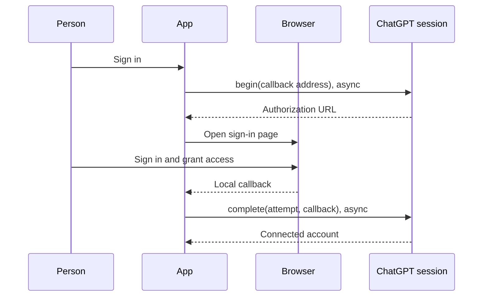
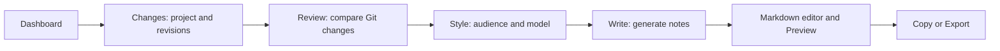
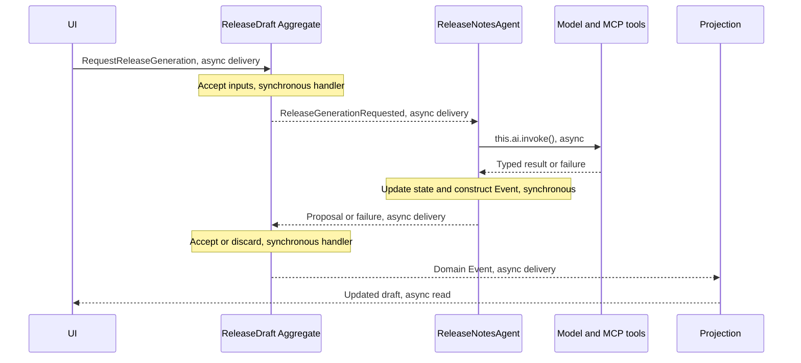

# Release Notes Studio

## What this example does

Release Notes Studio is a local desktop example application. You choose a Git
project and two revisions, ask a model to draft release notes, then edit and
export the Markdown. It uses your ChatGPT subscription after you sign in through
your browser.

Imagine maintaining a document-conversion library. Since the last release, it
added password-protected PDFs, fixed page rotation, and removed an old option.
The Git history contains the details, but you still need to explain those changes
to your users. This example turns that history into a first draft for you to review.

The application runs in MōBrowser, with a React UI and a local Bounded Context.
Git reads happen on your machine. Model calls go to OpenAI and can include the
selected repository content. Drafts, credentials, and interaction history stay
in memory for the app session. Export the Markdown to keep it after closing.

## What it demonstrates

This walkthrough assumes you already know Aggregates, Process Managers,
Projections, and signal routing. It introduces the Agent APIs through the app:

- **An Agent as an Entity.** `ReleaseNotesAgent` has a domain ID, Protobuf state,
  and a repository. It reacts to an Event and asks a model for a proposal.
- **A typed model operation.** `AiModel.define()` describes the input, expected
  output, instructions, and checks for that proposal.
- **ChatGPT sign-in.** The adapter handles authorization and token refresh;
  the app connects it to its browser and keeps credentials in memory.
- **Local MCP tools.** The model can ask for Git patches and file contents
  through four permitted, read-only tools.
- **Recorded interactions.** The history panel reads the Agent repository's
  audit API to show model messages, tool calls, and Events.
- **Application decisions around model output.** The Aggregate decides whether
  a proposal still applies. The person edits the final text and chooses what to export.

There is no background generation. An accepted signal starts the Agent's work.

## Run the example

On macOS, use Node.js 24 or later, the repository's pinned pnpm version, and Git.
Run these commands from the repository root:

```sh
pnpm install --ignore-scripts
pnpm proto:generate
pnpm typecheck:build:generated
pnpm --filter @spine-event-engine/example-release-notes start
```

`start` builds and launches the native app. For UI development with hot reload,
use `pnpm --filter @spine-event-engine/example-release-notes dev`.
To build without launching, use `pnpm --filter @spine-event-engine/example-release-notes build`;
the bundle appears in `examples/release-notes/build/bin/`.

You do not need Codex, an API key, Docker, or a database. The build bundles a
verified Node.js binary for the local Git worker. This example currently targets
macOS; it does not produce a signed or notarized installer.

## 1. Sign in and choose a model

The first screen asks you to sign in with ChatGPT. The app opens the official
sign-in page in your system browser. Once authorization succeeds and the account
grants access to its ChatGPT plan, you reach **Your releases**. Signing in without
that permission leaves the sign-in screen open. The models offered later in the
wizard come from your account's catalog.

The setup begins in [main.ts](src/main.ts):

<!-- prettier-ignore-start -->
<!-- docs-snippet-path: examples/release-notes/src/main.ts -->

```ts
import { VercelAx } from "@spine-event-engine/ai-vercel-ax";

import { CredentialStore } from "./trusted/credential-store.js";

// Keep this app session's authorization in memory.
const session = VercelAx.chatgptPlanSession({
    agentName: "Release Notes Studio",
    credentials: new CredentialStore(),
});
```
<!-- prettier-ignore-end -->

`session` is the adapter's entry point for sign-in and authenticated model use.
The app's [DesktopAuth](src/trusted/desktop-auth.ts) connects it to the browser:



`begin()` prepares browser authorization. `complete()` checks the callback and
stores the granted credentials through `CredentialStore`. The app supplies a
local callback listener and opens the browser; it does not implement OAuth or
token refresh itself.

When you choose a model, [PlanModelSelection](src/trusted/plan-model-selection.ts)
calls `session.model()` with the connected account's client ID and selected
model ID. That returns a **deployment registration**: a particular authenticated
model that can perform an operation. The trusted service adds it to its
`AiRegistry` with `registry.register(registration)`.

The registry holds the available deployments and tools. Its `resolveModel`
callback selects the deployment recorded with the accepted generation Event.
The Agent handler therefore does not need account or provider code.

Credentials never enter the UI, domain messages, or Agent history. They are
removed when the backend closes. Signing out returns to the sign-in screen;
reopening the app starts a new session. Your browser may remember its OpenAI
login separately.

## 2. Choose the changes to describe

Choose **New release**, select a project, enter a release name, and choose
**From** and **To**. **Next** opens a separate **Review** step with comparison
progress, followed by commit and file counts. Check that range before continuing
to **Style**, where you choose the audience, tone, optional notes, and model.



Git comparison is asynchronous. Moving between already prepared screens is a
local UI action. **Write** starts the asynchronous model interaction.

The app compares the two selected committed trees directly, including divergent
or reversed revisions. It excludes uncommitted changes. Branch and tag names
are resolved to full commit IDs before generation, so later branch movement
does not change the inputs for that generation.

[GitReleaseComparison](src/trusted/git-release.ts) prepares a catalog of changes.
The trusted service then posts `RequestReleaseGeneration`. The `ReleaseDraft`
Aggregate accepts the inputs and emits `ReleaseGenerationRequested`. That Event
starts the Agent.

## 3. Give the Agent a domain ID and state

An Agent is used much like a Process Manager: signals reach its handlers through
the repository, and it can update its Entity state and emit domain Events.
The added `this.ai` API performs and records model interactions for those handlers.

There is one `ReleaseNotesAgent` instance per draft. It uses `ReleaseDraftId`,
the same ID type as the Aggregate, but has separate state and a separate
repository. Its state in [states.proto](proto/spine/examples/releasenotes/states.proto)
is small:

```proto
// Per-draft Agent progress, separate from its audited interaction history.
message ReleaseNotesAgentState {
    option (entity).kind = ENTITY;

    // Identifies the draft for which this Agent prepares notes.
    ReleaseDraftId id = 1;

    // Conversation retained for generations for this draft.
    spine.ts.agent.ConversationId conversation = 2 [(validate) = true];

    // Identifies the most recently handled generation.
    ReleaseGenerationId generation = 3 [(validate) = true];
}
```

The first field is the Entity ID; its required and validation behavior is
implicit. `conversation` identifies related model interactions. `generation`
is the application's identifier for a particular attempt to draft the release.

The conversation itself is not an array in Entity state. The repository stores
it separately, together with System Events and the Agent's emitted domain Events.

## 4. Describe what the model should do

The app declares the operation in [model.ts](src/domain/model.ts).
An `AiModel` describes the job, not a provider account: it names the input and
output message types, instructions, tools, and application validation.

<!-- prettier-ignore-start -->
<!-- docs-snippet-path: examples/release-notes/test/release-model.test.ts -->

```ts
import { AiModel } from "@spine-event-engine/ai";

import { ReleaseGenerationRequestedSchema } from
    "../generated/spine/examples/releasenotes/events_pb.js";
import { ReleaseNotesDocumentSchema } from
    "../generated/spine/examples/releasenotes/types_pb.js";
import { ReleaseDocumentValidation } from "../src/domain/model.js";

/**
 * Drafts release notes from accepted inputs and permitted Git evidence.
 */
const draftReleaseNotes = AiModel.define({
    name: "draft-release-notes",
    version: "2",
    kind: "generation",
    input: ReleaseGenerationRequestedSchema,
    output: ReleaseNotesDocumentSchema,
    outputMode: "prompt-and-validate",
    instructions: [
        "Draft structured release notes for the supplied audience and instruction.",
        "Use only the accepted comparison and exact catalog evidence.",
        "Call the local read-only Git tools when detail is needed. Cite exact commit, parent, and path for per-parent evidence, or selected base, target, and path for a net tree change.",
        "Do not invent changes or claim incomplete detail as confirmed evidence.",
        "Return sections and evidence-backed entries for human review, not an approval.",
    ].join(" "),
    tools: [
        { server: "release-git", tool: "list_release_changes" },
        { server: "release-git", tool: "read_change_patch" },
        { server: "release-git", tool: "read_net_change_patch" },
        { server: "release-git", tool: "read_release_file" },
    ],
    validation: {
        version: "2",
        check: ReleaseDocumentValidation.check,
    },
});
```
<!-- prettier-ignore-end -->

Here the input is the accepted `ReleaseGenerationRequested` Event. The output is
a `ReleaseNotesDocument` containing sections, entries, and citations to Git evidence.
The deployment chosen after sign-in performs this operation.

`prompt-and-validate` means the adapter asks for structured output, parses the
answer, and checks it locally. Asking for a Protobuf-shaped result does not make
a model's answer trustworthy. Plain text or malformed data cannot become a
successful `ReleaseNotesDocument`.

The app adds its own check: each citation must refer to the accepted Git catalog.
For example, a citation to a file outside the chosen comparison produces an
`UNLISTED_EVIDENCE` issue. The runtime can use that issue in a recorded correction
attempt. These checks establish that citations exist; they cannot establish
that every sentence explains the code correctly. That is why the result opens
for human editing.

## 5. Invoke the model from the Event handler

The handler in [domain/index.ts](src/domain/index.ts) uses `@React` to receive
`ReleaseGenerationRequested`. The following shows its model call, state update,
and returned Events; the application's diagnostic logging is omitted.

<!-- prettier-ignore-start -->
<!-- docs-snippet-path: examples/release-notes/src/domain/index.ts -->

```ts
import { create } from "@bufbuild/protobuf";
import { Agent, React } from "@spine-event-engine/server";

import {
    ReleaseGenerationFailedSchema,
    ReleaseNotesProposedSchema,
    type ReleaseGenerationFailed,
    type ReleaseGenerationRequested,
    type ReleaseNotesProposed,
} from "../../generated/spine/examples/releasenotes/events_pb.js";
import { ReleaseNotesAgentStateSchema } from
    "../../generated/spine/examples/releasenotes/states_pb.js";
import type { ReleaseDraftId } from
    "../../generated/spine/examples/releasenotes/types_pb.js";
import { draftReleaseNotes } from "./model.js";

/**
 * Prepares a proposal for the draft identified by this Entity's ID.
 */
class ReleaseNotesAgent extends Agent<
    ReleaseDraftId,
    typeof ReleaseNotesAgentStateSchema
> {
    /**
     * Invokes the selected model and returns a domain outcome for the Aggregate.
     *
     * @param event Accepted inputs, conversation, and evidence catalog.
     * @returns A proposal or a safe failure tied to this generation.
     */
    @React
    async onRequested(
        event: ReleaseGenerationRequested,
    ): Promise<ReleaseNotesProposed | ReleaseGenerationFailed> {
        if (!event.conversation || !event.generation || !event.inputVersion) {
            throw new TypeError("Generation requires its conversation, identity, and input Version.");
        }
        const result = await this.ai.invoke(draftReleaseNotes, {
            call: "draft-release-notes",
            conversation: event.conversation,
            input: event,
        });
        this.update((state) => {
            state.id = this.id;
            state.conversation = event.conversation;
            state.generation = event.generation;
        });
        if (!result.ok) {
            return create(ReleaseGenerationFailedSchema, {
                id: this.id,
                generation: event.generation,
                inputVersion: event.inputVersion,
                reason: result.failure.code,
                operation: result.operationId,
            });
        }
        return create(ReleaseNotesProposedSchema, {
            id: this.id,
            generation: event.generation,
            inputVersion: event.inputVersion,
            document: result.value,
            operation: result.operationId,
        });
    }
}
```
<!-- prettier-ignore-end -->

`input` supplies the typed Event to the operation. `conversation` links its
records. `call` identifies this invocation within the handler, so the runtime
can recognize recorded work when continuing an interrupted execution. It is
not the provider model's name.

The handler awaits `this.ai.invoke()`. During that wait, the framework calls the
selected deployment, handles permitted tool calls and output checks, and records
what happened. The handler receives either a typed value or a failure, then
returns the appropriate domain Event.

The Bounded Context registers this Agent alongside the other Entities. In
`ReleaseNotesContext.create()`, `.withAi(ai)` supplies the registry, and the
Agent's repository options declare `models: [draftReleaseNotes]` and the
application's `resolveModel` callback. The Agent uses the regular repository and
signal-routing machinery; the app does not build a separate model-work queue.

## 6. Let the model ask for Git details

Sometimes the initial catalog is not enough to explain a change. **MCP** is a
protocol through which a model can ask an application to run a named tool and
return its result. In this example the tools read committed Git content.

| Tool                    | What the model can read                   |
| ----------------------- | ----------------------------------------- |
| `list_release_changes`  | The accepted change catalog.              |
| `read_change_patch`     | A change relative to one commit's parent. |
| `read_net_change_patch` | A file's direct From-to-To difference.    |
| `read_release_file`     | A permitted file at an accepted revision. |

The `tools` array in the model definition lists the tools the operation may use.
[ReleaseGitRegistration](src/trusted/git-mcp-registration.ts) configures their
MCP server with `Mcp.server()`, a fixed worker executable, and `effect: "read"`
policies. Its authorization callbacks find the comparison accepted for the
current Agent operation. The trusted service registers it as follows; `options`
contains those worker paths and the comparison lookup:

<!-- prettier-ignore-start -->
<!-- docs-snippet-path: examples/release-notes/src/trusted/studio-service.ts -->

```ts
import type { AiRegistry } from "@spine-event-engine/ai";

import {
    ReleaseGitRegistration,
    type GitMcpOperationLookup,
} from "./git-mcp-registration.js";

/**
 * Makes the app's permitted Git tools available to its Agent operations.
 *
 * @param registry Registry used by the ReleaseNotes Bounded Context.
 * @param options Worker paths and accepted-comparison lookup.
 */
function registerGitTools(registry: AiRegistry, options: GitMcpOperationLookup): void {
    registry.registerTools(ReleaseGitRegistration.create(options));
}
```
<!-- prettier-ignore-end -->

This is the registration call extracted from the service. The app implements
the Git-specific reads; the framework connects to the worker, checks tool
arguments and authorization, and records calls and results. The Agent handler
needs none of that protocol code.

These calls are asynchronous. The worker cannot edit the repository, push,
publish a release, or execute an arbitrary shell command supplied by the model.

## 7. Accept the proposal, then edit the Markdown

The model's answer is a proposal. The Aggregate decides whether it still belongs
to the draft:



While generation runs, the draft could be edited or generation canceled. The
Aggregate remembers the pending generation ID and input Version, and the Agent
carries both into its result Event. The Aggregate accepts only a matching
proposal. Editing or canceling clears the pending generation.

That rule is application code. The framework does not decide whether another
Entity's model result is still useful, or automatically carry that Entity's
Version through the conversation.

An accepted document becomes initial Markdown. The **Markdown** and **Preview**
tabs let you edit and inspect it. Edits are saved in order for this session.
**Copy Markdown** copies the editor text; **Export** saves that text through the
native file dialog. Nothing is published automatically.

## 8. Read the interaction history

While signed in, choose the history icon in the top bar. A panel slides in from
the right. Each release has a collapsible section with its name and age, such as
**just now**, **2m ago**, or **1y 3mo ago**.

Messages show the app's input, the model's output, and MCP calls and results.
Long messages have a four-line preview; opening one displays the full recorded
detail in a central dialog. **Load older** reads the next page.

The panel uses the Agent repository's audit API. It does not keep a second chat
log or search the Bounded Context's entire System Event store. The read in
[studio-service.ts](src/trusted/studio-service.ts) follows this pattern:

<!-- prettier-ignore-start -->
<!-- docs-snippet-path: examples/release-notes/src/trusted/studio-service.ts -->

```ts
import type { AgentHistoryCursor } from "@spine-event-engine/ai";
import type { BoundedContext } from "@spine-event-engine/server";

import type { ReleaseDraftId } from
    "../../generated/spine/examples/releasenotes/types_pb.js";
import { ReleaseNotesAgent } from "../domain/index.js";

/**
 * Reads one page for a draft already authorized by the trusted application.
 *
 * @param boundedContext Running ReleaseNotes Bounded Context.
 * @param id Agent's typed draft ID.
 * @param cursor Continuation returned by the previous page, when present.
 * @returns The next newest-first page and its continuation toward older entries.
 */
async function readHistory(
    boundedContext: BoundedContext,
    id: ReleaseDraftId,
    cursor?: AgentHistoryCursor,
) {
    const repository = boundedContext.getRepository(ReleaseNotesAgent);
    return repository.agentHistory(id, {}).fullHistory({
        pageSize: 25,
        ...(cursor ? { cursor } : {}),
    });
}
```
<!-- prettier-ignore-end -->

`nextCursor` from one page is passed as `cursor` to read older entries. The page
size controls one read, not the total amount of retained history. Entries are
returned newest first.

| Method                | What it returns                                                                   |
| --------------------- | --------------------------------------------------------------------------------- |
| `fullHistory`         | A Protobuf oneof containing a conversation record, System Event, or domain Event. |
| `conversationHistory` | Conversation records for a specified conversation.                                |
| `systemEventHistory`  | Events describing the Agent's model and tool activity.                            |
| `domainEventHistory`  | Domain Events emitted by this Agent, such as its proposal or failure.             |

Recording is mandatory. Agent handlers can also read these four histories through
their Entity API. Reading a history does not send it to a model; the handler
chooses what to include in its next input.

The Aggregate's later editing and acceptance Events are not part of this Agent's
`domainEventHistory`. In this example all storage is in memory, so the recorded
history disappears when the backend closes, just like the drafts.

## 9. Test the workflow through BlackBox

The example tests post actual domain Commands through `BlackBox` and inspect
the resulting Events and state. The [domain tests](test/release-domain.test.ts)
use `AiTestBackend` for controlled model behavior. They test the application's
rules without requiring a ChatGPT account.

The [Agent integration test](test/release-agent.test.ts) uses the real adapter
and a local MCP worker, with controlled provider responses. It first returns an
unlisted citation, then a corrected document. That exercises tool calls,
validation, correction, and recorded outcomes through the same Agent handler.

To run the example tests without the native UI tests:

```sh
pnpm exec vitest run examples/release-notes/test --exclude 'examples/release-notes/test/e2e/**'
```

The native sign-in screen tests run with:

```sh
pnpm --filter @spine-event-engine/example-release-notes test:e2e
```

Actual browser sign-in and subscription access need a live account; controlled
provider responses cannot demonstrate that a particular account has access.

## Where the framework ends and the example begins

| The framework provides                                                              | The example implements                                                                     |
| ----------------------------------------------------------------------------------- | ------------------------------------------------------------------------------------------ |
| Agent state, repositories, and signal routing.                                      | The release Aggregate, Agent handler, Projection, and wizard.                              |
| Typed model invocation, parsing, and output checks.                                 | Instructions, the document format, and Git citation rules.                                 |
| ChatGPT session, authorization protocol, token refresh, and model registration.     | Browser opening, local callback listener, in-memory credential store, and model selection. |
| MCP connection, argument validation, authorization hooks, and recording.            | Four Git tools and the rule restricting them to the accepted comparison.                   |
| Conversation records, System Events, execution progress, and indexed history reads. | The history panel's grouping, labels, message previews, and dialogs.                       |
| Commands, Events, and Entity Versions.                                              | Proposal acceptance, cancellation, Markdown editing, and file export.                      |

For more detail on individual decisions and failure cases, continue with the
[Agent tutorial](USER_GUIDE.md). For the reusable APIs, see the
[AI API reference](../../packages/ai/REFERENCE.md),
[adapter guide](../../packages/ai-vercel-ax/README.md), and
[testing reference](../../packages/testing/REFERENCE.md).
